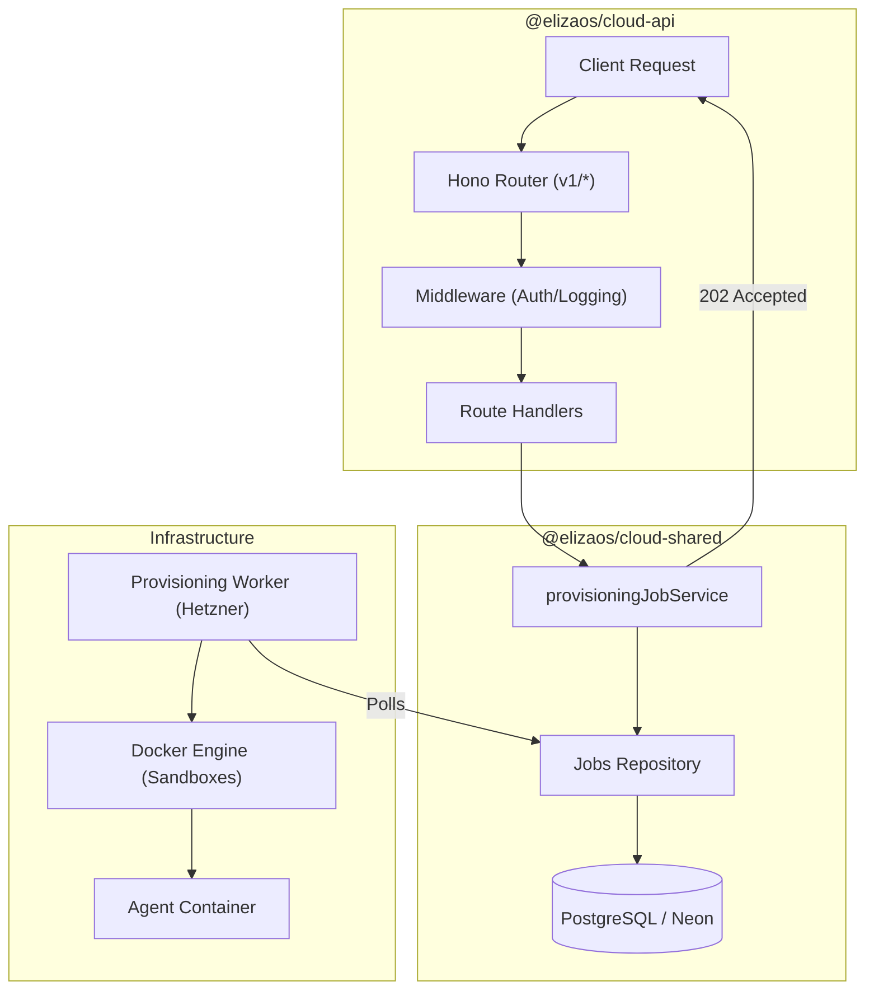
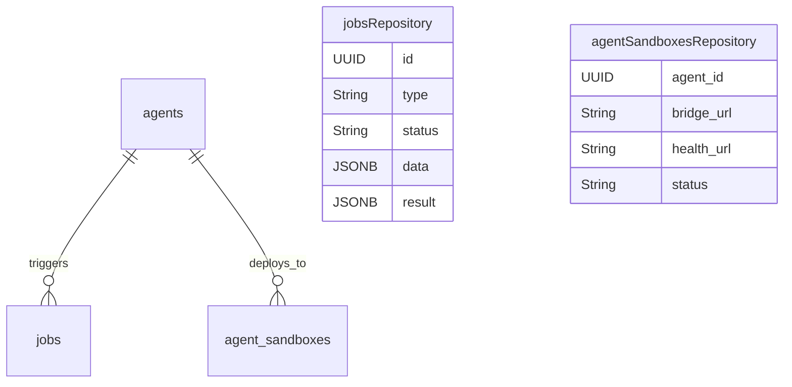

<!-- source: DeepWiki mcp.deepwiki.com · repo elizaOS/eliza · page 14.1 Cloud API and Backend · fetched 2026-10-29 -->

# Cloud API and Backend

Relevant source files

The following files were used as context for generating this wiki page:

- [.github/workflows/cloud-deploy-backend.yml](.github/workflows/cloud-deploy-backend.yml)
- [.github/workflows/deploy-eliza-provisioning-worker.yml](.github/workflows/deploy-eliza-provisioning-worker.yml)
- [packages/agent/tsconfig.json](packages/agent/tsconfig.json)
- [packages/app-core/scripts/voice-vad-smoke.ts](packages/app-core/scripts/voice-vad-smoke.ts)
- [packages/app-core/src/services/account-pool.ts](packages/app-core/src/services/account-pool.ts)
- [packages/app-core/tsconfig.json](packages/app-core/tsconfig.json)
- [packages/benchmarks/mmau-audio/fixtures/smoke.jsonl](packages/benchmarks/mmau-audio/fixtures/smoke.jsonl)
- [packages/benchmarks/visualwebbench/fixtures/smoke.jsonl](packages/benchmarks/visualwebbench/fixtures/smoke.jsonl)
- [packages/cloud-api/v1/agents/[agentId]/logs/route.ts](packages/cloud-api/v1/agents/[agentId]/logs/route.ts)
- [packages/cloud-api/v1/agents/[agentId]/restart/route.ts](packages/cloud-api/v1/agents/[agentId]/restart/route.ts)
- [packages/cloud-api/v1/agents/[agentId]/suspend/route.ts](packages/cloud-api/v1/agents/[agentId]/suspend/route.ts)
- [packages/cloud-api/v1/eliza/agents/[agentId]/resume/route.ts](packages/cloud-api/v1/eliza/agents/[agentId]/resume/route.ts)
- [packages/cloud-api/v1/eliza/agents/[agentId]/route.ts](packages/cloud-api/v1/eliza/agents/[agentId]/route.ts)
- [packages/cloud-api/v1/eliza/agents/[agentId]/snapshot/route.ts](packages/cloud-api/v1/eliza/agents/[agentId]/snapshot/route.ts)
- [packages/cloud-api/v1/eliza/agents/[agentId]/suspend/route.ts](packages/cloud-api/v1/eliza/agents/[agentId]/suspend/route.ts)
- [packages/cloud-frontend/content/index.mdx](packages/cloud-frontend/content/index.mdx)
- [packages/cloud-shared/src/db/schemas/agent-sandboxes.ts](packages/cloud-shared/src/db/schemas/agent-sandboxes.ts)
- [packages/cloud-shared/src/lib/services/__tests__/provisioning-job-types.test.ts](packages/cloud-shared/src/lib/services/__tests__/provisioning-job-types.test.ts)
- [packages/cloud-shared/src/lib/services/provisioning-job-types.ts](packages/cloud-shared/src/lib/services/provisioning-job-types.ts)
- [packages/cloud-shared/src/lib/services/provisioning-jobs.ts](packages/cloud-shared/src/lib/services/provisioning-jobs.ts)
- [packages/cloud-shared/src/lib/types/cloud-api.ts](packages/cloud-shared/src/lib/types/cloud-api.ts)
- [packages/scenario-runner/tsconfig.json](packages/scenario-runner/tsconfig.json)
- [packages/training/scripts/voice/eot/RUNBOOK.md](packages/training/scripts/voice/eot/RUNBOOK.md)
- [plugins/plugin-coding-tools/tsconfig.json](plugins/plugin-coding-tools/tsconfig.json)
- [plugins/plugin-local-inference/__tests__/dflash-backend-select.test.ts](plugins/plugin-local-inference/__tests__/dflash-backend-select.test.ts)
- [plugins/plugin-local-inference/__tests__/embedding-handler.test.ts](plugins/plugin-local-inference/__tests__/embedding-handler.test.ts)
- [plugins/plugin-local-inference/__tests__/text-handler.test.ts](plugins/plugin-local-inference/__tests__/text-handler.test.ts)
- [plugins/plugin-local-inference/src/services/engine.ts](plugins/plugin-local-inference/src/services/engine.ts)
- [plugins/plugin-local-inference/src/services/voice-prewarm.ts](plugins/plugin-local-inference/src/services/voice-prewarm.ts)
- [plugins/plugin-local-inference/src/services/voice/engine-bridge.ts](plugins/plugin-local-inference/src/services/voice/engine-bridge.ts)
- [plugins/plugin-local-inference/src/services/voice/eot-classifier-ggml.ts](plugins/plugin-local-inference/src/services/voice/eot-classifier-ggml.ts)
- [plugins/plugin-local-inference/src/services/voice/index.ts](plugins/plugin-local-inference/src/services/voice/index.ts)
- [plugins/plugin-local-inference/src/services/voice/samantha-preset-regenerator.ts](plugins/plugin-local-inference/src/services/voice/samantha-preset-regenerator.ts)
- [plugins/plugin-screenshare/src/ui/ScreenshareOperatorSurface.tsx](plugins/plugin-screenshare/src/ui/ScreenshareOperatorSurface.tsx)

The elizaOS Cloud API (`@elizaos/cloud-api`) is a high-performance REST API built on **Hono** and designed to run in serverless environments like **Cloudflare Workers** or as a standalone Node.js/Bun service. It serves as the orchestration layer for the hosted elizaOS platform, managing agent lifecycles, billing, database persistence via Drizzle ORM, and integration with the container control plane for Docker-based agent sandboxes.

## Architecture and Data Flow

The backend follows a clean separation between the routing layer (`@elizaos/cloud-api`) and the business logic/persistence layer (`@elizaos/cloud-shared`). A critical component is the **Provisioning Worker**, which handles long-running operations like container creation and snapshot restoration asynchronously.

### System Overview Diagram
The following diagram illustrates the flow from a client request through the Hono router to the repository layer and the asynchronous job queue.

"Cloud API Architecture and Job Flow"

Sources: [packages/cloud-api/v1/eliza/agents/[agentId]/resume/route.ts:33-47](), [packages/cloud-shared/src/lib/services/provisioning-jobs.ts:1-14](), [.github/workflows/deploy-eliza-provisioning-worker.yml:1-19]()

## The v1/ Route Tree

The API is structured around the `v1/` prefix, providing endpoints for various platform domains. Many agent-related routes support an optional `?sync=true` parameter to switch between immediate blocking execution and asynchronous job enqueuing.

| Domain | Route | Responsibility |
| :--- | :--- | :--- |
| **Agents** | `/v1/eliza/agents` | CRUD for agent configurations, including `/resume`, `/suspend`, and `/snapshot`. [packages/cloud-api/v1/eliza/agents/[agentId]/resume/route.ts:20-32]() |
| **Jobs** | `/v1/jobs/[jobId]` | Polling endpoint for tracking the status of asynchronous provisioning tasks. [packages/cloud-api/v1/eliza/agents/[agentId]/resume/route.ts:209-213]() |
| **Billing** | `/v1/billing` | Stripe integration and credit gating (X402). [packages/cloud-api/v1/eliza/agents/[agentId]/resume/route.ts:78-99]() |
| **Provisioning** | `/v1/provisioning` | Health checks and worker management for the Hetzner node cluster. [packages/cloud-api/v1/eliza/agents/[agentId]/resume/route.ts:139-155]() |

Sources: [packages/cloud-api/v1/eliza/agents/[agentId]/resume/route.ts:1-15](), [packages/cloud-shared/src/lib/services/provisioning-job-types.ts:1-20]()

## Database and Persistence

The backend uses **Drizzle ORM** for type-safe database interactions. The schema is centralized in `@elizaos/cloud-shared` to ensure consistency across the API and the provisioning worker.

### Key Repositories and Schemas
- **Agent Sandboxes**: Tracks the mapping between `agentId` and its physical container location, including `bridge_url` and `health_url`. [packages/cloud-shared/src/db/schemas/agent-sandboxes.ts:1-10]()
- **Jobs Repository**: Persists asynchronous task states (`pending`, `running`, `completed`, `failed`) and their JSONB payloads. [packages/cloud-shared/src/db/repositories/jobs.ts:20-25]()
- **Drizzle Helper**: Provides `dbWrite` and `dbRead` utilities for connection pooling. [packages/cloud-shared/src/lib/services/provisioning-jobs.ts:16-20]()

### Entity Relationship Mapping
This diagram maps the code entities in the `cloud-shared` package to the underlying data structure.

"Code Entity to Database Mapping"

Sources: [packages/cloud-shared/src/db/repositories/jobs.ts:20-25](), [packages/cloud-shared/src/db/repositories/agent-sandboxes.ts:1-10](), [packages/cloud-shared/src/lib/services/provisioning-jobs.ts:38-82]()

## Provisioning and Worker Logic

The `provisioningJobService` bridges the API with physical infrastructure operations. Instead of blocking HTTP requests, it creates a job and returns a `202 Accepted` status.

### Provisioning Job Types
The system supports several specialized job types for agent lifecycle management:
- `agent_provision`: Initial setup of Neon DB and Docker container.
- `agent_resume`: Restores a suspended agent from its latest backup/snapshot. [packages/cloud-api/v1/eliza/agents/[agentId]/resume/route.ts:180-186]()
- `agent_suspend`: Gracefully stops the container and persists state.
- `agent_snapshot`: Performs a manual or automated backup of the agent's data directory. [packages/cloud-shared/src/lib/services/provisioning-jobs.ts:76-81]()

### Worker Deployment
The provisioning worker is deployed as a systemd service (`eliza-provisioning-worker.service`) on Hetzner hosts. It uses `appleboy/ssh-action` in CI/CD to update the daemon code and restart the service.
Sources: [.github/workflows/deploy-eliza-provisioning-worker.yml:3-18](), [packages/cloud-shared/src/lib/services/provisioning-job-types.ts:1-40]()

## Development and Deployment

### CI/CD Pipeline
The Cloud Backend deployment involves two main stages:
1. **Database Migrations**: Automated via `bun run db:cloud:migrate` targeting Neon or Railway PostgreSQL. [.github/workflows/cloud-deploy-backend.yml:102-105]()
2. **Worker Deployment**: The `eliza-provisioning-worker` is updated via SSH to the `ELIZA_PROVISIONING_HOST`. [.github/workflows/deploy-eliza-provisioning-worker.yml:38-43]()

### Local Development
The backend requires a PostgreSQL connection string and valid authentication secrets.
- `MIGRATION_DATABASE_URL`: Used during the migration phase of the deployment. [.github/workflows/cloud-deploy-backend.yml:65-66]()
- `JWT_SECRET`: Preserved across container restarts to maintain user sessions. [packages/cloud-api/v1/eliza/agents/[agentId]/resume/route.ts:29-32]()

Sources: [.github/workflows/cloud-deploy-backend.yml:1-20](), [.github/workflows/deploy-eliza-provisioning-worker.yml:78-100]()

---

