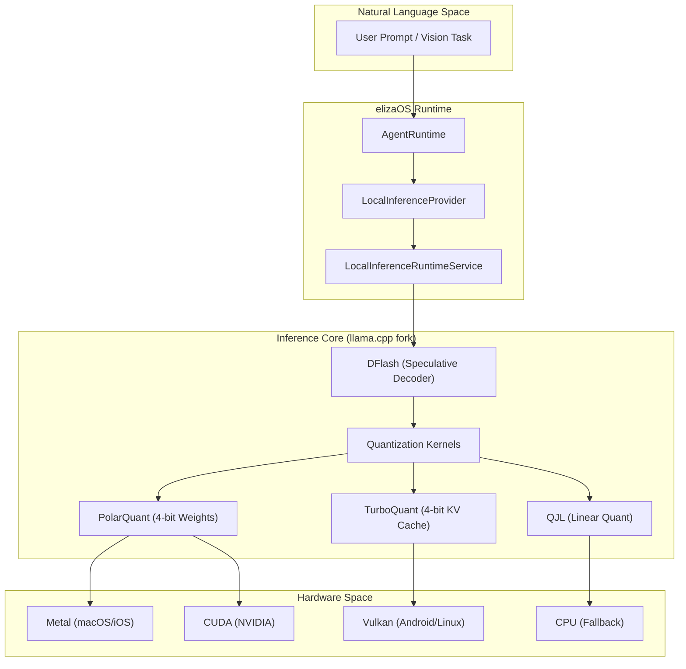
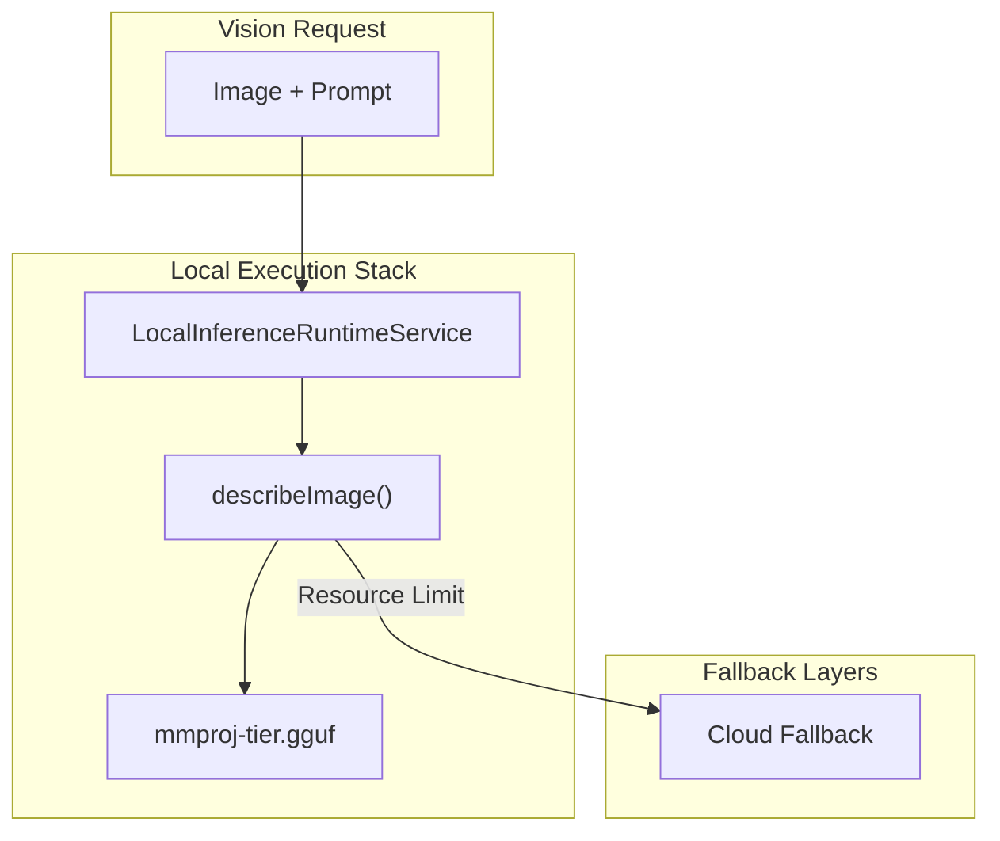

<!-- source: DeepWiki mcp.deepwiki.com · repo elizaOS/eliza · page 15 Local Inference · fetched 2026-10-29 -->

# Local Inference

Relevant source files

The following files were used as context for generating this wiki page:

- [docs/ELIZA_1_BUNDLE_EXTRAS.json](docs/ELIZA_1_BUNDLE_EXTRAS.json)
- [packages/app-core/scripts/ffi-stub/libelizainference_stub.so](packages/app-core/scripts/ffi-stub/libelizainference_stub.so)
- [packages/cloud-api/compat/agents/[id]/logs/route.ts](packages/cloud-api/compat/agents/[id]/logs/route.ts)
- [packages/cloud-api/compat/agents/[id]/suspend/route.ts](packages/cloud-api/compat/agents/[id]/suspend/route.ts)
- [packages/cloud-api/v1/admin/docker-containers/[id]/logs/route.ts](packages/cloud-api/v1/admin/docker-containers/[id]/logs/route.ts)
- [packages/cloud-api/v1/containers/[id]/logs/route.ts](packages/cloud-api/v1/containers/[id]/logs/route.ts)
- [packages/cloud-api/v1/containers/[id]/logs/stream/route.ts](packages/cloud-api/v1/containers/[id]/logs/stream/route.ts)
- [packages/cloud-api/v1/reports/bug/route.ts](packages/cloud-api/v1/reports/bug/route.ts)
- [packages/cloud-frontend/public/brand/elizaos-phone-transparent.png](packages/cloud-frontend/public/brand/elizaos-phone-transparent.png)
- [packages/shared/src/local-inference/catalog.ts](packages/shared/src/local-inference/catalog.ts)
- [packages/training/scripts/manifest/eliza1_licenses.py](packages/training/scripts/manifest/eliza1_licenses.py)
- [packages/training/scripts/manifest/eliza1_manifest.py](packages/training/scripts/manifest/eliza1_manifest.py)
- [packages/training/scripts/manifest/test_eliza1_licenses.py](packages/training/scripts/manifest/test_eliza1_licenses.py)
- [packages/training/scripts/manifest/test_eliza1_manifest.py](packages/training/scripts/manifest/test_eliza1_manifest.py)
- [packages/training/scripts/manifest/test_eliza1_platform_plan.py](packages/training/scripts/manifest/test_eliza1_platform_plan.py)
- [packages/training/scripts/manifest/test_stage_eliza1_bundle_assets.py](packages/training/scripts/manifest/test_stage_eliza1_bundle_assets.py)
- [packages/training/scripts/publish/orchestrator.py](packages/training/scripts/publish/orchestrator.py)
- [packages/training/scripts/publish/publish_eliza1_all.py](packages/training/scripts/publish/publish_eliza1_all.py)
- [packages/training/scripts/publish/publish_eliza1_model_repo.py](packages/training/scripts/publish/publish_eliza1_model_repo.py)
- [packages/training/scripts/publish/publish_model.py](packages/training/scripts/publish/publish_model.py)
- [packages/training/scripts/publish/publish_pipeline.py](packages/training/scripts/publish/publish_pipeline.py)
- [packages/training/scripts/publish/stage_base_v1_candidate.py](packages/training/scripts/publish/stage_base_v1_candidate.py)
- [packages/training/scripts/publish/templates/README.md.j2](packages/training/scripts/publish/templates/README.md.j2)
- [packages/training/scripts/publish/templates/release-evidence.template.json](packages/training/scripts/publish/templates/release-evidence.template.json)
- [packages/training/scripts/publish/test_orchestrator.py](packages/training/scripts/publish/test_orchestrator.py)
- [packages/training/scripts/publish/test_publish_eliza1_all.py](packages/training/scripts/publish/test_publish_eliza1_all.py)
- [packages/training/scripts/publish/test_publish_eliza1_model_repo.py](packages/training/scripts/publish/test_publish_eliza1_model_repo.py)
- [packages/training/scripts/training/model_registry.py](packages/training/scripts/training/model_registry.py)
- [packages/training/scripts/training/test_model_registry.py](packages/training/scripts/training/test_model_registry.py)
- [plugins/plugin-agent-orchestrator/tsconfig.build.json](plugins/plugin-agent-orchestrator/tsconfig.build.json)
- [plugins/plugin-agent-orchestrator/tsconfig.json](plugins/plugin-agent-orchestrator/tsconfig.json)
- [plugins/plugin-local-inference/__tests__/generate-media-action.test.ts](plugins/plugin-local-inference/__tests__/generate-media-action.test.ts)
- [plugins/plugin-local-inference/src/actions/generate-media.ts](plugins/plugin-local-inference/src/actions/generate-media.ts)
- [plugins/plugin-local-inference/src/index.ts](plugins/plugin-local-inference/src/index.ts)
- [plugins/plugin-local-inference/src/provider.ts](plugins/plugin-local-inference/src/provider.ts)
- [plugins/plugin-local-inference/src/routes/compat-helpers.ts](plugins/plugin-local-inference/src/routes/compat-helpers.ts)
- [plugins/plugin-local-inference/src/routes/index.ts](plugins/plugin-local-inference/src/routes/index.ts)
- [plugins/plugin-local-inference/src/routes/local-inference-asr-route.test.ts](plugins/plugin-local-inference/src/routes/local-inference-asr-route.test.ts)
- [plugins/plugin-local-inference/src/routes/local-inference-asr-route.ts](plugins/plugin-local-inference/src/routes/local-inference-asr-route.ts)
- [plugins/plugin-local-inference/src/routes/voice-models-routes.ts](plugins/plugin-local-inference/src/routes/voice-models-routes.ts)
- [plugins/plugin-local-inference/src/runtime/ensure-local-inference-handler.test.ts](plugins/plugin-local-inference/src/runtime/ensure-local-inference-handler.test.ts)
- [plugins/plugin-local-inference/src/services/dflash-catalog-disable.test.ts](plugins/plugin-local-inference/src/services/dflash-catalog-disable.test.ts)
- [plugins/plugin-local-inference/src/services/dflash-server-fused.integration.test.ts](plugins/plugin-local-inference/src/services/dflash-server-fused.integration.test.ts)
- [plugins/plugin-local-inference/src/services/dflash-structured.test.ts](plugins/plugin-local-inference/src/services/dflash-structured.test.ts)
- [plugins/plugin-local-inference/src/services/index.ts](plugins/plugin-local-inference/src/services/index.ts)
- [plugins/plugin-local-inference/src/services/service.test.ts](plugins/plugin-local-inference/src/services/service.test.ts)
- [plugins/plugin-local-inference/src/services/service.ts](plugins/plugin-local-inference/src/services/service.ts)
- [plugins/plugin-local-inference/vitest.config.ts](plugins/plugin-local-inference/vitest.config.ts)

Local Inference in elizaOS provides a production-grade, on-device AI stack designed for privacy, low latency, and hardware efficiency. It centers around the **Eliza-1** model family and a specialized fork of **llama.cpp** optimized for consumer hardware ranging from mobile phones to high-end workstations.

The system is designed to be "local-first," providing full-stack capabilities—text, vision, voice, and image generation—without mandatory cloud dependencies.

## Eliza-1 Model Family

The **Eliza-1** line is the primary model family for local inference. It consists of a size-ladder optimized for different hardware tiers. These models utilize the Qwen3.5 and Qwen3.6 architectures as bases and are fine-tuned and quantized specifically for the elizaOS runtime.

### Model Tiers and Hardware Targets
The catalog is organized into tiers to ensure agents run optimally on the user's specific hardware. The `ELIZA_1_TIER_IDS` define the supported model variants from 0.8B to 27B parameters.

| Tier ID | Parameters | Target Hardware | Context Length |
| :--- | :--- | :--- | :--- |
| `eliza-1-0_8b` | 0.8B | Low-RAM phones, CPU fallback | 128k |
| `eliza-1-2b` | 2B | Modern mobile phones | 128k |
| `eliza-1-4b` | 4B | Flagship phones, small desktops | 128k |
| `eliza-1-9b` | 9B | Workstations (RTX 3060/4060+) | 128k |
| `eliza-1-27b` | 27B | High-end desktops (2x 3090/4090) | 128k |
| `eliza-1-27b-256k`| 27B | Cloud/Server clusters | 256k |

For details on the model registry and training pipeline, see [Eliza-1 Model Catalog and Training](#15.1).

**Sources:**
- [packages/shared/src/local-inference/catalog.ts:23-30]()
- [packages/training/scripts/training/model_registry.py:22-26]()
- [packages/training/scripts/training/test_model_registry.py:22-35]()

## Inference Architecture

The local inference stack bridges high-level agent requests to low-level hardware kernels. It uses a specialized `llama.cpp` fork that implements proprietary and optimized kernels like **DFlash** (speculative decoding), **PolarQuant**, and **TurboQuant**. The `LocalInferenceRuntimeService` acts as the primary interface for these capabilities within the plugin system.

### Hardware-to-Code Mapping
The following diagram illustrates how high-level inference requests flow into specific code entities and hardware backends.

**Sources:**
- [plugins/plugin-local-inference/src/provider.ts:131-145]()
- [packages/training/scripts/manifest/eliza1_manifest.py:51-58]()
- [packages/training/scripts/training/model_registry.py:116-145]()

## Local Voice Pipeline

The local voice stack provides a complete speech-to-speech loop. It utilizes **OmniVoice** and **Kokoro** for Text-to-Speech (TTS), and **Silero VAD** for voice activity detection.

- **OmniVoice:** The high-fidelity default for workstation/cloud tiers (`9b`, `27b`).
- **Kokoro:** A low-latency fallback optimized for mobile and small tiers (`0_8b`, `2b`, `4b`).
- **VAD:** Managed by `silero-vad-v5.gguf` to detect when a user has finished speaking.

For details on the voice services and streaming adapters, see [Voice Pipeline](#15.3).

**Sources:**
- [packages/shared/src/local-inference/catalog.ts:163-173]()
- [packages/training/scripts/manifest/eliza1_manifest.py:214-221]()
- [packages/training/scripts/publish/orchestrator.py:122-127]()

## Vision and Fallback Chain

Vision capabilities are provided via `plugin-local-inference`. The system manages model assets like `mmproj` files for visual understanding. Every active Eliza-1 tier is vision-capable and requires a corresponding `mmproj` GGUF.

### Vision Asset Flow

For details on image generation backends and the vision stack, see [Vision and Image Generation](#15.4).

**Sources:**
- [plugins/plugin-local-inference/src/provider.ts:139-144]()
- [packages/training/scripts/publish/stage_base_v1_candidate.py:152-156]()
- [packages/training/scripts/manifest/eliza1_manifest.py:108-111]()

## Build and Release Pipeline

The local inference stack is strictly gated. Models and kernels must pass a series of automated checks managed by the `orchestrator.py` before being marked as `defaultEligible` in the manifest.

1. **Layout Validation:** Verifies the bundle conforms to the contract (text, tts, asr, vision, dflash, etc.).
2. **Kernel Verification:** Validation of Metal, Vulkan, and CUDA kernels on target hardware.
3. **Eval Gates:** Automated benchmarking (throughput, latency, and model accuracy) via `apply_gates`.
4. **Manifest Generation:** Assembly of the `eliza-1.manifest.v1.json` which defines the bundle's capabilities and checksums.

For details on the build system and kernel patches, see [llama.cpp Build System and Kernel Patches](#15.2).

**Sources:**
- [packages/training/scripts/publish/orchestrator.py:8-45]()
- [packages/training/scripts/manifest/eliza1_manifest.py:1-17]()
- [packages/training/scripts/publish/test_orchestrator.py:1-11]()

## Child Pages
- [Eliza-1 Model Catalog and Training](#15.1)
- [llama.cpp Build System and Kernel Patches](#15.2)
- [Voice Pipeline](#15.3)
- [Vision and Image Generation](#15.4)

---

