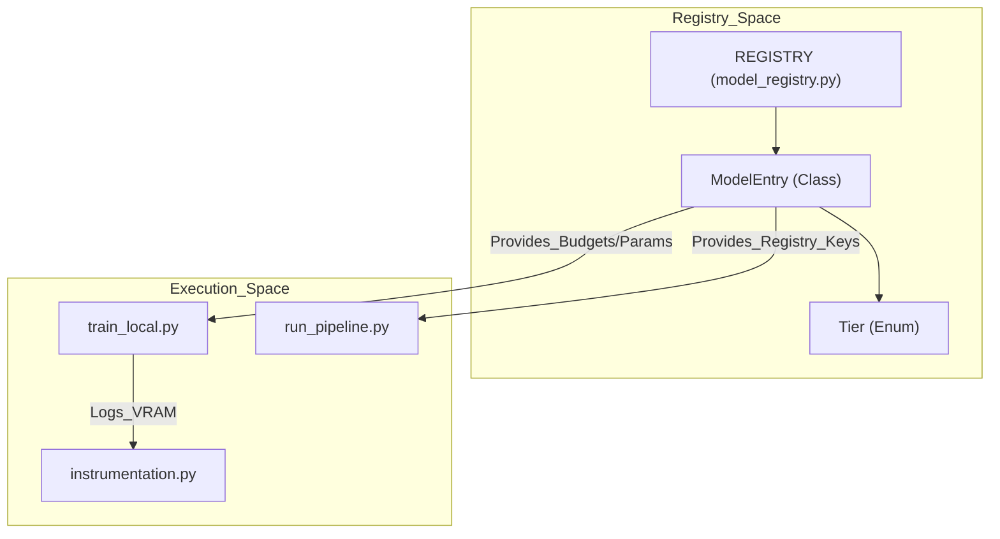
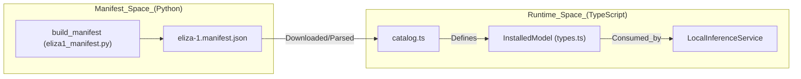

<!-- source: DeepWiki mcp.deepwiki.com · repo elizaOS/eliza · page 15.1 Eliza-1 Model Catalog and Training · fetched 2026-10-29 -->

# Eliza-1 Model Catalog and Training

Relevant source files

The following files were used as context for generating this wiki page:

- [packages/agent/src/runtime/restart.ts](packages/agent/src/runtime/restart.ts)
- [packages/agent/src/services/relationships-graph.ts](packages/agent/src/services/relationships-graph.ts)
- [packages/benchmarks/eliza-adapter/eliza_adapter/webshop.py](packages/benchmarks/eliza-adapter/eliza_adapter/webshop.py)
- [packages/benchmarks/eliza-adapter/tests/test_webshop_adapter.py](packages/benchmarks/eliza-adapter/tests/test_webshop_adapter.py)
- [packages/benchmarks/tau-bench/elizaos_tau_bench/model_client.py](packages/benchmarks/tau-bench/elizaos_tau_bench/model_client.py)
- [packages/core/src/features/secrets/actions/get-secret.ts](packages/core/src/features/secrets/actions/get-secret.ts)
- [packages/scenario-runner/src/cerebras-judge.d.ts](packages/scenario-runner/src/cerebras-judge.d.ts)
- [packages/scenario-runner/src/cerebras-judge.d.ts.map](packages/scenario-runner/src/cerebras-judge.d.ts.map)
- [packages/shared/src/awareness/registry.ts](packages/shared/src/awareness/registry.ts)
- [packages/shared/src/config/runtime-mode.ts](packages/shared/src/config/runtime-mode.ts)
- [packages/shared/src/index.ts](packages/shared/src/index.ts)
- [packages/shared/src/local-inference/CONTEXT_SCALING.md](packages/shared/src/local-inference/CONTEXT_SCALING.md)
- [packages/shared/src/local-inference/catalog.test.ts](packages/shared/src/local-inference/catalog.test.ts)
- [packages/shared/src/local-inference/catalog.ts](packages/shared/src/local-inference/catalog.ts)
- [packages/shared/src/local-inference/index.ts](packages/shared/src/local-inference/index.ts)
- [packages/shared/src/local-inference/kokoro-execution-provider.test.ts](packages/shared/src/local-inference/kokoro-execution-provider.test.ts)
- [packages/shared/src/local-inference/kokoro-execution-provider.ts](packages/shared/src/local-inference/kokoro-execution-provider.ts)
- [packages/shared/src/local-inference/providers-types.ts](packages/shared/src/local-inference/providers-types.ts)
- [packages/shared/src/local-inference/types.ts](packages/shared/src/local-inference/types.ts)
- [packages/shared/src/local-inference/voice-models.ts](packages/shared/src/local-inference/voice-models.ts)
- [packages/training/scripts/emotion/__init__.py](packages/training/scripts/emotion/__init__.py)
- [packages/training/scripts/emotion/distill_wav2small.py](packages/training/scripts/emotion/distill_wav2small.py)
- [packages/training/scripts/emotion/run_distill_ravdess.py](packages/training/scripts/emotion/run_distill_ravdess.py)
- [packages/training/scripts/emotion/test_distill_wav2small.py](packages/training/scripts/emotion/test_distill_wav2small.py)
- [packages/training/scripts/emotion/update_voice_emotion_registry.py](packages/training/scripts/emotion/update_voice_emotion_registry.py)
- [packages/training/scripts/manifest/eliza1_licenses.py](packages/training/scripts/manifest/eliza1_licenses.py)
- [packages/training/scripts/manifest/eliza1_manifest.py](packages/training/scripts/manifest/eliza1_manifest.py)
- [packages/training/scripts/manifest/test_eliza1_licenses.py](packages/training/scripts/manifest/test_eliza1_licenses.py)
- [packages/training/scripts/manifest/test_eliza1_manifest.py](packages/training/scripts/manifest/test_eliza1_manifest.py)
- [packages/training/scripts/manifest/test_eliza1_platform_plan.py](packages/training/scripts/manifest/test_eliza1_platform_plan.py)
- [packages/training/scripts/manifest/test_stage_eliza1_bundle_assets.py](packages/training/scripts/manifest/test_stage_eliza1_bundle_assets.py)
- [packages/training/scripts/publish/orchestrator.py](packages/training/scripts/publish/orchestrator.py)
- [packages/training/scripts/publish/publish_eliza1_all.py](packages/training/scripts/publish/publish_eliza1_all.py)
- [packages/training/scripts/publish/publish_eliza1_model_repo.py](packages/training/scripts/publish/publish_eliza1_model_repo.py)
- [packages/training/scripts/publish/publish_model.py](packages/training/scripts/publish/publish_model.py)
- [packages/training/scripts/publish/publish_pipeline.py](packages/training/scripts/publish/publish_pipeline.py)
- [packages/training/scripts/publish/stage_base_v1_candidate.py](packages/training/scripts/publish/stage_base_v1_candidate.py)
- [packages/training/scripts/publish/templates/README.md.j2](packages/training/scripts/publish/templates/README.md.j2)
- [packages/training/scripts/publish/templates/release-evidence.template.json](packages/training/scripts/publish/templates/release-evidence.template.json)
- [packages/training/scripts/publish/test_orchestrator.py](packages/training/scripts/publish/test_orchestrator.py)
- [packages/training/scripts/publish/test_publish_eliza1_all.py](packages/training/scripts/publish/test_publish_eliza1_all.py)
- [packages/training/scripts/publish/test_publish_eliza1_model_repo.py](packages/training/scripts/publish/test_publish_eliza1_model_repo.py)
- [packages/training/scripts/training/model_registry.py](packages/training/scripts/training/model_registry.py)
- [packages/training/scripts/training/test_model_registry.py](packages/training/scripts/training/test_model_registry.py)
- [packages/ui/src/api/client-local-inference.ts](packages/ui/src/api/client-local-inference.ts)
- [packages/ui/src/api/ios-local-agent-transport.ts](packages/ui/src/api/ios-local-agent-transport.ts)
- [packages/ui/src/services/local-inference/catalog.ts](packages/ui/src/services/local-inference/catalog.ts)
- [packages/ui/src/services/local-inference/types.ts](packages/ui/src/services/local-inference/types.ts)
- [plugins/plugin-local-inference/native/verify/PLATFORM_MATRIX.md](plugins/plugin-local-inference/native/verify/PLATFORM_MATRIX.md)
- [plugins/plugin-local-inference/native/verify/e2e_loop_bench.mjs](plugins/plugin-local-inference/native/verify/e2e_loop_bench.mjs)
- [plugins/plugin-local-inference/native/verify/eliza1_gates_collect.mjs](plugins/plugin-local-inference/native/verify/eliza1_gates_collect.mjs)
- [plugins/plugin-local-inference/native/verify/eliza1_memory_inventory.mjs](plugins/plugin-local-inference/native/verify/eliza1_memory_inventory.mjs)
- [plugins/plugin-local-inference/native/verify/eliza1_vision_smoke.mjs](plugins/plugin-local-inference/native/verify/eliza1_vision_smoke.mjs)
- [plugins/plugin-local-inference/native/verify/voice_profile_emotion_status.mjs](plugins/plugin-local-inference/native/verify/voice_profile_emotion_status.mjs)
- [plugins/plugin-local-inference/native/voice-bench/configs/gpu-benchmarks.json](plugins/plugin-local-inference/native/voice-bench/configs/gpu-benchmarks.json)
- [plugins/plugin-local-inference/native/voice-bench/configs/gpu/matrix.json](plugins/plugin-local-inference/native/voice-bench/configs/gpu/matrix.json)
- [plugins/plugin-local-inference/src/services/catalog.test.ts](plugins/plugin-local-inference/src/services/catalog.test.ts)
- [plugins/plugin-local-inference/src/services/dflash-doctor.ts](plugins/plugin-local-inference/src/services/dflash-doctor.ts)
- [plugins/plugin-local-inference/src/services/manifest/eliza-1.manifest.v1.json](plugins/plugin-local-inference/src/services/manifest/eliza-1.manifest.v1.json)
- [plugins/plugin-local-inference/src/services/manifest/schema.ts](plugins/plugin-local-inference/src/services/manifest/schema.ts)
- [plugins/plugin-local-inference/src/services/manifest/validator.ts](plugins/plugin-local-inference/src/services/manifest/validator.ts)
- [plugins/plugin-sql/package.json](plugins/plugin-sql/package.json)
- [plugins/plugin-workflow/README.md](plugins/plugin-workflow/README.md)

The Eliza-1 model family represents a curated line of optimized language and multimodal models specifically designed for on-device inference within the elizaOS ecosystem. The infrastructure encompasses a comprehensive model catalog, specialized quantization kernels, and a robust Python-based training pipeline for Fine-Tuning (SFT) and Reinforcement Learning (RL).

## 1. Eliza-1 Model Catalog

The catalog defines the active model tiers and their associated hardware requirements, inference kernels, and voice backends.

### 1.1 Model Tiers and Architecture
The Eliza-1 line is primarily based on the Qwen 3.5 and 3.6 architectures [packages/shared/src/local-inference/catalog.ts:4-7](). It is organized into a size-ladder ranging from 0.8B to 27B parameters [packages/shared/src/local-inference/catalog.ts:23-30]().

| Tier ID | Base Architecture | Context Length | Target Use Case |
| :--- | :--- | :--- | :--- |
| `eliza-1-0_8b` | Qwen 3.5 | 128k | Low-RAM phones, CPU fallback |
| `eliza-1-2b` | Qwen 3.5 | 128k | Modern mobile devices (Default) |
| `eliza-1-4b` | Qwen 3.5 | 128k | Flagship mobile, small workstations |
| `eliza-1-9b` | Qwen 3.5 | 128k | High-end workstations |
| `eliza-1-27b` | Qwen 3.6 | 128k | Cloud/Server-class inference |
| `eliza-1-27b-256k` | Qwen 3.6 | 256k | Long-context server inference |

Sources: [packages/shared/src/local-inference/catalog.ts:22-30](), [packages/shared/src/local-inference/catalog.test.ts:15-30](), [packages/training/scripts/training/model_registry.py:22-26](), [packages/training/scripts/publish/orchestrator.py:199-205]()

### 1.2 Mandatory Inference Kernels
To ensure performance parity across platforms, every Eliza-1 tier must support a set of mandatory kernels defined in the manifest and catalog [packages/training/scripts/manifest/eliza1_manifest.py:155-192]():
*   **DFlash**: Speculative decoding engine using a distilled drafter model (e.g., 0.1B or 0.3B configs) [packages/shared/src/local-inference/catalog.ts:50-57](), [packages/shared/src/local-inference/catalog.test.ts:133-159]().
*   **TurboQuant (turbo3/turbo4)**: High-speed quantization kernels for weights and KV cache [packages/shared/src/local-inference/catalog.ts:176-177]().
*   **PolarQuant**: Advanced 4-bit weight quantization [packages/shared/src/local-inference/catalog.ts:179]().
*   **QJL (qjl_full)**: Specialized kernel for structured output and rapid prefill [packages/shared/src/local-inference/catalog.ts:178]().

Sources: [packages/shared/src/local-inference/catalog.ts:175-180](), [packages/shared/src/local-inference/types.ts:169-176](), [packages/training/scripts/manifest/eliza1_manifest.py:51-58]()

## 2. Training Pipeline

The Python-based training infrastructure handles the end-to-end lifecycle from raw trajectory data to optimized GGUF bundles.

### 2.1 Training Orchestration
The pipeline manages full-parameter SFT and produces optimized variants for local inference [packages/training/scripts/training/model_registry.py:1-16]().

**Training Data Flow**
1.  **SFT with APOLLO**: Performs full-parameter Supervised Fine-Tuning using the APOLLO low-rank optimizer to minimize VRAM usage on commodity GPUs [packages/training/scripts/training/model_registry.py:35-39](), [packages/training/scripts/training/model_registry.py:148-153]().
2.  **Quantization**: Produces PolarQuant, TurboQuant, and QJL variants as specified in the registry [packages/training/scripts/training/model_registry.py:142-144]().
3.  **Liger Kernel Integration**: Applies Liger fused chunked Cross Entropy and RMSNorm kernels to meet sequence length budgets [packages/training/scripts/training/model_registry.py:94-96]().

Sources: [packages/training/scripts/training/model_registry.py:1-40](), [packages/training/scripts/training/model_registry.py:148-154]()

### 2.2 Model Registry
The `model_registry.py` is the single source of truth for training configurations, including sequence lengths, batch sizes, and memory budgets [packages/training/scripts/training/model_registry.py:1-5]().

**Entity Relationship: Registry to Training Execution**

Sources: [packages/training/scripts/training/model_registry.py:47-54](), [packages/training/scripts/training/model_registry.py:61-92](), [packages/training/scripts/training/test_model_registry.py:12-19]()

## 3. Release and Orchestration Pipeline

The release pipeline ensures that only models meeting strict quality and performance "gates" are published to the `elizaos/eliza-1` repository.

### 3.1 The Orchestrator
The `orchestrator.py` manages the final validation and upload process, ensuring bundle layout conformity [packages/training/scripts/publish/orchestrator.py:1-6]().

**Publish Stages:**
1.  **Layout Validation**: Verifies subdirectories like `text/`, `tts/`, `asr/`, `dflash/`, and `licenses/` [packages/training/scripts/publish/orchestrator.py:10-14](), [packages/training/scripts/publish/orchestrator.py:122-133]().
2.  **Kernel Verification**: Runs hardware-specific verification for Metal, Vulkan, and CUDA [packages/training/scripts/publish/orchestrator.py:15-20]().
3.  **Eval Gates**: Loads aggregate results and refuses to proceed unless all gates pass [packages/training/scripts/publish/orchestrator.py:26-28]().
4.  **Manifest Generation**: Builds the `eliza-1.manifest.v1.json` used for runtime discovery [packages/training/scripts/publish/orchestrator.py:29-33]().

Sources: [packages/training/scripts/publish/orchestrator.py:8-45](), [packages/training/scripts/publish/orchestrator.py:121-148](), [packages/training/scripts/manifest/eliza1_manifest.py:1-9]()

### 3.2 Manifest Structure
The manifest acts as the bridge between the trained weights and the `AgentRuntime` local inference services.

**Manifest to Runtime Mapping**

Sources: [packages/training/scripts/manifest/eliza1_manifest.py:1-9](), [packages/shared/src/local-inference/types.ts:49-69](), [packages/shared/src/local-inference/catalog.ts:203-210]()

### 3.3 Evaluation Gates
The orchestrator enforces strict gates defined in the benchmarking suite. If a model fails any gate, it is marked as `defaultEligible: false` in the manifest [packages/training/scripts/manifest/eliza1_manifest.py:7-9]().

| Gate Name | Description | Required For |
| :--- | :--- | :--- |
| `thirty_turn_ok` | Success in 30-turn conversation loops | All Tiers |
| `dflash_speedup` | Minimum speedup from speculative decoding | DFlash Tiers |
| `voice_rtf` | Real-Time Factor for TTS (lower is better) | All Tiers |
| `asr_wer` | Word Error Rate for Speech Recognition | All Tiers |
| `netImprovement` | Overall flag for auto-update eligibility | Voice Sub-models |

Sources: [packages/training/scripts/publish/orchestrator.py:67-72](), [packages/training/scripts/publish/test_orchestrator.py:65-94](), [packages/shared/src/local-inference/voice-models.ts:95-115]()

---

