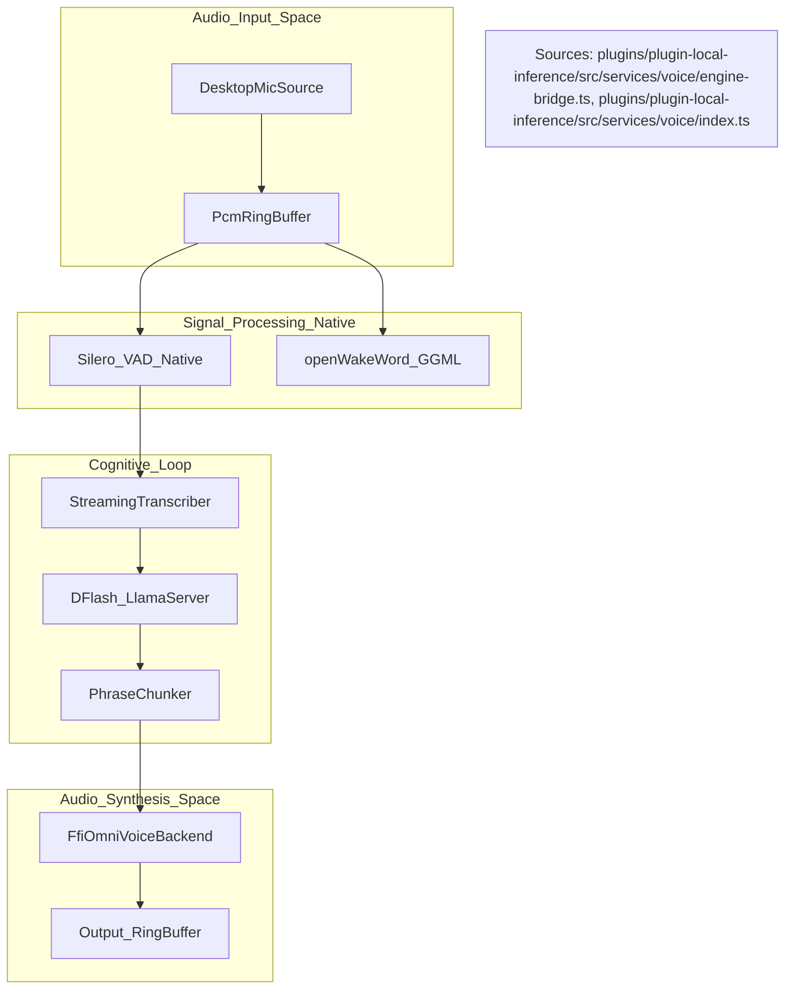

<!-- source: DeepWiki mcp.deepwiki.com · repo elizaOS/eliza · page 15.3 Voice Pipeline · fetched 2026-10-29 -->

# Voice Pipeline

<details>
<summary>Relevant source files</summary>

The following files were used as context for generating this wiki page:

- [.github/workflows/cloud-deploy-backend.yml](.github/workflows/cloud-deploy-backend.yml)
- [.github/workflows/deploy-eliza-provisioning-worker.yml](.github/workflows/deploy-eliza-provisioning-worker.yml)
- [packages/agent/tsconfig.json](packages/agent/tsconfig.json)
- [packages/app-core/scripts/kernel-patches/dflash-drafter-arch.mjs](packages/app-core/scripts/kernel-patches/dflash-drafter-arch.mjs)
- [packages/app-core/scripts/kernel-patches/dflash-drafter-arch.test.mjs](packages/app-core/scripts/kernel-patches/dflash-drafter-arch.test.mjs)
- [packages/app-core/scripts/kernel-patches/server-omnivoice-route.mjs](packages/app-core/scripts/kernel-patches/server-omnivoice-route.mjs)
- [packages/app-core/scripts/omnivoice-fuse/prepare.mjs](packages/app-core/scripts/omnivoice-fuse/prepare.mjs)
- [packages/app-core/scripts/voice-duet.mjs](packages/app-core/scripts/voice-duet.mjs)
- [packages/app-core/scripts/voice-vad-smoke.ts](packages/app-core/scripts/voice-vad-smoke.ts)
- [packages/app-core/tsconfig.json](packages/app-core/tsconfig.json)
- [packages/benchmarks/mmau-audio/fixtures/smoke.jsonl](packages/benchmarks/mmau-audio/fixtures/smoke.jsonl)
- [packages/benchmarks/visualwebbench/fixtures/smoke.jsonl](packages/benchmarks/visualwebbench/fixtures/smoke.jsonl)
- [packages/benchmarks/voice-speaker-validation/pyproject.toml](packages/benchmarks/voice-speaker-validation/pyproject.toml)
- [packages/core/src/features/basic-capabilities/providers/userEmotionSignal.test.ts](packages/core/src/features/basic-capabilities/providers/userEmotionSignal.test.ts)
- [packages/core/src/features/basic-capabilities/providers/userEmotionSignal.ts](packages/core/src/features/basic-capabilities/providers/userEmotionSignal.ts)
- [packages/core/src/runtime/builtin-field-evaluators.ts](packages/core/src/runtime/builtin-field-evaluators.ts)
- [packages/scenario-runner/tsconfig.json](packages/scenario-runner/tsconfig.json)
- [packages/training/scripts/asr/README.md](packages/training/scripts/asr/README.md)
- [packages/training/scripts/asr/__tests__/test_asr_pipeline.py](packages/training/scripts/asr/__tests__/test_asr_pipeline.py)
- [packages/training/scripts/kokoro/eval_kokoro.py](packages/training/scripts/kokoro/eval_kokoro.py)
- [packages/training/scripts/kokoro/push_voice_to_hf.py](packages/training/scripts/kokoro/push_voice_to_hf.py)
- [packages/training/scripts/kokoro/synthesize_distillation_corpus_omnivoice.py](packages/training/scripts/kokoro/synthesize_distillation_corpus_omnivoice.py)
- [packages/training/scripts/manifest/stage_kokoro_assets.py](packages/training/scripts/manifest/stage_kokoro_assets.py)
- [packages/training/scripts/publish_custom_kokoro_voice.sh](packages/training/scripts/publish_custom_kokoro_voice.sh)
- [packages/training/scripts/voice/eot/RUNBOOK.md](packages/training/scripts/voice/eot/RUNBOOK.md)
- [packages/ui/src/bridge/native-plugins.ts](packages/ui/src/bridge/native-plugins.ts)
- [packages/ui/src/components/onboarding/VoicePrefixGate.tsx](packages/ui/src/components/onboarding/VoicePrefixGate.tsx)
- [packages/ui/src/components/pages/chat-view-hooks.test.tsx](packages/ui/src/components/pages/chat-view-hooks.test.tsx)
- [packages/ui/src/components/pages/chat-view-hooks.tsx](packages/ui/src/components/pages/chat-view-hooks.tsx)
- [packages/ui/src/hooks/useVoiceChat.local-asr.test.tsx](packages/ui/src/hooks/useVoiceChat.local-asr.test.tsx)
- [packages/ui/src/hooks/useVoiceChat.ts](packages/ui/src/hooks/useVoiceChat.ts)
- [packages/ui/src/voice/__tests__/sentence-streaming.test.ts](packages/ui/src/voice/__tests__/sentence-streaming.test.ts)
- [packages/ui/src/voice/character-voice-config.test.ts](packages/ui/src/voice/character-voice-config.test.ts)
- [packages/ui/src/voice/character-voice-config.ts](packages/ui/src/voice/character-voice-config.ts)
- [packages/ui/src/voice/voice-chat-playback.ts](packages/ui/src/voice/voice-chat-playback.ts)
- [packages/ui/src/voice/voice-chat-types.ts](packages/ui/src/voice/voice-chat-types.ts)
- [plugins/plugin-coding-tools/tsconfig.json](plugins/plugin-coding-tools/tsconfig.json)
- [plugins/plugin-computeruse/src/__tests__/scene-multimon-coords.test.ts](plugins/plugin-computeruse/src/__tests__/scene-multimon-coords.test.ts)
- [plugins/plugin-local-inference/__tests__/dflash-backend-select.test.ts](plugins/plugin-local-inference/__tests__/dflash-backend-select.test.ts)
- [plugins/plugin-local-inference/__tests__/embedding-handler.test.ts](plugins/plugin-local-inference/__tests__/embedding-handler.test.ts)
- [plugins/plugin-local-inference/__tests__/freeze-voice-cli.test.ts](plugins/plugin-local-inference/__tests__/freeze-voice-cli.test.ts)
- [plugins/plugin-local-inference/__tests__/imagegen-sd-cpp-probe.test.ts](plugins/plugin-local-inference/__tests__/imagegen-sd-cpp-probe.test.ts)
- [plugins/plugin-local-inference/__tests__/text-handler.test.ts](plugins/plugin-local-inference/__tests__/text-handler.test.ts)
- [plugins/plugin-local-inference/__tests__/voice-onboarding-routes.test.ts](plugins/plugin-local-inference/__tests__/voice-onboarding-routes.test.ts)
- [plugins/plugin-local-inference/__tests__/voice-preset-format-v2.test.ts](plugins/plugin-local-inference/__tests__/voice-preset-format-v2.test.ts)
- [plugins/plugin-local-inference/src/routes/local-inference-compat-routes.test.ts](plugins/plugin-local-inference/src/routes/local-inference-compat-routes.test.ts)
- [plugins/plugin-local-inference/src/routes/voice-onboarding-routes.ts](plugins/plugin-local-inference/src/routes/voice-onboarding-routes.ts)
- [plugins/plugin-local-inference/src/services/device-tier.test.ts](plugins/plugin-local-inference/src/services/device-tier.test.ts)
- [plugins/plugin-local-inference/src/services/device-tier.ts](plugins/plugin-local-inference/src/services/device-tier.ts)
- [plugins/plugin-local-inference/src/services/engine.ts](plugins/plugin-local-inference/src/services/engine.ts)
- [plugins/plugin-local-inference/src/services/engine.voice.test.ts](plugins/plugin-local-inference/src/services/engine.voice.test.ts)
- [plugins/plugin-local-inference/src/services/voice-prewarm.ts](plugins/plugin-local-inference/src/services/voice-prewarm.ts)
- [plugins/plugin-local-inference/src/services/voice/emotion-attribution.test.ts](plugins/plugin-local-inference/src/services/voice/emotion-attribution.test.ts)
- [plugins/plugin-local-inference/src/services/voice/emotion-attribution.ts](plugins/plugin-local-inference/src/services/voice/emotion-attribution.ts)
- [plugins/plugin-local-inference/src/services/voice/engine-bridge-cancellation.test.ts](plugins/plugin-local-inference/src/services/voice/engine-bridge-cancellation.test.ts)
- [plugins/plugin-local-inference/src/services/voice/engine-bridge.ts](plugins/plugin-local-inference/src/services/voice/engine-bridge.ts)
- [plugins/plugin-local-inference/src/services/voice/eot-classifier-ggml.ts](plugins/plugin-local-inference/src/services/voice/eot-classifier-ggml.ts)
- [plugins/plugin-local-inference/src/services/voice/ffi-bindings.ts](plugins/plugin-local-inference/src/services/voice/ffi-bindings.ts)
- [plugins/plugin-local-inference/src/services/voice/first-line-cache.ts](plugins/plugin-local-inference/src/services/voice/first-line-cache.ts)
- [plugins/plugin-local-inference/src/services/voice/index.ts](plugins/plugin-local-inference/src/services/voice/index.ts)
- [plugins/plugin-local-inference/src/services/voice/profile-store.ts](plugins/plugin-local-inference/src/services/voice/profile-store.ts)
- [plugins/plugin-local-inference/src/services/voice/samantha-preset-regenerator.ts](plugins/plugin-local-inference/src/services/voice/samantha-preset-regenerator.ts)
- [plugins/plugin-local-inference/src/services/voice/speaker/attribution-pipeline.ts](plugins/plugin-local-inference/src/services/voice/speaker/attribution-pipeline.ts)
- [plugins/plugin-local-inference/src/services/voice/speaker/diarizer.ts](plugins/plugin-local-inference/src/services/voice/speaker/diarizer.ts)
- [plugins/plugin-local-inference/src/services/voice/speaker/encoder.ts](plugins/plugin-local-inference/src/services/voice/speaker/encoder.ts)
- [plugins/plugin-local-inference/src/services/voice/transcriber.ts](plugins/plugin-local-inference/src/services/voice/transcriber.ts)
- [plugins/plugin-local-inference/src/services/voice/voice-budget.test.ts](plugins/plugin-local-inference/src/services/voice/voice-budget.test.ts)
- [plugins/plugin-local-inference/src/services/voice/voice-budget.ts](plugins/plugin-local-inference/src/services/voice/voice-budget.ts)
- [plugins/plugin-local-inference/src/services/voice/voice-emotion-classifier.test.ts](plugins/plugin-local-inference/src/services/voice/voice-emotion-classifier.test.ts)
- [plugins/plugin-local-inference/src/services/voice/voice-emotion-classifier.ts](plugins/plugin-local-inference/src/services/voice/voice-emotion-classifier.ts)
- [plugins/plugin-local-inference/src/services/voice/voice-profile-routes.test.ts](plugins/plugin-local-inference/src/services/voice/voice-profile-routes.test.ts)
- [plugins/plugin-local-inference/src/services/voice/voice-profile-routes.ts](plugins/plugin-local-inference/src/services/voice/voice-profile-routes.ts)
- [plugins/plugin-local-inference/src/services/voice/wrap-with-first-line-cache.ts](plugins/plugin-local-inference/src/services/voice/wrap-with-first-line-cache.ts)
- [plugins/plugin-native-talkmode/android/src/main/java/ai/eliza/plugins/talkmode/TalkModePlugin.kt](plugins/plugin-native-talkmode/android/src/main/java/ai/eliza/plugins/talkmode/TalkModePlugin.kt)
- [plugins/plugin-native-talkmode/src/definitions.ts](plugins/plugin-native-talkmode/src/definitions.ts)
- [plugins/plugin-screenshare/src/ui/ScreenshareOperatorSurface.tsx](plugins/plugin-screenshare/src/ui/ScreenshareOperatorSurface.tsx)

</details>


The elizaOS Voice Pipeline is a high-performance, local-first inference stack designed for low-latency voice interaction. It bridges the gap between raw audio signals and agent cognition, implementing a multi-stage pipeline that handles everything from Wake-Word detection and Voice Activity Detection (VAD) to streaming Text-to-Speech (TTS) with speculative execution.

## Pipeline Architecture

The pipeline operates as a streaming graph where components are decoupled via ring buffers and event emitters. This allows the system to begin synthesizing audio before the LLM has finished generating a full response.

### High-Level Data Flow

1.  **Audio Input**: Captured via `MicSource` (Desktop or Push) [plugins/plugin-local-inference/src/services/voice/index.ts:141-146]().
2.  **VAD & Wake-Word**: `Silero VAD` and `openWakeWord` monitor the stream for human speech and activation triggers [plugins/plugin-local-inference/src/services/voice/index.ts:75-96]().
3.  **ASR (Transcription)**: Audio is converted to text tokens using `StreamingTranscriber` [plugins/plugin-local-inference/src/services/voice/engine-bridge.ts:94-107]().
4.  **Inference**: Text tokens are fed into the `DFlash` engine for speculative text generation [plugins/plugin-local-inference/src/services/engine.ts:43-51]().
5.  **Phrase Chunking**: LLM output is partitioned into natural speech segments by `PhraseChunker` [plugins/plugin-local-inference/src/services/voice/index.ts:168-168]().
6.  **TTS Synthesis**: `OmniVoice` or `Kokoro` backends convert phrases to PCM audio [plugins/plugin-local-inference/src/services/voice/engine-bridge.ts:198-207]().
7.  **Audio Output**: PCM chunks are buffered in `PcmRingBuffer` for playback [plugins/plugin-local-inference/src/services/voice/index.ts:209-209]().

### Voice Engine Bridge
The `EngineVoiceBridge` class acts as the primary orchestrator, adapting the `LocalInferenceEngine` and `DFlash` server to the `VoiceScheduler` [plugins/plugin-local-inference/src/services/voice/engine-bridge.ts:1-15]().



## Core Components

### 1. Wake-Word Detection (openWakeWord/GGML)
The system uses a native GGML implementation of `openWakeWord`. It provides low-power monitoring of the audio stream. The implementation is bound via `bun:ffi` to `libelizainference` for high efficiency, ensuring the agent only "wakes up" when the specific trigger phrase is detected.

### 2. VAD and EOT Classification
Eliza uses a 3-tier approach to detect the "End of Turn" (EOT) [plugins/plugin-local-inference/src/services/voice/index.ts:79-84]():
*   **Silero VAD**: A native GGML backend providing raw voice activity probabilities.
*   **3-Tier VAD Logic**: Uses `EOT_TENTATIVE_THRESHOLD`, `EOT_MID_CLAUSE_THRESHOLD`, and `EOT_COMMIT_THRESHOLD` to distinguish between natural pauses and completed thoughts [plugins/plugin-local-inference/src/services/voice/index.ts:79-84]().
*   **Eliza1EotScorer**: A specialized classifier that uses the LLM context to predict if a user has finished speaking based on linguistic cues [plugins/plugin-local-inference/src/services/voice/index.ts:37-39]().

### 3. Streaming TTS (PhraseChunkedTTS)
To minimize "Time to First Audio," the system breaks LLM streams into phrases based on punctuation boundaries.
*   **Punctuation Flush**: Dispatches a TTS request as soon as a sentence-ending character is detected.
*   **Max Token Cap**: Bounds phrase length (default 8 tokens) to keep rollback costs low and first-audio latency bounded [plugins/plugin-local-inference/src/services/voice/engine-bridge.ts:128-128]().
*   **First Line Cache**: Caches the synthesis of the first sentence to provide near-instantaneous response for common greetings [plugins/plugin-local-inference/src/services/voice/index.ts:117-130]().

### 4. Voice Backends: OmniVoice & Kokoro
The pipeline supports two primary local backends:
*   **OmniVoice**: A fused C++ backend integrated directly into `llama.cpp`. It supports v2 "ELZ2" voice presets which include instruction strings and reference audio tokens [plugins/plugin-local-inference/src/services/voice/engine-bridge.ts:133-149]().
*   **Kokoro**: A lightweight TTS backend using style tensors. The system includes a registry of bundled voice packs [plugins/plugin-local-inference/src/services/voice/engine-bridge.ts:35-37]().

## Implementation Details

### FFI and Native Fusion
The `libelizainference` library is a fused build of `llama.cpp` and `omnivoice.cpp`. It exposes a C ABI for the TypeScript runtime to call into high-performance kernels [packages/app-core/scripts/omnivoice-fuse/prepare.mjs:104-112]().

```mermaid
classDiagram
    class ElizaInferenceFfi {
        +ov_init(params)
        +ov_synthesize(handle, text)
        +ov_encode_reference(pcm)
    }
    class EngineVoiceBridge {
        -FfiOmniVoiceBackend backend
        -VoicePipeline pipeline
        +armVoice()
    }
    class VoiceScheduler {
        -PcmRingBuffer ringBuffer
        +schedulePhrase(phrase)
    }
    
    EngineVoiceBridge --> ElizaInferenceFfi : "calls via loadElizaInferenceFfi"
    EngineVoiceBridge --> VoiceScheduler : "manages"
    VoiceScheduler --> PcmRingBuffer : "writes PCM"

    Sources["Sources: plugins/plugin-local-inference/src/services/voice/engine-bridge.ts, plugins/plugin-local-inference/src/services/voice/ffi-bindings.ts"]
```

### Voice Profile System
The `VoiceProfileStore` manages speaker identification and diarization. It tracks `VoiceProfileRecord` objects containing voice imprints (embeddings) and observation metadata [plugins/plugin-local-inference/src/services/voice/index.ts:204-204]().

*   **Speaker Diarization**: Uses `DiarizerGgml` to segment audio by speaker ID [plugins/plugin-local-inference/src/services/voice/index.ts:254-258]().
*   **Emotion Classification**: `attributeVoiceEmotion` analyzes ASR features and audio characteristics to determine speaker intent/mood [plugins/plugin-local-inference/src/services/voice/index.ts:57-64]().

### Speculative Rollback
Because the pipeline uses `DFlash` for speculative text generation, the voice system must handle "rejections." If the LLM's target verifier rejects a draft token sequence, the `VoicePipeline` triggers a rollback:
1.  **Rejection Event**: `LlamaServerTargetVerifier` reports a rejected range [plugins/plugin-local-inference/src/services/voice/engine-bridge.ts:174-184]().
2.  **Cancellation**: The `VoiceCancellationCoordinator` cancels pending TTS synthesis for phrases containing rejected tokens [plugins/plugin-local-inference/src/services/voice/index.ts:9-11]().
3.  **Buffer Drain**: The system truncates the playback queue to the last "confirmed" audio sample [plugins/plugin-local-inference/src/services/voice/engine-bridge.ts:13-15]().

## Key Files and Symbols
*   `EngineVoiceBridge`: [plugins/plugin-local-inference/src/services/voice/engine-bridge.ts]() - Main orchestrator.
*   `VoicePipeline`: [plugins/plugin-local-inference/src/services/voice/pipeline.ts]() - Manages ASR-to-TTS flow.
*   `VoiceProfileStore`: [plugins/plugin-local-inference/src/services/voice/profile-store.ts]() - Manages speaker identities.
*   `libelizainference`: Native FFI bridge for OmniVoice and Silero VAD [packages/app-core/scripts/omnivoice-fuse/prepare.mjs:109-112]().

Sources: `plugins/plugin-local-inference/src/services/engine.ts`, `plugins/plugin-local-inference/src/services/voice/engine-bridge.ts`, `plugins/plugin-local-inference/src/services/voice/index.ts`, `packages/app-core/scripts/omnivoice-fuse/prepare.mjs`

---

