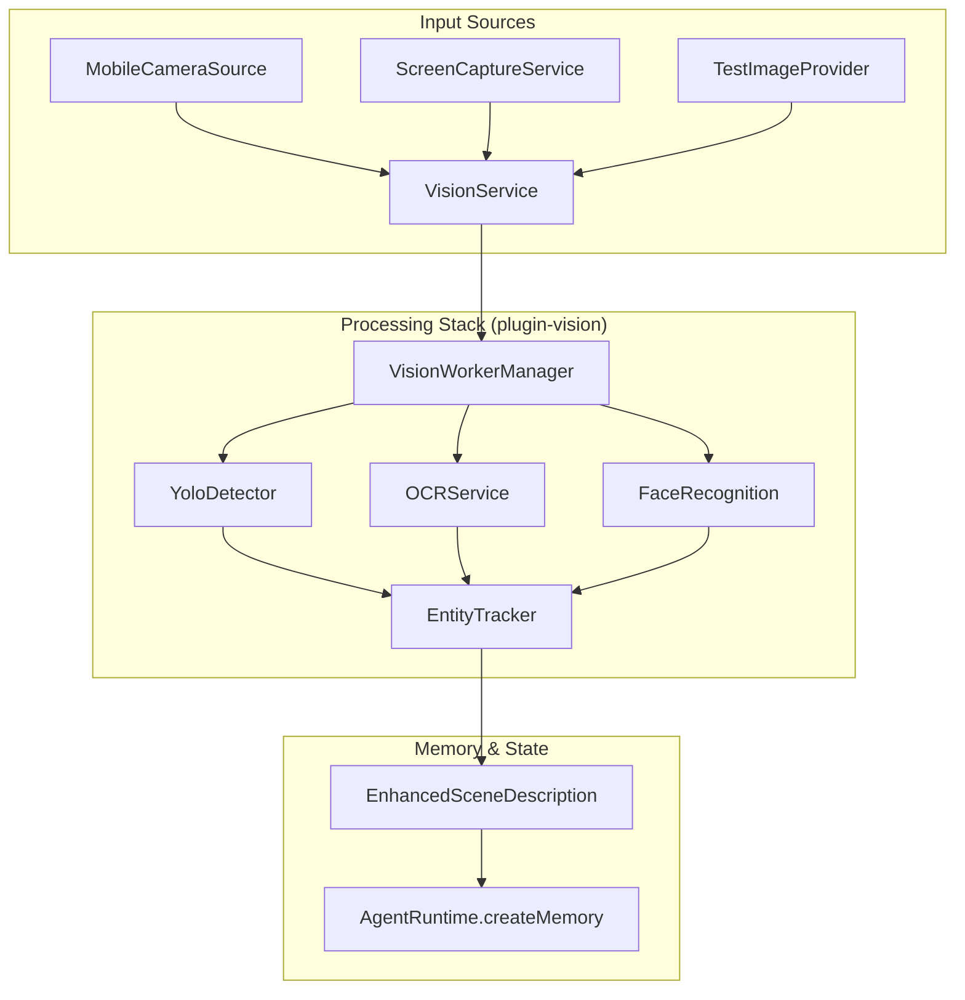

<!-- source: DeepWiki mcp.deepwiki.com · repo elizaOS/eliza · page 15.4 Vision and Image Generation · fetched 2026-10-29 -->

# Vision and Image Generation

<details>
<summary>Relevant source files</summary>

The following files were used as context for generating this wiki page:

- [.github/workflows/cloud-gateway-discord.yml](.github/workflows/cloud-gateway-discord.yml)
- [packages/cloud-sdk/package.json](packages/cloud-sdk/package.json)
- [packages/cloud-sdk/src/live.e2e.test.ts](packages/cloud-sdk/src/live.e2e.test.ts)
- [packages/scripts/build-views.mjs](packages/scripts/build-views.mjs)
- [packages/shared/src/config/app-config.ts](packages/shared/src/config/app-config.ts)
- [packages/test/vitest/shims/elizaos-core-connector.ts](packages/test/vitest/shims/elizaos-core-connector.ts)
- [packages/ui/src/state/useChatSend.test.tsx](packages/ui/src/state/useChatSend.test.tsx)
- [packages/ui/src/state/useChatSend.ts](packages/ui/src/state/useChatSend.ts)
- [plugins/plugin-computeruse/src/__tests__/vision-context-provider.test.ts](plugins/plugin-computeruse/src/__tests__/vision-context-provider.test.ts)
- [plugins/plugin-computeruse/src/services/vision-context-provider.ts](plugins/plugin-computeruse/src/services/vision-context-provider.ts)
- [plugins/plugin-contacts/vite.config.views.ts](plugins/plugin-contacts/vite.config.views.ts)
- [plugins/plugin-local-inference/src/services/vision/cloud-fallback.ts](plugins/plugin-local-inference/src/services/vision/cloud-fallback.ts)
- [plugins/plugin-local-inference/src/services/vision/fallback-chain.test.ts](plugins/plugin-local-inference/src/services/vision/fallback-chain.test.ts)
- [plugins/plugin-local-inference/src/services/vision/vast-fallback.ts](plugins/plugin-local-inference/src/services/vision/vast-fallback.ts)
- [plugins/plugin-matrix/src/service.ts](plugins/plugin-matrix/src/service.ts)
- [plugins/plugin-vision/README.md](plugins/plugin-vision/README.md)
- [plugins/plugin-vision/src/action.ts](plugins/plugin-vision/src/action.ts)
- [plugins/plugin-vision/src/mobile/capacitor-camera.test.ts](plugins/plugin-vision/src/mobile/capacitor-camera.test.ts)
- [plugins/plugin-vision/src/mobile/capacitor-camera.ts](plugins/plugin-vision/src/mobile/capacitor-camera.ts)
- [plugins/plugin-vision/src/tests/e2e/vision-worker-tests.ts](plugins/plugin-vision/src/tests/e2e/vision-worker-tests.ts)

</details>


The vision and image generation stack in elizaOS provides agents with the ability to perceive their environment (via cameras and screen captures) and generate visual content. This system is split between `plugin-vision`, which handles perception tasks like object detection and OCR, and `plugin-local-inference`, which manages heavy model execution (VLM, Stable Diffusion) and GPU resource arbitration.

## Vision Inference Stack

The vision stack is designed for high-frequency analysis of both physical camera feeds and digital screen buffers.

### Vision Service and Perception Pipeline
The `VisionService` [plugins/plugin-vision/src/service.ts:115-121]() acts as the central orchestrator for perception. It manages a pipeline that includes:
- **Object Detection**: Utilizing YOLO-based detectors for real-time entity identification [plugins/plugin-vision/src/service.ts:130-131]().
- **Face Recognition**: Identifying and tracking individuals across frames [plugins/plugin-vision/src/service.ts:129-129]().
- **OCR (Optical Character Recognition)**: Extracting text from screen captures or camera frames using `OCRService` [plugins/plugin-vision/src/service.ts:136-136]().
- **Screen Capture**: A dedicated `ScreenCaptureService` [plugins/plugin-vision/src/service.ts:135-135]() that handles multi-display environments and tile-based analysis.

### High-FPS Processing with Workers
To maintain responsiveness without blocking the main agent loop, `VisionWorkerManager` [plugins/plugin-vision/src/service.ts:141-141]() offloads frame processing to worker threads. This allows for high-FPS monitoring of screens for UI changes and text detection, which is validated in E2E tests [plugins/plugin-vision/src/tests/e2e/vision-worker-tests.ts:57-97]().

### Vision Data Flow
The following diagram illustrates how raw visual input is transformed into structured semantic data for the agent.

**Vision Perception Pipeline**

Sources: [plugins/plugin-vision/src/service.ts:115-145](), [plugins/plugin-vision/src/types.ts:26-42](), [plugins/plugin-vision/src/tests/e2e/vision-worker-tests.ts:15-54]()

## Local Inference Vision Services

When the agent needs deep semantic understanding (e.g., "What is happening in this scene?"), it uses the `LocalInferenceService`.

### Cloud/Vast Fallback Chain
The local vision path can report recoverable unavailability through a structured fallback mechanism [plugins/plugin-local-inference/src/services/vision/cloud-fallback.ts:1-8](). If local hardware is insufficient or overloaded, the system employs a chain:
1. **Local VLM**: Attempt execution on local hardware. Errors are classified into fallback reasons like `local-unavailable` or `local-overloaded` [plugins/plugin-local-inference/src/services/vision/cloud-fallback.ts:56-103]().
2. **Eliza Cloud Fallback**: If local fails, the `wrapImageDescriptionHandlerWithCloudFallback` [plugins/plugin-local-inference/src/services/vision/cloud-fallback.ts:224-227]() sends the request to `api.elizacloud.ai` [plugins/plugin-local-inference/src/services/vision/cloud-fallback.ts:171-171]().
3. **Vast.ai Fallback**: As a final layer, `wrapImageDescriptionHandlerWithVastFallback` [plugins/plugin-local-inference/src/services/vision/vast-fallback.ts:94-97]() can route requests to `api.vast.ai` if configured with `ELIZA_VAST_API_KEY` [plugins/plugin-local-inference/src/services/vision/vast-fallback.ts:33-37]().

The `withVisionFallbackChain` [plugins/plugin-local-inference/src/services/vision/fallback-chain.test.ts:4-4]() utility orchestrates this sequence, ensuring that if every provider is exhausted, a structured error is thrown [plugins/plugin-local-inference/src/services/vision/fallback-chain.test.ts:69-85]().

Sources: [plugins/plugin-local-inference/src/services/vision/cloud-fallback.ts:1-155](), [plugins/plugin-local-inference/src/services/vision/vast-fallback.ts:1-127](), [plugins/plugin-local-inference/src/services/vision/fallback-chain.test.ts:21-86]()

## Vision Context Provider
For `plugin-computeruse`, the `VisionContextProvider` [plugins/plugin-computeruse/src/services/vision-context-provider.ts:104-104]() provides compact desktop scene context for vision prompts. It aggregates:
- **Open Apps**: Unique process names or visible app names from the current scene [plugins/plugin-computeruse/src/services/vision-context-provider.ts:129-129]().
- **Focused Window**: Details about the active application, title, and bounding box [plugins/plugin-computeruse/src/services/vision-context-provider.ts:130-131]().
- **Recent Actions**: A history of the last 10 actions performed by the agent [plugins/plugin-computeruse/src/services/vision-context-provider.ts:137-148]().

Sources: [plugins/plugin-computeruse/src/services/vision-context-provider.ts:1-196](), [plugins/plugin-computeruse/src/__tests__/vision-context-provider.test.ts:61-132]()

## Image Generation Backends

Image generation is handled through multiple specialized backends in `plugin-local-inference`, selected based on the host platform's capabilities.

| Backend | Implementation | Target Platform |
| :--- | :--- | :--- |
| `sd-cpp` | `StableDiffusionCpp` | Desktop (CPU/GPU) |
| `mflux` | `MfluxBackend` | Apple Silicon (Metal) |
| `TensorRT` | `TensorRTStub` | NVIDIA (CUDA) |
| `AOSP` | `AospImageGen` | Android/Mobile |

Sources: [plugins/plugin-local-inference/src/services/imagegen/types.ts:1-20](), [plugins/plugin-local-inference/src/services/index.ts:143-147]()

## MemoryArbiter: GPU Resource Management

Because vision models and image generators are VRAM-intensive, the `MemoryArbiter` [plugins/plugin-local-inference/src/services/memory-arbiter.ts:127-131]() prevents system crashes by managing concurrent model loads.

### Key Functions
- `acquire(holder, bytes)`: Reserves VRAM for a specific sub-service (e.g., "vision:yolo") [plugins/plugin-vision/src/lifecycle.ts:31-31]().
- `release(holder)`: Frees the reservation [plugins/plugin-vision/src/lifecycle.ts:36-36]().
- `onPressure(listener)`: Subscribes to OS-level memory pressure events to trigger proactive unloading of "cold" models [plugins/plugin-vision/src/lifecycle.ts:43-43]().

### Lifecycle Management
The `VisionServiceLifecycleManager` [plugins/plugin-vision/src/lifecycle.ts:74-74]() implements an idle watchdog. If a vision sub-service is not "touched" within `idleUnloadMs` (default 60s), it is automatically released to free memory [plugins/plugin-vision/src/lifecycle.ts:71-87]().

**Resource Arbitration Sequence**
```mermaid
sequenceDiagram
    participant VS as VisionService
    participant LM as VisionServiceLifecycleManager
    participant MA as MemoryArbiter
    participant GPU as GPU_VRAM

    VS->>LM: touch("vision:yolo")
    LM->>MA: acquire("vision:yolo", 500MB)
    MA->>MA: Check available VRAM
    MA-->>LM: true (Reserved)
    LM->>VS: Load YOLO Model
    VS->>GPU: Allocate Memory
    Note over LM, MA: Start Idle Watchdog
    ... 60s Inactivity ...
    LM->>VS: unload()
    LM->>MA: release("vision:yolo")
    MA->>GPU: Free VRAM
```
Sources: [plugins/plugin-vision/src/lifecycle.ts:1-55](), [plugins/plugin-local-inference/src/services/index.ts:120-131]()

## Mobile and Hardware Integration

### MobileCameraSource
On mobile platforms (iOS/Android), the vision stack bridges to native hardware via the `CapacitorCamera` implementation [plugins/plugin-vision/src/mobile/capacitor-camera.ts:1-20](). This bridge allows the `AgentRuntime` running on-device to access the physical camera feed while adhering to mobile power and thermal constraints.

### Mobile Vision Actions
The `VISION_ANALYSIS` action [plugins/plugin-vision/src/action.ts:245-245]() supports operations such as `describe`, `capture`, `identify_person`, and `track_entity` [plugins/plugin-vision/src/action.ts:21-32](). It uses keywords to trigger specific vision tasks from natural language, such as "look", "see", or "camera" [plugins/plugin-vision/src/action.ts:44-73]().

Sources: [plugins/plugin-vision/src/action.ts:1-340](), [plugins/plugin-vision/src/mobile/capacitor-camera.ts:1-40]()

---

