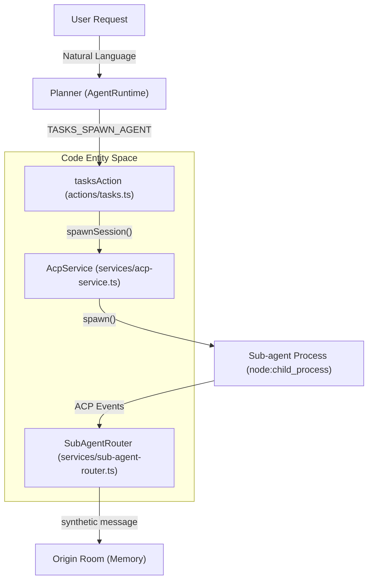
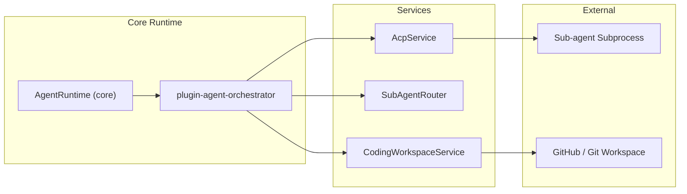

<!-- source: DeepWiki mcp.deepwiki.com · repo elizaOS/eliza · page 16 Agent Orchestration · fetched 2026-10-29 -->

# Agent Orchestration

Relevant source files

The following files were used as context for generating this wiki page:

- [packages/core/src/__tests__/message-stable-prefix.test.ts](packages/core/src/__tests__/message-stable-prefix.test.ts)
- [packages/core/src/__tests__/service-type-collisions.test.ts](packages/core/src/__tests__/service-type-collisions.test.ts)
- [packages/core/src/actions/promote-subactions.ts](packages/core/src/actions/promote-subactions.ts)
- [packages/core/src/features/basic-capabilities/providers/recentMessages.test.ts](packages/core/src/features/basic-capabilities/providers/recentMessages.test.ts)
- [packages/core/src/features/basic-capabilities/providers/recentMessages.ts](packages/core/src/features/basic-capabilities/providers/recentMessages.ts)
- [packages/core/src/runtime/__tests__/action-retrieval.test.ts](packages/core/src/runtime/__tests__/action-retrieval.test.ts)
- [packages/core/src/sensitive-request-policy.ts](packages/core/src/sensitive-request-policy.ts)
- [plugins/plugin-agent-orchestrator/__tests__/unit/acp-native-transport.test.ts](plugins/plugin-agent-orchestrator/__tests__/unit/acp-native-transport.test.ts)
- [plugins/plugin-agent-orchestrator/__tests__/unit/acp-service.test.ts](plugins/plugin-agent-orchestrator/__tests__/unit/acp-service.test.ts)
- [plugins/plugin-agent-orchestrator/__tests__/unit/create-task.test.ts](plugins/plugin-agent-orchestrator/__tests__/unit/create-task.test.ts)
- [plugins/plugin-agent-orchestrator/__tests__/unit/extract-completion-summary.test.ts](plugins/plugin-agent-orchestrator/__tests__/unit/extract-completion-summary.test.ts)
- [plugins/plugin-agent-orchestrator/__tests__/unit/get-acp-service-order.test.ts](plugins/plugin-agent-orchestrator/__tests__/unit/get-acp-service-order.test.ts)
- [plugins/plugin-agent-orchestrator/__tests__/unit/opencode-spawn-config-auto-detect.test.ts](plugins/plugin-agent-orchestrator/__tests__/unit/opencode-spawn-config-auto-detect.test.ts)
- [plugins/plugin-agent-orchestrator/__tests__/unit/register-routes.test.ts](plugins/plugin-agent-orchestrator/__tests__/unit/register-routes.test.ts)
- [plugins/plugin-agent-orchestrator/__tests__/unit/resolve-spawn-workdir.test.ts](plugins/plugin-agent-orchestrator/__tests__/unit/resolve-spawn-workdir.test.ts)
- [plugins/plugin-agent-orchestrator/__tests__/unit/session-resume.test.ts](plugins/plugin-agent-orchestrator/__tests__/unit/session-resume.test.ts)
- [plugins/plugin-agent-orchestrator/__tests__/unit/spawn-agent.test.ts](plugins/plugin-agent-orchestrator/__tests__/unit/spawn-agent.test.ts)
- [plugins/plugin-agent-orchestrator/__tests__/unit/sub-agent-completion-evaluator.test.ts](plugins/plugin-agent-orchestrator/__tests__/unit/sub-agent-completion-evaluator.test.ts)
- [plugins/plugin-agent-orchestrator/__tests__/unit/sub-agent-router.test.ts](plugins/plugin-agent-orchestrator/__tests__/unit/sub-agent-router.test.ts)
- [plugins/plugin-agent-orchestrator/bin/opencode](plugins/plugin-agent-orchestrator/bin/opencode)
- [plugins/plugin-agent-orchestrator/bin/opencode.cmd](plugins/plugin-agent-orchestrator/bin/opencode.cmd)
- [plugins/plugin-agent-orchestrator/package.json](plugins/plugin-agent-orchestrator/package.json)
- [plugins/plugin-agent-orchestrator/src/__tests__/workdir-routes.test.ts](plugins/plugin-agent-orchestrator/src/__tests__/workdir-routes.test.ts)
- [plugins/plugin-agent-orchestrator/src/actions/common.ts](plugins/plugin-agent-orchestrator/src/actions/common.ts)
- [plugins/plugin-agent-orchestrator/src/actions/sandbox-stub.ts](plugins/plugin-agent-orchestrator/src/actions/sandbox-stub.ts)
- [plugins/plugin-agent-orchestrator/src/actions/tasks.ts](plugins/plugin-agent-orchestrator/src/actions/tasks.ts)
- [plugins/plugin-agent-orchestrator/src/evaluators/sub-agent-completion.ts](plugins/plugin-agent-orchestrator/src/evaluators/sub-agent-completion.ts)
- [plugins/plugin-agent-orchestrator/src/index.ts](plugins/plugin-agent-orchestrator/src/index.ts)
- [plugins/plugin-agent-orchestrator/src/register-routes.ts](plugins/plugin-agent-orchestrator/src/register-routes.ts)
- [plugins/plugin-agent-orchestrator/src/services/acp-service.ts](plugins/plugin-agent-orchestrator/src/services/acp-service.ts)
- [plugins/plugin-agent-orchestrator/src/services/opencode-config.ts](plugins/plugin-agent-orchestrator/src/services/opencode-config.ts)
- [plugins/plugin-agent-orchestrator/src/services/parent-agent-broker.ts](plugins/plugin-agent-orchestrator/src/services/parent-agent-broker.ts)
- [plugins/plugin-agent-orchestrator/src/services/sub-agent-router.ts](plugins/plugin-agent-orchestrator/src/services/sub-agent-router.ts)
- [plugins/plugin-agent-orchestrator/src/services/task-agent-routing.ts](plugins/plugin-agent-orchestrator/src/services/task-agent-routing.ts)
- [plugins/plugin-ollama/__tests__/model-usage.test.ts](plugins/plugin-ollama/__tests__/model-usage.test.ts)
- [plugins/plugin-openai/__tests__/cerebras-config.shape.test.ts](plugins/plugin-openai/__tests__/cerebras-config.shape.test.ts)
- [plugins/plugin-openai/utils/config.ts](plugins/plugin-openai/utils/config.ts)
- [tsconfig.json](tsconfig.json)

Agent Orchestration in elizaOS refers to the multi-agent coordination system that allows a primary agent to delegate tasks to specialized sub-agents. This system is built upon the **Agent Client Protocol (ACP)**, a standardized communication layer that enables agents to spawn processes, exchange messages, and manage shared workspaces across different runtimes and adapters.

## Multi-Agent Coordination

The orchestration framework allows for complex, multi-step workflows where a "parent" agent can spin up "child" agents to handle specific domains, such as coding, data analysis, or web research. This is primarily managed through the `@elizaos/plugin-agent-orchestrator`, which provides the necessary services and actions to manage the sub-agent lifecycle [plugins/plugin-agent-orchestrator/src/index.ts:4-9]().

### Key Concepts
- **Sub-Agent Spawning**: The ability to initialize a new agent instance with a specific `agentType` (e.g., `opencode`, `claude`, `codex`, `elizaos`) and a dedicated `workdir` [plugins/plugin-agent-orchestrator/src/services/acp-service.ts:59-70]().
- **Workdir Routing**: A system for mapping specific tasks to predefined directories based on keyword matching, ensuring that agents operate in the correct context [plugins/plugin-agent-orchestrator/src/services/sub-agent-router.ts:50-54]().
- **Swarm Rooms**: Deterministic communication channels where multiple agents collaborate. Rooms are categorized by roles: `task` (the specific job), `worktree` (the shared filesystem context), and `origin` (the initial user request room) [plugins/plugin-agent-orchestrator/src/services/sub-agent-router.ts:28-29]().
- **Action Promotion**: The orchestrator uses `promoteSubactionsToActions` to turn internal sub-operations like `spawn_agent` or `send` into top-level virtual actions (e.g., `TASKS_SPAWN_AGENT`) that the planner can easily select [plugins/plugin-agent-orchestrator/src/index.ts:112-140]().

### Orchestration Entity Mapping
The following diagram illustrates how natural language orchestration requests are mapped to specific code entities and services within the system.

**Diagram: Orchestration Flow**

Sources: [plugins/plugin-agent-orchestrator/src/actions/tasks.ts:87-100](), [plugins/plugin-agent-orchestrator/src/services/acp-service.ts:1-7](), [plugins/plugin-agent-orchestrator/src/services/sub-agent-router.ts:183-194]()

## Agent Client Protocol (ACP)

The Agent Client Protocol (ACP) is the backbone of the orchestration system. It defines a JSON-RPC based communication standard between the orchestrator and the sub-agents [plugins/plugin-agent-orchestrator/src/services/acp-service.ts:21-35]().

- **AcpService**: The core service responsible for managing subprocesses, building execution environments (e.g., `opencode` environment variables), and handling transport [plugins/plugin-agent-orchestrator/src/services/acp-service.ts:118-155]().
- **Transport Modes**: Supports `native` (direct JSON-RPC via `NativeAcpClient`) and `cli` (standard I/O via `acpx` binary) [plugins/plugin-agent-orchestrator/src/services/acp-service.ts:148-155]().
- **Session Management**: Sessions are tracked via a `SessionStore`. The service includes logic to reconcile "orphaned" sessions after a runtime restart, allowing agents to resume interrupted work [plugins/plugin-agent-orchestrator/src/services/acp-service.ts:92-108]().

For a deep dive into ACP implementation and specific adapters, see **[Plugin Agent Orchestrator](#16.1)**.

## Agent API Server

The orchestration system is exposed via a REST API server. This server facilitates external control and monitoring of the agent lifecycle.

- **Route Registration**: The orchestrator registers specific coding-agent routes (e.g., `/api/coding-agents/*`) to prevent them from being tree-shaken during builds [plugins/plugin-agent-orchestrator/src/index.ts:27-34]().
- **Lifecycle Management**: Provides endpoints to start, stop, and status-check agents via the `AcpService`.
- **Chat & Conversations**: Exposes the messaging pipeline for UI consumers. The `subAgentCompletionResponseEvaluator` ensures that sub-agent outputs are cleaned of raw tool transcripts before being presented to the user [plugins/plugin-agent-orchestrator/src/evaluators/sub-agent-completion.ts:201-210]().

For details on API implementation and available endpoints, see **[Agent API Server](#16.2)**.

## System Architecture

The orchestration system bridges the gap between the core runtime and external processes.

**Diagram: Orchestration Architecture**

Sources: [plugins/plugin-agent-orchestrator/src/index.ts:102-108](), [plugins/plugin-agent-orchestrator/src/services/acp-service.ts:118-120](), [plugins/plugin-agent-orchestrator/src/services/workspace-service.ts:51-51]()

### Key Orchestration Components

| Component | File Path | Responsibility |
| :--- | :--- | :--- |
| `tasksAction` | [plugins/plugin-agent-orchestrator/src/actions/tasks.ts]() | Parent action for all task/agent lifecycle operations (create, spawn, send, stop). |
| `AcpService` | [plugins/plugin-agent-orchestrator/src/services/acp-service.ts]() | Manages subprocesses, environment variables, and ACP transport. |
| `SubAgentRouter` | [plugins/plugin-agent-orchestrator/src/services/sub-agent-router.ts]() | Routes events (e.g., `task_complete`) from sub-agents back to the message pipeline. |
| `subAgentCompletionResponseEvaluator` | [plugins/plugin-agent-orchestrator/src/evaluators/sub-agent-completion.ts]() | Validates sub-agent success and filters raw tool output from final responses. |
| `promoteSubactionsToActions` | [packages/core/src/actions/promote-subactions.ts]() | Utility to expose sub-operations as top-level actions for the planner. |

Sources: [plugins/plugin-agent-orchestrator/src/index.ts:40-61](), [packages/core/src/actions/promote-subactions.ts:85-96]()

---

