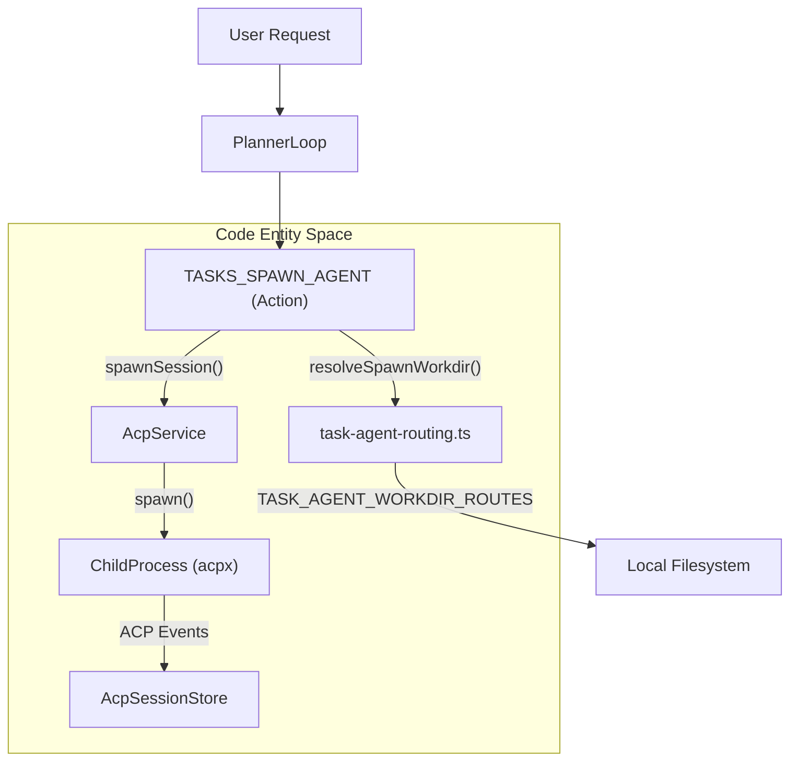
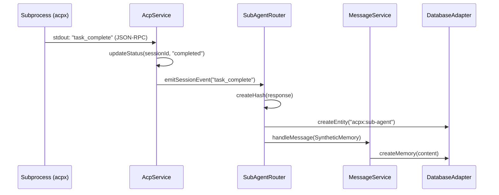

<!-- source: DeepWiki mcp.deepwiki.com · repo elizaOS/eliza · page 16.1 Plugin Agent Orchestrator · fetched 2026-10-29 -->

# Plugin Agent Orchestrator

Relevant source files

The following files were used as context for generating this wiki page:

- [packages/agent/src/index.ts](packages/agent/src/index.ts)
- [packages/agent/src/runtime/local-execution-mode.ts](packages/agent/src/runtime/local-execution-mode.ts)
- [packages/agent/src/services/js-runtime-bridge.ts](packages/agent/src/services/js-runtime-bridge.ts)
- [packages/agent/src/services/sandbox-manager.ts](packages/agent/src/services/sandbox-manager.ts)
- [packages/core/src/__tests__/message-stable-prefix.test.ts](packages/core/src/__tests__/message-stable-prefix.test.ts)
- [packages/core/src/__tests__/service-type-collisions.test.ts](packages/core/src/__tests__/service-type-collisions.test.ts)
- [packages/core/src/actions/promote-subactions.ts](packages/core/src/actions/promote-subactions.ts)
- [packages/core/src/features/advanced-memory/evaluators/memory-items.ts](packages/core/src/features/advanced-memory/evaluators/memory-items.ts)
- [packages/core/src/features/basic-capabilities/providers/recentMessages.test.ts](packages/core/src/features/basic-capabilities/providers/recentMessages.test.ts)
- [packages/core/src/features/basic-capabilities/providers/recentMessages.ts](packages/core/src/features/basic-capabilities/providers/recentMessages.ts)
- [packages/core/src/runtime/__tests__/action-retrieval.test.ts](packages/core/src/runtime/__tests__/action-retrieval.test.ts)
- [packages/core/src/sensitive-request-policy.ts](packages/core/src/sensitive-request-policy.ts)
- [plugins/plugin-agent-orchestrator/__tests__/unit/acp-native-transport.test.ts](plugins/plugin-agent-orchestrator/__tests__/unit/acp-native-transport.test.ts)
- [plugins/plugin-agent-orchestrator/__tests__/unit/acp-service.test.ts](plugins/plugin-agent-orchestrator/__tests__/unit/acp-service.test.ts)
- [plugins/plugin-agent-orchestrator/__tests__/unit/create-task.test.ts](plugins/plugin-agent-orchestrator/__tests__/unit/create-task.test.ts)
- [plugins/plugin-agent-orchestrator/__tests__/unit/extract-completion-summary.test.ts](plugins/plugin-agent-orchestrator/__tests__/unit/extract-completion-summary.test.ts)
- [plugins/plugin-agent-orchestrator/__tests__/unit/get-acp-service-order.test.ts](plugins/plugin-agent-orchestrator/__tests__/unit/get-acp-service-order.test.ts)
- [plugins/plugin-agent-orchestrator/__tests__/unit/opencode-spawn-config-auto-detect.test.ts](plugins/plugin-agent-orchestrator/__tests__/unit/opencode-spawn-config-auto-detect.test.ts)
- [plugins/plugin-agent-orchestrator/__tests__/unit/register-routes.test.ts](plugins/plugin-agent-orchestrator/__tests__/unit/register-routes.test.ts)
- [plugins/plugin-agent-orchestrator/__tests__/unit/resolve-spawn-workdir.test.ts](plugins/plugin-agent-orchestrator/__tests__/unit/resolve-spawn-workdir.test.ts)
- [plugins/plugin-agent-orchestrator/__tests__/unit/session-resume.test.ts](plugins/plugin-agent-orchestrator/__tests__/unit/session-resume.test.ts)
- [plugins/plugin-agent-orchestrator/__tests__/unit/spawn-agent.test.ts](plugins/plugin-agent-orchestrator/__tests__/unit/spawn-agent.test.ts)
- [plugins/plugin-agent-orchestrator/__tests__/unit/sub-agent-completion-evaluator.test.ts](plugins/plugin-agent-orchestrator/__tests__/unit/sub-agent-completion-evaluator.test.ts)
- [plugins/plugin-agent-orchestrator/__tests__/unit/sub-agent-router.test.ts](plugins/plugin-agent-orchestrator/__tests__/unit/sub-agent-router.test.ts)
- [plugins/plugin-agent-orchestrator/bin/opencode](plugins/plugin-agent-orchestrator/bin/opencode)
- [plugins/plugin-agent-orchestrator/bin/opencode.cmd](plugins/plugin-agent-orchestrator/bin/opencode.cmd)
- [plugins/plugin-agent-orchestrator/package.json](plugins/plugin-agent-orchestrator/package.json)
- [plugins/plugin-agent-orchestrator/src/__tests__/workdir-routes.test.ts](plugins/plugin-agent-orchestrator/src/__tests__/workdir-routes.test.ts)
- [plugins/plugin-agent-orchestrator/src/actions/common.ts](plugins/plugin-agent-orchestrator/src/actions/common.ts)
- [plugins/plugin-agent-orchestrator/src/actions/sandbox-stub.ts](plugins/plugin-agent-orchestrator/src/actions/sandbox-stub.ts)
- [plugins/plugin-agent-orchestrator/src/actions/tasks.ts](plugins/plugin-agent-orchestrator/src/actions/tasks.ts)
- [plugins/plugin-agent-orchestrator/src/evaluators/sub-agent-completion.ts](plugins/plugin-agent-orchestrator/src/evaluators/sub-agent-completion.ts)
- [plugins/plugin-agent-orchestrator/src/index.ts](plugins/plugin-agent-orchestrator/src/index.ts)
- [plugins/plugin-agent-orchestrator/src/register-routes.ts](plugins/plugin-agent-orchestrator/src/register-routes.ts)
- [plugins/plugin-agent-orchestrator/src/services/acp-service.ts](plugins/plugin-agent-orchestrator/src/services/acp-service.ts)
- [plugins/plugin-agent-orchestrator/src/services/opencode-config.ts](plugins/plugin-agent-orchestrator/src/services/opencode-config.ts)
- [plugins/plugin-agent-orchestrator/src/services/parent-agent-broker.ts](plugins/plugin-agent-orchestrator/src/services/parent-agent-broker.ts)
- [plugins/plugin-agent-orchestrator/src/services/sub-agent-router.ts](plugins/plugin-agent-orchestrator/src/services/sub-agent-router.ts)
- [plugins/plugin-agent-orchestrator/src/services/task-agent-routing.ts](plugins/plugin-agent-orchestrator/src/services/task-agent-routing.ts)
- [plugins/plugin-coding-tools/src/actions/bash.test.ts](plugins/plugin-coding-tools/src/actions/bash.test.ts)
- [plugins/plugin-coding-tools/src/actions/bash.ts](plugins/plugin-coding-tools/src/actions/bash.ts)
- [plugins/plugin-coding-tools/src/lib/run-shell.ts](plugins/plugin-coding-tools/src/lib/run-shell.ts)
- [plugins/plugin-ollama/__tests__/model-usage.test.ts](plugins/plugin-ollama/__tests__/model-usage.test.ts)
- [plugins/plugin-openai/__tests__/cerebras-config.shape.test.ts](plugins/plugin-openai/__tests__/cerebras-config.shape.test.ts)
- [plugins/plugin-openai/utils/config.ts](plugins/plugin-openai/utils/config.ts)
- [plugins/plugin-shell/services/shellService.ts](plugins/plugin-shell/services/shellService.ts)
- [plugins/plugin-shell/utils/processQueue.ts](plugins/plugin-shell/utils/processQueue.ts)
- [plugins/plugin-sql/src/build.ts](plugins/plugin-sql/src/build.ts)
- [tsconfig.json](tsconfig.json)

The **Plugin Agent Orchestrator** (`@elizaos/plugin-agent-orchestrator`) is the canonical system for spawning, managing, and coordinating specialized coding sub-agents [plugins/plugin-agent-orchestrator/src/index.ts:2-9](). It implements the **Agent Client Protocol (ACP)** to provide a standardized transport for background tasks, workspace management, and multi-agent swarm coordination [plugins/plugin-agent-orchestrator/src/index.ts:4-7]().

## System Architecture

The orchestrator operates as a collection of services and a unified "Pattern C" umbrella action that manages the lifecycle of sub-agents [plugins/plugin-agent-orchestrator/src/actions/tasks.ts:1-4]().

### Component Overview
| Component | Responsibility |
| :--- | :--- |
| `AcpService` | Manages ACP subprocesses, session persistence, and transport-level events [plugins/plugin-agent-orchestrator/src/services/acp-service.ts:118-120](). |
| `SubAgentRouter` | Routes terminal events (completion, errors) back to origin rooms as synthetic messages [plugins/plugin-agent-orchestrator/src/services/sub-agent-router.ts:211-213](). |
| `TASKS` Action | A parent action covering spawning, sending, stopping, and history [plugins/plugin-agent-orchestrator/src/actions/tasks.ts:9-24](). |
| `CodingWorkspaceService` | Handles filesystem-level workspace provisioning and GitHub integration [plugins/plugin-agent-orchestrator/src/services/workspace-service.ts:61-61](). |
| `subAgentCompletionResponseEvaluator` | Evaluates if a sub-agent's task has reached a terminal state or requires verification [plugins/plugin-agent-orchestrator/src/evaluators/sub-agent-completion.ts:41-41](). |

### Data Flow: Task Spawning
This diagram illustrates the transition from a natural language request to the creation of a physical sub-agent process.

Sources: [plugins/plugin-agent-orchestrator/src/actions/tasks.ts:87-88](), [plugins/plugin-agent-orchestrator/src/services/acp-service.ts:176-178](), [plugins/plugin-agent-orchestrator/src/services/task-agent-routing.ts:41-43]().

## Agent Client Protocol (ACP) Service

The `AcpService` is the primary interface for managing asynchronous agent sessions [plugins/plugin-agent-orchestrator/src/services/acp-service.ts:118-119](). It supports adapters for `elizaos`, `opencode`, `claude`, and `codex` [plugins/plugin-agent-orchestrator/src/services/acp-service.ts:109-109]().

### Key Implementation Details
- **Transport Modes**: Supports both `native` and `cli` (via `acpx`) transport modes [plugins/plugin-agent-orchestrator/src/services/acp-service.ts:148-148]().
- **Session Limits**: Enforces a `MAX_CONCURRENT_AGENTS` limit (default 8) to prevent resource exhaustion [plugins/plugin-agent-orchestrator/src/actions/tasks.ts:80-80]().
- **Orphan Reconciliation**: On startup, it reconciles "orphan" sessions (subprocesses that survived a runtime restart) by checking if they were active within a `RECONCILE_LIVE_WINDOW_MS` (90s) [plugins/plugin-agent-orchestrator/src/services/acp-service.ts:92-97]().
- **Environment Scrubbing**: Automatically scrubs sensitive tokens (Discord, Telegram, Slack, Vault) from environment variables passed to sub-agents [plugins/plugin-agent-orchestrator/src/services/acp-service.ts:110-116]().

Sources: [plugins/plugin-agent-orchestrator/src/services/acp-service.ts:148-154](), [plugins/plugin-agent-orchestrator/src/services/acp-service.ts:178-184]().

## Sub-Agent Routing and Swarm Coordination

The `SubAgentRouter` manages the feedback loop between background sub-agents and user-facing chat rooms [plugins/plugin-agent-orchestrator/src/services/sub-agent-router.ts:211-213]().

### Swarm Rooms and Roles
The orchestrator tracks three primary roles for message delivery [plugins/plugin-agent-orchestrator/src/services/sub-agent-router.ts:29-29]():
1.  **`task`**: The room specific to the active task.
2.  **`worktree`**: A room shared by all agents working in the same directory/repository.
3.  **`origin`**: The room where the user interaction first started.

### Round-Trip Capping
To prevent infinite agent-to-agent loops (echo loops), the router implements a `DEFAULT_ROUND_TRIP_CAP` of 32 messages [plugins/plugin-agent-orchestrator/src/services/sub-agent-router.ts:26-26]().

### URL Verification
When a sub-agent reports completion, the router extracts URLs and verifies their reachability using `collectVerifiableUrlCandidates` [plugins/plugin-agent-orchestrator/src/services/sub-agent-router.ts:62-65](). It uses a regex `URL_IN_TEXT_RE` that excludes markdown formatting to ensure precise extraction [plugins/plugin-agent-orchestrator/src/services/sub-agent-router.ts:34-34]().

Sources: [plugins/plugin-agent-orchestrator/src/services/sub-agent-router.ts:24-29](), [plugins/plugin-agent-orchestrator/src/services/sub-agent-router.ts:211-213]().

## TASKS Action Umbrella

The `tasksAction` is a Pattern C action that subsumes all orchestrator operations [plugins/plugin-agent-orchestrator/src/actions/tasks.ts:1-24]().

### Supported Operations
The `TASKS` umbrella manages the following sub-actions [plugins/plugin-agent-orchestrator/src/actions/tasks.ts:102-117]():
- `create` / `spawn_agent`: Initializes and starts a coding sub-agent session.
- `send`: Forwards user input to an active sub-agent.
- `stop_agent` / `cancel`: Terminates the session and cleans up resources.
- `history`: Retrieves past task logs and metrics.
- `manage_issues`: Provides GitHub integration (create, list, comment on issues).
- `provision_workspace`: Prepares the filesystem environment for the sub-agent.

### Workdir Routing
The orchestrator uses `resolveSpawnWorkdir` to determine the correct path for a new sub-agent [plugins/plugin-agent-orchestrator/src/services/task-agent-routing.ts:42-42](). This logic matches user intent against `TASK_AGENT_WORKDIR_ROUTES` to route tasks to specific project folders [plugins/plugin-agent-orchestrator/src/services/task-agent-routing.ts:100-105]().

Sources: [plugins/plugin-agent-orchestrator/src/actions/tasks.ts:86-100](), [plugins/plugin-agent-orchestrator/src/services/task-agent-routing.ts:40-43]().

## Evaluators and Verification

### `subAgentCompletionResponseEvaluator`
This evaluator processes sub-agent responses to determine if they are "terminal" (complete or errored) [plugins/plugin-agent-orchestrator/src/evaluators/sub-agent-completion.ts:41-41](). It performs several cleanup tasks:
- **Prose Extraction**: Strips router annotations and raw tool transcripts to provide clean feedback to the user [plugins/plugin-agent-orchestrator/src/evaluators/sub-agent-completion.ts:201-202]().
- **Context Management**: Switches the active context to `automation` to satisfy tool-call gates [plugins/plugin-agent-orchestrator/src/evaluators/sub-agent-completion.ts:18-18]().

## Sequence Diagram: Event Routing
This diagram shows how an ACP event from a subprocess is translated back into the ElizaOS memory system.

Sources: [plugins/plugin-agent-orchestrator/src/services/acp-service.ts:216-228](), [plugins/plugin-agent-orchestrator/src/services/sub-agent-router.ts:211-213](), [plugins/plugin-agent-orchestrator/__tests__/unit/sub-agent-router.test.ts:183-193]().

## Configuration Reference

Key environment variables and settings [plugins/plugin-agent-orchestrator/src/services/acp-service.ts:168-186]():
- `ELIZA_ACP_CLI`: The command for the ACP transport (default: `acpx`).
- `ELIZA_ACP_TRANSPORT`: Choice between `native` or `cli`.
- `ELIZA_ACP_DEFAULT_AGENT`: Default sub-agent adapter (e.g., `opencode`, `claude`).
- `ELIZA_ACP_DEFAULT_APPROVAL`: The default `ApprovalPreset` (e.g., `standard`, `approve-all`).
- `TASK_AGENT_WORKDIR_ROUTES`: JSON configuration mapping task keywords to local paths.

Sources: [plugins/plugin-agent-orchestrator/src/services/acp-service.ts:168-186](), [plugins/plugin-agent-orchestrator/src/services/task-agent-routing.ts:100-105]().

---

