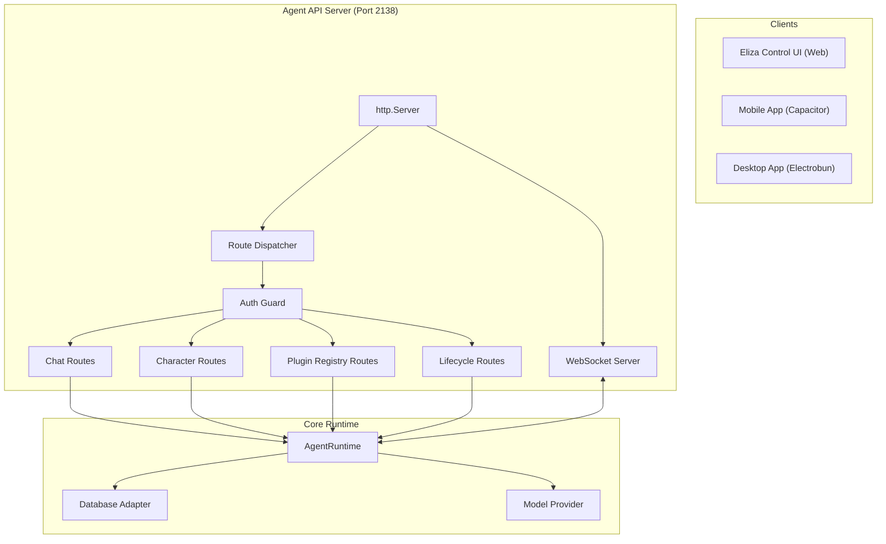
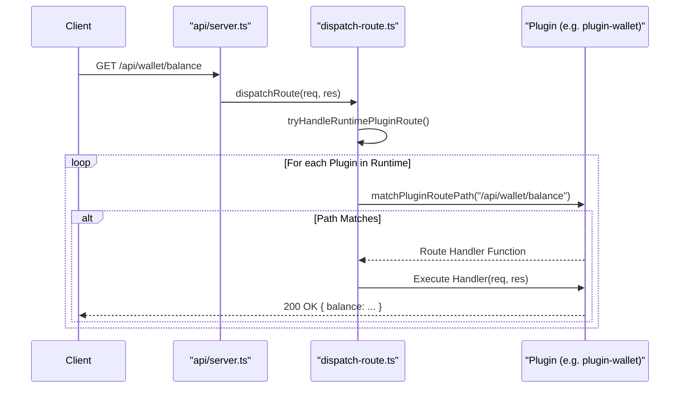

<!-- source: DeepWiki mcp.deepwiki.com · repo elizaOS/eliza · page 16.2 Agent API Server · fetched 2026-10-29 -->

# Agent API Server

Relevant source files

The following files were used as context for generating this wiki page:

- [packages/agent/package.json](packages/agent/package.json)
- [packages/agent/src/actions/extract-params.ts](packages/agent/src/actions/extract-params.ts)
- [packages/agent/src/api/__tests__/conversation-streaming.test.ts](packages/agent/src/api/__tests__/conversation-streaming.test.ts)
- [packages/agent/src/api/__tests__/persistence-after-done.test.ts](packages/agent/src/api/__tests__/persistence-after-done.test.ts)
- [packages/agent/src/api/auth-routes.ts](packages/agent/src/api/auth-routes.ts)
- [packages/agent/src/api/avatar-routes.ts](packages/agent/src/api/avatar-routes.ts)
- [packages/agent/src/api/chat-routes.ts](packages/agent/src/api/chat-routes.ts)
- [packages/agent/src/api/conversation-routes.ts](packages/agent/src/api/conversation-routes.ts)
- [packages/agent/src/api/inbox-routes.ts](packages/agent/src/api/inbox-routes.ts)
- [packages/agent/src/api/index.ts](packages/agent/src/api/index.ts)
- [packages/agent/src/api/plugin-discovery-helpers.ts](packages/agent/src/api/plugin-discovery-helpers.ts)
- [packages/agent/src/api/registry-routes.ts](packages/agent/src/api/registry-routes.ts)
- [packages/agent/src/api/server-helpers.ts](packages/agent/src/api/server-helpers.ts)
- [packages/agent/src/api/server-route-dispatch.ts](packages/agent/src/api/server-route-dispatch.ts)
- [packages/agent/src/api/server-types.ts](packages/agent/src/api/server-types.ts)
- [packages/agent/src/api/server.ts](packages/agent/src/api/server.ts)
- [packages/agent/src/api/static-file-server.ts](packages/agent/src/api/static-file-server.ts)
- [packages/agent/src/api/trade-safety.ts](packages/agent/src/api/trade-safety.ts)
- [packages/agent/src/config/feature-flags.ts](packages/agent/src/config/feature-flags.ts)
- [packages/agent/src/config/zod-schema.agent-runtime.ts](packages/agent/src/config/zod-schema.agent-runtime.ts)
- [packages/agent/src/runtime/build-character-config.ts](packages/agent/src/runtime/build-character-config.ts)
- [packages/agent/src/runtime/trajectory-internals.ts](packages/agent/src/runtime/trajectory-internals.ts)
- [packages/agent/src/runtime/trajectory-storage.ts](packages/agent/src/runtime/trajectory-storage.ts)
- [packages/agent/src/services/app-package-modules.ts](packages/agent/src/services/app-package-modules.ts)
- [packages/agent/src/services/index.ts](packages/agent/src/services/index.ts)
- [packages/agent/src/services/registry-client-app-meta.ts](packages/agent/src/services/registry-client-app-meta.ts)
- [packages/agent/src/services/registry-client-local.ts](packages/agent/src/services/registry-client-local.ts)
- [packages/agent/src/services/registry-client-queries.ts](packages/agent/src/services/registry-client-queries.ts)
- [packages/agent/src/triggers/runtime.ts](packages/agent/src/triggers/runtime.ts)
- [packages/agent/test/api/agent-message-route.test.ts](packages/agent/test/api/agent-message-route.test.ts)
- [packages/app-core/src/runtime/desktop/AppWindowRenderer.tsx](packages/app-core/src/runtime/desktop/AppWindowRenderer.tsx)
- [packages/benchmarks/agentbench/elizaos_agentbench/adapters/web_browsing_adapter.py](packages/benchmarks/agentbench/elizaos_agentbench/adapters/web_browsing_adapter.py)
- [packages/benchmarks/agentbench/elizaos_agentbench/mock_runtime.py](packages/benchmarks/agentbench/elizaos_agentbench/mock_runtime.py)
- [packages/examples/a2a/package.json](packages/examples/a2a/package.json)
- [packages/examples/cloudflare/package.json](packages/examples/cloudflare/package.json)
- [packages/examples/rest-api/express/package.json](packages/examples/rest-api/express/package.json)
- [packages/examples/roblox/package.json](packages/examples/roblox/package.json)
- [packages/examples/roblox/tsconfig.json](packages/examples/roblox/tsconfig.json)
- [packages/examples/vercel/package.json](packages/examples/vercel/package.json)
- [packages/shared/src/contracts/auth-routes.test.ts](packages/shared/src/contracts/auth-routes.test.ts)
- [packages/shared/src/contracts/auth-routes.ts](packages/shared/src/contracts/auth-routes.ts)
- [packages/shared/src/contracts/inbox-routes.test.ts](packages/shared/src/contracts/inbox-routes.test.ts)
- [packages/shared/src/contracts/inbox-routes.ts](packages/shared/src/contracts/inbox-routes.ts)
- [packages/shared/src/utils/assistant-text.test.ts](packages/shared/src/utils/assistant-text.test.ts)
- [packages/shared/src/utils/assistant-text.ts](packages/shared/src/utils/assistant-text.ts)
- [plugins/plugin-agent-skills/src/index.ts](plugins/plugin-agent-skills/src/index.ts)
- [plugins/plugin-capacitor-bridge/src/android/bridge.ts](plugins/plugin-capacitor-bridge/src/android/bridge.ts)
- [plugins/plugin-capacitor-bridge/src/ios/bridge.ts](plugins/plugin-capacitor-bridge/src/ios/bridge.ts)
- [plugins/plugin-capacitor-bridge/src/shared/fs-promises-proxy.ts](plugins/plugin-capacitor-bridge/src/shared/fs-promises-proxy.ts)
- [plugins/plugin-capacitor-bridge/src/shared/fs-proxy.ts](plugins/plugin-capacitor-bridge/src/shared/fs-proxy.ts)
- [plugins/plugin-capacitor-bridge/src/shared/fs-sandbox.ts](plugins/plugin-capacitor-bridge/src/shared/fs-sandbox.ts)
- [plugins/plugin-capacitor-bridge/src/shared/fs-shim.ts](plugins/plugin-capacitor-bridge/src/shared/fs-shim.ts)
- [plugins/plugin-discord/discord-avatar-cache.ts](plugins/plugin-discord/discord-avatar-cache.ts)
- [plugins/plugin-discord/discord-profiles.ts](plugins/plugin-discord/discord-profiles.ts)
- [plugins/plugin-local-storage/package.json](plugins/plugin-local-storage/package.json)
- [plugins/plugin-wallet/package.json](plugins/plugin-wallet/package.json)
- [plugins/plugin-wallet/src/api/wallet-routes.ts](plugins/plugin-wallet/src/api/wallet-routes.ts)
- [plugins/plugin-wallet/src/index.ts](plugins/plugin-wallet/src/index.ts)

The **Agent API Server** is the primary REST and WebSocket interface for elizaOS agents, hosted within the `packages/agent` package. It provides the necessary endpoints for the Eliza Control UI, mobile applications, and third-party integrations to interact with the `AgentRuntime`.

The server typically listens on port **2138** [packages/agent/src/api/server.ts:5]() and acts as the bridge between the frontend application shell and the underlying agent logic, managing everything from real-time chat to plugin configuration and system lifecycle.

## Overview and Core Server

The entry point for the API server is located in `packages/agent/src/api/server.ts`. It utilizes a standard Node.js `http` server combined with the `ws` library for real-time communication [packages/agent/src/api/server.ts:11-56]().

### Key Responsibilities
- **Authentication**: Validates requests using token-based security with timing-safe comparisons [packages/agent/src/api/server.ts:14-21]().
- **Routing**: Dispatches requests to specialized handlers for chat, characters, models, and plugins [packages/agent/src/api/server.ts:221-230]().
- **WebSocket Management**: Maintains persistent connections for streaming agent responses and event broadcasting [packages/agent/src/api/server.ts:56]().
- **Plugin Injection**: Dynamically mounts routes provided by loaded plugins such as the Wallet or App Manager [packages/agent/src/api/index.ts:5-26]().
- **Lazy Loading**: Optional plugins like `@elizaos/plugin-browser` and `@elizaos/plugin-x402` are lazily loaded to optimize container boot times [packages/agent/src/api/server.ts:58-63]().

### Server Architecture
The server follows a modular "Route Handler" pattern where functional areas are delegated to separate modules while sharing a common `IAgentRuntime` context.

Title: Agent API Server Data Flow

Sources: [packages/agent/src/api/server.ts:1-60](), [packages/agent/src/api/index.ts:27-58]()

## Route Handlers

The API is partitioned into several specialized route domains:

### 1. Chat and Conversation Routes
Handled in `packages/agent/src/api/chat-routes.ts` and `packages/agent/src/api/conversation-routes.ts`. These provide compatibility with major AI providers:
- `POST /v1/chat/completions`: OpenAI-compatible endpoint [packages/agent/src/api/chat-routes.ts:5]().
- `POST /v1/messages`: Anthropic-compatible endpoint [packages/agent/src/api/chat-routes.ts:6]().
- **Streaming**: Supports Server-Sent Events (SSE) and token-by-token delivery via `generateChatResponse` [packages/agent/src/api/conversation-routes.ts:9](), [packages/agent/src/api/__tests__/conversation-streaming.test.ts:100-110]().
- **Local Direct Chat**: Special optimization for mobile platforms (Android/iOS) to handle local Llama inference without full pipeline overhead [packages/agent/src/api/chat-routes.ts:163-183]().

### 2. Character and Lifecycle
- **Character CRUD**: Handled in `character-routes.ts`, allowing for character configuration and synchronization [packages/agent/src/api/index.ts:34]().
- **Lifecycle**: Managed in `agent-lifecycle-routes.ts` for restarts and status monitoring [packages/agent/src/api/index.ts:29]().

### 3. Plugin Registry and Skills
- **Plugin Discovery**: Scans the `plugins.json` manifest and workspace to categorize plugins as AI providers, connectors, or features [packages/agent/src/api/plugin-discovery-helpers.ts:143-156]().
- **Skills API**: Integrates with `@elizaos/plugin-agent-skills` to provide curated skill routes and marketplace searches [plugins/plugin-agent-skills/src/index.ts:19-32]().

### 4. Models and Provider Registry
Exposes the available model catalog and runtime configurations:
- `GET /v1/models`: Returns the list of active model IDs supported by the current `AgentRuntime` [packages/agent/src/api/chat-routes.ts:7]().

Sources: [packages/agent/src/api/chat-routes.ts:1-12](), [packages/agent/src/api/index.ts:27-77](), [packages/agent/src/api/plugin-discovery-helpers.ts:1-20]()

## Plugin Injection Pattern

The API server uses a dynamic injection pattern to allow plugins to extend the REST interface. This is facilitated by the `dispatchRoute` function and the `tryHandleRuntimePluginRoute` helper.

### Runtime Plugin Routes
Plugins can define custom routes that are matched against incoming requests. For example, the wallet plugin routes are lazily loaded only when a request hits the `/api/wallet` prefix [packages/agent/src/api/index.ts:22-26]().

Title: Plugin Route Injection Sequence

Sources: [packages/agent/src/api/dispatch-route.ts:42](), [packages/agent/src/api/index.ts:63-66]()

## Mobile and Platform Targets

The API server adapts its behavior based on the platform, particularly for mobile environments.

- **Android Bridge**: On Android, the agent runs as a Bun child process. The bridge sets environment variables like `ELIZA_ANDROID_LOCAL_BACKEND` and binds the API to loopback `127.0.0.1` [plugins/plugin-capacitor-bridge/src/android/bridge.ts:43-48]().
- **Mobile FS Sandbox**: Installs a shim to restrict file system access to the app's internal storage directory [plugins/plugin-capacitor-bridge/src/android/bridge.ts:127]().
- **Direct Reply Pattern**: A performance optimization for mobile local LLMs that bypasses complex orchestration for simple queries (e.g., "what is my name") [packages/agent/src/api/chat-routes.ts:134-135]().

Sources: [plugins/plugin-capacitor-bridge/src/android/bridge.ts:1-50](), [packages/agent/src/api/chat-routes.ts:163-183]()

## Technical Implementation Details

### JSON Body Parsing
The server implements a safe JSON body reader with a configurable byte limit:
- **Standard Routes**: 1 MB limit [packages/agent/src/api/server.ts:23]().
- **Chat Routes**: 20 MB limit to accommodate image attachments [packages/agent/src/api/chat-routes.ts:126]().

### Security
- **Timing-Safe Equality**: Authentication tokens are compared using `crypto.timingSafeEqual` to prevent side-channel attacks [packages/agent/src/api/server.ts:14-21]().
- **CORS and Bind Host**: The server resolves the bind host and port dynamically based on whether it is running in a desktop or server environment [packages/agent/src/api/server.ts:51-53]().

### Persistence and State
- **Deleted Conversations**: The server maintains a tombstone list of deleted conversation IDs in `deleted-conversations.v1.json` to ensure consistency across restarts [packages/agent/src/api/conversation-routes.ts:135-142]().
- **Conversation Metadata**: Manages `ConversationMeta` including `roomId`, `title`, and timestamps [packages/agent/src/api/server-types.ts:50-57]().

Sources: [packages/agent/src/api/server.ts:14-23](), [packages/agent/src/api/chat-routes.ts:126](), [packages/agent/src/api/conversation-routes.ts:135-186]()

---

