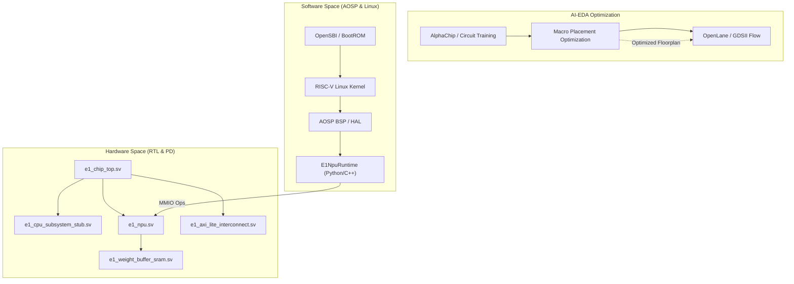
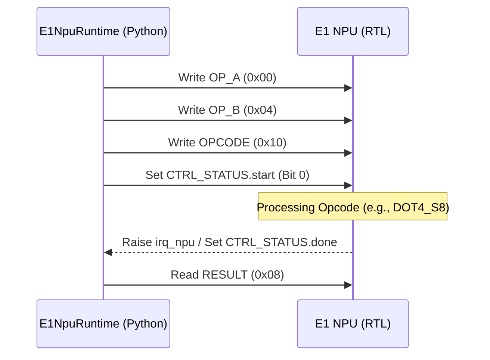

<!-- source: DeepWiki mcp.deepwiki.com · repo elizaOS/eliza · page 17 E1 Chip — AI SoC Design · fetched 2026-10-29 -->

# E1 Chip — AI SoC Design

Relevant source files

The following files were used as context for generating this wiki page:

- [packages/app-core/platforms/electrobun/src/preload.js](packages/app-core/platforms/electrobun/src/preload.js)
- [packages/chip/Makefile](packages/chip/Makefile)
- [packages/chip/README.md](packages/chip/README.md)
- [packages/chip/compiler/runtime/e1_npu_partitioner.py](packages/chip/compiler/runtime/e1_npu_partitioner.py)
- [packages/chip/compiler/runtime/test_e1_partitioner.py](packages/chip/compiler/runtime/test_e1_partitioner.py)
- [packages/chip/docs/arch/npu.md](packages/chip/docs/arch/npu.md)
- [packages/chip/docs/npu/2028-targets.md](packages/chip/docs/npu/2028-targets.md)
- [packages/chip/docs/spec-db/e1-npu-runtime-contract.json](packages/chip/docs/spec-db/e1-npu-runtime-contract.json)
- [packages/chip/external/README.md](packages/chip/external/README.md)
- [packages/chip/external/SOURCES.lock.yaml](packages/chip/external/SOURCES.lock.yaml)
- [packages/chip/external/repos/google-circuit-training/manifest.yaml](packages/chip/external/repos/google-circuit-training/manifest.yaml)
- [packages/chip/research/alpha_chip_macro_placement/01_sources/ai_eda_automation_readiness.yaml](packages/chip/research/alpha_chip_macro_placement/01_sources/ai_eda_automation_readiness.yaml)
- [packages/chip/research/alpha_chip_macro_placement/01_sources/ai_eda_integration_backlog.yaml](packages/chip/research/alpha_chip_macro_placement/01_sources/ai_eda_integration_backlog.yaml)
- [packages/chip/research/alpha_chip_macro_placement/01_sources/ai_eda_literature_and_tools_2026-05-19.md](packages/chip/research/alpha_chip_macro_placement/01_sources/ai_eda_literature_and_tools_2026-05-19.md)
- [packages/chip/research/alpha_chip_macro_placement/01_sources/ai_eda_provenance_matrix.yaml](packages/chip/research/alpha_chip_macro_placement/01_sources/ai_eda_provenance_matrix.yaml)
- [packages/chip/research/alpha_chip_macro_placement/01_sources/ai_eda_sota_review.md](packages/chip/research/alpha_chip_macro_placement/01_sources/ai_eda_sota_review.md)
- [packages/chip/research/alpha_chip_macro_placement/01_sources/ai_eda_source_inventory.yaml](packages/chip/research/alpha_chip_macro_placement/01_sources/ai_eda_source_inventory.yaml)
- [packages/chip/research/alpha_chip_macro_placement/01_sources/ai_for_chip_design_sota.md](packages/chip/research/alpha_chip_macro_placement/01_sources/ai_for_chip_design_sota.md)
- [packages/chip/research/alpha_chip_macro_placement/08_full_stack_ai_chip_optimization_plan_2026-05-20.md](packages/chip/research/alpha_chip_macro_placement/08_full_stack_ai_chip_optimization_plan_2026-05-20.md)
- [packages/chip/scripts/ai_eda/bootstrap_ai_eda_stack.py](packages/chip/scripts/ai_eda/bootstrap_ai_eda_stack.py)
- [packages/chip/scripts/ai_eda/build_macro_placement_supervised_dataset.py](packages/chip/scripts/ai_eda/build_macro_placement_supervised_dataset.py)
- [packages/chip/scripts/ai_eda/check_alphachip_checkpoint_blocker.py](packages/chip/scripts/ai_eda/check_alphachip_checkpoint_blocker.py)
- [packages/chip/scripts/ai_eda/check_chipbench_d_conversion.py](packages/chip/scripts/ai_eda/check_chipbench_d_conversion.py)
- [packages/chip/scripts/ai_eda/check_external_intake_manifests.py](packages/chip/scripts/ai_eda/check_external_intake_manifests.py)
- [packages/chip/scripts/ai_eda/check_logic_synthesis_policy_baseline.py](packages/chip/scripts/ai_eda/check_logic_synthesis_policy_baseline.py)
- [packages/chip/scripts/ai_eda/check_macro_placement_supervised_model.py](packages/chip/scripts/ai_eda/check_macro_placement_supervised_model.py)
- [packages/chip/scripts/ai_eda/check_macro_placement_torch_inference.py](packages/chip/scripts/ai_eda/check_macro_placement_torch_inference.py)
- [packages/chip/scripts/ai_eda/check_openabc_d_conversion.py](packages/chip/scripts/ai_eda/check_openabc_d_conversion.py)
- [packages/chip/scripts/ai_eda/convert_chipbench_d_to_internal_records.py](packages/chip/scripts/ai_eda/convert_chipbench_d_to_internal_records.py)
- [packages/chip/scripts/ai_eda/convert_circuitnet3_to_internal_records.py](packages/chip/scripts/ai_eda/convert_circuitnet3_to_internal_records.py)
- [packages/chip/scripts/ai_eda/convert_openabc_d_to_internal_records.py](packages/chip/scripts/ai_eda/convert_openabc_d_to_internal_records.py)
- [packages/chip/scripts/ai_eda/convert_openroad_eda_corpus.py](packages/chip/scripts/ai_eda/convert_openroad_eda_corpus.py)
- [packages/chip/scripts/ai_eda/convert_tilos_macroplacement.py](packages/chip/scripts/ai_eda/convert_tilos_macroplacement.py)
- [packages/chip/scripts/ai_eda/evaluate_macro_placement_candidates.py](packages/chip/scripts/ai_eda/evaluate_macro_placement_candidates.py)
- [packages/chip/scripts/ai_eda/fetch_external_asset.py](packages/chip/scripts/ai_eda/fetch_external_asset.py)
- [packages/chip/scripts/ai_eda/infer_macro_placement_torch_regressor.py](packages/chip/scripts/ai_eda/infer_macro_placement_torch_regressor.py)
- [packages/chip/scripts/ai_eda/materialize_e1_softmacro_cases.py](packages/chip/scripts/ai_eda/materialize_e1_softmacro_cases.py)
- [packages/chip/scripts/ai_eda/package_cuda_training_payload.py](packages/chip/scripts/ai_eda/package_cuda_training_payload.py)
- [packages/chip/scripts/ai_eda/train_circuitnet3_timing_power_baseline.py](packages/chip/scripts/ai_eda/train_circuitnet3_timing_power_baseline.py)
- [packages/chip/scripts/ai_eda/train_macro_placement_policy.py](packages/chip/scripts/ai_eda/train_macro_placement_policy.py)
- [packages/chip/scripts/ai_eda/train_macro_placement_supervised_model.py](packages/chip/scripts/ai_eda/train_macro_placement_supervised_model.py)
- [packages/chip/scripts/ai_eda/train_macro_placement_torch_regressor.py](packages/chip/scripts/ai_eda/train_macro_placement_torch_regressor.py)
- [packages/chip/scripts/check_ai_eda_source_inventory.py](packages/chip/scripts/check_ai_eda_source_inventory.py)
- [packages/chip/scripts/check_e1_npu_runtime_contract.py](packages/chip/scripts/check_e1_npu_runtime_contract.py)
- [packages/chip/scripts/check_npu_2028_targets.py](packages/chip/scripts/check_npu_2028_targets.py)
- [packages/cloud-frontend/src/dashboard/api-explorer/_components/use-explorer-api-key.ts](packages/cloud-frontend/src/dashboard/api-explorer/_components/use-explorer-api-key.ts)
- [packages/cloud-frontend/tests/e2e/aesthetic-audit.spec.ts](packages/cloud-frontend/tests/e2e/aesthetic-audit.spec.ts)
- [packages/cloud-frontend/tests/e2e/solana-login.spec.ts](packages/cloud-frontend/tests/e2e/solana-login.spec.ts)
- [packages/cloud-frontend/tests/e2e/view-switching.spec.ts](packages/cloud-frontend/tests/e2e/view-switching.spec.ts)
- [packages/homepage/scripts/generate-contact-sheet.mjs](packages/homepage/scripts/generate-contact-sheet.mjs)
- [packages/homepage/src/lib/api/siws.ts](packages/homepage/src/lib/api/siws.ts)
- [packages/homepage/tests/e2e/aesthetic-audit.spec.ts](packages/homepage/tests/e2e/aesthetic-audit.spec.ts)

The elizaOS E1 chip project is an open-source RISC-V AI SoC design intended for mobile and agentic applications. It provides a complete vertical stack from SystemVerilog RTL and AI-assisted physical design (AI-EDA) to a customized AOSP (Android Open Source Project) software environment. The project emphasizes a "fail-closed" evidence-based design philosophy, where architectural claims are only validated through deterministic simulation, formal verification, and physical design gates [packages/chip/README.md:58-60]().

### System Architecture Overview

The E1 SoC integrates a RISC-V CPU subsystem with a specialized Neural Processing Unit (NPU) designed for low-precision AI inference. The hardware is managed via a comprehensive `Makefile` that orchestrates everything from RTL linting to KiCad board layout and AI-assisted macro placement [packages/chip/Makefile:1-37]().

Sources: [packages/chip/Makefile:9-10](), [packages/chip/docs/arch/npu.md:3-6](), [packages/chip/research/alpha_chip_macro_placement/08_full_stack_ai_chip_optimization_plan_2026-05-20.md:19-33]()

---

### E1 SoC Hardware Architecture
The hardware design focuses on a synthesizable datapath with a single-cycle MMIO control interface. Key components include:
*   **NPU:** Supports low-precision operations including `INT8`, `INT4`, and `INT2` (BitNet-style), as well as `FP8_E4M3` [packages/chip/docs/arch/npu.md:31-48]().
*   **Interconnect:** Uses an AXI-Lite framework for peripheral communication [packages/chip/Makefile:10]().
*   **Memory:** Features dedicated weight buffer SRAM and a DMA engine for tensor prefetching [packages/chip/Makefile:10](), [packages/chip/docs/spec-db/e1-npu-runtime-contract.json:9-10]().

For details, see [E1 SoC Hardware Architecture](#17.1).

### AI-EDA Optimization Stack
The E1 project utilizes an AI-assisted Electronic Design Automation (EDA) pipeline to optimize physical design metrics such as wirelength and congestion.
*   **Macro Placement:** Integration with Google's Circuit Training (AlphaChip) for RL-based floorplanning [packages/chip/research/alpha_chip_macro_placement/08_full_stack_ai_chip_optimization_plan_2026-05-20.md:111-118]().
*   **Dataset Ingestion:** Pipelines for converting public datasets like `CircuitNet 3.0` and `ChiPBench-D` into internal records [packages/chip/scripts/ai_eda/bootstrap_ai_eda_stack.py:42-45]().
*   **Training Payloads:** Scripts to package CUDA training data for remote high-performance hosts like Nebius [packages/chip/scripts/ai_eda/package_cuda_training_payload.py:1-7]().

For details, see [AI-EDA Optimization Stack](#17.2).

### E1 Software and AOSP Integration
The software stack bridges the gap between raw hardware and AI agent applications.
*   **NPU Runtime:** A Python and C++ runtime (`E1NpuRuntime`) that handles StableHLO lowering and MMIO dispatch [packages/chip/compiler/runtime/e1_npu_runtime.py:1-37]().
*   **OS Variants:** Includes a Debian-based RISC-V distribution and an AOSP device tree for phone-class integration [packages/chip/Makefile:15]().
*   **Simulation:** Support for QEMU and Renode for pre-silicon software development [packages/chip/Makefile:37]().

For details, see [E1 Software and AOSP Integration](#17.3).

---

### NPU Command Interface and Contract
The interaction between the elizaOS software and the E1 hardware is governed by a strict MMIO contract. The `E1NpuRuntime` class interacts with registers defined in the hardware specification.

Sources: [packages/chip/docs/arch/npu.md:14-22](), [packages/chip/docs/spec-db/e1-npu-runtime-contract.json:21-28]()

### NPU Supported Opcodes (Partial List)

| Opcode | Name | Description |
| :--- | :--- | :--- |
| `4` | `DOT4_S8` | Four packed signed INT8 products plus `ACC` |
| `7` | `DOT8_S4` | Eight packed signed INT4 products plus `ACC` |
| `12` | `SDOT4_S4_2_4` | Two 2:4 sparse INT4 groups |
| `13` | `DOT16_S2` | Sixteen packed signed INT2 (BitNet) products |
| `14` | `DOT4_FP8_E4M3` | Four packed FP8 E4M3 products |

Sources: [packages/chip/docs/arch/npu.md:31-48](), [packages/chip/docs/spec-db/e1-npu-runtime-contract.json:150-167]()

### AI-EDA Source Inventory
The project maintains an inventory of external AI/EDA research to inform the optimization lanes. These are tracked in `ai_eda_source_inventory.yaml` and require deterministic evidence gates before being promoted to design claims [packages/chip/research/alpha_chip_macro_placement/01_sources/ai_eda_source_inventory.yaml:8-13]().

| ID | Name | Role |
| :--- | :--- | :--- |
| `autoeda-mcp` | AutoEDA | Agentic RTL-to-GDS flow using MCP |
| `eda-mcp-server` | EDA-MCP | Model Context Protocol server for EDA tools |
| `circuit-training` | AlphaChip | RL-based macro placement |

Sources: [packages/chip/research/alpha_chip_macro_placement/01_sources/ai_eda_source_inventory.yaml:48-127]()

---

