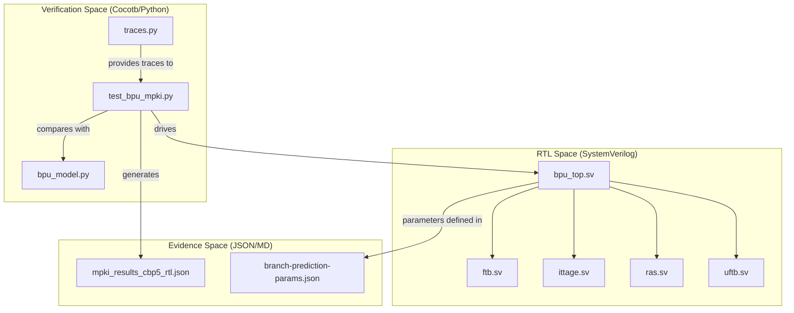
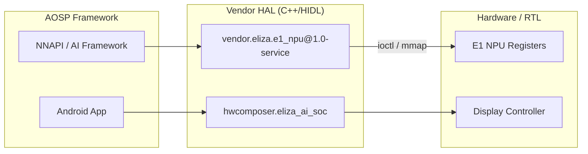

<!-- source: DeepWiki mcp.deepwiki.com · repo elizaOS/eliza · page 17.1 E1 SoC Hardware Architecture · fetched 2026-10-29 -->

# E1 SoC Hardware Architecture

Relevant source files

The following files were used as context for generating this wiki page:

- [packages/chip/benchmarks/cpu/branch/bpu_model.py](packages/chip/benchmarks/cpu/branch/bpu_model.py)
- [packages/chip/benchmarks/cpu/branch/run_mpki.py](packages/chip/benchmarks/cpu/branch/run_mpki.py)
- [packages/chip/benchmarks/cpu/branch/traces.py](packages/chip/benchmarks/cpu/branch/traces.py)
- [packages/chip/docs/arch/branch-prediction.md](packages/chip/docs/arch/branch-prediction.md)
- [packages/chip/docs/evidence/cpu_ap/branch-prediction-params.json](packages/chip/docs/evidence/cpu_ap/branch-prediction-params.json)
- [packages/chip/docs/evidence/cpu_ap/cbp5-trace-manifest.json](packages/chip/docs/evidence/cpu_ap/cbp5-trace-manifest.json)
- [packages/chip/docs/evidence/cpu_ap/core-selection.json](packages/chip/docs/evidence/cpu_ap/core-selection.json)
- [packages/chip/docs/evidence/cpu_ap/mpki_cbp5_vs_tagesc_l_64kb.md](packages/chip/docs/evidence/cpu_ap/mpki_cbp5_vs_tagesc_l_64kb.md)
- [packages/chip/docs/evidence/cpu_ap/mpki_results_cbp5.json](packages/chip/docs/evidence/cpu_ap/mpki_results_cbp5.json)
- [packages/chip/docs/evidence/cpu_ap/mpki_results_cbp5_rtl.json](packages/chip/docs/evidence/cpu_ap/mpki_results_cbp5_rtl.json)
- [packages/chip/docs/evidence/cpu_ap/mpki_results_synthetic.json](packages/chip/docs/evidence/cpu_ap/mpki_results_synthetic.json)
- [packages/chip/docs/evidence/cpu_ap/mpki_synthetic_vs_cbp5_reference.md](packages/chip/docs/evidence/cpu_ap/mpki_synthetic_vs_cbp5_reference.md)
- [packages/chip/rtl/cache/l3/e1_l3_cache.sv](packages/chip/rtl/cache/l3/e1_l3_cache.sv)
- [packages/chip/rtl/cpu/bpu/bimodal.sv](packages/chip/rtl/cpu/bpu/bimodal.sv)
- [packages/chip/rtl/cpu/bpu/bpu_pkg.sv](packages/chip/rtl/cpu/bpu/bpu_pkg.sv)
- [packages/chip/rtl/cpu/bpu/bpu_top.sv](packages/chip/rtl/cpu/bpu/bpu_top.sv)
- [packages/chip/rtl/cpu/bpu/ftb.sv](packages/chip/rtl/cpu/bpu/ftb.sv)
- [packages/chip/rtl/cpu/bpu/ras.sv](packages/chip/rtl/cpu/bpu/ras.sv)
- [packages/chip/rtl/cpu/bpu/uftb.sv](packages/chip/rtl/cpu/bpu/uftb.sv)
- [packages/chip/scripts/alphachip/run_pretraining.sh](packages/chip/scripts/alphachip/run_pretraining.sh)
- [packages/chip/scripts/boot_android_simulator.sh](packages/chip/scripts/boot_android_simulator.sh)
- [packages/chip/scripts/check_android_app_runtime_contract.py](packages/chip/scripts/check_android_app_runtime_contract.py)
- [packages/chip/scripts/check_aosp_product_contract.py](packages/chip/scripts/check_aosp_product_contract.py)
- [packages/chip/scripts/check_branch_prediction.py](packages/chip/scripts/check_branch_prediction.py)
- [packages/chip/scripts/check_e1_phone_board_package.py](packages/chip/scripts/check_e1_phone_board_package.py)
- [packages/chip/scripts/check_manufacturing_artifacts.py](packages/chip/scripts/check_manufacturing_artifacts.py)
- [packages/chip/scripts/generate_e1_phone_cad.py](packages/chip/scripts/generate_e1_phone_cad.py)
- [packages/chip/scripts/generate_e1_phone_manufacturing_closure.py](packages/chip/scripts/generate_e1_phone_manufacturing_closure.py)
- [packages/chip/scripts/generate_e1_phone_routed_release_plan.py](packages/chip/scripts/generate_e1_phone_routed_release_plan.py)
- [packages/chip/scripts/test_android_app_runtime_contract.py](packages/chip/scripts/test_android_app_runtime_contract.py)
- [packages/chip/scripts/test_generate_e1_phone_cad.py](packages/chip/scripts/test_generate_e1_phone_cad.py)
- [packages/chip/scripts/test_linux_memory_platform_contract.py](packages/chip/scripts/test_linux_memory_platform_contract.py)
- [packages/chip/sw/aosp-device/build-aosp-riscv64.sh](packages/chip/sw/aosp-device/build-aosp-riscv64.sh)
- [packages/chip/sw/aosp-device/device/eliza/eliza_ai_soc/BoardConfig.mk](packages/chip/sw/aosp-device/device/eliza/eliza_ai_soc/BoardConfig.mk)
- [packages/chip/sw/aosp-device/device/eliza/eliza_ai_soc/device.mk](packages/chip/sw/aosp-device/device/eliza/eliza_ai_soc/device.mk)
- [packages/chip/sw/aosp-device/device/eliza/eliza_ai_soc/eliza_ai_soc.mk](packages/chip/sw/aosp-device/device/eliza/eliza_ai_soc/eliza_ai_soc.mk)
- [packages/chip/sw/aosp-device/device/eliza/eliza_ai_soc/hal/e1_npu/Android.bp](packages/chip/sw/aosp-device/device/eliza/eliza_ai_soc/hal/e1_npu/Android.bp)
- [packages/chip/sw/aosp-device/device/eliza/eliza_ai_soc/hal/e1_npu/E1Npu.h](packages/chip/sw/aosp-device/device/eliza/eliza_ai_soc/hal/e1_npu/E1Npu.h)
- [packages/chip/sw/aosp-device/device/eliza/eliza_ai_soc/hal/e1_npu/vendor.eliza.e1_npu@1.0-service.rc](packages/chip/sw/aosp-device/device/eliza/eliza_ai_soc/hal/e1_npu/vendor.eliza.e1_npu@1.0-service.rc)
- [packages/chip/sw/aosp-device/device/eliza/eliza_ai_soc/init.eliza.rc](packages/chip/sw/aosp-device/device/eliza/eliza_ai_soc/init.eliza.rc)
- [packages/chip/sw/aosp-device/device/eliza/eliza_ai_soc/manifest.xml](packages/chip/sw/aosp-device/device/eliza/eliza_ai_soc/manifest.xml)
- [packages/chip/sw/aosp-device/local_manifests/eliza.xml](packages/chip/sw/aosp-device/local_manifests/eliza.xml)
- [packages/chip/verify/cocotb/bpu/bpu_top_tb.sv](packages/chip/verify/cocotb/bpu/bpu_top_tb.sv)
- [packages/chip/verify/cocotb/bpu/ftb_tb.sv](packages/chip/verify/cocotb/bpu/ftb_tb.sv)
- [packages/chip/verify/cocotb/bpu/ftq_tb.sv](packages/chip/verify/cocotb/bpu/ftq_tb.sv)
- [packages/chip/verify/cocotb/bpu/ras_tb.sv](packages/chip/verify/cocotb/bpu/ras_tb.sv)
- [packages/chip/verify/cocotb/bpu/test_bpu_mpki.py](packages/chip/verify/cocotb/bpu/test_bpu_mpki.py)
- [packages/chip/verify/cocotb/bpu/test_bpu_top.py](packages/chip/verify/cocotb/bpu/test_bpu_top.py)
- [packages/chip/verify/cocotb/bpu/test_ftb.py](packages/chip/verify/cocotb/bpu/test_ftb.py)
- [packages/chip/verify/formal/bpu/ras_formal.sv](packages/chip/verify/formal/bpu/ras_formal.sv)

The E1 SoC is an open-source RISC-V AI system-on-chip designed to power mobile hardware within the elizaOS ecosystem. The architecture focuses on high-performance branch prediction for complex AI agent logic, a dedicated NPU for local inference, and deep integration with the Android Open Source Project (AOSP) for mobile application delivery.

## System Architecture Overview

The E1 chip architecture is defined through a combination of SystemVerilog RTL, behavioral models for performance validation, and a comprehensive platform contract that bridges hardware design with software expectations.

### Core Configuration
The E1 employs a heterogeneous multi-core topology optimized for different workload tiers:
*   **Ultra (Big):** High-performance cores (e.g., Ascalon) with 8-wide decode and 480 ROB entries [packages/chip/docs/evidence/cpu_ap/core-selection.json:7-16]().
*   **Premium (Mid):** Mid-tier cores (e.g., Kunminghu) with 6-wide decode and 256 ROB entries [packages/chip/docs/evidence/cpu_ap/core-selection.json:18-28]().
*   **Pro (Little):** Efficiency cores (e.g., CVA6) for background tasks [packages/chip/docs/evidence/cpu_ap/core-selection.json:40-50]().

### Data Flow and Interconnect
The system utilizes a multi-level cache hierarchy, including a dedicated L3 cache implementation [packages/chip/rtl/cache/l3/e1_l3_cache.sv:1-10](), and high-bandwidth DMA controllers to move data between the NPU and main memory.

**Sources:** [packages/chip/docs/evidence/cpu_ap/core-selection.json:1-66](), [packages/chip/rtl/cache/l3/e1_l3_cache.sv:1-10]()

---

## Branch Prediction Unit (BPU)

A critical component of the E1 is its advanced Branch Prediction Unit, designed to minimize Mispredictions Per Kilo-Instruction (MPKI) for the complex control flow found in AI agent runtimes.

### BPU Implementation (RTL)
The `bpu_top` module integrates several specialized predictors:
*   **FTB (Fetch Target Buffer):** Stores branch targets and kinds. The R8 design uses 4096 entries x 4 ways [packages/chip/docs/evidence/cpu_ap/mpki_cbp5_vs_tagesc_l_64kb.md:23-25]().
*   **uFTB:** A micro-FTB for single-cycle low-latency predictions [packages/chip/rtl/cpu/bpu/uftb.sv:1-10]().
*   **ITTAGE:** An indirect branch predictor. The E1 implementation uses a 5-table geometry [packages/chip/docs/evidence/cpu_ap/branch-prediction-params.json:42-48]().
*   **RAS (Return Address Stack):** Handles function call/return predictions with 64 speculative entries [packages/chip/docs/evidence/cpu_ap/branch-prediction-params.json:60-60]().

### BPU Data Flow
The BPU processes prediction requests (`lkp_pc`) and provides combinational outputs including `pred_taken`, `pred_target`, and `pred_kind` [packages/chip/verify/cocotb/bpu/test_bpu_mpki.py:130-138]().

| Parameter | Value | Description |
| :--- | :--- | :--- |
| `BIM_ENTRIES` | 16384 | Bimodal table size [packages/chip/docs/evidence/cpu_ap/branch-prediction-params.json:37-37]() |
| `FETCH_BLOCK_BYTES` | 32 | Size of the fetch block [packages/chip/docs/evidence/cpu_ap/branch-prediction-params.json:38-38]() |
| `TAGE_TABLES` | 5 | Number of TAGE tables [packages/chip/docs/evidence/cpu_ap/branch-prediction-params.json:78-78]() |
| `TAGE_HIST_LEN_MAX` | 119 | Maximum global history length [packages/chip/docs/evidence/cpu_ap/branch-prediction-params.json:77-77]() |

### Performance Verification
The BPU is verified using `cocotb` against the CBP-5 (Championship Branch Prediction 2025) trace set.
*   **RTL MPKI:** 3.957 (Aggregate) [packages/chip/docs/evidence/cpu_ap/mpki_results_cbp5_rtl.json:2-7]().
*   **Target:** < 4.0 MPKI [packages/chip/docs/evidence/cpu_ap/mpki_results_cbp5_rtl.json:22-22]().

**Sources:** [packages/chip/rtl/cpu/bpu/bpu_top.sv:1-20](), [packages/chip/docs/evidence/cpu_ap/branch-prediction-params.json:1-141](), [packages/chip/verify/cocotb/bpu/test_bpu_mpki.py:1-175](), [packages/chip/docs/evidence/cpu_ap/mpki_cbp5_vs_tagesc_l_64kb.md:1-100]()

---

## NPU and AI Acceleration

The E1 includes a dedicated Neural Processing Unit (NPU) for local AI inference.

### Hardware-Software Interface
The NPU is exposed to the operating system through a Vendor HAL (Hardware Abstraction Layer). The service `vendor.eliza.e1_npu@1.0-service` manages the lifecycle of the NPU hardware [packages/chip/sw/aosp-device/device/eliza/eliza_ai_soc/device.mk:25-25]().

### NPU HAL Structure
The HAL implementation in AOSP includes:
*   `E1Npu.h`: Defines the C++ interface for interacting with the NPU registers [packages/chip/sw/aosp-device/device/eliza/eliza_ai_soc/hal/e1_npu/E1Npu.h:1-10]().
*   `Android.bp`: Build configuration for the NPU service [packages/chip/sw/aosp-device/device/eliza/eliza_ai_soc/hal/e1_npu/Android.bp:1-5]().

**Sources:** [packages/chip/sw/aosp-device/device/eliza/eliza_ai_soc/device.mk:1-44](), [packages/chip/sw/aosp-device/device/eliza/eliza_ai_soc/hal/e1_npu/E1Npu.h:1-10]()

---

## Mechanical and Physical Design

The E1 project includes full mechanical concept generation and physical design (PD) verification.

### Mechanical CAD Concept
A Python-based generator (`generate_e1_phone_cad.py`) creates deterministic mesh artifacts for the phone enclosure [packages/chip/scripts/generate_e1_phone_cad.py:2-8]().
*   **Enclosure:** Rounded box geometry with a configurable corner radius [packages/chip/scripts/generate_e1_phone_cad.py:112-124]().
*   **Components:** Includes models for the main PCB, USB-C receptacle, speaker modules, and camera assemblies [packages/chip/scripts/test_generate_e1_phone_cad.py:70-85]().

### Physical Design Verification
Manufacturing artifacts are validated against a manifest system to ensure tapeout readiness.
*   **Checks:** Includes ERC/DRC reports, Gerber archives, and BOM validation [packages/chip/scripts/check_manufacturing_artifacts.py:42-49]().
*   **Mass Budget:** The CAD script monitors the device mass budget [packages/chip/scripts/test_generate_e1_phone_cad.py:63-63]().

**Sources:** [packages/chip/scripts/generate_e1_phone_cad.py:1-200](), [packages/chip/scripts/test_generate_e1_phone_cad.py:1-140](), [packages/chip/scripts/check_manufacturing_artifacts.py:1-80]()

---

## AOSP Integration

The E1 SoC is designed as a first-class target for the Android Open Source Project.

### Device Configuration
The AOSP device tree for the E1 SoC (`device/eliza/eliza_ai_soc`) defines the hardware properties:
*   `PRODUCT_MODEL`: Eliza e1 AI SoC [packages/chip/sw/aosp-device/device/eliza/eliza_ai_soc/device.mk:12-12]().
*   `BoardConfig.mk`: Defines architecture-specific flags for RISC-V 64-bit [packages/chip/sw/aosp-device/device/eliza/eliza_ai_soc/BoardConfig.mk:1-10]().
*   `VINTF Manifest`: Declares the hardware services provided by the SoC [packages/chip/sw/aosp-device/device/eliza/eliza_ai_soc/manifest.xml:22-25]().

### System Services
*   **Gralloc/HWC:** Uses the `eliza` hardware composer and graphics allocator [packages/chip/sw/aosp-device/device/eliza/eliza_ai_soc/device.mk:42-43]().
*   **Init:** Custom `init.eliza.rc` handles SoC-specific service initialization [packages/chip/sw/aosp-device/device/eliza/eliza_ai_soc/init.eliza.rc:1-10]().

**Sources:** [packages/chip/sw/aosp-device/device/eliza/eliza_ai_soc/device.mk:1-44](), [packages/chip/sw/aosp-device/device/eliza/eliza_ai_soc/manifest.xml:1-25]()

---

## Hardware-Software Entity Mapping

The following diagram bridges the RTL design entities with their verification and software counterparts.

### BPU Architecture and Verification Flow

**Sources:** [packages/chip/rtl/cpu/bpu/bpu_top.sv:1-20](), [packages/chip/verify/cocotb/bpu/test_bpu_mpki.py:1-50](), [packages/chip/benchmarks/cpu/branch/bpu_model.py:1-50](), [packages/chip/docs/evidence/cpu_ap/branch-prediction-params.json:83-100]()

### AOSP Hardware Abstraction Mapping

**Sources:** [packages/chip/sw/aosp-device/device/eliza/eliza_ai_soc/device.mk:20-33](), [packages/chip/sw/aosp-device/device/eliza/eliza_ai_soc/manifest.xml:13-20](), [packages/chip/sw/aosp-device/device/eliza/eliza_ai_soc/hal/e1_npu/E1Npu.h:1-10]()

---

