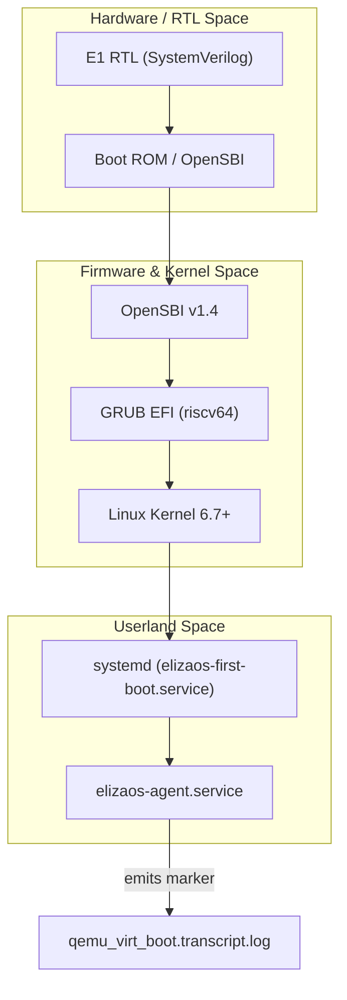
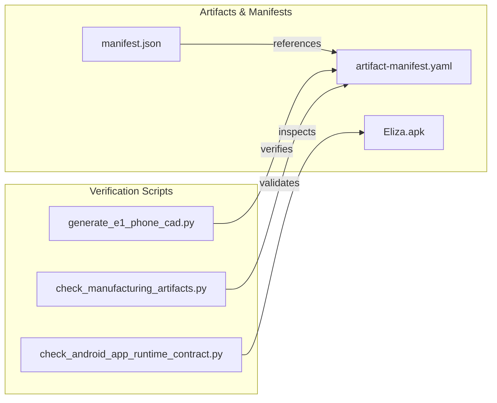

<!-- source: DeepWiki mcp.deepwiki.com · repo elizaOS/eliza · page 17.3 E1 Software and AOSP Integration · fetched 2026-10-29 -->

# E1 Software and AOSP Integration

Relevant source files

The following files were used as context for generating this wiki page:

- [packages/chip/rtl/cache/l3/e1_l3_cache.sv](packages/chip/rtl/cache/l3/e1_l3_cache.sv)
- [packages/chip/scripts/alphachip/run_pretraining.sh](packages/chip/scripts/alphachip/run_pretraining.sh)
- [packages/chip/scripts/boot_android_simulator.sh](packages/chip/scripts/boot_android_simulator.sh)
- [packages/chip/scripts/check_android_app_runtime_contract.py](packages/chip/scripts/check_android_app_runtime_contract.py)
- [packages/chip/scripts/check_aosp_product_contract.py](packages/chip/scripts/check_aosp_product_contract.py)
- [packages/chip/scripts/check_e1_phone_board_package.py](packages/chip/scripts/check_e1_phone_board_package.py)
- [packages/chip/scripts/check_manufacturing_artifacts.py](packages/chip/scripts/check_manufacturing_artifacts.py)
- [packages/chip/scripts/check_os_rv64_chip_boot_contract.py](packages/chip/scripts/check_os_rv64_chip_boot_contract.py)
- [packages/chip/scripts/generate_e1_phone_cad.py](packages/chip/scripts/generate_e1_phone_cad.py)
- [packages/chip/scripts/generate_e1_phone_manufacturing_closure.py](packages/chip/scripts/generate_e1_phone_manufacturing_closure.py)
- [packages/chip/scripts/generate_e1_phone_routed_release_plan.py](packages/chip/scripts/generate_e1_phone_routed_release_plan.py)
- [packages/chip/scripts/test_android_app_runtime_contract.py](packages/chip/scripts/test_android_app_runtime_contract.py)
- [packages/chip/scripts/test_generate_e1_phone_cad.py](packages/chip/scripts/test_generate_e1_phone_cad.py)
- [packages/chip/scripts/test_linux_memory_platform_contract.py](packages/chip/scripts/test_linux_memory_platform_contract.py)
- [packages/chip/sw/aosp-device/build-aosp-riscv64.sh](packages/chip/sw/aosp-device/build-aosp-riscv64.sh)
- [packages/chip/sw/aosp-device/device/eliza/eliza_ai_soc/BoardConfig.mk](packages/chip/sw/aosp-device/device/eliza/eliza_ai_soc/BoardConfig.mk)
- [packages/chip/sw/aosp-device/device/eliza/eliza_ai_soc/device.mk](packages/chip/sw/aosp-device/device/eliza/eliza_ai_soc/device.mk)
- [packages/chip/sw/aosp-device/device/eliza/eliza_ai_soc/eliza_ai_soc.mk](packages/chip/sw/aosp-device/device/eliza/eliza_ai_soc/eliza_ai_soc.mk)
- [packages/chip/sw/aosp-device/device/eliza/eliza_ai_soc/hal/e1_npu/Android.bp](packages/chip/sw/aosp-device/device/eliza/eliza_ai_soc/hal/e1_npu/Android.bp)
- [packages/chip/sw/aosp-device/device/eliza/eliza_ai_soc/hal/e1_npu/E1Npu.h](packages/chip/sw/aosp-device/device/eliza/eliza_ai_soc/hal/e1_npu/E1Npu.h)
- [packages/chip/sw/aosp-device/device/eliza/eliza_ai_soc/hal/e1_npu/vendor.eliza.e1_npu@1.0-service.rc](packages/chip/sw/aosp-device/device/eliza/eliza_ai_soc/hal/e1_npu/vendor.eliza.e1_npu@1.0-service.rc)
- [packages/chip/sw/aosp-device/device/eliza/eliza_ai_soc/init.eliza.rc](packages/chip/sw/aosp-device/device/eliza/eliza_ai_soc/init.eliza.rc)
- [packages/chip/sw/aosp-device/device/eliza/eliza_ai_soc/manifest.xml](packages/chip/sw/aosp-device/device/eliza/eliza_ai_soc/manifest.xml)
- [packages/chip/sw/aosp-device/local_manifests/eliza.xml](packages/chip/sw/aosp-device/local_manifests/eliza.xml)
- [packages/os/linux/variants/elizaos-debian-riscv64/Makefile](packages/os/linux/variants/elizaos-debian-riscv64/Makefile)
- [packages/os/linux/variants/elizaos-debian-riscv64/STATUS.md](packages/os/linux/variants/elizaos-debian-riscv64/STATUS.md)
- [packages/os/linux/variants/elizaos-debian-riscv64/config/hooks/normal/0030-elizaos-userland.hook.chroot](packages/os/linux/variants/elizaos-debian-riscv64/config/hooks/normal/0030-elizaos-userland.hook.chroot)
- [packages/os/linux/variants/elizaos-debian-riscv64/config/includes.chroot/etc/systemd/system/elizaos-agent.service](packages/os/linux/variants/elizaos-debian-riscv64/config/includes.chroot/etc/systemd/system/elizaos-agent.service)
- [packages/os/linux/variants/elizaos-debian-riscv64/config/includes.chroot/etc/systemd/system/elizaos-first-boot.service](packages/os/linux/variants/elizaos-debian-riscv64/config/includes.chroot/etc/systemd/system/elizaos-first-boot.service)
- [packages/os/linux/variants/elizaos-debian-riscv64/config/includes.chroot/usr/lib/elizaos/first-boot.sh](packages/os/linux/variants/elizaos-debian-riscv64/config/includes.chroot/usr/lib/elizaos/first-boot.sh)
- [packages/os/linux/variants/elizaos-debian-riscv64/config/package-lists/elizaos-runtime.list.chroot](packages/os/linux/variants/elizaos-debian-riscv64/config/package-lists/elizaos-runtime.list.chroot)
- [packages/os/linux/variants/elizaos-debian-riscv64/docs/e2e-qemu-virt.md](packages/os/linux/variants/elizaos-debian-riscv64/docs/e2e-qemu-virt.md)
- [packages/os/linux/variants/elizaos-debian-riscv64/docs/userland-startup.md](packages/os/linux/variants/elizaos-debian-riscv64/docs/userland-startup.md)
- [packages/os/linux/variants/elizaos-debian-riscv64/manifest.json](packages/os/linux/variants/elizaos-debian-riscv64/manifest.json)
- [packages/os/linux/variants/elizaos-debian-riscv64/requirements.txt](packages/os/linux/variants/elizaos-debian-riscv64/requirements.txt)
- [packages/os/linux/variants/elizaos-debian-riscv64/scripts/check_release_manifest.py](packages/os/linux/variants/elizaos-debian-riscv64/scripts/check_release_manifest.py)
- [packages/os/linux/variants/elizaos-debian-riscv64/scripts/qemu_virt_boot.sh](packages/os/linux/variants/elizaos-debian-riscv64/scripts/qemu_virt_boot.sh)
- [packages/os/linux/variants/elizaos-debian-riscv64/scripts/qemu_virt_smoke.py](packages/os/linux/variants/elizaos-debian-riscv64/scripts/qemu_virt_smoke.py)
- [packages/os/linux/variants/elizaos-debian-riscv64/scripts/test_check_release_manifest.py](packages/os/linux/variants/elizaos-debian-riscv64/scripts/test_check_release_manifest.py)
- [packages/os/linux/variants/elizaos-debian-riscv64/scripts/test_qemu_virt_smoke.py](packages/os/linux/variants/elizaos-debian-riscv64/scripts/test_qemu_virt_smoke.py)

This page documents the software stack for the E1 chip, ranging from low-level firmware and boot ROMs to high-level operating system variants. The E1 software ecosystem supports both a custom RISC-V Debian distribution for headless/agent use and an AOSP (Android Open Source Project) BSP for mobile hardware integration.

## 1. RISC-V Debian Variant (`elizaos-debian-riscv64`)

The `elizaos-debian-riscv64` variant is a specialized Linux distribution designed for RISC-V 64-bit hardware, specifically optimized for running elizaOS agents in a live-ISO environment.

### 1.1 Build and Release Pipeline
The build process is containerized and managed via a local `Makefile` [packages/os/linux/variants/elizaos-debian-riscv64/Makefile:1-38](). It uses `live-build` and `debootstrap` to generate a bootable ISO [packages/os/linux/variants/elizaos-debian-riscv64/docs/e2e-qemu-virt.md:21-40]().

The release is governed by a **fail-closed release-manifest gate**. This validator ensures that no ISO is promoted to "published" status unless it passes structural checks and verified boot evidence [packages/os/linux/variants/elizaos-debian-riscv64/scripts/check_release_manifest.py:3-27]().

### 1.2 Boot Verification and Evidence
To prove system viability before physical tapeout, the stack utilizes a QEMU-based smoke test harness.

*   **Harness:** `qemu_virt_boot.sh` executes `qemu-system-riscv64` using the `-machine virt` profile [packages/os/linux/variants/elizaos-debian-riscv64/scripts/qemu_virt_boot.sh:2-18]().
*   **Evidence Collection:** The harness captures serial transcripts and searches for specific "liveness" markers like `elizaos-firstboot-ready` [packages/os/linux/variants/elizaos-debian-riscv64/scripts/qemu_virt_boot.sh:181-191]().
*   **Validation:** The `validate_evidence` function in `qemu_virt_smoke.py` enforces the `eliza.os.linux.qemu_virt_boot.v1` schema, checking for SHA256 integrity of the ISO and transcript [packages/os/linux/variants/elizaos-debian-riscv64/scripts/qemu_virt_smoke.py:95-155]().

### 1.3 Userland Initialization
The OS uses `systemd` to manage agent lifecycles.
*   `elizaos-first-boot.service`: Runs `first-boot.sh` to initialize the environment and emit the readiness marker to the serial console [packages/os/linux/variants/elizaos-debian-riscv64/scripts/check_release_manifest.py:64-67]().
*   `elizaos-agent.service`: Manages the actual elizaOS agent process within the RISC-V userland.

**Sources:**
- [packages/os/linux/variants/elizaos-debian-riscv64/Makefile]()
- [packages/os/linux/variants/elizaos-debian-riscv64/scripts/check_release_manifest.py]()
- [packages/os/linux/variants/elizaos-debian-riscv64/scripts/qemu_virt_boot.sh]()
- [packages/os/linux/variants/elizaos-debian-riscv64/scripts/qemu_virt_smoke.py]()

---

## 2. AOSP BSP Integration

The E1 chip includes a Board Support Package (BSP) for AOSP, targeting mobile form factors. The integration is defined in `packages/chip/sw/aosp-device/`.

### 2.1 Device Configuration
The AOSP target is identified as `eliza_ai_soc` [packages/chip/sw/aosp-device/device/eliza/eliza_ai_soc/device.mk:9-13](). Key components include:
*   **VINTF Manifest:** A scaffold-only `manifest.xml` that reserves slots for the `e1_npu` and `hwcomposer` HALs [packages/chip/sw/aosp-device/device/eliza/eliza_ai_soc/manifest.xml:1-24]().
*   **Vendor Properties:** Sets hardware-specific properties like `vendor.e1_npu.ready` and `ro.hardware.hwcomposer` [packages/chip/sw/aosp-device/device/eliza/eliza_ai_soc/device.mk:38-43]().

### 2.2 Android App Runtime Contract
A static validator (`check_android_app_runtime_contract.py`) ensures that the Android application layer and the underlying chip/vendor configurations are synchronized [packages/chip/scripts/check_android_app_runtime_contract.py:2-8]().

| Entity | Code Reference | Purpose |
| :--- | :--- | :--- |
| `ElizaAgentService` | `ElizaAgentService.java` | Background service for agent runtime in Android [packages/chip/scripts/check_android_app_runtime_contract.py:35]() |
| `ElizaNativeBridge` | `ElizaNativeBridge.java` | JNI bridge for NPU/Native acceleration [packages/chip/scripts/check_android_app_runtime_contract.py:36]() |
| `APK_APPLICATION_ID` | `apk_application_id()` | Extracts and verifies the package identity via `apkanalyzer` [packages/chip/scripts/check_android_app_runtime_contract.py:156-174]() |

**Sources:**
- [packages/chip/sw/aosp-device/device/eliza/eliza_ai_soc/device.mk]()
- [packages/chip/sw/aosp-device/device/eliza/eliza_ai_soc/manifest.xml]()
- [packages/chip/scripts/check_android_app_runtime_contract.py]()

---

## 3. Data Flow and System Architecture

The software stack bridges the gap between the physical RTL (Register Transfer Level) design and the high-level Agent Runtime.

### 3.1 Software Stack Overview
The following diagram illustrates the transition from hardware-specific firmware to the elizaOS application layer.

**E1 Software Layering and Data Flow**

**Sources:**
- [packages/os/linux/variants/elizaos-debian-riscv64/scripts/qemu_virt_boot.sh:166-191]()
- [packages/os/linux/variants/elizaos-debian-riscv64/docs/e2e-qemu-virt.md:113-158]()

### 3.2 Manufacturing and Verification Closure
The system uses a manifest-based approach to ensure manufacturing readiness. The `check_manufacturing_artifacts.py` script validates that Kicad projects, FPGA bitstreams, and physical evidence are present before tapeout [packages/chip/scripts/check_manufacturing_artifacts.py:12-30]().

**Verification Pipeline to Code Entity Mapping**

**Sources:**
- [packages/chip/scripts/check_manufacturing_artifacts.py:34-80]()
- [packages/chip/scripts/generate_e1_phone_cad.py:1-8]()
- [packages/chip/scripts/check_android_app_runtime_contract.py:32-52]()

---

## 4. Mechanical and Physical Integration

The software stack also includes tools for mechanical validation, ensuring the E1 phone enclosure accommodates the mainboard and IO ports.

### 4.1 CAD Artifact Generation
`generate_e1_phone_cad.py` creates deterministic mesh artifacts and analytic fit checks for the phone enclosure [packages/chip/scripts/generate_e1_phone_cad.py:2-8](). It validates:
*   **USB-C Insertion Envelope:** Ensures the physical port matches the molded opening [packages/chip/scripts/test_generate_e1_phone_cad.py:46]().
*   **Acoustic Apertures:** Validates speaker and microphone port alignment [packages/chip/scripts/test_generate_e1_phone_cad.py:48]().
*   **Button Seal Stacks:** Checks the labyrinth rails and gaskets for the power and volume buttons [packages/chip/scripts/test_generate_e1_phone_cad.py:89-94]().

### 4.2 Compactness Optimization
The script `write_compactness_optimization_artifacts` generates reports on how the display and battery drive the outer envelope, ensuring the molded depth stays sub-10mm [packages/chip/scripts/test_generate_e1_phone_cad.py:183-196]().

**Sources:**
- [packages/chip/scripts/generate_e1_phone_cad.py]()
- [packages/chip/scripts/test_generate_e1_phone_cad.py]()

---

## 5. Simulation Environment

The E1 software stack is tested primarily in QEMU and Renode before silicon availability.

| Environment | Purpose | Key Script |
| :--- | :--- | :--- |
| **QEMU Virt** | OS-level boot validation and userland readiness [packages/os/linux/variants/elizaos-debian-riscv64/scripts/qemu_virt_boot.sh:2-7]() | `qemu_virt_smoke.py` |
| **Android Simulator** | AOSP framework and app-level testing | `boot_android_simulator.sh` |
| **Renode** | Multi-node SoC simulation (CPU + NPU + Peripherals) | `packages/chip/compiler/` |

**Sources:**
- [packages/os/linux/variants/elizaos-debian-riscv64/scripts/qemu_virt_smoke.py:1-12]()
- [packages/os/linux/variants/elizaos-debian-riscv64/docs/e2e-qemu-virt.md:1-20]()

---

