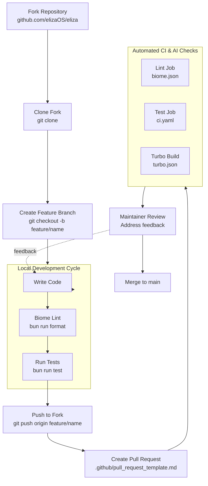
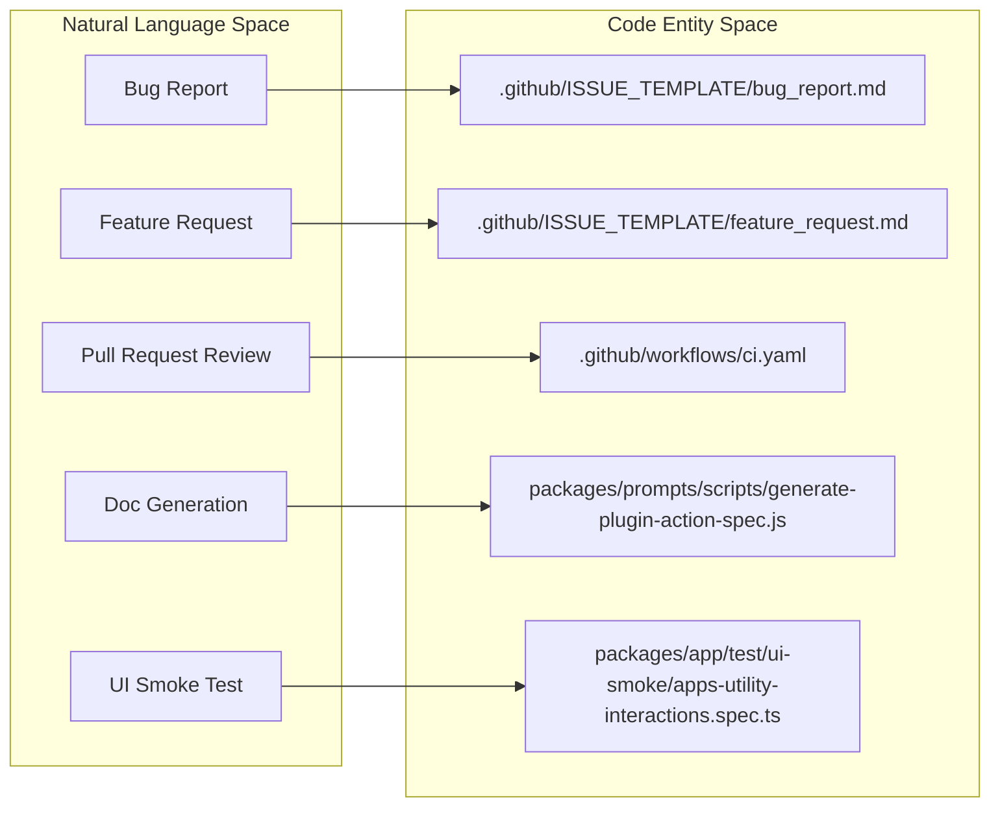

<!-- source: DeepWiki mcp.deepwiki.com · repo elizaOS/eliza · page 18 Contributing · fetched 2026-10-29 -->

# Contributing

Relevant source files

The following files were used as context for generating this wiki page:

- [.gitattributes](.gitattributes)
- [.gitignore](.gitignore)
- [packages/app/test/ui-smoke/apps-utility-interactions.spec.ts](packages/app/test/ui-smoke/apps-utility-interactions.spec.ts)
- [packages/app/test/ui-smoke/remote-capability-view.spec.ts](packages/app/test/ui-smoke/remote-capability-view.spec.ts)
- [packages/cloud-frontend/tests/e2e/api-explorer-flow.spec.ts](packages/cloud-frontend/tests/e2e/api-explorer-flow.spec.ts)
- [packages/core/src/__tests__/action-structure-audit.test.ts](packages/core/src/__tests__/action-structure-audit.test.ts)
- [packages/core/src/generated/action-docs.ts](packages/core/src/generated/action-docs.ts)
- [packages/core/src/utils/context-catalog.ts](packages/core/src/utils/context-catalog.ts)
- [packages/elizaos/templates-manifest.json](packages/elizaos/templates-manifest.json)
- [packages/examples/a2a/tsconfig.json](packages/examples/a2a/tsconfig.json)
- [packages/examples/agent-console/tsconfig.json](packages/examples/agent-console/tsconfig.json)
- [packages/examples/aws/tsconfig.json](packages/examples/aws/tsconfig.json)
- [packages/examples/bluesky/tsconfig.json](packages/examples/bluesky/tsconfig.json)
- [packages/examples/setup-guide.html](packages/examples/setup-guide.html)
- [packages/prompts/scripts/generate-plugin-action-spec.js](packages/prompts/scripts/generate-plugin-action-spec.js)
- [packages/prompts/specs/actions/plugins.generated.json](packages/prompts/specs/actions/plugins.generated.json)
- [packages/ui/src/bridge/capacitor-bridge.ts](packages/ui/src/bridge/capacitor-bridge.ts)
- [packages/ui/src/bridge/plugin-bridge.ts](packages/ui/src/bridge/plugin-bridge.ts)
- [packages/ui/src/components/apps/GameView.tsx](packages/ui/src/components/apps/GameView.tsx)
- [packages/ui/src/components/apps/load-apps-catalog.ts](packages/ui/src/components/apps/load-apps-catalog.ts)
- [packages/ui/src/components/character/CharacterEditor.tsx](packages/ui/src/components/character/CharacterEditor.tsx)
- [plugins/plugin-browser/src/actions/browser.ts](plugins/plugin-browser/src/actions/browser.ts)
- [plugins/plugin-coding-tools/src/services/ripgrep-service.ts](plugins/plugin-coding-tools/src/services/ripgrep-service.ts)
- [tsconfig.dist-paths.json](tsconfig.dist-paths.json)
- [turbo.json](turbo.json)

This document provides guidelines for contributing to elizaOS. It covers the development workflow, code quality standards, testing requirements, and pull request process for both new and existing contributors.

For information about the monorepo structure and build system details, see [Monorepo Structure](#10.1) and [Build System](#10.2). For CI/CD pipeline implementation details, see [Continuous Integration](#11.1) and [Release Process](#11.2).

## Overview of Contribution Types

elizaOS welcomes several types of contributions. Each type follows a specific template to ensure all necessary information is captured for the maintainers. Automated AI reviewers also assist in maintaining standards for security and code quality.

| Contribution Type | Template/Process | Description |
|------------------|-----------------|-------------|
| Bug Reports | `.github/ISSUE_TEMPLATE/bug_report.md` | Report issues or unexpected behavior. |
| Feature Requests | `.github/ISSUE_TEMPLATE/feature_request.md` | Propose new functionality or improvements. |
| Pull Requests | `.github/pull_request_template.md` | Code contributions (must link to an issue). |
| Dependency Updates | `dependabot.yml` / `renovate-preset.json` | Automated updates for core and plugin dependencies. |
| Project Scaffolding | `packages/elizaos/templates-manifest.json` | Templates for new plugins and projects [packages/elizaos/templates-manifest.json:4-22](). |

For details on the specific fields required in these forms, see [Issue and PR Templates](#18.1).

**Sources:** [packages/elizaos/templates-manifest.json:4-22](), [.github/pull_request_template.md](), [.github/ISSUE_TEMPLATE/bug_report.md]()

## Pull Request Process

### Pull Request Template Structure

All pull requests must use the template at `.github/pull_request_template.md` and include the following critical sections:

*   **Relates to**: Link to the GitHub issue being addressed.
*   **Risks**: Assessment of impact (Low, Medium, Large).
*   **Background**: Description of changes and the "Why" behind them.
*   **Testing**: Detailed steps for reviewers to verify the fix or feature.
*   **Discord Username**: For assigning the contributor role in the community.

### Automated Review and Testing Standards

The repository employs a comprehensive testing suite and AI-driven reviews to ensure high standards. PRs will be automatically checked for:
*   **Security**: Hardcoded keys, SQL injection, and XSS vulnerabilities.
*   **Testing**: TypeScript tests must use `vitest`, Python tests use `pytest`, and Rust tests use `cargo test`.
*   **UI Testing**: Smoke tests for the application shell are performed using Playwright [packages/app/test/ui-smoke/apps-utility-interactions.spec.ts:1-8]().
*   **Action Integrity**: Automated audits ensure that retired actions are not present in generated documentation [packages/core/src/__tests__/action-structure-audit.test.ts:6-113]().
*   **Linting**: The project uses Biome for TypeScript linting and formatting.

### Contribution Workflow Diagram

The following diagram maps the contribution process from local development to the CI pipeline and final merge.

**Sources:** [turbo.json:1-14](), [packages/app/test/ui-smoke/apps-utility-interactions.spec.ts:1-8](), [.github/pull_request_template.md]()

## Dependency Management

elizaOS uses automated tools to keep the ecosystem secure and up-to-date.

*   **Renovate/Dependabot**: Used to pin `@elizaos/*` packages and group related ecosystem updates (TypeScript, Biome, Vite/Rollup).
*   **Workspace Management**: Workspace dependencies and build order are managed via Turborepo [turbo.json:15-42]().
*   **Distribution Paths**: TypeScript paths are mapped to `dist` folders for cross-package development [tsconfig.dist-paths.json:8-15]().
*   **Patches**: Upstream dependency fixes are maintained in the `patches/` directory.

For details on the pinning strategy and grouping rules, see [Dependency Management](#18.2).

**Sources:** [turbo.json:1-42](), [tsconfig.dist-paths.json:8-15]()

## Code Entity Mapping

This diagram bridges Natural Language contribution concepts to the specific code entities and configurations used to enforce them.

**Sources:** [packages/prompts/scripts/generate-plugin-action-spec.js:13-25](), [packages/app/test/ui-smoke/apps-utility-interactions.spec.ts:1-8](), [.github/ISSUE_TEMPLATE/bug_report.md]()

## Community Standards

### Discord Integration
elizaOS is a community-driven project. Contributors are encouraged to join the official Discord server to coordinate efforts.
*   **Discord Link**: [https://discord.gg/ai16z](https://discord.gg/ai16z)
*   **Contributor Role**: Include your Discord username in your PR to be added to the `#development-feed` and receive the contributor role.

### Development Environment
Contributors should use the following environment standards:
*   **Package Manager**: Bun is the primary runtime and package manager used throughout the repository.
*   **Monorepo Tooling**: Turborepo (`turbo.json`) is used for task orchestration and build caching [turbo.json:1-9]().
*   **Action/Provider Specs**: New plugins should ensure their actions are documented in the `packages/prompts/specs/` directory to be included in the auto-generated documentation [packages/core/src/generated/action-docs.ts:1-4]().

**Sources:** [turbo.json:1-14](), [packages/core/src/generated/action-docs.ts:1-4](), [packages/prompts/scripts/generate-plugin-action-spec.js:13-25]()

---

