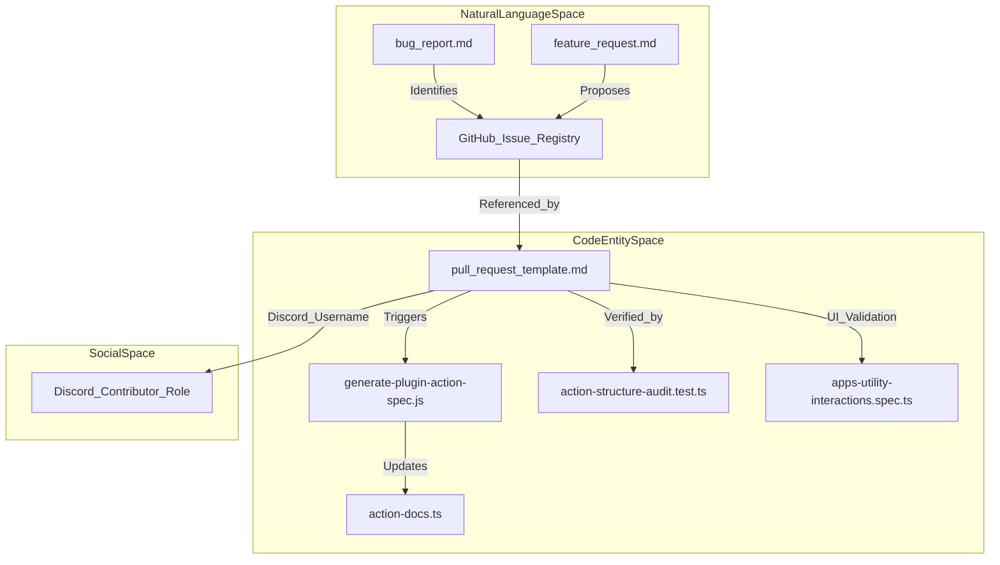
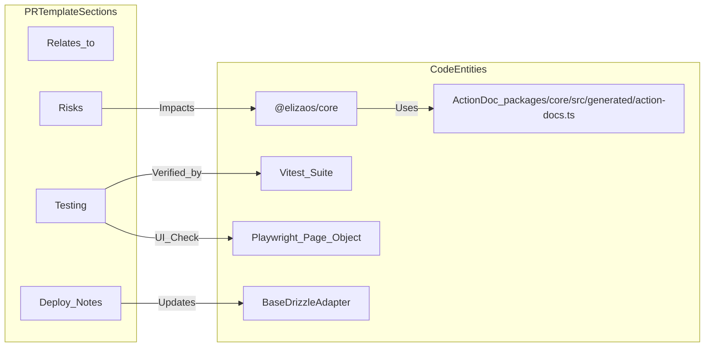

<!-- source: DeepWiki mcp.deepwiki.com · repo elizaOS/eliza · page 18.1 Issue and PR Templates · fetched 2026-10-29 -->

# Issue and PR Templates

Relevant source files

The following files were used as context for generating this wiki page:

- [.gitattributes](.gitattributes)
- [.gitignore](.gitignore)
- [packages/app/test/ui-smoke/apps-utility-interactions.spec.ts](packages/app/test/ui-smoke/apps-utility-interactions.spec.ts)
- [packages/app/test/ui-smoke/remote-capability-view.spec.ts](packages/app/test/ui-smoke/remote-capability-view.spec.ts)
- [packages/cloud-frontend/tests/e2e/api-explorer-flow.spec.ts](packages/cloud-frontend/tests/e2e/api-explorer-flow.spec.ts)
- [packages/core/src/__tests__/action-structure-audit.test.ts](packages/core/src/__tests__/action-structure-audit.test.ts)
- [packages/core/src/generated/action-docs.ts](packages/core/src/generated/action-docs.ts)
- [packages/core/src/utils/context-catalog.ts](packages/core/src/utils/context-catalog.ts)
- [packages/elizaos/templates-manifest.json](packages/elizaos/templates-manifest.json)
- [packages/examples/a2a/tsconfig.json](packages/examples/a2a/tsconfig.json)
- [packages/examples/agent-console/tsconfig.json](packages/examples/agent-console/tsconfig.json)
- [packages/examples/aws/tsconfig.json](packages/examples/aws/tsconfig.json)
- [packages/examples/bluesky/tsconfig.json](packages/examples/bluesky/tsconfig.json)
- [packages/examples/setup-guide.html](packages/examples/setup-guide.html)
- [packages/prompts/scripts/generate-plugin-action-spec.js](packages/prompts/scripts/generate-plugin-action-spec.js)
- [packages/prompts/specs/actions/plugins.generated.json](packages/prompts/specs/actions/plugins.generated.json)
- [packages/ui/src/bridge/capacitor-bridge.ts](packages/ui/src/bridge/capacitor-bridge.ts)
- [packages/ui/src/bridge/plugin-bridge.ts](packages/ui/src/bridge/plugin-bridge.ts)
- [packages/ui/src/components/apps/GameView.tsx](packages/ui/src/components/apps/GameView.tsx)
- [packages/ui/src/components/apps/load-apps-catalog.ts](packages/ui/src/components/apps/load-apps-catalog.ts)
- [packages/ui/src/components/character/CharacterEditor.tsx](packages/ui/src/components/character/CharacterEditor.tsx)
- [plugins/plugin-browser/src/actions/browser.ts](plugins/plugin-browser/src/actions/browser.ts)
- [plugins/plugin-coding-tools/src/services/ripgrep-service.ts](plugins/plugin-coding-tools/src/services/ripgrep-service.ts)
- [tsconfig.dist-paths.json](tsconfig.dist-paths.json)
- [turbo.json](turbo.json)

The elizaOS project utilizes standardized GitHub templates to maintain code quality, ensure comprehensive testing, and facilitate community engagement. These templates serve as the primary interface between contributors and the core maintainers, enforcing a structured data flow from problem identification to deployment. Automated reviews via workflows further augment this process by enforcing standards directly on Pull Requests (PRs).

## Issue Templates

The repository defines primary issue types to categorize incoming reports and suggestions. These are managed via the `.github/ISSUE_TEMPLATE/` directory.

### Bug Reports
The `bug_report.md` template is designed to provide maintainers with actionable reproduction steps. It enforces the collection of environment-specific context and expected outcomes to minimize back-and-forth communication.

| Section | Purpose |
| :--- | :--- |
| **Describe the bug** | High-level summary of the defect. |
| **To Reproduce** | Sequential steps to trigger the issue in a local environment. |
| **Expected behavior** | The desired state or output versus the actual observed state. |
| **Screenshots** | Visual evidence, particularly useful for UI or CLI output errors. |
| **Additional context** | Logs, environment variables, or specific character configurations. |

### Feature Requests
The `feature_request.md` template shifts focus toward problem-solving and architectural alignment. It requires contributors to articulate the "Why" before the "How."

| Section | Purpose |
| :--- | :--- |
| **Related Problem** | Context on why the current implementation is insufficient. |
| **Proposed Solution** | Detailed description of the requested functionality. |
| **Alternatives** | Discussion of other approaches considered to avoid "XY problems." |

**Sources:**
- [turbo.json:1-8]() (Global dependencies for build consistency)
- [.gitignore:1-17]() (Standard environment and node exclusions)

## Pull Request Template

The `pull_request_template.md` is a comprehensive checklist that ensures every code change is vetted for risk, tested thoroughly, and documented. It acts as the final gate before a PR enters the CI/CD pipeline.

### Required Information Blocks

#### 1. Relates to
Contributors must link the PR to an existing GitHub Issue or ticket. This ensures traceability from the requirement to the implementation.

#### 2. Risks
A mandatory assessment of the change impact. Contributors must categorize risks as **Low**, **Medium**, or **Large** and identify which subsystems might be affected. This is particularly critical when modifying core components like `AgentRuntime` or shared utilities.

#### 3. Background and Change Type
This section classifies the PR into categories:
- **Bug fixes**: Non-breaking changes fixing an issue.
- **Improvements**: Enhancements to existing features.
- **Features**: New functionality (e.g., new actions or providers).
- **Updates**: Dependency or internal code version bumps.

#### 4. Testing
The template emphasizes proof of verification. It includes:
- **Reviewer Starting Point**: Guidance on which files contain the core logic.
- **Detailed Testing Steps**: Manual verification steps or references to automated tests. The project uses `Vitest` for TypeScript and `Playwright` for E2E smoke tests [packages/app/test/ui-smoke/apps-utility-interactions.spec.ts:1-10]().
- **Screenshots/Videos**: Required for any UI changes, showing "Before" and "After" states.

#### 5. Deploy Notes
Crucial for infrastructure and database management. It includes:
- **Database changes**: Explicit mention of schema migrations or Drizzle ORM updates.
- **Deployment instructions**: Manual steps required beyond the automated workflows.

**Sources:**
- [packages/app/test/ui-smoke/apps-utility-interactions.spec.ts:1-10]()
- [packages/app/test/ui-smoke/apps-utility-interactions.spec.ts:117-123]()

## Automated Review and Verification

elizaOS employs specialized logic to ensure that new contributions adhere to the defined specs, especially for actions and plugins.

### Action and Plugin Spec Generation
The system uses automated scripts to generate action documentation and ensure consistency between the code and the prompt templates.
- **Spec Generation**: The `generate-plugin-action-spec.js` script crawls the `plugins/` directory to extract action definitions [packages/prompts/scripts/generate-plugin-action-spec.js:19-25]().
- **Action Audits**: Test suites verify that retired actions are not present in generated docs and that mandatory parameters (like `action` discriminators) are correctly defined [packages/core/src/__tests__/action-structure-audit.test.ts:151-157]().

### UI Smoke Testing
For PRs affecting the frontend or application shell, `Playwright` tests verify that the application remains interactive and error-free [packages/app/test/ui-smoke/apps-utility-interactions.spec.ts:125-132]().

**Sources:**
- [packages/prompts/scripts/generate-plugin-action-spec.js:19-25]()
- [packages/core/src/__tests__/action-structure-audit.test.ts:151-157]()
- [packages/core/src/generated/action-docs.ts:52-61]()

## Community Integration

elizaOS integrates its GitHub workflow with its Discord community to reward contributors.

### Contributor Role Integration
The PR template includes a specific section for the **Discord username**. Providing this information allows the project to grant the "Contributor" role on the official Discord server. This bridges the gap between the "Code Entity Space" (GitHub PRs) and the "Social Space" (Discord development channels).

## Workflow Diagrams

### Issue to PR Lifecycle
The following diagram illustrates how the templates facilitate the transition from a natural language problem to a code-level solution.

**Template Data Flow**

**Sources:**
- [packages/prompts/scripts/generate-plugin-action-spec.js:19-25]()
- [packages/core/src/__tests__/action-structure-audit.test.ts:1-5]()
- [packages/app/test/ui-smoke/apps-utility-interactions.spec.ts:125-132]()

### PR Template and CI Data Flow
This diagram details how the specific sections of `pull_request_template.md` map to system-level verification and the automated review pipeline.

**System Verification Mapping**

**Sources:**
- [packages/core/src/generated/action-docs.ts:52-61]()
- [packages/app/test/ui-smoke/apps-utility-interactions.spec.ts:42-55]()
- [turbo.json:168-173]()

---

