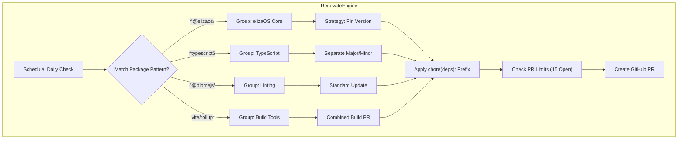
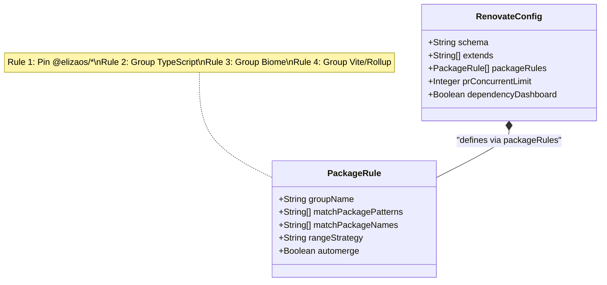
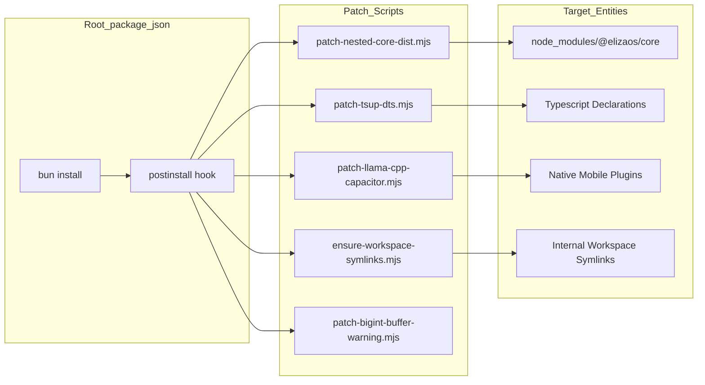

<!-- source: DeepWiki mcp.deepwiki.com · repo elizaOS/eliza · page 18.2 Dependency Management · fetched 2026-10-29 -->

# Dependency Management

Relevant source files

The following files were used as context for generating this wiki page:

- [bun.lock](bun.lock)
- [package.json](package.json)
- [packages/app-core/scripts/lib/orchestrator-desktop-dev-banner.mjs](packages/app-core/scripts/lib/orchestrator-desktop-dev-banner.mjs)
- [packages/shared/package.json](packages/shared/package.json)
- [packages/ui/package.json](packages/ui/package.json)
- [packages/ui/src/components/pages/BrowserWorkspaceView.tsx](packages/ui/src/components/pages/BrowserWorkspaceView.tsx)
- [packages/ui/test/stubs/capacitor-app.ts](packages/ui/test/stubs/capacitor-app.ts)
- [packages/ui/test/stubs/elizaos-app-wallet.ts](packages/ui/test/stubs/elizaos-app-wallet.ts)
- [packages/ui/test/stubs/elizaos-capacitor-llama.ts](packages/ui/test/stubs/elizaos-capacitor-llama.ts)
- [packages/ui/test/stubs/node-llama-cpp.ts](packages/ui/test/stubs/node-llama-cpp.ts)
- [packages/ui/vitest.config.ts](packages/ui/vitest.config.ts)

Dependency management in elizaOS is handled through a combination of automated tools, specific versioning strategies, and manual patching mechanisms designed to maintain stability across a complex monorepo. The framework utilizes **Renovate** as its primary engine for sophisticated dependency orchestration and **Dependabot** for standard security and ecosystem updates.

## Automated Update Engines

The repository integrates two primary automation tools to ensure that external libraries and internal workspace packages remain current and secure.

### Renovate Configuration
Renovate is the primary tool used for managing complex dependency relationships, particularly for the `@elizaos/*` package ecosystem. It is configured via a shared preset that defines grouping rules, scheduling, and pinning strategies.

Key features of the Renovate implementation include:
*   **Dependency Dashboard**: A centralized GitHub issue titled "🤖 Renovate Dependency Dashboard" provides an overview of all pending updates and allows manual triggering of PRs [[.github/renovate-preset.json:44-45]]().
*   **Semantic Commits**: All PRs generated by Renovate use the `chore(deps):` prefix to comply with the repository's semantic versioning standards [[.github/renovate-preset.json:46-47]]().
*   **Rate Limiting**: To prevent CI congestion, Renovate is restricted to 5 PRs per hour and a maximum of 15 concurrent open PRs [[.github/renovate-preset.json:39-40]]().
*   **Global Extension**: The root `renovate.json` extends the recommended configuration to apply base best practices across the entire monorepo [[renovate.json:1-6]]().

### Dependabot Configuration
Dependabot serves as a secondary layer, primarily focused on the root manifest and standard ecosystem updates. It is configured to check for updates on a weekly interval.

### Dependency Orchestration Flow

The following diagram illustrates how Renovate processes different package categories based on the rules defined in `renovate-preset.json`.

**Diagram: Renovate Update Logic**

Sources: [[.github/renovate-preset.json:5-47]](), [[renovate.json:1-6]]()

## Pinning and Grouping Strategies

elizaOS employs specific strategies for different segments of its dependency tree to balance development velocity with system stability.

### Internal Package Pinning (`@elizaos/*`)
A critical component of the elizaOS architecture is the pinning of internal packages. All packages matching the `^@elizaos/` pattern are strictly pinned rather than using range-based versioning (e.g., `^` or `~`). This ensures that plugins and agents always build against a known, tested version of the core runtime [[.github/renovate-preset.json:7-10]]().

In the root `bun.lock` and package manifests, these are often represented as `workspace:*` to link to the local monorepo source during development [[bun.lock:9-17]]().

### Ecosystem Grouping
To reduce "PR noise," Renovate groups related dependencies into single pull requests. This is particularly important for tools that must remain synchronized to function correctly.

| Group Name | Match Patterns | Rationale |
| :--- | :--- | :--- |
| **elizaOS Core** | `^@elizaos/` | Ensures internal workspace consistency [[.github/renovate-preset.json:8-9]]() |
| **TypeScript** | `^typescript$` | Prevents type mismatches across the monorepo [[.github/renovate-preset.json:17-18]]() |
| **Linting** | `^@biomejs/` | Maintains consistent formatting rules [[.github/renovate-preset.json:22-23]]() |
| **Build Tools** | `vite`, `rollup`, `^@vitejs/`, `^@rollup/` | Synchronizes the bundling pipeline [[.github/renovate-preset.json:27-34]]() |

### Implementation Details in Code

The logic for these groups is defined within the `packageRules` array of the Renovate configuration.

**Diagram: Code Entity Association (Renovate Rules)**

Sources: [[.github/renovate-preset.json:1-41]]()

## Manual Patching and Fixes

In cases where upstream dependencies require immediate fixes that are not yet available in a stable release, elizaOS uses a `patches/` directory and dedicated maintenance scripts.

### Post-Install Patching
The framework executes a series of scripts after installation to apply fixes to the `node_modules` tree. These are orchestrated via the `postinstall` hook in the root `package.json` [[package.json:21]]().

*   **Nested Core Dist**: Executed via `patch-nested-core-dist.mjs` to fix issues with nested `@elizaos/core` distribution files [[package.json:21]]().
*   **TSUP Declarations**: Executed via `patch-tsup-dts.mjs` to handle complex `.d.ts` generation [[package.json:21]]().
*   **Capacitor Llama.cpp**: Executed via `patch-llama-cpp-capacitor.mjs` for mobile-specific patches for the inference engine [[package.json:21]]().
*   **BigInt Buffer Warning**: Executed via `patch-bigint-buffer-warning.mjs` to suppress specific Node.js/Bun compatibility warnings [[package.json:21]]().

### Workspace Dependency Maintenance
The framework includes a utility script `fix-workspace-deps.mjs` to ensure consistency across the monorepo's `package.json` files.
*   `fix-deps`: Runs the fix utility `bun packages/scripts/fix-workspace-deps.mjs` [[package.json:24]]().
*   `fix-deps:check`: Validates workspace dependency health using the `--check` flag [[package.json:25]]().
*   `fix-deps:restore`: Reverts changes made by the fix utility using the `--restore` flag [[package.json:26]]().

**Diagram: Post-Install Maintenance Pipeline**

Sources: [[package.json:21-26]]()

## PR Lifecycle and Maintenance

Dependency updates follow a strict lifecycle to ensure they do not break the framework's multi-language runtimes.

1.  **Detection**: Renovate checks for updates daily according to the UTC timezone [[.github/renovate-preset.json:37-38]]().
2.  **Creation**: PRs are created with a `chore(deps):` prefix. If a PR results in a conflict, Renovate is configured to rebase automatically when conflicted [[.github/renovate-preset.json:46-50]]().
3.  **Validation**: PRs must pass the standard CI suite. This includes the `ci.yaml` workflow which validates multi-language tests and linting.
4.  **Merging**: Automerge is explicitly disabled (`"automerge": false`) for both standard and core dependencies [[.github/renovate-preset.json:13, 48]](). This requires a maintainer to manually review and approve dependency changes, ensuring no regressions in the AI agent's behavior.
5.  **Version Separation**: Renovate is configured to separate Major and Minor updates into different PRs (`"separateMajorMinor": true`), while Minor and Patch updates are typically combined (`"separateMinorPatch": false`) [[.github/renovate-preset.json:42-43]]().

Sources: [[.github/renovate-preset.json:1-51]](), [[renovate.json:1-6]](), [[package.json:21-26]]()

---

