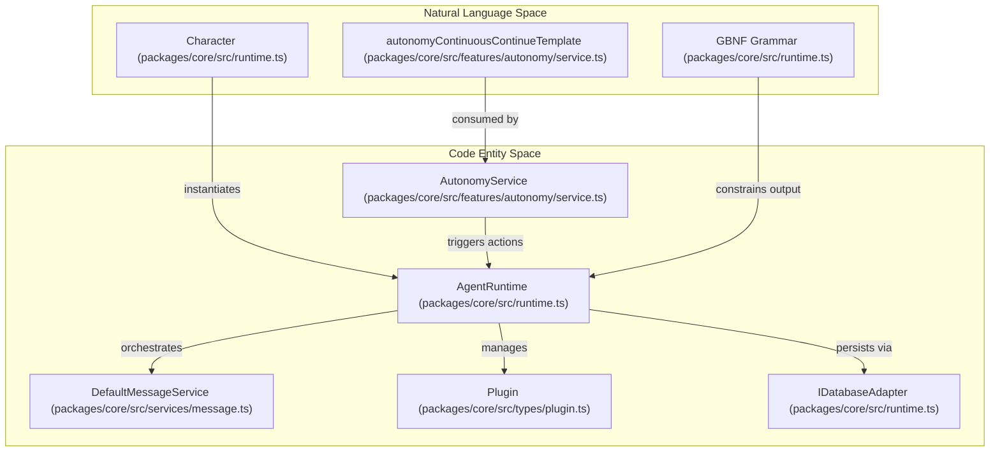
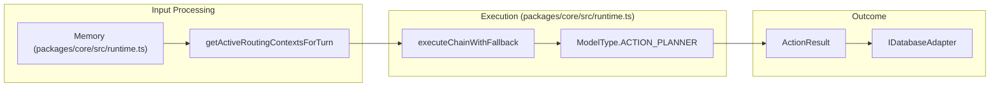

<!-- source: DeepWiki mcp.deepwiki.com · repo elizaOS/eliza · page 2 Core Runtime · fetched 2026-10-29 -->

# Core Runtime

Relevant source files

The following files were used as context for generating this wiki page:

- [packages/app-core/scripts/install-android-sms-gateway.md](packages/app-core/scripts/install-android-sms-gateway.md)
- [packages/benchmarks/orchestrator/README.md](packages/benchmarks/orchestrator/README.md)
- [packages/benchmarks/orchestrator/code_agent_coverage.py](packages/benchmarks/orchestrator/code_agent_coverage.py)
- [packages/benchmarks/orchestrator/code_agent_matrix.py](packages/benchmarks/orchestrator/code_agent_matrix.py)
- [packages/benchmarks/orchestrator/tests/test_code_agent_matrix.py](packages/benchmarks/orchestrator/tests/test_code_agent_matrix.py)
- [packages/cloud-api/v1/billing/resources/[id]/cancel/route.ts](packages/cloud-api/v1/billing/resources/[id]/cancel/route.ts)
- [packages/cloud-shared/src/lib/services/active-billing.ts](packages/cloud-shared/src/lib/services/active-billing.ts)
- [packages/cloud-shared/src/lib/services/agent-managed-discord.ts](packages/cloud-shared/src/lib/services/agent-managed-discord.ts)
- [packages/cloud-shared/src/lib/services/agent-managed-github.ts](packages/cloud-shared/src/lib/services/agent-managed-github.ts)
- [packages/core/src/__tests__/runtime-settings.test.ts](packages/core/src/__tests__/runtime-settings.test.ts)
- [packages/core/src/features/autonomy/action.ts](packages/core/src/features/autonomy/action.ts)
- [packages/core/src/features/autonomy/service.test.ts](packages/core/src/features/autonomy/service.test.ts)
- [packages/core/src/features/autonomy/service.ts](packages/core/src/features/autonomy/service.ts)
- [packages/core/src/runtime.ts](packages/core/src/runtime.ts)
- [packages/core/src/runtime/__tests__/message-post-connectors.test.ts](packages/core/src/runtime/__tests__/message-post-connectors.test.ts)
- [packages/core/src/services/optimized-prompt.ts](packages/core/src/services/optimized-prompt.ts)
- [packages/core/src/types/plugin.ts](packages/core/src/types/plugin.ts)
- [packages/core/src/types/runtime.ts](packages/core/src/types/runtime.ts)
- [packages/examples/_plugin/package.json](packages/examples/_plugin/package.json)
- [packages/examples/_plugin/test.ts](packages/examples/_plugin/test.ts)
- [packages/examples/smartglasses/README.md](packages/examples/smartglasses/README.md)
- [packages/examples/smartglasses/eliza-runtime-smoke.ts](packages/examples/smartglasses/eliza-runtime-smoke.ts)
- [packages/examples/smartglasses/package-smoke.ts](packages/examples/smartglasses/package-smoke.ts)
- [packages/examples/smartglasses/smartglasses.test.ts](packages/examples/smartglasses/smartglasses.test.ts)
- [packages/examples/smartglasses/smartglasses.ts](packages/examples/smartglasses/smartglasses.ts)
- [packages/homepage/tests/e2e/app-routes-flow.spec.ts](packages/homepage/tests/e2e/app-routes-flow.spec.ts)
- [packages/scripts/cloud/bluebubbles-local-bridge.ts](packages/scripts/cloud/bluebubbles-local-bridge.ts)
- [packages/scripts/run-autonomy-cerebras-loops.ts](packages/scripts/run-autonomy-cerebras-loops.ts)
- [plugins/plugin-agent-orchestrator/__tests__/unit/sanitize-planner-text.test.ts](plugins/plugin-agent-orchestrator/__tests__/unit/sanitize-planner-text.test.ts)
- [plugins/plugin-agent-orchestrator/__tests__/unit/scan-and-unlink-older-than.test.ts](plugins/plugin-agent-orchestrator/__tests__/unit/scan-and-unlink-older-than.test.ts)
- [plugins/plugin-agent-orchestrator/__tests__/unit/session-store.test.ts](plugins/plugin-agent-orchestrator/__tests__/unit/session-store.test.ts)
- [plugins/plugin-agent-orchestrator/src/providers/active-sub-agents.ts](plugins/plugin-agent-orchestrator/src/providers/active-sub-agents.ts)
- [plugins/plugin-agent-orchestrator/src/services/audit.ts](plugins/plugin-agent-orchestrator/src/services/audit.ts)
- [plugins/plugin-agent-orchestrator/src/services/session-store.ts](plugins/plugin-agent-orchestrator/src/services/session-store.ts)
- [plugins/plugin-agent-orchestrator/src/services/types.ts](plugins/plugin-agent-orchestrator/src/services/types.ts)
- [plugins/plugin-discord/__tests__/extract-content-metadata.test.ts](plugins/plugin-discord/__tests__/extract-content-metadata.test.ts)
- [plugins/plugin-xr/src/protocol.ts](plugins/plugin-xr/src/protocol.ts)
- [plugins/plugin-xr/src/routes/xr-views.ts](plugins/plugin-xr/src/routes/xr-views.ts)
- [plugins/plugin-xr/src/services/xr-session-service.ts](plugins/plugin-xr/src/services/xr-session-service.ts)

This page provides an overview of the `AgentRuntime` engine, the central orchestrator of elizaOS. It covers the runtime's role in managing agent identity, service lifecycles, model integration, and the message processing pipeline.

---

## Overview

The **Core Runtime** is the heart of elizaOS. It is responsible for instantiating agents based on Character Definitions, managing their long-term memory via database adapters, and executing the logic that transforms user input into autonomous actions.

Every agent in elizaOS is an instance of the `AgentRuntime` class. It serves as the "glue" between high-level personality and low-level system capabilities, managing the registration of `Action`, `Evaluator`, `Provider`, and `Plugin` entities [packages/core/src/runtime.ts:156-167]().

**Key Implementation Files:**
- **Core Runtime:** `AgentRuntime` class in [packages/core/src/runtime.ts:156]()
- **Message Service:** `DefaultMessageService` in [packages/core/src/services/message.ts:51]()
- **Autonomy Service:** `AutonomyService` in [packages/core/src/features/autonomy/service.ts:68]()
- **Interfaces:** `IAgentRuntime` definition in [packages/core/src/runtime.ts:101]()

---

## AgentRuntime Orchestrator

The `AgentRuntime` implements the `IAgentRuntime` interface, providing a unified API for interacting with an agent. It maintains the agent's identity via `agentId` and `character` configuration [packages/core/src/runtime.ts:156-200]().

For detailed documentation on initialization, lifecycle hooks, and core methods, see [AgentRuntime](#2.1).

### Architectural Role
The runtime sits at the center of the system, mediating between the **Natural Language Space** (prompts, characters) and the **Code Entity Space** (plugins, services, databases).

**Diagram: Core Runtime System Context**

Sources: [packages/core/src/runtime.ts:156-200](), [packages/core/src/features/autonomy/service.ts:68-90](), [packages/core/src/types/plugin.ts:198-210]()

---

## Subsystem Overviews

### Character System
The Character System defines the "who" of the agent. The `AgentRuntime` holds a `Character` object containing `bio`, `lore`, `adjectives`, and `postExamples` [packages/core/src/runtime.ts:75](). These are used during state composition to ensure the LLM maintains a consistent persona. The system also supports autonomous thought generation via the `AutonomyService` [packages/core/src/features/autonomy/service.ts:200-210]().

### Model Providers
elizaOS interacts with models through a standardized interface. The runtime supports various `ModelType` categories (e.g., `TEXT_LARGE`, `ACTION_PLANNER`) [packages/core/src/runtime.ts:119-120](). It handles model selection, fallback chains via `executeChainWithFallback`, and structured output parsing [packages/core/src/runtime.ts:26-30]().

### Settings and Configuration
The runtime is configured via environment variables and runtime settings. It uses `decryptSecret` for sensitive keys [packages/core/src/runtime.ts:53]() and manages hierarchical data storage.
For details, see [Settings and Configuration](#2.5).

### Message Processing Pipeline
The v5 pipeline introduces a sophisticated message handling flow:
1.  **Triage:** The system decides if the agent should respond based on character settings and context.
2.  **Context Routing:** Employs `getActiveRoutingContextsForTurn` to determine which domain-specific tools are needed [packages/core/src/runtime.ts:208-210]().
3.  **Planning:** Executes logic that allows the agent to call multiple tools and evaluate results.
4.  **Autonomy:** The `AutonomyService` provides recurring background loops for internal thinking and proactive actions [packages/core/src/features/autonomy/service.ts:68-75]().

For details, see [Message Processing Pipeline](#2.6).

---

## Core Data Entities

The runtime manages several key data structures to maintain state and context.

| Entity | Code Symbol | Description |
|---|---|---|
| **Memory** | `Memory` | A unit of information with `UUID` and `Content` [packages/core/src/runtime.ts:109]() |
| **State** | `State` | The combined context for the LLM, including `values` and `data` [packages/core/src/runtime.ts:154]() |
| **Action** | `Action` | A discrete capability that can be executed by the agent [packages/core/src/runtime.ts:69]() |
| **Plugin** | `Plugin` | A bundle of actions, providers, and evaluators [packages/core/src/runtime.ts:130]() |

**Diagram: Message to Action Pipeline**

Sources: [packages/core/src/runtime.ts:109-120](), [packages/core/src/runtime.ts:208-210](), [packages/core/src/runtime.ts:26-30]()

---

## Streaming and Utilities

The core runtime includes robust utilities for handling real-time AI interactions:
- **Streaming Context:** Managed via `runWithStreamingContext` to handle chunked LLM output and hook emissions [packages/core/src/runtime.ts:57-58]().
- **Optimized Prompts:** `OptimizedPromptService` provides a runtime cache of native-optimizer artifacts to substitute high-performance system prompts [packages/core/src/services/optimized-prompt.ts:2-9]().
- **Trajectory Context:** `getTrajectoryContext` tracks the reasoning trace for debugging and reinforcement learning [packages/core/src/runtime.ts:60-62]().

Sources: [packages/core/src/runtime.ts:57-62](), [packages/core/src/services/optimized-prompt.ts:2-15]()

---

