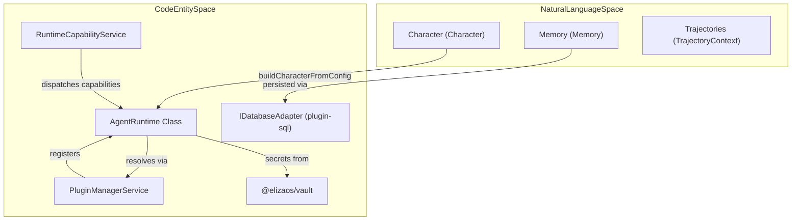
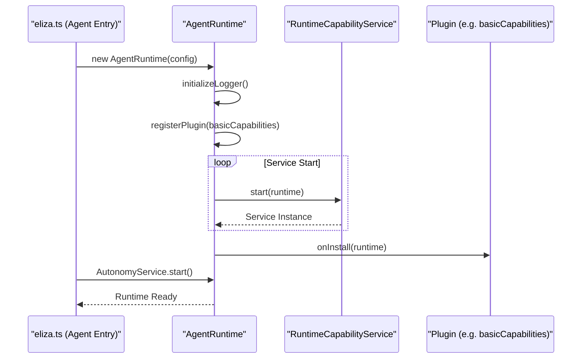

<!-- source: DeepWiki mcp.deepwiki.com · repo elizaOS/eliza · page 2.1 AgentRuntime · fetched 2026-10-29 -->

# AgentRuntime

Relevant source files

The following files were used as context for generating this wiki page:

- [.env.example](.env.example)
- [.github/workflows/sandbox-live-smoke.yml](.github/workflows/sandbox-live-smoke.yml)
- [knip.json](knip.json)
- [packages/agent/docs/e2b-capability-routing.md](packages/agent/docs/e2b-capability-routing.md)
- [packages/agent/scripts/live-sandbox-smoke.ts](packages/agent/scripts/live-sandbox-smoke.ts)
- [packages/agent/scripts/mobile-stubs/e2b-capability-router.cjs](packages/agent/scripts/mobile-stubs/e2b-capability-router.cjs)
- [packages/agent/src/runtime/eliza.ts](packages/agent/src/runtime/eliza.ts)
- [packages/agent/src/runtime/roles/src/index.ts](packages/agent/src/runtime/roles/src/index.ts)
- [packages/agent/src/services/e2b-capability-router.test.ts](packages/agent/src/services/e2b-capability-router.test.ts)
- [packages/agent/src/services/e2b-capability-router.ts](packages/agent/src/services/e2b-capability-router.ts)
- [packages/app-core/platforms/electrobun/tsconfig.json](packages/app-core/platforms/electrobun/tsconfig.json)
- [packages/app-core/platforms/electrobun/vitest.electrobun.config.ts](packages/app-core/platforms/electrobun/vitest.electrobun.config.ts)
- [packages/app/scripts/mobile-release-preflight.mjs](packages/app/scripts/mobile-release-preflight.mjs)
- [packages/app/src/types/side-effect-app-modules.d.ts](packages/app/src/types/side-effect-app-modules.d.ts)
- [packages/benchmarks/vision-language/src/runner.ts](packages/benchmarks/vision-language/src/runner.ts)
- [packages/benchmarks/vision-language/src/runtime-resolver.ts](packages/benchmarks/vision-language/src/runtime-resolver.ts)
- [packages/cloud-api/v1/billing/resources/[id]/cancel/route.ts](packages/cloud-api/v1/billing/resources/[id]/cancel/route.ts)
- [packages/cloud-shared/src/lib/services/active-billing.ts](packages/cloud-shared/src/lib/services/active-billing.ts)
- [packages/cloud-shared/src/lib/services/agent-managed-discord.ts](packages/cloud-shared/src/lib/services/agent-managed-discord.ts)
- [packages/cloud-shared/src/lib/services/agent-managed-github.ts](packages/cloud-shared/src/lib/services/agent-managed-github.ts)
- [packages/core/src/__tests__/runtime-settings.test.ts](packages/core/src/__tests__/runtime-settings.test.ts)
- [packages/core/src/connectors/oauth-role.test.ts](packages/core/src/connectors/oauth-role.test.ts)
- [packages/core/src/connectors/oauth-role.ts](packages/core/src/connectors/oauth-role.ts)
- [packages/core/src/features/advanced-capabilities/evaluators/index.ts](packages/core/src/features/advanced-capabilities/evaluators/index.ts)
- [packages/core/src/features/advanced-capabilities/index.ts](packages/core/src/features/advanced-capabilities/index.ts)
- [packages/core/src/features/advanced-capabilities/providers/contacts.ts](packages/core/src/features/advanced-capabilities/providers/contacts.ts)
- [packages/core/src/features/autonomy/action.ts](packages/core/src/features/autonomy/action.ts)
- [packages/core/src/features/autonomy/service.test.ts](packages/core/src/features/autonomy/service.test.ts)
- [packages/core/src/features/autonomy/service.ts](packages/core/src/features/autonomy/service.ts)
- [packages/core/src/features/basic-capabilities/index.ts](packages/core/src/features/basic-capabilities/index.ts)
- [packages/core/src/features/index.ts](packages/core/src/features/index.ts)
- [packages/core/src/features/plugin-manager/actions/plugin.ts](packages/core/src/features/plugin-manager/actions/plugin.ts)
- [packages/core/src/features/plugin-manager/coreExtensions.ts](packages/core/src/features/plugin-manager/coreExtensions.ts)
- [packages/core/src/features/plugin-manager/index.ts](packages/core/src/features/plugin-manager/index.ts)
- [packages/core/src/features/plugin-manager/services/pluginManagerService.ts](packages/core/src/features/plugin-manager/services/pluginManagerService.ts)
- [packages/core/src/features/plugin-manager/types.ts](packages/core/src/features/plugin-manager/types.ts)
- [packages/core/src/index.browser.ts](packages/core/src/index.browser.ts)
- [packages/core/src/index.edge.ts](packages/core/src/index.edge.ts)
- [packages/core/src/index.node.ts](packages/core/src/index.node.ts)
- [packages/core/src/plugins/native-features.ts](packages/core/src/plugins/native-features.ts)
- [packages/core/src/runtime.ts](packages/core/src/runtime.ts)
- [packages/core/src/services/optimized-prompt.ts](packages/core/src/services/optimized-prompt.ts)
- [packages/core/src/services/runtime-capability-service.ts](packages/core/src/services/runtime-capability-service.ts)
- [packages/examples/_plugin/package.json](packages/examples/_plugin/package.json)
- [packages/examples/_plugin/test.ts](packages/examples/_plugin/test.ts)
- [packages/homepage/tests/e2e/app-routes-flow.spec.ts](packages/homepage/tests/e2e/app-routes-flow.spec.ts)
- [packages/plugin-remote-manifest/examples/carrot-clock/plugin.json](packages/plugin-remote-manifest/examples/carrot-clock/plugin.json)
- [packages/plugin-remote-manifest/examples/hello-carrot/plugin.json](packages/plugin-remote-manifest/examples/hello-carrot/plugin.json)
- [packages/prompts/specs/actions/core.json](packages/prompts/specs/actions/core.json)
- [packages/scripts/run-autonomy-cerebras-loops.ts](packages/scripts/run-autonomy-cerebras-loops.ts)
- [packages/ui/src/components/settings/CloudInstancePanel.tsx](packages/ui/src/components/settings/CloudInstancePanel.tsx)
- [packages/ui/src/onboarding/onboarding-config.ts](packages/ui/src/onboarding/onboarding-config.ts)
- [plugins/plugin-calendly/src/connector-account-provider.ts](plugins/plugin-calendly/src/connector-account-provider.ts)
- [plugins/plugin-elizacloud/src/index.browser.ts](plugins/plugin-elizacloud/src/index.browser.ts)
- [plugins/plugin-linear/src/connector-account-provider.ts](plugins/plugin-linear/src/connector-account-provider.ts)
- [plugins/plugin-shopify/src/connector-account-provider.ts](plugins/plugin-shopify/src/connector-account-provider.ts)

This page documents the `AgentRuntime` class: its purpose, initialization, lifecycle, and role as the central orchestrator of agent behavior within elizaOS. It serves as the primary execution engine, coordinating between character definitions, plugins, and environment-specific configurations.

---

## Overview

`AgentRuntime` is the core class responsible for managing an agent's lifecycle. It coordinates between the character's personality, registered plugins, and the underlying database and model providers. In the modern elizaOS architecture, the runtime is designed to be highly modular, supporting dynamic plugin resolution and platform-specific optimizations (e.g., AOSP for mobile, Electrobun for desktop).

The runtime is exported via environment-specific entry points to ensure compatibility across Node.js, Edge, and Browser environments:
- **Node.js**: `packages/core/src/index.node.ts` [packages/core/src/index.node.ts:157-157]()
- **Edge**: `packages/core/src/index.edge.ts` [packages/core/src/index.edge.ts:46-46]()
- **Browser**: `packages/core/src/index.browser.ts` [packages/core/src/index.browser.ts:47-47]()

Sources: [packages/core/src/runtime.ts:108-111](), [packages/agent/src/runtime/eliza.ts:77-92]()

---

## Architectural Position

The runtime acts as the central hub, connecting high-level "Natural Language" concepts (like characters and conversation history) to low-level "Code Entities" (like database adapters and LLM handlers). It leverages a sophisticated plugin resolution system to load capabilities based on environment variables and character configuration.

**Diagram: AgentRuntime System Context**

Sources: [packages/core/src/runtime.ts:69-167](), [packages/core/src/services/runtime-capability-service.ts:108-111](), [packages/agent/src/runtime/eliza.ts:149-154]()

---

## Plugin Registration and Resolution

The `AgentRuntime` uses a dynamic registration system to extend its capabilities. Plugins provide actions, evaluators, providers, and services that are injected into the runtime during startup.

### Capability Tiers
The runtime distinguishes between different levels of capabilities:
1. **Basic Capabilities**: Core functionality like reply/ignore actions, essential services (Task, Embedding), and event handlers [packages/core/src/features/basic-capabilities/index.ts:1-11]().
2. **Advanced Capabilities**: Extended context management (Facts, Relationships, Roles) and personality management services, enabled via `enableExtendedCapabilities` [packages/core/src/features/advanced-capabilities/index.ts:4-15]().
3. **Native Features**: Platform-specific features like trajectory logging and secure secrets management [packages/core/src/runtime.ts:18-24]().

### Plugin Lifecycle
Plugins are not just static collections of code; they have a lifecycle managed by the runtime. The `installRuntimePluginLifecycle` function ensures that plugins are properly initialized and can react to runtime events [packages/core/src/runtime.ts:17-17]().

Sources: [packages/core/src/features/basic-capabilities/index.ts:45-52](), [packages/core/src/features/advanced-capabilities/index.ts:144-149](), [packages/core/src/runtime.ts:130-140]()

---

## Initialization and Lifecycle

### Startup Sequence
The agent startup sequence is managed through `AgentRuntime`. This process involves setting up the workspace, initializing the database, and loading plugins in a specific order.

1. **Environment Setup**: Resolves process environment variables and vault secrets [packages/agent/src/runtime/eliza.ts:30-30]().
2. **Character Hydration**: Uses `buildCharacterFromConfig` to create the agent's identity [packages/agent/src/runtime/eliza.ts:149-149]().
3. **Plugin Resolution**: `resolvePlugins` identifies the necessary plugins based on character and environment [packages/agent/src/runtime/eliza.ts:31-31]().
4. **Service Boot**: Starts the `RuntimeCapabilityService` and other registered services [packages/core/src/services/runtime-capability-service.ts:136-140]().

**Diagram: Agent Startup Sequence**

Sources: [packages/agent/src/runtime/eliza.ts:77-92](), [packages/core/src/runtime.ts:1-20](), [packages/core/src/services/runtime-capability-service.ts:136-140]()

---

## Capability Routing

A significant addition to the runtime is the `RuntimeCapabilityService`. This service acts as a unified router for various agent capabilities, dispatching requests to local or remote strategies.

### Strategy-Based Dispatch
The `RuntimeCapabilityService` implements the `ElizaCapabilityRouter` interface and manages:
- **File System (fs)**: File operations [packages/core/src/services/runtime-capability-service.ts:156-158]().
- **Terminal (pty)**: Shell and command execution [packages/core/src/services/runtime-capability-service.ts:160-162]().
- **Git**: Repository management [packages/core/src/services/runtime-capability-service.ts:164-166]().
- **Local Model**: On-device inference status [packages/core/src/services/runtime-capability-service.ts:168-170]().

### Remote Execution (E2B)
For sandboxed execution, the runtime can use the `E2BRemoteCapabilityRouterService`. This allows agents to run code in secure, isolated environments provided by E2B or Eliza Cloud [packages/agent/src/services/e2b-capability-router.ts:4-30]().

Sources: [packages/core/src/services/runtime-capability-service.ts:33-67](), [packages/agent/src/services/e2b-capability-router.ts:56-81]()

---

## Core Services and Capabilities

The `AgentRuntime` provides a set of built-in services that are registered during initialization.

| Service | Purpose | File Reference |
|---|---|---|
| `AutonomyService` | Manages the agent's autonomous decision-making loop | [packages/core/src/features/basic-capabilities/index.ts:75-75]() |
| `EmbeddingGenerationService` | Handles text-to-vector transformations | [packages/core/src/features/basic-capabilities/index.ts:22-22]() |
| `TaskService` | Manages scheduled tasks and background workers | [packages/core/src/features/basic-capabilities/index.ts:26-26]() |
| `EvaluatorService` | Runs post-turn analysis (Facts, Skills, Relationships) | [packages/core/src/features/basic-capabilities/index.ts:23-23]() |
| `RuntimeCapabilityService` | Unified router for fs/pty/git/model capabilities | [packages/core/src/services/runtime-capability-service.ts:108-111]() |

### Advanced Features
- **Turn Controllers**: Managed via `TurnControllerRegistry` to coordinate conversation flow [packages/core/src/runtime.ts:48-48]().
- **Message Triage**: Cross-platform messaging triage using `BaseMessageAdapter` and `DefaultTriageService` [packages/core/src/index.node.ts:93-125]().
- **Response Grammar**: Enforces structured output using GBNF grammars [packages/core/src/runtime.ts:206-206]().

Sources: [packages/core/src/runtime.ts:14-68](), [packages/core/src/features/basic-capabilities/index.ts:13-56](), [packages/core/src/features/advanced-capabilities/index.ts:113-139]()

---

