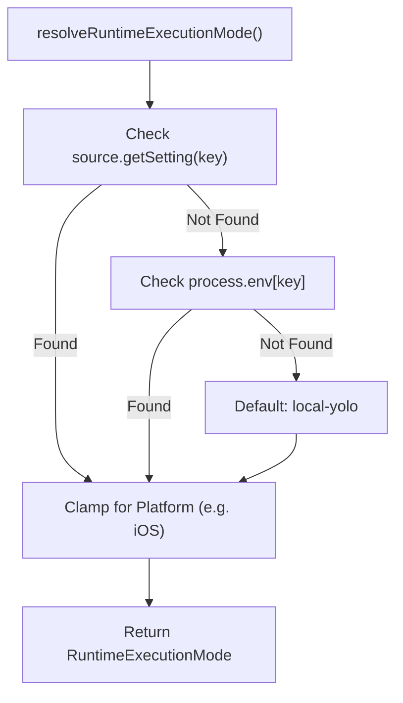
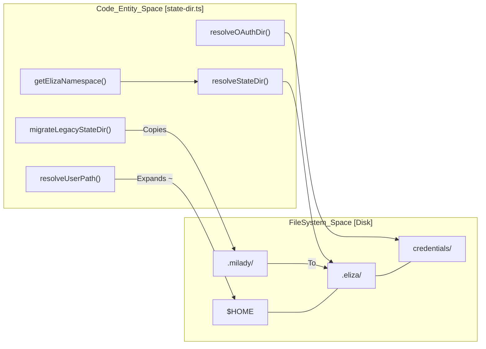
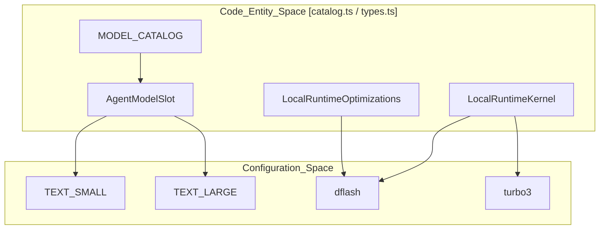

<!-- source: DeepWiki mcp.deepwiki.com · repo elizaOS/eliza · page 2.5 Settings and Configuration · fetched 2026-10-29 -->

# Settings and Configuration

Relevant source files

The following files were used as context for generating this wiki page:

- [packages/agent/src/config/paths.ts](packages/agent/src/config/paths.ts)
- [packages/agent/src/runtime/restart.ts](packages/agent/src/runtime/restart.ts)
- [packages/agent/src/services/relationships-graph.ts](packages/agent/src/services/relationships-graph.ts)
- [packages/app-core/deploy/Dockerfile.cloud](packages/app-core/deploy/Dockerfile.cloud)
- [packages/app-core/deploy/Dockerfile.cloud.dockerignore](packages/app-core/deploy/Dockerfile.cloud.dockerignore)
- [packages/app-core/src/runtime/build-variant.ts](packages/app-core/src/runtime/build-variant.ts)
- [packages/app-core/src/runtime/sandbox-policy.ts](packages/app-core/src/runtime/sandbox-policy.ts)
- [packages/benchmarks/lifeops-bench/eliza_lifeops_bench/lifeworld/entities.py](packages/benchmarks/lifeops-bench/eliza_lifeops_bench/lifeworld/entities.py)
- [packages/benchmarks/lifeops-bench/eliza_lifeops_bench/lifeworld/world.py](packages/benchmarks/lifeops-bench/eliza_lifeops_bench/lifeworld/world.py)
- [packages/core/src/build-variant.ts](packages/core/src/build-variant.ts)
- [packages/core/src/features/secrets/actions/get-secret.ts](packages/core/src/features/secrets/actions/get-secret.ts)
- [packages/core/src/sandbox-policy.ts](packages/core/src/sandbox-policy.ts)
- [packages/core/src/utils/read-env.test.ts](packages/core/src/utils/read-env.test.ts)
- [packages/core/src/utils/read-env.ts](packages/core/src/utils/read-env.ts)
- [packages/core/src/utils/state-dir.test.ts](packages/core/src/utils/state-dir.test.ts)
- [packages/core/src/utils/state-dir.ts](packages/core/src/utils/state-dir.ts)
- [packages/scenario-runner/src/cerebras-judge.d.ts](packages/scenario-runner/src/cerebras-judge.d.ts)
- [packages/scenario-runner/src/cerebras-judge.d.ts.map](packages/scenario-runner/src/cerebras-judge.d.ts.map)
- [packages/shared/src/awareness/registry.ts](packages/shared/src/awareness/registry.ts)
- [packages/shared/src/config/runtime-mode.ts](packages/shared/src/config/runtime-mode.ts)
- [packages/shared/src/index.ts](packages/shared/src/index.ts)
- [packages/shared/src/local-inference/catalog.test.ts](packages/shared/src/local-inference/catalog.test.ts)
- [packages/shared/src/local-inference/index.ts](packages/shared/src/local-inference/index.ts)
- [packages/shared/src/local-inference/kokoro-execution-provider.test.ts](packages/shared/src/local-inference/kokoro-execution-provider.test.ts)
- [packages/shared/src/local-inference/kokoro-execution-provider.ts](packages/shared/src/local-inference/kokoro-execution-provider.ts)
- [packages/shared/src/local-inference/providers-types.ts](packages/shared/src/local-inference/providers-types.ts)
- [packages/shared/src/local-inference/types.ts](packages/shared/src/local-inference/types.ts)
- [packages/shared/src/local-inference/voice-models.ts](packages/shared/src/local-inference/voice-models.ts)
- [packages/ui/src/api/client-local-inference.ts](packages/ui/src/api/client-local-inference.ts)
- [packages/ui/src/build-variant.ts](packages/ui/src/build-variant.ts)
- [packages/ui/src/services/local-inference/catalog.ts](packages/ui/src/services/local-inference/catalog.ts)
- [packages/ui/src/services/local-inference/types.ts](packages/ui/src/services/local-inference/types.ts)
- [plugins.json](plugins.json)
- [plugins/plugin-local-inference/src/services/dflash-doctor.ts](plugins/plugin-local-inference/src/services/dflash-doctor.ts)
- [plugins/plugin-sql/package.json](plugins/plugin-sql/package.json)
- [plugins/plugin-workflow/README.md](plugins/plugin-workflow/README.md)

This page documents all environment variables and configuration options recognized by elizaOS, including server settings, database backend selection, AI provider credentials, data directory paths, and runtime execution modes. Configuration is loaded at process startup from a `.env` file in the working directory, or from environment variables set in the shell.

For how the CLI prompts for and generates `.env` files interactively, see [CLI Deploy Command](#4.2). For database backend architecture and connection pooling details, see [Memory and Database Adapters](#6.1). For the data directory file-system layout, see [Data Directory Structure](#6.2). For AI model provider selection logic at runtime, see [AgentRuntime](#2.1).

---

## Configuration Source

The canonical template for all recognized environment variables is provided in the repository's `.env.example`. This file serves as the documentation for the expected keys and their roles.

### Runtime Environment Utilities
The system utilizes centralized utilities in `packages/shared/src/env-utils.ts` and `packages/core/src/utils/read-env.ts` to resolve configuration. The `readEnv` function provides a standardized way to read environment variables with support for legacy aliases and silent mode [packages/core/src/utils/read-env.ts:1-20](). It is used extensively by the state directory resolution logic [packages/core/src/utils/state-dir.ts:29-30]().

---

## Runtime Execution Modes

elizaOS implements a tiered execution model that dictates security policies and sandbox requirements. This is controlled via the `ELIZA_RUNTIME_MODE` variable.

| Mode | Key | Description |
|---|---|---|
| **Cloud** | `cloud` | Optimized for managed environments; enforces strict security [packages/shared/src/config/runtime-mode.ts:34-40](). |
| **Local Safe** | `local-safe` | Local execution with mandatory sandboxing for sensitive operations [packages/shared/src/config/runtime-mode.ts:41-47](). |
| **Local YOLO** | `local-yolo` | Default mode; local execution without sandbox restrictions [packages/shared/src/config/runtime-mode.ts:48-54](). |

The resolution logic for these modes is implemented in `resolveRuntimeExecutionMode`, which checks `ELIZA_RUNTIME_MODE`, `RUNTIME_MODE`, and `LOCAL_RUNTIME_MODE` in order [packages/shared/src/config/runtime-mode.ts:132-154]().

**Execution Mode Resolution Flow:**

Sources: [packages/shared/src/config/runtime-mode.ts:5-55](), [packages/shared/src/config/runtime-mode.ts:132-154]()

---

## Data Directory Hierarchy

All persistent runtime data is stored under a configurable base directory. Every caller touching persisted state must use `resolveStateDir()` to ensure consistent path resolution [packages/core/src/utils/state-dir.ts:9-11]().

### Path Precedence
1. `ELIZA_STATE_DIR` (or legacy `MILADY_STATE_DIR`) [packages/core/src/utils/state-dir.ts:58-63]().
2. `<homedir>/.${ELIZA_NAMESPACE ?? "eliza"}` [packages/core/src/utils/state-dir.ts:64-65]().

### State Directory Components

| Variable | Default Path | Contents |
|---|---|---|
| `ELIZA_STATE_DIR` | `~/.eliza` | Root for all user state (skills, training, optimized prompts) [packages/core/src/utils/state-dir.ts:58-65](). |
| `ELIZA_OAUTH_DIR` | `{state-dir}/credentials` | OAuth token storage and session metadata [packages/core/src/utils/state-dir.ts:71-79](). |
| `ELIZA_NAMESPACE` | `eliza` | Used to name the default hidden directory in the user's home [packages/core/src/utils/state-dir.ts:48-52](). |

### Legacy Migration
On first run, if `~/.eliza` does not exist but a legacy `~/.milady` directory does, `migrateLegacyStateDir` automatically copies contents to the new location [packages/core/src/utils/state-dir.ts:118-144]().

**State Directory Entity Mapping:**

Sources: [packages/core/src/utils/state-dir.ts:35-154](), [packages/core/src/utils/state-dir.test.ts:23-86]()

---

## Local Inference Configuration

elizaOS includes a sophisticated local inference stack (Eliza-1) configured via a model catalog and tier system.

### Model Tiering
Models are categorized into tiers (0.8B to 27B) with specific hardware requirements [packages/shared/src/local-inference/catalog.js:15-30]().

| Setting | Description |
|---|---|
| `ELIZA_1_TIER` | Selects the model tier (e.g., `eliza-1-2b`) [packages/shared/src/local-inference/catalog.js:5-10](). |
| `GGML_OPENVINO_DEVICE` | Selects hardware (CPU/GPU/NPU) for OpenVINO workloads [packages/shared/src/local-inference/types.ts:149-152](). |

### Local Runtime Kernels
The runtime advertises capabilities via kernels like `dflash`, `turbo3`, and `polarquant` [packages/shared/src/local-inference/types.ts:169-176](). These are required for Eliza-1 W4-B kernel sets [packages/shared/src/local-inference/types.ts:153-160]().

**Inference Configuration Mapping:**

Sources: [packages/shared/src/local-inference/types.ts:12-32](), [packages/shared/src/local-inference/types.ts:169-185](), [packages/shared/src/local-inference/catalog.test.ts:113-124]()

---

## Database Configuration

elizaOS supports multiple database adapters, primarily managed through the SQL plugin.

| Variable | Description |
|---|---|
| `POSTGRES_URL` | Connection string for remote or local PostgreSQL instances [plugins/plugin-sql/package.json:86](). |
| `PGLITE_DATA_DIR` | Path for the embedded PGLite database [plugins/plugin-sql/package.json:83](). |

The `@elizaos/plugin-sql` package utilizes Drizzle ORM and support both Node.js and Browser environments [plugins/plugin-sql/package.json:10-29]().

---

## Docker and Cloud Deployment

Cloud-optimized deployments use a specific configuration to minimize image size and manage runtime entry points.

| Variable | Default | Description |
|---|---|---|
| `APP_PORT` | `2138` | Port the agent API binds to [packages/app-core/deploy/Dockerfile.cloud:8](). |
| `APP_API_BIND` | `127.0.0.1` | Network interface for the API [packages/app-core/deploy/Dockerfile.cloud:9](). |
| `NODE_LLAMA_CPP_SKIP_DOWNLOAD` | `true` | Prevents binary downloads during Docker build [packages/app-core/deploy/Dockerfile.cloud:49](). |

Sources: [packages/app-core/deploy/Dockerfile.cloud:5-26]()

---

