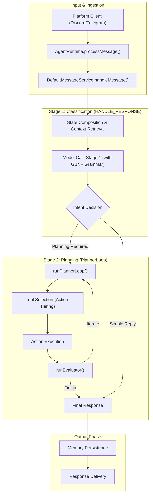
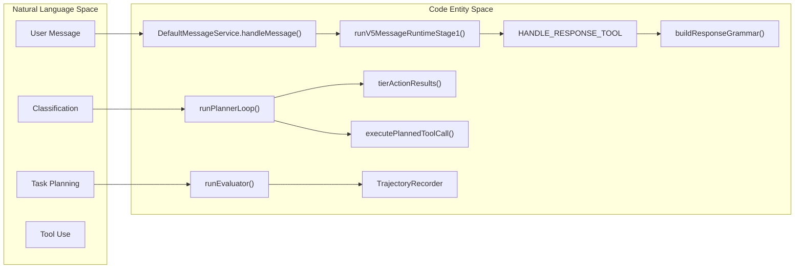

<!-- source: DeepWiki mcp.deepwiki.com · repo elizaOS/eliza · page 2.6 Message Processing Pipeline · fetched 2026-10-29 -->

# Message Processing Pipeline

Relevant source files

The following files were used as context for generating this wiki page:

- [biome.json](biome.json)
- [packages/agent/src/runtime/plugin-role-gating.test.ts](packages/agent/src/runtime/plugin-role-gating.test.ts)
- [packages/agent/src/runtime/plugin-role-gating.ts](packages/agent/src/runtime/plugin-role-gating.ts)
- [packages/agent/src/services/sandbox-engine.ts](packages/agent/src/services/sandbox-engine.ts)
- [packages/core/build.ts](packages/core/build.ts)
- [packages/core/src/__tests__/message-routing-live-regression.test.ts](packages/core/src/__tests__/message-routing-live-regression.test.ts)
- [packages/core/src/__tests__/message-runtime-stage1.test.ts](packages/core/src/__tests__/message-runtime-stage1.test.ts)
- [packages/core/src/__tests__/tiered-action-surface.test.ts](packages/core/src/__tests__/tiered-action-surface.test.ts)
- [packages/core/src/actions/to-tool.ts](packages/core/src/actions/to-tool.ts)
- [packages/core/src/features/advanced-capabilities/actions/generateMedia.test.ts](packages/core/src/features/advanced-capabilities/actions/generateMedia.test.ts)
- [packages/core/src/features/messaging/triage/__tests__/list-inbox-action.test.ts](packages/core/src/features/messaging/triage/__tests__/list-inbox-action.test.ts)
- [packages/core/src/features/plugin-manager/plugin-manager-umbrella.test.ts](packages/core/src/features/plugin-manager/plugin-manager-umbrella.test.ts)
- [packages/core/src/network/ssrf.test.ts](packages/core/src/network/ssrf.test.ts)
- [packages/core/src/prompts/evaluator.ts](packages/core/src/prompts/evaluator.ts)
- [packages/core/src/prompts/planner.ts](packages/core/src/prompts/planner.ts)
- [packages/core/src/runtime/__tests__/action-tiering.test.ts](packages/core/src/runtime/__tests__/action-tiering.test.ts)
- [packages/core/src/runtime/__tests__/evaluator.test.ts](packages/core/src/runtime/__tests__/evaluator.test.ts)
- [packages/core/src/runtime/__tests__/json-output.test.ts](packages/core/src/runtime/__tests__/json-output.test.ts)
- [packages/core/src/runtime/__tests__/message-handler-bogus-candidates.test.ts](packages/core/src/runtime/__tests__/message-handler-bogus-candidates.test.ts)
- [packages/core/src/runtime/__tests__/message-handler-refusal-suppression.test.ts](packages/core/src/runtime/__tests__/message-handler-refusal-suppression.test.ts)
- [packages/core/src/runtime/__tests__/message-handler.test.ts](packages/core/src/runtime/__tests__/message-handler.test.ts)
- [packages/core/src/runtime/__tests__/plan-actions-extractor.test.ts](packages/core/src/runtime/__tests__/plan-actions-extractor.test.ts)
- [packages/core/src/runtime/__tests__/planner-loop-plan-actions-in-text.test.ts](packages/core/src/runtime/__tests__/planner-loop-plan-actions-in-text.test.ts)
- [packages/core/src/runtime/__tests__/planner-loop.test.ts](packages/core/src/runtime/__tests__/planner-loop.test.ts)
- [packages/core/src/runtime/__tests__/response-grammar.test.ts](packages/core/src/runtime/__tests__/response-grammar.test.ts)
- [packages/core/src/runtime/__tests__/response-handler-evaluators.test.ts](packages/core/src/runtime/__tests__/response-handler-evaluators.test.ts)
- [packages/core/src/runtime/__tests__/response-handler-field-registry.test.ts](packages/core/src/runtime/__tests__/response-handler-field-registry.test.ts)
- [packages/core/src/runtime/action-tiering.ts](packages/core/src/runtime/action-tiering.ts)
- [packages/core/src/runtime/evaluator.ts](packages/core/src/runtime/evaluator.ts)
- [packages/core/src/runtime/json-output.ts](packages/core/src/runtime/json-output.ts)
- [packages/core/src/runtime/message-handler.ts](packages/core/src/runtime/message-handler.ts)
- [packages/core/src/runtime/plan-actions-extractor.ts](packages/core/src/runtime/plan-actions-extractor.ts)
- [packages/core/src/runtime/planner-loop.ts](packages/core/src/runtime/planner-loop.ts)
- [packages/core/src/runtime/response-grammar.ts](packages/core/src/runtime/response-grammar.ts)
- [packages/core/src/runtime/response-handler-evaluators.ts](packages/core/src/runtime/response-handler-evaluators.ts)
- [packages/core/src/runtime/response-handler-field-registry.ts](packages/core/src/runtime/response-handler-field-registry.ts)
- [packages/core/src/services/message.ts](packages/core/src/services/message.ts)
- [packages/core/src/types/components.ts](packages/core/src/types/components.ts)
- [packages/core/src/types/model.ts](packages/core/src/types/model.ts)
- [plugins/plugin-agent-orchestrator/__tests__/unit/task-agent-frameworks.test.ts](plugins/plugin-agent-orchestrator/__tests__/unit/task-agent-frameworks.test.ts)
- [plugins/plugin-discord/__tests__/message-coalesce.test.ts](plugins/plugin-discord/__tests__/message-coalesce.test.ts)
- [plugins/plugin-discord/__tests__/messages-url.test.ts](plugins/plugin-discord/__tests__/messages-url.test.ts)
- [plugins/plugin-discord/__tests__/staleness.test.ts](plugins/plugin-discord/__tests__/staleness.test.ts)
- [plugins/plugin-discord/attachments.ts](plugins/plugin-discord/attachments.ts)
- [plugins/plugin-discord/debouncer.ts](plugins/plugin-discord/debouncer.ts)
- [plugins/plugin-discord/discord-events.ts](plugins/plugin-discord/discord-events.ts)
- [plugins/plugin-discord/discord-history.ts](plugins/plugin-discord/discord-history.ts)
- [plugins/plugin-discord/message-coalesce.ts](plugins/plugin-discord/message-coalesce.ts)
- [plugins/plugin-discord/messages.ts](plugins/plugin-discord/messages.ts)
- [plugins/plugin-discord/service.ts](plugins/plugin-discord/service.ts)
- [plugins/plugin-discord/slash-commands.ts](plugins/plugin-discord/slash-commands.ts)
- [plugins/plugin-discord/staleness.ts](plugins/plugin-discord/staleness.ts)
- [plugins/plugin-discord/status-reactions.ts](plugins/plugin-discord/status-reactions.ts)
- [plugins/plugin-local-inference/native/docs/TOKEN_TRIE_SAMPLER.md](plugins/plugin-local-inference/native/docs/TOKEN_TRIE_SAMPLER.md)
- [plugins/plugin-local-inference/native/include/eliza_token_trie_sampler.h](plugins/plugin-local-inference/native/include/eliza_token_trie_sampler.h)

## Purpose and Scope

The Message Processing Pipeline is the core orchestration engine within elizaOS that transforms raw inputs into intelligent agent responses. In v5, the pipeline follows a redesigned two-stage process: **Stage 1 (Classification and Intent)** and **Stage 2 (Planning and Execution)**. This architecture ensures that agents can handle both trivial chat and complex, multi-step tasks with high reliability and structured output enforcement.

The pipeline is primarily implemented in the `DefaultMessageService` within `packages/core/src/services/message.ts` [packages/core/src/services/message.ts:140-144](). It coordinates the `AgentRuntime`, the `PlannerLoop`, and GBNF grammar enforcement to manage state and model interactions.

## High-Level Data Flow

The v5 pipeline follows a structured sequence using the `HANDLE_RESPONSE` tool to bridge natural language input to structured code execution.

Title: v5 Message Processing Architecture

Sources: [packages/core/src/services/message.ts:71-75](), [packages/core/src/runtime/planner-loop.ts:119-130]()

## Stage 1: The `HANDLE_RESPONSE` Pipeline

Stage 1 is the entry point for all message processing. It uses a specialized tool called `HANDLE_RESPONSE` to classify the user's intent and decide the execution strategy [packages/core/src/actions/to-tool.ts:8-10]().

### The HANDLE_RESPONSE Tool
This tool enforces a strict JSON schema via GBNF (Guided BNF) grammar to ensure the model provides all necessary metadata [packages/core/src/runtime/response-grammar.ts:112-122]().

| Field | Purpose | Implementation |
| :--- | :--- | :--- |
| `shouldRespond` | Enum: `RESPOND`, `IGNORE`, or `STOP`. | [packages/core/src/actions/to-tool.ts:8-9]() |
| `contexts` | Identifies active sub-systems (e.g., `calendar`, `tasks`). | [packages/core/src/runtime/response-grammar.ts:65-66]() |
| `replyText` | A direct answer (Simple mode) or acknowledgement. | [packages/core/src/services/message.ts:106-107]() |
| `candidateActionNames` | High-precision hints for Stage 2 action surface. | [packages/core/src/services/message.ts:27-29]() |
| `facts` / `relationships` | Extracts durable information for memory. | [packages/core/src/services/message.ts:65-67]() |

### Context and Grammar Enforcement
To optimize local inference, the pipeline generates a dynamic GBNF grammar for every turn. This forces the model to pick only from valid `contexts` and `actions` [packages/core/src/runtime/response-grammar.ts:5-16]().
- **Direct Channels**: In DMs, the pipeline drops fields like `shouldRespond` and `facts` to reduce token overhead [packages/core/src/runtime/response-grammar.ts:105-120]().
- **Grammar Caching**: Grammars are cached based on a signature derived from the registry and available contexts [packages/core/src/runtime/response-grammar.ts:26-31]().

Sources: [packages/core/src/runtime/response-grammar.ts:1-32](), [packages/core/src/services/message.ts:93-96]()

## Stage 2: The PlannerLoop

If Stage 1 determines that planning is required (e.g., `contexts` contains more than `simple`), the system enters the `runPlannerLoop` [packages/core/src/runtime/planner-loop.ts:119-121]().

### Multi-Step Execution
The `PlannerLoop` is a chaining mechanism that allows the agent to call multiple tools in sequence.
1. **Action Tiering**: Actions are tiered based on relevance to the turn's `candidateActionNames` [packages/core/src/runtime/action-tiering.ts:32-33]().
2. **Tool Selection**: The planner selects a tool, executes it, and appends the result to the `PlannerTrajectory` [packages/core/src/runtime/planner-loop.ts:124-130]().
3. **Evaluation**: After each tool call, `runEvaluator` is invoked to decide if the task is complete (`FINISH`) or needs more steps [packages/core/src/runtime/evaluator.ts:67-69]().

### Trajectory and Limits
The `PlannerLoop` enforces several guards to prevent infinite loops and bound costs [packages/core/src/runtime/planner-loop.ts:131-162]():
- `maxTrajectoryPromptTokens`: Caps the total tokens consumed in a single user turn.
- `TrajectoryRecorder`: Records every model interaction for debugging and training [packages/core/src/runtime/planner-loop.ts:70-77]().
- `observePlannerUsage`: Sums tokens across every stage to fire budget guards [packages/core/src/runtime/planner-loop.ts:146-151]().

Sources: [packages/core/src/runtime/planner-loop.ts:119-215](), [packages/core/src/runtime/evaluator.ts:67-151]()

## Code Entity Mapping

The following diagram maps high-level pipeline concepts to the specific TypeScript classes and functions that implement them.

Title: Natural Language Space to Code Entity Space

Sources: [packages/core/src/services/message.ts:8-12](), [packages/core/src/runtime/planner-loop.ts:119-121](), [packages/core/src/runtime/response-grammar.ts:112-114]()

## Action Tiering and Retrieval

The pipeline uses a tiered approach to manage the agent's action surface, preventing context window bloat and improving precision.

| Tier | Description | Implementation |
| :--- | :--- | :--- |
| **Tier A** | Actions explicitly requested by Stage 1 (`candidateActionNames`). | [packages/core/src/runtime/action-tiering.ts:32-33]() |
| **Tier B** | Contextually relevant actions found via semantic search. | [packages/core/src/runtime/action-retrieval.ts:30-31]() |
| **Terminals** | Essential turn-ending actions like `REPLY` and `STOP`. | [packages/core/src/actions/to-tool.ts:7-9]() |

The `buildPlannerToolsFromTieredActions` function converts these filtered actions into native tool definitions for the LLM [packages/core/src/actions/to-tool.ts:6-10]().

## Key Implementation Summary

| Feature | Code Symbol | Role |
| :--- | :--- | :--- |
| **Message Service** | `DefaultMessageService` | Entry point for the v5 pipeline orchestration. |
| **Response Handler** | `HANDLE_RESPONSE` | The Stage 1 classification tool and JSON envelope. |
| **Grammar Engine** | `buildResponseGrammar` | Generates GBNF for structure-forcing local models. |
| **Execution Loop** | `runPlannerLoop` | Manages multi-step tool execution and trajectory. |
| **Evaluator** | `runEvaluator` | Determines if a plan is complete or needs iteration. |
| **Streaming** | `StreamingContext` | Manages real-time token delivery and pipeline hooks. |

Sources:
- `packages/core/src/services/message.ts`
- `packages/core/src/runtime/planner-loop.ts`
- `packages/core/src/runtime/response-grammar.ts`
- `packages/core/src/runtime/evaluator.ts`
- `packages/core/src/streaming-context.ts`

---

