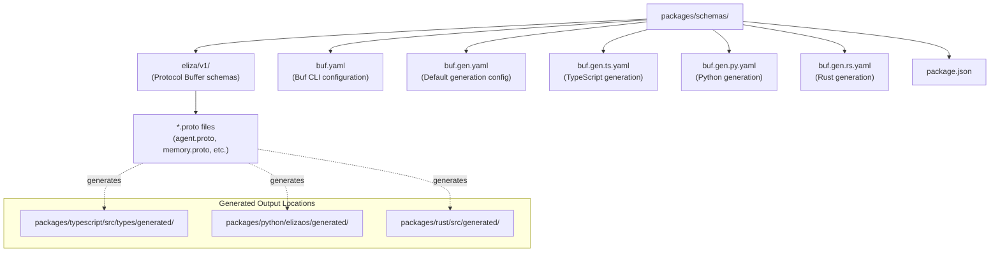
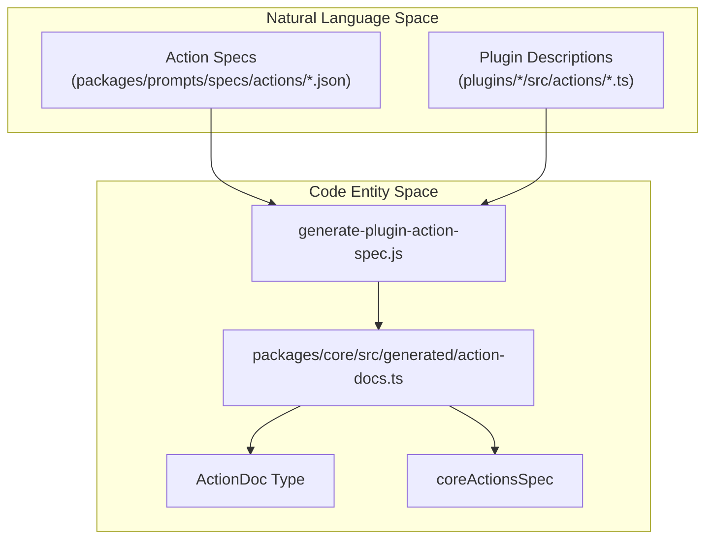
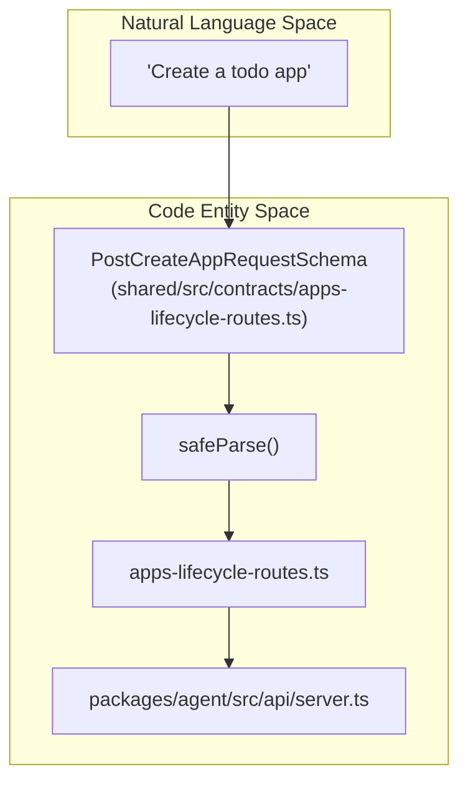

<!-- source: DeepWiki mcp.deepwiki.com · repo elizaOS/eliza · page 3.1 Schema Definition · fetched 2026-10-29 -->

# Schema Definition

Relevant source files

The following files were used as context for generating this wiki page:

- [.gitattributes](.gitattributes)
- [.gitignore](.gitignore)
- [packages/agent/src/api/config-routes.ts](packages/agent/src/api/config-routes.ts)
- [packages/agent/src/api/onboarding-routes.ts](packages/agent/src/api/onboarding-routes.ts)
- [packages/agent/src/api/server-helpers-config.ts](packages/agent/src/api/server-helpers-config.ts)
- [packages/app/test/ui-smoke/apps-utility-interactions.spec.ts](packages/app/test/ui-smoke/apps-utility-interactions.spec.ts)
- [packages/app/test/ui-smoke/remote-capability-view.spec.ts](packages/app/test/ui-smoke/remote-capability-view.spec.ts)
- [packages/cloud-frontend/tests/e2e/api-explorer-flow.spec.ts](packages/cloud-frontend/tests/e2e/api-explorer-flow.spec.ts)
- [packages/core/src/__tests__/action-structure-audit.test.ts](packages/core/src/__tests__/action-structure-audit.test.ts)
- [packages/core/src/generated/action-docs.ts](packages/core/src/generated/action-docs.ts)
- [packages/core/src/utils/context-catalog.ts](packages/core/src/utils/context-catalog.ts)
- [packages/elizaos/templates-manifest.json](packages/elizaos/templates-manifest.json)
- [packages/examples/a2a/tsconfig.json](packages/examples/a2a/tsconfig.json)
- [packages/examples/agent-console/tsconfig.json](packages/examples/agent-console/tsconfig.json)
- [packages/examples/aws/tsconfig.json](packages/examples/aws/tsconfig.json)
- [packages/examples/bluesky/tsconfig.json](packages/examples/bluesky/tsconfig.json)
- [packages/examples/setup-guide.html](packages/examples/setup-guide.html)
- [packages/prompts/scripts/generate-plugin-action-spec.js](packages/prompts/scripts/generate-plugin-action-spec.js)
- [packages/prompts/specs/actions/plugins.generated.json](packages/prompts/specs/actions/plugins.generated.json)
- [packages/shared/src/contracts/__tests__/schema-vs-type-drift.test.ts](packages/shared/src/contracts/__tests__/schema-vs-type-drift.test.ts)
- [packages/shared/src/contracts/apps-favorites-routes.test.ts](packages/shared/src/contracts/apps-favorites-routes.test.ts)
- [packages/shared/src/contracts/apps-favorites-routes.ts](packages/shared/src/contracts/apps-favorites-routes.ts)
- [packages/shared/src/contracts/apps-lifecycle-routes.test.ts](packages/shared/src/contracts/apps-lifecycle-routes.test.ts)
- [packages/shared/src/contracts/apps-lifecycle-routes.ts](packages/shared/src/contracts/apps-lifecycle-routes.ts)
- [packages/shared/src/contracts/apps-runs-routes.test.ts](packages/shared/src/contracts/apps-runs-routes.test.ts)
- [packages/shared/src/contracts/apps-runs-routes.ts](packages/shared/src/contracts/apps-runs-routes.ts)
- [packages/shared/src/contracts/conversation-routes.test.ts](packages/shared/src/contracts/conversation-routes.test.ts)
- [packages/shared/src/contracts/index.ts](packages/shared/src/contracts/index.ts)
- [packages/shared/src/contracts/onboarding-routes.test.ts](packages/shared/src/contracts/onboarding-routes.test.ts)
- [packages/shared/src/contracts/onboarding-routes.ts](packages/shared/src/contracts/onboarding-routes.ts)
- [packages/ui/src/bridge/capacitor-bridge.ts](packages/ui/src/bridge/capacitor-bridge.ts)
- [packages/ui/src/bridge/plugin-bridge.ts](packages/ui/src/bridge/plugin-bridge.ts)
- [packages/ui/src/components/apps/GameView.tsx](packages/ui/src/components/apps/GameView.tsx)
- [packages/ui/src/components/apps/load-apps-catalog.ts](packages/ui/src/components/apps/load-apps-catalog.ts)
- [packages/ui/src/components/character/CharacterEditor.tsx](packages/ui/src/components/character/CharacterEditor.tsx)
- [plugins/plugin-browser/src/actions/browser.ts](plugins/plugin-browser/src/actions/browser.ts)
- [plugins/plugin-coding-tools/src/services/ripgrep-service.ts](plugins/plugin-coding-tools/src/services/ripgrep-service.ts)
- [tsconfig.dist-paths.json](tsconfig.dist-paths.json)
- [turbo.json](turbo.json)

This page documents how Protocol Buffer schemas are defined, organized, and compiled in elizaOS. The `packages/schemas/` package serves as the single source of truth for all type definitions across TypeScript, Python, and Rust runtimes, ensuring cross-language interoperability.

---

## Schema Package Structure

The schemas package resides at `packages/schemas/` and houses all Protocol Buffer (`.proto`) definitions. These schemas are used as the canonical source of data types and service contracts that are compiled into language-specific type modules. The system covers core definitions including `agent.proto`, `memory.proto`, `events.proto`, `plugin.proto`, `messaging.proto`, `tee.proto`, and others.

The system also utilizes Zod schemas for HTTP route validation, particularly within the `packages/shared/src/contracts/` directory, which provides type safety for the API layer [packages/shared/src/contracts/apps-lifecycle-routes.ts:1-21](). This layer bridges the gaps between the internal protocol and external HTTP interfaces.

**Sources:** [packages/shared/src/contracts/apps-lifecycle-routes.ts:1-21](), [tsconfig.dist-paths.json:80-80]()

---

## Buf Configuration and Tooling

### Core Configuration
The elizaOS schema infrastructure is managed using **Buf**, a toolchain that simplifies Protocol Buffer management. The configuration ensures that schemas are organized under the `eliza/v1/` directory to support versioned API evolution.

- **Linting**: Validates schema definitions against project-wide style rules.
- **Breaking Change Detection**: Ensures that updates to `.proto` files do not break compatibility with existing generated code in the various language runtimes.
- **Generation**: Orchestrated via `buf generate` using various templates for multi-language output.

### Multi-Language Generation
The generation process is critical for the polyglot architecture of elizaOS. The `packages/schemas` package is referenced by other workspace packages to ensure type consistency [tsconfig.dist-paths.json:80-80]().

| Language | Target Path | Purpose |
|----------|-------------|---------|
| TypeScript | `packages/typescript/src/types/generated/` | Core runtime types and client bindings. |
| Python | `packages/python/elizaos/generated/` | Robotics stack and local inference support. |
| Rust | `packages/rust/src/generated/` | High-performance TEE and WASM components. |

---

## Runtime Type Integration

### API Schema Validation (Zod)
While Protocol Buffers handle cross-language serialization, elizaOS uses **Zod** for strict runtime validation of HTTP request and response bodies. This is centralized in `packages/shared/src/contracts/` [packages/shared/src/contracts/index.ts:1-41]().

| Schema Name | Purpose | Target Route |
|-------------|---------|--------------|
| `PostLaunchAppRequestSchema` | Validates app launch requests [packages/shared/src/contracts/apps-lifecycle-routes.ts:38-40]() | `POST /api/apps/launch` |
| `PostInstallAppRequestSchema` | Validates app installation with versioning [packages/shared/src/contracts/apps-lifecycle-routes.ts:42-60]() | `POST /api/apps/install` |
| `PostStopAppRequestSchema` | Validates stop requests using `name` or `runId` [packages/shared/src/contracts/apps-lifecycle-routes.ts:67-82]() | `POST /api/apps/stop` |
| `PostCreateAppRequestSchema` | Validates intent-based app creation [packages/shared/src/contracts/apps-lifecycle-routes.ts:122-139]() | `POST /api/apps/create` |

### Action Documentation Schema
The system also maintains a specialized schema for auto-generating action and provider documentation, found in `packages/core/src/generated/action-docs.ts` [packages/core/src/generated/action-docs.ts:1-61](). This defines types like `ActionDoc`, `ActionDocParameter`, and `ActionDocExampleCall`, which are used to inform the LLM planner about available capabilities.

**Sources:** [packages/shared/src/contracts/apps-lifecycle-routes.ts:23-158](), [packages/core/src/generated/action-docs.ts:1-61](), [packages/shared/src/contracts/index.ts:1-41]()

---

## Bridging Natural Language to Code Entities

### Diagram 1: Action Specification Pipeline
This diagram illustrates how natural language action descriptions are transformed into code entities that the `AgentRuntime` can utilize.

**Sources:** [packages/prompts/scripts/generate-plugin-action-spec.js:1-25](), [packages/core/src/generated/action-docs.ts:1-77]()

### Diagram 2: API Contract Flow
This diagram illustrates how Zod schemas in the `shared` package bridge natural language "Intents" to validated server actions within the `AgentRuntime`.

**Sources:** [packages/shared/src/contracts/apps-lifecycle-routes.ts:122-139](), [packages/shared/src/contracts/index.ts:1-41]()

---

## Action and Context Mapping

The schema system extends to how actions are categorized for the LLM. The `ACTION_CONTEXT_MAP` in `packages/core/src/utils/context-catalog.ts` associates action names with their functional domains [packages/core/src/utils/context-catalog.ts:3-162]().

| Action | Contexts |
|--------|----------|
| `REPLY` | `["general"]` [packages/core/src/utils/context-catalog.ts:7-7]() |
| `WALLET` | `["wallet"]` [packages/core/src/utils/context-catalog.ts:18-18]() |
| `BROWSER` | `["browser"]` [packages/core/src/utils/context-catalog.ts:67-67]() |
| `SPAWN_AGENT` | `["code", "automation"]` [packages/core/src/utils/context-catalog.ts:74-74]() |

**Sources:** [packages/core/src/utils/context-catalog.ts:1-162](), [packages/core/src/__tests__/action-structure-audit.test.ts:151-230]()

---

