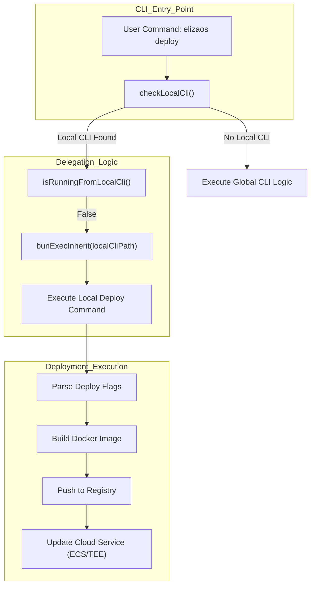
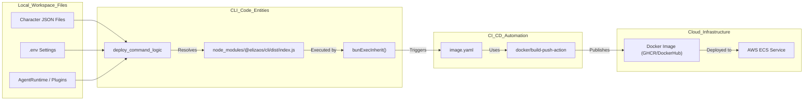
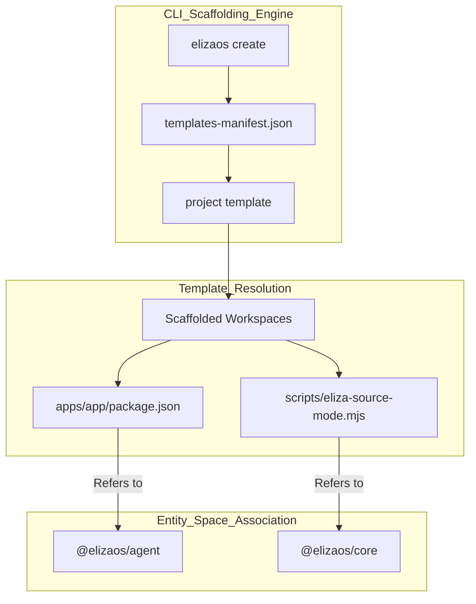

<!-- source: DeepWiki mcp.deepwiki.com · repo elizaOS/eliza · page 4.2 CLI Deploy Command · fetched 2026-10-29 -->

# CLI Deploy Command

Relevant source files

The following files were used as context for generating this wiki page:

- [.gitattributes](.gitattributes)
- [.github/workflows/nightly.yml](.github/workflows/nightly.yml)
- [.github/workflows/release.yaml](.github/workflows/release.yaml)
- [.gitignore](.gitignore)
- [lerna.json](lerna.json)
- [packages/app-core/platforms/electrobun/README.md](packages/app-core/platforms/electrobun/README.md)
- [packages/app-core/platforms/electrobun/assets/brand-config.json](packages/app-core/platforms/electrobun/assets/brand-config.json)
- [packages/app-core/platforms/electrobun/package.json](packages/app-core/platforms/electrobun/package.json)
- [packages/app/test/ui-smoke/apps-utility-interactions.spec.ts](packages/app/test/ui-smoke/apps-utility-interactions.spec.ts)
- [packages/app/test/ui-smoke/remote-capability-view.spec.ts](packages/app/test/ui-smoke/remote-capability-view.spec.ts)
- [packages/benchmarks/terminal-bench/elizaos_terminal_bench/cli.py](packages/benchmarks/terminal-bench/elizaos_terminal_bench/cli.py)
- [packages/benchmarks/terminal-bench/elizaos_terminal_bench/runner.py](packages/benchmarks/terminal-bench/elizaos_terminal_bench/runner.py)
- [packages/benchmarks/terminal-bench/elizaos_terminal_bench/types.py](packages/benchmarks/terminal-bench/elizaos_terminal_bench/types.py)
- [packages/benchmarks/terminal-bench/tests/test_cli.py](packages/benchmarks/terminal-bench/tests/test_cli.py)
- [packages/cloud-frontend/tests/e2e/api-explorer-flow.spec.ts](packages/cloud-frontend/tests/e2e/api-explorer-flow.spec.ts)
- [packages/core/src/__tests__/action-structure-audit.test.ts](packages/core/src/__tests__/action-structure-audit.test.ts)
- [packages/core/src/generated/action-docs.ts](packages/core/src/generated/action-docs.ts)
- [packages/core/src/utils/context-catalog.ts](packages/core/src/utils/context-catalog.ts)
- [packages/elizaos/templates-manifest.json](packages/elizaos/templates-manifest.json)
- [packages/elizaos/templates/project/apps/app/electrobun/package.json](packages/elizaos/templates/project/apps/app/electrobun/package.json)
- [packages/elizaos/templates/project/apps/app/package.json](packages/elizaos/templates/project/apps/app/package.json)
- [packages/elizaos/templates/project/package.json](packages/elizaos/templates/project/package.json)
- [packages/elizaos/templates/project/scripts/eliza-source-mode.mjs](packages/elizaos/templates/project/scripts/eliza-source-mode.mjs)
- [packages/examples/a2a/tsconfig.json](packages/examples/a2a/tsconfig.json)
- [packages/examples/agent-console/tsconfig.json](packages/examples/agent-console/tsconfig.json)
- [packages/examples/aws/tsconfig.json](packages/examples/aws/tsconfig.json)
- [packages/examples/bluesky/tsconfig.json](packages/examples/bluesky/tsconfig.json)
- [packages/examples/setup-guide.html](packages/examples/setup-guide.html)
- [packages/prompts/scripts/generate-plugin-action-spec.js](packages/prompts/scripts/generate-plugin-action-spec.js)
- [packages/prompts/specs/actions/plugins.generated.json](packages/prompts/specs/actions/plugins.generated.json)
- [packages/scripts/validate-capability-router-github-live-artifacts.ts](packages/scripts/validate-capability-router-github-live-artifacts.ts)
- [packages/ui/src/bridge/capacitor-bridge.ts](packages/ui/src/bridge/capacitor-bridge.ts)
- [packages/ui/src/bridge/plugin-bridge.ts](packages/ui/src/bridge/plugin-bridge.ts)
- [packages/ui/src/components/apps/GameView.tsx](packages/ui/src/components/apps/GameView.tsx)
- [packages/ui/src/components/apps/load-apps-catalog.ts](packages/ui/src/components/apps/load-apps-catalog.ts)
- [packages/ui/src/components/character/CharacterEditor.tsx](packages/ui/src/components/character/CharacterEditor.tsx)
- [plugins/plugin-browser/src/actions/browser.ts](plugins/plugin-browser/src/actions/browser.ts)
- [plugins/plugin-coding-tools/src/services/ripgrep-service.ts](plugins/plugin-coding-tools/src/services/ripgrep-service.ts)
- [plugins/plugin-device-filesystem/package.json](plugins/plugin-device-filesystem/package.json)
- [tsconfig.dist-paths.json](tsconfig.dist-paths.json)
- [turbo.json](turbo.json)

The `elizaos deploy` command provides a unified interface for deploying agents and infrastructure to cloud platforms. It handles the orchestration of containerization, environment configuration, and resource provisioning, specifically targeting Docker-based environments, AWS Elastic Container Service (ECS), and Trusted Execution Environments (TEE) like Phala Cloud.

## Overview

The deployment subsystem in the `elizaos` CLI (found in `packages/elizaos`) is designed to bridge the gap between local development and production cloud environments. It automates the process of packaging an agent's runtime, plugins, and character files into a deployable unit.

### Key Capabilities
- **Docker Integration**: Automatically generates Dockerfiles and builds images for agent runtimes, supported by automated GitHub Actions for image publishing [packages/app-core/deploy/docker-compose.yml:1-10]().
- **Cloud Targeting**: Supports deployment to AWS ECS and various cloud providers (AWS, GCP, Vercel, Supabase) with specialized configuration examples [packages/examples/aws/tsconfig.json:1-10](), [packages/examples/gcp/package.json:1-5]().
- **TEE Deployment**: Specialized support for deploying to Phala Cloud using hardware-secured agent execution via the `tee-build-deploy.yml` workflow.
- **Project Scaffolding**: The CLI provides `create`, `upgrade`, and `info` commands to manage the lifecycle of an elizaOS project using predefined templates like `project` and `plugin` [packages/elizaos/templates-manifest.json:5-23]().

## Implementation Details

The deployment logic is primarily driven by the CLI's delegation and execution system. When a user executes `elizaos deploy`, the CLI first checks for a local installation to delegate the command to, ensuring version consistency between the CLI and the project dependencies.

### Command Delegation Flow
The CLI uses a delegation mechanism to ensure that the deployment is handled by the specific version of the `@elizaos/cli` (or `@elizaos/plugin-cli`) installed in the project's `node_modules`. This prevents version drift between the global CLI and the agent's specific runtime requirements.

**CLI Delegation Logic**

Sources: [scripts/debug-cli-delegation.ts:126-140](), [scripts/debug-cli-delegation.ts:145-153](), [scripts/debug-cli-delegation.ts:28-31]()

### Data Flow: Local to Cloud
The deployment process transforms local assets into cloud-native entities. The following diagram maps the transition from "Natural Language/Config Space" (Characters and Settings) to "Code Entity Space" (Containers and Services), specifically highlighting how `bunExecInherit` manages the execution context.

**Natural Language to Code Entity Mapping**

Sources: [scripts/debug-cli-delegation.ts:126-134](), [scripts/debug-cli-delegation.ts:28-31](), [packages/app-core/deploy/docker-compose.yml:1-5]()

## Project Scaffolding and Templates

The CLI package manages project initialization through a template system. The `templates-manifest.json` defines the available project types and their metadata [packages/elizaos/templates-manifest.json:1-24]().

### Project Template
The `project` template creates a package-first elizaOS project with optional local source mode [packages/elizaos/templates-manifest.json:15-22]().
- **Structure**: Includes an `apps/app` directory with `package.json` and local source mode scripts to facilitate rapid development [packages/elizaos/templates/project/apps/app/package.json:1-10](), [packages/elizaos/templates/project/scripts/eliza-source-mode.mjs:1-15]().
- **Metadata**: Managed via the manifest which tracks versioning and repository URLs [packages/elizaos/templates-manifest.json:2-4]().

### Plugin Template
The `plugin` template scaffolds an elizaOS plugin starter in TypeScript [packages/elizaos/templates-manifest.json:7-13]().

**Scaffolding Data Flow**

Sources: [packages/elizaos/templates-manifest.json:7-22](), [packages/elizaos/templates/project/package.json:1-15](), [packages/elizaos/templates/project/apps/app/package.json:1-10]()

## Deployment Targets

### Docker-based Targets
The CLI and CI pipeline support building standard Docker containers. This is the foundation for most cloud deployments.

- **Automated Publishing**: The `image.yaml` workflow automates building and pushing images to GitHub Container Registry (GHCR) [packages/app-core/deploy/docker-compose.yml:1-10]().
- **Compose Support**: Multi-container setups, including Supabase databases, are supported via `docker-compose.supabase-db.yml`.

### AWS ECS (Elastic Container Service)
For enterprise-grade deployments, the CLI provides integration with AWS ECS, managing Task Definitions and Service updates. This is often paired with `packages/examples/aws` configurations [packages/examples/aws/tsconfig.json:1-10]().

## Troubleshooting and Debugging

The CLI includes specialized utilities to diagnose deployment and delegation issues. The `debug-cli-delegation.ts` script is used to identify why a deployment might fail due to environment mismatches.

### Common Deployment Blockers
The system checks for several environment variables that might prevent a successful deployment or delegation:

| Variable | Impact on Deployment | Source |
| :--- | :--- | :--- |
| `ELIZA_SKIP_LOCAL_CLI_DELEGATION` | Forces the use of the global CLI, potentially causing version mismatches. | [scripts/debug-cli-delegation.ts:163-163]() |
| `ELIZA_DISABLE_LOCAL_CLI_DELEGATION` | Explicitly prevents the CLI from looking into `node_modules`. | [scripts/debug-cli-delegation.ts:164-164]() |
| `CI` / `GITHUB_ACTIONS` | Signals a non-interactive environment, which may alter deployment prompts. | [scripts/debug-cli-delegation.ts:169-171]() |
| `_ELIZA_CLI_DELEGATION_DEPTH` | Prevents infinite recursion if a delegated CLI tries to delegate again. | [scripts/debug-cli-delegation.ts:181-181]() |

Sources: [scripts/debug-cli-delegation.ts:126-140](), [scripts/debug-cli-delegation.ts:163-181]()

---

