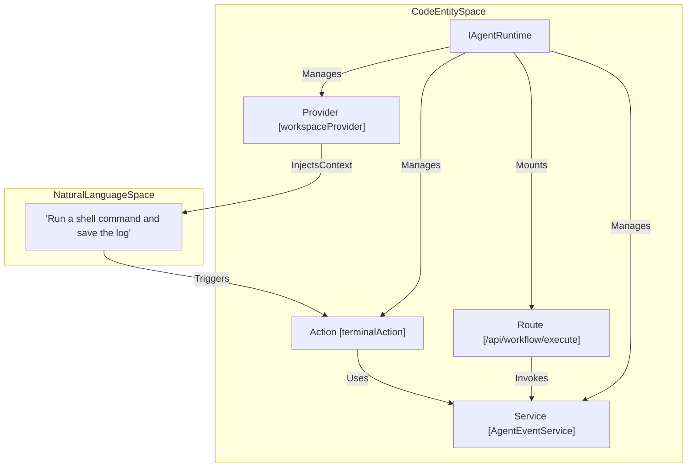
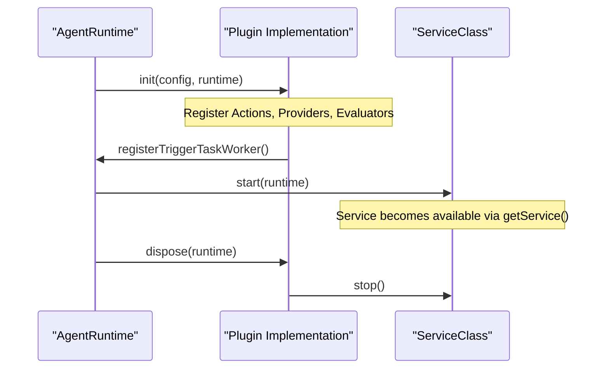

<!-- source: DeepWiki mcp.deepwiki.com · repo elizaOS/eliza · page 5 Plugin System · fetched 2026-10-29 -->

# Plugin System

Relevant source files

The following files were used as context for generating this wiki page:

- [packages/agent/src/actions/connector-resolver.ts](packages/agent/src/actions/connector-resolver.ts)
- [packages/agent/src/actions/contact.ts](packages/agent/src/actions/contact.ts)
- [packages/agent/src/actions/index.ts](packages/agent/src/actions/index.ts)
- [packages/agent/src/actions/logs.ts](packages/agent/src/actions/logs.ts)
- [packages/agent/src/actions/memories.ts](packages/agent/src/actions/memories.ts)
- [packages/agent/src/actions/plugin.ts](packages/agent/src/actions/plugin.ts)
- [packages/agent/src/actions/runtime.ts](packages/agent/src/actions/runtime.ts)
- [packages/agent/src/api/chat-augmentation.test.ts](packages/agent/src/api/chat-augmentation.test.ts)
- [packages/agent/src/api/chat-augmentation.ts](packages/agent/src/api/chat-augmentation.ts)
- [packages/agent/src/api/connector-routes.ts](packages/agent/src/api/connector-routes.ts)
- [packages/agent/src/api/credit-detection.ts](packages/agent/src/api/credit-detection.ts)
- [packages/agent/src/api/dispatch-route.ts](packages/agent/src/api/dispatch-route.ts)
- [packages/agent/src/api/plugin-runtime-apply.ts](packages/agent/src/api/plugin-runtime-apply.ts)
- [packages/agent/src/api/provider-switch-routes.ts](packages/agent/src/api/provider-switch-routes.ts)
- [packages/agent/src/api/wallet-trading-profile.ts](packages/agent/src/api/wallet-trading-profile.ts)
- [packages/agent/src/api/wallet.ts](packages/agent/src/api/wallet.ts)
- [packages/agent/src/api/workbench-helpers.ts](packages/agent/src/api/workbench-helpers.ts)
- [packages/agent/src/providers/page-scoped-context.ts](packages/agent/src/providers/page-scoped-context.ts)
- [packages/agent/src/providers/rolodex.ts](packages/agent/src/providers/rolodex.ts)
- [packages/agent/src/runtime/custom-actions.ts](packages/agent/src/runtime/custom-actions.ts)
- [packages/agent/src/runtime/eliza-plugin.ts](packages/agent/src/runtime/eliza-plugin.ts)
- [packages/agent/src/triggers/text-to-workflow.test.ts](packages/agent/src/triggers/text-to-workflow.test.ts)
- [packages/app-core/scripts/install-android-sms-gateway.md](packages/app-core/scripts/install-android-sms-gateway.md)
- [packages/benchmarks/orchestrator/README.md](packages/benchmarks/orchestrator/README.md)
- [packages/benchmarks/orchestrator/code_agent_coverage.py](packages/benchmarks/orchestrator/code_agent_coverage.py)
- [packages/benchmarks/orchestrator/code_agent_matrix.py](packages/benchmarks/orchestrator/code_agent_matrix.py)
- [packages/benchmarks/orchestrator/tests/test_code_agent_matrix.py](packages/benchmarks/orchestrator/tests/test_code_agent_matrix.py)
- [packages/chip/docs/evidence/cpu-ap-evidence-manifest.json](packages/chip/docs/evidence/cpu-ap-evidence-manifest.json)
- [packages/core/src/contracts/wallet.ts](packages/core/src/contracts/wallet.ts)
- [packages/core/src/runtime/__tests__/message-post-connectors.test.ts](packages/core/src/runtime/__tests__/message-post-connectors.test.ts)
- [packages/core/src/types/plugin.ts](packages/core/src/types/plugin.ts)
- [packages/core/src/types/runtime.ts](packages/core/src/types/runtime.ts)
- [packages/examples/smartglasses/README.md](packages/examples/smartglasses/README.md)
- [packages/examples/smartglasses/eliza-runtime-smoke.ts](packages/examples/smartglasses/eliza-runtime-smoke.ts)
- [packages/examples/smartglasses/package-smoke.ts](packages/examples/smartglasses/package-smoke.ts)
- [packages/examples/smartglasses/smartglasses.test.ts](packages/examples/smartglasses/smartglasses.test.ts)
- [packages/examples/smartglasses/smartglasses.ts](packages/examples/smartglasses/smartglasses.ts)
- [packages/scripts/cloud/bluebubbles-local-bridge.ts](packages/scripts/cloud/bluebubbles-local-bridge.ts)
- [packages/shared/src/contracts/connector-routes.test.ts](packages/shared/src/contracts/connector-routes.test.ts)
- [packages/shared/src/contracts/connector-routes.ts](packages/shared/src/contracts/connector-routes.ts)
- [plugins/plugin-agent-orchestrator/__tests__/unit/sanitize-planner-text.test.ts](plugins/plugin-agent-orchestrator/__tests__/unit/sanitize-planner-text.test.ts)
- [plugins/plugin-agent-orchestrator/__tests__/unit/scan-and-unlink-older-than.test.ts](plugins/plugin-agent-orchestrator/__tests__/unit/scan-and-unlink-older-than.test.ts)
- [plugins/plugin-agent-orchestrator/__tests__/unit/session-store.test.ts](plugins/plugin-agent-orchestrator/__tests__/unit/session-store.test.ts)
- [plugins/plugin-agent-orchestrator/src/providers/active-sub-agents.ts](plugins/plugin-agent-orchestrator/src/providers/active-sub-agents.ts)
- [plugins/plugin-agent-orchestrator/src/services/audit.ts](plugins/plugin-agent-orchestrator/src/services/audit.ts)
- [plugins/plugin-agent-orchestrator/src/services/session-store.ts](plugins/plugin-agent-orchestrator/src/services/session-store.ts)
- [plugins/plugin-agent-orchestrator/src/services/skill-lifeops-context-broker.ts](plugins/plugin-agent-orchestrator/src/services/skill-lifeops-context-broker.ts)
- [plugins/plugin-agent-orchestrator/src/services/types.ts](plugins/plugin-agent-orchestrator/src/services/types.ts)
- [plugins/plugin-discord/__tests__/extract-content-metadata.test.ts](plugins/plugin-discord/__tests__/extract-content-metadata.test.ts)
- [plugins/plugin-discord/user-account-scraper/discord-browser-scraper.ts](plugins/plugin-discord/user-account-scraper/discord-browser-scraper.ts)
- [plugins/plugin-sql/drizzle/migrations/0001_connector_accounts.sql](plugins/plugin-sql/drizzle/migrations/0001_connector_accounts.sql)
- [plugins/plugin-workflow/src/index.ts](plugins/plugin-workflow/src/index.ts)
- [plugins/plugin-workflow/src/lib/automations-builder.ts](plugins/plugin-workflow/src/lib/automations-builder.ts)
- [plugins/plugin-workflow/src/lib/legacy-text-trigger-migration.ts](plugins/plugin-workflow/src/lib/legacy-text-trigger-migration.ts)
- [plugins/plugin-workflow/src/services/index.ts](plugins/plugin-workflow/src/services/index.ts)
- [plugins/plugin-workflow/src/services/workflow-dispatch.ts](plugins/plugin-workflow/src/services/workflow-dispatch.ts)
- [plugins/plugin-xr/src/protocol.ts](plugins/plugin-xr/src/protocol.ts)
- [plugins/plugin-xr/src/routes/xr-views.ts](plugins/plugin-xr/src/routes/xr-views.ts)
- [plugins/plugin-xr/src/services/xr-session-service.ts](plugins/plugin-xr/src/services/xr-session-service.ts)

The elizaOS plugin system is a modular architecture designed to extend the capabilities of the `AgentRuntime` without modifying the core engine. Plugins serve as the primary mechanism for integrating external services, blockchain protocols, and communication platforms into an agent's workflow.

### High-Level Architecture

The plugin system bridges "Natural Language Space" (the agent's reasoning) with "Code Entity Space" (executable logic). Plugins are registered during runtime initialization and inject primary types of entities into the `IAgentRuntime` [packages/core/src/types/plugin.ts:198-210]().

*   **Actions**: Discrete tasks the agent can perform (e.g., `compactConversationAction`, `terminalAction`). Defined by the `Action` interface [packages/agent/src/runtime/eliza-plugin.ts:16-25]().
*   **Providers**: Context injectors that supply real-time data to the agent's state (e.g., `activeSubAgentsProvider`, `workspaceProvider`). Defined by the `Provider` interface [packages/agent/src/runtime/eliza-plugin.ts:86-100]().
*   **Evaluators**: Post-processing logic that assesses interactions or updates state (e.g., `subAgentCompletionResponseEvaluator`) [packages/core/src/types/plugin.ts:7-9]().
*   **Services**: Long-running background processes or utility classes (e.g., `WorkflowService`, `AgentMediaGenerationService`) [packages/agent/src/runtime/eliza-plugin.ts:108-113]().
*   **Routes**: HTTP endpoints exposed by the agent to support webhooks or UI interactions (e.g., `workflowRoutes`) [packages/core/src/types/plugin.ts:111-168]().

#### Entity Mapping: Language to Code

The following diagram illustrates how natural language intents are mapped to specific code entities defined within the plugin architecture.

**Intent-to-Entity Mapping**

Sources: [packages/core/src/types/plugin.ts:198-230](), [packages/agent/src/runtime/eliza-plugin.ts:104-113](), [plugins/plugin-workflow/src/index.ts:50-71]()

---

### Plugin Interface and Lifecycle

Every plugin must implement the `Plugin` interface, which defines its name, description, and the components it contributes [packages/core/src/types/plugin.ts:198-230](). 

The lifecycle is managed by the runtime and includes:
1.  **Initialization**: The `init` function allows plugins to perform setup, such as registering task workers or dynamic skill commands [packages/agent/src/runtime/eliza-plugin.ts:115-179]().
2.  **Service Registration**: Plugins can register `ServiceClass` constructors which the runtime starts via the `start()` factory method [packages/core/src/types/plugin.ts:22-33]().
3.  **Disposal**: The `dispose` method allows plugins to gracefully shut down services and clean up resources [plugins/plugin-workflow/src/index.ts:58-62]().

For a deep dive into implementing the `Plugin` interface and managing the registration process, see **[Plugin Architecture and Lifecycle](#5.1)**.

**Plugin Lifecycle Flow**

Sources: [packages/core/src/types/plugin.ts:22-33](), [packages/agent/src/runtime/eliza-plugin.ts:115-117](), [plugins/plugin-workflow/src/index.ts:58-62]()

---

### Ecosystem Categories

The elizaOS ecosystem categorizes plugins based on functional domains and platform compatibility.

#### Core and Communication Plugins
Foundational plugins providing "senses", "voice", and system-level capabilities.

| Category | Key Plugins | Purpose |
| :--- | :--- | :--- |
| **Workspace** | `createElizaPlugin` | Handles session keys, workspace context, and character persistence [packages/agent/src/runtime/eliza-plugin.ts:79-113]() |
| **Automation** | `@elizaos/plugin-workflow` | Manages natural language workflow generation and execution [plugins/plugin-workflow/src/index.ts:50-54]() |
| **Communication** | `@elizaos/plugin-discord` | Platform integration including message metadata extraction [plugins/plugin-discord/__tests__/extract-content-metadata.test.ts:1-10]() |
| **System** | `@elizaos/plugin-sql` | Provides database adapters and schema migrations [plugins/plugin-sql/drizzle/migrations/0001_connector_accounts.sql:1-5]() |

For details, see **[Core and Communication Plugins](#5.2)**.

#### Blockchain and Web3 Plugins
Plugins for interacting with decentralized protocols and managing assets.

| Ecosystem | Key Plugins | Supported Actions |
| :--- | :--- | :--- |
| **Wallet** | `@elizaos/plugin-wallet` | Multi-chain signing and dual-wallet architecture [packages/core/src/contracts/wallet.ts:1-10]() |
| **Orchestration** | `@elizaos/plugin-agent-orchestrator` | Sub-agent spawning via ACP (Agent Client Protocol) [plugins/plugin-agent-orchestrator/src/services/types.ts:12-19]() |

For details, see **[Blockchain and Web3 Plugins](#5.3)**.

---

### Discovery and Registry

The plugin system supports advanced discovery and dynamic configuration:
*   **Service Resolution**: Runtimes use services like `getAcpService` to interact with plugin-provided logic across the system [plugins/plugin-agent-orchestrator/src/providers/active-sub-agents.ts:56-62]().
*   **Dynamic Skills**: Plugins like `eliza` can dynamically register skills as slash commands within the runtime [packages/agent/src/runtime/eliza-plugin.ts:118-168]().
*   **Route Mounting**: Plugins use `register-routes.ts` patterns to mount paths like `/api/workflow/*` on the host HTTP server [plugins/plugin-workflow/src/index.ts:18-23]().
*   **Benchmarking**: The `code_agent_matrix.py` harness validates plugin performance across various adapters like `elizaos` and `opencode` [packages/benchmarks/orchestrator/code_agent_matrix.py:46-51]().

Sources: [packages/core/src/types/plugin.ts:1-230](), [packages/agent/src/runtime/eliza-plugin.ts:1-195](), [plugins/plugin-workflow/src/index.ts:1-104]()

---

