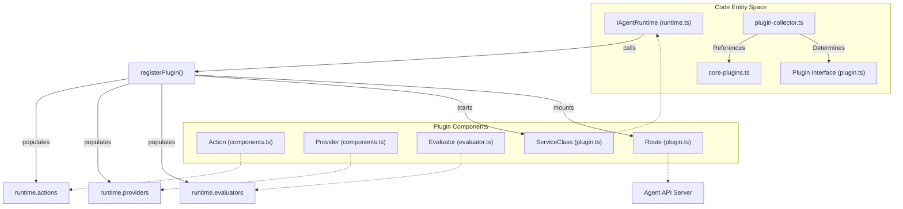
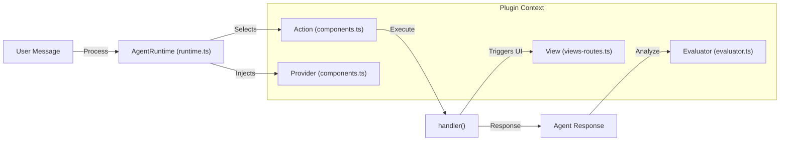

<!-- source: DeepWiki mcp.deepwiki.com · repo elizaOS/eliza · page 5.1 Plugin Architecture and Lifecycle · fetched 2026-10-29 -->

# Plugin Architecture and Lifecycle

Relevant source files

The following files were used as context for generating this wiki page:

- [packages/agent/src/actions/terminal.ts](packages/agent/src/actions/terminal.ts)
- [packages/agent/src/api/misc-routes.ts](packages/agent/src/api/misc-routes.ts)
- [packages/agent/src/api/views-registry.ts](packages/agent/src/api/views-registry.ts)
- [packages/agent/src/api/views-routes.ts](packages/agent/src/api/views-routes.ts)
- [packages/agent/src/runtime/core-plugins.ts](packages/agent/src/runtime/core-plugins.ts)
- [packages/agent/src/runtime/plugin-collector-aosp.test.ts](packages/agent/src/runtime/plugin-collector-aosp.test.ts)
- [packages/agent/src/runtime/plugin-collector-mode-policy.test.ts](packages/agent/src/runtime/plugin-collector-mode-policy.test.ts)
- [packages/agent/src/runtime/plugin-collector.ts](packages/agent/src/runtime/plugin-collector.ts)
- [packages/agent/src/runtime/plugin-lifecycle.ts](packages/agent/src/runtime/plugin-lifecycle.ts)
- [packages/agent/src/runtime/tool-call-cache-wrapper.ts](packages/agent/src/runtime/tool-call-cache-wrapper.ts)
- [packages/agent/src/services/evm-signing-capability.ts](packages/agent/src/services/evm-signing-capability.ts)
- [packages/app-core/platforms/electrobun/src/__stubs__/bun-ffi.ts](packages/app-core/platforms/electrobun/src/__stubs__/bun-ffi.ts)
- [packages/app-core/scripts/install-android-sms-gateway.md](packages/app-core/scripts/install-android-sms-gateway.md)
- [packages/benchmarks/orchestrator/README.md](packages/benchmarks/orchestrator/README.md)
- [packages/benchmarks/orchestrator/code_agent_coverage.py](packages/benchmarks/orchestrator/code_agent_coverage.py)
- [packages/benchmarks/orchestrator/code_agent_matrix.py](packages/benchmarks/orchestrator/code_agent_matrix.py)
- [packages/benchmarks/orchestrator/tests/test_code_agent_matrix.py](packages/benchmarks/orchestrator/tests/test_code_agent_matrix.py)
- [packages/core/src/features/basic-capabilities/actions/reply.test.ts](packages/core/src/features/basic-capabilities/actions/reply.test.ts)
- [packages/core/src/features/basic-capabilities/actions/reply.ts](packages/core/src/features/basic-capabilities/actions/reply.ts)
- [packages/core/src/runtime/__tests__/message-post-connectors.test.ts](packages/core/src/runtime/__tests__/message-post-connectors.test.ts)
- [packages/core/src/types/plugin.ts](packages/core/src/types/plugin.ts)
- [packages/core/src/types/runtime.ts](packages/core/src/types/runtime.ts)
- [packages/docs/model-providers.mdx](packages/docs/model-providers.mdx)
- [packages/examples/autonomous/autonomous.ts](packages/examples/autonomous/autonomous.ts)
- [packages/examples/smartglasses/README.md](packages/examples/smartglasses/README.md)
- [packages/examples/smartglasses/eliza-runtime-smoke.ts](packages/examples/smartglasses/eliza-runtime-smoke.ts)
- [packages/examples/smartglasses/package-smoke.ts](packages/examples/smartglasses/package-smoke.ts)
- [packages/examples/smartglasses/smartglasses.test.ts](packages/examples/smartglasses/smartglasses.test.ts)
- [packages/examples/smartglasses/smartglasses.ts](packages/examples/smartglasses/smartglasses.ts)
- [packages/scripts/cloud/bluebubbles-local-bridge.ts](packages/scripts/cloud/bluebubbles-local-bridge.ts)
- [packages/shared/src/contracts/misc-routes.test.ts](packages/shared/src/contracts/misc-routes.test.ts)
- [packages/shared/src/contracts/misc-routes.ts](packages/shared/src/contracts/misc-routes.ts)
- [packages/ui/src/components/views/DynamicViewLoader.tsx](packages/ui/src/components/views/DynamicViewLoader.tsx)
- [packages/ui/src/hooks/useAvailableViews.ts](packages/ui/src/hooks/useAvailableViews.ts)
- [plugins/plugin-agent-orchestrator/__tests__/unit/sanitize-planner-text.test.ts](plugins/plugin-agent-orchestrator/__tests__/unit/sanitize-planner-text.test.ts)
- [plugins/plugin-agent-orchestrator/__tests__/unit/scan-and-unlink-older-than.test.ts](plugins/plugin-agent-orchestrator/__tests__/unit/scan-and-unlink-older-than.test.ts)
- [plugins/plugin-agent-orchestrator/__tests__/unit/session-store.test.ts](plugins/plugin-agent-orchestrator/__tests__/unit/session-store.test.ts)
- [plugins/plugin-agent-orchestrator/src/api/agent-routes.ts](plugins/plugin-agent-orchestrator/src/api/agent-routes.ts)
- [plugins/plugin-agent-orchestrator/src/providers/active-sub-agents.ts](plugins/plugin-agent-orchestrator/src/providers/active-sub-agents.ts)
- [plugins/plugin-agent-orchestrator/src/services/audit.ts](plugins/plugin-agent-orchestrator/src/services/audit.ts)
- [plugins/plugin-agent-orchestrator/src/services/session-store.ts](plugins/plugin-agent-orchestrator/src/services/session-store.ts)
- [plugins/plugin-agent-orchestrator/src/services/types.ts](plugins/plugin-agent-orchestrator/src/services/types.ts)
- [plugins/plugin-agent-orchestrator/src/services/workspace-github.ts](plugins/plugin-agent-orchestrator/src/services/workspace-github.ts)
- [plugins/plugin-agent-orchestrator/src/services/workspace-service.ts](plugins/plugin-agent-orchestrator/src/services/workspace-service.ts)
- [plugins/plugin-app-control/src/actions/app-create.ts](plugins/plugin-app-control/src/actions/app-create.ts)
- [plugins/plugin-app-control/src/actions/app.ts](plugins/plugin-app-control/src/actions/app.ts)
- [plugins/plugin-app-control/src/actions/views-create.ts](plugins/plugin-app-control/src/actions/views-create.ts)
- [plugins/plugin-app-control/src/actions/views-delete.ts](plugins/plugin-app-control/src/actions/views-delete.ts)
- [plugins/plugin-app-control/src/actions/views-edit.ts](plugins/plugin-app-control/src/actions/views-edit.ts)
- [plugins/plugin-app-control/src/actions/views.ts](plugins/plugin-app-control/src/actions/views.ts)
- [plugins/plugin-discord/__tests__/extract-content-metadata.test.ts](plugins/plugin-discord/__tests__/extract-content-metadata.test.ts)
- [plugins/plugin-sql/src/index.browser.ts](plugins/plugin-sql/src/index.browser.ts)
- [plugins/plugin-sql/src/index.node.ts](plugins/plugin-sql/src/index.node.ts)
- [plugins/plugin-sql/src/index.ts](plugins/plugin-sql/src/index.ts)
- [plugins/plugin-xr/src/protocol.ts](plugins/plugin-xr/src/protocol.ts)
- [plugins/plugin-xr/src/routes/xr-views.ts](plugins/plugin-xr/src/routes/xr-views.ts)
- [plugins/plugin-xr/src/services/xr-session-service.ts](plugins/plugin-xr/src/services/xr-session-service.ts)

The elizaOS plugin system is a modular framework designed to extend the `AgentRuntime` with specialized capabilities. Plugins serve as the primary mechanism for integrating external APIs, blockchain networks, communication platforms, and custom logic into an agent's execution pipeline. This architecture allows for a "pluggable" intelligence where features like Discord integration, SQL database access, or local inference can be toggled per agent.

## The Plugin Interface

A plugin in elizaOS is defined by the `Plugin` interface. It acts as a container for five primary types of extensions: **Actions**, **Providers**, **Evaluators**, **Services**, and **Routes**.

### Core Components
*   **Actions**: Discrete functions that the agent can choose to execute based on context (e.g., `REPLY`, `IGNORE`). [packages/core/src/types/components.ts:11-18]()
*   **Providers**: Inject real-time information into the agent's context window (e.g., `currentTimeProvider`, `recentMessagesProvider`). [packages/core/src/types/components.ts:5-5]()
*   **Evaluators**: Assessment logic that runs after message processing to extract facts or assess outcomes. [packages/core/src/types/evaluator.ts:7-14]()
*   **Services**: Long-running background processes or utility classes (e.g., `EmbeddingGenerationService`, `TaskService`). [packages/core/src/types/plugin.ts:22-33]()
*   **Routes**: Custom HTTP endpoints exposed by the agent's API server, supporting both legacy Express-style and new return-shape handlers. [packages/core/src/types/plugin.ts:111-168]()

### Interface Definition

| Property | Type | Description |
| :--- | :--- | :--- |
| `name` | `string` | Unique identifier for the plugin (e.g., "eliza", "openai"). [packages/core/src/types/plugin.ts:219-219]() |
| `description` | `string` | Human-readable description of the plugin's purpose. [packages/core/src/types/plugin.ts:220-220]() |
| `actions` | `Action[]` | Array of actions the agent can perform. [packages/core/src/types/plugin.ts:223-223]() |
| `providers` | `Provider[]` | Array of providers to inject context. [packages/core/src/types/plugin.ts:224-224]() |
| `evaluators` | `Evaluator[]` | Array of evaluators to process post-interaction. [packages/core/src/types/plugin.ts:225-225]() |
| `services` | `ServiceClass[]` | Background service constructors managed by the runtime. [packages/core/src/types/plugin.ts:226-226]() |
| `routes` | `Route[]` | Custom API endpoints registered on the agent server. [packages/core/src/types/plugin.ts:227-227]() |
| `views` | `View[]` | UI views contributed by the plugin for the frontend. [packages/core/src/types/plugin.ts:233-233]() |

**Sources:**
- [packages/core/src/types/plugin.ts:22-233]()
- [packages/core/src/types/components.ts:1-18]()

---

## Plugin Lifecycle and Registration

The lifecycle of a plugin is managed by the `AgentRuntime`. The system distinguishes between "Core" plugins that are always loaded and "Optional" plugins enabled via configuration or environment variables.

### Initialization Flow
1.  **Collection**: The `plugin-collector.ts` determines which plugin packages should be loaded based on `ElizaConfig`, environment variables, and platform-specific rules (e.g., `MOBILE_CORE_PLUGINS` for Android). [packages/agent/src/runtime/plugin-collector.ts:15-32]()
2.  **Resolution**: The `plugin-resolver.ts` (referenced in `plugin-collector`) loads the plugin from static imports or npm packages.
3.  **Registration**: The runtime registers actions, providers, and evaluators. [packages/core/src/types/runtime.ts:543-550]()
4.  **Service Startup**: Any `ServiceClass` in the plugin is instantiated and started via `ServiceClass.start(runtime)`. [packages/core/src/types/plugin.ts:26-26]()
5.  **Init Hook**: If the plugin defines an `init` method, it is executed during runtime setup. [packages/core/src/types/plugin.ts:241-244]()

### Diagram: Plugin Registration and Runtime Integration

**Sources:**
- [packages/agent/src/runtime/plugin-collector.ts:15-165]()
- [packages/agent/src/runtime/core-plugins.ts:82-107]()
- [packages/core/src/types/plugin.ts:22-56]()

---

## Extension Mechanisms

### 1. View Registry and UI Integration
Plugins can now extend the elizaOS UI via the `views` property. These views are registered with the agent's API server and can be managed through the `VIEWS` action. [plugins/plugin-app-control/src/actions/views.ts:190-197]()
*   **Routes**: The API server mounts routes to serve view metadata, compiled bundles, and assets. [packages/agent/src/api/views-routes.ts:8-18]()
*   **Interaction**: Agents can interact with views via "capabilities" dispatched through the `POST /api/views/:id/interact` endpoint. [packages/agent/src/api/views-routes.ts:16-16]()

### 2. Service Mixins and Global State
Services like `CodingWorkspaceService` or `SessionStore` allow plugins to maintain persistent state and provide complex logic that spans multiple interactions. [plugins/plugin-agent-orchestrator/src/services/workspace-service.ts:198-202]()

### Diagram: Message Data Flow to Code Entities

**Sources:**
- [packages/agent/src/api/views-routes.ts:1-18]()
- [plugins/plugin-app-control/src/actions/views.ts:1-40]()

---

## Configuration and Auto-Enablement

elizaOS employs `CHANNEL_PLUGIN_MAP` and `PROVIDER_PLUGIN_MAP` to automatically load plugins based on the environment. [packages/agent/src/runtime/plugin-collector.ts:117-165]()

### Auto-Enablement Mapping

| Variable | Target Plugin | Role |
| :--- | :--- | :--- |
| `ANTHROPIC_API_KEY` | `@elizaos/plugin-anthropic` | AI Provider [packages/agent/src/runtime/plugin-collector.ts:145-145]() |
| `OPENAI_API_KEY` | `@elizaos/plugin-openai` | AI Provider [packages/agent/src/runtime/plugin-collector.ts:146-146]() |
| `TELEGRAM_BOT_TOKEN`| `@elizaos/plugin-telegram` | Connector [packages/agent/src/runtime/plugin-collector.ts:121-121]() |
| `ELIZAOS_CLOUD_ENABLED`| `@elizaos/plugin-elizacloud`| Cloud Service [packages/agent/src/runtime/plugin-collector.ts:164-164]() |

### Core vs. Platform Plugins
*   **CORE_PLUGINS**: Standard plugins like `plugin-sql` and `plugin-local-inference` that form the base agent capability. [packages/agent/src/runtime/core-plugins.ts:82-107]()
*   **MOBILE_CORE_PLUGINS**: A subset of plugins (SQL, background runner, device filesystem) safe for resource-constrained mobile environments. [packages/agent/src/runtime/core-plugins.ts:39-43]()
*   **DESKTOP_ONLY_PLUGINS**: Plugins requiring native binaries or PTY support, such as `agent-orchestrator` and `coding-tools`. [packages/agent/src/runtime/core-plugins.ts:12-15]()

**Sources:**
- [packages/agent/src/runtime/plugin-collector.ts:117-165]()
- [packages/agent/src/runtime/core-plugins.ts:12-107]()

---

