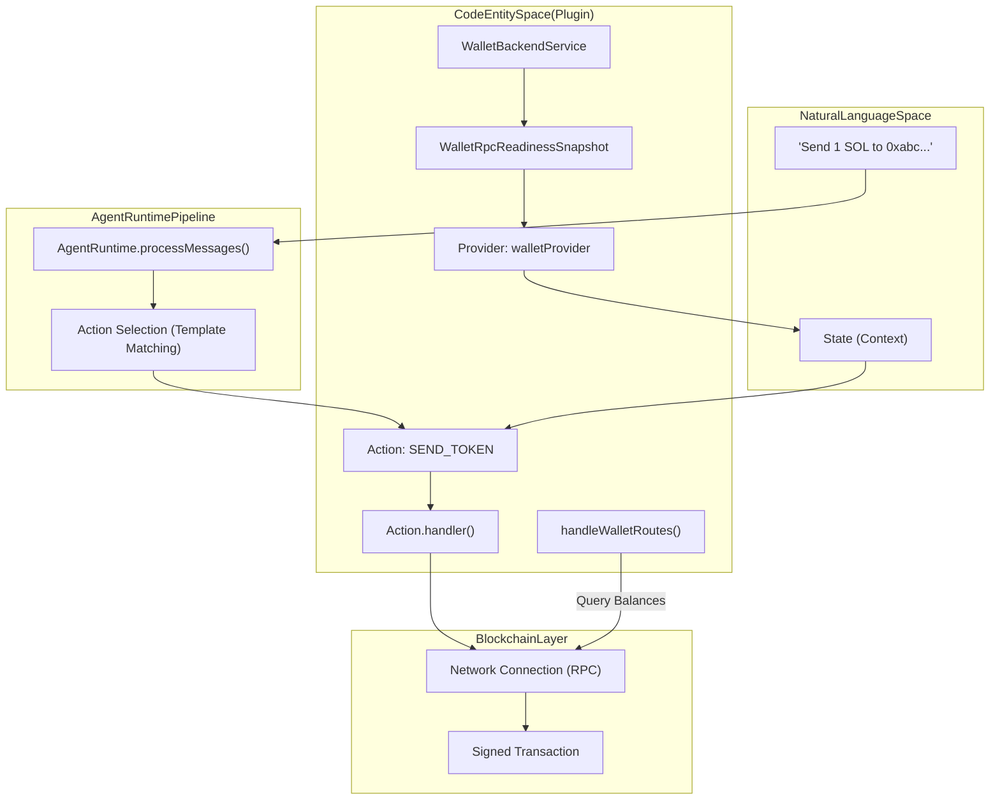

<!-- source: DeepWiki mcp.deepwiki.com · repo elizaOS/eliza · page 5.3 Blockchain and Web3 Plugins · fetched 2026-10-29 -->

# Blockchain and Web3 Plugins

Relevant source files

The following files were used as context for generating this wiki page:

- [packages/agent/package.json](packages/agent/package.json)
- [packages/agent/src/api/index.ts](packages/agent/src/api/index.ts)
- [packages/agent/src/api/server.ts](packages/agent/src/api/server.ts)
- [packages/agent/src/services/index.ts](packages/agent/src/services/index.ts)
- [plugins/plugin-agent-skills/src/index.ts](plugins/plugin-agent-skills/src/index.ts)
- [plugins/plugin-capacitor-bridge/src/android/bridge.ts](plugins/plugin-capacitor-bridge/src/android/bridge.ts)
- [plugins/plugin-capacitor-bridge/src/ios/bridge.ts](plugins/plugin-capacitor-bridge/src/ios/bridge.ts)
- [plugins/plugin-capacitor-bridge/src/shared/fs-promises-proxy.ts](plugins/plugin-capacitor-bridge/src/shared/fs-promises-proxy.ts)
- [plugins/plugin-capacitor-bridge/src/shared/fs-proxy.ts](plugins/plugin-capacitor-bridge/src/shared/fs-proxy.ts)
- [plugins/plugin-capacitor-bridge/src/shared/fs-sandbox.ts](plugins/plugin-capacitor-bridge/src/shared/fs-sandbox.ts)
- [plugins/plugin-capacitor-bridge/src/shared/fs-shim.ts](plugins/plugin-capacitor-bridge/src/shared/fs-shim.ts)
- [plugins/plugin-wallet/package.json](plugins/plugin-wallet/package.json)
- [plugins/plugin-wallet/src/api/wallet-routes.ts](plugins/plugin-wallet/src/api/wallet-routes.ts)
- [plugins/plugin-wallet/src/index.ts](plugins/plugin-wallet/src/index.ts)

Blockchain and Web3 plugins in elizaOS provide the interface between Natural Language Processing (NLP) and decentralized networks. These plugins enable agents to perform on-chain operations such as token transfers, balance checks, liquidity provision, and cross-chain interactions across various ecosystems including Solana, Ethereum (EVM), Starknet, and Coinbase (Base).

The primary entry point for these capabilities is `@elizaos/plugin-wallet`, which consolidates formerly disparate plugins (EVM, Solana, Raydium, etc.) into a single canonical surface [plugins/plugin-wallet/package.json:4-4]().

## Plugin Architecture and Data Flow

Blockchain plugins follow the standard elizaOS plugin architecture, consisting of **Actions**, **Providers**, and **Evaluators**. The data flow typically starts with a natural language intent which is mapped to a specific blockchain action via the `AgentRuntime`.

### Natural Language to On-Chain Execution

The following diagram illustrates how a user request (e.g., "Send 1 SOL to [address]") transitions from a text string to a signed transaction on the blockchain, highlighting the specific code entities involved in wallet resolution and the `handleWalletRoutes` API layer.

**Data Flow: Natural Language to On-Chain Action**

**Sources:**
- `plugins/plugin-wallet/src/index.ts` [22-26](), [65-65]()
- `plugins/plugin-wallet/src/api/wallet-routes.ts` [30-43]()
- `plugins/plugin-wallet/src/services/wallet-backend-service.ts` [71-73]()

---

## Wallet Management and Dual-Wallet Architecture

elizaOS implements a dual-wallet architecture that supports both local non-custodial keys and managed "Steward" wallets. The `ELIZA_WALLET_BACKEND` setting determines whether the agent uses local private keys or delegates signing to a remote vault [plugins/plugin-wallet/package.json:98-102]().

### Signing Capabilities
The system determines if an agent can sign transactions based on its environment and configuration.

| Backend Type | Description | Configuration |
| :--- | :--- | :--- |
| `local` | Non-custodial signing via local keys. | `EVM_PRIVATE_KEY`, `SOLANA_PRIVATE_KEY` [plugins/plugin-wallet/package.json:104-115]() |
| `steward` | Managed signing via Steward API. | `STEWARD_API_URL`, `STEWARD_AGENT_TOKEN` [plugins/plugin-wallet/package.json:116-130]() |
| `auto` | Desktop uses local; Cloud uses steward. | Default behavior [plugins/plugin-wallet/package.json:101-102]() |

### Wallet API and Routing
The `handleWalletRoutes` function is the central hub for the Agent UI to interact with the wallet system. It is lazily loaded by the agent server to prevent heavy trading dependencies from slowing down initial boot [packages/agent/src/api/index.ts:22-26](). It provides endpoints for:
- Querying balances across EVM and Solana [plugins/plugin-wallet/src/api/wallet-routes.ts:213-220]().
- Managing RPC provider selections [plugins/plugin-wallet/src/api/wallet-routes.ts:142-149]().
- Exporting/importing wallet configurations [plugins/plugin-wallet/src/api/wallet-routes.ts:47-50]().

**Sources:**
- `packages/agent/src/api/index.ts` [11-26]()
- `plugins/plugin-wallet/src/api/wallet-routes.ts` [113-170]()

---

## LP Manager Plugin

The LP Manager (now part of `@elizaos/plugin-wallet`) provides automated liquidity management across multiple decentralized exchanges (DEXes) [plugins/plugin-wallet/src/index.ts:39-42]().

### Supported DEXes and Services
The plugin provides specialized services for interacting with various protocols:

| Category | Supported Protocols | Service Class |
| :--- | :--- | :--- |
| **Solana DEX** | Raydium, Orca, Meteora | `DexInteractionService` [plugins/plugin-wallet/src/lp/lp-manager-entry.ts:47-54]() |
| **EVM DEX** | Uniswap V3, Aerodrome, PancakeSwap | `UniswapV3LpService`, `AerodromeLpService` [plugins/plugin-wallet/src/lp/lp-manager-entry.ts:44-57]() |
| **Optimization** | Kamino, Steer Protocol | `YieldOptimizationService` [plugins/plugin-wallet/src/lp/lp-manager-entry.ts:59-59]() |

**Core Services:**
- `ConcentratedLiquidityService`: Manages tick ranges for V3-style pools [plugins/plugin-wallet/src/lp/lp-manager-entry.ts:46-46]().
- `UserLpProfileService`: Tracks agent's liquidity positions [plugins/plugin-wallet/src/lp/lp-manager-entry.ts:56-56]().
- `VaultService`: Handles secure asset storage for LP strategies [plugins/plugin-wallet/src/lp/lp-manager-entry.ts:58-58]().

**Sources:**
- `plugins/plugin-wallet/src/index.ts` [43-61]()
- `plugins/plugin-wallet/src/lp/lp-manager-entry.ts` [43-61]()

---

## Mobile and Capacitor Bridge

The `@elizaos/plugin-capacitor-bridge` provides the infrastructure to run blockchain-enabled agents on iOS and Android.

### Filesystem Sandboxing
Because mobile environments have strict security requirements, the bridge implements a `mobile-fs-shim`. This shim intercepts `node:fs` calls to ensure the agent only writes to the app's allowed sandbox (e.g., `Application Support/Eliza/`) and prevents directory traversal [plugins/plugin-capacitor-bridge/src/shared/fs-shim.ts:24-32]().

### On-Device Inference Delegation
On iOS, the bridge routes text generation through native llama-cpp via `IOS_NATIVE_LLAMA_PROVIDER` [plugins/plugin-capacitor-bridge/src/ios/bridge.ts:245-247](). This allows the agent to use the device's GPU/NPU for local inference while maintaining its Web3 capabilities [plugins/plugin-capacitor-bridge/src/ios/bridge.ts:275-280]().

**Sources:**
- `plugins/plugin-capacitor-bridge/src/shared/fs-shim.ts` [7-20](), [110-118]()
- `plugins/plugin-capacitor-bridge/src/ios/bridge.ts` [245-280]()
- `plugins/plugin-capacitor-bridge/src/android/bridge.ts` [4-16]()

---

## X402 and Micropayments

The framework supports **X402 micropayments**, which are lazily loaded in the agent server to minimize the footprint for non-financial agents [packages/agent/src/api/server.ts:65-65]().

X402 allows agents to:
- Attach payment requirements to specific API routes or natural language actions.
- Verify payment success before executing resource-intensive tasks.
- Integrate with the `walletPlugin` for automated settlement.

**Sources:**
- `packages/agent/src/api/server.ts` [79-86](), [92-95]()
- `plugins/plugin-wallet/package.json:4-4]()

---

## Configuration Reference

| Variable | Description |
| :--- | :--- |
| `ELIZA_WALLET_BACKEND` | Selection: `local` \| `steward` \| `auto` [plugins/plugin-wallet/package.json:98-102](). |
| `EVM_PRIVATE_KEY` | Hex private key for local EVM signing [plugins/plugin-wallet/package.json:104-109](). |
| `SOLANA_PRIVATE_KEY` | Base58 private key for local Solana signing [plugins/plugin-wallet/package.json:110-115](). |
| `STEWARD_API_URL` | Base URL for the Steward vault service [plugins/plugin-wallet/package.json:116-120](). |
| `STEWARD_AGENT_TOKEN` | Bearer token for Steward authentication [plugins/plugin-wallet/package.json:126-131](). |

**Sources:**
- `plugins/plugin-wallet/package.json` [95-138]()

---

