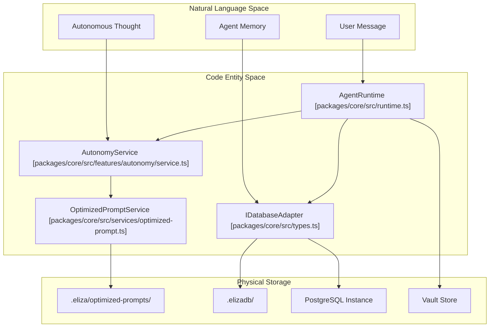
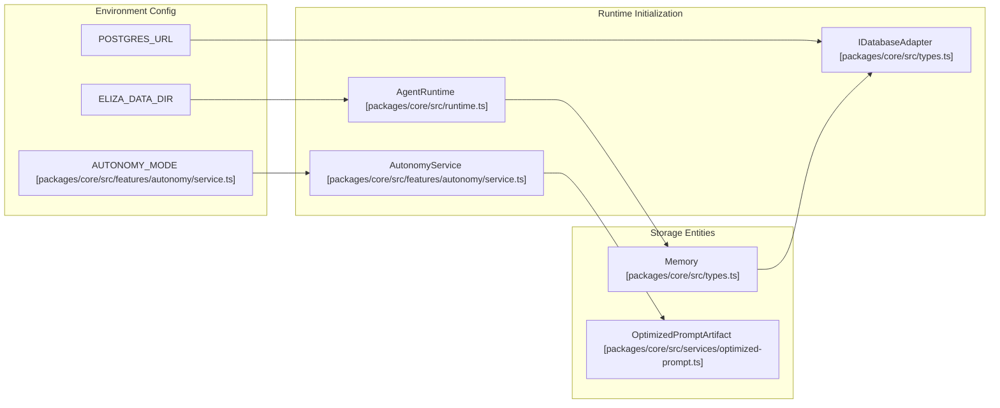

<!-- source: DeepWiki mcp.deepwiki.com · repo elizaOS/eliza · page 6 Data and Storage · fetched 2026-10-29 -->

# Data and Storage

Relevant source files

The following files were used as context for generating this wiki page:

- [packages/cloud-api/v1/billing/resources/[id]/cancel/route.ts](packages/cloud-api/v1/billing/resources/[id]/cancel/route.ts)
- [packages/cloud-shared/src/lib/services/active-billing.ts](packages/cloud-shared/src/lib/services/active-billing.ts)
- [packages/cloud-shared/src/lib/services/agent-managed-discord.ts](packages/cloud-shared/src/lib/services/agent-managed-discord.ts)
- [packages/cloud-shared/src/lib/services/agent-managed-github.ts](packages/cloud-shared/src/lib/services/agent-managed-github.ts)
- [packages/core/src/__tests__/runtime-settings.test.ts](packages/core/src/__tests__/runtime-settings.test.ts)
- [packages/core/src/features/autonomy/action.ts](packages/core/src/features/autonomy/action.ts)
- [packages/core/src/features/autonomy/service.test.ts](packages/core/src/features/autonomy/service.test.ts)
- [packages/core/src/features/autonomy/service.ts](packages/core/src/features/autonomy/service.ts)
- [packages/core/src/runtime.ts](packages/core/src/runtime.ts)
- [packages/core/src/services/optimized-prompt.ts](packages/core/src/services/optimized-prompt.ts)
- [packages/examples/_plugin/package.json](packages/examples/_plugin/package.json)
- [packages/examples/_plugin/test.ts](packages/examples/_plugin/test.ts)
- [packages/homepage/tests/e2e/app-routes-flow.spec.ts](packages/homepage/tests/e2e/app-routes-flow.spec.ts)
- [packages/scripts/run-autonomy-cerebras-loops.ts](packages/scripts/run-autonomy-cerebras-loops.ts)

elizaOS implements a robust persistence layer designed to handle the complex memory requirements of autonomous agents. The system manages everything from short-term conversation context to long-term vector-searchable knowledge, utilizing a flexible architecture that supports multiple database backends and a structured hierarchical file system.

## Persistence Overview

The data architecture of elizaOS is centered around the `AgentRuntime`, which orchestrates how information is stored, retrieved, and processed [packages/core/src/runtime.ts:156-198](). Persistence is split into three primary domains:
1.  **Structured Data**: Handled by database adapters (PostgreSQL, PGLite, or In-Memory) for storing messages, participants, relationships, and embeddings [packages/core/src/runtime.ts:102-110]().
2.  **File-based Data**: Handled by the `ELIZA_DATA_DIR` hierarchy for storing character definitions, generated assets, and optimized prompt artifacts [packages/core/src/services/optimized-prompt.ts:141-143]().
3.  **Encrypted Secrets**: Managed by the `@elizaos/vault` package for secure storage of API keys and credentials [packages/core/src/runtime.ts:50-53]().

### Data Flow Architecture

The following diagram illustrates how the `AgentRuntime` interacts with various storage components to bridge natural language interactions with persistent code entities.

**Diagram: Storage Entity Mapping**

Sources: [packages/core/src/runtime.ts:102-110](), [packages/core/src/features/autonomy/service.ts:68-85](), [packages/core/src/services/optimized-prompt.ts:5-17]()

---

## Memory and Database Adapters

The core of elizaOS's intelligence is its memory system. Unlike simple databases, the memory system supports **Vector Embeddings**, allowing agents to perform semantic searches across past interactions and autonomous thoughts [packages/core/src/features/autonomy/service.ts:142-147]().

### Database Interface
All database interactions are abstracted through the `IDatabaseAdapter` interface. This allows elizaOS to be platform-agnostic, supporting high-performance cloud databases or local, zero-config storage [packages/core/src/runtime.ts:101-102]().

| Adapter Type | Implementation | Best For |
| :--- | :--- | :--- |
| **PostgreSQL** | `PostgresDatabaseAdapter` | Production, multi-agent deployments, and cloud hosting. |
| **PGLite** | `PgliteDatabaseAdapter` | Local development and WASM environments. |
| **In-Memory** | `InMemoryDatabaseAdapter` | Testing, benchmarks, and ephemeral sessions [packages/core/src/runtime.ts:8-8](). |

The system can be configured to run without a persistent database for testing via `ALLOW_NO_DATABASE` [packages/scripts/run-autonomy-cerebras-loops.ts:152-152]().

For more technical details on implementation, interfaces, and vector search, see [Memory and Database Adapters](#6.1).

Sources: [packages/core/src/runtime.ts:101-110](), [packages/scripts/run-autonomy-cerebras-loops.ts:181-181]()

---

## Data Directory Structure

elizaOS uses a standardized directory structure to organize non-relational data. This is controlled primarily by the `ELIZA_DATA_DIR` environment variable.

### Directory Hierarchy
The system organizes data into specific sub-directories to separate agent configurations from generated content:

*   **`.elizadb/`**: Default location for local PGLite database files.
*   **`optimized-prompts/`**: Stores JSON artifacts for optimized system prompts (MIPRO/GEPA) [packages/core/src/services/optimized-prompt.ts:5-17]().
*   **`data/generated/`**: Assets created by the agent (e.g., images, processed documents).
*   **`data/uploads/`**: Media and files uploaded via client interfaces.

The `OptimizedPromptService` manages a versioned file system for prompts, retaining the last 5 versions using symlinks like `current`, `previous`, and `previous2` [packages/core/src/services/optimized-prompt.ts:56-59]().

For a full breakdown of the folder structure and how to configure custom paths, see [Data Directory Structure](#6.2).

Sources: [packages/core/src/services/optimized-prompt.ts:11-17](), [packages/core/src/services/optimized-prompt.ts:141-143]()

---

## Vault and Secrets Management

Secure data persistence is handled by the `@elizaos/vault` package. This system isolates sensitive credentials from the primary agent database. Secrets can be provided via character files or environment variables and are redacted during logging to prevent exposure [packages/core/src/runtime.ts:50-53]().

### Security Features
*   **Encryption**: Uses AES-256-GCM for sensitive data.
*   **Runtime Redaction**: The `redactWithSecrets` utility ensures API keys and other secrets do not appear in runtime logs [packages/core/src/runtime.ts:50-50]().
*   **Character Isolation**: Each character can have its own `secrets` object defined in its configuration [packages/scripts/run-autonomy-cerebras-loops.ts:169-179]().

For details on managing API keys and wallet secrets, see [Vault and Secrets Management](#6.3).

Sources: [packages/core/src/runtime.ts:50-53](), [packages/scripts/run-autonomy-cerebras-loops.ts:169-179]()

---

## Storage Integration Logic

The following diagram bridges the high-level configuration to the internal class structures that manage storage.

**Diagram: Configuration to Runtime Mapping**

Sources: [packages/core/src/features/autonomy/service.ts:86-90](), [packages/core/src/services/optimized-prompt.ts:113-125](), [packages/core/src/runtime.ts:156-167]()

---

