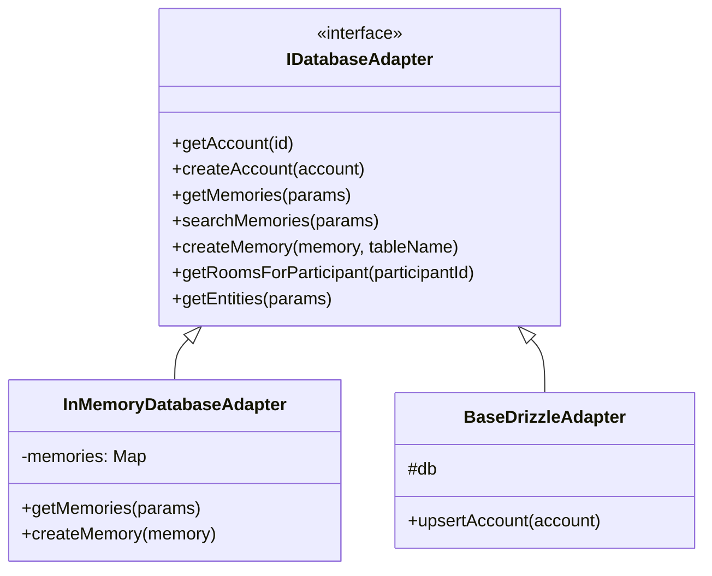
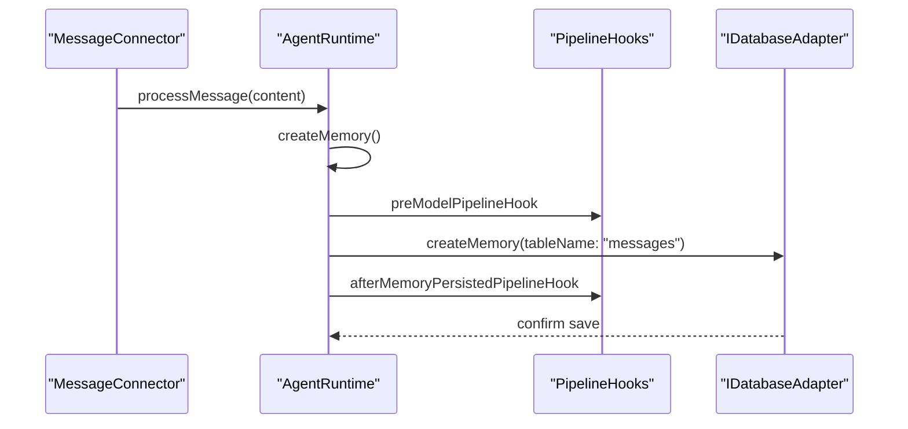
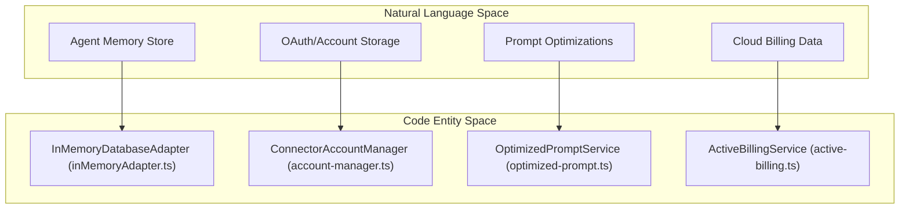

<!-- source: DeepWiki mcp.deepwiki.com · repo elizaOS/eliza · page 6.1 Memory and Database Adapters · fetched 2026-10-29 -->

# Memory and Database Adapters

Relevant source files

The following files were used as context for generating this wiki page:

- [packages/app-core/deploy/Dockerfile.ci](packages/app-core/deploy/Dockerfile.ci)
- [packages/app-core/deploy/deploy.defaults.env](packages/app-core/deploy/deploy.defaults.env)
- [packages/app-core/packaging/snap/snapcraft.yaml](packages/app-core/packaging/snap/snapcraft.yaml)
- [packages/app-core/src/api/dev-voice-latency-route.test.ts](packages/app-core/src/api/dev-voice-latency-route.test.ts)
- [packages/app-core/src/services/phrase-chunked-tts.test.ts](packages/app-core/src/services/phrase-chunked-tts.test.ts)
- [packages/cloud-api/v1/billing/resources/[id]/cancel/route.ts](packages/cloud-api/v1/billing/resources/[id]/cancel/route.ts)
- [packages/cloud-services/operator/capabilities/__tests__/redis-mock.test.ts](packages/cloud-services/operator/capabilities/__tests__/redis-mock.test.ts)
- [packages/cloud-shared/src/lib/services/active-billing.ts](packages/cloud-shared/src/lib/services/active-billing.ts)
- [packages/cloud-shared/src/lib/services/agent-managed-discord.ts](packages/cloud-shared/src/lib/services/agent-managed-discord.ts)
- [packages/cloud-shared/src/lib/services/agent-managed-github.ts](packages/cloud-shared/src/lib/services/agent-managed-github.ts)
- [packages/core/src/__tests__/runtime-settings.test.ts](packages/core/src/__tests__/runtime-settings.test.ts)
- [packages/core/src/action-docs.ts](packages/core/src/action-docs.ts)
- [packages/core/src/connectors/account-manager.ts](packages/core/src/connectors/account-manager.ts)
- [packages/core/src/features/advanced-capabilities/actions/room.ts](packages/core/src/features/advanced-capabilities/actions/room.ts)
- [packages/core/src/features/advanced-capabilities/experience/utils/experienceText.ts](packages/core/src/features/advanced-capabilities/experience/utils/experienceText.ts)
- [packages/core/src/features/advanced-memory/types.ts](packages/core/src/features/advanced-memory/types.ts)
- [packages/core/src/features/autonomy/action.ts](packages/core/src/features/autonomy/action.ts)
- [packages/core/src/features/autonomy/service.test.ts](packages/core/src/features/autonomy/service.test.ts)
- [packages/core/src/features/autonomy/service.ts](packages/core/src/features/autonomy/service.ts)
- [packages/core/src/features/documents/actions.ts](packages/core/src/features/documents/actions.ts)
- [packages/core/src/features/documents/document-processor.ts](packages/core/src/features/documents/document-processor.ts)
- [packages/core/src/features/documents/service.ts](packages/core/src/features/documents/service.ts)
- [packages/core/src/features/documents/url-ingest.ts](packages/core/src/features/documents/url-ingest.ts)
- [packages/core/src/features/trust/services/CredentialProtector.ts](packages/core/src/features/trust/services/CredentialProtector.ts)
- [packages/core/src/runtime.ts](packages/core/src/runtime.ts)
- [packages/core/src/services/optimized-prompt.ts](packages/core/src/services/optimized-prompt.ts)
- [packages/core/src/services/relationships.ts](packages/core/src/services/relationships.ts)
- [packages/core/src/utils/synthetic-conversation-artifact.ts](packages/core/src/utils/synthetic-conversation-artifact.ts)
- [packages/core/test/live/orchestrator-live-failover.ts](packages/core/test/live/orchestrator-live-failover.ts)
- [packages/core/test/live/orchestrator-task-thread-integration.ts](packages/core/test/live/orchestrator-task-thread-integration.ts)
- [packages/core/test/live/orchestrator-task-thread-restart.ts](packages/core/test/live/orchestrator-task-thread-restart.ts)
- [packages/core/test/live/research-task-thread-live.ts](packages/core/test/live/research-task-thread-live.ts)
- [packages/examples/_plugin/package.json](packages/examples/_plugin/package.json)
- [packages/examples/_plugin/test.ts](packages/examples/_plugin/test.ts)
- [packages/homepage/tests/e2e/app-routes-flow.spec.ts](packages/homepage/tests/e2e/app-routes-flow.spec.ts)
- [packages/scripts/cloud/admin/migrate-with-diagnostics.ts](packages/scripts/cloud/admin/migrate-with-diagnostics.ts)
- [packages/scripts/cloud/admin/run-integration-tests.mjs](packages/scripts/cloud/admin/run-integration-tests.mjs)
- [packages/scripts/run-autonomy-cerebras-loops.ts](packages/scripts/run-autonomy-cerebras-loops.ts)
- [packages/scripts/run-live-scenarios.mjs](packages/scripts/run-live-scenarios.mjs)
- [plugins/plugin-local-inference/src/services/dflash-server.p3.test.ts](plugins/plugin-local-inference/src/services/dflash-server.p3.test.ts)

The elizaOS framework employs a robust memory and persistence system designed to handle high-frequency agent interactions, long-term state retention, and vector-based semantic retrieval. This system is built upon a flexible adapter architecture, allowing agents to switch between lightweight local storage (PGlite), production-grade relational databases (PostgreSQL), or transient in-memory storage.

## The Memory System

In elizaOS, "Memory" refers to the structured storage of interactions, facts, and relationships. The core logic resides in `@elizaos/core`, which defines how the `AgentRuntime` manages memory objects.

### Memory Structure
A `Memory` object is the primary unit of data. It contains the content of an interaction, associated metadata, and embeddings for vector search.

| Field | Type | Description |
| :--- | :--- | :--- |
| `id` | `UUID` | Unique identifier for the memory entry [packages/core/src/types.ts:109](). |
| `entityId` | `UUID` | The entity (user or agent) associated with this memory [packages/core/src/types.ts:109](). |
| `agentId` | `UUID` | The agent that owns or created this memory [packages/core/src/types.ts:109](). |
| `roomId` | `UUID` | The conversation context/room ID [packages/core/src/types.ts:145](). |
| `content` | `Content` | The actual text, attachments, or action data [packages/core/src/types.ts:83](). |
| `embedding` | `number[]` | Vector representation for similarity search. |
| `createdAt` | `number` | Epoch timestamp of memory creation [packages/core/src/types.ts:109](). |

### Memory Management
The memory system is coordinated by the `AgentRuntime` [packages/core/src/runtime.ts:156](). The system supports sophisticated retrieval mechanisms, including a multi-stage process (Exact, Regex, Keyword, BM25, Embedding, and Context Match) to select the most relevant actions and memories for a given context.

**Key Lifecycle Functions:**
- **Search**: The `BM25` class provides full-text search capabilities for memory retrieval [packages/core/src/search.ts:49]().
- **Autonomy Integration**: The `AutonomyService` manages "Autonomous Thoughts" as memories, often compacting older thoughts to preserve context window space [packages/core/src/features/autonomy/service.ts:200-226]().
- **Memory Pipeline**: The system uses pipeline hooks like `afterMemoryPersistedPipelineHookContext` to trigger actions after data is saved [packages/core/src/runtime.ts:171]().

**Sources:** [packages/core/src/types.ts:83-167](), [packages/core/src/runtime.ts:156-200](), [packages/core/src/features/autonomy/service.ts:200-226]()

---

## Database Adapters and IDatabaseAdapter

The framework uses an adapter pattern to decouple core logic from specific database implementations. All adapters must implement the `IDatabaseAdapter` interface.

### IDatabaseAdapter Interface
This interface defines the contract for storage operations, including account management, room state, and memory persistence.

**Sources:** [packages/core/src/types.ts:102](), [packages/core/src/database/inMemoryAdapter.ts:8](), [packages/core/src/runtime.ts:181]()

---

## Supported Adapters

### 1. PGlite Adapter
PGlite provides a WASM-based PostgreSQL implementation that runs entirely in-process. It is the default for local development and snap-packaged versions of the app.
- **Packaging**: The `elizaos-app` snap uses PGlite for zero-config onboarding [packages/app-core/packaging/snap/snapcraft.yaml:10-15]().
- **Docker Integration**: The CI Dockerfile installs `@electric-sql/pglite` as a core runtime dependency [packages/app-core/deploy/Dockerfile.ci:40]().

### 2. PostgreSQL Adapter
For production environments, the PostgreSQL adapter connects to external instances. It is typically managed via **Drizzle ORM** (version 0.45.2).
- **Schema Management**: Uses Drizzle for type-safe queries and migrations [packages/app-core/deploy/Dockerfile.ci:44]().
- **Cloud Usage**: The ElizaOS Cloud platform uses Drizzle with PostgreSQL (via `@neondatabase/serverless`) to manage containers, billing, and agent sandboxes [packages/cloud-shared/src/lib/services/active-billing.ts:1-5]().

### 3. InMemoryDatabaseAdapter
A high-performance, non-persistent adapter used for unit tests, verifiers, and benchmarks.
- **Autonomy Verification**: Used in scripts to validate Cerebras loops without requiring a physical database [packages/scripts/run-autonomy-cerebras-loops.ts:181]().
- **Testing**: Default fallback in the `AgentRuntime` if no adapter is provided [packages/core/src/runtime.ts:8]().

**Sources:** [packages/app-core/packaging/snap/snapcraft.yaml:1-50](), [packages/app-core/deploy/Dockerfile.ci:36-61](), [packages/scripts/run-autonomy-cerebras-loops.ts:181](), [packages/cloud-shared/src/lib/services/active-billing.ts:1-10]()

---

## Specialized Storage Services

### 1. Optimized Prompt Service
This service manages a runtime cache of native-optimizer artifacts (e.g., from MIPRO or GEPA). It stores optimized prompts in a versioned on-disk layout [packages/core/src/services/optimized-prompt.ts:1-15]().
- **Task Types**: Supports optimization for `action_planner`, `should_respond`, and `autonomy` [packages/core/src/services/optimized-prompt.ts:65-71]().
- **Lineage**: Tracks the score and round of each optimization variant [packages/core/src/services/optimized-prompt.ts:106-111]().

### 2. Connector Account Manager
Manages external platform credentials and OAuth flows (e.g., Discord, Telegram).
- **Storage**: Uses `ConnectorAccountStorage` to persist account status and metadata [packages/core/src/connectors/account-manager.ts:172-199]().
- **OAuth**: Handles state, code verifiers, and token expiration [packages/core/src/connectors/account-manager.ts:67-81]().

**Sources:** [packages/core/src/services/optimized-prompt.ts:1-140](), [packages/core/src/connectors/account-manager.ts:1-200]()

---

## Data Flow: Memory Persistence

The following diagram illustrates how a message moves from a connector into permanent storage.

**Sources:** [packages/core/src/runtime.ts:171-182](), [packages/core/src/types.ts:111-114]()

---

## Natural Language to Code Entity Mapping

This diagram bridges the gap between high-level concepts and the specific classes/files in the codebase.

**Sources:** [packages/core/src/database/inMemoryAdapter.ts:8](), [packages/core/src/connectors/account-manager.ts:117](), [packages/core/src/services/optimized-prompt.ts:63](), [packages/cloud-shared/src/lib/services/active-billing.ts:99]()

---

