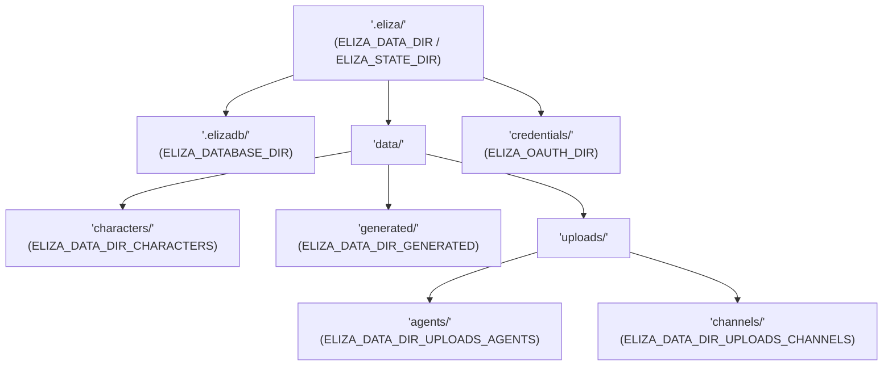
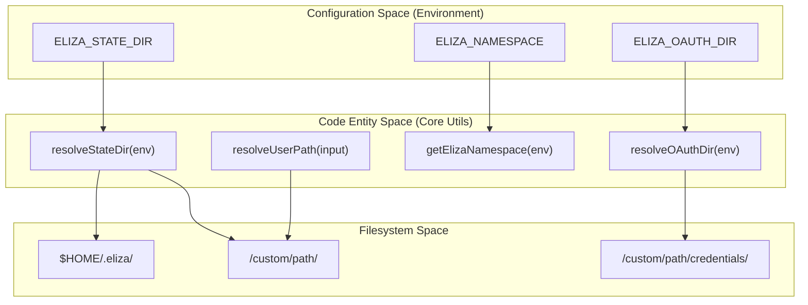
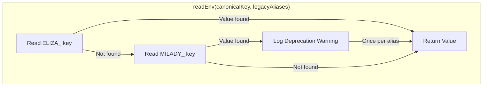

<!-- source: DeepWiki mcp.deepwiki.com · repo elizaOS/eliza · page 6.2 Data Directory Structure · fetched 2026-10-29 -->

# Data Directory Structure

Relevant source files

The following files were used as context for generating this wiki page:

- [packages/agent/src/config/paths.ts](packages/agent/src/config/paths.ts)
- [packages/app-core/deploy/Dockerfile.cloud](packages/app-core/deploy/Dockerfile.cloud)
- [packages/app-core/deploy/Dockerfile.cloud.dockerignore](packages/app-core/deploy/Dockerfile.cloud.dockerignore)
- [packages/app-core/src/runtime/build-variant.ts](packages/app-core/src/runtime/build-variant.ts)
- [packages/app-core/src/runtime/sandbox-policy.ts](packages/app-core/src/runtime/sandbox-policy.ts)
- [packages/benchmarks/lifeops-bench/eliza_lifeops_bench/lifeworld/entities.py](packages/benchmarks/lifeops-bench/eliza_lifeops_bench/lifeworld/entities.py)
- [packages/benchmarks/lifeops-bench/eliza_lifeops_bench/lifeworld/world.py](packages/benchmarks/lifeops-bench/eliza_lifeops_bench/lifeworld/world.py)
- [packages/core/src/build-variant.ts](packages/core/src/build-variant.ts)
- [packages/core/src/sandbox-policy.ts](packages/core/src/sandbox-policy.ts)
- [packages/core/src/utils/read-env.test.ts](packages/core/src/utils/read-env.test.ts)
- [packages/core/src/utils/read-env.ts](packages/core/src/utils/read-env.ts)
- [packages/core/src/utils/state-dir.test.ts](packages/core/src/utils/state-dir.test.ts)
- [packages/core/src/utils/state-dir.ts](packages/core/src/utils/state-dir.ts)
- [packages/ui/src/build-variant.ts](packages/ui/src/build-variant.ts)
- [plugins.json](plugins.json)

This document explains the hierarchical data directory system used by elizaOS to organize agent data, database files, character definitions, generated content, and uploads. It covers the `ELIZA_DATA_DIR` configuration, state-dir resolution, and the migration path for legacy data.

## Purpose and Scope

elizaOS uses a well-defined directory structure to organize all persistent data generated and used by agents. This structure is configurable through environment variables, allowing developers to customize storage locations for different deployment scenarios. The system supports both single-agent and multi-agent deployments with isolated or shared data directories. 

The core logic for resolving these paths resides in `@elizaos/core` within the `state-dir.ts` utility [packages/core/src/utils/state-dir.ts:1-21]().

## Directory Hierarchy Overview

The data directory system follows a hierarchical organization with a root data directory containing specialized subdirectories for different data types.

### Default Directory Tree

Sources: [packages/core/src/utils/state-dir.ts:58-79](), [packages/agent/src/config/paths.ts:84-110]()

## State Directory Resolution

The system uses a strict precedence for resolving the active data directory. Every caller touching persisted user state (skills, training, optimized prompts, counters, credentials) must use `resolveStateDir()` to ensure the precedence is enforced in one place [packages/core/src/utils/state-dir.ts:9-11]().

### Canonical Precedence
1. **`ELIZA_STATE_DIR`**: Explicit environment override [packages/core/src/utils/state-dir.ts:62]().
2. **`MILADY_STATE_DIR`**: Legacy alias (honored with a one-time warning) [packages/core/src/utils/state-dir.ts:62]().
3. **`~/.${ELIZA_NAMESPACE ?? "eliza"}`**: Default home-relative path [packages/core/src/utils/state-dir.ts:64]().

### Code-to-Filesystem Mapping

The following diagram bridges the `AgentRuntime` configuration calls to the physical directory resolution logic.

Sources: [packages/core/src/utils/state-dir.ts:35-79](), [packages/agent/src/config/paths.ts:43-61]()

## Directory Descriptions

### Root State Directory (`.eliza/`)

Controlled by `ELIZA_STATE_DIR`, this is the parent container. It uses `os.homedir()` rather than `process.env.HOME` to ensure compatibility across Windows and ensure that under macOS App Sandbox or Windows AppContainer, the OS-redirected home lands paths in the per-app sandboxed data directory [packages/core/src/utils/state-dir.ts:13-16]().

### Database Directory (`.elizadb/`)

Stores database files for the persistence layer. 
- **Embedded**: When using `@electric-sql/pglite`, data is stored in this directory.
- **External**: When `POSTGRES_URL` is provided, this directory may still be used for local caches or temporary buffers.

### Models Cache Directory

Located at `<state-dir>/models/`. This directory stores per-provider model cache files, organized as `<providerId>.json` [packages/agent/src/config/paths.ts:84-89]().

### Credentials and OAuth

- **OAuth Path**: The directory is resolved via `resolveOAuthDir()` and defaults to `<state-dir>/credentials/` [packages/core/src/utils/state-dir.ts:71-79](). The specific file is `oauth.json` [packages/agent/src/config/paths.ts:91-96]().
- **Steward Credentials**: Canonical path is `<state-dir>/steward-credentials.json` [packages/agent/src/config/paths.ts:105-110]().

## Legacy Migration

On the first run of a new installation, elizaOS automatically detects and migrates data from legacy naming conventions.

### Namespace Migration (`.milady` → `.eliza`)
If `~/.eliza` does not exist but `~/.milady` does, the `migrateLegacyStateDir()` function recursively copies the contents to the new namespace [packages/core/src/utils/state-dir.ts:118-144](). This is synchronous and runs at boot to ensure state is available before the agent starts.

### Config File Candidates
When resolving the agent configuration file, the system checks candidates in this order [packages/agent/src/config/paths.ts:35-41]():
1. `${namespace}.json` (e.g., `eliza.json`)
2. `eliza.json` (if namespace is custom)
3. `milady.json` (Legacy fallback)

## Build Variants and Sandboxing

The directory structure behavior changes based on the `BuildVariant` [packages/core/src/build-variant.ts:17-18]().

| Variant | Context | Filesystem Reach |
|---------|---------|-------------------|
| `direct` | User-downloaded binaries / Dev | Unrestricted; defaults to `~/.eliza` |
| `store` | App Store / MS Store / Flatpak | Restricted to OS-provided app container |

Sources: [packages/core/src/build-variant.ts:4-13](), [packages/core/src/utils/state-dir.ts:87-106]()

### Sandbox Migration
The `migrateStateDir` function is used specifically for "import from direct build" flows, allowing users to move state from a direct installation into a sandboxed store-build state directory [packages/core/src/utils/state-dir.ts:82-86]().

## Implementation Details: Environment Reading

All environment variables related to paths are read through a centralized `readEnv` utility that handles the transition from `MILADY_*` to `ELIZA_*` naming conventions.

Sources: [packages/core/src/utils/read-env.ts:52-72](), [packages/core/src/utils/read-env.test.ts:19-27]()

## Summary of Configuration Variables

| Variable | Function | Source |
|----------|----------|--------|
| `ELIZA_STATE_DIR` | Root of all persistent state | [packages/core/src/utils/state-dir.ts:62]() |
| `ELIZA_NAMESPACE` | Defines default folder name (`~/.<namespace>`) | [packages/core/src/utils/state-dir.ts:51]() |
| `ELIZA_OAUTH_DIR` | Directory for OAuth credentials | [packages/core/src/utils/state-dir.ts:71]() |
| `ELIZA_CONFIG_PATH`| Explicit path to the JSON config file | [packages/agent/src/config/paths.ts:12]() |
| `ELIZA_BUILD_VARIANT`| Switches between `store` and `direct` logic | [packages/core/src/build-variant.ts:30]() |

Sources: [packages/core/src/utils/state-dir.ts:35-79](), [packages/agent/src/config/paths.ts:12-20](), [packages/core/src/build-variant.ts:15-36]()

---

