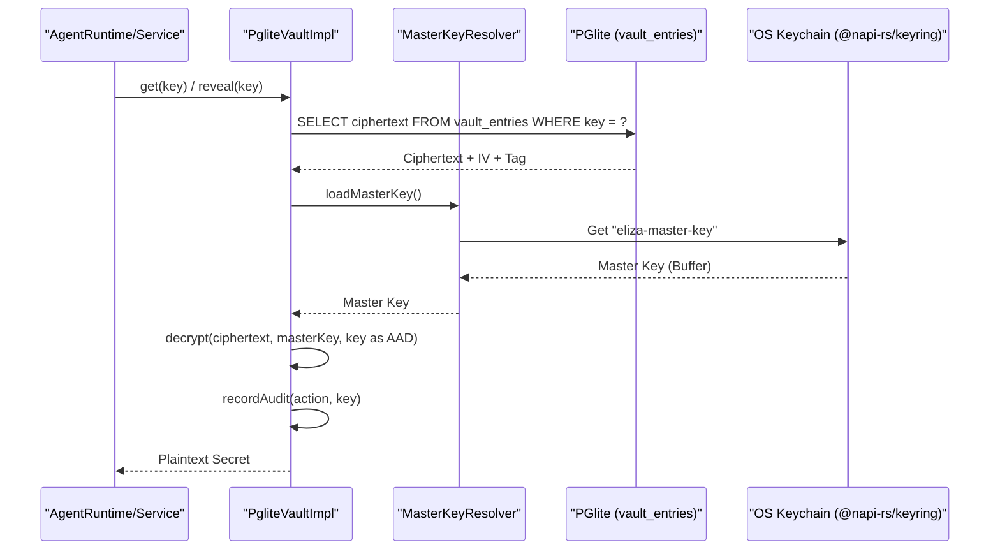
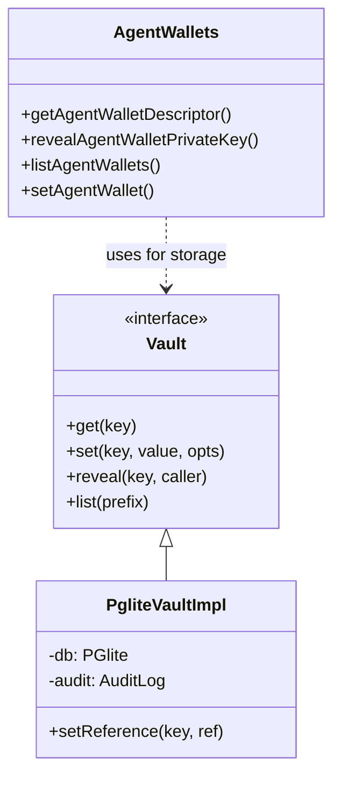

<!-- source: DeepWiki mcp.deepwiki.com · repo elizaOS/eliza · page 6.3 Vault and Secrets Management · fetched 2026-10-29 -->

# Vault and Secrets Management

Relevant source files

The following files were used as context for generating this wiki page:

- [.github/workflows/cloud-e2e.yml](.github/workflows/cloud-e2e.yml)
- [packages/agent/src/runtime/agent-wallets.ts](packages/agent/src/runtime/agent-wallets.ts)
- [packages/app-core/src/cli/profile.ts](packages/app-core/src/cli/profile.ts)
- [packages/app-core/src/cli/program/register.db.ts](packages/app-core/src/cli/program/register.db.ts)
- [packages/app-core/src/services/cloud-jwks-store.ts](packages/app-core/src/services/cloud-jwks-store.ts)
- [packages/app-core/src/services/steward-credentials.ts](packages/app-core/src/services/steward-credentials.ts)
- [packages/cloud-shared/src/db/client.ts](packages/cloud-shared/src/db/client.ts)
- [packages/scripts/cloud/admin/dev/cloud-api-dev.mjs](packages/scripts/cloud/admin/dev/cloud-api-dev.mjs)
- [packages/scripts/run-all-tests.mjs](packages/scripts/run-all-tests.mjs)
- [packages/test/cloud-e2e/tests/stuck-cleanup.spec.ts](packages/test/cloud-e2e/tests/stuck-cleanup.spec.ts)
- [packages/test/cloud-mocks/package.json](packages/test/cloud-mocks/package.json)
- [packages/vault/package.json](packages/vault/package.json)
- [packages/vault/src/index.ts](packages/vault/src/index.ts)
- [packages/vault/src/pglite-vault.ts](packages/vault/src/pglite-vault.ts)
- [packages/vault/src/vault.ts](packages/vault/src/vault.ts)
- [packages/vault/test/pglite-vault.test.ts](packages/vault/test/pglite-vault.test.ts)
- [plugins/plugin-local-inference/src/services/ensure-local-artifacts.integration.test.ts](plugins/plugin-local-inference/src/services/ensure-local-artifacts.integration.test.ts)
- [plugins/plugin-local-inference/src/services/ensure-local-artifacts.test.ts](plugins/plugin-local-inference/src/services/ensure-local-artifacts.test.ts)

The `@elizaos/vault` package provides a secure, encrypted storage system for sensitive agent credentials, API keys, and wallet private keys. It serves as the bridge between agent identity and persistent storage, ensuring that secrets are never stored in plaintext and are protected by OS-level security features.

## Overview and Purpose

The Vault is designed to solve the problem of managing secrets across multiple agents and platforms. It supports:
- **AES-256-GCM Encryption**: All sensitive data is encrypted at rest using a master key [packages/vault/src/pglite-vault.ts:32-35]().
- **OS Keychain Integration**: The master key is stored in the OS keychain via `@napi-rs/keyring` [packages/vault/src/pglite-vault.ts:33-34]().
- **Multi-Backend Support**: Includes a high-performance `PGlite` backend that sidesteps single-writer constraints by maintaining its own database instance [packages/vault/src/pglite-vault.ts:24-31]().
- **Audit Logging**: Every access (get, set, reveal) is recorded in a JSONL audit log for security monitoring [packages/vault/src/pglite-vault.ts:82-86]().
- **Password Manager References**: Instead of storing the secret itself, the vault can store references to external managers like 1Password or Proton Pass [packages/vault/src/pglite-vault.ts:127-137]().

Sources: [packages/vault/src/pglite-vault.ts:1-39](), [packages/vault/package.json:49-51]()

---

## Architecture and Data Flow

The vault operates as an isolated storage layer. In the `PGlite` implementation, it maintains its own database file (`.vault-pglite/`) separate from the main agent database (`.elizadb/`) to avoid writer contention and isolate corruption [packages/vault/src/pglite-vault.ts:24-31](). This separation allows the vault to open early in the agent startup sequence (Step 2e) before main database adapters register [packages/vault/src/pglite-vault.ts:28-29]().

### Secret Resolution Flow
The following diagram illustrates how a secret is retrieved and decrypted using the `PgliteVaultImpl`.

**Secret Retrieval and Decryption Flow**

Sources: [packages/vault/src/pglite-vault.ts:155-171](), [packages/vault/src/pglite-vault.ts:96-97](), [packages/vault/src/pglite-vault.ts:32-35](), [packages/vault/src/pglite-vault.ts:24-31]()

---

## Implementation Details

### PGlite Vault Schema
The PGlite backend uses a single table `vault_entries` to manage three kinds of data: `value` (plaintext), `secret` (encrypted), and `reference` (external link) [packages/vault/src/pglite-vault.ts:42-52]().

| Column | Type | Description |
| :--- | :--- | :--- |
| `key` | TEXT | Primary key (e.g., `agent.<id>.wallet.evm`) |
| `kind` | TEXT | `value`, `secret`, or `reference` |
| `value` | TEXT | Plaintext value (if kind is `value`) |
| `ciphertext` | TEXT | AES-GCM base64 string (if kind is `secret`) |
| `ref_source` | TEXT | `1password` or `protonpass` |
| `ref_path` | TEXT | External reference URI (e.g., `op://vault/item/field`) |
| `last_modified` | BIGINT | Unix timestamp of last update |

Sources: [packages/vault/src/pglite-vault.ts:41-52](), [packages/vault/src/pglite-vault.ts:56-64]()

### Cryptography
Encryption is performed using `AES-256-GCM`. A unique security feature of the Eliza vault is that the **storage key** itself is used as **Additional Authenticated Data (AAD)** during encryption [packages/vault/src/pglite-vault.ts:32-35](). This prevents "key-substitution" attacks where an encrypted value from one key is moved to another.

The `MasterKeyResolver` defaults to using `@napi-rs/keyring` to fetch a master key from the system's secure storage [packages/vault/src/pglite-vault.ts:33-34]().

Sources: [packages/vault/src/pglite-vault.ts:96-97](), [packages/vault/src/pglite-vault.ts:32-35](), [packages/vault/src/vault.ts:21-26]()

---

## Core Components and Classes

### PgliteVaultImpl
The primary implementation for modern Eliza deployments. It handles initialization, migration from legacy `vault.json`, and the database lifecycle [packages/vault/src/pglite-vault.ts:79-86]().

- `set(key, value, opts)`: Persists a value. If `opts.sensitive` is true, it triggers the encryption path [packages/vault/src/pglite-vault.ts:88-125]().
- `get(key)`: Returns the value, decrypting if necessary [packages/vault/src/pglite-vault.ts:155-160]().
- `reveal(key, caller)`: Similar to `get`, but explicitly audit-logs the `caller` identity for high-sensitivity access (like private key signing) [packages/vault/src/pglite-vault.ts:162-171]().
- `list(prefix)`: Scans keys using a segment-based prefix match (e.g., `agent.123` matches `agent.123.wallet`) [packages/vault/src/pglite-vault.ts:190-205]().

### Agent Wallet Integration
The vault is the authoritative source for per-agent blockchain wallets. Wallets are stored under the namespace `agent.<agentId>.wallet.<chain>` [packages/agent/src/runtime/agent-wallets.ts:58-60](). This module provides functions like `listAgentWallets` and `revealAgentWalletPrivateKey` which wrap the vault's core methods with agent-specific logic [packages/agent/src/runtime/agent-wallets.ts:143-152](), [packages/agent/src/runtime/agent-wallets.ts:168-171]().

**Agent Wallet Code Entities**

Sources: [packages/agent/src/runtime/agent-wallets.ts:122-152](), [packages/vault/src/vault-types.ts:1-20](), [packages/vault/src/pglite-vault.ts:79-86]()

---

## Configuration and Backends

The vault initialization logic in `createVault` resolves the storage directory based on `ELIZA_STATE_DIR` or the default `~/.eliza` path [packages/vault/src/vault.ts:14-19]().

| Feature | implementation |
| :--- | :--- |
| **Default Storage** | `<stateDir>/.vault-pglite/` [packages/vault/src/pglite-vault.ts:67-68]() |
| **Audit Path** | `<stateDir>/audit/vault.jsonl` [packages/vault/src/vault.ts:20]() |
| **Legacy Migration** | One-shot import from `vault.json` [packages/vault/src/vault.ts:12-13]() |

### Migration from Legacy Store
When `PgliteVaultImpl` initializes, it checks for a legacy `vault.json` file. If the PGlite table is empty, it performs a one-shot migration, importing plaintext, encrypted secrets, and password manager references verbatim into the new database [packages/vault/src/pglite-vault.ts:69-70](), [packages/vault/test/pglite-vault.test.ts:165-194]().

Sources: [packages/vault/src/pglite-vault.ts:24-39](), [packages/vault/src/vault.ts:14-30](), [packages/vault/test/pglite-vault.test.ts:165-194]()

---

