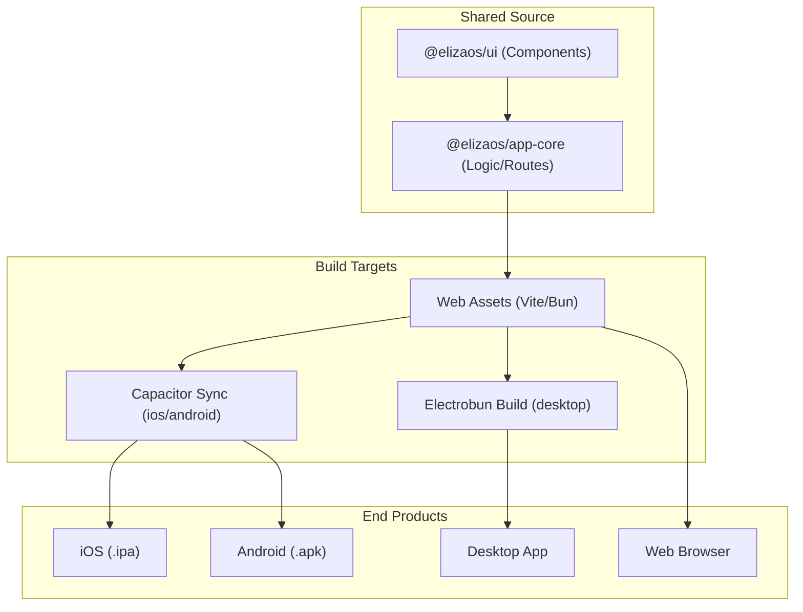
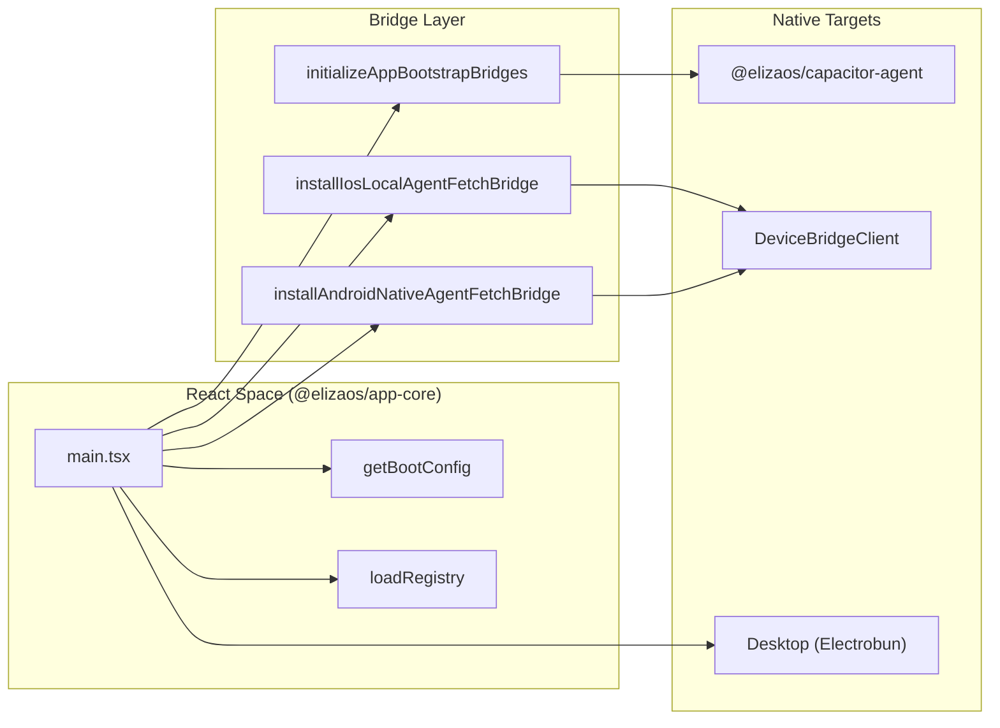

<!-- source: DeepWiki mcp.deepwiki.com · repo elizaOS/eliza · page 7 Application Shell and UI · fetched 2026-10-29 -->

# Application Shell and UI

Relevant source files

The following files were used as context for generating this wiki page:

- [packages/app-core/package.json](packages/app-core/package.json)
- [packages/app-core/scripts/aosp/variant-config-schema.ts](packages/app-core/scripts/aosp/variant-config-schema.ts)
- [packages/app-core/scripts/playwright-ui-live-stack.ts](packages/app-core/scripts/playwright-ui-live-stack.ts)
- [packages/app-core/src/api/auth-bootstrap-routes.ts](packages/app-core/src/api/auth-bootstrap-routes.ts)
- [packages/app-core/src/api/auth-session-routes.ts](packages/app-core/src/api/auth-session-routes.ts)
- [packages/app-core/src/api/catalog-routes.ts](packages/app-core/src/api/catalog-routes.ts)
- [packages/app-core/src/api/cloud-voice-routes.test.ts](packages/app-core/src/api/cloud-voice-routes.test.ts)
- [packages/app-core/src/api/cloud-voice-routes.ts](packages/app-core/src/api/cloud-voice-routes.ts)
- [packages/app-core/src/api/database-rows-compat-routes.ts](packages/app-core/src/api/database-rows-compat-routes.ts)
- [packages/app-core/src/api/dev-compat-routes.ts](packages/app-core/src/api/dev-compat-routes.ts)
- [packages/app-core/src/api/onboarding-routes.ts](packages/app-core/src/api/onboarding-routes.ts)
- [packages/app-core/src/api/secrets-inventory-routes.ts](packages/app-core/src/api/secrets-inventory-routes.ts)
- [packages/app-core/src/api/server.ts](packages/app-core/src/api/server.ts)
- [packages/app-core/src/cli/doctor/checks.ts](packages/app-core/src/cli/doctor/checks.ts)
- [packages/app-core/src/index.ts](packages/app-core/src/index.ts)
- [packages/app-core/src/register-runtime-hooks.ts](packages/app-core/src/register-runtime-hooks.ts)
- [packages/app-core/src/runtime/eliza.ts](packages/app-core/src/runtime/eliza.ts)
- [packages/app-core/src/services/phrase-chunked-tts.ts](packages/app-core/src/services/phrase-chunked-tts.ts)
- [packages/app-core/src/services/steward-sidecar.ts](packages/app-core/src/services/steward-sidecar.ts)
- [packages/app-core/src/services/steward-sidecar/health-check.ts](packages/app-core/src/services/steward-sidecar/health-check.ts)
- [packages/app-core/src/services/steward-sidecar/wallet-setup.ts](packages/app-core/src/services/steward-sidecar/wallet-setup.ts)
- [packages/app-core/src/services/task-host-capabilities.ts](packages/app-core/src/services/task-host-capabilities.ts)
- [packages/app-core/test/app/memory-relationships.real.e2e.test.ts](packages/app-core/test/app/memory-relationships.real.e2e.test.ts)
- [packages/app-core/test/app/onboarding-companion.live.e2e.test.ts](packages/app-core/test/app/onboarding-companion.live.e2e.test.ts)
- [packages/app-core/test/helpers/i18n.ts](packages/app-core/test/helpers/i18n.ts)
- [packages/app/package.json](packages/app/package.json)
- [packages/app/src/app-config.ts](packages/app/src/app-config.ts)
- [packages/app/src/main.tsx](packages/app/src/main.tsx)
- [packages/app/vite.config.ts](packages/app/vite.config.ts)
- [packages/benchmarks/orchestrator/runtime_gates.py](packages/benchmarks/orchestrator/runtime_gates.py)
- [packages/benchmarks/orchestrator/tests/test_latest_readiness.py](packages/benchmarks/orchestrator/tests/test_latest_readiness.py)
- [packages/benchmarks/orchestrator/tests/test_runtime_gates.py](packages/benchmarks/orchestrator/tests/test_runtime_gates.py)
- [packages/benchmarks/tau-bench/elizaos_tau_bench/upstream/envs/airline/data.py](packages/benchmarks/tau-bench/elizaos_tau_bench/upstream/envs/airline/data.py)
- [packages/core/src/testing/pglite-runtime.ts](packages/core/src/testing/pglite-runtime.ts)
- [packages/core/src/testing/real-runtime.ts](packages/core/src/testing/real-runtime.ts)
- [packages/training/docs/FINETUNING_PIPELINE.md](packages/training/docs/FINETUNING_PIPELINE.md)
- [packages/ui/src/components/shell/__tests__/exports.test.ts](packages/ui/src/components/shell/__tests__/exports.test.ts)
- [packages/ui/src/index.ts](packages/ui/src/index.ts)
- [plugins/plugin-clawville/src/ui/ClawvilleOperatorSurface.tsx](plugins/plugin-clawville/src/ui/ClawvilleOperatorSurface.tsx)
- [plugins/plugin-local-inference/src/backends/apple-foundation.ts](plugins/plugin-local-inference/src/backends/apple-foundation.ts)
- [plugins/plugin-messages/src/components/MessagesAppView.tsx](plugins/plugin-messages/src/components/MessagesAppView.tsx)

The elizaOS application ecosystem provides a unified interface for interacting with AI agents across multiple platforms. This is achieved through a modular architecture consisting of a core React application shell (`@elizaos/app-core`), a shared UI component library (`@elizaos/ui`), and a multi-platform delivery strategy that targets Web, Desktop (Electrobun/Electron), and Mobile (iOS/Android).

## Multi-Platform Delivery Strategy

elizaOS uses a "write once, run anywhere" approach by leveraging **Capacitor** for mobile and **Electrobun** for desktop, all wrapping the same core React application logic. This ensures that features like the character editor, chat interface, and agent management are consistent across all devices.

### Platform Architecture

The following diagram illustrates how the shared codebases are bundled into platform-specific binaries.

**Platform Distribution Pipeline**

Sources: [packages/ui/package.json:1-5](), [packages/app/src/main.tsx:5-15](), [packages/app/src/main.tsx:23-25]()

---

## Core Packages

The UI ecosystem is primarily contained within two packages that provide the foundation for all elizaOS visual interfaces.

### @elizaos/app-core
This package serves as the primary application shell. It contains the routing logic, global state management, and high-level views. It acts as the orchestrator for platform-specific initializations, such as `initializeAppBootstrapBridges` [packages/app-core/src/index.ts:34]() and `installAppBootstrapClientPatches` [packages/app-core/src/index.ts:35]().
- **Onboarding Flow**: Manages the configuration for new agents via `onboarding-config.ts` [packages/app-core/src/onboarding/onboarding-config.ts:14]().
- **Character Editor**: Integrated via `CharacterEditor` for visual personality tuning [packages/app/src/main.tsx:41]().
- **API Server**: Provides the backend routes for the UI, including auth, character management, and plugin registry [packages/app-core/src/api/server.ts:13]().

For details, see [App Core and UI Components](#7.1).

### @elizaos/ui
A design-system-compliant component library built with React and Radix UI [packages/ui/package.json:179-198](). It exports a comprehensive set of primitives including `AppPageSidebar`, `ThemeToggle`, and `VoicePill` [packages/ui/src/index.ts:195-221](). It also includes specialized views like the `MessagesAppView` for SMS integration [plugins/plugin-messages/src/components/MessagesAppView.tsx:103]().

For details, see [App Core and UI Components](#7.1).

Sources: [packages/app-core/package.json:1-4](), [packages/ui/src/index.ts:1-225](), [packages/app/src/main.tsx:1-41]()

---

## Chat and Conversation UI

The conversation experience is handled through specialized components that manage interaction between users and agents. This includes the `AppWindowRenderer` for managing the overall application viewport [packages/app/src/main.tsx:40]() and specialized surfaces like the `ClawvilleOperatorSurface` for game-like agent interactions [plugins/plugin-clawville/src/ui/ClawvilleOperatorSurface.tsx:152]().

**UI Component Registry**
| Component | Role | Code Reference |
| :--- | :--- | :--- |
| `AppWindowRenderer` | Handles window-based app rendering | [packages/app/src/main.tsx:40]() |
| `CharacterEditor` | Interface for agent personality tuning | [packages/app/src/main.tsx:41]() |
| `ThemeToggle` | Global theme switcher (Dark/Light) | [packages/ui/src/index.ts:195]() |
| `AppPageSidebar` | Navigation for active chat sessions | [packages/ui/src/index.ts:220]() |
| `VoicePill` | Audio interaction status indicator | [packages/app/src/main.tsx:2]() |

For details, see [Chat and Conversation UI](#7.2).

---

## Terminal UI (TUI)

In addition to graphical interfaces, elizaOS provides a robust Terminal UI framework (`@elizaos/tui`). This is used for CLI-based interactions, offering differential rendering and a rich set of terminal components like `Markdown` and `SelectList`.

For details, see [Terminal UI (TUI)](#7.3).

---

## Desktop Application

The desktop version of elizaOS leverages **Electrobun** for native window management. It provides native system integration through the `DesktopTrayRuntime` and `DesktopSurfaceNavigationRuntime` [packages/app/src/main.tsx:12-13]().

**Desktop Integration Entities**
| Entity | Role | Location |
| :--- | :--- | :--- |
| `invokeDesktopBridgeRequest` | Communication bridge for desktop | [packages/ui/src/index.ts:47]() |
| `isElectrobunRuntime` | Desktop-specific runtime detection | [packages/ui/src/index.ts:48]() |
| `DesktopTrayRuntime` | Management for desktop tray menu | [packages/app/src/main.tsx:13]() |
| `DESKTOP_TRAY_MENU_ITEMS` | Configuration for tray actions | [packages/app/src/main.tsx:11]() |

For details, see [Desktop Application](#8.2).

---

## Mobile Applications

elizaOS supports native mobile experiences on iOS and Android via **Capacitor**. This allows the React-based shell to access native device APIs [packages/app/src/main.tsx:5-9]().

- **Native Bridges**: Integration with local LLM runners via `primeIosFullBunRuntime` [packages/app/src/main.tsx:21]() and `installAndroidNativeAgentFetchBridge` [packages/app/src/main.tsx:33]().
- **Background Tasks**: Managed via `@capacitor/background-runner` for persistent agent operations [packages/app/src/main.tsx:6]().

For details, see [Mobile Applications](#8.3).

Sources: [packages/app/src/main.tsx:5-33](), [packages/app/package.json:60-73]()

---

## Technical Mapping: UI to Native

This diagram bridges the high-level UI concepts to the specific code entities that manage the transition from the React space to the native platform space.

**UI to Code Entity Mapping**

Sources: [packages/app/src/main.tsx:16-38](), [packages/app-core/src/index.ts:34](), [packages/app-core/src/runtime/eliza.ts:49]()

---

