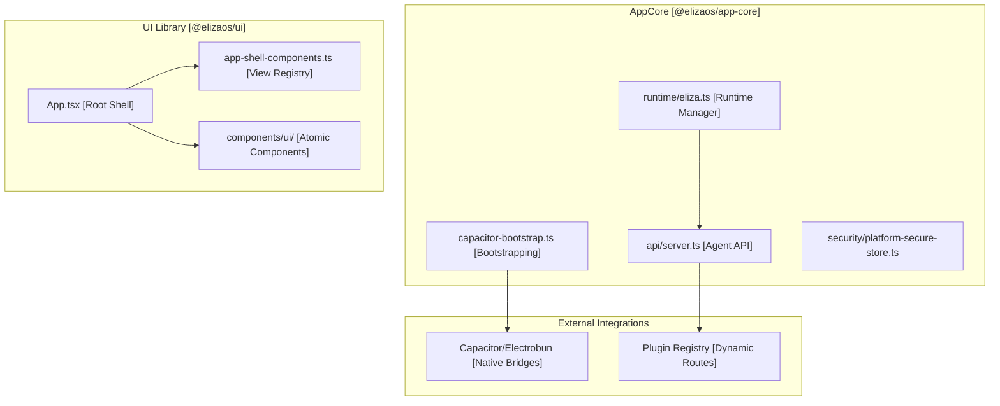
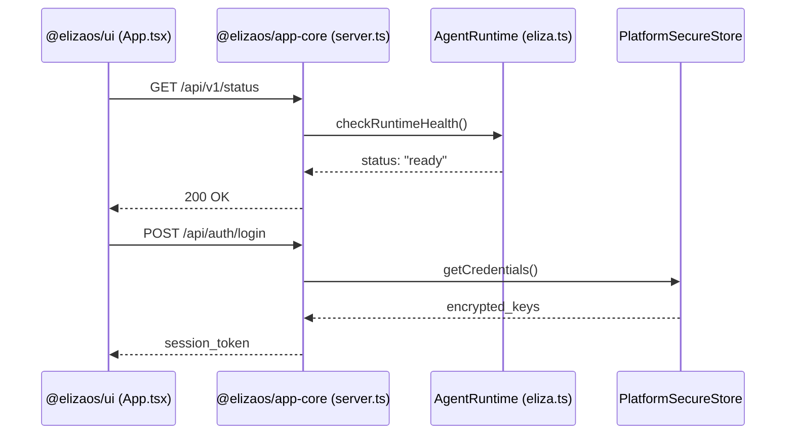

<!-- source: DeepWiki mcp.deepwiki.com · repo elizaOS/eliza · page 7.1 App Core and UI Components · fetched 2026-10-29 -->

# App Core and UI Components

Relevant source files

The following files were used as context for generating this wiki page:

- [packages/app-core/package.json](packages/app-core/package.json)
- [packages/app-core/scripts/check-i18n.mjs](packages/app-core/scripts/check-i18n.mjs)
- [packages/app-core/src/api/auth-bootstrap-routes.ts](packages/app-core/src/api/auth-bootstrap-routes.ts)
- [packages/app-core/src/api/auth-session-routes.ts](packages/app-core/src/api/auth-session-routes.ts)
- [packages/app-core/src/api/catalog-routes.ts](packages/app-core/src/api/catalog-routes.ts)
- [packages/app-core/src/api/cloud-voice-routes.test.ts](packages/app-core/src/api/cloud-voice-routes.test.ts)
- [packages/app-core/src/api/cloud-voice-routes.ts](packages/app-core/src/api/cloud-voice-routes.ts)
- [packages/app-core/src/api/database-rows-compat-routes.ts](packages/app-core/src/api/database-rows-compat-routes.ts)
- [packages/app-core/src/api/dev-compat-routes.ts](packages/app-core/src/api/dev-compat-routes.ts)
- [packages/app-core/src/api/onboarding-routes.ts](packages/app-core/src/api/onboarding-routes.ts)
- [packages/app-core/src/api/secrets-inventory-routes.ts](packages/app-core/src/api/secrets-inventory-routes.ts)
- [packages/app-core/src/api/server.ts](packages/app-core/src/api/server.ts)
- [packages/app-core/src/browser.ts](packages/app-core/src/browser.ts)
- [packages/app-core/src/cli/doctor/checks.ts](packages/app-core/src/cli/doctor/checks.ts)
- [packages/app-core/src/index.ts](packages/app-core/src/index.ts)
- [packages/app-core/src/register-runtime-hooks.ts](packages/app-core/src/register-runtime-hooks.ts)
- [packages/app-core/src/runtime/desktop/browser-entry-tray-exports.test.ts](packages/app-core/src/runtime/desktop/browser-entry-tray-exports.test.ts)
- [packages/app-core/src/runtime/eliza.ts](packages/app-core/src/runtime/eliza.ts)
- [packages/app-core/src/services/phrase-chunked-tts.ts](packages/app-core/src/services/phrase-chunked-tts.ts)
- [packages/app-core/src/services/steward-sidecar.ts](packages/app-core/src/services/steward-sidecar.ts)
- [packages/app-core/src/services/steward-sidecar/health-check.ts](packages/app-core/src/services/steward-sidecar/health-check.ts)
- [packages/app-core/src/services/steward-sidecar/wallet-setup.ts](packages/app-core/src/services/steward-sidecar/wallet-setup.ts)
- [packages/app-core/src/services/task-host-capabilities.ts](packages/app-core/src/services/task-host-capabilities.ts)
- [packages/cloud-frontend/src/providers/I18nProvider.tsx](packages/cloud-frontend/src/providers/I18nProvider.tsx)
- [packages/cloud-services/_common/package.json](packages/cloud-services/_common/package.json)
- [packages/docs/guides/sandbox.md](packages/docs/guides/sandbox.md)
- [packages/os-homepage/tests/visual.spec.ts](packages/os-homepage/tests/visual.spec.ts)
- [packages/scripts/check-i18n.mjs](packages/scripts/check-i18n.mjs)
- [packages/training/scripts/manifest/finalize_eliza1_evidence.py](packages/training/scripts/manifest/finalize_eliza1_evidence.py)
- [packages/ui/src/App.tsx](packages/ui/src/App.tsx)
- [packages/ui/src/api/client-agent-desktop-status.test.ts](packages/ui/src/api/client-agent-desktop-status.test.ts)
- [packages/ui/src/backgrounds/index.ts](packages/ui/src/backgrounds/index.ts)
- [packages/ui/src/components/shared/LanguageDropdown.tsx](packages/ui/src/components/shared/LanguageDropdown.tsx)
- [packages/ui/src/components/shell/AssistantOverlay.tsx](packages/ui/src/components/shell/AssistantOverlay.tsx)
- [packages/ui/src/components/shell/HomePill.tsx](packages/ui/src/components/shell/HomePill.tsx)
- [packages/ui/src/components/shell/__tests__/AssistantOverlay.test.tsx](packages/ui/src/components/shell/__tests__/AssistantOverlay.test.tsx)
- [packages/ui/src/components/shell/__tests__/HomePill.test.tsx](packages/ui/src/components/shell/__tests__/HomePill.test.tsx)
- [packages/ui/src/components/shell/__tests__/shell-state.test.ts](packages/ui/src/components/shell/__tests__/shell-state.test.ts)
- [packages/ui/src/components/shell/__tests__/useShellState.test.tsx](packages/ui/src/components/shell/__tests__/useShellState.test.tsx)
- [packages/ui/src/components/shell/shell-state.ts](packages/ui/src/components/shell/shell-state.ts)
- [packages/ui/src/components/shell/useShellState.ts](packages/ui/src/components/shell/useShellState.ts)
- [packages/ui/src/i18n/index.ts](packages/ui/src/i18n/index.ts)
- [packages/ui/src/i18n/locales/en.json](packages/ui/src/i18n/locales/en.json)
- [packages/ui/src/i18n/locales/es.json](packages/ui/src/i18n/locales/es.json)
- [packages/ui/src/i18n/locales/ja.json](packages/ui/src/i18n/locales/ja.json)
- [packages/ui/src/i18n/locales/ko.json](packages/ui/src/i18n/locales/ko.json)
- [packages/ui/src/i18n/locales/pt.json](packages/ui/src/i18n/locales/pt.json)
- [packages/ui/src/i18n/locales/tl.json](packages/ui/src/i18n/locales/tl.json)
- [packages/ui/src/i18n/locales/vi.json](packages/ui/src/i18n/locales/vi.json)
- [packages/ui/src/i18n/locales/zh-CN.json](packages/ui/src/i18n/locales/zh-CN.json)
- [packages/ui/src/i18n/messages.ts](packages/ui/src/i18n/messages.ts)
- [packages/ui/src/styles/base.css](packages/ui/src/styles/base.css)
- [packages/ui/src/styles/tailwind-theme.css](packages/ui/src/styles/tailwind-theme.css)
- [plugins/plugin-local-inference/src/services/dflash-direct-bundle.test.ts](plugins/plugin-local-inference/src/services/dflash-direct-bundle.test.ts)
- [plugins/plugin-local-inference/src/services/image-description-runtime.test.ts](plugins/plugin-local-inference/src/services/image-description-runtime.test.ts)
- [plugins/plugin-workflow/src/data/defaultNodes.json](plugins/plugin-workflow/src/data/defaultNodes.json)

The elizaOS ecosystem utilizes a shared React-based application shell and a dedicated UI component library to provide a consistent user experience across web, desktop, and mobile platforms. The core logic for the application interface resides in `@elizaos/app-core`, while the visual building blocks and design system are defined in `@elizaos/ui`.

## Overview of App Core and UI

The `@elizaos/app-core` package serves as the shared application core for elizaOS white-label agent apps [packages/app-core/package.json:2-4](). It manages routing, state, and complex views required for interacting with AI agents, including character management, chat interfaces, and onboarding flows. It is designed to be platform-agnostic, allowing it to be wrapped by Electrobun for desktop or Capacitor for mobile [packages/app-core/src/index.ts:32-36]().

The `@elizaos/ui` package is a shared component library providing atomic and molecular UI elements (buttons, inputs, cards) and layout utilities used by `app-core` and other elizaOS applications [packages/app-core/src/browser.ts:11-12]().

### Data Flow and Architecture

The application follows a provider-based architecture where global state and hooks manage specific functionalities like voice synthesis, character configuration, and agent communication.

Title: App Core System Architecture

**Sources:** [packages/app-core/src/index.ts:1-81](), [packages/app-core/src/api/server.ts:1-157](), [packages/ui/src/App.tsx:1-83]().

---

## App Core Implementation

### Bootstrapping and Platform Bridges
The application initializes platform-specific bridges for Capacitor (mobile) or Electrobun (desktop). It handles native runtime backends and secure storage integration [packages/app-core/src/index.ts:32-42]().

*   **Native Runtimes:** The core provides bridges for `capacitor-llama`, `eliza-aosp-llama`, and `eliza-device-bridge` to handle local inference [packages/app-core/src/api/server.ts:169-174]().
*   **Secure Storage:** Platform-specific secure stores are used to hydrate wallet keys and manage sensitive credentials across Node and browser environments [packages/app-core/src/security/hydrate-wallet-keys-from-platform-store.ts:1-20](), [packages/app-core/src/index.ts:59-61]().

### View Management and Routing
The application uses a registry-based routing system. The `App` component in `@elizaos/ui` acts as the root routing shell, managing sidebars, chat panes, and view switching [packages/ui/src/App.tsx:1-4]().

*   **Dynamic View Loading:** The `DynamicViewLoader` allows the agent to register new UI views via plugins dynamically [packages/ui/src/App.tsx:143]().
*   **App Registry:** The core maintains a registry of available apps and plugins that can be injected into the shell [packages/app-core/src/registry/index.ts:1-20]().

### API Server and Runtime Integration
The `app-core` includes a full-featured API server that handles communication between the UI and the underlying `AgentRuntime` [packages/app-core/src/api/server.ts:1-34]().

*   **Route Guards:** Implements `applyRouteModeGuard` and `ensureRouteAuthorized` to protect sensitive agent operations [packages/app-core/src/api/server.ts:39-44]().
*   **Plugin Compatibility:** Bridges legacy plugin routes to the new modular system via `handlePluginsCompatRoutes` [packages/app-core/src/api/server.ts:127-128]().

**Sources:** [packages/app-core/src/api/server.ts:1-157](), [packages/app-core/src/runtime/eliza.ts:1-100](), [packages/ui/src/App.tsx:116-137]().

---

## UI Component Library

The `@elizaos/ui` package provides the visual building blocks and layout patterns. It leverages `lucide-react` for iconography and Radix UI primitives for accessible components [packages/ui/src/App.tsx:5-15]().

### Internationalization (i18n)
The UI library includes a robust internationalization system supporting multiple languages including English, Chinese, Vietnamese, Tagalog, Portuguese, Spanish, Korean, and Japanese [packages/ui/src/i18n/locales/en.json:1-100](), [packages/ui/src/i18n/locales/zh-CN.json:1-100]().

*   **Namespace Management:** Translations cover accounts, agent activity, app details, and shell navigation [packages/ui/src/i18n/locales/en.json:1-125]().
*   **Dynamic Placeholders:** Supports variable injection for status messages (e.g., `Rate-limited (resets in {{resetIn}})` ) [packages/ui/src/i18n/locales/en.json:39]().

### Chat Interface
The `ChatView` is the primary interface for agent interaction. It supports:
*   **Multi-source registration:** Integrating messages from various sources [packages/ui/src/App.tsx:17]().
*   **Shell Overlays:** Providing context-aware UI like the `AssistantOverlay` and `ChatSurface` [packages/ui/src/App.tsx:48-50]().
*   **Conversation Management:** A dedicated `ConversationsSidebar` for navigating between different agent interactions [packages/ui/src/App.tsx:41]().

**Sources:** [packages/ui/src/App.tsx:1-180](), [packages/ui/src/i18n/locales/en.json:1-200](), [packages/app-core/src/browser.ts:1-60]().

---

## View Registry and Agent Interaction

The agent can control the UI through a specialized API that bridges the `AgentRuntime` with the frontend shell.

Title: App Core Initialization and Data Flow

### Automation and Extensibility
The shell allows for "Automation Node Contributors," enabling plugins to add logic directly into the application's automation pipelines [packages/app-core/src/api/automation-node-contributors.ts:1-10]().

*   **Extension Registry:** Detail extensions can be registered to enhance the "App Detail" views [packages/app-core/src/browser.ts:13]().
*   **Overlay Apps:** Support for `registerOverlayApp` allows third-party UI to float over the main chat interface [packages/app-core/src/browser.ts:32]().

**Sources:** [packages/app-core/src/browser.ts:1-60](), [packages/app-core/src/api/server.ts:45-53](), [packages/app-core/src/runtime/eliza.ts:186-200]().

---

## Multi-Platform Delivery

The same core application code is packaged for different environments using specialized build pipelines and runtime detection.

### Platform Secure Store
The `PlatformSecureStore` provides a unified interface for credential management that behaves differently on Node.js versus browser/Capacitor environments [packages/app-core/src/security/platform-secure-store.ts:1-10]().

*   **Node.js Implementation:** Uses `platform-secure-store-node.ts` for native OS keychain access [packages/app-core/src/index.ts:129-133]().
*   **Mobile/Browser:** Uses the Capacitor Secure Storage plugin when running on native mobile [packages/app-core/src/platform/capacitor-bootstrap.ts:32-36]().

### Desktop Integration
The `DesktopTrayRuntime` and `DesktopSurfaceNavigationRuntime` provide the necessary hooks for the application to interact with the system tray and native window controls when running under Electrobun [packages/app-core/src/browser.ts:54-58]().

**Sources:** [packages/app-core/src/index.ts:32-62](), [packages/app-core/src/browser.ts:44-60](), [packages/app-core/package.json:43-70]().

---

