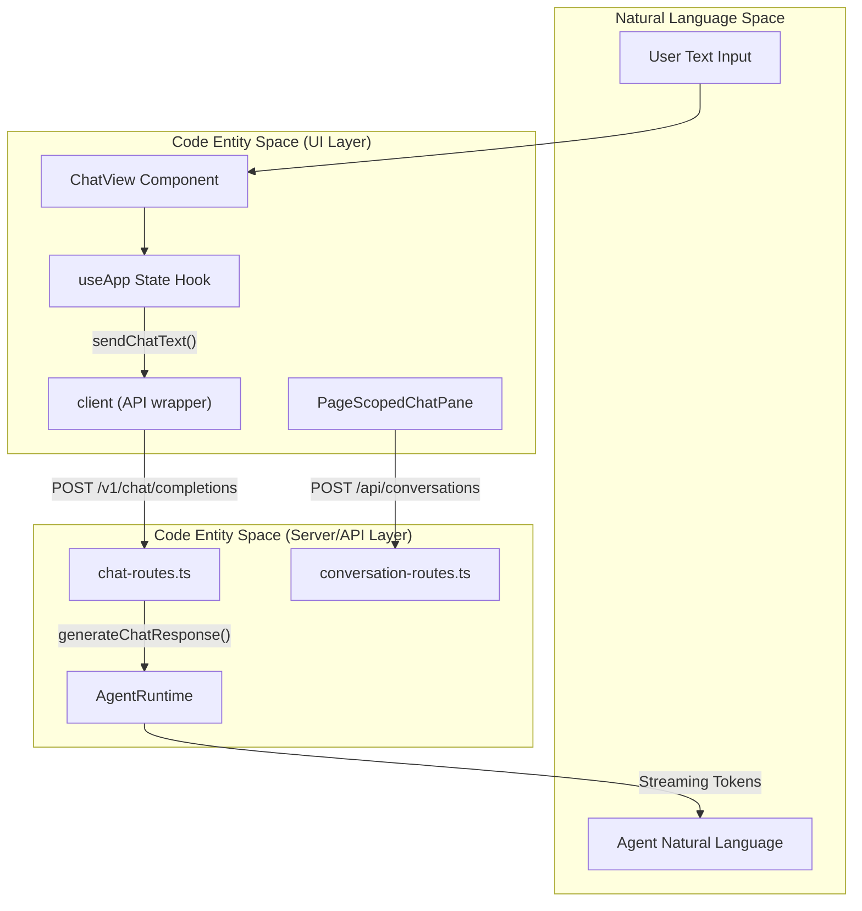
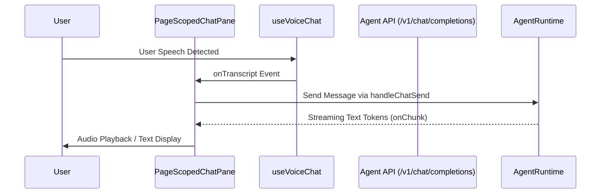

<!-- source: DeepWiki mcp.deepwiki.com · repo elizaOS/eliza · page 7.2 Chat and Conversation UI · fetched 2026-10-29 -->

# Chat and Conversation UI

Relevant source files

The following files were used as context for generating this wiki page:

- [bun.lock](bun.lock)
- [package.json](package.json)
- [packages/agent/src/api/__tests__/conversation-streaming.test.ts](packages/agent/src/api/__tests__/conversation-streaming.test.ts)
- [packages/agent/src/api/__tests__/persistence-after-done.test.ts](packages/agent/src/api/__tests__/persistence-after-done.test.ts)
- [packages/agent/src/api/auth-routes.ts](packages/agent/src/api/auth-routes.ts)
- [packages/agent/src/api/avatar-routes.ts](packages/agent/src/api/avatar-routes.ts)
- [packages/agent/src/api/chat-routes.ts](packages/agent/src/api/chat-routes.ts)
- [packages/agent/src/api/conversation-routes.ts](packages/agent/src/api/conversation-routes.ts)
- [packages/agent/src/api/inbox-routes.ts](packages/agent/src/api/inbox-routes.ts)
- [packages/agent/src/api/platform-detect.ts](packages/agent/src/api/platform-detect.ts)
- [packages/agent/src/api/server-route-dispatch.ts](packages/agent/src/api/server-route-dispatch.ts)
- [packages/agent/src/api/static-file-server.ts](packages/agent/src/api/static-file-server.ts)
- [packages/agent/test/api/agent-message-route.test.ts](packages/agent/test/api/agent-message-route.test.ts)
- [packages/app-core/platforms/android/README.md](packages/app-core/platforms/android/README.md)
- [packages/app-core/platforms/electrobun/src/native/mac-window-effects.ts](packages/app-core/platforms/electrobun/src/native/mac-window-effects.ts)
- [packages/app-core/scripts/lib/orchestrator-desktop-dev-banner.mjs](packages/app-core/scripts/lib/orchestrator-desktop-dev-banner.mjs)
- [packages/app-core/src/platform/native-library-policy.test.ts](packages/app-core/src/platform/native-library-policy.test.ts)
- [packages/app-core/src/platform/native-library-policy.ts](packages/app-core/src/platform/native-library-policy.ts)
- [packages/app-core/src/runtime/desktop/AppWindowRenderer.tsx](packages/app-core/src/runtime/desktop/AppWindowRenderer.tsx)
- [packages/benchmarks/agentbench/elizaos_agentbench/adapters/web_browsing_adapter.py](packages/benchmarks/agentbench/elizaos_agentbench/adapters/web_browsing_adapter.py)
- [packages/benchmarks/agentbench/elizaos_agentbench/mock_runtime.py](packages/benchmarks/agentbench/elizaos_agentbench/mock_runtime.py)
- [packages/benchmarks/three-agent-dialogue/__tests__/smoke.test.ts](packages/benchmarks/three-agent-dialogue/__tests__/smoke.test.ts)
- [packages/benchmarks/three-agent-dialogue/runner/run-dialogue.ts](packages/benchmarks/three-agent-dialogue/runner/run-dialogue.ts)
- [packages/benchmarks/three-agent-dialogue/verify/verify-run.ts](packages/benchmarks/three-agent-dialogue/verify/verify-run.ts)
- [packages/core/src/sandbox/dlopen-gate.test.ts](packages/core/src/sandbox/dlopen-gate.test.ts)
- [packages/examples/a2a/package.json](packages/examples/a2a/package.json)
- [packages/examples/cloudflare/package.json](packages/examples/cloudflare/package.json)
- [packages/examples/rest-api/express/package.json](packages/examples/rest-api/express/package.json)
- [packages/examples/roblox/package.json](packages/examples/roblox/package.json)
- [packages/examples/roblox/tsconfig.json](packages/examples/roblox/tsconfig.json)
- [packages/examples/vercel/package.json](packages/examples/vercel/package.json)
- [packages/shared/package.json](packages/shared/package.json)
- [packages/shared/src/contracts/auth-routes.test.ts](packages/shared/src/contracts/auth-routes.test.ts)
- [packages/shared/src/contracts/auth-routes.ts](packages/shared/src/contracts/auth-routes.ts)
- [packages/shared/src/contracts/inbox-routes.test.ts](packages/shared/src/contracts/inbox-routes.test.ts)
- [packages/shared/src/contracts/inbox-routes.ts](packages/shared/src/contracts/inbox-routes.ts)
- [packages/shared/src/utils/assistant-text.test.ts](packages/shared/src/utils/assistant-text.test.ts)
- [packages/shared/src/utils/assistant-text.ts](packages/shared/src/utils/assistant-text.ts)
- [packages/training/scripts/asr/__tests__/__init__.py](packages/training/scripts/asr/__tests__/__init__.py)
- [packages/training/scripts/omnivoice/__tests__/__init__.py](packages/training/scripts/omnivoice/__tests__/__init__.py)
- [packages/ui/package.json](packages/ui/package.json)
- [packages/ui/src/components/pages/BrowserWorkspaceView.tsx](packages/ui/src/components/pages/BrowserWorkspaceView.tsx)
- [packages/ui/src/components/pages/ChatView.tsx](packages/ui/src/components/pages/ChatView.tsx)
- [packages/ui/src/components/pages/PageScopedChatPane.tsx](packages/ui/src/components/pages/PageScopedChatPane.tsx)
- [packages/ui/src/platform/android-runtime.ts](packages/ui/src/platform/android-runtime.ts)
- [packages/ui/src/platform/assistant-launch-payload.ts](packages/ui/src/platform/assistant-launch-payload.ts)
- [packages/ui/src/platform/index.ts](packages/ui/src/platform/index.ts)
- [packages/ui/src/platform/platform-guards.ts](packages/ui/src/platform/platform-guards.ts)
- [packages/ui/test/stubs/capacitor-app.ts](packages/ui/test/stubs/capacitor-app.ts)
- [packages/ui/test/stubs/elizaos-app-wallet.ts](packages/ui/test/stubs/elizaos-app-wallet.ts)
- [packages/ui/test/stubs/elizaos-capacitor-llama.ts](packages/ui/test/stubs/elizaos-capacitor-llama.ts)
- [packages/ui/test/stubs/node-llama-cpp.ts](packages/ui/test/stubs/node-llama-cpp.ts)
- [packages/ui/vitest.config.ts](packages/ui/vitest.config.ts)
- [plugins/plugin-discord/discord-avatar-cache.ts](plugins/plugin-discord/discord-avatar-cache.ts)
- [plugins/plugin-discord/discord-profiles.ts](plugins/plugin-discord/discord-profiles.ts)
- [plugins/plugin-local-inference/__tests__/W3-8-tts-cache-validation.test.ts](plugins/plugin-local-inference/__tests__/W3-8-tts-cache-validation.test.ts)
- [plugins/plugin-local-inference/src/services/voice/cancellation-coordinator.test.ts](plugins/plugin-local-inference/src/services/voice/cancellation-coordinator.test.ts)
- [plugins/plugin-local-storage/package.json](plugins/plugin-local-storage/package.json)

The elizaOS chat and conversation UI provides a multi-layered interface for interacting with agents across different contexts. It encompasses a global conversation management system, specialized chat panes for specific application pages, automation-focused interfaces, and a flexible widget system for extending the chat experience.

## Overview of UI Architecture

The chat system is built on React components within `@elizaos/app-core` and `@elizaos/ui`. It follows a pattern where conversations can be global (general chat) or "page-scoped" (contextually grounded in a specific view like the Browser or Automations).

### Core Components and Data Flow

The following diagram illustrates how the UI components interact with the `AgentRuntime` and the underlying API routes.

**Chat UI Entity Mapping**

Sources: [packages/ui/src/components/pages/ChatView.tsx:130-158](), [packages/ui/src/components/pages/PageScopedChatPane.tsx:164-184](), [packages/agent/src/api/chat-routes.ts:132-154](), [packages/agent/src/api/conversation-routes.ts:1-14]()

## Conversation Management

### Conversation Routing and Persistence
The system handles two primary styles of chat interaction:
1.  **OpenAI/Anthropic Compatible**: Handled in `chat-routes.ts` via `/v1/chat/completions` and `/v1/messages` [packages/agent/src/api/chat-routes.ts:5-8]().
2.  **Internal Conversation API**: Handled in `conversation-routes.ts`, providing CRUD operations for managed chat threads [packages/agent/src/api/conversation-routes.ts:5-13]().

The `conversation-routes.ts` logic manages a `Map<string, ConversationMeta>` and persists deleted IDs to `deleted-conversations.v1.json` to maintain state across restarts [packages/agent/src/api/conversation-routes.ts:135-143]().

### Page-Scoped Chat Panes
`PageScopedChatPane` is a specialized chat interface that automatically grounds the agent in the current UI context. It uses a `PageScope` (e.g., `page-browser`, `page-character`) to prepend a `systemAddendum` to the first message of a conversation [packages/ui/src/components/pages/PageScopedChatPane.tsx:50-55]().

| Scope | Implementation Feature | System Grounding |
| :--- | :--- | :--- |
| **Page-Scoped Routing** | `buildPageScopedRoutingMetadata` | Injects page context into the message [packages/ui/src/components/pages/PageScopedChatPane.tsx:49-49]() |
| **Persistence** | `getPageScopedConversationMessages` | Fetches history specific to the active page [packages/ui/src/components/pages/PageScopedChatPane.tsx:69-78]() |
| **Voice Integration** | `useVoiceChat` | Provides TTS/STT within the pane [packages/ui/src/components/pages/PageScopedChatPane.tsx:22-22]() |

Sources: [packages/ui/src/components/pages/PageScopedChatPane.tsx:107-151](), [packages/agent/src/api/conversation-routes.ts:1-14]()

## Message Processing and Streaming

The UI utilizes a robust streaming architecture to provide real-time feedback.

### Token Streaming
The `generateChatResponse` function in `chat-routes.ts` forwards LLM token deltas to the caller via an `onChunk` callback [packages/agent/src/api/chat-routes.ts:10-12](). This is exercised by the `/api/conversations/:id/messages/stream` endpoint [packages/agent/src/api/conversation-routes.ts:9-9]().

### Android Local Direct Chat
A specialized path exists for mobile platforms (Android/iOS) where local inference is enabled.
- **Detection**: `isAndroidLocalDirectChatRuntime` checks for `ELIZA_MOBILE_PLATFORM` and local LLM settings [packages/agent/src/api/chat-routes.ts:163-183]().
- **Blocking Patterns**: Certain intents (e.g., "search", "email", "delete") or complex metadata will block the direct local path, forcing a fallback to more capable models or cloud processing [packages/agent/src/api/chat-routes.ts:128-135](), [packages/agent/src/api/chat-routes.ts:185-207]().

Sources: [packages/agent/src/api/chat-routes.ts:1-12](), [packages/agent/src/api/__tests__/conversation-streaming.test.ts:1-8]()

## Voice and Multimedia UI

The chat interface integrates a complex voice pipeline for real-time interaction.

### Voice Controller
The UI manages the lifecycle of a voice-enabled turn through hooks like `useVoiceChat` [packages/ui/src/components/pages/PageScopedChatPane.tsx:22-22]().
- **Continuous Mode**: Supports `VoiceContinuousMode`, allowing the agent to stay in an active listening state [packages/ui/src/components/pages/PageScopedChatPane.tsx:201-206]().
- **Locale Resolution**: The system maps UI languages (e.g., `zh-CN`, `ko`, `es`) to specific speech locales for accurate STT [packages/ui/src/components/pages/PageScopedChatPane.tsx:88-105]().

### Image Attachments
The UI supports image uploads and drag-and-drop. `ChatView` uses `ChatAttachmentStrip` to display pending images before sending [packages/ui/src/components/pages/ChatView.tsx:50-50](). `PageScopedChatPane` enforces a `MAX_PAGE_CHAT_IMAGES` limit of 4 [packages/ui/src/components/pages/PageScopedChatPane.tsx:57-57]().

**Voice Interaction Data Flow**

Sources: [packages/ui/src/components/pages/PageScopedChatPane.tsx:21-32](), [packages/agent/src/api/chat-routes.ts:100-115](), [packages/agent/src/api/__tests__/conversation-streaming.test.ts:100-127]()

## Platform Specific UI Enhancements

### Desktop Window Effects
For desktop targets using Electrobun on macOS, elizaOS provides native window effects via `libMacWindowEffects.dylib`.
- **Vibrancy**: `enableWindowVibrancy` provides native macOS blur effects [packages/app-core/platforms/electrobun/src/native/mac-window-effects.ts:60-60]().
- **Drag Regions**: `setNativeWindowDragRegion` allows defining areas where the user can drag the window, even over a webview [packages/app-core/platforms/electrobun/src/native/mac-window-effects.ts:66-69]().

### Browser Workspace Integration
The `BrowserWorkspaceView` provides a workspace where the agent can interact with web content alongside the chat interface.
- **Tab Management**: Distinguishes between partitions to isolate agent browsing from app state [packages/ui/src/components/pages/BrowserWorkspaceView.tsx:66-67]().
- **Native OOPIF**: Uses Electrobun's native webview capabilities to render out-of-process IFrames [packages/ui/src/components/pages/BrowserWorkspaceView.tsx:95-125]().

Sources: [packages/app-core/platforms/electrobun/src/native/mac-window-effects.ts:1-24](), [packages/ui/src/components/pages/BrowserWorkspaceView.tsx:1-27]()

---

