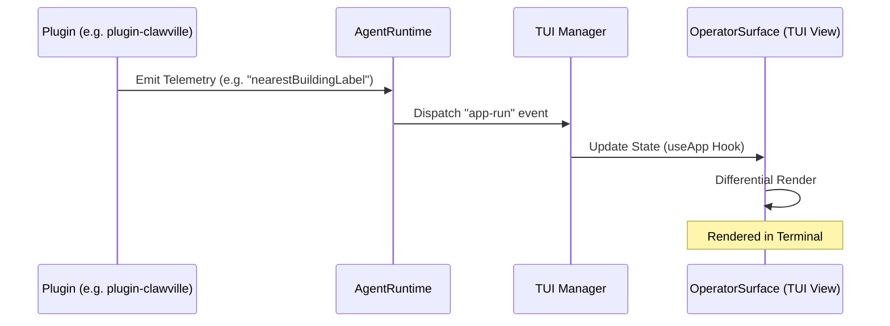

<!-- source: DeepWiki mcp.deepwiki.com · repo elizaOS/eliza · page 7.3 Terminal UI (TUI) · fetched 2026-10-29 -->

# Terminal UI (TUI)

<details>
<summary>Relevant source files</summary>

The following files were used as context for generating this wiki page:

- [packages/agent/src/__tests__/game-tui-mounted-surfaces.test.tsx](packages/agent/src/__tests__/game-tui-mounted-surfaces.test.tsx)
- [packages/app-core/package.json](packages/app-core/package.json)
- [packages/app-core/src/api/auth-bootstrap-routes.ts](packages/app-core/src/api/auth-bootstrap-routes.ts)
- [packages/app-core/src/api/auth-session-routes.ts](packages/app-core/src/api/auth-session-routes.ts)
- [packages/app-core/src/api/catalog-routes.ts](packages/app-core/src/api/catalog-routes.ts)
- [packages/app-core/src/api/cloud-voice-routes.test.ts](packages/app-core/src/api/cloud-voice-routes.test.ts)
- [packages/app-core/src/api/cloud-voice-routes.ts](packages/app-core/src/api/cloud-voice-routes.ts)
- [packages/app-core/src/api/database-rows-compat-routes.ts](packages/app-core/src/api/database-rows-compat-routes.ts)
- [packages/app-core/src/api/dev-compat-routes.ts](packages/app-core/src/api/dev-compat-routes.ts)
- [packages/app-core/src/api/onboarding-routes.ts](packages/app-core/src/api/onboarding-routes.ts)
- [packages/app-core/src/api/secrets-inventory-routes.ts](packages/app-core/src/api/secrets-inventory-routes.ts)
- [packages/app-core/src/api/server.ts](packages/app-core/src/api/server.ts)
- [packages/app-core/src/cli/doctor/checks.ts](packages/app-core/src/cli/doctor/checks.ts)
- [packages/app-core/src/index.ts](packages/app-core/src/index.ts)
- [packages/app-core/src/register-runtime-hooks.ts](packages/app-core/src/register-runtime-hooks.ts)
- [packages/app-core/src/runtime/eliza.ts](packages/app-core/src/runtime/eliza.ts)
- [packages/app-core/src/services/phrase-chunked-tts.ts](packages/app-core/src/services/phrase-chunked-tts.ts)
- [packages/app-core/src/services/steward-sidecar.ts](packages/app-core/src/services/steward-sidecar.ts)
- [packages/app-core/src/services/steward-sidecar/health-check.ts](packages/app-core/src/services/steward-sidecar/health-check.ts)
- [packages/app-core/src/services/steward-sidecar/wallet-setup.ts](packages/app-core/src/services/steward-sidecar/wallet-setup.ts)
- [packages/app-core/src/services/task-host-capabilities.ts](packages/app-core/src/services/task-host-capabilities.ts)
- [plugins/plugin-hearwear/src/index.ts](plugins/plugin-hearwear/src/index.ts)
- [plugins/plugin-xr/src/__tests__/xr-bundle-coverage.test.ts](plugins/plugin-xr/src/__tests__/xr-bundle-coverage.test.ts)
- [plugins/plugin-xr/src/__tests__/xr-feature-parity.test.ts](plugins/plugin-xr/src/__tests__/xr-feature-parity.test.ts)
- [plugins/plugin-xr/src/__tests__/xr-functional-parity.test.ts](plugins/plugin-xr/src/__tests__/xr-functional-parity.test.ts)
- [plugins/plugin-xr/src/__tests__/xr-view-host-http.test.ts](plugins/plugin-xr/src/__tests__/xr-view-host-http.test.ts)
- [plugins/plugin-xr/src/__tests__/xr-view-host.test.ts](plugins/plugin-xr/src/__tests__/xr-view-host.test.ts)
- [plugins/plugin-xr/src/actions/xr-view-actions.ts](plugins/plugin-xr/src/actions/xr-view-actions.ts)

</details>


The `@elizaos/tui` framework provides a high-performance terminal user interface for elizaOS agents, featuring differential rendering, synchronized output streams, and a rich component library. It is designed to bridge the gap between headless agent operations and graphical interfaces, allowing developers to manage agents, view real-time logs, and interact with specialized "Operator Surfaces" directly from the command line.

## Overview and Architecture

The TUI architecture is built on a component-based model similar to React, but optimized for the character-grid constraints of terminal emulators. It manages a virtual DOM of terminal cells and performs differential updates to minimize flickers and bandwidth usage over SSH or slow terminal connections.

### Key Capabilities
- **Differential Rendering**: Only updates terminal cells that have changed between frames.
- **Synchronized Output**: Coordinates between standard agent logs and interactive UI components to prevent text overlapping.
- **Operator Surfaces**: Specialized views for game plugins (e.g., `plugin-2004scape`, `plugin-clawville`) that render game state in the terminal [packages/agent/src/__tests__/game-tui-mounted-surfaces.test.tsx:184-185]().
- **Inline Images**: Supports the Kitty and iTerm2 inline image protocols for rendering visual data (e.g., agent screenshots or generated art) directly in the terminal.

### Component Hierarchy

The framework provides a set of core layout and input components:
- **Box & Container**: Flexbox-like layout primitives for positioning.
- **Text & Markdown**: Formatted text rendering with ANSI color support.
- **Editor**: A multi-line text input field with syntax highlighting and autocomplete.
- **SelectList**: Interactive menus for agent selection or configuration.
- **Loader**: Animated progress indicators for long-running tasks.

## Data Flow and Implementation

The TUI operates as a specialized output target for the `AgentRuntime`. When an agent is launched in TUI mode, the runtime pipes its event stream into the TUI manager, which routes data to the active "Surface".

### Terminal Entity Mapping

The following diagram bridges the natural language concepts of the UI to the specific code entities in the `packages/tui/src/` and related plugin directories.

**TUI Entity Association**
```mermaid
graph TD
    subgraph "Natural Language Space"
        "User Input"
        "Agent Log"
        "Game Map"
        "Menu Selection"
    end

    subgraph "Code Entity Space (packages/tui/src/)"
        "Editor"["Editor Component"]
        "LogStream"["LogStream Buffer"]
        "OperatorSurface"["OperatorSurface Interface"]
        "SelectList"["SelectList Component"]
    end

    "User Input" --> "Editor"
    "Agent Log" --> "LogStream"
    "Game Map" --> "OperatorSurface"
    "Menu Selection" --> "SelectList"

    style "Editor" stroke-dasharray: 5 5
    style "OperatorSurface" stroke-dasharray: 5 5
```
Sources: [packages/agent/src/__tests__/game-tui-mounted-surfaces.test.tsx:109-127](), [packages/app-core/src/index.ts:49-55]()

## Operator Surfaces

Operator Surfaces are plugin-specific TUI views that provide a tailored interface for specific agent capabilities. These are often used for "Game Operators" where the terminal displays a live view of the game world or agent status.

### Implementation Pattern
Plugins register TUI views by exporting a component (e.g., `TwoThousandFourScapeTuiView`) and an interaction handler.

| Plugin | TUI View Component | Purpose |
| :--- | :--- | :--- |
| `plugin-2004scape` | `TwoThousandFourScapeTuiView` | OSRS bot management and world view [packages/agent/src/__tests__/game-tui-mounted-surfaces.test.tsx:110-111]() |
| `plugin-clawville` | `ClawvilleTuiView` | Detective RPG agent monitoring [packages/agent/src/__tests__/game-tui-mounted-surfaces.test.tsx:113-115]() |
| `plugin-hyperscape` | `HyperscapeTuiView` | 3D world navigation telemetry [packages/agent/src/__tests__/game-tui-mounted-surfaces.test.tsx:121-123]() |
| `plugin-hearwear` | `FacewearView` (tui type) | Terminal management for XR/Smartglasses [plugins/plugin-hearwear/src/index.ts:98-106]() |

### Data Flow for Operator Surfaces
The `app-run-aware` TUI state allows surfaces to react to real-time telemetry from running agent processes.

**Operator Surface Data Flow**

Sources: [packages/agent/src/__tests__/game-tui-mounted-surfaces.test.tsx:186-195](), [packages/app-core/src/runtime/app-core-runtime-hooks.ts:49-49]()

## Component Details

### The Editor Component
The `Editor` is the primary input mechanism. It supports:
- **Autocomplete**: Pluggable completion providers for agent commands.
- **Syntax Highlighting**: ANSI-based coloring for code or structured logs.
- **History**: Persistent command history across sessions.

### Markdown Rendering
The `Markdown` component parses standard Markdown and converts it to ANSI-formatted terminal text. It handles:
- Bold/Italic via ANSI escape codes.
- Lists and blockquotes with proper indentation.
- Code blocks with syntax highlighting.

### Inline Image Protocol
The TUI framework detects terminal capabilities and utilizes specific protocols:
- **Kitty Protocol**: High-resolution image placement using escape sequences.
- **iTerm2 Protocol**: Base64 encoded image streaming.
- **Fallback**: If no image protocol is detected, the TUI renders an ASCII/Braille approximation of the image.

## Integration with App Core

The TUI is not a standalone application but is integrated into the `@elizaos/app-core` runtime. It leverages the same registry and plugin system as the GUI and Mobile targets.

- **Registry Integration**: TUI views are discovered via the `loadRegistry` and `getApps` functions [packages/app-core/src/runtime/eliza.ts:49-49]().
- **View Types**: Plugins define `viewType: "tui"` in their manifest to register terminal-specific interfaces [plugins/plugin-hearwear/src/index.ts:99-100]().
- **Runtime Hooks**: Uses `app-core-runtime-hooks` to synchronize state between the agent's background process and the terminal foreground [packages/app-core/src/runtime/app-core-runtime-hooks.ts:49-49]().

Sources:
- [packages/agent/src/__tests__/game-tui-mounted-surfaces.test.tsx:1-127]()
- [packages/app-core/src/runtime/eliza.ts:1-55]()
- [plugins/plugin-hearwear/src/index.ts:98-106]()
- [packages/app-core/src/index.ts:1-81]()

---

