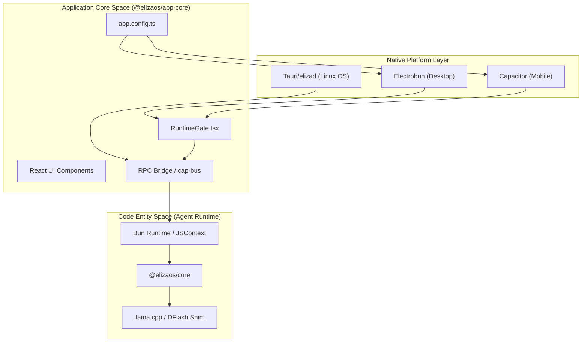
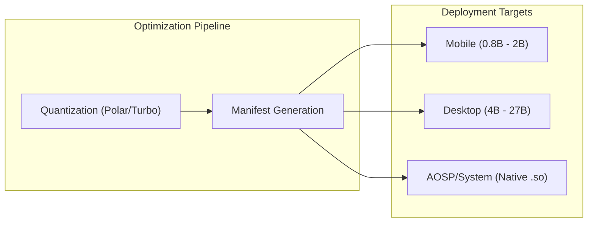

<!-- source: DeepWiki mcp.deepwiki.com · repo elizaOS/eliza · page 8 Platform Targets · fetched 2026-10-29 -->

# Platform Targets

Relevant source files

The following files were used as context for generating this wiki page:

- [packages/agent/src/runtime/release-plugin-policy.test.ts](packages/agent/src/runtime/release-plugin-policy.test.ts)
- [packages/agent/src/runtime/release-plugin-policy.ts](packages/agent/src/runtime/release-plugin-policy.ts)
- [packages/agent/src/shared/workspace-resolution.workspace-folder.test.ts](packages/agent/src/shared/workspace-resolution.workspace-folder.test.ts)
- [packages/app-core/platforms/android/app/build.gradle](packages/app-core/platforms/android/app/build.gradle)
- [packages/app-core/platforms/android/app/src/androidTest/java/ai/elizaos/app/ElizaOsInstrumentedTest.java](packages/app-core/platforms/android/app/src/androidTest/java/ai/elizaos/app/ElizaOsInstrumentedTest.java)
- [packages/app-core/platforms/android/app/src/main/AndroidManifest.xml](packages/app-core/platforms/android/app/src/main/AndroidManifest.xml)
- [packages/app-core/platforms/android/app/src/main/java/ai/elizaos/app/AgentPlugin.java](packages/app-core/platforms/android/app/src/main/java/ai/elizaos/app/AgentPlugin.java)
- [packages/app-core/platforms/android/app/src/main/java/ai/elizaos/app/ElizaSmsGatewayService.java](packages/app-core/platforms/android/app/src/main/java/ai/elizaos/app/ElizaSmsGatewayService.java)
- [packages/app-core/platforms/android/app/src/main/java/ai/elizaos/app/ElizaVoiceCaptureService.java](packages/app-core/platforms/android/app/src/main/java/ai/elizaos/app/ElizaVoiceCaptureService.java)
- [packages/app-core/platforms/android/app/src/main/java/ai/elizaos/app/GatewayConnectionService.java](packages/app-core/platforms/android/app/src/main/java/ai/elizaos/app/GatewayConnectionService.java)
- [packages/app-core/platforms/android/app/src/main/res/values/android_app_actions.xml](packages/app-core/platforms/android/app/src/main/res/values/android_app_actions.xml)
- [packages/app-core/platforms/android/app/src/main/res/values/colors.xml](packages/app-core/platforms/android/app/src/main/res/values/colors.xml)
- [packages/app-core/platforms/android/app/src/main/res/values/strings.xml](packages/app-core/platforms/android/app/src/main/res/values/strings.xml)
- [packages/app-core/platforms/android/app/src/main/res/values/styles.xml](packages/app-core/platforms/android/app/src/main/res/values/styles.xml)
- [packages/app-core/platforms/android/app/src/main/res/xml/shortcuts.xml](packages/app-core/platforms/android/app/src/main/res/xml/shortcuts.xml)
- [packages/app-core/platforms/android/capacitor.settings.gradle](packages/app-core/platforms/android/capacitor.settings.gradle)
- [packages/app-core/platforms/electrobun/electrobun.config.ts](packages/app-core/platforms/electrobun/electrobun.config.ts)
- [packages/app-core/platforms/electrobun/src/electrobun-config.test.ts](packages/app-core/platforms/electrobun/src/electrobun-config.test.ts)
- [packages/app-core/platforms/ios/App/App/Base.lproj/LaunchScreen.storyboard](packages/app-core/platforms/ios/App/App/Base.lproj/LaunchScreen.storyboard)
- [packages/app-core/scripts/assert-required-bundled-packages.test.ts](packages/app-core/scripts/assert-required-bundled-packages.test.ts)
- [packages/app-core/scripts/audit-apple-store-sandbox.mjs](packages/app-core/scripts/audit-apple-store-sandbox.mjs)
- [packages/app-core/scripts/copy-runtime-node-modules.ts](packages/app-core/scripts/copy-runtime-node-modules.ts)
- [packages/app-core/scripts/desktop-build.mjs](packages/app-core/scripts/desktop-build.mjs)
- [packages/app-core/scripts/dev-platform.mjs](packages/app-core/scripts/dev-platform.mjs)
- [packages/app-core/scripts/lib/read-app-identity.mjs](packages/app-core/scripts/lib/read-app-identity.mjs)
- [packages/app-core/scripts/run-mobile-build-policy.test.mjs](packages/app-core/scripts/run-mobile-build-policy.test.mjs)
- [packages/app-core/scripts/run-mobile-build.mjs](packages/app-core/scripts/run-mobile-build.mjs)
- [packages/app-core/vitest.config.ts](packages/app-core/vitest.config.ts)
- [packages/app/test/brand-surface.test.ts](packages/app/test/brand-surface.test.ts)
- [packages/elizaos/templates/project/apps/app/electrobun/electrobun.config.ts](packages/elizaos/templates/project/apps/app/electrobun/electrobun.config.ts)
- [packages/ui/src/backgrounds/BackgroundHost.tsx](packages/ui/src/backgrounds/BackgroundHost.tsx)
- [packages/ui/src/backgrounds/__tests__/BackgroundHost.test.ts](packages/ui/src/backgrounds/__tests__/BackgroundHost.test.ts)
- [packages/ui/src/components/onboarding/states/onboarding.css](packages/ui/src/components/onboarding/states/onboarding.css)
- [packages/ui/src/components/shell/RuntimeGate.cloud-provisioning.test.tsx](packages/ui/src/components/shell/RuntimeGate.cloud-provisioning.test.tsx)
- [packages/ui/src/components/shell/RuntimeGate.tsx](packages/ui/src/components/shell/RuntimeGate.tsx)
- [packages/ui/src/components/shell/StartupShell.tsx](packages/ui/src/components/shell/StartupShell.tsx)
- [packages/ui/src/components/shell/startup-shell-assets.test.ts](packages/ui/src/components/shell/startup-shell-assets.test.ts)
- [plugins/plugin-elizacloud/__tests__/cloud-route-plugin.test.ts](plugins/plugin-elizacloud/__tests__/cloud-route-plugin.test.ts)
- [plugins/plugin-elizacloud/src/plugin.ts](plugins/plugin-elizacloud/src/plugin.ts)
- [plugins/plugin-elizacloud/src/routes/cloud-routes.ts](plugins/plugin-elizacloud/src/routes/cloud-routes.ts)

elizaOS utilizes a multi-platform delivery strategy designed to bring autonomous agents to every environment—from high-performance desktop workstations and mobile devices to secure, sovereign Linux distributions. The framework leverages a shared core (`@elizaos/app-core`) to maintain feature parity across targets while utilizing native bridges for environment-specific capabilities like system-level automation, local inference, and hardware access.

### Platform Architecture Overview

The delivery strategy is centered around a unified application contract defined in `app.config.ts` [packages/app-core/scripts/run-mobile-build.mjs:6-7](). This configuration allows the web, desktop, and native mobile builds to share identity, branding, and capability sets via `readAppIdentity` [packages/app-core/scripts/lib/read-app-identity.mjs:12-39]().

The platform stack is categorized into four primary targets:

| Target | Technology Stack | Primary Use Case |
| :--- | :--- | :--- |
| **Desktop** | Electrobun (Bun + Zig + Webview) | Native system automation, local heavy inference (CUDA/Metal). |
| **Mobile** | Capacitor (iOS/Android) | Personal assistants with camera, location, and on-device voice. |
| **Linux OS** | Debian-derivative (usbeliza) | Secure, air-gapped agent sovereignty via Live-USB. |
| **Browser** | Extension / WebXR | Web-based orchestration and XR frontend integration. |

### System Flow: Multi-Platform Orchestration

The following diagram illustrates how platform-specific runners interface with the shared agent runtime and native system capabilities.

**Sources:** [packages/app-core/scripts/run-mobile-build.mjs:6-43](), [packages/app-core/platforms/electrobun/electrobun.config.ts:54-73](), [packages/ui/src/components/shell/RuntimeGate.tsx:1-20]()

---

## Desktop Application

The desktop target is built using **Electrobun**, a high-performance alternative to Electron that uses Bun as the main process [packages/app-core/platforms/electrobun/electrobun.config.ts:4-6](). It is designed for users who require deep system integration and high-performance local inference.

*   **Native Capabilities:** Orchestrated via `desktop-build.mjs`, which handles build profiles ("full" vs "no-streaming") and variants ("store" vs "direct") [packages/app-core/scripts/desktop-build.mjs:98-112]().
*   **Extension System:** Utilizes the "Electrobun Carrots" system for modular desktop extensions.
*   **Runtime Embedding:** The build can optionally embed the full agent runtime bundle into the application package [packages/app-core/platforms/electrobun/electrobun.config.ts:47-56]().

For details, see [Desktop Application](#8.2).

---

## Mobile Applications

elizaOS supports iOS and Android via **Capacitor**, providing a hybrid architecture that can run either as a "Thin Client" (connected to Eliza Cloud) or a "Local Agent" (running the full runtime on-device) [packages/app-core/scripts/run-mobile-build.mjs:11-43]().

*   **Android:** Supports multiple variants, including `android-system` for AOSP builds and `android-sms-gateway` for running a shared SMS gateway [packages/app-core/scripts/run-mobile-build.mjs:19-25]().
*   **iOS:** Includes specialized handling for App Store constraints, using `local-safe` execution modes and stripping JIT-dependent bridges for `ios` store builds [packages/app-core/scripts/run-mobile-build.mjs:41-43]().
*   **Native Plugins:** Integrates native functionality such as `ElizaVoiceCaptureService` and `ElizaSmsGatewayService` [packages/app-core/platforms/android/app/src/main/java/ai/elizaos/app/ElizaVoiceCaptureService.java:1-20]().

For details, see [Mobile Applications](#8.3).

---

## usbeliza — Linux Live-USB OS

**usbeliza** is a sovereign operating system target located in `packages/os/linux/`. It transforms a standard x86 machine into a dedicated AI appliance where the entire user interface is a single chat interface managed by the `elizad` shell.

*   **Architecture:** Uses a Tauri/Rust-based shell (`elizad`) that manages the `eliza-agent` as a supervised subprocess.
*   **Variants:** Includes `milady-tails` for privacy-focused operations and `elizaos-debian-riscv64` for E1 chip and RISC-V hardware targets.
*   **Deployment:** Designed to be flashed to a USB drive, providing a portable, encrypted, and air-gapped environment for agent operations.

For details, see [usbeliza — Linux Live-USB OS](#8.4).

---

## Browser Extension and WebXR

The browser target extends elizaOS into web navigation and spatial computing environments.

*   **Browser Bridge:** The `@elizaos/browser-bridge-extension` provides a Chrome and Safari extension for webpage chat integration.
*   **WebXR:** The `@elizaos/app-xr` package provides a specialized frontend for XR hardware like Meta Quest and Apple Vision Pro.
*   **Runtime Selection:** Users select their agent location (Cloud, Local, or Remote) via the `RuntimeGate` component [packages/ui/src/components/shell/RuntimeGate.tsx:4-10]().

For details, see [Browser Extension and WebXR](#8.5).

---

## Platform Inference Strategy

Intelligence is delivered via a tiered model strategy, ensuring that the `Eliza-1` model family is optimized for the specific constraints of each platform.

**Sources:** [packages/app-core/platforms/android/app/build.gradle:20-25](), [packages/app-core/scripts/run-mobile-build.mjs:171-179]()

*   **Mobile Constraints:** Android builds can use an AOSP-only `libllama.so` loader for inference when `AOSP_BUILD` is enabled [packages/app-core/platforms/android/app/build.gradle:20-25]().
*   **Asset Management:** The build system ensures `.gguf` and `.so` files are packaged without compression in the APK for memory-mapped performance [packages/app-core/platforms/android/app/build.gradle:74-91]().

For details, see [Local Inference](#15).

---

