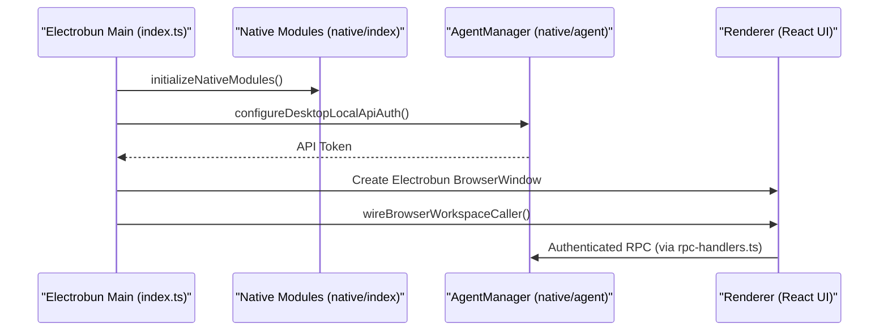
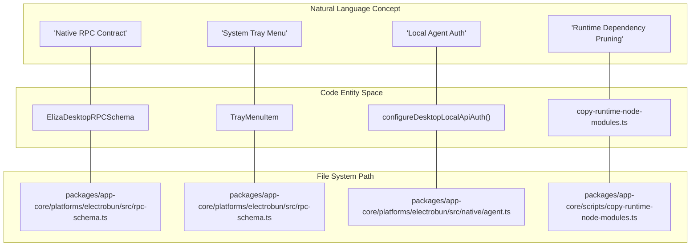
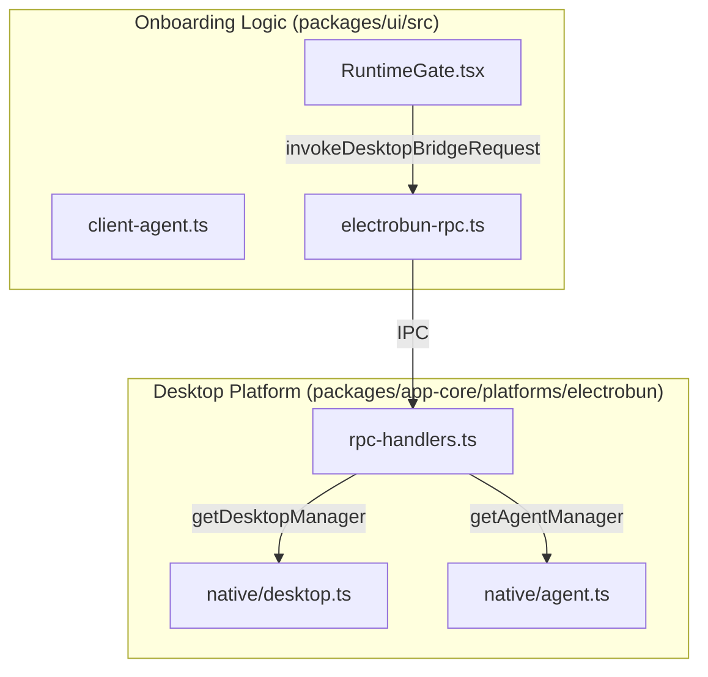

<!-- source: DeepWiki mcp.deepwiki.com · repo elizaOS/eliza · page 8.2 Desktop Application · fetched 2026-10-29 -->

# Desktop Application

Relevant source files

The following files were used as context for generating this wiki page:

- [packages/agent/src/actions/database.ts](packages/agent/src/actions/database.ts)
- [packages/agent/src/api/connector-account-routes.test.ts](packages/agent/src/api/connector-account-routes.test.ts)
- [packages/agent/src/api/database.ts](packages/agent/src/api/database.ts)
- [packages/agent/src/api/permissions-routes-extra.ts](packages/agent/src/api/permissions-routes-extra.ts)
- [packages/agent/src/runtime/release-plugin-policy.test.ts](packages/agent/src/runtime/release-plugin-policy.test.ts)
- [packages/agent/src/runtime/release-plugin-policy.ts](packages/agent/src/runtime/release-plugin-policy.ts)
- [packages/agent/src/triggers/types.ts](packages/agent/src/triggers/types.ts)
- [packages/app-core/platforms/electrobun/electrobun.config.ts](packages/app-core/platforms/electrobun/electrobun.config.ts)
- [packages/app-core/platforms/electrobun/src/api-base.ts](packages/app-core/platforms/electrobun/src/api-base.ts)
- [packages/app-core/platforms/electrobun/src/config-and-auth-rpc.test.ts](packages/app-core/platforms/electrobun/src/config-and-auth-rpc.test.ts)
- [packages/app-core/platforms/electrobun/src/config-and-auth-rpc.ts](packages/app-core/platforms/electrobun/src/config-and-auth-rpc.ts)
- [packages/app-core/platforms/electrobun/src/conversations-and-character-rpc.test.ts](packages/app-core/platforms/electrobun/src/conversations-and-character-rpc.test.ts)
- [packages/app-core/platforms/electrobun/src/conversations-and-character-rpc.ts](packages/app-core/platforms/electrobun/src/conversations-and-character-rpc.ts)
- [packages/app-core/platforms/electrobun/src/desktop-tray-config.test.ts](packages/app-core/platforms/electrobun/src/desktop-tray-config.test.ts)
- [packages/app-core/platforms/electrobun/src/electrobun-config.test.ts](packages/app-core/platforms/electrobun/src/electrobun-config.test.ts)
- [packages/app-core/platforms/electrobun/src/index.ts](packages/app-core/platforms/electrobun/src/index.ts)
- [packages/app-core/platforms/electrobun/src/lifecycle/api-base-owner.ts](packages/app-core/platforms/electrobun/src/lifecycle/api-base-owner.ts)
- [packages/app-core/platforms/electrobun/src/lifecycle/desktop-session-prime.ts](packages/app-core/platforms/electrobun/src/lifecycle/desktop-session-prime.ts)
- [packages/app-core/platforms/electrobun/src/logger.ts](packages/app-core/platforms/electrobun/src/logger.ts)
- [packages/app-core/platforms/electrobun/src/native/agent.ts](packages/app-core/platforms/electrobun/src/native/agent.ts)
- [packages/app-core/platforms/electrobun/src/native/desktop.ts](packages/app-core/platforms/electrobun/src/native/desktop.ts)
- [packages/app-core/platforms/electrobun/src/native/gateway.ts](packages/app-core/platforms/electrobun/src/native/gateway.ts)
- [packages/app-core/platforms/electrobun/src/native/steward.ts](packages/app-core/platforms/electrobun/src/native/steward.ts)
- [packages/app-core/platforms/electrobun/src/onboarding-rpc.test.ts](packages/app-core/platforms/electrobun/src/onboarding-rpc.test.ts)
- [packages/app-core/platforms/electrobun/src/onboarding-rpc.ts](packages/app-core/platforms/electrobun/src/onboarding-rpc.ts)
- [packages/app-core/platforms/electrobun/src/pill-window.ts](packages/app-core/platforms/electrobun/src/pill-window.ts)
- [packages/app-core/platforms/electrobun/src/renderer-api-proxy.ts](packages/app-core/platforms/electrobun/src/renderer-api-proxy.ts)
- [packages/app-core/platforms/electrobun/src/rpc-handlers.ts](packages/app-core/platforms/electrobun/src/rpc-handlers.ts)
- [packages/app-core/platforms/electrobun/src/rpc-port-resolver.test.ts](packages/app-core/platforms/electrobun/src/rpc-port-resolver.test.ts)
- [packages/app-core/platforms/electrobun/src/rpc-port-resolver.ts](packages/app-core/platforms/electrobun/src/rpc-port-resolver.ts)
- [packages/app-core/platforms/electrobun/src/rpc-schema.ts](packages/app-core/platforms/electrobun/src/rpc-schema.ts)
- [packages/app-core/platforms/electrobun/src/runtime-permissions.ts](packages/app-core/platforms/electrobun/src/runtime-permissions.ts)
- [packages/app-core/scripts/assert-required-bundled-packages.test.ts](packages/app-core/scripts/assert-required-bundled-packages.test.ts)
- [packages/app-core/scripts/copy-runtime-node-modules.ts](packages/app-core/scripts/copy-runtime-node-modules.ts)
- [packages/app-core/scripts/desktop-build.mjs](packages/app-core/scripts/desktop-build.mjs)
- [packages/app-core/scripts/dev-platform.mjs](packages/app-core/scripts/dev-platform.mjs)
- [packages/app-core/scripts/lib/read-app-identity.mjs](packages/app-core/scripts/lib/read-app-identity.mjs)
- [packages/app-core/vitest.config.ts](packages/app-core/vitest.config.ts)
- [packages/core/src/utils/workspace-folder-config.test.ts](packages/core/src/utils/workspace-folder-config.test.ts)
- [packages/elizaos/templates/project/apps/app/electrobun/electrobun.config.ts](packages/elizaos/templates/project/apps/app/electrobun/electrobun.config.ts)
- [packages/shared/src/api/agent-api-types.ts](packages/shared/src/api/agent-api-types.ts)
- [packages/shared/src/contracts/conversation-routes.ts](packages/shared/src/contracts/conversation-routes.ts)
- [packages/shared/src/voice.ts](packages/shared/src/voice.ts)
- [packages/skills/skills/coding-agent/SKILL.md](packages/skills/skills/coding-agent/SKILL.md)
- [packages/ui/src/api/agent-client-type-shim.ts](packages/ui/src/api/agent-client-type-shim.ts)
- [packages/ui/src/api/client-agent.ts](packages/ui/src/api/client-agent.ts)
- [packages/ui/src/api/client-chat.ts](packages/ui/src/api/client-chat.ts)
- [packages/ui/src/api/client-types-config.ts](packages/ui/src/api/client-types-config.ts)
- [packages/ui/src/api/client-types-core.ts](packages/ui/src/api/client-types-core.ts)
- [packages/ui/src/backgrounds/BackgroundHost.tsx](packages/ui/src/backgrounds/BackgroundHost.tsx)
- [packages/ui/src/backgrounds/__tests__/BackgroundHost.test.ts](packages/ui/src/backgrounds/__tests__/BackgroundHost.test.ts)
- [packages/ui/src/components/onboarding/states/onboarding.css](packages/ui/src/components/onboarding/states/onboarding.css)
- [packages/ui/src/components/settings/AdvancedToggle.test.tsx](packages/ui/src/components/settings/AdvancedToggle.test.tsx)
- [packages/ui/src/components/shell/RuntimeGate.cloud-provisioning.test.tsx](packages/ui/src/components/shell/RuntimeGate.cloud-provisioning.test.tsx)
- [packages/ui/src/components/shell/RuntimeGate.tsx](packages/ui/src/components/shell/RuntimeGate.tsx)
- [packages/ui/src/components/shell/StartupShell.tsx](packages/ui/src/components/shell/StartupShell.tsx)
- [packages/ui/src/components/shell/startup-shell-assets.test.ts](packages/ui/src/components/shell/startup-shell-assets.test.ts)
- [packages/ui/src/state/startup-phase-poll.ts](packages/ui/src/state/startup-phase-poll.ts)
- [packages/ui/src/state/startup-phase-runtime.test.ts](packages/ui/src/state/startup-phase-runtime.test.ts)
- [packages/ui/src/state/startup-phase-runtime.ts](packages/ui/src/state/startup-phase-runtime.ts)
- [plugins/plugin-agent-orchestrator/src/__tests__/terminal-capabilities.test.ts](plugins/plugin-agent-orchestrator/src/__tests__/terminal-capabilities.test.ts)
- [plugins/plugin-coding-tools/src/lib/terminal-capabilities.test.ts](plugins/plugin-coding-tools/src/lib/terminal-capabilities.test.ts)
- [plugins/plugin-computeruse/docs/MOBILE_ASSISTANT_ROUTING.md](plugins/plugin-computeruse/docs/MOBILE_ASSISTANT_ROUTING.md)
- [plugins/plugin-elizacloud/__tests__/cloud-route-plugin.test.ts](plugins/plugin-elizacloud/__tests__/cloud-route-plugin.test.ts)
- [plugins/plugin-elizacloud/src/plugin.ts](plugins/plugin-elizacloud/src/plugin.ts)
- [plugins/plugin-elizacloud/src/routes/cloud-routes.ts](plugins/plugin-elizacloud/src/routes/cloud-routes.ts)
- [plugins/plugin-local-inference/src/runtime/embedding-manager-support.ts](plugins/plugin-local-inference/src/runtime/embedding-manager-support.ts)
- [plugins/plugin-local-inference/src/runtime/index.ts](plugins/plugin-local-inference/src/runtime/index.ts)
- [plugins/plugin-shell/__tests__/terminal-capabilities.test.ts](plugins/plugin-shell/__tests__/terminal-capabilities.test.ts)

This page details the architecture and implementation of the elizaOS desktop application ecosystem. It focuses on the Electrobun-based native application, the "Carrots" extension system, and the RPC bridge that enables native capabilities.

---

## Overview

The elizaOS desktop experience is centered around a high-performance, native application shell that integrates the web-based UI with system-level capabilities.

- **Electrobun Shell**: A lightweight native wrapper located in `packages/app-core/platforms/electrobun/` that provides low-level window management, vibrancy effects, and RPC bridges [packages/app-core/platforms/electrobun/src/index.ts:7-15]().
- **Native Capabilities**: Direct system access for window effects (macOS), hardware acceleration (WebGPU), and local agent management [packages/app-core/platforms/electrobun/src/index.ts:66-74]().
- **Desktop Tray**: A native system tray implementation for persistent background access and quick actions [packages/app-core/platforms/electrobun/src/rpc-schema.ts:94-111]().
- **Embedded Runtime**: The application can bundle a full agent runtime, managed via the `AgentManager` [packages/app-core/platforms/electrobun/src/native/agent.ts:56-64]().

Sources: [packages/app-core/platforms/electrobun/src/index.ts:1-80](), [packages/app-core/platforms/electrobun/src/rpc-schema.ts:94-111]()

---

## Electrobun Architecture

The Electrobun platform implementation serves as the entry point for the desktop application, bridging the Bun runtime with native windowing APIs.

### Main Process Initialization
The entry point `packages/app-core/platforms/electrobun/src/index.ts` initializes native modules, sets up the application menu, and manages the lifecycle of the `BrowserWindow` and `BrowserView` components [packages/app-core/platforms/electrobun/src/index.ts:36-51]().

Key responsibilities include:
- **Native Module Lifecycle**: Initializing and disposing of platform-specific modules via `initializeNativeModules()` [packages/app-core/platforms/electrobun/src/index.ts:66-66]().
- **Window Effects**: Applying macOS-specific features like vibrancy and custom traffic light positions [packages/app-core/platforms/electrobun/src/native/mac-window-effects.ts:68-72]().
- **Local API Auth**: Configuring authentication for the local agent API via `configureDesktopLocalApiAuth()` [packages/app-core/platforms/electrobun/src/native/agent.ts:56-64]().

### RPC Schema and Bridge
The application uses a typed RPC contract defined in `ElizaDesktopRPCSchema` to communicate between the Bun main process and the webview renderer [packages/app-core/platforms/electrobun/src/rpc-schema.ts:1-13]().

| Component | Role | File |
| :--- | :--- | :--- |
| **Schema** | Defines typed RPC contract (requests/messages) | [packages/app-core/platforms/electrobun/src/rpc-schema.ts:8-13]() |
| **Handlers** | Maps RPC requests to native module methods | [packages/app-core/platforms/electrobun/src/rpc-handlers.ts:1-9]() |
| **Desktop Manager** | Implements system-level APIs (Tray, Clipboard, etc.) | [packages/app-core/platforms/electrobun/src/native/desktop.ts:4-12]() |

### Data Flow: Desktop Initialization

Sources: [packages/app-core/platforms/electrobun/src/index.ts:58-75](), [packages/app-core/platforms/electrobun/src/rpc-handlers.ts:1-20](), [packages/app-core/platforms/electrobun/src/native/desktop.ts:1-22]()

---

## Build and Distribution System

The desktop application uses a specialized build pipeline to manage dependencies and platform-specific packaging.

### Build Script (`desktop-build.mjs`)
The `packages/app-core/scripts/desktop-build.mjs` script orchestrates the entire build process, including environment pre-flight checks and workspace resolution [packages/app-core/scripts/desktop-build.mjs:1-25]().

- **Profile Support**: Supports "full" and "no-streaming" build profiles [packages/app-core/scripts/desktop-build.mjs:30-33]().
- **Workspace Resolution**: Automatically finds package directories for `app-core`, `core`, and plugins [packages/app-core/scripts/desktop-build.mjs:73-86]().

### Runtime Dependency Management
To ensure a stable bundled agent, the `copy-runtime-node-modules.ts` script performs a transitive walk of dependencies and prunes unnecessary files (e.g., `.git`, `tests`, `docs`) [packages/app-core/scripts/copy-runtime-node-modules.ts:67-90]().

- **Defense-in-Depth**: `assertRequiredBundledPackagesLanded` verifies that critical packages like `@elizaos/core` are correctly included in the final bundle [packages/app-core/scripts/assert-required-bundled-packages.test.ts:4-11]().
- **Platform Aliasing**: Normalizes platform names (e.g., "macos" -> "darwin") to ensure correct native module resolution [packages/app-core/scripts/copy-runtime-node-modules.ts:99-115]().

### Configuration (`electrobun.config.ts`)
The `electrobun.config.ts` file sets platform-specific flags and locates the monorepo root [packages/app-core/platforms/electrobun/electrobun.config.ts:132-158]().
- **Chromium Flags**: Configures WebGPU and Vulkan for Linux CEF builds [packages/app-core/platforms/electrobun/electrobun.config.ts:58-78]().
- **Embedded Runtime**: Determines whether to embed the agent runtime based on environment variables like `ELIZA_DESKTOP_SKIP_EMBEDDED_AGENT` [packages/app-core/platforms/electrobun/electrobun.config.ts:47-56]().

---

## Desktop Mapping: Concept to Implementation

The following diagrams bridge the gap between high-level desktop features and their code entities.

### Feature Mapping

Sources: [packages/app-core/platforms/electrobun/src/rpc-schema.ts:1-13](), [packages/app-core/platforms/electrobun/src/rpc-schema.ts:94-104](), [packages/app-core/platforms/electrobun/src/native/agent.ts:56-64](), [packages/app-core/scripts/copy-runtime-node-modules.ts:1-15]()

### Onboarding Flow

Sources: [packages/ui/src/components/shell/RuntimeGate.tsx:129-131](), [packages/ui/src/api/client-agent.ts:203-214](), [packages/app-core/platforms/electrobun/src/rpc-handlers.ts:1-9]()

Sources: [packages/app-core/scripts/desktop-build.mjs:1-100](), [packages/app-core/platforms/electrobun/electrobun.config.ts:1-80](), [packages/app-core/scripts/copy-runtime-node-modules.ts:1-136]()

---

