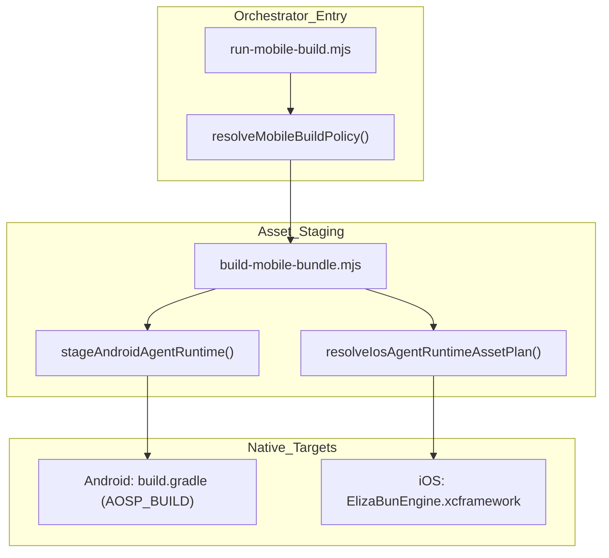
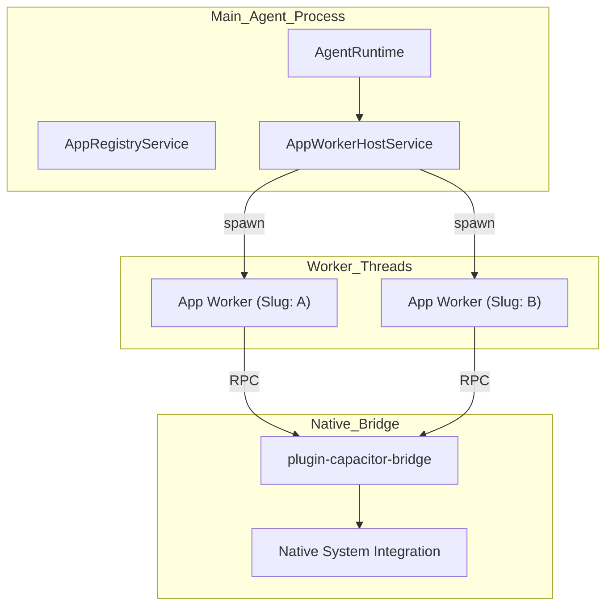

<!-- source: DeepWiki mcp.deepwiki.com · repo elizaOS/eliza · page 8.3 Mobile Applications · fetched 2026-10-29 -->

# Mobile Applications

Relevant source files

The following files were used as context for generating this wiki page:

- [.github/workflows/mobile-build-smoke.yml](.github/workflows/mobile-build-smoke.yml)
- [packages/agent/scripts/build-mobile-bundle.mjs](packages/agent/scripts/build-mobile-bundle.mjs)
- [packages/agent/scripts/mobile-stubs/null-plugin.cjs](packages/agent/scripts/mobile-stubs/null-plugin.cjs)
- [packages/agent/src/__tests__/view-memory-lifecycle.test.ts](packages/agent/src/__tests__/view-memory-lifecycle.test.ts)
- [packages/agent/src/cli/index.ts](packages/agent/src/cli/index.ts)
- [packages/agent/src/external-modules.d.ts](packages/agent/src/external-modules.d.ts)
- [packages/agent/src/runtime/android-app-plugins.ts](packages/agent/src/runtime/android-app-plugins.ts)
- [packages/agent/src/shared/workspace-resolution.workspace-folder.test.ts](packages/agent/src/shared/workspace-resolution.workspace-folder.test.ts)
- [packages/app-core/platforms/android/app/build.gradle](packages/app-core/platforms/android/app/build.gradle)
- [packages/app-core/platforms/android/app/src/androidTest/java/ai/elizaos/app/ElizaOsInstrumentedTest.java](packages/app-core/platforms/android/app/src/androidTest/java/ai/elizaos/app/ElizaOsInstrumentedTest.java)
- [packages/app-core/platforms/android/app/src/main/AndroidManifest.xml](packages/app-core/platforms/android/app/src/main/AndroidManifest.xml)
- [packages/app-core/platforms/android/app/src/main/java/ai/elizaos/app/AgentPlugin.java](packages/app-core/platforms/android/app/src/main/java/ai/elizaos/app/AgentPlugin.java)
- [packages/app-core/platforms/android/app/src/main/java/ai/elizaos/app/ElizaSmsGatewayService.java](packages/app-core/platforms/android/app/src/main/java/ai/elizaos/app/ElizaSmsGatewayService.java)
- [packages/app-core/platforms/android/app/src/main/java/ai/elizaos/app/ElizaVoiceCaptureService.java](packages/app-core/platforms/android/app/src/main/java/ai/elizaos/app/ElizaVoiceCaptureService.java)
- [packages/app-core/platforms/android/app/src/main/java/ai/elizaos/app/GatewayConnectionService.java](packages/app-core/platforms/android/app/src/main/java/ai/elizaos/app/GatewayConnectionService.java)
- [packages/app-core/platforms/android/app/src/main/res/values/android_app_actions.xml](packages/app-core/platforms/android/app/src/main/res/values/android_app_actions.xml)
- [packages/app-core/platforms/android/app/src/main/res/values/colors.xml](packages/app-core/platforms/android/app/src/main/res/values/colors.xml)
- [packages/app-core/platforms/android/app/src/main/res/values/strings.xml](packages/app-core/platforms/android/app/src/main/res/values/strings.xml)
- [packages/app-core/platforms/android/app/src/main/res/values/styles.xml](packages/app-core/platforms/android/app/src/main/res/values/styles.xml)
- [packages/app-core/platforms/android/app/src/main/res/xml/shortcuts.xml](packages/app-core/platforms/android/app/src/main/res/xml/shortcuts.xml)
- [packages/app-core/platforms/android/capacitor.settings.gradle](packages/app-core/platforms/android/capacitor.settings.gradle)
- [packages/app-core/platforms/ios/App/App/Base.lproj/LaunchScreen.storyboard](packages/app-core/platforms/ios/App/App/Base.lproj/LaunchScreen.storyboard)
- [packages/app-core/scripts/aosp/llama-shim/eliza_llama_shim.c](packages/app-core/scripts/aosp/llama-shim/eliza_llama_shim.c)
- [packages/app-core/scripts/audit-apple-store-sandbox.mjs](packages/app-core/scripts/audit-apple-store-sandbox.mjs)
- [packages/app-core/scripts/pack-upstreams.mjs](packages/app-core/scripts/pack-upstreams.mjs)
- [packages/app-core/scripts/run-mobile-build-policy.test.mjs](packages/app-core/scripts/run-mobile-build-policy.test.mjs)
- [packages/app-core/scripts/run-mobile-build.mjs](packages/app-core/scripts/run-mobile-build.mjs)
- [packages/app-core/scripts/run-production-build.mjs](packages/app-core/scripts/run-production-build.mjs)
- [packages/app/test/brand-surface.test.ts](packages/app/test/brand-surface.test.ts)
- [packages/chip/docs/architecture-optimization/sota-2028/cache-hierarchies.md](packages/chip/docs/architecture-optimization/sota-2028/cache-hierarchies.md)
- [packages/scripts/capability-router-fixture-conformance-smoke.ts](packages/scripts/capability-router-fixture-conformance-smoke.ts)
- [packages/scripts/capability-router-fixture-server.ts](packages/scripts/capability-router-fixture-server.ts)
- [packages/shared/src/contracts/app-permissions.test.ts](packages/shared/src/contracts/app-permissions.test.ts)
- [packages/shared/src/contracts/app-permissions.ts](packages/shared/src/contracts/app-permissions.ts)
- [packages/training/scripts/split_v2.py](packages/training/scripts/split_v2.py)
- [packages/ui/src/components/pages/ViewManagerPage.tsx](packages/ui/src/components/pages/ViewManagerPage.tsx)
- [packages/ui/src/navigation/main-tab.test.ts](packages/ui/src/navigation/main-tab.test.ts)
- [packages/ui/src/navigation/main-tab.ts](packages/ui/src/navigation/main-tab.ts)
- [plugins/plugin-app-control/src/actions/app-load-from-directory.ts](plugins/plugin-app-control/src/actions/app-load-from-directory.ts)
- [plugins/plugin-app-control/src/actions/views-client.ts](plugins/plugin-app-control/src/actions/views-client.ts)
- [plugins/plugin-app-control/src/actions/views-list.ts](plugins/plugin-app-control/src/actions/views-list.ts)
- [plugins/plugin-app-control/src/actions/views-search.ts](plugins/plugin-app-control/src/actions/views-search.ts)
- [plugins/plugin-app-control/src/actions/views-show.ts](plugins/plugin-app-control/src/actions/views-show.ts)
- [plugins/plugin-app-control/src/index.ts](plugins/plugin-app-control/src/index.ts)
- [plugins/plugin-app-control/src/services/__tests__/app-permissions-e2e.test.ts](plugins/plugin-app-control/src/services/__tests__/app-permissions-e2e.test.ts)
- [plugins/plugin-app-control/src/services/__tests__/app-registry-permissions.test.ts](plugins/plugin-app-control/src/services/__tests__/app-registry-permissions.test.ts)
- [plugins/plugin-app-control/src/services/__tests__/app-worker-host.test.ts](plugins/plugin-app-control/src/services/__tests__/app-worker-host.test.ts)
- [plugins/plugin-app-control/src/services/app-registry-service.ts](plugins/plugin-app-control/src/services/app-registry-service.ts)
- [plugins/plugin-app-control/src/services/app-worker-host-service.ts](plugins/plugin-app-control/src/services/app-worker-host-service.ts)
- [plugins/plugin-app-control/src/views/ViewManagerView.tsx](plugins/plugin-app-control/src/views/ViewManagerView.tsx)
- [plugins/plugin-app-control/src/workers/app-worker-entry.ts](plugins/plugin-app-control/src/workers/app-worker-entry.ts)
- [plugins/plugin-app-control/test/fixtures/sandbox-plugin/plugin.ts](plugins/plugin-app-control/test/fixtures/sandbox-plugin/plugin.ts)
- [plugins/plugin-app-control/tsconfig.views.json](plugins/plugin-app-control/tsconfig.views.json)
- [plugins/plugin-app-control/vite.config.views.ts](plugins/plugin-app-control/vite.config.views.ts)
- [plugins/plugin-app-control/vitest.config.ts](plugins/plugin-app-control/vitest.config.ts)
- [plugins/plugin-capacitor-bridge/package.json](plugins/plugin-capacitor-bridge/package.json)
- [plugins/plugin-capacitor-bridge/src/index.ts](plugins/plugin-capacitor-bridge/src/index.ts)
- [plugins/plugin-capacitor-bridge/tsconfig.json](plugins/plugin-capacitor-bridge/tsconfig.json)
- [plugins/plugin-capacitor-bridge/tsup.config.ts](plugins/plugin-capacitor-bridge/tsup.config.ts)

This page documents the mobile application infrastructure for elizaOS, focusing on the iOS and Android implementations built using **Capacitor**. The mobile apps leverage `@elizaos/app-core` to provide a unified cross-platform experience while integrating with native mobile capabilities through a sophisticated build orchestration system, native plugins, and on-device inference engines.

---

## Overview

The elizaOS mobile strategy utilizes a hybrid approach. The core application logic and UI are shared via the `@elizaos/app-core` package, which is then wrapped in native containers for iOS and Android. A custom build orchestrator, `run-mobile-build.mjs`, manages the lifecycle of native project generation, template overlaying, and compilation [packages/app-core/scripts/run-mobile-build.mjs:1-18]().

Key components include:
- **Capacitor**: The cross-platform bridge linking web assets to native APIs.
- **Mobile Build Orchestrator**: A Node.js script that handles environment resolution, platform patching, and native build execution [packages/app-core/scripts/run-mobile-build.mjs:1-18]().
- **On-Device Agent**: Support for running a full Bun-based agent runtime directly on the mobile device [packages/app-core/scripts/run-mobile-build.mjs:28-32]().
- **Native Plugins**: A suite of Capacitor plugins providing access to system features like camera, location, and screen capture.

---

## Mobile Build Orchestrator

The build process is managed by `packages/app-core/scripts/run-mobile-build.mjs`. This script centralizes the identity of the app (read from `app.config.ts`) and ensures that web, desktop, and mobile builds share a canonical contract [packages/app-core/scripts/run-mobile-build.mjs:2-7]().

### Build Targets
The orchestrator supports multiple specialized targets for different deployment scenarios:

| Target | Description |
| :--- | :--- |
| `android` | Sideload debug APK with on-device agent and AOSP/system permissions [packages/app-core/scripts/run-mobile-build.mjs:12-13](). |
| `android-cloud` | Play Store compliant thin client backed by Eliza Cloud (no on-device agent) [packages/app-core/scripts/run-mobile-build.mjs:14-16](). |
| `android-system` | Privileged platform-signed AOSP release APK for ElizaOS device builds [packages/app-core/scripts/run-mobile-build.mjs:19-20](). |
| `android-sms-gateway` | Debug APK for running the Eliza Cloud SMS gateway as the default SMS app [packages/app-core/scripts/run-mobile-build.mjs:19-23](). |
| `ios` | App Store safe cloud-hybrid build without JIT local runtimes [packages/app-core/scripts/run-mobile-build.mjs:40-43](). |
| `ios-local` | Dev/sideload build with `runtimeMode=local` and full agent payload [packages/app-core/scripts/run-mobile-build.mjs:44-47](). |

### Build Phases
1. **Resolve Config**: Reads identity from the host app's `app.config.ts` [packages/app-core/scripts/run-mobile-build.mjs:28-28]().
2. **Build Web**: Executes `vite build` to generate the `dist/` directory [packages/app-core/scripts/run-mobile-build.mjs:29-29]().
3. **Capacitor Sync**: Runs `npx cap sync` to generate native platform projects [packages/app-core/scripts/run-mobile-build.mjs:30-30]().
4. **Overlay Native**: Applies permissions, services, and entitlements (e.g., `Podfile` for iOS) [packages/app-core/scripts/run-mobile-build.mjs:31-31]().
5. **Stage Agent**: For local targets, stages the agent bundle (Bun runtime, PGlite WASM, and assets) into native assets [packages/app-core/scripts/run-mobile-build.mjs:33-37]().
6. **Native Build**: Executes `gradlew` for Android or `xcodebuild` for iOS [packages/app-core/scripts/run-mobile-build.mjs:38-38]().

### Diagram: Mobile Build Logic Flow
This diagram bridges the build script logic to the filesystem and native entities.

Sources: [packages/app-core/scripts/run-mobile-build.mjs:27-38](), [packages/agent/scripts/build-mobile-bundle.mjs:3-15](), [packages/app-core/scripts/run-mobile-build-policy.test.mjs:24-25]()

---

## Android Implementation

The Android application is a Gradle-based project configured in `packages/app-core/platforms/android/app/build.gradle`.

### Build Configuration
The Android build system uses specialized flags to gate features:
- **AOSP_BUILD**: A boolean field read by the agent to decide whether to export `ELIZA_LOCAL_LLAMA=1` for native `libllama.so` loading [packages/app-core/platforms/android/app/build.gradle:25-25]().
- **SMS Gateway**: Configures webhook URLs and secrets for the `android-sms-gateway` target [packages/app-core/platforms/android/app/build.gradle:26-30]().
- **NoCompress**: Prevents compression of `.gguf` and `.so` files to allow memory-mapped loading [packages/app-core/platforms/android/app/build.gradle:89-91]().

### Local Inference Bridge
For non-AOSP builds where the agent cannot run `llama.cpp` via FFI, the `plugin-capacitor-bridge` provides a WebSocket bridge [packages/agent/src/cli/index.ts:84-91]().
- **Bridge CLI**: The `android-bridge` command boots a local HTTP server on `127.0.0.1:31337` [packages/agent/src/cli/index.ts:18-18]().
- **Handlers**: `ensureMobileDeviceBridgeInferenceHandlers` registers the model inference logic for the mobile environment [packages/agent/src/cli/index.ts:87-90]().

Sources: [packages/app-core/platforms/android/app/build.gradle:3-104](), [packages/agent/src/cli/index.ts:1-105]()

---

## iOS Implementation

The iOS application is built using Xcode and CocoaPods, featuring a specialized Bun runtime for local execution.

### Bun iOS Runtime
The `bun-ios-runtime` package provides a full Bun engine on iOS via the `ElizaBunEngine.xcframework` [packages/app-core/scripts/run-mobile-build.mjs:148-154]().
- **Deployment Target**: Requires iOS 16.0 [packages/app-core/scripts/run-mobile-build.mjs:91-92]().
- **Compliance Audit**: The `ios-app-store-runtime-policy.mjs` script enforces App Store safety by checking for forbidden symbols like `_posix_spawn` or `_fork` [packages/app-core/scripts/run-mobile-build.mjs:55-60]().

### Native Assets
The iOS agent runtime requires specific assets to be bundled in the app package:
- `agent-bundle.js`: The primary agent logic produced by `build-mobile-bundle.mjs` [packages/agent/scripts/build-mobile-bundle.mjs:7-8]().
- `pglite.wasm`, `initdb.wasm`, and `pglite.data`: The on-device PostgreSQL engine [packages/agent/scripts/build-mobile-bundle.mjs:9-11]().
- `vector.tar.gz`: Vector search extensions for PGlite [packages/agent/scripts/build-mobile-bundle.mjs:12-12]().

Sources: [packages/app-core/scripts/run-mobile-build.mjs:148-183](), [packages/agent/scripts/build-mobile-bundle.mjs:3-34]()

---

## App Control and Isolation

The mobile apps utilize the `plugin-app-control` system to manage modular sub-apps with security boundaries.

### App Worker Host
The `AppWorkerHostService` manages the lifecycle of apps that declare `isolation: "worker"` [plugins/plugin-app-control/src/services/app-worker-host-service.ts:4-7]().
- **Worker Threads**: Spawns one Bun `node:worker_threads` Worker per registered app [plugins/plugin-app-control/src/services/app-worker-host-service.ts:4-5]().
- **RPC Bridge**: Provides an `invoke(slug, method, params)` interface for typed communication between the main agent and isolated workers [plugins/plugin-app-control/src/services/app-worker-host-service.ts:11-13]().

### Diagram: Mobile App Isolation Architecture
This diagram shows the relationship between the Agent Runtime and isolated mobile sub-apps.

Sources: [plugins/plugin-app-control/src/services/app-worker-host-service.ts:180-210](), [plugins/plugin-app-control/src/services/app-registry-service.ts:38-45](), [packages/agent/src/external-modules.d.ts:2-44]()

---

## CI/CD and Smoke Testing

Automated workflows ensure mobile builds remain functional across changes.

### Mobile Build Smoke Test (`mobile-build-smoke.yml`)
- **iOS Simulator**: Validates the build on `macos-15` using `iphonesimulator` [github/workflows/mobile-build-smoke.yml:25-27]().
- **Info.plist Verification**: Checks for required keys such as `NSHealthShareUsageDescription` and `UIBackgroundModes` [github/workflows/mobile-build-smoke.yml:106-111]().
- **Fastlane Verification**: Ensures `Fastfile` and `Matchfile` are correctly copied to the platform directory [github/workflows/mobile-build-smoke.yml:132-149]().
- **Android Debug**: Validates the Gradle build on `ubuntu-24.04` with Java 21 [github/workflows/mobile-build-smoke.yml:153-165]().

Sources: [.github/workflows/mobile-build-smoke.yml:1-170]()

---

