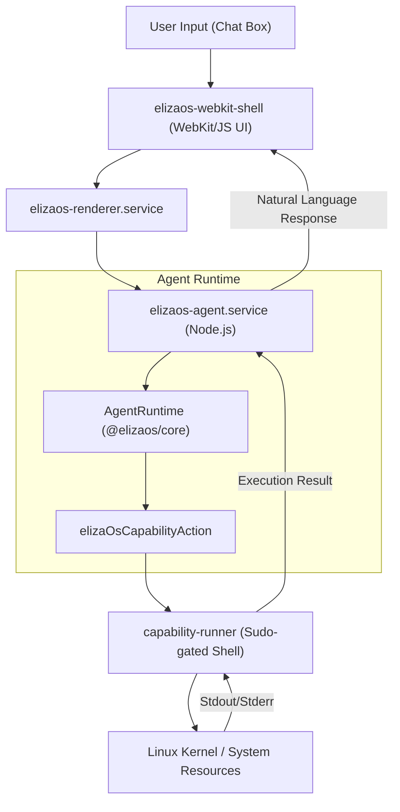
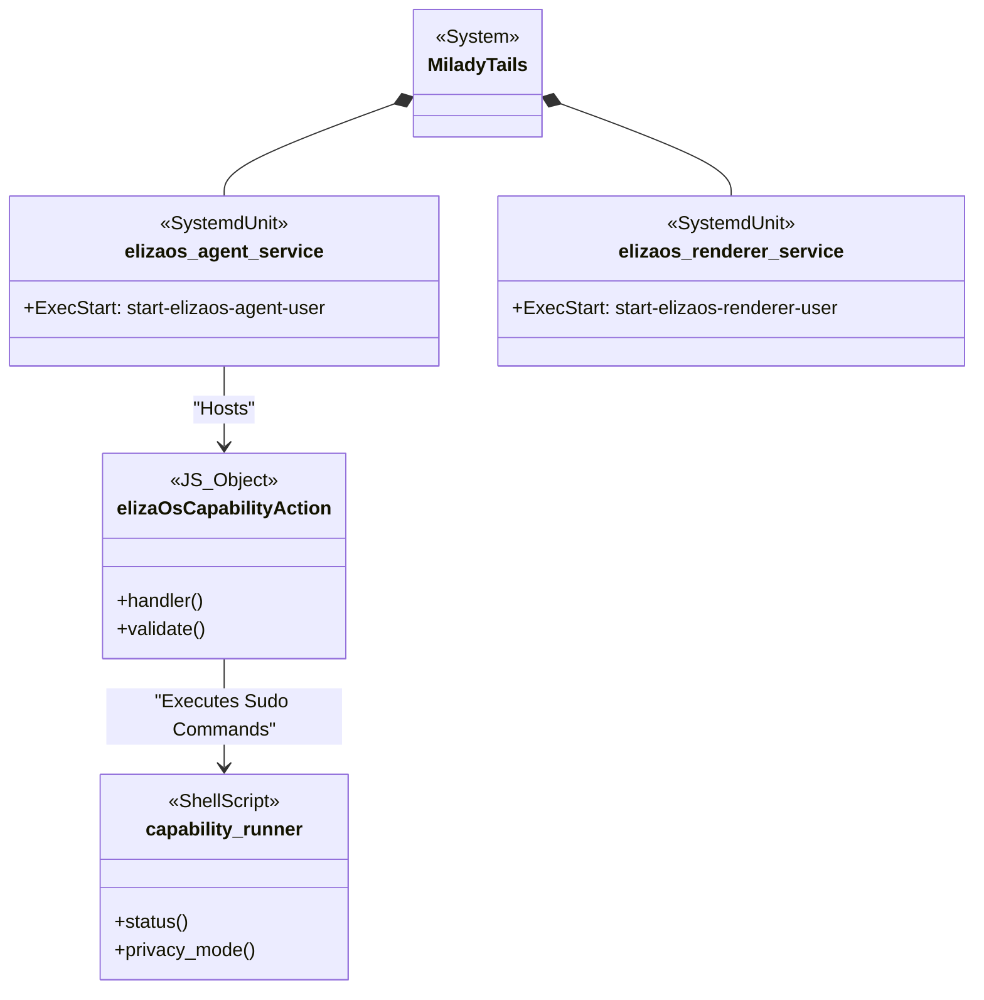

<!-- source: DeepWiki mcp.deepwiki.com · repo elizaOS/eliza · page 8.4 usbeliza — Linux Live-USB OS · fetched 2026-10-29 -->

# usbeliza — Linux Live-USB OS

Relevant source files

The following files were used as context for generating this wiki page:

- [packages/chip/scripts/check_os_rv64_chip_boot_contract.py](packages/chip/scripts/check_os_rv64_chip_boot_contract.py)
- [packages/os/linux/README.md](packages/os/linux/README.md)
- [packages/os/linux/variants/elizaos-debian-riscv64/Makefile](packages/os/linux/variants/elizaos-debian-riscv64/Makefile)
- [packages/os/linux/variants/elizaos-debian-riscv64/STATUS.md](packages/os/linux/variants/elizaos-debian-riscv64/STATUS.md)
- [packages/os/linux/variants/elizaos-debian-riscv64/config/hooks/normal/0030-elizaos-userland.hook.chroot](packages/os/linux/variants/elizaos-debian-riscv64/config/hooks/normal/0030-elizaos-userland.hook.chroot)
- [packages/os/linux/variants/elizaos-debian-riscv64/config/includes.chroot/etc/systemd/system/elizaos-agent.service](packages/os/linux/variants/elizaos-debian-riscv64/config/includes.chroot/etc/systemd/system/elizaos-agent.service)
- [packages/os/linux/variants/elizaos-debian-riscv64/config/includes.chroot/etc/systemd/system/elizaos-first-boot.service](packages/os/linux/variants/elizaos-debian-riscv64/config/includes.chroot/etc/systemd/system/elizaos-first-boot.service)
- [packages/os/linux/variants/elizaos-debian-riscv64/config/includes.chroot/usr/lib/elizaos/first-boot.sh](packages/os/linux/variants/elizaos-debian-riscv64/config/includes.chroot/usr/lib/elizaos/first-boot.sh)
- [packages/os/linux/variants/elizaos-debian-riscv64/config/package-lists/elizaos-runtime.list.chroot](packages/os/linux/variants/elizaos-debian-riscv64/config/package-lists/elizaos-runtime.list.chroot)
- [packages/os/linux/variants/elizaos-debian-riscv64/docs/e2e-qemu-virt.md](packages/os/linux/variants/elizaos-debian-riscv64/docs/e2e-qemu-virt.md)
- [packages/os/linux/variants/elizaos-debian-riscv64/docs/userland-startup.md](packages/os/linux/variants/elizaos-debian-riscv64/docs/userland-startup.md)
- [packages/os/linux/variants/elizaos-debian-riscv64/manifest.json](packages/os/linux/variants/elizaos-debian-riscv64/manifest.json)
- [packages/os/linux/variants/elizaos-debian-riscv64/requirements.txt](packages/os/linux/variants/elizaos-debian-riscv64/requirements.txt)
- [packages/os/linux/variants/elizaos-debian-riscv64/scripts/check_release_manifest.py](packages/os/linux/variants/elizaos-debian-riscv64/scripts/check_release_manifest.py)
- [packages/os/linux/variants/elizaos-debian-riscv64/scripts/qemu_virt_boot.sh](packages/os/linux/variants/elizaos-debian-riscv64/scripts/qemu_virt_boot.sh)
- [packages/os/linux/variants/elizaos-debian-riscv64/scripts/qemu_virt_smoke.py](packages/os/linux/variants/elizaos-debian-riscv64/scripts/qemu_virt_smoke.py)
- [packages/os/linux/variants/elizaos-debian-riscv64/scripts/test_check_release_manifest.py](packages/os/linux/variants/elizaos-debian-riscv64/scripts/test_check_release_manifest.py)
- [packages/os/linux/variants/elizaos-debian-riscv64/scripts/test_qemu_virt_smoke.py](packages/os/linux/variants/elizaos-debian-riscv64/scripts/test_qemu_virt_smoke.py)
- [packages/os/linux/variants/milady-tails/Justfile](packages/os/linux/variants/milady-tails/Justfile)
- [packages/os/linux/variants/milady-tails/README.md](packages/os/linux/variants/milady-tails/README.md)
- [packages/os/linux/variants/milady-tails/build-iso.sh](packages/os/linux/variants/milady-tails/build-iso.sh)
- [packages/os/linux/variants/milady-tails/docs/build-infrastructure.md](packages/os/linux/variants/milady-tails/docs/build-infrastructure.md)
- [packages/os/linux/variants/milady-tails/docs/current-status.md](packages/os/linux/variants/milady-tails/docs/current-status.md)
- [packages/os/linux/variants/milady-tails/docs/distribution-and-updates.md](packages/os/linux/variants/milady-tails/docs/distribution-and-updates.md)
- [packages/os/linux/variants/milady-tails/docs/inherited-tails-sudoers-review.md](packages/os/linux/variants/milady-tails/docs/inherited-tails-sudoers-review.md)
- [packages/os/linux/variants/milady-tails/docs/production-readiness.md](packages/os/linux/variants/milady-tails/docs/production-readiness.md)
- [packages/os/linux/variants/milady-tails/docs/runtime-packaging.md](packages/os/linux/variants/milady-tails/docs/runtime-packaging.md)
- [packages/os/linux/variants/milady-tails/docs/security-model.md](packages/os/linux/variants/milady-tails/docs/security-model.md)
- [packages/os/linux/variants/milady-tails/docs/update-architecture.md](packages/os/linux/variants/milady-tails/docs/update-architecture.md)
- [packages/os/linux/variants/milady-tails/scripts/dev-sign-update-manifest.sh](packages/os/linux/variants/milady-tails/scripts/dev-sign-update-manifest.sh)
- [packages/os/linux/variants/milady-tails/scripts/generate-release-evidence.mjs](packages/os/linux/variants/milady-tails/scripts/generate-release-evidence.mjs)
- [packages/os/linux/variants/milady-tails/scripts/prepare-milady-app-overlay.mjs](packages/os/linux/variants/milady-tails/scripts/prepare-milady-app-overlay.mjs)
- [packages/os/linux/variants/milady-tails/scripts/security-smoke.sh](packages/os/linux/variants/milady-tails/scripts/security-smoke.sh)
- [packages/os/linux/variants/milady-tails/scripts/static-smoke.sh](packages/os/linux/variants/milady-tails/scripts/static-smoke.sh)
- [packages/os/linux/variants/milady-tails/scripts/usb-write.sh](packages/os/linux/variants/milady-tails/scripts/usb-write.sh)
- [packages/os/linux/variants/milady-tails/scripts/validate-model-catalog.mjs](packages/os/linux/variants/milady-tails/scripts/validate-model-catalog.mjs)
- [packages/os/linux/variants/milady-tails/tails/auto/scripts/create-usb-image-from-iso](packages/os/linux/variants/milady-tails/tails/auto/scripts/create-usb-image-from-iso)
- [packages/os/linux/variants/milady-tails/tails/config/chroot_local-hooks/52-update-systemd-units](packages/os/linux/variants/milady-tails/tails/config/chroot_local-hooks/52-update-systemd-units)
- [packages/os/linux/variants/milady-tails/tails/config/chroot_local-hooks/99-zzzzzz_permissions](packages/os/linux/variants/milady-tails/tails/config/chroot_local-hooks/99-zzzzzz_permissions)
- [packages/os/linux/variants/milady-tails/tails/config/chroot_local-includes/etc/systemd/system/elizaos-root-mode.service](packages/os/linux/variants/milady-tails/tails/config/chroot_local-includes/etc/systemd/system/elizaos-root-mode.service)
- [packages/os/linux/variants/milady-tails/tails/config/chroot_local-includes/etc/systemd/system/elizaos-update-health-check.service](packages/os/linux/variants/milady-tails/tails/config/chroot_local-includes/etc/systemd/system/elizaos-update-health-check.service)
- [packages/os/linux/variants/milady-tails/tails/config/chroot_local-includes/etc/systemd/system/elizaos-update-verify.service](packages/os/linux/variants/milady-tails/tails/config/chroot_local-includes/etc/systemd/system/elizaos-update-verify.service)
- [packages/os/linux/variants/milady-tails/tails/config/chroot_local-includes/etc/systemd/system/milady.service](packages/os/linux/variants/milady-tails/tails/config/chroot_local-includes/etc/systemd/system/milady.service)
- [packages/os/linux/variants/milady-tails/tails/config/chroot_local-includes/etc/systemd/user/elizaos-agent.service](packages/os/linux/variants/milady-tails/tails/config/chroot_local-includes/etc/systemd/user/elizaos-agent.service)
- [packages/os/linux/variants/milady-tails/tails/config/chroot_local-includes/etc/systemd/user/elizaos-pill.service](packages/os/linux/variants/milady-tails/tails/config/chroot_local-includes/etc/systemd/user/elizaos-pill.service)
- [packages/os/linux/variants/milady-tails/tails/config/chroot_local-includes/etc/systemd/user/elizaos-renderer.service](packages/os/linux/variants/milady-tails/tails/config/chroot_local-includes/etc/systemd/user/elizaos-renderer.service)
- [packages/os/linux/variants/milady-tails/tails/config/chroot_local-includes/etc/systemd/user/milady.service](packages/os/linux/variants/milady-tails/tails/config/chroot_local-includes/etc/systemd/user/milady.service)
- [packages/os/linux/variants/milady-tails/tails/config/chroot_local-includes/usr/lib/systemd/system/run-nosymfollow.mount.d/elizaos-root-mode.conf](packages/os/linux/variants/milady-tails/tails/config/chroot_local-includes/usr/lib/systemd/system/run-nosymfollow.mount.d/elizaos-root-mode.conf)
- [packages/os/linux/variants/milady-tails/tails/config/chroot_local-includes/usr/local/lib/persistent-storage/on-activated-hooks/MiladyData/20-restart-milady](packages/os/linux/variants/milady-tails/tails/config/chroot_local-includes/usr/local/lib/persistent-storage/on-activated-hooks/MiladyData/20-restart-milady)
- [packages/os/linux/variants/milady-tails/tails/config/chroot_local-includes/usr/local/lib/persistent-storage/on-deactivated-hooks/MiladyData/20-restart-milady](packages/os/linux/variants/milady-tails/tails/config/chroot_local-includes/usr/local/lib/persistent-storage/on-deactivated-hooks/MiladyData/20-restart-milady)
- [packages/os/linux/variants/milady-tails/tails/config/chroot_local-includes/usr/share/initramfs-tools/scripts/lib/first_boot_repartition](packages/os/linux/variants/milady-tails/tails/config/chroot_local-includes/usr/share/initramfs-tools/scripts/lib/first_boot_repartition)
- [packages/os/linux/variants/milady-tails/tails/config/chroot_local-includes/usr/share/tails/greeter/greeter.css](packages/os/linux/variants/milady-tails/tails/config/chroot_local-includes/usr/share/tails/greeter/greeter.css)
- [packages/os/linux/variants/milady-tails/tails/config/chroot_local-packageslists/tails-common.list](packages/os/linux/variants/milady-tails/tails/config/chroot_local-packageslists/tails-common.list)

The **usbeliza** project, located in `packages/os/linux/`, is a specialized Debian-derivative operating system designed to run as a Live-USB environment. The core design philosophy is "OS-as-an-Agent," where the entire user interface is a single, immersive chat box that manages the underlying system through natural language. It includes specialized variants like **milady-tails** for privacy and **elizaos-debian-riscv64** for the E1 chip/RISC-V hardware.

## Architecture Overview

The system operates through a multi-layered architecture that bridges the gap between high-level AI reasoning and low-level Linux system management. It utilizes a custom shell and a message broker to coordinate between the UI and the agent runtime.

### Key Components

| Component | Description | Implementation |
| :--- | :--- | :--- |
| **elizad / milady** | The Tauri/Rust-based desktop shell or the Milady-branded WebKit shell. | `packages/os/linux/variants/milady-tails/tails/config/chroot_local-includes/usr/local/lib/elizaos/elizaos-webkit-shell` [packages/os/linux/variants/milady-tails/scripts/static-smoke.sh:145-145]() |
| **eliza-agent** | A dedicated systemd user service running the local agent runtime. | `tails/config/chroot_local-includes/etc/systemd/user/elizaos-agent.service` [packages/os/linux/variants/milady-tails/tails/config/chroot_local-includes/etc/systemd/user/elizaos-agent.service:1-23]() |
| **capability-runner** | A narrow, sudo-gated broker for inter-process communication (IPC) and root actions. | `usr/local/lib/elizaos/capability-runner` [packages/os/linux/variants/milady-tails/scripts/security-smoke.sh:76-76]() |
| **Persistent Storage** | Encrypted LUKS partition (`TailsData`) used for agent state and models. | `milady/eliza` bind-mounted to `/home/amnesia/.eliza` [packages/os/linux/variants/milady-tails/scripts/security-smoke.sh:182-182]() |

### Data Flow Diagram: System Interaction

This diagram illustrates how a user command in the chat box traverses the system to execute a native Linux command via the capability broker.

Sources: [packages/os/linux/variants/milady-tails/scripts/prepare-milady-app-overlay.mjs:194-206](), [packages/os/linux/variants/milady-tails/tails/config/chroot_local-includes/etc/systemd/user/elizaos-agent.service:1-23]()

## Variant: milady-tails (Privacy OS)

The `milady-tails` variant is a Tails-derived live USB distribution where the visible product surface is elizaOS, but the underlying plumbing maintains Tails' privacy guarantees.

### Service Orchestration
The OS manages several systemd units to maintain the "chat box" UI while supervising the agent:
- `elizaos-agent.service`: Runs the Node.js agent runtime [packages/os/linux/variants/milady-tails/tails/config/chroot_local-includes/etc/systemd/user/elizaos-agent.service:13-13]().
- `elizaos-renderer.service`: Manages the local app renderer [packages/os/linux/variants/milady-tails/tails/config/chroot_local-includes/etc/systemd/user/elizaos-renderer.service:13-13]().
- `elizaos-pill.service`: An optional voice-pill overlay service [packages/os/linux/variants/milady-tails/tails/config/chroot_local-includes/etc/systemd/user/elizaos-pill.service:14-14]().

### Security and Capability Broker
Instead of granting the agent full root access, usbeliza uses a `capability-runner` with a strict allowlist of commands:
1. **status**: General system health.
2. **privacy_mode**: Toggles Tor/Network settings.
3. **root_status**: Smoke test for root authority.
4. **open_persistent_storage**: Unlocks the encrypted user partition.

The `elizaOsCapabilityAction` in the agent code calls this runner via `execFile` [packages/os/linux/variants/milady-tails/scripts/prepare-milady-app-overlay.mjs:144-164]().

Sources: [packages/os/linux/variants/milady-tails/scripts/security-smoke.sh:90-93](), [packages/os/linux/variants/milady-tails/scripts/prepare-milady-app-overlay.mjs:106-124]()

## Variant: elizaos-debian-riscv64 (RISC-V Hardware)

This variant targets RISC-V 64 hardware, specifically the E1 chip and `qemu-virt` simulation environments.

### Release Manifest and Verification
The RISC-V build process includes a fail-closed `check_release_manifest.py` script that acts as a gate for promotion. It requires:
- `qemu-virt-boot`: Validated transcript of a successful boot [packages/os/linux/variants/elizaos-debian-riscv64/scripts/check_release_manifest.py:54-54]().
- `grub-efi-riscv64-boot`: Verification of the GRUB bootloader path [packages/os/linux/variants/elizaos-debian-riscv64/scripts/check_release_manifest.py:55-55]().
- `elizaos-agent-live`: Evidence that the agent service is active [packages/os/linux/variants/elizaos-debian-riscv64/scripts/check_release_manifest.py:56-56]().

### Boot Markers
The system searches for specific strings in the boot transcript to confirm success, such as `elizaos-firstboot-ready` [packages/os/linux/variants/elizaos-debian-riscv64/scripts/check_release_manifest.py:67-67]() and `Booting 'elizaOS Live (RISC-V 64)'` [packages/os/linux/variants/elizaos-debian-riscv64/scripts/check_release_manifest.py:70-70]().

Sources: [packages/os/linux/variants/elizaos-debian-riscv64/scripts/check_release_manifest.py:1-27](), [packages/os/linux/variants/elizaos-debian-riscv64/scripts/test_check_release_manifest.py:89-147]()

## Code Entity Mapping

The following diagram bridges the natural language concepts of the OS to the specific code entities and systemd services.

Sources: [packages/os/linux/variants/milady-tails/tails/config/chroot_local-includes/etc/systemd/user/elizaos-agent.service:1-23](), [packages/os/linux/variants/milady-tails/scripts/prepare-milady-app-overlay.mjs:194-218](), [packages/os/linux/variants/milady-tails/scripts/security-smoke.sh:76-99]()

## Development and QEMU Workflow

### Virtual USB Proof
Developers use QEMU to boot a disposable raw USB image to exercise the live boot-device shape.
1. **UEFI Boot**: Reaches the elizaOS boot splash [packages/os/linux/variants/milady-tails/docs/current-status.md:62-62]().
2. **Greeter**: The Tails greeter is branded as elizaOS [packages/os/linux/variants/milady-tails/docs/current-status.md:63-63]().
3. **Persistence**: The Tails Persistent Storage D-Bus API is used to create a LUKS `TailsData` partition [packages/os/linux/variants/milady-tails/docs/current-status.md:74-75]().

### Smoke Testing
A suite of scripts ensures the image remains secure and functional:
- `static-smoke.sh`: Checks shell syntax and file existence across the chroot [packages/os/linux/variants/milady-tails/scripts/static-smoke.sh:1-132]().
- `security-smoke.sh`: Validates sudoers policy and capability-runner boundaries [packages/os/linux/variants/milady-tails/scripts/security-smoke.sh:1-100]().
- `validate-runtime-overlay.mjs`: Compares the packaged node_modules against the manifest [packages/os/linux/variants/milady-tails/scripts/prepare-milady-app-overlay.mjs:160-162]().

Sources: [packages/os/linux/variants/milady-tails/docs/current-status.md:54-81](), [packages/os/linux/variants/milady-tails/scripts/static-smoke.sh:93-132]()

---

