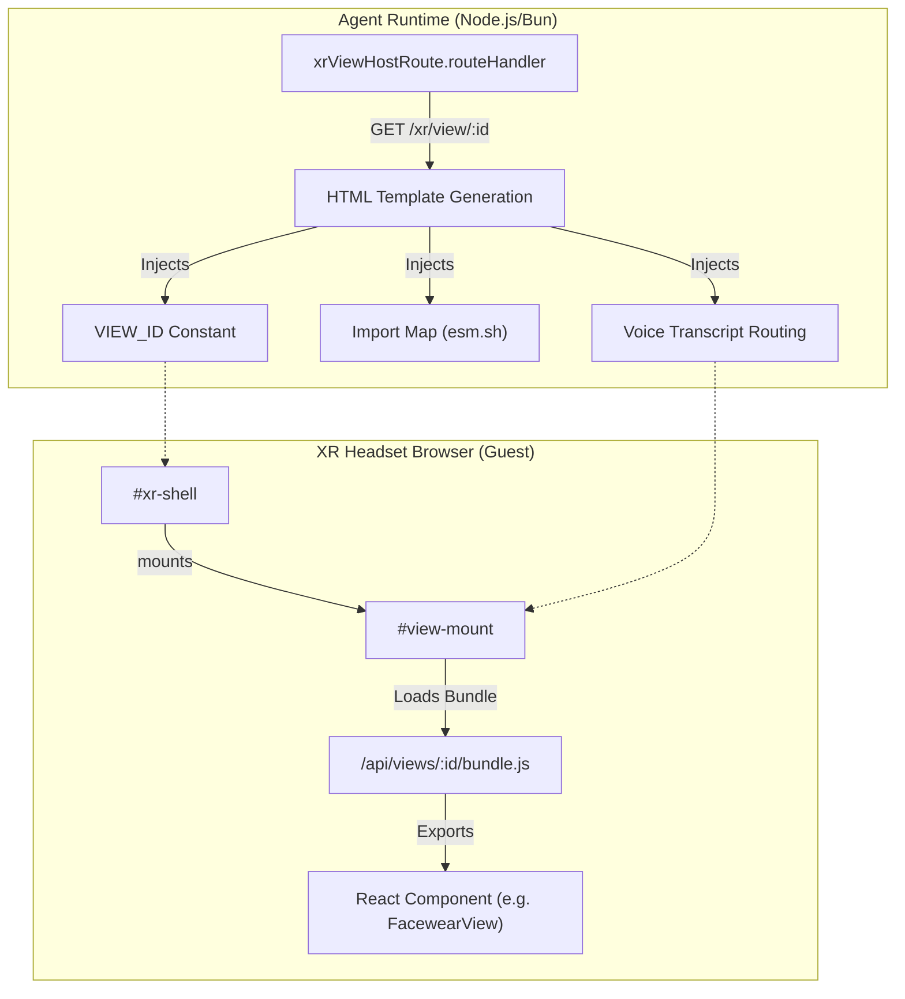
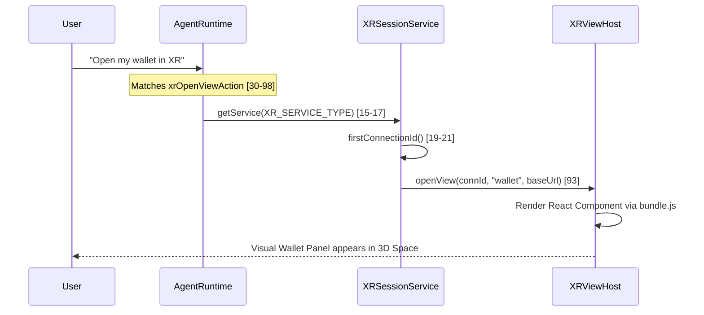

<!-- source: DeepWiki mcp.deepwiki.com · repo elizaOS/eliza · page 8.5 Browser Extension and WebXR · fetched 2026-10-29 -->

# Browser Extension and WebXR

Relevant source files

The following files were used as context for generating this wiki page:

- [packages/agent/src/__tests__/game-tui-mounted-surfaces.test.tsx](packages/agent/src/__tests__/game-tui-mounted-surfaces.test.tsx)
- [packages/examples/browser-extension/safari/Chat with Webpage/Shared (App)/Assets.xcassets/AccentColor.colorset/Contents.json](packages/examples/browser-extension/safari/Chat with Webpage/Shared (App)/Assets.xcassets/AccentColor.colorset/Contents.json)
- [packages/examples/browser-extension/safari/Chat with Webpage/Shared (App)/Assets.xcassets/AppIcon.appiconset/Contents.json](packages/examples/browser-extension/safari/Chat with Webpage/Shared (App)/Assets.xcassets/AppIcon.appiconset/Contents.json)
- [packages/examples/browser-extension/safari/Chat with Webpage/Shared (App)/Assets.xcassets/Contents.json](packages/examples/browser-extension/safari/Chat with Webpage/Shared (App)/Assets.xcassets/Contents.json)
- [packages/examples/browser-extension/safari/Chat with Webpage/Shared (App)/Assets.xcassets/LargeIcon.imageset/Contents.json](packages/examples/browser-extension/safari/Chat with Webpage/Shared (App)/Assets.xcassets/LargeIcon.imageset/Contents.json)
- [packages/examples/browser-extension/safari/Chat with Webpage/Shared (App)/Resources/Script.js](packages/examples/browser-extension/safari/Chat with Webpage/Shared (App)/Resources/Script.js)
- [packages/examples/browser-extension/safari/Chat with Webpage/Shared (App)/Resources/Style.css](packages/examples/browser-extension/safari/Chat with Webpage/Shared (App)/Resources/Style.css)
- [plugins/plugin-hearwear/src/index.ts](plugins/plugin-hearwear/src/index.ts)
- [plugins/plugin-xr/src/__tests__/xr-bundle-coverage.test.ts](plugins/plugin-xr/src/__tests__/xr-bundle-coverage.test.ts)
- [plugins/plugin-xr/src/__tests__/xr-feature-parity.test.ts](plugins/plugin-xr/src/__tests__/xr-feature-parity.test.ts)
- [plugins/plugin-xr/src/__tests__/xr-functional-parity.test.ts](plugins/plugin-xr/src/__tests__/xr-functional-parity.test.ts)
- [plugins/plugin-xr/src/__tests__/xr-view-host-http.test.ts](plugins/plugin-xr/src/__tests__/xr-view-host-http.test.ts)
- [plugins/plugin-xr/src/__tests__/xr-view-host.test.ts](plugins/plugin-xr/src/__tests__/xr-view-host.test.ts)
- [plugins/plugin-xr/src/actions/xr-view-actions.ts](plugins/plugin-xr/src/actions/xr-view-actions.ts)

ElizaOS provides a multi-platform delivery strategy that extends agent interaction beyond traditional chat interfaces into spatial computing and web browsing. This is achieved through the `@elizaos/browser-bridge-extension` for webpage integration and `@elizaos/app-xr` for immersive environments like Meta Quest, XReal, and Apple Vision Pro.

## 1. Browser Bridge Extension

The browser extension (available for Chrome and Safari) serves as a bridge between the agent and the user's active browsing session. It allows agents to interact with webpage content, perform "Computer Use" tasks, and provide a persistent chat interface across different domains.

### 1.1 Safari WebExtension Packaging
The Safari implementation is packaged as a native wrapper application that contains the WebExtension resources. This allows the extension to be distributed via the Mac App Store and iOS App Store.

- **Resources and UI**: The extension uses a shared set of CSS and JavaScript resources for the native app shell [packages/examples/browser-extension/safari/Chat with Webpage/Shared (App)/Resources/Style.css:1-62]().
- **State Management**: The `Script.js` file handles the display of the extension's enabled/disabled state within the Safari settings context [packages/examples/browser-extension/safari/Chat with Webpage/Shared (App)/Resources/Script.js:1-23]().
- **Native Communication**: It uses `webkit.messageHandlers.controller.postMessage` to communicate between the web-based settings UI and the native Swift/Objective-C controller [packages/examples/browser-extension/safari/Chat with Webpage/Shared (App)/Resources/Script.js:25-27]().

### 1.2 Data Flow: Extension to Agent
The extension typically connects to a local or cloud-hosted ElizaOS agent. It extracts page context and forwards it to the agent's message pipeline, receiving actions (like clicking or typing) in return.

Sources: [packages/examples/browser-extension/safari/Chat with Webpage/Shared (App)/Resources/Style.css:1-62](), [packages/examples/browser-extension/safari/Chat with Webpage/Shared (App)/Resources/Script.js:1-32]()

---

## 2. WebXR Frontend (`app-xr`)

The `@elizaos/app-xr` package is a dedicated frontend for spatial computing devices. It provides 100% feature parity with the native desktop and mobile applications by rendering agent views within a 3D environment [plugins/plugin-xr/src/__tests__/xr-feature-parity.test.ts:1-17]().

### 2.1 XR View Architecture
The system uses a "Host-Guest" architecture. The `xrViewHostRoute` serves as the "Host" (the shell), while individual plugin views (like the wallet or companion) are "Guests" loaded as React bundles.

#### Diagram: XR View Hosting Data Flow
This diagram illustrates how the `xrViewHostRoute` dynamically constructs the environment for a specific view.

Sources: [plugins/plugin-xr/src/routes/xr-view-host.ts](), [plugins/plugin-xr/src/__tests__/xr-view-host.test.ts:78-150]()

### 2.2 Key XR Actions
The `plugin-xr` (often integrated via `plugin-hearwear`) provides actions that allow the agent to manipulate the user's spatial interface.

| Action | Description | Code Reference |
| :--- | :--- | :--- |
| `XR_OPEN_VIEW` | Launches a specific view panel (e.g., "wallet") on the headset. | [plugins/plugin-xr/src/actions/xr-view-actions.ts:30-98]() |
| `XR_CLOSE_VIEW` | Dismisses a specific panel or all panels. | [plugins/plugin-xr/src/actions/xr-view-actions.ts:102-160]() |
| `XR_SWITCH_VIEW` | Brings a specific view to the foreground (billboarding). | [plugins/plugin-xr/src/actions/xr-view-actions.ts:164-208]() |
| `XR_LIST_VIEWS` | Discovers and lists available view IDs to the agent. | [plugins/plugin-xr/src/actions/xr-view-actions.ts:212-235]() |

### 2.3 View Registration and Parity
Every plugin that provides a GUI must register an equivalent `xr` view type in its manifest to ensure compatibility with headsets [plugins/plugin-xr/src/__tests__/xr-feature-parity.test.ts:166-186]().

**Example Registration (`plugin-hearwear`):**
The `facewearPlugin` registers views for `gui`, `tui`, and `xr` types, all pointing to the same `bundle.js` but utilizing different entry points or styles [plugins/plugin-hearwear/src/index.ts:64-116]().

Sources: [plugins/plugin-xr/src/actions/xr-view-actions.ts:1-235](), [plugins/plugin-hearwear/src/index.ts:32-116](), [plugins/plugin-xr/src/__tests__/xr-view-host.test.ts:16-42]()

---

## 3. Implementation Details

### 3.1 Voice Integration in XR
A critical feature of the XR interface is the voice pipeline. The `xrViewHostRoute` includes a transcript routing script that listens for `xr:transcript` messages. These messages are routed to the currently focused input element within the spatial view, allowing hands-free interaction [plugins/plugin-xr/src/__tests__/xr-view-host.test.ts:103-117]().

### 3.2 Component Bundling
Each XR-compatible plugin must export a `bundle.js` in its `dist/views/` directory. This bundle must contain the named export defined in the plugin's `componentExport` field [plugins/plugin-xr/src/__tests__/xr-bundle-coverage.test.ts:1-16]().

#### Diagram: Natural Language to XR Action Flow
This diagram maps a user's intent to the underlying code entities that execute the spatial command.

Sources: [plugins/plugin-xr/src/actions/xr-view-actions.ts:13-98](), [plugins/plugin-hearwear/src/index.ts:28-37]()

### 3.3 Supported Devices
The system is designed for a "Unified Hearwear" experience, supporting:
- **Meta Quest 3**: Full WebXR streaming and view panels.
- **XReal / Apple Vision Pro**: Spatial browser views.
- **Even Realities G1/G2**: BLE-based smartglasses integration via `SmartglassesService` [plugins/plugin-hearwear/src/index.ts:32-37]().

Sources: [plugins/plugin-hearwear/src/index.ts:1-37](), [plugins/plugin-xr/src/__tests__/xr-feature-parity.test.ts:105-131]()

---

