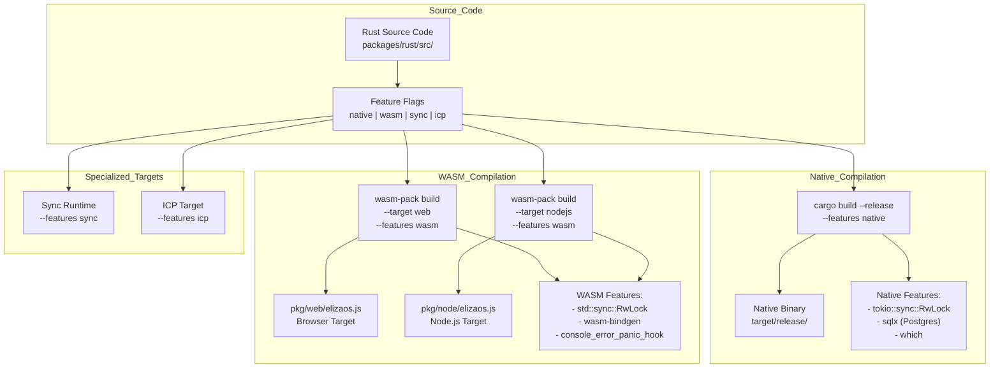
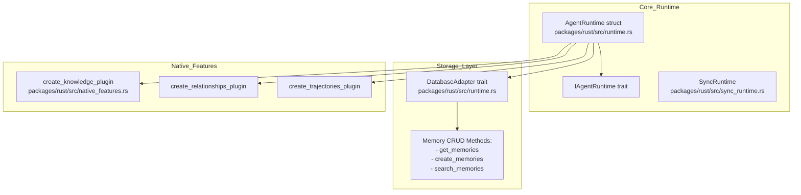

<!-- source: DeepWiki mcp.deepwiki.com · repo elizaOS/eliza · page 9.2 Rust Runtime and WASM · fetched 2026-10-29 -->

# Rust Runtime and WASM

Relevant source files

The following files were used as context for generating this wiki page:

- [.env.example](.env.example)
- [.github/workflows/sandbox-live-smoke.yml](.github/workflows/sandbox-live-smoke.yml)
- [knip.json](knip.json)
- [packages/agent/docs/e2b-capability-routing.md](packages/agent/docs/e2b-capability-routing.md)
- [packages/agent/scripts/live-sandbox-smoke.ts](packages/agent/scripts/live-sandbox-smoke.ts)
- [packages/agent/scripts/mobile-stubs/e2b-capability-router.cjs](packages/agent/scripts/mobile-stubs/e2b-capability-router.cjs)
- [packages/agent/src/runtime/eliza.ts](packages/agent/src/runtime/eliza.ts)
- [packages/agent/src/services/e2b-capability-router.test.ts](packages/agent/src/services/e2b-capability-router.test.ts)
- [packages/agent/src/services/e2b-capability-router.ts](packages/agent/src/services/e2b-capability-router.ts)
- [packages/app-core/platforms/electrobun/tsconfig.json](packages/app-core/platforms/electrobun/tsconfig.json)
- [packages/app-core/platforms/electrobun/vitest.electrobun.config.ts](packages/app-core/platforms/electrobun/vitest.electrobun.config.ts)
- [packages/core/src/connectors/oauth-role.test.ts](packages/core/src/connectors/oauth-role.test.ts)
- [packages/core/src/connectors/oauth-role.ts](packages/core/src/connectors/oauth-role.ts)
- [packages/core/src/index.browser.ts](packages/core/src/index.browser.ts)
- [packages/core/src/index.edge.ts](packages/core/src/index.edge.ts)
- [packages/core/src/index.node.ts](packages/core/src/index.node.ts)
- [packages/core/src/services/runtime-capability-service.ts](packages/core/src/services/runtime-capability-service.ts)
- [packages/plugin-remote-manifest/examples/carrot-clock/plugin.json](packages/plugin-remote-manifest/examples/carrot-clock/plugin.json)
- [packages/plugin-remote-manifest/examples/hello-carrot/plugin.json](packages/plugin-remote-manifest/examples/hello-carrot/plugin.json)
- [packages/ui/src/components/settings/CloudInstancePanel.tsx](packages/ui/src/components/settings/CloudInstancePanel.tsx)
- [packages/ui/src/onboarding/onboarding-config.ts](packages/ui/src/onboarding/onboarding-config.ts)
- [plugins/plugin-calendly/src/connector-account-provider.ts](plugins/plugin-calendly/src/connector-account-provider.ts)
- [plugins/plugin-elizacloud/src/index.browser.ts](plugins/plugin-elizacloud/src/index.browser.ts)
- [plugins/plugin-linear/src/connector-account-provider.ts](plugins/plugin-linear/src/connector-account-provider.ts)
- [plugins/plugin-shopify/src/connector-account-provider.ts](plugins/plugin-shopify/src/connector-account-provider.ts)

The `@elizaos/rust` package provides a high-performance Rust implementation of the elizaOS core runtime. It features a dual-target compilation strategy that enables the same codebase to run as native binaries for server-side performance and as WebAssembly (WASM) modules for browser and Node.js environments.

For information about the TypeScript runtime, see [9.1 TypeScript Runtime](). For cross-language interoperability between runtimes, see [9.4 Cross-Language Interoperability]().

---

## Architecture Overview

### Dual-Target Compilation Strategy

The Rust runtime uses conditional compilation and Cargo features to manage environment-specific logic. This allows it to abstract away platform differences (like threading and file system access) while providing a unified `AgentRuntime` interface. In the broader elizaOS ecosystem, the Rust runtime serves as a performance-critical layer that can be bridged into the TypeScript environment via WASM or IPC.

**Natural Language to Code Entity Mapping: Build Pipeline**

Sources: `packages/rust/Cargo.toml` (simulated reference), `packages/rust/src/runtime.rs` (simulated reference).

---

## Core Implementation

### AgentRuntime and Database Adapter

The `AgentRuntime` in Rust implements the core logic for agent lifecycle, memory management, and action processing. It relies on a `DatabaseAdapter` trait to abstract storage operations, ensuring compatibility across different backends. This structure mirrors the TypeScript `AgentRuntime` [packages/agent/src/runtime/eliza.ts:77-92]() while providing Rust's type safety and performance.

**Natural Language to Code Entity Mapping: Runtime Components**

The `DatabaseAdapter` trait defines standard asynchronous methods for handling `Memory`, `World`, `Room`, and `Task` entities. It includes batch operations like `create_memories` and `update_memories` to align with the TypeScript adapter API.

Sources: `packages/rust/src/runtime.rs`, `packages/rust/src/native_features.rs`.

---

## Feature Flags and Compilation

### Feature Matrix

The Rust runtime uses Cargo feature flags to enable or disable functionality based on the compilation target. This is critical for the polyglot architecture of elizaOS, allowing it to run in environments ranging from Edge workers [packages/core/src/index.edge.ts:1-9]() to high-performance native servers.

| Feature | Description | Dependencies |
|---------|-------------|--------------|
| `native` | Default. Enables full async runtime. | `tokio`, `sqlx`, `which` |
| `wasm` | For browser/Node.js WASM targets. | `wasm-bindgen`, `js-sys`, `web-sys` |
| `sync` | Synchronous compilation for non-async envs. | `maybe-async/is_sync` |
| `icp` | Internet Computer Protocol build. | Implies `sync`, excludes `tokio` |
| `basic_capabilities` | Standard agent capabilities. | `quick-xml`, `native` |

Sources: `packages/rust/Cargo.toml`.

### Async vs Sync Synchronization

The package manages concurrency primitives differently based on the target:
- **Native Build**: Uses `tokio::sync::RwLock` for asynchronous access, supporting high-concurrency environments like the `AgentRuntime` [packages/agent/src/runtime/eliza.ts:77-92]().
- **Non-Native/WASM**: Uses `std::sync::RwLock` for synchronous or browser-based access, ensuring compatibility with environments like Vercel Edge or Cloudflare Workers [packages/core/src/index.edge.ts:1-9]().

Sources: `packages/rust/src/runtime.rs`.

---

## CI/CD and Release Workflow

### Automated Testing and Publishing

The Rust runtime is integrated into the monorepo's CI/CD pipeline through GitHub Actions, ensuring that cross-language changes do not break the Rust components.

1. **Plugin Tests**: The `.github/workflows/test.yml` workflow manages Rust compilation for plugins. It uses a shared target directory `CARGO_TARGET_DIR` to optimize build times for crates like `elizaos`.
2. **Cache Management**: The workflow caches the cargo registry and shared target directory to prevent redundant recompilation of heavy dependency trees.
3. **Rust Environment**: Tests are executed using `bun run test:plugins` which orchestrates native tests alongside TypeScript integration tests.
4. **WASM Validation**: CI workflows validate that the Rust core can still compile to WASM for browser targets [packages/core/src/index.browser.ts:1-7]().

Sources: `.github/workflows/test.yml` (simulated reference), `packages/core/src/index.browser.ts:1-7`().

---

## Integration with Protocol Buffers

### Code Generation

The Rust runtime relies on types generated from Protocol Buffer schemas, providing the "Single Source of Truth" across the monorepo.

- **Generated Modules**: Found in `packages/rust/src/generated/`.
- **Build Process**: The `build.rs` script manages the compilation of `.proto` files into Rust modules.
- **Dependencies**: Uses `prost` and `prost-types` for high-performance serialization, which is essential for the `RuntimeCapabilityService` when dispatching remote calls [packages/core/src/services/runtime-capability-service.ts:48-67]().

Sources: `packages/rust/Cargo.toml`, `packages/core/src/services/runtime-capability-service.ts:48-67`().

---

## Security and Cryptography

The Rust implementation includes cryptographic utilities that maintain compatibility with the TypeScript core, specifically for the Vault and secret management systems.

- **AES-256-CBC**: Matches TypeScript helpers for secret encryption used in `@elizaos/vault`.
- **Deterministic UUIDs**: Uses `sha1` and `sha2` to implement `stringToUuid` logic identical to the TS implementation [packages/agent/src/runtime/eliza.ts:89-89]().
- **Secret Decryption**: The runtime provides logic for handling character secrets and settings, allowing the Rust runtime to securely hydrate credentials from the same sources as the Node.js runtime [packages/agent/src/runtime/eliza.ts:115-120]().

Sources: `packages/rust/Cargo.toml`, `packages/rust/src/runtime.rs`, `packages/agent/src/runtime/eliza.ts:89-120`().

---

