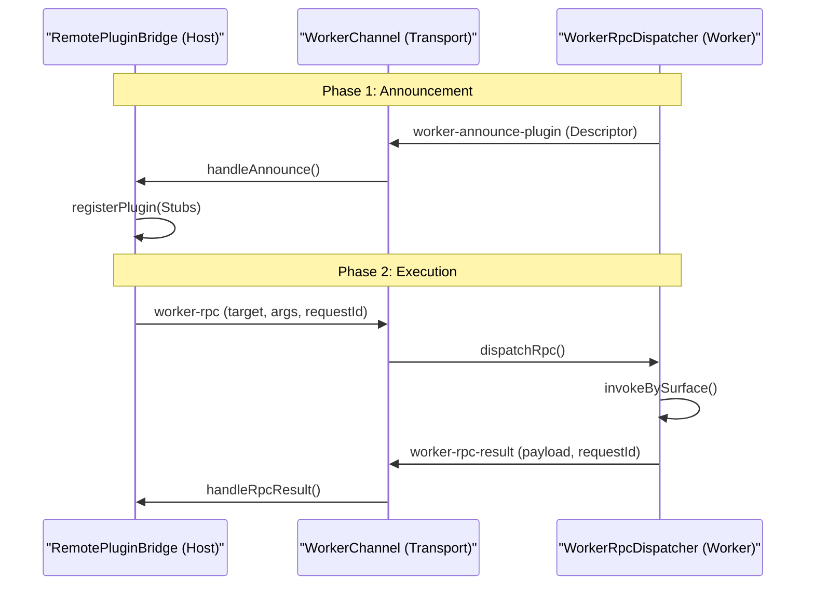

<!-- source: DeepWiki mcp.deepwiki.com · repo elizaOS/eliza · page 9.4 Cross-Language Interoperability · fetched 2026-10-29 -->

# Cross-Language Interoperability

<details>
<summary>Relevant source files</summary>

The following files were used as context for generating this wiki page:

- [packages/agent/src/services/remote-plugin-bridge.ts](packages/agent/src/services/remote-plugin-bridge.ts)
- [packages/app-core/platforms/electrobun/src/native/remote-plugin-host.ts](packages/app-core/platforms/electrobun/src/native/remote-plugin-host.ts)
- [packages/app-core/src/benchmark/cerebras-autowire.ts](packages/app-core/src/benchmark/cerebras-autowire.ts)
- [packages/benchmarks/eliza-adapter/eliza_adapter/server_manager.py](packages/benchmarks/eliza-adapter/eliza_adapter/server_manager.py)
- [packages/benchmarks/orchestrator/latest_comparability.py](packages/benchmarks/orchestrator/latest_comparability.py)
- [packages/benchmarks/swe_bench/cli.py](packages/benchmarks/swe_bench/cli.py)
- [packages/benchmarks/swe_bench/tests/test_cli.py](packages/benchmarks/swe_bench/tests/test_cli.py)
- [packages/benchmarks/swe_bench/tests/test_evaluator.py](packages/benchmarks/swe_bench/tests/test_evaluator.py)
- [packages/plugin-worker-runtime/package.json](packages/plugin-worker-runtime/package.json)
- [packages/plugin-worker-runtime/src/bootstrap.ts](packages/plugin-worker-runtime/src/bootstrap.ts)
- [packages/plugin-worker-runtime/src/descriptor.ts](packages/plugin-worker-runtime/src/descriptor.ts)
- [packages/plugin-worker-runtime/src/dispatch.ts](packages/plugin-worker-runtime/src/dispatch.ts)
- [packages/plugin-worker-runtime/src/envelope.ts](packages/plugin-worker-runtime/src/envelope.ts)
- [packages/plugin-worker-runtime/src/error.ts](packages/plugin-worker-runtime/src/error.ts)
- [packages/plugin-worker-runtime/src/index.ts](packages/plugin-worker-runtime/src/index.ts)
- [packages/plugin-worker-runtime/src/runtime-proxy.ts](packages/plugin-worker-runtime/src/runtime-proxy.ts)
- [packages/plugin-worker-runtime/tsconfig.build.json](packages/plugin-worker-runtime/tsconfig.build.json)
- [packages/plugin-worker-runtime/tsconfig.json](packages/plugin-worker-runtime/tsconfig.json)
- [plugins/plugin-wifi/src/components/WifiAppView.tsx](plugins/plugin-wifi/src/components/WifiAppView.tsx)
- [plugins/plugin-wifi/src/components/wifi-app.ts](plugins/plugin-wifi/src/components/wifi-app.ts)
- [plugins/plugin-wifi/src/register.ts](plugins/plugin-wifi/src/register.ts)

</details>


This document explains the cross-language interoperability framework in elizaOS, which facilitates seamless integration and communication between plugins and components written in TypeScript, Python, and Rust. It describes the role of the `@elizaos/interop` and `@elizaos/plugin-worker-runtime` packages, the use of Protocol Buffer (Protobuf) serialization, IPC/RPC bridges, and how the system maintains a single source of truth for types across different language runtimes.

---

## Architecture Overview

elizaOS implements a polyglot architecture that leverages Protocol Buffer schemas as the canonical source of truth for types and data exchange. The interoperability layer enables a "Remote Plugin" architecture where plugins can run in isolated processes (Node.js, Python, or Rust) while appearing as native contributions to the main `AgentRuntime`.

### Remote Plugin Bridge Architecture

The `RemotePluginBridge` acts as the host-side orchestrator, while `bootstrap` and `RuntimeProxy` handle the worker-side logic.

```mermaid
graph TB
    subgraph "Host Process (TypeScript)"
        ["AgentRuntime\n@elizaos/core"] -- "registerPlugin()" --> ["RemotePluginBridge\npackages/agent/src/services/remote-plugin-bridge.ts"]
        ["RemotePluginBridge"] -- "JSON RPC" --> ["BridgeChannel"]
    end
    
    subgraph "Worker Process (TS/PY/RS)"
        ["BridgeChannel"] -- "Envelope" --> ["WorkerChannel\npackages/plugin-worker-runtime/src/envelope.ts"]
        ["WorkerChannel"] --> ["WorkerRpcDispatcher\npackages/plugin-worker-runtime/src/dispatch.ts"]
        ["WorkerRpcDispatcher"] --> ["Plugin_Logic\n(Actions/Providers/Services)"]
        ["Plugin_Logic"] -- "Calls Host" --> ["RuntimeProxy\npackages/plugin-worker-runtime/src/runtime-proxy.ts"]
    end
    
    ["RuntimeProxy"] -- "host-rpc" --> ["RemotePluginBridge"]
```

- **RemotePluginBridge**: Sits between a transport channel and the `IAgentRuntime`. It materializes stub Plugin contributions (actions, providers, events) whose handlers proxy back to the worker [packages/agent/src/services/remote-plugin-bridge.ts:2-9]().
- **Bootstrap**: The worker entrypoint that announces plugin surfaces to the host and enters the dispatch loop [packages/plugin-worker-runtime/src/bootstrap.ts:2-4]().
- **RuntimeProxy**: A facade that remote handlers use to call host methods like `getService`, `useModel`, and `getMemory` [packages/plugin-worker-runtime/src/runtime-proxy.ts:2-14]().

**Sources:**
[packages/agent/src/services/remote-plugin-bridge.ts:1-19](),
[packages/plugin-worker-runtime/src/bootstrap.ts:1-17](),
[packages/plugin-worker-runtime/src/runtime-proxy.ts:1-14]()

---

## The Interop Matrix

elizaOS supports three primary interoperability paths to accommodate different performance and environment requirements.

### 1. TypeScript ↔ Remote Worker (RPC)
The primary mechanism for cross-language plugins. The host and worker communicate via a JSON-RPC protocol over various transports.
- **Worker Announcement**: The worker sends a `worker-announce-plugin` message containing a descriptor of its capabilities [packages/agent/src/services/remote-plugin-bridge.ts:127-129]().
- **Descriptor Generation**: The `buildAnnounceDescriptor` walks the plugin object, replaces functions with RPC tags, and registers them in a `HandlerRegistry` [packages/plugin-worker-runtime/src/descriptor.ts:128-132]().

### 2. TypeScript ↔ Python (IPC/Subprocess)
Used for AI/ML workloads and benchmarks.
- **Subprocess Channel**: Uses newline-delimited JSON over `stdin`/`stdout` for communication with isolated processes [packages/plugin-worker-runtime/src/envelope.ts:68-73]().
- **SWE-bench Bridge**: A Python-based CLI that prompts a TypeScript-based bridge for patches and evaluates them in Docker [packages/benchmarks/swe_bench/cli.py:4-9]().
- **Server Management**: `ElizaServerManager` handles spawning the TS benchmark server as a subprocess for Python clients [packages/benchmarks/eliza-adapter/eliza_adapter/server_manager.py:172-182]().

### 3. TypeScript ↔ Rust (WASM/NAPI-RS)
- **Native Bindings**: Used for system-level operations like screen capture and camera access via NAPI-RS.
- **WASM**: Compiled Rust runtimes for browser or edge execution.

**Sources:**
[packages/agent/src/services/remote-plugin-bridge.ts:125-141](),
[packages/plugin-worker-runtime/src/descriptor.ts:1-12](),
[packages/plugin-worker-runtime/src/envelope.ts:68-77](),
[packages/benchmarks/swe_bench/cli.py:1-9](),
[packages/benchmarks/eliza-adapter/eliza_adapter/server_manager.py:172-182]()

---

## Communication Protocol

The communication between host and worker is governed by specific message types and a request-response correlation system.

### RPC Message Flow



- **RequestId Allocation**: Monotonic request-id allocators correlate requests and responses across the channel [packages/plugin-worker-runtime/src/envelope.ts:163-169]().
- **Surface Dispatching**: The worker dispatches inbound RPCs to the correct handler based on the "surface" (action, provider, evaluator, etc.) [packages/plugin-worker-runtime/src/dispatch.ts:81-87]().
- **Error Marshalling**: Errors are serialized into a `WireError` format to be reconstructed on the receiving side [packages/plugin-worker-runtime/src/error.ts:1-10]().

**Sources:**
[packages/plugin-worker-runtime/src/envelope.ts:163-169](),
[packages/plugin-worker-runtime/src/dispatch.ts:81-171](),
[packages/agent/src/services/remote-plugin-bridge.ts:125-141]()

---

## Runtime Parity and Services

To ensure plugins behave consistently across languages, the `RuntimeProxy` provides a subset of the `IAgentRuntime` interface.

### Supported Runtime Methods
Remote plugins can invoke the following methods on the host runtime [packages/plugin-worker-runtime/src/runtime-proxy.ts:26-37]():
- `getService`: Resolve a service by type.
- `useModel`: Execute a model inference.
- `getMemory` / `createMemory` / `updateMemory`: Interact with the memory system.
- `emitEvent`: Trigger system events.
- `composeState`: Generate context for LLM prompts.

### Service Exporting
Services can be exported from a remote-mode plugin by opting in via a `static rpcMethods` array [packages/plugin-worker-runtime/src/descriptor.ts:32-36](). The host then synthesizes a `ServiceProxy` with those specific methods [packages/plugin-worker-runtime/src/descriptor.ts:25-30]().

| Component | Role | File Reference |
|-----------|------|----------------|
| `RemotePluginBridge` | Host-side stub generator | `packages/agent/src/services/remote-plugin-bridge.ts` |
| `RuntimeProxy` | Worker-side host caller | `packages/plugin-worker-runtime/src/runtime-proxy.ts` |
| `WorkerRpcDispatcher` | Worker-side RPC executor | `packages/plugin-worker-runtime/src/dispatch.ts` |
| `HandlerRegistry` | Worker-side ID-to-Function map | `packages/plugin-worker-runtime/src/descriptor.ts` |

**Sources:**
[packages/plugin-worker-runtime/src/runtime-proxy.ts:26-37](),
[packages/plugin-worker-runtime/src/descriptor.ts:25-43](),
[packages/plugin-worker-runtime/src/dispatch.ts:1-11]()

---

## Interop in Benchmarking

The interop layer is heavily used in the benchmarking infrastructure to bridge the TypeScript agent runtime with Python-based evaluation harnesses.

- **Cerebras Autowire**: Automatically configures environment variables to bridge OpenAI-compatible requests to Cerebras when running benchmarks [packages/app-core/src/benchmark/cerebras-autowire.ts:4-12]().
- **Server Manager**: Spawns the eliza benchmark server (`server.ts`) and waits for it to be healthy before allowing Python clients to connect [packages/benchmarks/eliza-adapter/eliza_adapter/server_manager.py:172-182]().
- **Comparability Validation**: Python scripts validate that results are comparable across different harnesses (`eliza`, `hermes`, `openclaw`) [packages/benchmarks/orchestrator/latest_comparability.py:16-24]().

**Sources:**
[packages/app-core/src/benchmark/cerebras-autowire.ts:4-28](),
[packages/benchmarks/eliza-adapter/eliza_adapter/server_manager.py:172-182](),
[packages/benchmarks/orchestrator/latest_comparability.py:1-24]()

---

