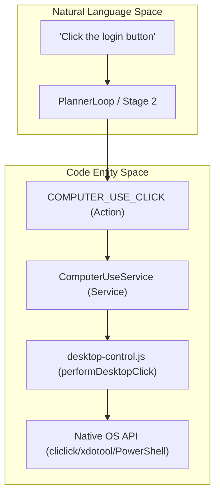
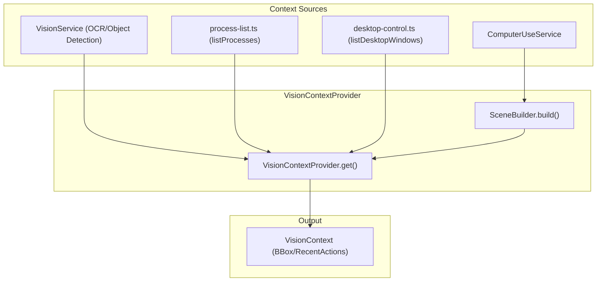

<!-- source: DeepWiki mcp.deepwiki.com · repo elizaOS/eliza · page 9.5 ComputerUse and Native Bindings · fetched 2026-10-29 -->

# ComputerUse and Native Bindings

Relevant source files

The following files were used as context for generating this wiki page:

- [packages/agent/src/runtime/conversation-compactor-runtime.ts](packages/agent/src/runtime/conversation-compactor-runtime.ts)
- [packages/agent/src/services/permissions-registry.ts](packages/agent/src/services/permissions-registry.ts)
- [packages/app-core/test/live-agent/api-auth-live.e2e.test.ts](packages/app-core/test/live-agent/api-auth-live.e2e.test.ts)
- [packages/benchmarks/webshop/elizaos_webshop/environment.py](packages/benchmarks/webshop/elizaos_webshop/environment.py)
- [packages/shared/src/contracts/awareness.ts](packages/shared/src/contracts/awareness.ts)
- [packages/ui/src/onboarding/local-agent-token.ts](packages/ui/src/onboarding/local-agent-token.ts)
- [plugins/plugin-calendly/src/index.ts](plugins/plugin-calendly/src/index.ts)
- [plugins/plugin-coding-tools/src/index.ts](plugins/plugin-coding-tools/src/index.ts)
- [plugins/plugin-computeruse/package.json](plugins/plugin-computeruse/package.json)
- [plugins/plugin-computeruse/src/index.ts](plugins/plugin-computeruse/src/index.ts)
- [plugins/plugin-computeruse/src/routes/sandbox-routes.ts](plugins/plugin-computeruse/src/routes/sandbox-routes.ts)
- [plugins/plugin-device-filesystem/src/index.ts](plugins/plugin-device-filesystem/src/index.ts)
- [plugins/plugin-feishu/src/index.ts](plugins/plugin-feishu/src/index.ts)
- [plugins/plugin-form/src/form-plugin.test.ts](plugins/plugin-form/src/form-plugin.test.ts)
- [plugins/plugin-form/src/index.ts](plugins/plugin-form/src/index.ts)
- [plugins/plugin-form/test/form-plugin.live.e2e.test.ts](plugins/plugin-form/test/form-plugin.live.e2e.test.ts)
- [plugins/plugin-google-chat/src/index.ts](plugins/plugin-google-chat/src/index.ts)
- [plugins/plugin-line/__tests__/integration.test.ts](plugins/plugin-line/__tests__/integration.test.ts)
- [plugins/plugin-line/src/actions/index.ts](plugins/plugin-line/src/actions/index.ts)
- [plugins/plugin-line/src/index.ts](plugins/plugin-line/src/index.ts)
- [plugins/plugin-linear/src/actions/linear.ts](plugins/plugin-linear/src/actions/linear.ts)
- [plugins/plugin-linear/src/index.ts](plugins/plugin-linear/src/index.ts)
- [plugins/plugin-local-storage/src/index.ts](plugins/plugin-local-storage/src/index.ts)
- [plugins/plugin-mcp/src/actions/mcp.ts](plugins/plugin-mcp/src/actions/mcp.ts)
- [plugins/plugin-mysticism/src/index.ts](plugins/plugin-mysticism/src/index.ts)
- [plugins/plugin-pdf/index.ts](plugins/plugin-pdf/index.ts)
- [plugins/plugin-shell/index.ts](plugins/plugin-shell/index.ts)
- [plugins/plugin-shopify/src/actions/shopify.ts](plugins/plugin-shopify/src/actions/shopify.ts)
- [plugins/plugin-shopify/src/index.ts](plugins/plugin-shopify/src/index.ts)
- [plugins/plugin-vision/src/action.ts](plugins/plugin-vision/src/action.ts)
- [plugins/plugin-vision/src/index.ts](plugins/plugin-vision/src/index.ts)
- [plugins/plugin-vision/src/tests/e2e/vision-worker-tests.ts](plugins/plugin-vision/src/tests/e2e/vision-worker-tests.ts)

This page documents the `@elizaos/plugin-computeruse` package, the underlying native platform-specific modules, and the integration layer that exposes system-level capabilities—including screen capture, browser automation, and window management—to elizaOS agents.

---

## Overview

Computer use and native integration in elizaOS allow agents to transcend the sandbox of the browser or terminal to interact directly with the host operating system. This is achieved through two primary mechanisms:
1.  **ComputerUse Plugin**: A high-level interface for desktop automation (mouse, keyboard, screen) and browser CDP automation. [plugins/plugin-computeruse/src/index.ts:4-22]()
2.  **Vision Plugin**: A multi-threaded system for screen analysis, OCR, and object detection that provides the "eyes" for computer use. [plugins/plugin-vision/src/index.ts:1-15]()
3.  **Native Plugins**: A collection of platform-specific modules (NAPI-RS for desktop, Capacitor for mobile) that provide hardware and OS access. [packages/ui/src/onboarding/local-agent-token.ts:1-11]()

Sources: [plugins/plugin-computeruse/src/index.ts:1-23](), [plugins/plugin-vision/src/index.ts:1-15]()

---

## ComputerUse Architecture

The `ComputerUseService` is the central orchestrator for all desktop interactions. It manages state, detects platform capabilities, and executes commands through a variety of platform-specific drivers.

### Desktop Automation Flow

The following diagram illustrates how natural language intents are translated into native system calls via the `ComputerUseService`.

Sources: [plugins/plugin-computeruse/src/services/computer-use-service.ts:73-80](), [plugins/plugin-computeruse/src/services/desktop-control.ts:180-186](), [plugins/plugin-computeruse/src/index.ts:88-92]()

### Core Components

- **`ComputerUseService`**: Orchestrates native calls for `screenshot`, `mouse_move`, `click`, and `keypress`. [plugins/plugin-computeruse/src/services/computer-use-service.ts:33-35]()
- **`VisionContextProvider`**: Provides a compact desktop scene context (open apps, focused window, recent actions) for vision-language model prompts. [plugins/plugin-computeruse/src/services/vision-context-provider.ts:34-35]()
- **`SceneBuilder`**: Aggregates display info, window lists, and accessibility trees into a unified `Scene` object. [plugins/plugin-computeruse/src/scene/scene-builder.ts:151-154]()
- **`ComputerUseAgent`**: An autonomous loop (Actor/Cascade/Dispatch) that manages multi-step desktop tasks. [plugins/plugin-computeruse/src/index.ts:111-114]()

Sources: [plugins/plugin-computeruse/src/index.ts:66-81](), [plugins/plugin-computeruse/src/services/vision-context-provider.ts:187-195]()

---

## Vision and Context Integration

The `VisionService` and `VisionContextProvider` bridge the gap between raw system state and the agent's perception. The system supports multi-threaded analysis using worker threads for high-FPS capture and OCR. [plugins/plugin-vision/src/tests/e2e/vision-worker-tests.ts:15-18]()

Sources: [plugins/plugin-computeruse/src/services/vision-context-provider.ts:193-195](), [plugins/plugin-vision/src/action.ts:300-303](), [plugins/plugin-vision/src/tests/e2e/vision-worker-tests.ts:45-52]()

---

## Platform-Specific Drivers

The plugin supports macOS, Linux, and Windows through external command-line utilities and native scripts.

| Platform | Tooling Used | File Reference |
| :--- | :--- | :--- |
| **macOS** | `screencapture`, `cliclick`, AppleScript | [plugins/plugin-computeruse/src/index.ts:17-17]() |
| **Linux** | `xdotool`, `ImageMagick`, `scrot` | [plugins/plugin-computeruse/src/index.ts:18-18]() |
| **Windows** | PowerShell | [plugins/plugin-computeruse/src/index.ts:19-19]() |
| **Browser** | Puppeteer-core (CDP) | [plugins/plugin-computeruse/src/index.ts:20-20]() |

Sources: [plugins/plugin-computeruse/src/index.ts:16-21](), [plugins/plugin-computeruse/src/services/desktop-control.ts:173-186]()

---

## Browser Automation (CDP)

The plugin includes a robust browser automation suite via Chrome DevTools Protocol (CDP). Key operations include:
- **`captureDesktopScreenshot`**: Captures the current desktop or specific region. [plugins/plugin-computeruse/src/services/desktop-control.ts:174-174]()
- **`performDesktopTextInput`**: Sends text to the focused application. [plugins/plugin-computeruse/src/services/desktop-control.ts:185-185]()
- **`listDesktopWindows`**: Enumerates open windows and their properties. [plugins/plugin-computeruse/src/services/desktop-control.ts:179-179]()

Sources: [plugins/plugin-computeruse/src/services/desktop-control.ts:173-186]()

---

## Native Bindings and Mobile Integration

### Android and iOS Local Runtimes
For mobile platforms, elizaOS uses Capacitor-based native bridges to access local agent capabilities and tokens.
- **`hydrateAndroidLocalAgentTokenForUrl`**: Bridges the webview to native Android plugins to retrieve local API tokens. [packages/ui/src/onboarding/local-agent-token.ts:49-52]()
- **`isMobileLocalAgentUrl`**: Determines if the runtime should use local native bindings instead of remote APIs. [packages/ui/src/onboarding/local-agent-token.ts:4-5]()

### Specialized Native Plugins
Native capabilities are distributed across specialized packages in `packages/native-plugins/` (managed via NAPI-RS for Node/Bun runtimes):
- **Screenshot/Camera**: Integrated into `VisionService` for low-latency capture. [plugins/plugin-vision/src/tests/e2e/vision-worker-tests.ts:57-60]()
- **Location/Talkmode**: Native system integrations for mobile and desktop "life-ops" scenarios.

Sources: [packages/ui/src/onboarding/local-agent-token.ts:1-11](), [plugins/plugin-vision/src/tests/e2e/vision-worker-tests.ts:15-53]()

---

## Configuration and Deployment

The `ComputerUse` and `Vision` plugins use an `autoEnable` pattern to activate based on environment variables or configuration flags.

- **ComputerUse**: Enabled via `COMPUTER_USE_ENABLED=1` or `features.computeruse: true`. [plugins/plugin-computeruse/src/index.ts:98-100]()
- **Vision**: Integrated with the runtime `VISION` service type. [plugins/plugin-vision/src/action.ts:300-303]()

### Build and Release
Native modules are compiled and released via:
- `release-computeruse-crates.yaml`: Rust crate publishing.
- `release-computeruse-npm.yaml`: NAPI-RS binary publishing.

Sources: [plugins/plugin-computeruse/src/index.ts:12-15](), [plugins/plugin-computeruse/src/index.ts:98-101]()

---

