# Page: Overview

# Overview

<details>
<summary>Relevant source files</summary>

The following files were used as context for generating this wiki page:

- [.gitattributes](.gitattributes)
- [.gitignore](.gitignore)
- [bun.lock](bun.lock)
- [package.json](package.json)
- [packages/app-core/scripts/lib/orchestrator-desktop-dev-banner.mjs](packages/app-core/scripts/lib/orchestrator-desktop-dev-banner.mjs)
- [packages/app/test/ui-smoke/apps-utility-interactions.spec.ts](packages/app/test/ui-smoke/apps-utility-interactions.spec.ts)
- [packages/app/test/ui-smoke/remote-capability-view.spec.ts](packages/app/test/ui-smoke/remote-capability-view.spec.ts)
- [packages/cloud-frontend/tests/e2e/api-explorer-flow.spec.ts](packages/cloud-frontend/tests/e2e/api-explorer-flow.spec.ts)
- [packages/core/src/__tests__/action-structure-audit.test.ts](packages/core/src/__tests__/action-structure-audit.test.ts)
- [packages/core/src/generated/action-docs.ts](packages/core/src/generated/action-docs.ts)
- [packages/core/src/utils/context-catalog.ts](packages/core/src/utils/context-catalog.ts)
- [packages/elizaos/templates-manifest.json](packages/elizaos/templates-manifest.json)
- [packages/examples/a2a/tsconfig.json](packages/examples/a2a/tsconfig.json)
- [packages/examples/agent-console/tsconfig.json](packages/examples/agent-console/tsconfig.json)
- [packages/examples/aws/tsconfig.json](packages/examples/aws/tsconfig.json)
- [packages/examples/bluesky/tsconfig.json](packages/examples/bluesky/tsconfig.json)
- [packages/examples/setup-guide.html](packages/examples/setup-guide.html)
- [packages/prompts/scripts/generate-plugin-action-spec.js](packages/prompts/scripts/generate-plugin-action-spec.js)
- [packages/prompts/specs/actions/plugins.generated.json](packages/prompts/specs/actions/plugins.generated.json)
- [packages/shared/package.json](packages/shared/package.json)
- [packages/ui/package.json](packages/ui/package.json)
- [packages/ui/src/bridge/capacitor-bridge.ts](packages/ui/src/bridge/capacitor-bridge.ts)
- [packages/ui/src/bridge/plugin-bridge.ts](packages/ui/src/bridge/plugin-bridge.ts)
- [packages/ui/src/components/apps/GameView.tsx](packages/ui/src/components/apps/GameView.tsx)
- [packages/ui/src/components/apps/load-apps-catalog.ts](packages/ui/src/components/apps/load-apps-catalog.ts)
- [packages/ui/src/components/character/CharacterEditor.tsx](packages/ui/src/components/character/CharacterEditor.tsx)
- [packages/ui/src/components/pages/BrowserWorkspaceView.tsx](packages/ui/src/components/pages/BrowserWorkspaceView.tsx)
- [packages/ui/test/stubs/capacitor-app.ts](packages/ui/test/stubs/capacitor-app.ts)
- [packages/ui/test/stubs/elizaos-app-wallet.ts](packages/ui/test/stubs/elizaos-app-wallet.ts)
- [packages/ui/test/stubs/elizaos-capacitor-llama.ts](packages/ui/test/stubs/elizaos-capacitor-llama.ts)
- [packages/ui/test/stubs/node-llama-cpp.ts](packages/ui/test/stubs/node-llama-cpp.ts)
- [packages/ui/vitest.config.ts](packages/ui/vitest.config.ts)
- [plugins/plugin-browser/src/actions/browser.ts](plugins/plugin-browser/src/actions/browser.ts)
- [plugins/plugin-coding-tools/src/services/ripgrep-service.ts](plugins/plugin-coding-tools/src/services/ripgrep-service.ts)
- [tsconfig.dist-paths.json](tsconfig.dist-paths.json)
- [turbo.json](turbo.json)

</details>


elizaOS is a multi-agent AI framework designed for building, deploying, and managing autonomous AI agents. This page provides a technical introduction to the system architecture, core components, and how they interact across multiple languages. For detailed subsystem documentation, see [Architecture](#1.1) for design patterns and [Package Overview](#1.3) for per-package references.

---

## What is elizaOS?

elizaOS is an all-in-one, extensible platform published as a Turborepo-managed monorepo. [package.json:1-6](), [turbo.json:1-9](). The system provides a complete platform for AI agent development, including:

- **`AgentRuntime`**: Core agent execution engine with character state, memory management, and action pipeline. [packages/agent/package.json:85](), [packages/core/package.json:4]()
- **Plugin System**: Extensible architecture for model providers (OpenAI, Anthropic, Ollama, etc.), platform connectors (Discord, Telegram, Twitter), and custom actions. [bun.lock:10-17](), [package.json:186-215]()
- **Multi-Language Support**: TypeScript core with Rust (native + WASM) and Python runtimes via Protocol Buffer schemas. [tsconfig.dist-paths.json:77-80](), [package.json:73-74](), [packages/core/package.json:124]()
- **Server Infrastructure**: Elysia/Hono-based HTTP server for agent lifecycle management and API access. [bun.lock:32-36](), [package.json:145]()
- **Developer Tools**: CLI (`elizaos`), UI component library (`@elizaos/ui`), and application shell (`@elizaos/app-core`). [package.json:48-53](), [tsconfig.dist-paths.json:9-15](), [tsconfig.dist-paths.json:84]()

The framework follows a library-first approach. Developers instantiate `AgentRuntime` directly from `@elizaos/core` or use the `elizaos` CLI for scaffolding and process management. [packages/elizaos/templates-manifest.json:4-21](), [packages/core/package.json:2-4]()

**Current version:** `2.0.0-beta.0` [package.json:3]()

### Core Capabilities

| Capability | Implementation |
|---|---|
| **Agent Runtime** | `AgentRuntime` class in `@elizaos/core`. [packages/agent/package.json:85]() |
| **Model Integration** | Provider abstraction supporting OpenAI, Anthropic, Groq, and local inference via `llama.cpp`. [bun.lock:10-15](), [package.json:78]() |
| **Database & RAG** | `Drizzle ORM` with vector embeddings via PostgreSQL or PGLite. [bun.lock:8](), [bun.lock:140]() |
| **Multi-Language** | Protocol Buffer schemas generate TypeScript, Rust, Python types. [packages/core/package.json:124](), [tsconfig.dist-paths.json:80]() |
| **Local Inference** | Integrated `llama.cpp` and `DFlash` speculative decoding for on-device AI. [package.json:78-79](), [bun.lock:13]() |
| **UI Framework** | Shared React primitives and app shell for desktop/mobile/web. [tsconfig.dist-paths.json:9](), [tsconfig.dist-paths.json:84]() |

Sources: [package.json:1-87](), [bun.lock:1-160](), [packages/core/src/generated/action-docs.ts:77-150]()

---

## Repository Structure

The monorepo is organized as a Bun workspace managed by Turborepo. [package.json:1-7](), [turbo.json:1-9]()

**Directory Layout**

```
/
├── packages/
│   ├── core/                # @elizaos/core — AgentRuntime, core abstractions
│   ├── agent/               # @elizaos/agent — Default agent implementation & API server
│   ├── schemas/             # @elizaos/schemas — Protocol Buffer definitions
│   ├── prompts/             # @elizaos/prompts — Multi-language prompt templates
│   ├── shared/              # @elizaos/shared — Common utilities across packages
│   ├── app-core/            # @elizaos/app-core — Shared application shell
│   ├── ui/                  # @elizaos/ui — Component library
│   └── elizaos/             # @elizaos/elizaos — CLI and templates
├── apps/                    # End-user applications (Training, LifeOps, Feed, etc.)
├── plugins/                 # Official plugins (SQL, OpenAI, local-inference, etc.)
└── scripts/                 # Build and development utilities
```

**Package Resolution**: Workspace packages use `workspace:*` protocol for internal dependencies. [bun.lock:9-17](), [turbo.json:11]()

Sources: [package.json:1-87](), [turbo.json:1-240](), [tsconfig.dist-paths.json:1-183]()

---

## System Architecture

The architecture follows a layered design with Protocol Buffers providing type safety across language boundaries and a plugin-centric runtime.

**Overall System Architecture**

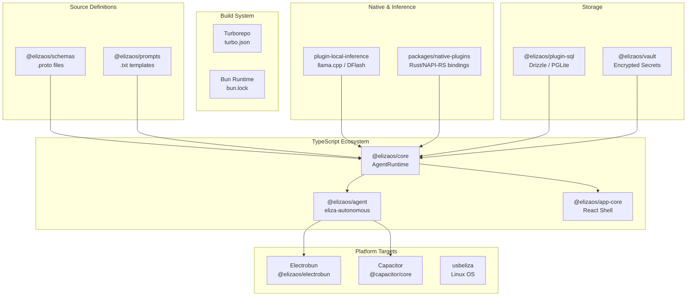

**Key Architecture Principles:**
1. **Single Source of Truth**: Protocol Buffer schemas (`@elizaos/schemas`) define data types across languages. [tsconfig.dist-paths.json:80]()
2. **Modular Extensibility**: Plugins add actions, providers, and evaluators. [package.json:186-215](), [packages/prompts/specs/actions/plugins.generated.json:1-109]()
3. **Multi-Platform Delivery**: The same agent logic runs on Desktop (Electrobun), Mobile (Capacitor), and Cloud (Cloudflare Workers). [package.json:74-75](), [bun.lock:45](), [turbo.json:178]()

Sources: [turbo.json:1-240](), [tsconfig.dist-paths.json:1-183](), [bun.lock:1-176]()

---

## AgentRuntime Architecture

The `AgentRuntime` class is the central execution environment. It orchestrates the message pipeline, model providers, and memory persistence.

**AgentRuntime Component Architecture**

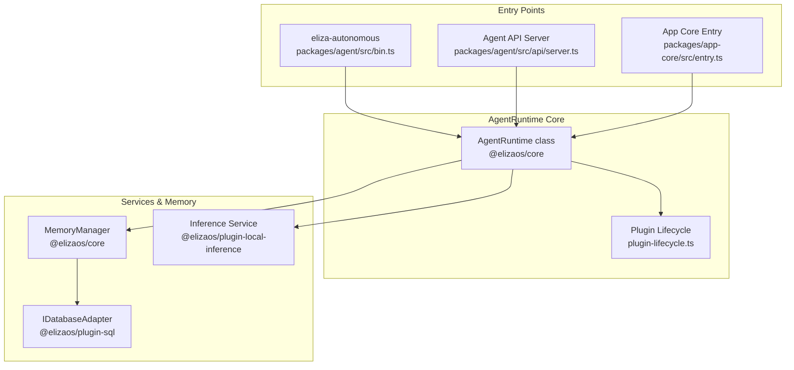

**Key Code Entities:**
- **`AgentRuntime`**: The main class orchestrating the agent. [packages/agent/package.json:85](), [bun.lock:48]()
- **`eliza-autonomous`**: Binary entry point for the agent. [packages/agent/package.json:88]()
- **`localInferencePlugin`**: Provides on-device model execution and `DFlash` support. [bun.lock:13](), [package.json:78]()
- **`plugin-sql`**: Implements the database adapter layer using Drizzle and PGLite/Postgres. [bun.lock:16](), [bun.lock:140]()

Sources: [packages/agent/package.json:84-176](), [bun.lock:1-160](), [package.json:68-85]()

---

## Technology Stack

| Component | Technology | Package |
|---|---|---|
| **Runtime** | Bun | `bun@1.3.14` [bun.lock:55]() |
| **Orchestration** | Turbo | `turbo ^2.7.4` [bun.lock:78]() |
| **ORM** | Drizzle | `drizzle-orm 0.45.2` [bun.lock:140]() |
| **API Framework** | Elysia / Hono | `elysia ^1.4.21`, `hono ^4.12.18` [bun.lock:34-36]() |
| **Desktop Shell** | Electrobun | `@elizaos/electrobun` [turbo.json:178]() |
| **Mobile Shell** | Capacitor | `@capacitor/core 8.3.1` [bun.lock:45]() |
| **Database** | PGLite / Postgres | `@electric-sql/pglite ^0.4.5` [bun.lock:8]() |

---

## Where to Go Next

| Topic | Page |
|---|---|
| Detailed architectural design | [Architecture](#1.1) |
| All packages enumerated | [Package Overview](#1.3) |
| Message processing pipeline | [Message Processing Pipeline](#2.6) |
| Protocol Buffers and types | [Protocol Buffers and Schemas](#3) |
| Desktop and Mobile platforms | [Platform Targets](#8) |
| Managed hosting platform | [ElizaOS Cloud Platform](#14) |
| Local AI and Voice | [Local Inference](#15) |

---

# Page: Architecture

# Architecture

<details>
<summary>Relevant source files</summary>

The following files were used as context for generating this wiki page:

- [.env.example](.env.example)
- [.github/workflows/sandbox-live-smoke.yml](.github/workflows/sandbox-live-smoke.yml)
- [bun.lock](bun.lock)
- [knip.json](knip.json)
- [package.json](package.json)
- [packages/agent/docs/e2b-capability-routing.md](packages/agent/docs/e2b-capability-routing.md)
- [packages/agent/scripts/live-sandbox-smoke.ts](packages/agent/scripts/live-sandbox-smoke.ts)
- [packages/agent/scripts/mobile-stubs/e2b-capability-router.cjs](packages/agent/scripts/mobile-stubs/e2b-capability-router.cjs)
- [packages/agent/src/runtime/eliza.ts](packages/agent/src/runtime/eliza.ts)
- [packages/agent/src/services/e2b-capability-router.test.ts](packages/agent/src/services/e2b-capability-router.test.ts)
- [packages/agent/src/services/e2b-capability-router.ts](packages/agent/src/services/e2b-capability-router.ts)
- [packages/app-core/platforms/electrobun/tsconfig.json](packages/app-core/platforms/electrobun/tsconfig.json)
- [packages/app-core/platforms/electrobun/vitest.electrobun.config.ts](packages/app-core/platforms/electrobun/vitest.electrobun.config.ts)
- [packages/app-core/scripts/lib/orchestrator-desktop-dev-banner.mjs](packages/app-core/scripts/lib/orchestrator-desktop-dev-banner.mjs)
- [packages/core/src/connectors/oauth-role.test.ts](packages/core/src/connectors/oauth-role.test.ts)
- [packages/core/src/connectors/oauth-role.ts](packages/core/src/connectors/oauth-role.ts)
- [packages/core/src/index.browser.ts](packages/core/src/index.browser.ts)
- [packages/core/src/index.edge.ts](packages/core/src/index.edge.ts)
- [packages/core/src/index.node.ts](packages/core/src/index.node.ts)
- [packages/core/src/services/runtime-capability-service.ts](packages/core/src/services/runtime-capability-service.ts)
- [packages/plugin-remote-manifest/examples/carrot-clock/plugin.json](packages/plugin-remote-manifest/examples/carrot-clock/plugin.json)
- [packages/plugin-remote-manifest/examples/hello-carrot/plugin.json](packages/plugin-remote-manifest/examples/hello-carrot/plugin.json)
- [packages/shared/package.json](packages/shared/package.json)
- [packages/ui/package.json](packages/ui/package.json)
- [packages/ui/src/components/pages/BrowserWorkspaceView.tsx](packages/ui/src/components/pages/BrowserWorkspaceView.tsx)
- [packages/ui/src/components/settings/CloudInstancePanel.tsx](packages/ui/src/components/settings/CloudInstancePanel.tsx)
- [packages/ui/src/onboarding/onboarding-config.ts](packages/ui/src/onboarding/onboarding-config.ts)
- [packages/ui/test/stubs/capacitor-app.ts](packages/ui/test/stubs/capacitor-app.ts)
- [packages/ui/test/stubs/elizaos-app-wallet.ts](packages/ui/test/stubs/elizaos-app-wallet.ts)
- [packages/ui/test/stubs/elizaos-capacitor-llama.ts](packages/ui/test/stubs/elizaos-capacitor-llama.ts)
- [packages/ui/test/stubs/node-llama-cpp.ts](packages/ui/test/stubs/node-llama-cpp.ts)
- [packages/ui/vitest.config.ts](packages/ui/vitest.config.ts)
- [plugins/plugin-calendly/src/connector-account-provider.ts](plugins/plugin-calendly/src/connector-account-provider.ts)
- [plugins/plugin-elizacloud/src/index.browser.ts](plugins/plugin-elizacloud/src/index.browser.ts)
- [plugins/plugin-linear/src/connector-account-provider.ts](plugins/plugin-linear/src/connector-account-provider.ts)
- [plugins/plugin-shopify/src/connector-account-provider.ts](plugins/plugin-shopify/src/connector-account-provider.ts)

</details>


This document describes the high-level architectural design of elizaOS: its modular package structure, multi-language runtimes, and the interaction between core subsystems. elizaOS is architected as a monorepo-based, polyglot AI agent framework where Protocol Buffers serve as the single source of truth for types across TypeScript, Python, and Rust.

## System Overview

The architecture follows a layered approach, ensuring that the core logic is model-agnostic and platform-independent while remaining highly extensible through a plugin system.

### Architectural Layers

| Layer | Description | Key Packages |
|-------|-------------|--------------|
| **Type Foundation** | Protocol Buffer schemas - single source of truth | `packages/schemas` |
| **Core Runtimes** | Language-specific runtime implementations | `@elizaos/core` (TS), `packages/rust`, `packages/python` |
| **Infrastructure** | Cross-language bridges, shared templates, and skills | `@elizaos/interop`, `@elizaos/prompts`, `@elizaos/skills` |
| **Specialized Capabilities** | Desktop automation and native bindings | `@elizaos/plugin-computeruse`, `@elizaos/native-plugins` |
| **Developer Tools** | CLI and terminal interfaces | `packages/elizaos` (CLI), `@elizaos/tui` |

### High-Level Component Interaction

The following diagram bridges the Natural Language Space (concepts like "Agent" or "Skill") to the Code Entity Space (specific classes and packages).

**System Component Map**

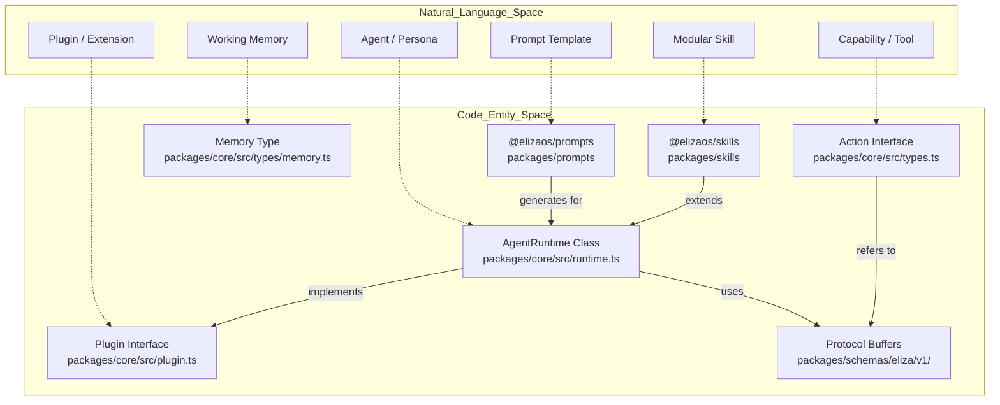

Sources: [packages/core/src/index.node.ts:157-157](), [packages/core/src/index.node.ts:147-147](), [packages/core/src/index.node.ts:142-142](), [packages/core/src/index.node.ts:149-149](), [bun.lock:130-131]()

## Monorepo Structure

elizaOS uses a monorepo managed by **Bun**, **Lerna**, and **Turbo**. The workspace is organized to support multi-language development and cross-platform native builds.

### Workspace Organization
The monorepo defines its workspace structure in the root configuration, using Bun for package management [bun.lock:4-83]().
- `packages/*`: Core framework, runtimes, and infrastructure (e.g., `@elizaos/core`, `@elizaos/agent`, `@elizaos/app-core`).
- `plugins/*`: Externalized capabilities managed as modular extensions like `@elizaos/plugin-sql` or `@elizaos/plugin-anthropic` [bun.lock:9-17]().
- `apps/*`: End-user applications like `app-lifeops` or `app-steward`.

**Package Relationship Diagram**

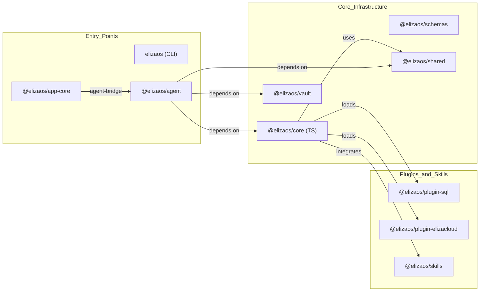

Sources: [bun.lock:4-132](), [packages/agent/src/runtime/eliza.ts:130-140](), [packages/agent/src/runtime/eliza.ts:76-92]()

## Multi-Language Runtime Design

elizaOS is a polyglot framework. While the TypeScript implementation is the primary runtime, the architecture ensures that logic and types are shared across targets via specialized entry points.

### TypeScript Runtime Targets (`@elizaos/core`)
The primary orchestrator supports multiple environments via environment-specific entry points:
- **Node.js**: Entry point via `packages/core/src/index.node.ts`, exporting the full API surface including Node-only path and provisioning helpers [packages/core/src/index.node.ts:1-7]().
- **Browser**: Entry point via `packages/core/src/index.browser.ts`, providing stubs for Node-specific functionality and exporting browser-safe modules [packages/core/src/index.browser.ts:1-7]().
- **Edge**: Entry point via `packages/core/src/index.edge.ts` for Vercel Edge, Cloudflare Workers, and Deno, excluding Node-only modules like `character-loader` [packages/core/src/index.edge.ts:1-9]().

### Unified Capability Routing
The system employs a `RuntimeCapabilityService` to manage capability dispatching across different environments. It implements the `ElizaCapabilityRouter` interface to handle `fs`, `pty`, `git`, and `model` invocations [packages/core/src/services/runtime-capability-service.ts:108-112]().

**Capability Dispatch Logic**
1.  **Strategies**: Decisions are made via a strategy table (e.g., `LocalPluginStrategy` vs `HttpEndpointStrategy`) [packages/core/src/services/runtime-capability-service.ts:48-57]().
2.  **Fallback**: If no strategy matches, it defaults to an `UnavailableCapabilityRouter` [packages/core/src/services/runtime-capability-service.ts:128-133]().

Sources: [packages/core/src/index.node.ts:1-157](), [packages/core/src/index.browser.ts:1-156](), [packages/core/src/index.edge.ts:1-99](), [packages/core/src/services/runtime-capability-service.ts:33-67]()

## Core Components and Data Flow

The `AgentRuntime` manages the lifecycle and interaction of agents. In the `@elizaos/agent` package, the runtime is initialized with a plugin configuration and environment resolution [packages/agent/src/runtime/eliza.ts:1-7]().

### Message Processing Pipeline
The runtime categorizes capabilities into functional blocks:
- **Basic Capabilities**: Core functions like `reply` and `followup` actions [packages/core/src/index.node.ts:98-99]().
- **Advanced Capabilities**: Features like `role` management and `secrets` handling [packages/core/src/index.node.ts:62-65](), [packages/core/src/index.node.ts:128-132]().

**Data Flow Diagram (Natural Language to Code)**

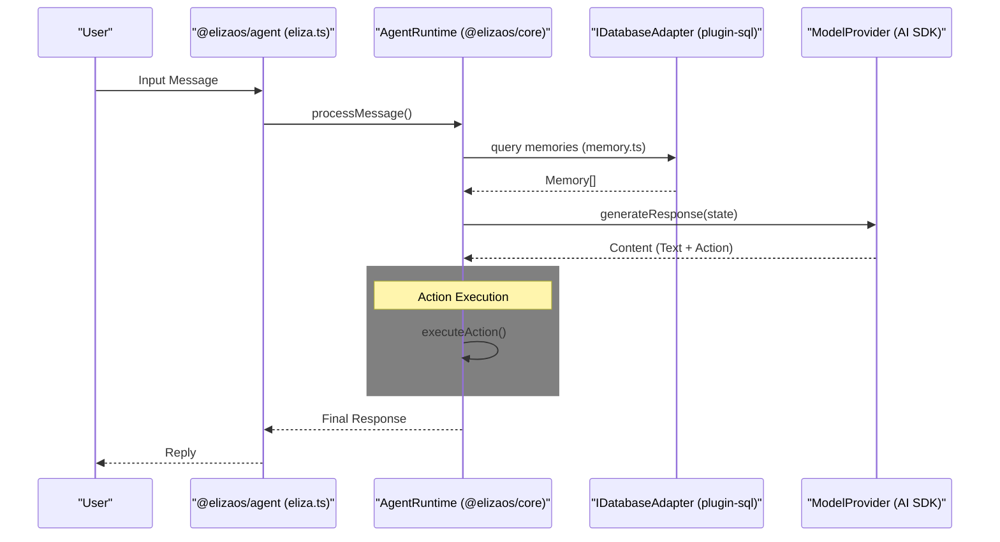

Sources: [packages/agent/src/runtime/eliza.ts:76-92](), [packages/core/src/index.node.ts:58-59](), [packages/core/src/index.node.ts:142-142](), [packages/core/src/index.node.ts:157-157]()

## Specialized Subsystems

### Application Shell (`@elizaos/app-core`)
A shared React core for building agent applications across platforms.
- **Platform Bridges**: Uses an `agent-bridge` to connect UI components to the agent runtime [packages/agent/src/runtime/eliza.ts:130-140]().
- **Mobile/Desktop**: Supports Capacitor for mobile and Electrobun for desktop targets [packages/ui/vitest.config.ts:125-131](), [packages/app-core/platforms/electrobun/tsconfig.json:1-18]().

### Vault and Secrets
The `@elizaos/vault` package provides secure storage, which is hydrated into the runtime during the bootstrap process [packages/agent/src/runtime/eliza.ts:114-120](). It handles sensitive keys like wallet credentials [packages/agent/src/runtime/eliza.ts:115-115]().

Sources: [packages/agent/src/runtime/eliza.ts:108-128](), [packages/ui/vitest.config.ts:62-112](), [packages/app-core/platforms/electrobun/tsconfig.json:102-103]()

---

# Page: Package Overview

# Package Overview

<details>
<summary>Relevant source files</summary>

The following files were used as context for generating this wiki page:

- [.github/workflows/README.md](.github/workflows/README.md)
- [bun.lock](bun.lock)
- [package.json](package.json)
- [packages/app-core/package.json](packages/app-core/package.json)
- [packages/app-core/scripts/docker-ci-smoke.sh](packages/app-core/scripts/docker-ci-smoke.sh)
- [packages/app-core/scripts/lib/orchestrator-desktop-dev-banner.mjs](packages/app-core/scripts/lib/orchestrator-desktop-dev-banner.mjs)
- [packages/app-core/scripts/link-docker-local-app-packages.mjs](packages/app-core/scripts/link-docker-local-app-packages.mjs)
- [packages/app-core/src/api/auth-bootstrap-routes.ts](packages/app-core/src/api/auth-bootstrap-routes.ts)
- [packages/app-core/src/api/auth-session-routes.ts](packages/app-core/src/api/auth-session-routes.ts)
- [packages/app-core/src/api/catalog-routes.ts](packages/app-core/src/api/catalog-routes.ts)
- [packages/app-core/src/api/cloud-voice-routes.test.ts](packages/app-core/src/api/cloud-voice-routes.test.ts)
- [packages/app-core/src/api/cloud-voice-routes.ts](packages/app-core/src/api/cloud-voice-routes.ts)
- [packages/app-core/src/api/database-rows-compat-routes.ts](packages/app-core/src/api/database-rows-compat-routes.ts)
- [packages/app-core/src/api/dev-compat-routes.ts](packages/app-core/src/api/dev-compat-routes.ts)
- [packages/app-core/src/api/ios-local-agent-transport.ts](packages/app-core/src/api/ios-local-agent-transport.ts)
- [packages/app-core/src/api/onboarding-routes.ts](packages/app-core/src/api/onboarding-routes.ts)
- [packages/app-core/src/api/secrets-inventory-routes.ts](packages/app-core/src/api/secrets-inventory-routes.ts)
- [packages/app-core/src/api/server.ts](packages/app-core/src/api/server.ts)
- [packages/app-core/src/cli/doctor/checks.ts](packages/app-core/src/cli/doctor/checks.ts)
- [packages/app-core/src/index.ts](packages/app-core/src/index.ts)
- [packages/app-core/src/register-runtime-hooks.ts](packages/app-core/src/register-runtime-hooks.ts)
- [packages/app-core/src/runtime/eliza.ts](packages/app-core/src/runtime/eliza.ts)
- [packages/app-core/src/services/phrase-chunked-tts.ts](packages/app-core/src/services/phrase-chunked-tts.ts)
- [packages/app-core/src/services/steward-sidecar.ts](packages/app-core/src/services/steward-sidecar.ts)
- [packages/app-core/src/services/steward-sidecar/health-check.ts](packages/app-core/src/services/steward-sidecar/health-check.ts)
- [packages/app-core/src/services/steward-sidecar/wallet-setup.ts](packages/app-core/src/services/steward-sidecar/wallet-setup.ts)
- [packages/app-core/src/services/task-host-capabilities.ts](packages/app-core/src/services/task-host-capabilities.ts)
- [packages/core/package.json](packages/core/package.json)
- [packages/shared/package.json](packages/shared/package.json)
- [packages/ui/package.json](packages/ui/package.json)
- [packages/ui/src/components/pages/BrowserWorkspaceView.tsx](packages/ui/src/components/pages/BrowserWorkspaceView.tsx)
- [packages/ui/test/stubs/capacitor-app.ts](packages/ui/test/stubs/capacitor-app.ts)
- [packages/ui/test/stubs/elizaos-app-wallet.ts](packages/ui/test/stubs/elizaos-app-wallet.ts)
- [packages/ui/test/stubs/elizaos-capacitor-llama.ts](packages/ui/test/stubs/elizaos-capacitor-llama.ts)
- [packages/ui/test/stubs/node-llama-cpp.ts](packages/ui/test/stubs/node-llama-cpp.ts)
- [packages/ui/vitest.config.ts](packages/ui/vitest.config.ts)
- [plugins/plugin-app-control/package.json](plugins/plugin-app-control/package.json)
- [plugins/plugin-commands/package.json](plugins/plugin-commands/package.json)
- [plugins/plugin-discord/package.json](plugins/plugin-discord/package.json)
- [plugins/plugin-elizacloud/package.json](plugins/plugin-elizacloud/package.json)
- [plugins/plugin-farcaster/package.json](plugins/plugin-farcaster/package.json)
- [plugins/plugin-feishu/package.json](plugins/plugin-feishu/package.json)
- [plugins/plugin-google-chat/package.json](plugins/plugin-google-chat/package.json)
- [plugins/plugin-google-chat/src/actions/index.ts](plugins/plugin-google-chat/src/actions/index.ts)
- [plugins/plugin-google-chat/src/providers/index.ts](plugins/plugin-google-chat/src/providers/index.ts)
- [plugins/plugin-imessage/package.json](plugins/plugin-imessage/package.json)
- [plugins/plugin-line/package.json](plugins/plugin-line/package.json)
- [plugins/plugin-local-storage/src/services/local-storage.ts](plugins/plugin-local-storage/src/services/local-storage.ts)
- [plugins/plugin-matrix/package.json](plugins/plugin-matrix/package.json)
- [plugins/plugin-music/package.json](plugins/plugin-music/package.json)
- [plugins/plugin-nostr/package.json](plugins/plugin-nostr/package.json)
- [plugins/plugin-openrouter/package.json](plugins/plugin-openrouter/package.json)
- [plugins/plugin-roblox/package.json](plugins/plugin-roblox/package.json)
- [plugins/plugin-signal/package.json](plugins/plugin-signal/package.json)
- [plugins/plugin-slack/package.json](plugins/plugin-slack/package.json)
- [plugins/plugin-social-alpha/package.json](plugins/plugin-social-alpha/package.json)
- [plugins/plugin-suno/package.json](plugins/plugin-suno/package.json)
- [plugins/plugin-twitch/package.json](plugins/plugin-twitch/package.json)
- [plugins/plugin-web-search/package.json](plugins/plugin-web-search/package.json)
- [plugins/plugin-wechat/package.json](plugins/plugin-wechat/package.json)

</details>


This document catalogs the packages within the elizaOS monorepo, detailing their roles, technical implementations, and interdependencies. elizaOS is a polyglot framework designed for multi-agent AI systems, utilizing a monorepo structure managed by Lerna [bun.lock:72]() and orchestrated by Turbo [package.json:78]().

## Package Organization

The monorepo organizes code into functional domains, spanning core logic, infrastructure, specialized runtimes (TypeScript, Rust, Python), and developer tooling. All packages follow a synchronized versioning scheme managed by Lerna [package.json:3]().

### Foundation and Core Runtimes

#### @elizaos/core (TypeScript)
**Location:** `packages/core/`  
**Description:** The primary TypeScript implementation of the elizaOS runtime. It provides the foundation for agent lifecycles, memory management, and model abstraction [packages/core/package.json:4]().

**Key Technical Details:**
- **Environment-Specific Exports:** Provides optimized entry points for `node`, `browser`, and `bun` environments [packages/core/package.json:28-58]().
- **Persistence:** Uses `drizzle-orm` for database abstraction [packages/core/package.json:138]() and supports PGLite for local-first execution.
- **Model Integration:** Relies on the Vercel `ai` SDK [packages/core/package.json:135]() and provides native support for Anthropic, Google, and OpenAI providers [packages/core/package.json:121-124]().
- **Templating:** Uses `handlebars` for dynamic prompt construction [packages/core/package.json:142]().

**Sources:** [packages/core/package.json:1-151]()

---

#### @elizaos/rust
**Location:** `packages/rust/`  
**Description:** High-performance Rust implementation of the elizaOS core and types. It is designed for native execution and WASM compilation to support polyglot plugin environments.

---

#### @elizaos/python
**Location:** `packages/python/`  
**Description:** Python implementation of the elizaOS runtime, enabling agent development in Python with full interoperability. It is frequently used for robotics (AiNex) and reinforcement learning (Brax-PPO) workflows.

---

#### @elizaos/interop
**Location:** `packages/interop/`  
**Description:** The bridge for cross-language plugin interoperability, enabling plugins written in Python or Rust to communicate with the TypeScript core via Protocol Buffer serialization and IPC/FFI bridges.

### Specialized Infrastructure

#### @elizaos/schemas
**Location:** `packages/schemas/`  
**Description:** The single source of truth for all types in elizaOS using Protocol Buffers. It defines the structure for agents, memory, events, and messaging that all language runtimes consume.

---

#### @elizaos/prompts
**Location:** `packages/prompts/`  
**Description:** Shared prompt templates used across TypeScript, Python, and Rust runtimes. Referenced as a workspace dependency by `@elizaos/core` [packages/core/package.json:129]().

**Sources:** [packages/core/package.json:129]()

### User Interfaces and CLI

#### elizaos (CLI)
**Location:** `packages/elizaos/`  
**Description:** The primary command-line tool for project scaffolding, upgrading, and deployment.

#### @elizaos/ui & @elizaos/app-core
**Location:** `packages/ui/` & `packages/app-core/`  
**Description:** `app-core` provides the shared React application shell [packages/app-core/package.json:4](), while `ui` contains the reusable component library [packages/ui/package.json:4]().

**Key Technical Details:**
- **App Core:** Manages platform-specific logic for Electrobun (Desktop) and Capacitor (Mobile) [packages/app-core/src/index.ts:34-42](). It exports the `startApiServer` [packages/app-core/src/api/server.ts:32]() and `bootElizaRuntime` [packages/app-core/src/runtime/eliza.ts:19]() logic.
- **UI Components:** Provides Radix-based primitives [bun.lock:19-30]() and specialized chat views like `BrowserWorkspaceView` [packages/ui/src/components/pages/BrowserWorkspaceView.tsx:24]().
- **Platform Bridging:** `app-core` includes `ios-local-agent-transport` [packages/app-core/src/index.ts:9]() and `android-avf-microdroid-bridge` [packages/app-core/src/index.ts:48]() for mobile native agent execution.

**Sources:** [packages/app-core/package.json:1-12](), [packages/ui/package.json:1-12](), [packages/app-core/src/index.ts:1-82]()

### Shared Resources and Utilities

| Package | Purpose | Key Exports/Dependencies |
|---------|---------|-----------|
| `@elizaos/shared` | Common utilities, environment handling, and brand aliasing [packages/shared/package.json:4](). | `drizzle-orm`, `zod`, `chalk` [packages/shared/package.json:114-123]() |
| `@elizaos/agent` | High-level agent implementation and REST API server [bun.lock:85](). | `@elizaos/app-core`, `@elizaos/core`, `@elizaos/skills` [bun.lock:93-130]() |
| `@elizaos/skills` | Modular agent capabilities and skill discovery [bun.lock:130](). | Referenced by `@elizaos/agent` and CLI. |
| `@elizaos/vault` | Secure credential storage with AES-256-GCM encryption [bun.lock:132](). | Used by `agent` and `app-core`. |
| `@elizaos/plugin-elizacloud` | Managed cloud platform integration [bun.lock:11](). | `@elizaos/core`, `@elizaos/shared` [bun.lock:108, 129]() |

## Code Entity Mapping

### Mobile and Desktop Runtime Bootstrap
This diagram maps the platform-specific bootstrap entities in `app-core` to the native bridges they utilize.

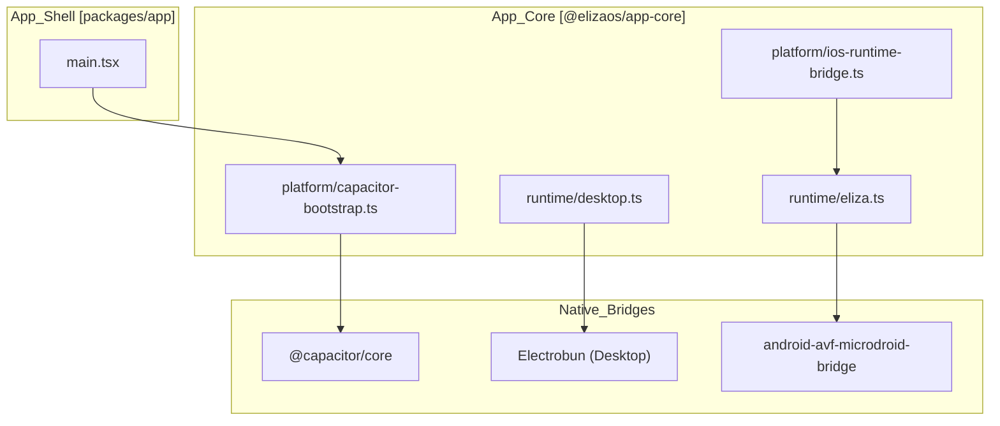
**Sources:** [packages/app-core/src/index.ts:32-56](), [packages/app-core/src/runtime/eliza.ts:48-55]()

### API Server and Plugin Integration
This diagram illustrates the data flow from the `app-core` API server through to specialized plugin routes.

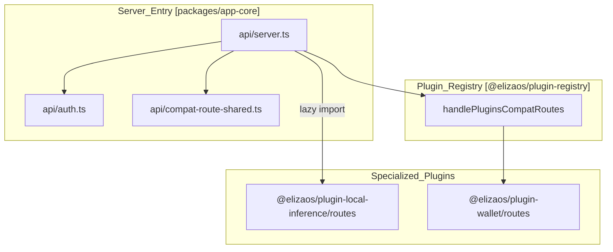
**Sources:** [packages/app-core/src/api/server.ts:1-157](), [packages/app-core/src/api/server.ts:114-124]()

## Dependency Graph

The following graph visualizes the build-time and runtime dependencies between primary workspace packages.

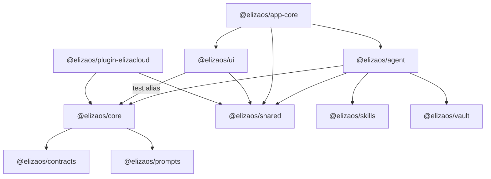
**Sources:** [bun.lock:90-132](), [packages/core/package.json:128-129](), [packages/ui/vitest.config.ts:82-88]()

---

# Page: Core Runtime

# Core Runtime

<details>
<summary>Relevant source files</summary>

The following files were used as context for generating this wiki page:

- [packages/app-core/scripts/install-android-sms-gateway.md](packages/app-core/scripts/install-android-sms-gateway.md)
- [packages/benchmarks/orchestrator/README.md](packages/benchmarks/orchestrator/README.md)
- [packages/benchmarks/orchestrator/code_agent_coverage.py](packages/benchmarks/orchestrator/code_agent_coverage.py)
- [packages/benchmarks/orchestrator/code_agent_matrix.py](packages/benchmarks/orchestrator/code_agent_matrix.py)
- [packages/benchmarks/orchestrator/tests/test_code_agent_matrix.py](packages/benchmarks/orchestrator/tests/test_code_agent_matrix.py)
- [packages/cloud-api/v1/billing/resources/[id]/cancel/route.ts](packages/cloud-api/v1/billing/resources/[id]/cancel/route.ts)
- [packages/cloud-shared/src/lib/services/active-billing.ts](packages/cloud-shared/src/lib/services/active-billing.ts)
- [packages/cloud-shared/src/lib/services/agent-managed-discord.ts](packages/cloud-shared/src/lib/services/agent-managed-discord.ts)
- [packages/cloud-shared/src/lib/services/agent-managed-github.ts](packages/cloud-shared/src/lib/services/agent-managed-github.ts)
- [packages/core/src/__tests__/runtime-settings.test.ts](packages/core/src/__tests__/runtime-settings.test.ts)
- [packages/core/src/features/autonomy/action.ts](packages/core/src/features/autonomy/action.ts)
- [packages/core/src/features/autonomy/service.test.ts](packages/core/src/features/autonomy/service.test.ts)
- [packages/core/src/features/autonomy/service.ts](packages/core/src/features/autonomy/service.ts)
- [packages/core/src/runtime.ts](packages/core/src/runtime.ts)
- [packages/core/src/runtime/__tests__/message-post-connectors.test.ts](packages/core/src/runtime/__tests__/message-post-connectors.test.ts)
- [packages/core/src/services/optimized-prompt.ts](packages/core/src/services/optimized-prompt.ts)
- [packages/core/src/types/plugin.ts](packages/core/src/types/plugin.ts)
- [packages/core/src/types/runtime.ts](packages/core/src/types/runtime.ts)
- [packages/examples/_plugin/package.json](packages/examples/_plugin/package.json)
- [packages/examples/_plugin/test.ts](packages/examples/_plugin/test.ts)
- [packages/examples/smartglasses/README.md](packages/examples/smartglasses/README.md)
- [packages/examples/smartglasses/eliza-runtime-smoke.ts](packages/examples/smartglasses/eliza-runtime-smoke.ts)
- [packages/examples/smartglasses/package-smoke.ts](packages/examples/smartglasses/package-smoke.ts)
- [packages/examples/smartglasses/smartglasses.test.ts](packages/examples/smartglasses/smartglasses.test.ts)
- [packages/examples/smartglasses/smartglasses.ts](packages/examples/smartglasses/smartglasses.ts)
- [packages/homepage/tests/e2e/app-routes-flow.spec.ts](packages/homepage/tests/e2e/app-routes-flow.spec.ts)
- [packages/scripts/cloud/bluebubbles-local-bridge.ts](packages/scripts/cloud/bluebubbles-local-bridge.ts)
- [packages/scripts/run-autonomy-cerebras-loops.ts](packages/scripts/run-autonomy-cerebras-loops.ts)
- [plugins/plugin-agent-orchestrator/__tests__/unit/sanitize-planner-text.test.ts](plugins/plugin-agent-orchestrator/__tests__/unit/sanitize-planner-text.test.ts)
- [plugins/plugin-agent-orchestrator/__tests__/unit/scan-and-unlink-older-than.test.ts](plugins/plugin-agent-orchestrator/__tests__/unit/scan-and-unlink-older-than.test.ts)
- [plugins/plugin-agent-orchestrator/__tests__/unit/session-store.test.ts](plugins/plugin-agent-orchestrator/__tests__/unit/session-store.test.ts)
- [plugins/plugin-agent-orchestrator/src/providers/active-sub-agents.ts](plugins/plugin-agent-orchestrator/src/providers/active-sub-agents.ts)
- [plugins/plugin-agent-orchestrator/src/services/audit.ts](plugins/plugin-agent-orchestrator/src/services/audit.ts)
- [plugins/plugin-agent-orchestrator/src/services/session-store.ts](plugins/plugin-agent-orchestrator/src/services/session-store.ts)
- [plugins/plugin-agent-orchestrator/src/services/types.ts](plugins/plugin-agent-orchestrator/src/services/types.ts)
- [plugins/plugin-discord/__tests__/extract-content-metadata.test.ts](plugins/plugin-discord/__tests__/extract-content-metadata.test.ts)
- [plugins/plugin-xr/src/protocol.ts](plugins/plugin-xr/src/protocol.ts)
- [plugins/plugin-xr/src/routes/xr-views.ts](plugins/plugin-xr/src/routes/xr-views.ts)
- [plugins/plugin-xr/src/services/xr-session-service.ts](plugins/plugin-xr/src/services/xr-session-service.ts)

</details>


This page provides an overview of the `AgentRuntime` engine, the central orchestrator of elizaOS. It covers the runtime's role in managing agent identity, service lifecycles, model integration, and the message processing pipeline.

---

## Overview

The **Core Runtime** is the heart of elizaOS. It is responsible for instantiating agents based on Character Definitions, managing their long-term memory via database adapters, and executing the logic that transforms user input into autonomous actions.

Every agent in elizaOS is an instance of the `AgentRuntime` class. It serves as the "glue" between high-level personality and low-level system capabilities, managing the registration of `Action`, `Evaluator`, `Provider`, and `Plugin` entities [packages/core/src/runtime.ts:156-167]().

**Key Implementation Files:**
- **Core Runtime:** `AgentRuntime` class in [packages/core/src/runtime.ts:156]()
- **Message Service:** `DefaultMessageService` in [packages/core/src/services/message.ts:51]()
- **Autonomy Service:** `AutonomyService` in [packages/core/src/features/autonomy/service.ts:68]()
- **Interfaces:** `IAgentRuntime` definition in [packages/core/src/runtime.ts:101]()

---

## AgentRuntime Orchestrator

The `AgentRuntime` implements the `IAgentRuntime` interface, providing a unified API for interacting with an agent. It maintains the agent's identity via `agentId` and `character` configuration [packages/core/src/runtime.ts:156-200]().

For detailed documentation on initialization, lifecycle hooks, and core methods, see [AgentRuntime](#2.1).

### Architectural Role
The runtime sits at the center of the system, mediating between the **Natural Language Space** (prompts, characters) and the **Code Entity Space** (plugins, services, databases).

**Diagram: Core Runtime System Context**

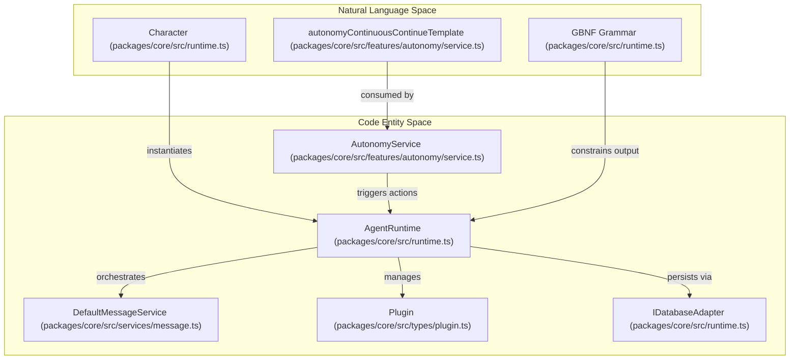

Sources: [packages/core/src/runtime.ts:156-200](), [packages/core/src/features/autonomy/service.ts:68-90](), [packages/core/src/types/plugin.ts:198-210]()

---

## Subsystem Overviews

### Character System
The Character System defines the "who" of the agent. The `AgentRuntime` holds a `Character` object containing `bio`, `lore`, `adjectives`, and `postExamples` [packages/core/src/runtime.ts:75](). These are used during state composition to ensure the LLM maintains a consistent persona. The system also supports autonomous thought generation via the `AutonomyService` [packages/core/src/features/autonomy/service.ts:200-210]().

### Model Providers
elizaOS interacts with models through a standardized interface. The runtime supports various `ModelType` categories (e.g., `TEXT_LARGE`, `ACTION_PLANNER`) [packages/core/src/runtime.ts:119-120](). It handles model selection, fallback chains via `executeChainWithFallback`, and structured output parsing [packages/core/src/runtime.ts:26-30]().

### Settings and Configuration
The runtime is configured via environment variables and runtime settings. It uses `decryptSecret` for sensitive keys [packages/core/src/runtime.ts:53]() and manages hierarchical data storage.
For details, see [Settings and Configuration](#2.5).

### Message Processing Pipeline
The v5 pipeline introduces a sophisticated message handling flow:
1.  **Triage:** The system decides if the agent should respond based on character settings and context.
2.  **Context Routing:** Employs `getActiveRoutingContextsForTurn` to determine which domain-specific tools are needed [packages/core/src/runtime.ts:208-210]().
3.  **Planning:** Executes logic that allows the agent to call multiple tools and evaluate results.
4.  **Autonomy:** The `AutonomyService` provides recurring background loops for internal thinking and proactive actions [packages/core/src/features/autonomy/service.ts:68-75]().

For details, see [Message Processing Pipeline](#2.6).

---

## Core Data Entities

The runtime manages several key data structures to maintain state and context.

| Entity | Code Symbol | Description |
|---|---|---|
| **Memory** | `Memory` | A unit of information with `UUID` and `Content` [packages/core/src/runtime.ts:109]() |
| **State** | `State` | The combined context for the LLM, including `values` and `data` [packages/core/src/runtime.ts:154]() |
| **Action** | `Action` | A discrete capability that can be executed by the agent [packages/core/src/runtime.ts:69]() |
| **Plugin** | `Plugin` | A bundle of actions, providers, and evaluators [packages/core/src/runtime.ts:130]() |

**Diagram: Message to Action Pipeline**

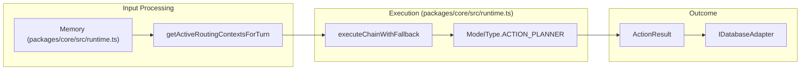

Sources: [packages/core/src/runtime.ts:109-120](), [packages/core/src/runtime.ts:208-210](), [packages/core/src/runtime.ts:26-30]()

---

## Streaming and Utilities

The core runtime includes robust utilities for handling real-time AI interactions:
- **Streaming Context:** Managed via `runWithStreamingContext` to handle chunked LLM output and hook emissions [packages/core/src/runtime.ts:57-58]().
- **Optimized Prompts:** `OptimizedPromptService` provides a runtime cache of native-optimizer artifacts to substitute high-performance system prompts [packages/core/src/services/optimized-prompt.ts:2-9]().
- **Trajectory Context:** `getTrajectoryContext` tracks the reasoning trace for debugging and reinforcement learning [packages/core/src/runtime.ts:60-62]().

Sources: [packages/core/src/runtime.ts:57-62](), [packages/core/src/services/optimized-prompt.ts:2-15]()

---

# Page: AgentRuntime

# AgentRuntime

<details>
<summary>Relevant source files</summary>

The following files were used as context for generating this wiki page:

- [.env.example](.env.example)
- [.github/workflows/sandbox-live-smoke.yml](.github/workflows/sandbox-live-smoke.yml)
- [knip.json](knip.json)
- [packages/agent/docs/e2b-capability-routing.md](packages/agent/docs/e2b-capability-routing.md)
- [packages/agent/scripts/live-sandbox-smoke.ts](packages/agent/scripts/live-sandbox-smoke.ts)
- [packages/agent/scripts/mobile-stubs/e2b-capability-router.cjs](packages/agent/scripts/mobile-stubs/e2b-capability-router.cjs)
- [packages/agent/src/runtime/eliza.ts](packages/agent/src/runtime/eliza.ts)
- [packages/agent/src/runtime/roles/src/index.ts](packages/agent/src/runtime/roles/src/index.ts)
- [packages/agent/src/services/e2b-capability-router.test.ts](packages/agent/src/services/e2b-capability-router.test.ts)
- [packages/agent/src/services/e2b-capability-router.ts](packages/agent/src/services/e2b-capability-router.ts)
- [packages/app-core/platforms/electrobun/tsconfig.json](packages/app-core/platforms/electrobun/tsconfig.json)
- [packages/app-core/platforms/electrobun/vitest.electrobun.config.ts](packages/app-core/platforms/electrobun/vitest.electrobun.config.ts)
- [packages/app/scripts/mobile-release-preflight.mjs](packages/app/scripts/mobile-release-preflight.mjs)
- [packages/app/src/types/side-effect-app-modules.d.ts](packages/app/src/types/side-effect-app-modules.d.ts)
- [packages/benchmarks/vision-language/src/runner.ts](packages/benchmarks/vision-language/src/runner.ts)
- [packages/benchmarks/vision-language/src/runtime-resolver.ts](packages/benchmarks/vision-language/src/runtime-resolver.ts)
- [packages/cloud-api/v1/billing/resources/[id]/cancel/route.ts](packages/cloud-api/v1/billing/resources/[id]/cancel/route.ts)
- [packages/cloud-shared/src/lib/services/active-billing.ts](packages/cloud-shared/src/lib/services/active-billing.ts)
- [packages/cloud-shared/src/lib/services/agent-managed-discord.ts](packages/cloud-shared/src/lib/services/agent-managed-discord.ts)
- [packages/cloud-shared/src/lib/services/agent-managed-github.ts](packages/cloud-shared/src/lib/services/agent-managed-github.ts)
- [packages/core/src/__tests__/runtime-settings.test.ts](packages/core/src/__tests__/runtime-settings.test.ts)
- [packages/core/src/connectors/oauth-role.test.ts](packages/core/src/connectors/oauth-role.test.ts)
- [packages/core/src/connectors/oauth-role.ts](packages/core/src/connectors/oauth-role.ts)
- [packages/core/src/features/advanced-capabilities/evaluators/index.ts](packages/core/src/features/advanced-capabilities/evaluators/index.ts)
- [packages/core/src/features/advanced-capabilities/index.ts](packages/core/src/features/advanced-capabilities/index.ts)
- [packages/core/src/features/advanced-capabilities/providers/contacts.ts](packages/core/src/features/advanced-capabilities/providers/contacts.ts)
- [packages/core/src/features/autonomy/action.ts](packages/core/src/features/autonomy/action.ts)
- [packages/core/src/features/autonomy/service.test.ts](packages/core/src/features/autonomy/service.test.ts)
- [packages/core/src/features/autonomy/service.ts](packages/core/src/features/autonomy/service.ts)
- [packages/core/src/features/basic-capabilities/index.ts](packages/core/src/features/basic-capabilities/index.ts)
- [packages/core/src/features/index.ts](packages/core/src/features/index.ts)
- [packages/core/src/features/plugin-manager/actions/plugin.ts](packages/core/src/features/plugin-manager/actions/plugin.ts)
- [packages/core/src/features/plugin-manager/coreExtensions.ts](packages/core/src/features/plugin-manager/coreExtensions.ts)
- [packages/core/src/features/plugin-manager/index.ts](packages/core/src/features/plugin-manager/index.ts)
- [packages/core/src/features/plugin-manager/services/pluginManagerService.ts](packages/core/src/features/plugin-manager/services/pluginManagerService.ts)
- [packages/core/src/features/plugin-manager/types.ts](packages/core/src/features/plugin-manager/types.ts)
- [packages/core/src/index.browser.ts](packages/core/src/index.browser.ts)
- [packages/core/src/index.edge.ts](packages/core/src/index.edge.ts)
- [packages/core/src/index.node.ts](packages/core/src/index.node.ts)
- [packages/core/src/plugins/native-features.ts](packages/core/src/plugins/native-features.ts)
- [packages/core/src/runtime.ts](packages/core/src/runtime.ts)
- [packages/core/src/services/optimized-prompt.ts](packages/core/src/services/optimized-prompt.ts)
- [packages/core/src/services/runtime-capability-service.ts](packages/core/src/services/runtime-capability-service.ts)
- [packages/examples/_plugin/package.json](packages/examples/_plugin/package.json)
- [packages/examples/_plugin/test.ts](packages/examples/_plugin/test.ts)
- [packages/homepage/tests/e2e/app-routes-flow.spec.ts](packages/homepage/tests/e2e/app-routes-flow.spec.ts)
- [packages/plugin-remote-manifest/examples/carrot-clock/plugin.json](packages/plugin-remote-manifest/examples/carrot-clock/plugin.json)
- [packages/plugin-remote-manifest/examples/hello-carrot/plugin.json](packages/plugin-remote-manifest/examples/hello-carrot/plugin.json)
- [packages/prompts/specs/actions/core.json](packages/prompts/specs/actions/core.json)
- [packages/scripts/run-autonomy-cerebras-loops.ts](packages/scripts/run-autonomy-cerebras-loops.ts)
- [packages/ui/src/components/settings/CloudInstancePanel.tsx](packages/ui/src/components/settings/CloudInstancePanel.tsx)
- [packages/ui/src/onboarding/onboarding-config.ts](packages/ui/src/onboarding/onboarding-config.ts)
- [plugins/plugin-calendly/src/connector-account-provider.ts](plugins/plugin-calendly/src/connector-account-provider.ts)
- [plugins/plugin-elizacloud/src/index.browser.ts](plugins/plugin-elizacloud/src/index.browser.ts)
- [plugins/plugin-linear/src/connector-account-provider.ts](plugins/plugin-linear/src/connector-account-provider.ts)
- [plugins/plugin-shopify/src/connector-account-provider.ts](plugins/plugin-shopify/src/connector-account-provider.ts)

</details>


This page documents the `AgentRuntime` class: its purpose, initialization, lifecycle, and role as the central orchestrator of agent behavior within elizaOS. It serves as the primary execution engine, coordinating between character definitions, plugins, and environment-specific configurations.

---

## Overview

`AgentRuntime` is the core class responsible for managing an agent's lifecycle. It coordinates between the character's personality, registered plugins, and the underlying database and model providers. In the modern elizaOS architecture, the runtime is designed to be highly modular, supporting dynamic plugin resolution and platform-specific optimizations (e.g., AOSP for mobile, Electrobun for desktop).

The runtime is exported via environment-specific entry points to ensure compatibility across Node.js, Edge, and Browser environments:
- **Node.js**: `packages/core/src/index.node.ts` [packages/core/src/index.node.ts:157-157]()
- **Edge**: `packages/core/src/index.edge.ts` [packages/core/src/index.edge.ts:46-46]()
- **Browser**: `packages/core/src/index.browser.ts` [packages/core/src/index.browser.ts:47-47]()

Sources: [packages/core/src/runtime.ts:108-111](), [packages/agent/src/runtime/eliza.ts:77-92]()

---

## Architectural Position

The runtime acts as the central hub, connecting high-level "Natural Language" concepts (like characters and conversation history) to low-level "Code Entities" (like database adapters and LLM handlers). It leverages a sophisticated plugin resolution system to load capabilities based on environment variables and character configuration.

**Diagram: AgentRuntime System Context**

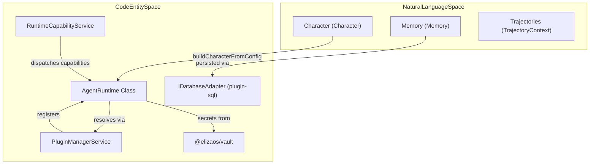

Sources: [packages/core/src/runtime.ts:69-167](), [packages/core/src/services/runtime-capability-service.ts:108-111](), [packages/agent/src/runtime/eliza.ts:149-154]()

---

## Plugin Registration and Resolution

The `AgentRuntime` uses a dynamic registration system to extend its capabilities. Plugins provide actions, evaluators, providers, and services that are injected into the runtime during startup.

### Capability Tiers
The runtime distinguishes between different levels of capabilities:
1. **Basic Capabilities**: Core functionality like reply/ignore actions, essential services (Task, Embedding), and event handlers [packages/core/src/features/basic-capabilities/index.ts:1-11]().
2. **Advanced Capabilities**: Extended context management (Facts, Relationships, Roles) and personality management services, enabled via `enableExtendedCapabilities` [packages/core/src/features/advanced-capabilities/index.ts:4-15]().
3. **Native Features**: Platform-specific features like trajectory logging and secure secrets management [packages/core/src/runtime.ts:18-24]().

### Plugin Lifecycle
Plugins are not just static collections of code; they have a lifecycle managed by the runtime. The `installRuntimePluginLifecycle` function ensures that plugins are properly initialized and can react to runtime events [packages/core/src/runtime.ts:17-17]().

Sources: [packages/core/src/features/basic-capabilities/index.ts:45-52](), [packages/core/src/features/advanced-capabilities/index.ts:144-149](), [packages/core/src/runtime.ts:130-140]()

---

## Initialization and Lifecycle

### Startup Sequence
The agent startup sequence is managed through `AgentRuntime`. This process involves setting up the workspace, initializing the database, and loading plugins in a specific order.

1. **Environment Setup**: Resolves process environment variables and vault secrets [packages/agent/src/runtime/eliza.ts:30-30]().
2. **Character Hydration**: Uses `buildCharacterFromConfig` to create the agent's identity [packages/agent/src/runtime/eliza.ts:149-149]().
3. **Plugin Resolution**: `resolvePlugins` identifies the necessary plugins based on character and environment [packages/agent/src/runtime/eliza.ts:31-31]().
4. **Service Boot**: Starts the `RuntimeCapabilityService` and other registered services [packages/core/src/services/runtime-capability-service.ts:136-140]().

**Diagram: Agent Startup Sequence**

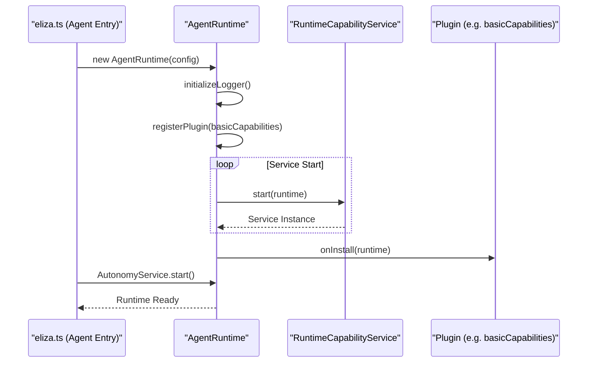

Sources: [packages/agent/src/runtime/eliza.ts:77-92](), [packages/core/src/runtime.ts:1-20](), [packages/core/src/services/runtime-capability-service.ts:136-140]()

---

## Capability Routing

A significant addition to the runtime is the `RuntimeCapabilityService`. This service acts as a unified router for various agent capabilities, dispatching requests to local or remote strategies.

### Strategy-Based Dispatch
The `RuntimeCapabilityService` implements the `ElizaCapabilityRouter` interface and manages:
- **File System (fs)**: File operations [packages/core/src/services/runtime-capability-service.ts:156-158]().
- **Terminal (pty)**: Shell and command execution [packages/core/src/services/runtime-capability-service.ts:160-162]().
- **Git**: Repository management [packages/core/src/services/runtime-capability-service.ts:164-166]().
- **Local Model**: On-device inference status [packages/core/src/services/runtime-capability-service.ts:168-170]().

### Remote Execution (E2B)
For sandboxed execution, the runtime can use the `E2BRemoteCapabilityRouterService`. This allows agents to run code in secure, isolated environments provided by E2B or Eliza Cloud [packages/agent/src/services/e2b-capability-router.ts:4-30]().

Sources: [packages/core/src/services/runtime-capability-service.ts:33-67](), [packages/agent/src/services/e2b-capability-router.ts:56-81]()

---

## Core Services and Capabilities

The `AgentRuntime` provides a set of built-in services that are registered during initialization.

| Service | Purpose | File Reference |
|---|---|---|
| `AutonomyService` | Manages the agent's autonomous decision-making loop | [packages/core/src/features/basic-capabilities/index.ts:75-75]() |
| `EmbeddingGenerationService` | Handles text-to-vector transformations | [packages/core/src/features/basic-capabilities/index.ts:22-22]() |
| `TaskService` | Manages scheduled tasks and background workers | [packages/core/src/features/basic-capabilities/index.ts:26-26]() |
| `EvaluatorService` | Runs post-turn analysis (Facts, Skills, Relationships) | [packages/core/src/features/basic-capabilities/index.ts:23-23]() |
| `RuntimeCapabilityService` | Unified router for fs/pty/git/model capabilities | [packages/core/src/services/runtime-capability-service.ts:108-111]() |

### Advanced Features
- **Turn Controllers**: Managed via `TurnControllerRegistry` to coordinate conversation flow [packages/core/src/runtime.ts:48-48]().
- **Message Triage**: Cross-platform messaging triage using `BaseMessageAdapter` and `DefaultTriageService` [packages/core/src/index.node.ts:93-125]().
- **Response Grammar**: Enforces structured output using GBNF grammars [packages/core/src/runtime.ts:206-206]().

Sources: [packages/core/src/runtime.ts:14-68](), [packages/core/src/features/basic-capabilities/index.ts:13-56](), [packages/core/src/features/advanced-capabilities/index.ts:113-139]()

---

# Page: Settings and Configuration

# Settings and Configuration

<details>
<summary>Relevant source files</summary>

The following files were used as context for generating this wiki page:

- [packages/agent/src/config/paths.ts](packages/agent/src/config/paths.ts)
- [packages/agent/src/runtime/restart.ts](packages/agent/src/runtime/restart.ts)
- [packages/agent/src/services/relationships-graph.ts](packages/agent/src/services/relationships-graph.ts)
- [packages/app-core/deploy/Dockerfile.cloud](packages/app-core/deploy/Dockerfile.cloud)
- [packages/app-core/deploy/Dockerfile.cloud.dockerignore](packages/app-core/deploy/Dockerfile.cloud.dockerignore)
- [packages/app-core/src/runtime/build-variant.ts](packages/app-core/src/runtime/build-variant.ts)
- [packages/app-core/src/runtime/sandbox-policy.ts](packages/app-core/src/runtime/sandbox-policy.ts)
- [packages/benchmarks/lifeops-bench/eliza_lifeops_bench/lifeworld/entities.py](packages/benchmarks/lifeops-bench/eliza_lifeops_bench/lifeworld/entities.py)
- [packages/benchmarks/lifeops-bench/eliza_lifeops_bench/lifeworld/world.py](packages/benchmarks/lifeops-bench/eliza_lifeops_bench/lifeworld/world.py)
- [packages/core/src/build-variant.ts](packages/core/src/build-variant.ts)
- [packages/core/src/features/secrets/actions/get-secret.ts](packages/core/src/features/secrets/actions/get-secret.ts)
- [packages/core/src/sandbox-policy.ts](packages/core/src/sandbox-policy.ts)
- [packages/core/src/utils/read-env.test.ts](packages/core/src/utils/read-env.test.ts)
- [packages/core/src/utils/read-env.ts](packages/core/src/utils/read-env.ts)
- [packages/core/src/utils/state-dir.test.ts](packages/core/src/utils/state-dir.test.ts)
- [packages/core/src/utils/state-dir.ts](packages/core/src/utils/state-dir.ts)
- [packages/scenario-runner/src/cerebras-judge.d.ts](packages/scenario-runner/src/cerebras-judge.d.ts)
- [packages/scenario-runner/src/cerebras-judge.d.ts.map](packages/scenario-runner/src/cerebras-judge.d.ts.map)
- [packages/shared/src/awareness/registry.ts](packages/shared/src/awareness/registry.ts)
- [packages/shared/src/config/runtime-mode.ts](packages/shared/src/config/runtime-mode.ts)
- [packages/shared/src/index.ts](packages/shared/src/index.ts)
- [packages/shared/src/local-inference/catalog.test.ts](packages/shared/src/local-inference/catalog.test.ts)
- [packages/shared/src/local-inference/index.ts](packages/shared/src/local-inference/index.ts)
- [packages/shared/src/local-inference/kokoro-execution-provider.test.ts](packages/shared/src/local-inference/kokoro-execution-provider.test.ts)
- [packages/shared/src/local-inference/kokoro-execution-provider.ts](packages/shared/src/local-inference/kokoro-execution-provider.ts)
- [packages/shared/src/local-inference/providers-types.ts](packages/shared/src/local-inference/providers-types.ts)
- [packages/shared/src/local-inference/types.ts](packages/shared/src/local-inference/types.ts)
- [packages/shared/src/local-inference/voice-models.ts](packages/shared/src/local-inference/voice-models.ts)
- [packages/ui/src/api/client-local-inference.ts](packages/ui/src/api/client-local-inference.ts)
- [packages/ui/src/build-variant.ts](packages/ui/src/build-variant.ts)
- [packages/ui/src/services/local-inference/catalog.ts](packages/ui/src/services/local-inference/catalog.ts)
- [packages/ui/src/services/local-inference/types.ts](packages/ui/src/services/local-inference/types.ts)
- [plugins.json](plugins.json)
- [plugins/plugin-local-inference/src/services/dflash-doctor.ts](plugins/plugin-local-inference/src/services/dflash-doctor.ts)
- [plugins/plugin-sql/package.json](plugins/plugin-sql/package.json)
- [plugins/plugin-workflow/README.md](plugins/plugin-workflow/README.md)

</details>


This page documents all environment variables and configuration options recognized by elizaOS, including server settings, database backend selection, AI provider credentials, data directory paths, and runtime execution modes. Configuration is loaded at process startup from a `.env` file in the working directory, or from environment variables set in the shell.

For how the CLI prompts for and generates `.env` files interactively, see [CLI Deploy Command](#4.2). For database backend architecture and connection pooling details, see [Memory and Database Adapters](#6.1). For the data directory file-system layout, see [Data Directory Structure](#6.2). For AI model provider selection logic at runtime, see [AgentRuntime](#2.1).

---

## Configuration Source

The canonical template for all recognized environment variables is provided in the repository's `.env.example`. This file serves as the documentation for the expected keys and their roles.

### Runtime Environment Utilities
The system utilizes centralized utilities in `packages/shared/src/env-utils.ts` and `packages/core/src/utils/read-env.ts` to resolve configuration. The `readEnv` function provides a standardized way to read environment variables with support for legacy aliases and silent mode [packages/core/src/utils/read-env.ts:1-20](). It is used extensively by the state directory resolution logic [packages/core/src/utils/state-dir.ts:29-30]().

---

## Runtime Execution Modes

elizaOS implements a tiered execution model that dictates security policies and sandbox requirements. This is controlled via the `ELIZA_RUNTIME_MODE` variable.

| Mode | Key | Description |
|---|---|---|
| **Cloud** | `cloud` | Optimized for managed environments; enforces strict security [packages/shared/src/config/runtime-mode.ts:34-40](). |
| **Local Safe** | `local-safe` | Local execution with mandatory sandboxing for sensitive operations [packages/shared/src/config/runtime-mode.ts:41-47](). |
| **Local YOLO** | `local-yolo` | Default mode; local execution without sandbox restrictions [packages/shared/src/config/runtime-mode.ts:48-54](). |

The resolution logic for these modes is implemented in `resolveRuntimeExecutionMode`, which checks `ELIZA_RUNTIME_MODE`, `RUNTIME_MODE`, and `LOCAL_RUNTIME_MODE` in order [packages/shared/src/config/runtime-mode.ts:132-154]().

**Execution Mode Resolution Flow:**

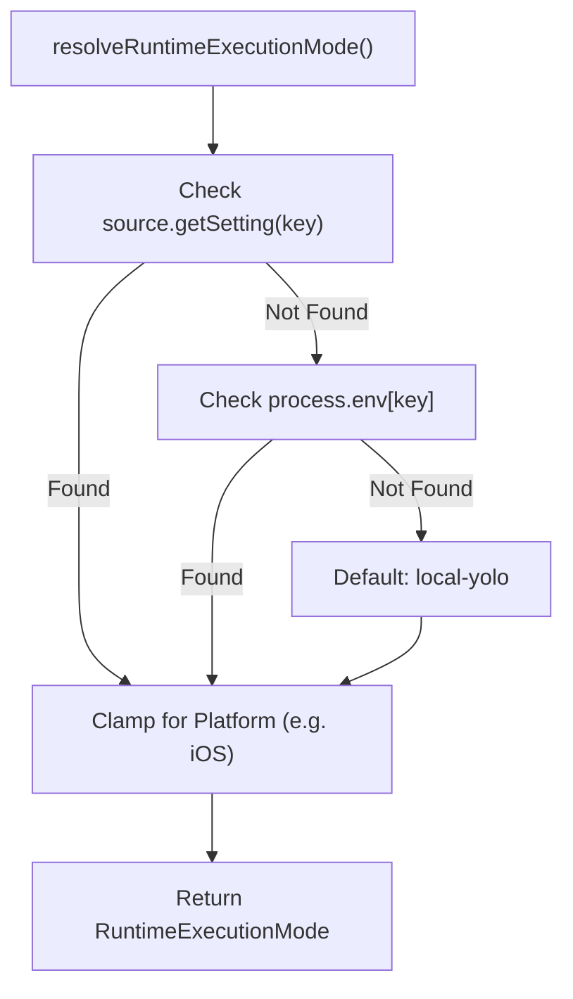

Sources: [packages/shared/src/config/runtime-mode.ts:5-55](), [packages/shared/src/config/runtime-mode.ts:132-154]()

---

## Data Directory Hierarchy

All persistent runtime data is stored under a configurable base directory. Every caller touching persisted state must use `resolveStateDir()` to ensure consistent path resolution [packages/core/src/utils/state-dir.ts:9-11]().

### Path Precedence
1. `ELIZA_STATE_DIR` (or legacy `MILADY_STATE_DIR`) [packages/core/src/utils/state-dir.ts:58-63]().
2. `<homedir>/.${ELIZA_NAMESPACE ?? "eliza"}` [packages/core/src/utils/state-dir.ts:64-65]().

### State Directory Components

| Variable | Default Path | Contents |
|---|---|---|
| `ELIZA_STATE_DIR` | `~/.eliza` | Root for all user state (skills, training, optimized prompts) [packages/core/src/utils/state-dir.ts:58-65](). |
| `ELIZA_OAUTH_DIR` | `{state-dir}/credentials` | OAuth token storage and session metadata [packages/core/src/utils/state-dir.ts:71-79](). |
| `ELIZA_NAMESPACE` | `eliza` | Used to name the default hidden directory in the user's home [packages/core/src/utils/state-dir.ts:48-52](). |

### Legacy Migration
On first run, if `~/.eliza` does not exist but a legacy `~/.milady` directory does, `migrateLegacyStateDir` automatically copies contents to the new location [packages/core/src/utils/state-dir.ts:118-144]().

**State Directory Entity Mapping:**

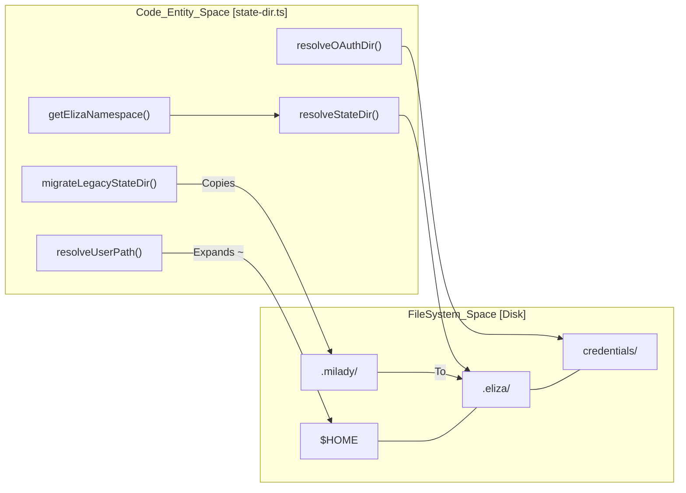

Sources: [packages/core/src/utils/state-dir.ts:35-154](), [packages/core/src/utils/state-dir.test.ts:23-86]()

---

## Local Inference Configuration

elizaOS includes a sophisticated local inference stack (Eliza-1) configured via a model catalog and tier system.

### Model Tiering
Models are categorized into tiers (0.8B to 27B) with specific hardware requirements [packages/shared/src/local-inference/catalog.js:15-30]().

| Setting | Description |
|---|---|
| `ELIZA_1_TIER` | Selects the model tier (e.g., `eliza-1-2b`) [packages/shared/src/local-inference/catalog.js:5-10](). |
| `GGML_OPENVINO_DEVICE` | Selects hardware (CPU/GPU/NPU) for OpenVINO workloads [packages/shared/src/local-inference/types.ts:149-152](). |

### Local Runtime Kernels
The runtime advertises capabilities via kernels like `dflash`, `turbo3`, and `polarquant` [packages/shared/src/local-inference/types.ts:169-176](). These are required for Eliza-1 W4-B kernel sets [packages/shared/src/local-inference/types.ts:153-160]().

**Inference Configuration Mapping:**

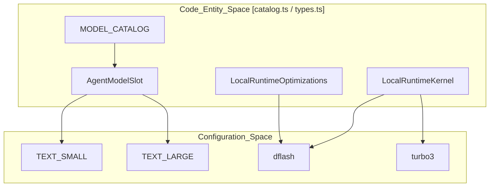

Sources: [packages/shared/src/local-inference/types.ts:12-32](), [packages/shared/src/local-inference/types.ts:169-185](), [packages/shared/src/local-inference/catalog.test.ts:113-124]()

---

## Database Configuration

elizaOS supports multiple database adapters, primarily managed through the SQL plugin.

| Variable | Description |
|---|---|
| `POSTGRES_URL` | Connection string for remote or local PostgreSQL instances [plugins/plugin-sql/package.json:86](). |
| `PGLITE_DATA_DIR` | Path for the embedded PGLite database [plugins/plugin-sql/package.json:83](). |

The `@elizaos/plugin-sql` package utilizes Drizzle ORM and support both Node.js and Browser environments [plugins/plugin-sql/package.json:10-29]().

---

## Docker and Cloud Deployment

Cloud-optimized deployments use a specific configuration to minimize image size and manage runtime entry points.

| Variable | Default | Description |
|---|---|---|
| `APP_PORT` | `2138` | Port the agent API binds to [packages/app-core/deploy/Dockerfile.cloud:8](). |
| `APP_API_BIND` | `127.0.0.1` | Network interface for the API [packages/app-core/deploy/Dockerfile.cloud:9](). |
| `NODE_LLAMA_CPP_SKIP_DOWNLOAD` | `true` | Prevents binary downloads during Docker build [packages/app-core/deploy/Dockerfile.cloud:49](). |

Sources: [packages/app-core/deploy/Dockerfile.cloud:5-26]()

---

# Page: Message Processing Pipeline

# Message Processing Pipeline

<details>
<summary>Relevant source files</summary>

The following files were used as context for generating this wiki page:

- [biome.json](biome.json)
- [packages/agent/src/runtime/plugin-role-gating.test.ts](packages/agent/src/runtime/plugin-role-gating.test.ts)
- [packages/agent/src/runtime/plugin-role-gating.ts](packages/agent/src/runtime/plugin-role-gating.ts)
- [packages/agent/src/services/sandbox-engine.ts](packages/agent/src/services/sandbox-engine.ts)
- [packages/core/build.ts](packages/core/build.ts)
- [packages/core/src/__tests__/message-routing-live-regression.test.ts](packages/core/src/__tests__/message-routing-live-regression.test.ts)
- [packages/core/src/__tests__/message-runtime-stage1.test.ts](packages/core/src/__tests__/message-runtime-stage1.test.ts)
- [packages/core/src/__tests__/tiered-action-surface.test.ts](packages/core/src/__tests__/tiered-action-surface.test.ts)
- [packages/core/src/actions/to-tool.ts](packages/core/src/actions/to-tool.ts)
- [packages/core/src/features/advanced-capabilities/actions/generateMedia.test.ts](packages/core/src/features/advanced-capabilities/actions/generateMedia.test.ts)
- [packages/core/src/features/messaging/triage/__tests__/list-inbox-action.test.ts](packages/core/src/features/messaging/triage/__tests__/list-inbox-action.test.ts)
- [packages/core/src/features/plugin-manager/plugin-manager-umbrella.test.ts](packages/core/src/features/plugin-manager/plugin-manager-umbrella.test.ts)
- [packages/core/src/network/ssrf.test.ts](packages/core/src/network/ssrf.test.ts)
- [packages/core/src/prompts/evaluator.ts](packages/core/src/prompts/evaluator.ts)
- [packages/core/src/prompts/planner.ts](packages/core/src/prompts/planner.ts)
- [packages/core/src/runtime/__tests__/action-tiering.test.ts](packages/core/src/runtime/__tests__/action-tiering.test.ts)
- [packages/core/src/runtime/__tests__/evaluator.test.ts](packages/core/src/runtime/__tests__/evaluator.test.ts)
- [packages/core/src/runtime/__tests__/json-output.test.ts](packages/core/src/runtime/__tests__/json-output.test.ts)
- [packages/core/src/runtime/__tests__/message-handler-bogus-candidates.test.ts](packages/core/src/runtime/__tests__/message-handler-bogus-candidates.test.ts)
- [packages/core/src/runtime/__tests__/message-handler-refusal-suppression.test.ts](packages/core/src/runtime/__tests__/message-handler-refusal-suppression.test.ts)
- [packages/core/src/runtime/__tests__/message-handler.test.ts](packages/core/src/runtime/__tests__/message-handler.test.ts)
- [packages/core/src/runtime/__tests__/plan-actions-extractor.test.ts](packages/core/src/runtime/__tests__/plan-actions-extractor.test.ts)
- [packages/core/src/runtime/__tests__/planner-loop-plan-actions-in-text.test.ts](packages/core/src/runtime/__tests__/planner-loop-plan-actions-in-text.test.ts)
- [packages/core/src/runtime/__tests__/planner-loop.test.ts](packages/core/src/runtime/__tests__/planner-loop.test.ts)
- [packages/core/src/runtime/__tests__/response-grammar.test.ts](packages/core/src/runtime/__tests__/response-grammar.test.ts)
- [packages/core/src/runtime/__tests__/response-handler-evaluators.test.ts](packages/core/src/runtime/__tests__/response-handler-evaluators.test.ts)
- [packages/core/src/runtime/__tests__/response-handler-field-registry.test.ts](packages/core/src/runtime/__tests__/response-handler-field-registry.test.ts)
- [packages/core/src/runtime/action-tiering.ts](packages/core/src/runtime/action-tiering.ts)
- [packages/core/src/runtime/evaluator.ts](packages/core/src/runtime/evaluator.ts)
- [packages/core/src/runtime/json-output.ts](packages/core/src/runtime/json-output.ts)
- [packages/core/src/runtime/message-handler.ts](packages/core/src/runtime/message-handler.ts)
- [packages/core/src/runtime/plan-actions-extractor.ts](packages/core/src/runtime/plan-actions-extractor.ts)
- [packages/core/src/runtime/planner-loop.ts](packages/core/src/runtime/planner-loop.ts)
- [packages/core/src/runtime/response-grammar.ts](packages/core/src/runtime/response-grammar.ts)
- [packages/core/src/runtime/response-handler-evaluators.ts](packages/core/src/runtime/response-handler-evaluators.ts)
- [packages/core/src/runtime/response-handler-field-registry.ts](packages/core/src/runtime/response-handler-field-registry.ts)
- [packages/core/src/services/message.ts](packages/core/src/services/message.ts)
- [packages/core/src/types/components.ts](packages/core/src/types/components.ts)
- [packages/core/src/types/model.ts](packages/core/src/types/model.ts)
- [plugins/plugin-agent-orchestrator/__tests__/unit/task-agent-frameworks.test.ts](plugins/plugin-agent-orchestrator/__tests__/unit/task-agent-frameworks.test.ts)
- [plugins/plugin-discord/__tests__/message-coalesce.test.ts](plugins/plugin-discord/__tests__/message-coalesce.test.ts)
- [plugins/plugin-discord/__tests__/messages-url.test.ts](plugins/plugin-discord/__tests__/messages-url.test.ts)
- [plugins/plugin-discord/__tests__/staleness.test.ts](plugins/plugin-discord/__tests__/staleness.test.ts)
- [plugins/plugin-discord/attachments.ts](plugins/plugin-discord/attachments.ts)
- [plugins/plugin-discord/debouncer.ts](plugins/plugin-discord/debouncer.ts)
- [plugins/plugin-discord/discord-events.ts](plugins/plugin-discord/discord-events.ts)
- [plugins/plugin-discord/discord-history.ts](plugins/plugin-discord/discord-history.ts)
- [plugins/plugin-discord/message-coalesce.ts](plugins/plugin-discord/message-coalesce.ts)
- [plugins/plugin-discord/messages.ts](plugins/plugin-discord/messages.ts)
- [plugins/plugin-discord/service.ts](plugins/plugin-discord/service.ts)
- [plugins/plugin-discord/slash-commands.ts](plugins/plugin-discord/slash-commands.ts)
- [plugins/plugin-discord/staleness.ts](plugins/plugin-discord/staleness.ts)
- [plugins/plugin-discord/status-reactions.ts](plugins/plugin-discord/status-reactions.ts)
- [plugins/plugin-local-inference/native/docs/TOKEN_TRIE_SAMPLER.md](plugins/plugin-local-inference/native/docs/TOKEN_TRIE_SAMPLER.md)
- [plugins/plugin-local-inference/native/include/eliza_token_trie_sampler.h](plugins/plugin-local-inference/native/include/eliza_token_trie_sampler.h)

</details>


## Purpose and Scope

The Message Processing Pipeline is the core orchestration engine within elizaOS that transforms raw inputs into intelligent agent responses. In v5, the pipeline follows a redesigned two-stage process: **Stage 1 (Classification and Intent)** and **Stage 2 (Planning and Execution)**. This architecture ensures that agents can handle both trivial chat and complex, multi-step tasks with high reliability and structured output enforcement.

The pipeline is primarily implemented in the `DefaultMessageService` within `packages/core/src/services/message.ts` [packages/core/src/services/message.ts:140-144](). It coordinates the `AgentRuntime`, the `PlannerLoop`, and GBNF grammar enforcement to manage state and model interactions.

## High-Level Data Flow

The v5 pipeline follows a structured sequence using the `HANDLE_RESPONSE` tool to bridge natural language input to structured code execution.

Title: v5 Message Processing Architecture
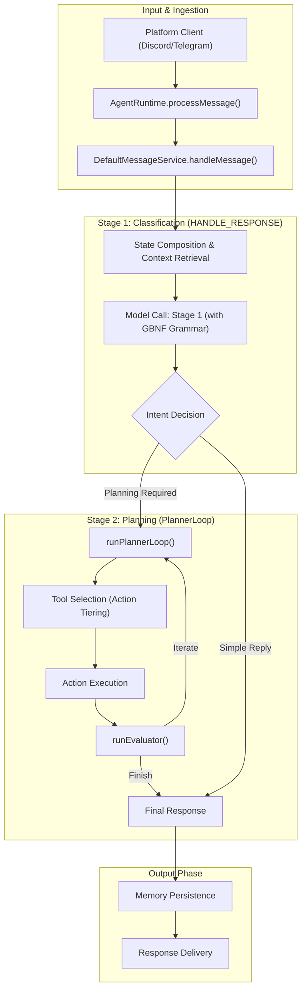

Sources: [packages/core/src/services/message.ts:71-75](), [packages/core/src/runtime/planner-loop.ts:119-130]()

## Stage 1: The `HANDLE_RESPONSE` Pipeline

Stage 1 is the entry point for all message processing. It uses a specialized tool called `HANDLE_RESPONSE` to classify the user's intent and decide the execution strategy [packages/core/src/actions/to-tool.ts:8-10]().

### The HANDLE_RESPONSE Tool
This tool enforces a strict JSON schema via GBNF (Guided BNF) grammar to ensure the model provides all necessary metadata [packages/core/src/runtime/response-grammar.ts:112-122]().

| Field | Purpose | Implementation |
| :--- | :--- | :--- |
| `shouldRespond` | Enum: `RESPOND`, `IGNORE`, or `STOP`. | [packages/core/src/actions/to-tool.ts:8-9]() |
| `contexts` | Identifies active sub-systems (e.g., `calendar`, `tasks`). | [packages/core/src/runtime/response-grammar.ts:65-66]() |
| `replyText` | A direct answer (Simple mode) or acknowledgement. | [packages/core/src/services/message.ts:106-107]() |
| `candidateActionNames` | High-precision hints for Stage 2 action surface. | [packages/core/src/services/message.ts:27-29]() |
| `facts` / `relationships` | Extracts durable information for memory. | [packages/core/src/services/message.ts:65-67]() |

### Context and Grammar Enforcement
To optimize local inference, the pipeline generates a dynamic GBNF grammar for every turn. This forces the model to pick only from valid `contexts` and `actions` [packages/core/src/runtime/response-grammar.ts:5-16]().
- **Direct Channels**: In DMs, the pipeline drops fields like `shouldRespond` and `facts` to reduce token overhead [packages/core/src/runtime/response-grammar.ts:105-120]().
- **Grammar Caching**: Grammars are cached based on a signature derived from the registry and available contexts [packages/core/src/runtime/response-grammar.ts:26-31]().

Sources: [packages/core/src/runtime/response-grammar.ts:1-32](), [packages/core/src/services/message.ts:93-96]()

## Stage 2: The PlannerLoop

If Stage 1 determines that planning is required (e.g., `contexts` contains more than `simple`), the system enters the `runPlannerLoop` [packages/core/src/runtime/planner-loop.ts:119-121]().

### Multi-Step Execution
The `PlannerLoop` is a chaining mechanism that allows the agent to call multiple tools in sequence.
1. **Action Tiering**: Actions are tiered based on relevance to the turn's `candidateActionNames` [packages/core/src/runtime/action-tiering.ts:32-33]().
2. **Tool Selection**: The planner selects a tool, executes it, and appends the result to the `PlannerTrajectory` [packages/core/src/runtime/planner-loop.ts:124-130]().
3. **Evaluation**: After each tool call, `runEvaluator` is invoked to decide if the task is complete (`FINISH`) or needs more steps [packages/core/src/runtime/evaluator.ts:67-69]().

### Trajectory and Limits
The `PlannerLoop` enforces several guards to prevent infinite loops and bound costs [packages/core/src/runtime/planner-loop.ts:131-162]():
- `maxTrajectoryPromptTokens`: Caps the total tokens consumed in a single user turn.
- `TrajectoryRecorder`: Records every model interaction for debugging and training [packages/core/src/runtime/planner-loop.ts:70-77]().
- `observePlannerUsage`: Sums tokens across every stage to fire budget guards [packages/core/src/runtime/planner-loop.ts:146-151]().

Sources: [packages/core/src/runtime/planner-loop.ts:119-215](), [packages/core/src/runtime/evaluator.ts:67-151]()

## Code Entity Mapping

The following diagram maps high-level pipeline concepts to the specific TypeScript classes and functions that implement them.

Title: Natural Language Space to Code Entity Space
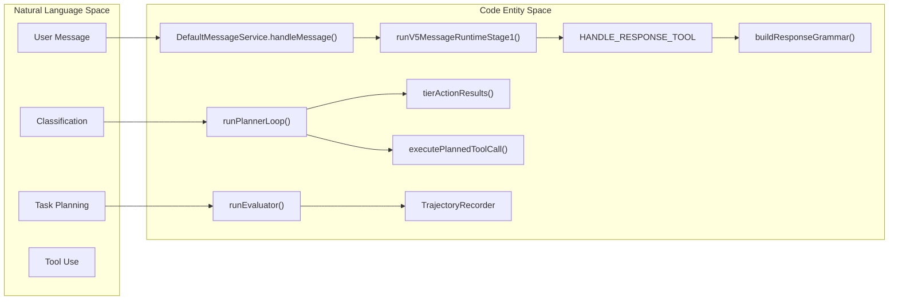

Sources: [packages/core/src/services/message.ts:8-12](), [packages/core/src/runtime/planner-loop.ts:119-121](), [packages/core/src/runtime/response-grammar.ts:112-114]()

## Action Tiering and Retrieval

The pipeline uses a tiered approach to manage the agent's action surface, preventing context window bloat and improving precision.

| Tier | Description | Implementation |
| :--- | :--- | :--- |
| **Tier A** | Actions explicitly requested by Stage 1 (`candidateActionNames`). | [packages/core/src/runtime/action-tiering.ts:32-33]() |
| **Tier B** | Contextually relevant actions found via semantic search. | [packages/core/src/runtime/action-retrieval.ts:30-31]() |
| **Terminals** | Essential turn-ending actions like `REPLY` and `STOP`. | [packages/core/src/actions/to-tool.ts:7-9]() |

The `buildPlannerToolsFromTieredActions` function converts these filtered actions into native tool definitions for the LLM [packages/core/src/actions/to-tool.ts:6-10]().

## Key Implementation Summary

| Feature | Code Symbol | Role |
| :--- | :--- | :--- |
| **Message Service** | `DefaultMessageService` | Entry point for the v5 pipeline orchestration. |
| **Response Handler** | `HANDLE_RESPONSE` | The Stage 1 classification tool and JSON envelope. |
| **Grammar Engine** | `buildResponseGrammar` | Generates GBNF for structure-forcing local models. |
| **Execution Loop** | `runPlannerLoop` | Manages multi-step tool execution and trajectory. |
| **Evaluator** | `runEvaluator` | Determines if a plan is complete or needs iteration. |
| **Streaming** | `StreamingContext` | Manages real-time token delivery and pipeline hooks. |

Sources:
- `packages/core/src/services/message.ts`
- `packages/core/src/runtime/planner-loop.ts`
- `packages/core/src/runtime/response-grammar.ts`
- `packages/core/src/runtime/evaluator.ts`
- `packages/core/src/streaming-context.ts`

---

# Page: Protocol Buffers and Schemas

# Protocol Buffers and Schemas

<details>
<summary>Relevant source files</summary>

The following files were used as context for generating this wiki page:

- [.gitattributes](.gitattributes)
- [.gitignore](.gitignore)
- [packages/app/test/ui-smoke/apps-utility-interactions.spec.ts](packages/app/test/ui-smoke/apps-utility-interactions.spec.ts)
- [packages/app/test/ui-smoke/remote-capability-view.spec.ts](packages/app/test/ui-smoke/remote-capability-view.spec.ts)
- [packages/cloud-frontend/tests/e2e/api-explorer-flow.spec.ts](packages/cloud-frontend/tests/e2e/api-explorer-flow.spec.ts)
- [packages/core/src/__tests__/action-structure-audit.test.ts](packages/core/src/__tests__/action-structure-audit.test.ts)
- [packages/core/src/generated/action-docs.ts](packages/core/src/generated/action-docs.ts)
- [packages/core/src/utils/context-catalog.ts](packages/core/src/utils/context-catalog.ts)
- [packages/elizaos/templates-manifest.json](packages/elizaos/templates-manifest.json)
- [packages/examples/a2a/tsconfig.json](packages/examples/a2a/tsconfig.json)
- [packages/examples/agent-console/tsconfig.json](packages/examples/agent-console/tsconfig.json)
- [packages/examples/aws/tsconfig.json](packages/examples/aws/tsconfig.json)
- [packages/examples/bluesky/tsconfig.json](packages/examples/bluesky/tsconfig.json)
- [packages/examples/setup-guide.html](packages/examples/setup-guide.html)
- [packages/prompts/scripts/generate-plugin-action-spec.js](packages/prompts/scripts/generate-plugin-action-spec.js)
- [packages/prompts/specs/actions/plugins.generated.json](packages/prompts/specs/actions/plugins.generated.json)
- [packages/ui/src/bridge/capacitor-bridge.ts](packages/ui/src/bridge/capacitor-bridge.ts)
- [packages/ui/src/bridge/plugin-bridge.ts](packages/ui/src/bridge/plugin-bridge.ts)
- [packages/ui/src/components/apps/GameView.tsx](packages/ui/src/components/apps/GameView.tsx)
- [packages/ui/src/components/apps/load-apps-catalog.ts](packages/ui/src/components/apps/load-apps-catalog.ts)
- [packages/ui/src/components/character/CharacterEditor.tsx](packages/ui/src/components/character/CharacterEditor.tsx)
- [plugins/plugin-browser/src/actions/browser.ts](plugins/plugin-browser/src/actions/browser.ts)
- [plugins/plugin-coding-tools/src/services/ripgrep-service.ts](plugins/plugin-coding-tools/src/services/ripgrep-service.ts)
- [tsconfig.dist-paths.json](tsconfig.dist-paths.json)
- [turbo.json](turbo.json)

</details>


The `@elizaos/schemas` package provides the **single source of truth** for all type definitions in elizaOS [tsconfig.dist-paths.json:80](). It uses Protocol Buffers (protobuf) to define data structures once and generate strongly-typed implementations for TypeScript, Python, and Rust. This ensures type consistency across the entire multi-language platform and eliminates the need to manually maintain parallel type definitions.

**Scope**: This page explains the role of Protocol Buffers in the elizaOS architecture, the schema package structure, and the code generation workflow. For details on writing `.proto` schema files, see [Schema Definition](#3.1). For the technical details of multi-language code generation, see [Code Generation](#3.2).

---

## Purpose and Architecture

Protocol Buffers serve as the type system foundation for elizaOS's multi-language architecture. By defining types once in `.proto` files and generating language-specific implementations, the system achieves:

- **Type safety across language boundaries**: Messages passed between TypeScript, Python, and Rust components are guaranteed to have matching structures.
- **Single source of truth**: Type definitions exist in one location, preventing drift and inconsistencies.
- **Automatic serialization**: Protocol Buffer runtime libraries, such as `@bufbuild/protobuf`, handle efficient serialization for high-performance communication.
- **Backward compatibility**: Protobuf's evolution semantics allow schema changes without breaking existing code.

The schemas package is consumed by all language runtimes in the elizaOS platform, including `@elizaos/core` [packages/core/package.json:2](), `@elizaos/agent` [packages/agent/package.json:81](), and the various language-specific runtimes.

**Sources**: [tsconfig.dist-paths.json:80-80](), [packages/core/package.json:2-4]()

---

## Package Structure

The schema system is organized to support the [Buf](https://buf.build/) toolchain for schema management. The definitions reside in `packages/schemas/` and are referenced across the monorepo via workspace symlinks.

| Component | Purpose |
| :--- | :--- |
| `.proto` Files | Core schema definitions (Agent, Memory, Events, etc.) located in `packages/schemas/eliza/v1/`. |
| `buf.yaml` | Buf configuration for linting and compilation. |
| `buf.gen.yaml` | Configuration for multi-language code generation (TS, Python, Rust). |
| Generated Types | Output directories such as `packages/core/src/generated/` for TypeScript [packages/core/src/generated/action-docs.ts:1-4](). |

The package publishes schema definitions and configuration files. Each language runtime package contains its own generated types in its source tree to ensure they can be built without the full protobuf toolchain present during standard installation. For example, action and provider documentation is auto-generated from prompts and specs into the core runtime [packages/core/src/generated/action-docs.ts:1-4]().

**Sources**: [tsconfig.dist-paths.json:80-80](), [packages/core/src/generated/action-docs.ts:1-4]()

---

## Schema Compilation Flow

The diagram below illustrates how `.proto` schemas and prompt specifications are compiled into language-specific type definitions and documentation using the `buf` toolchain and custom generation scripts.

### Type Generation Pipeline
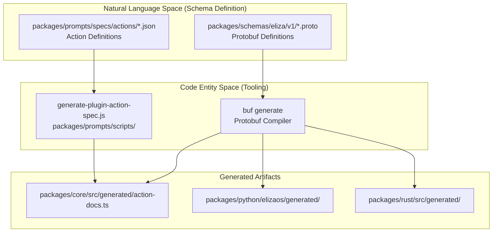

**Sources**: [packages/prompts/scripts/generate-plugin-action-spec.js:1-25](), [packages/core/src/generated/action-docs.ts:1-4](), [tsconfig.dist-paths.json:80-80]()

---

## Build Scripts and Workflow

The system provides centralized scripts to manage the schema lifecycle. The build orchestration is handled by Turbo, ensuring dependencies are built in the correct order.

| Script | Command | Purpose |
|--------|---------|---------|
| `build` | `turbo run build` | Orchestrates builds across all packages including schemas [turbo.json:10]() |
| `generate-plugin-action-spec.js` | `node packages/prompts/scripts/generate-plugin-action-spec.js` | Scans plugins to generate canonical action specifications [packages/prompts/scripts/generate-plugin-action-spec.js:1-25]() |

The typical workflow for updating schemas:
1. Edit `.proto` files in `packages/schemas/eliza/v1/`.
2. Run the generation scripts to update language targets.
3. The build system (Turbo) ensures that dependent packages like `@elizaos/core` are rebuilt with the new types, specifically checking `@elizaos/core#build` [turbo.json:11]().

**Sources**: [turbo.json:10-11](), [packages/prompts/scripts/generate-plugin-action-spec.js:1-25]()

---

## Cross-Language Serialization

Protocol Buffers enable seamless data exchange between the language runtimes. This is critical for the "Interop" layer where TypeScript, Python, and Rust components interact.

### Interop Data Flow
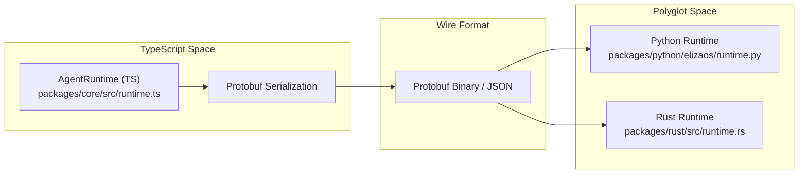

**Sources**: [tsconfig.dist-paths.json:10-16](), [packages/core/src/utils/context-catalog.ts:1-13]()

---

## Integration with Language Runtimes

Each language runtime package consumes the generated types and requires specific runtime dependencies to handle the serialization logic.

### TypeScript Integration
The `@elizaos/core` package uses these generated types for component interfaces, action documentation [packages/core/src/generated/action-docs.ts:52-61](), and the `ACTION_CONTEXT_MAP` [packages/core/src/utils/context-catalog.ts:3-10]().

### Python and Rust Integration
The `@elizaos/python` and `@elizaos/rust` packages maintain their own copies of generated types. Rust uses these types within its runtime implementations to ensure high-performance execution while remaining compatible with the TypeScript-based orchestrator.

**Sources**: [packages/core/src/generated/action-docs.ts:52-61](), [packages/core/src/utils/context-catalog.ts:3-10](), [tsconfig.dist-paths.json:80-84]()

---

## Next Steps

- **[Schema Definition](#3.1)**: Learn how to define Protocol Buffer schemas, including message types, field types, and best practices for the v1 schema.
- **[Code Generation](#3.2)**: Understand the multi-language code generation process (TS, Python, Rust) and the build pipeline.
- **[Cross-Language Interoperability](#9.4)**: See how Protocol Buffers enable communication between TypeScript, Python, and Rust components via the Interop package.

---

# Page: Schema Definition

# Schema Definition

<details>
<summary>Relevant source files</summary>

The following files were used as context for generating this wiki page:

- [.gitattributes](.gitattributes)
- [.gitignore](.gitignore)
- [packages/agent/src/api/config-routes.ts](packages/agent/src/api/config-routes.ts)
- [packages/agent/src/api/onboarding-routes.ts](packages/agent/src/api/onboarding-routes.ts)
- [packages/agent/src/api/server-helpers-config.ts](packages/agent/src/api/server-helpers-config.ts)
- [packages/app/test/ui-smoke/apps-utility-interactions.spec.ts](packages/app/test/ui-smoke/apps-utility-interactions.spec.ts)
- [packages/app/test/ui-smoke/remote-capability-view.spec.ts](packages/app/test/ui-smoke/remote-capability-view.spec.ts)
- [packages/cloud-frontend/tests/e2e/api-explorer-flow.spec.ts](packages/cloud-frontend/tests/e2e/api-explorer-flow.spec.ts)
- [packages/core/src/__tests__/action-structure-audit.test.ts](packages/core/src/__tests__/action-structure-audit.test.ts)
- [packages/core/src/generated/action-docs.ts](packages/core/src/generated/action-docs.ts)
- [packages/core/src/utils/context-catalog.ts](packages/core/src/utils/context-catalog.ts)
- [packages/elizaos/templates-manifest.json](packages/elizaos/templates-manifest.json)
- [packages/examples/a2a/tsconfig.json](packages/examples/a2a/tsconfig.json)
- [packages/examples/agent-console/tsconfig.json](packages/examples/agent-console/tsconfig.json)
- [packages/examples/aws/tsconfig.json](packages/examples/aws/tsconfig.json)
- [packages/examples/bluesky/tsconfig.json](packages/examples/bluesky/tsconfig.json)
- [packages/examples/setup-guide.html](packages/examples/setup-guide.html)
- [packages/prompts/scripts/generate-plugin-action-spec.js](packages/prompts/scripts/generate-plugin-action-spec.js)
- [packages/prompts/specs/actions/plugins.generated.json](packages/prompts/specs/actions/plugins.generated.json)
- [packages/shared/src/contracts/__tests__/schema-vs-type-drift.test.ts](packages/shared/src/contracts/__tests__/schema-vs-type-drift.test.ts)
- [packages/shared/src/contracts/apps-favorites-routes.test.ts](packages/shared/src/contracts/apps-favorites-routes.test.ts)
- [packages/shared/src/contracts/apps-favorites-routes.ts](packages/shared/src/contracts/apps-favorites-routes.ts)
- [packages/shared/src/contracts/apps-lifecycle-routes.test.ts](packages/shared/src/contracts/apps-lifecycle-routes.test.ts)
- [packages/shared/src/contracts/apps-lifecycle-routes.ts](packages/shared/src/contracts/apps-lifecycle-routes.ts)
- [packages/shared/src/contracts/apps-runs-routes.test.ts](packages/shared/src/contracts/apps-runs-routes.test.ts)
- [packages/shared/src/contracts/apps-runs-routes.ts](packages/shared/src/contracts/apps-runs-routes.ts)
- [packages/shared/src/contracts/conversation-routes.test.ts](packages/shared/src/contracts/conversation-routes.test.ts)
- [packages/shared/src/contracts/index.ts](packages/shared/src/contracts/index.ts)
- [packages/shared/src/contracts/onboarding-routes.test.ts](packages/shared/src/contracts/onboarding-routes.test.ts)
- [packages/shared/src/contracts/onboarding-routes.ts](packages/shared/src/contracts/onboarding-routes.ts)
- [packages/ui/src/bridge/capacitor-bridge.ts](packages/ui/src/bridge/capacitor-bridge.ts)
- [packages/ui/src/bridge/plugin-bridge.ts](packages/ui/src/bridge/plugin-bridge.ts)
- [packages/ui/src/components/apps/GameView.tsx](packages/ui/src/components/apps/GameView.tsx)
- [packages/ui/src/components/apps/load-apps-catalog.ts](packages/ui/src/components/apps/load-apps-catalog.ts)
- [packages/ui/src/components/character/CharacterEditor.tsx](packages/ui/src/components/character/CharacterEditor.tsx)
- [plugins/plugin-browser/src/actions/browser.ts](plugins/plugin-browser/src/actions/browser.ts)
- [plugins/plugin-coding-tools/src/services/ripgrep-service.ts](plugins/plugin-coding-tools/src/services/ripgrep-service.ts)
- [tsconfig.dist-paths.json](tsconfig.dist-paths.json)
- [turbo.json](turbo.json)

</details>


This page documents how Protocol Buffer schemas are defined, organized, and compiled in elizaOS. The `packages/schemas/` package serves as the single source of truth for all type definitions across TypeScript, Python, and Rust runtimes, ensuring cross-language interoperability.

---

## Schema Package Structure

The schemas package resides at `packages/schemas/` and houses all Protocol Buffer (`.proto`) definitions. These schemas are used as the canonical source of data types and service contracts that are compiled into language-specific type modules. The system covers core definitions including `agent.proto`, `memory.proto`, `events.proto`, `plugin.proto`, `messaging.proto`, `tee.proto`, and others.

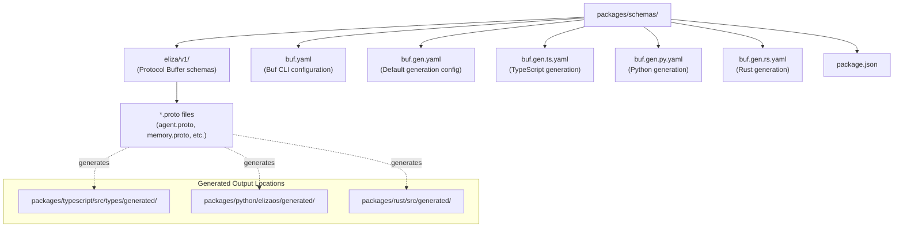

The system also utilizes Zod schemas for HTTP route validation, particularly within the `packages/shared/src/contracts/` directory, which provides type safety for the API layer [packages/shared/src/contracts/apps-lifecycle-routes.ts:1-21](). This layer bridges the gaps between the internal protocol and external HTTP interfaces.

**Sources:** [packages/shared/src/contracts/apps-lifecycle-routes.ts:1-21](), [tsconfig.dist-paths.json:80-80]()

---

## Buf Configuration and Tooling

### Core Configuration
The elizaOS schema infrastructure is managed using **Buf**, a toolchain that simplifies Protocol Buffer management. The configuration ensures that schemas are organized under the `eliza/v1/` directory to support versioned API evolution.

- **Linting**: Validates schema definitions against project-wide style rules.
- **Breaking Change Detection**: Ensures that updates to `.proto` files do not break compatibility with existing generated code in the various language runtimes.
- **Generation**: Orchestrated via `buf generate` using various templates for multi-language output.

### Multi-Language Generation
The generation process is critical for the polyglot architecture of elizaOS. The `packages/schemas` package is referenced by other workspace packages to ensure type consistency [tsconfig.dist-paths.json:80-80]().

| Language | Target Path | Purpose |
|----------|-------------|---------|
| TypeScript | `packages/typescript/src/types/generated/` | Core runtime types and client bindings. |
| Python | `packages/python/elizaos/generated/` | Robotics stack and local inference support. |
| Rust | `packages/rust/src/generated/` | High-performance TEE and WASM components. |

---

## Runtime Type Integration

### API Schema Validation (Zod)
While Protocol Buffers handle cross-language serialization, elizaOS uses **Zod** for strict runtime validation of HTTP request and response bodies. This is centralized in `packages/shared/src/contracts/` [packages/shared/src/contracts/index.ts:1-41]().

| Schema Name | Purpose | Target Route |
|-------------|---------|--------------|
| `PostLaunchAppRequestSchema` | Validates app launch requests [packages/shared/src/contracts/apps-lifecycle-routes.ts:38-40]() | `POST /api/apps/launch` |
| `PostInstallAppRequestSchema` | Validates app installation with versioning [packages/shared/src/contracts/apps-lifecycle-routes.ts:42-60]() | `POST /api/apps/install` |
| `PostStopAppRequestSchema` | Validates stop requests using `name` or `runId` [packages/shared/src/contracts/apps-lifecycle-routes.ts:67-82]() | `POST /api/apps/stop` |
| `PostCreateAppRequestSchema` | Validates intent-based app creation [packages/shared/src/contracts/apps-lifecycle-routes.ts:122-139]() | `POST /api/apps/create` |

### Action Documentation Schema
The system also maintains a specialized schema for auto-generating action and provider documentation, found in `packages/core/src/generated/action-docs.ts` [packages/core/src/generated/action-docs.ts:1-61](). This defines types like `ActionDoc`, `ActionDocParameter`, and `ActionDocExampleCall`, which are used to inform the LLM planner about available capabilities.

**Sources:** [packages/shared/src/contracts/apps-lifecycle-routes.ts:23-158](), [packages/core/src/generated/action-docs.ts:1-61](), [packages/shared/src/contracts/index.ts:1-41]()

---

## Bridging Natural Language to Code Entities

### Diagram 1: Action Specification Pipeline
This diagram illustrates how natural language action descriptions are transformed into code entities that the `AgentRuntime` can utilize.

```mermaid
graph TD
    subgraph "Natural Language Space"
        SpecFiles["Action Specs<br/>(packages/prompts/specs/actions/*.json)"]
        PluginDocs["Plugin Descriptions<br/>(plugins/*/src/actions/*.ts)"]
    end

    subgraph "Code Entity Space"
        GenScript["generate-plugin-action-spec.js"]
        ActionDocs["packages/core/src/generated/action-docs.ts"]
        ActionType["ActionDoc Type"]
        CoreActions["coreActionsSpec"]
    end

    SpecFiles --> GenScript
    PluginDocs --> GenScript
    GenScript --> ActionDocs
    ActionDocs --> ActionType
    ActionDocs --> CoreActions
```

**Sources:** [packages/prompts/scripts/generate-plugin-action-spec.js:1-25](), [packages/core/src/generated/action-docs.ts:1-77]()

### Diagram 2: API Contract Flow
This diagram illustrates how Zod schemas in the `shared` package bridge natural language "Intents" to validated server actions within the `AgentRuntime`.

```mermaid
graph TD
    subgraph "Natural Language Space"
        UserIntent["'Create a todo app'"]
    end

    subgraph "Code Entity Space"
        ZodSchema["PostCreateAppRequestSchema<br/>(shared/src/contracts/apps-lifecycle-routes.ts)"]
        Validation["safeParse()"]
        RouteHandler["apps-lifecycle-routes.ts"]
        AgentAPI["packages/agent/src/api/server.ts"]
    end

    UserIntent --> ZodSchema
    ZodSchema --> Validation
    Validation --> RouteHandler
    RouteHandler --> AgentAPI
```

**Sources:** [packages/shared/src/contracts/apps-lifecycle-routes.ts:122-139](), [packages/shared/src/contracts/index.ts:1-41]()

---

## Action and Context Mapping

The schema system extends to how actions are categorized for the LLM. The `ACTION_CONTEXT_MAP` in `packages/core/src/utils/context-catalog.ts` associates action names with their functional domains [packages/core/src/utils/context-catalog.ts:3-162]().

| Action | Contexts |
|--------|----------|
| `REPLY` | `["general"]` [packages/core/src/utils/context-catalog.ts:7-7]() |
| `WALLET` | `["wallet"]` [packages/core/src/utils/context-catalog.ts:18-18]() |
| `BROWSER` | `["browser"]` [packages/core/src/utils/context-catalog.ts:67-67]() |
| `SPAWN_AGENT` | `["code", "automation"]` [packages/core/src/utils/context-catalog.ts:74-74]() |

**Sources:** [packages/core/src/utils/context-catalog.ts:1-162](), [packages/core/src/__tests__/action-structure-audit.test.ts:151-230]()

---

# Page: Code Generation

# Code Generation

<details>
<summary>Relevant source files</summary>

The following files were used as context for generating this wiki page:

- [.gitattributes](.gitattributes)
- [.gitignore](.gitignore)
- [packages/app/test/ui-smoke/apps-utility-interactions.spec.ts](packages/app/test/ui-smoke/apps-utility-interactions.spec.ts)
- [packages/app/test/ui-smoke/remote-capability-view.spec.ts](packages/app/test/ui-smoke/remote-capability-view.spec.ts)
- [packages/cloud-frontend/tests/e2e/api-explorer-flow.spec.ts](packages/cloud-frontend/tests/e2e/api-explorer-flow.spec.ts)
- [packages/core/src/__tests__/action-structure-audit.test.ts](packages/core/src/__tests__/action-structure-audit.test.ts)
- [packages/core/src/generated/action-docs.ts](packages/core/src/generated/action-docs.ts)
- [packages/core/src/utils/context-catalog.ts](packages/core/src/utils/context-catalog.ts)
- [packages/elizaos/templates-manifest.json](packages/elizaos/templates-manifest.json)
- [packages/examples/a2a/tsconfig.json](packages/examples/a2a/tsconfig.json)
- [packages/examples/agent-console/tsconfig.json](packages/examples/agent-console/tsconfig.json)
- [packages/examples/aws/tsconfig.json](packages/examples/aws/tsconfig.json)
- [packages/examples/bluesky/tsconfig.json](packages/examples/bluesky/tsconfig.json)
- [packages/examples/setup-guide.html](packages/examples/setup-guide.html)
- [packages/prompts/scripts/generate-plugin-action-spec.js](packages/prompts/scripts/generate-plugin-action-spec.js)
- [packages/prompts/specs/actions/plugins.generated.json](packages/prompts/specs/actions/plugins.generated.json)
- [packages/ui/src/bridge/capacitor-bridge.ts](packages/ui/src/bridge/capacitor-bridge.ts)
- [packages/ui/src/bridge/plugin-bridge.ts](packages/ui/src/bridge/plugin-bridge.ts)
- [packages/ui/src/components/apps/GameView.tsx](packages/ui/src/components/apps/GameView.tsx)
- [packages/ui/src/components/apps/load-apps-catalog.ts](packages/ui/src/components/apps/load-apps-catalog.ts)
- [packages/ui/src/components/character/CharacterEditor.tsx](packages/ui/src/components/character/CharacterEditor.tsx)
- [plugins/plugin-browser/src/actions/browser.ts](plugins/plugin-browser/src/actions/browser.ts)
- [plugins/plugin-coding-tools/src/services/ripgrep-service.ts](plugins/plugin-coding-tools/src/services/ripgrep-service.ts)
- [tsconfig.dist-paths.json](tsconfig.dist-paths.json)
- [turbo.json](turbo.json)

</details>


ElizaOS uses automated code generation to maintain type safety and consistency across its multi-language architecture. The framework generates TypeScript, Python, and Rust code from Protocol Buffer schemas and specialized prompt/action specifications, ensuring a single source of truth for all data structures and AI templates.

For information about schema definitions, see [3.1 Schema Definition](). For details on multi-language interoperability, see [9.4 Cross-Language Interoperability]().

## Overview

The code generation system operates on three primary source types:

1.  **Protocol Buffer Schemas** (`.proto` files) - Compiled via Buf CLI to produce type-safe data structures across all languages.
2.  **Prompt Templates** (`.txt` files) - Converted into language-specific string constants using Handlebars-style syntax.
3.  **Action/Provider/Evaluator Specs** (`.json` files) - Transformed into canonical documentation and type-safe metadata for the runtimes, such as `packages/core/src/generated/action-docs.ts` [packages/core/src/generated/action-docs.ts:1-4]().

All generated code is treated as build artifacts. The generation process runs automatically during the build pipeline, often triggered by `turbo run build` [turbo.json:10-14]() or specific prebuild steps that generate keywords and validation data.

Sources: `packages/core/src/generated/action-docs.ts:1-4`, `turbo.json:10-14`

## Protocol Buffer Code Generation

### Buf CLI Compilation Pipeline

The framework uses Buf CLI to compile Protocol Buffer schemas. The compilation is configured through YAML templates that specify output directories and plugin options for each target language.

```mermaid
graph TB
    subgraph "Natural Language Space (Schema Source)"
        direction TB
        ["ProtoFiles"]["eliza/v1/*.proto<br/>Schema Definitions"]
        ["BufYAML"]["buf.yaml<br/>Linting Configuration"]
    end
    
    ["BufLint"]["buf lint<br/>Schema Validation"]
    
    subgraph "Code Entity Space (Generators)"
        direction TB
        ["BufGenerate"]["buf generate<br/>Code Generator"]
        ["TSTemplate"]["buf.gen.ts.yaml<br/>TypeScript Config"]
        ["PyTemplate"]["buf.gen.py.yaml<br/>Python Config"]
        ["RsTemplate"]["buf.gen.rs.yaml<br/>Rust Config"]
    end
    
    ["ProtoFiles"] --> ["BufLint"]
    ["BufYAML"] --> ["BufLint"]
    ["BufLint"] --> ["BufGenerate"]
    ["TSTemplate"] --> ["BufGenerate"]
    ["PyTemplate"] --> ["BufGenerate"]
    ["RsTemplate"] --> ["BufGenerate"]
    
    subgraph "Generated Artifacts"
        direction TB
        ["TSTypes"]["packages/typescript/src/types/proto.js<br/>TypeScript Types"]
        ["PyTypes"]["packages/python/elizaos/generated/<br/>Python Types"]
        ["RsTypes"]["packages/rust/src/generated/<br/>Rust Types"]
    end
    
    ["BufGenerate"] --> ["TSTypes"]
    ["BufGenerate"] --> ["PyTypes"]
    ["BufGenerate"] --> ["RsTypes"]
```

**Diagram: Protocol Buffer Compilation Flow**

### Output Directory Structure

Generated types are placed in language-specific locations within their respective runtime packages. The build system ensures these are generated correctly before other packages consume them. The `.gitignore` file explicitly excludes many of these generated paths to prevent source bloat [ .gitignore:58-60]().

*   **TypeScript**: `packages/core/src/generated/`
*   **Python**: `packages/python/elizaos/generated/`
*   **Rust**: `packages/rust/src/generated/`

Sources: `.gitignore:58-60`

## Prompt and Documentation Generation

### Multi-Language Prompt Pipeline

The `@elizaos/prompts` package generates language-specific prompt implementations and action documentation from JSON specifications [packages/prompts/specs/actions/plugins.generated.json:1-3]().

```mermaid
graph TB
    subgraph "Natural Language Space (Source)"
        ["PromptTXT"]["packages/prompts/prompts/*.txt<br/>Raw Prompt Templates"]
        ["ActionSpecs"]["packages/prompts/specs/**/*.json<br/>Metadata & Examples"]
    end

    subgraph "Code Entity Space (Build Pipeline)"
        ["GenerateJS"]["packages/prompts/scripts/generate.js<br/>Template Transpiler"]
        ["GenDocsJS"]["packages/prompts/scripts/generate-action-docs.js<br/>Documentation Generator"]
        ["GenPluginSpec"]["packages/prompts/scripts/generate-plugin-action-spec.js<br/>generate-plugin-action-spec.js"]
    end

    subgraph "Generated Code Artifacts"
        ["TSPrompts"]["packages/typescript/src/prompts.ts<br/>TS Template Constants"]
        ["ActionDocsTS"]["packages/core/src/generated/action-docs.ts<br/>ActionDoc[]"]
        ["ActionDocsPy"]["packages/python/elizaos/generated/action_docs.py<br/>Python Docs"]
        ["ActionDocsRs"]["packages/rust/src/generated/action_docs.rs<br/>Rust Docs"]
    end

    ["PromptTXT"] --> ["GenerateJS"]
    ["ActionSpecs"] --> ["GenDocsJS"]
    ["ActionSpecs"] --> ["GenPluginSpec"]

    ["GenerateJS"] --> ["TSPrompts"]
    ["GenDocsJS"] --> ["ActionDocsTS"]
    ["GenDocsJS"] --> ["ActionDocsPy"]
    ["GenDocsJS"] --> ["ActionDocsRs"]
```

**Diagram: Prompt and Action Documentation Generation**

Sources: `packages/core/src/generated/action-docs.ts:1-4`, `packages/prompts/specs/actions/plugins.generated.json:1-3`, `packages/prompts/scripts/generate-plugin-action-spec.js:1-25`

### Implementation Patterns

#### Canonical Action Documentation
The generation process produces `ActionDoc` and `ProviderDoc` types in TypeScript to enforce structure [packages/core/src/generated/action-docs.ts:52-70](). These generated files include full metadata for core actions like `REPLY` [packages/core/src/generated/action-docs.ts:81-150]() and `IGNORE` [packages/core/src/generated/action-docs.ts:152-254](), including their descriptions, similes, and examples.

The documentation also includes versioning constants to ensure runtime compatibility:
*   `coreActionsSpecVersion` [packages/core/src/generated/action-docs.ts:72-72]()
*   `allActionsSpecVersion` [packages/core/src/generated/action-docs.ts:73-73]()

#### Plugin Action Specifications
Plugin-specific actions, such as those for the `AiNex` robot (`AINEX_BOW`, `AINEX_WALK_FORWARD`), are generated into the `plugins.generated.json` specification [packages/prompts/specs/actions/plugins.generated.json:5-106](). This ensures that parameters like `speed` or `duration` are consistently typed across the system. The `generate-plugin-action-spec.js` script handles expanding description templates and excluding retired actions [packages/prompts/scripts/generate-plugin-action-spec.js:27-116]().

#### Structural Audits
To ensure the integrity of generated code, ElizaOS includes a `action-structure-audit.test.ts` which verifies that retired actions do not appear in generated documentation [packages/core/src/__tests__/action-structure-audit.test.ts:6-113]() and that umbrella actions like `TRUST` or `SECRETS` use canonical discriminators [packages/core/src/__tests__/action-structure-audit.test.ts:189-231]().

Sources: `packages/core/src/generated/action-docs.ts:52-150`, `packages/core/src/generated/action-docs.ts:72-73`, `packages/prompts/specs/actions/plugins.generated.json:5-106`, `packages/prompts/scripts/generate-plugin-action-spec.js:27-116`, `packages/core/src/__tests__/action-structure-audit.test.ts:6-231`

## Build System Integration

### Orchestration with Turbo
The build process is orchestrated using Turborepo (`turbo.json`). Tasks have explicit dependencies to ensure that generated code is available before dependent packages compile. For example, `@elizaos/core#build` must complete before `@elizaos/agent#build` or `@elizaos/app-core#build` [turbo.json:15-42]().

| Package | Build Dependencies |
| :--- | :--- |
| `@elizaos/core` | `@elizaos/contracts` [turbo.json:168-173]() |
| `@elizaos/agent` | `@elizaos/core`, `@elizaos/shared`, `@elizaos/skills` [turbo.json:15-32]() |
| `@elizaos/ui` | `@elizaos/cloud-sdk`, `@elizaos/core`, `@elizaos/shared` [turbo.json:43-52]() |

### Scaffolding and Templates
The framework also generates project structures from templates defined in `packages/elizaos/templates-manifest.json` [packages/elizaos/templates-manifest.json:1-24](). This allows developers to quickly generate new plugins or package-first projects that adhere to the framework's generated type standards.

Sources: `turbo.json:15-52`, `turbo.json:168-173`, `packages/elizaos/templates-manifest.json:1-24`

---

# Page: CLI

# CLI

<details>
<summary>Relevant source files</summary>

The following files were used as context for generating this wiki page:

- [.gitattributes](.gitattributes)
- [.gitignore](.gitignore)
- [packages/app/test/ui-smoke/apps-utility-interactions.spec.ts](packages/app/test/ui-smoke/apps-utility-interactions.spec.ts)
- [packages/app/test/ui-smoke/remote-capability-view.spec.ts](packages/app/test/ui-smoke/remote-capability-view.spec.ts)
- [packages/cloud-frontend/tests/e2e/api-explorer-flow.spec.ts](packages/cloud-frontend/tests/e2e/api-explorer-flow.spec.ts)
- [packages/core/src/__tests__/action-structure-audit.test.ts](packages/core/src/__tests__/action-structure-audit.test.ts)
- [packages/core/src/generated/action-docs.ts](packages/core/src/generated/action-docs.ts)
- [packages/core/src/utils/context-catalog.ts](packages/core/src/utils/context-catalog.ts)
- [packages/elizaos/templates-manifest.json](packages/elizaos/templates-manifest.json)
- [packages/examples/a2a/tsconfig.json](packages/examples/a2a/tsconfig.json)
- [packages/examples/agent-console/tsconfig.json](packages/examples/agent-console/tsconfig.json)
- [packages/examples/aws/tsconfig.json](packages/examples/aws/tsconfig.json)
- [packages/examples/bluesky/tsconfig.json](packages/examples/bluesky/tsconfig.json)
- [packages/examples/setup-guide.html](packages/examples/setup-guide.html)
- [packages/prompts/scripts/generate-plugin-action-spec.js](packages/prompts/scripts/generate-plugin-action-spec.js)
- [packages/prompts/specs/actions/plugins.generated.json](packages/prompts/specs/actions/plugins.generated.json)
- [packages/ui/src/bridge/capacitor-bridge.ts](packages/ui/src/bridge/capacitor-bridge.ts)
- [packages/ui/src/bridge/plugin-bridge.ts](packages/ui/src/bridge/plugin-bridge.ts)
- [packages/ui/src/components/apps/GameView.tsx](packages/ui/src/components/apps/GameView.tsx)
- [packages/ui/src/components/apps/load-apps-catalog.ts](packages/ui/src/components/apps/load-apps-catalog.ts)
- [packages/ui/src/components/character/CharacterEditor.tsx](packages/ui/src/components/character/CharacterEditor.tsx)
- [plugins/plugin-browser/src/actions/browser.ts](plugins/plugin-browser/src/actions/browser.ts)
- [plugins/plugin-coding-tools/src/services/ripgrep-service.ts](plugins/plugin-coding-tools/src/services/ripgrep-service.ts)
- [tsconfig.dist-paths.json](tsconfig.dist-paths.json)
- [turbo.json](turbo.json)

</details>


The elizaOS command-line interface (CLI) is the primary entry point for managing agent lifecycles, developing plugins, and deploying to production environments. It provides a unified toolset for interacting with the multi-agent framework across different runtimes and platforms.

## Overview

The CLI is packaged as `elizaos` and serves as a tool for scaffolding, upgrading, and managing elizaOS projects [packages/elizaos/templates-manifest.json:5-23](). It is designed to be "location-aware," automatically detecting and delegating commands to local installations within a project directory when available.

### Key Features
- **Project Scaffolding**: Initialize new agents and plugins using the `create` command, utilizing pre-defined templates for `plugin` and `project` kinds [packages/elizaos/templates-manifest.json:7-22]().
- **Lifecycle Management**: Tools to `upgrade` existing projects and retrieve system `info`.
- **Deployment**: Integrated `deploy` commands for pushing agents to cloud infrastructure like AWS ECS and Docker-based targets.
- **Environment Management**: Handles configuration and authentication for the elizaOS ecosystem.

## Architecture and Packages

The CLI infrastructure is distributed across several packages to support different runtime environments and deployment targets.

| Package | Role | Key File |
|---------|------|----------|
| `elizaos` | Main CLI entry point and project manager | `packages/elizaos/package.json` |
| `@elizaos/agent` | Standalone agent and backend server | `packages/agent/src/api/server.ts` |
| `@elizaos/core` | Core TypeScript runtime and logic | `packages/core/src/runtime.ts` |
| `@elizaos/plugin-cli` | Plugin providing CLI-specific actions | `turbo.json:182-185` |

### CLI Execution Flow
The following diagram illustrates how the CLI determines whether to run globally or delegate to a local project instance.

**CLI Delegation Logic**
```mermaid
graph TD
    "UserCommand"["User runs 'elizaos start'"] --> "CheckLocal"["Check node_modules/@elizaos/cli"]
    "CheckLocal" --> "Exists?"{"Exists?"}
    "Exists?" -- "Yes" --> "CheckEnv"["Check Delegation Env Vars"]
    "Exists?" -- "No" --> "RunGlobal"["Execute Global CLI"]
    
    "CheckEnv" --> "IsTestMode?"{"ELIZA_CONFIG_SKIP_LOCAL_CLI_DELEGATION == 'true'?"}
    "IsTestMode?" -- "Yes" --> "RunGlobal"
    "IsTestMode?" -- "No" --> "Delegate"["Execute node_modules/@elizaos/cli/dist/index.js"]
    
    subgraph "LocalProjectSpace"["Local Project Space"]
        "Delegate"
    end
    
    subgraph "GlobalSpace"["Global Space"]
        "RunGlobal"
    end
```
Sources: `scripts/debug-cli-delegation.ts`

## CLI Commands and Usage

The `elizaos` CLI manages its command structure to facilitate rapid development. It provides a user-friendly interface for interactive scaffolding.

Common commands include:
- `create`: Scaffolds a new project from templates. Available templates include `plugin` (TypeScript) and `project` (package-first with optional local source mode) [packages/elizaos/templates-manifest.json:7-22]().
- `upgrade`: Updates project dependencies and templates to the latest version.
- `info`: Displays diagnostic information about the current environment.

For details on the primary commands and their parameters, see [CLI Deploy Command](#4.2).

## Deployment

The CLI includes a robust `deploy` command designed to streamline the transition from local development to production. It handles containerization and cloud provisioning, specifically targeting environments like AWS ECS and Docker-based hosts.

For details on configuring and running deployments, see [CLI Deploy Command](#4.2).

## Code Entity Mapping

The CLI bridges natural language commands to specific code entities within the monorepo.

**CLI Component Association**
```mermaid
graph LR
    subgraph "CLIEntitySpace"["CLI Entity Space"]
        "templates_manifest"["packages/elizaos/templates-manifest.json"]
        "agent_server"["packages/agent/src/api/server.ts"]
        "action_docs"["packages/core/src/generated/action-docs.ts"]
        "ripgrep_service"["plugins/plugin-coding-tools/src/services/ripgrep-service.ts"]
    end

    subgraph "Functionality"["Functionality"]
        "scaffolding"["Project Scaffolding (create)"]
        "orchestration"["Agent API & Orchestration"]
        "prompt_gen"["Action Spec Generation"]
        "search_tools"["CLI Search (RipgrepService)"]
    end

    "templates_manifest" --> "scaffolding"
    "agent_server" --> "orchestration"
    "action_docs" --> "prompt_gen"
    "ripgrep_service" --> "search_tools"
```
Sources: [packages/elizaos/templates-manifest.json:1-24](), [packages/core/src/generated/action-docs.ts:1-75](), [plugins/plugin-coding-tools/src/services/ripgrep-service.ts:41-43]()

### Action Documentation Generation
The CLI ecosystem includes scripts to generate action and provider documentation from specifications [packages/core/src/generated/action-docs.ts:1-4](). This ensures that the agent's available capabilities, such as `REPLY`, `IGNORE`, and `NONE`, are always synchronized with the core logic [packages/core/src/generated/action-docs.ts:77-274](). This is handled by specialized scripts like `generate-plugin-action-spec.js` which parses TypeScript files for action definitions [packages/prompts/scripts/generate-plugin-action-spec.js:1-5]() and maps them to contexts [packages/core/src/utils/context-catalog.ts:3-162]().

Sources:
- [packages/elizaos/templates-manifest.json:1-24]()
- [packages/core/src/generated/action-docs.ts:1-274]()
- [packages/prompts/specs/actions/plugins.generated.json:1-220]()
- [packages/prompts/scripts/generate-plugin-action-spec.js:1-157]()
- [packages/core/src/utils/context-catalog.ts:3-162]()

---

# Page: CLI Deploy Command

# CLI Deploy Command

<details>
<summary>Relevant source files</summary>

The following files were used as context for generating this wiki page:

- [.gitattributes](.gitattributes)
- [.github/workflows/nightly.yml](.github/workflows/nightly.yml)
- [.github/workflows/release.yaml](.github/workflows/release.yaml)
- [.gitignore](.gitignore)
- [lerna.json](lerna.json)
- [packages/app-core/platforms/electrobun/README.md](packages/app-core/platforms/electrobun/README.md)
- [packages/app-core/platforms/electrobun/assets/brand-config.json](packages/app-core/platforms/electrobun/assets/brand-config.json)
- [packages/app-core/platforms/electrobun/package.json](packages/app-core/platforms/electrobun/package.json)
- [packages/app/test/ui-smoke/apps-utility-interactions.spec.ts](packages/app/test/ui-smoke/apps-utility-interactions.spec.ts)
- [packages/app/test/ui-smoke/remote-capability-view.spec.ts](packages/app/test/ui-smoke/remote-capability-view.spec.ts)
- [packages/benchmarks/terminal-bench/elizaos_terminal_bench/cli.py](packages/benchmarks/terminal-bench/elizaos_terminal_bench/cli.py)
- [packages/benchmarks/terminal-bench/elizaos_terminal_bench/runner.py](packages/benchmarks/terminal-bench/elizaos_terminal_bench/runner.py)
- [packages/benchmarks/terminal-bench/elizaos_terminal_bench/types.py](packages/benchmarks/terminal-bench/elizaos_terminal_bench/types.py)
- [packages/benchmarks/terminal-bench/tests/test_cli.py](packages/benchmarks/terminal-bench/tests/test_cli.py)
- [packages/cloud-frontend/tests/e2e/api-explorer-flow.spec.ts](packages/cloud-frontend/tests/e2e/api-explorer-flow.spec.ts)
- [packages/core/src/__tests__/action-structure-audit.test.ts](packages/core/src/__tests__/action-structure-audit.test.ts)
- [packages/core/src/generated/action-docs.ts](packages/core/src/generated/action-docs.ts)
- [packages/core/src/utils/context-catalog.ts](packages/core/src/utils/context-catalog.ts)
- [packages/elizaos/templates-manifest.json](packages/elizaos/templates-manifest.json)
- [packages/elizaos/templates/project/apps/app/electrobun/package.json](packages/elizaos/templates/project/apps/app/electrobun/package.json)
- [packages/elizaos/templates/project/apps/app/package.json](packages/elizaos/templates/project/apps/app/package.json)
- [packages/elizaos/templates/project/package.json](packages/elizaos/templates/project/package.json)
- [packages/elizaos/templates/project/scripts/eliza-source-mode.mjs](packages/elizaos/templates/project/scripts/eliza-source-mode.mjs)
- [packages/examples/a2a/tsconfig.json](packages/examples/a2a/tsconfig.json)
- [packages/examples/agent-console/tsconfig.json](packages/examples/agent-console/tsconfig.json)
- [packages/examples/aws/tsconfig.json](packages/examples/aws/tsconfig.json)
- [packages/examples/bluesky/tsconfig.json](packages/examples/bluesky/tsconfig.json)
- [packages/examples/setup-guide.html](packages/examples/setup-guide.html)
- [packages/prompts/scripts/generate-plugin-action-spec.js](packages/prompts/scripts/generate-plugin-action-spec.js)
- [packages/prompts/specs/actions/plugins.generated.json](packages/prompts/specs/actions/plugins.generated.json)
- [packages/scripts/validate-capability-router-github-live-artifacts.ts](packages/scripts/validate-capability-router-github-live-artifacts.ts)
- [packages/ui/src/bridge/capacitor-bridge.ts](packages/ui/src/bridge/capacitor-bridge.ts)
- [packages/ui/src/bridge/plugin-bridge.ts](packages/ui/src/bridge/plugin-bridge.ts)
- [packages/ui/src/components/apps/GameView.tsx](packages/ui/src/components/apps/GameView.tsx)
- [packages/ui/src/components/apps/load-apps-catalog.ts](packages/ui/src/components/apps/load-apps-catalog.ts)
- [packages/ui/src/components/character/CharacterEditor.tsx](packages/ui/src/components/character/CharacterEditor.tsx)
- [plugins/plugin-browser/src/actions/browser.ts](plugins/plugin-browser/src/actions/browser.ts)
- [plugins/plugin-coding-tools/src/services/ripgrep-service.ts](plugins/plugin-coding-tools/src/services/ripgrep-service.ts)
- [plugins/plugin-device-filesystem/package.json](plugins/plugin-device-filesystem/package.json)
- [tsconfig.dist-paths.json](tsconfig.dist-paths.json)
- [turbo.json](turbo.json)

</details>


The `elizaos deploy` command provides a unified interface for deploying agents and infrastructure to cloud platforms. It handles the orchestration of containerization, environment configuration, and resource provisioning, specifically targeting Docker-based environments, AWS Elastic Container Service (ECS), and Trusted Execution Environments (TEE) like Phala Cloud.

## Overview

The deployment subsystem in the `elizaos` CLI (found in `packages/elizaos`) is designed to bridge the gap between local development and production cloud environments. It automates the process of packaging an agent's runtime, plugins, and character files into a deployable unit.

### Key Capabilities
- **Docker Integration**: Automatically generates Dockerfiles and builds images for agent runtimes, supported by automated GitHub Actions for image publishing [packages/app-core/deploy/docker-compose.yml:1-10]().
- **Cloud Targeting**: Supports deployment to AWS ECS and various cloud providers (AWS, GCP, Vercel, Supabase) with specialized configuration examples [packages/examples/aws/tsconfig.json:1-10](), [packages/examples/gcp/package.json:1-5]().
- **TEE Deployment**: Specialized support for deploying to Phala Cloud using hardware-secured agent execution via the `tee-build-deploy.yml` workflow.
- **Project Scaffolding**: The CLI provides `create`, `upgrade`, and `info` commands to manage the lifecycle of an elizaOS project using predefined templates like `project` and `plugin` [packages/elizaos/templates-manifest.json:5-23]().

## Implementation Details

The deployment logic is primarily driven by the CLI's delegation and execution system. When a user executes `elizaos deploy`, the CLI first checks for a local installation to delegate the command to, ensuring version consistency between the CLI and the project dependencies.

### Command Delegation Flow
The CLI uses a delegation mechanism to ensure that the deployment is handled by the specific version of the `@elizaos/cli` (or `@elizaos/plugin-cli`) installed in the project's `node_modules`. This prevents version drift between the global CLI and the agent's specific runtime requirements.

**CLI Delegation Logic**
```mermaid
graph TD
    subgraph "CLI_Entry_Point"
        A["User Command: elizaos deploy"] --> B["checkLocalCli()"]
    end

    subgraph "Delegation_Logic"
        B -- "Local CLI Found" --> C["isRunningFromLocalCli()"]
        C -- "False" --> D["bunExecInherit(localCliPath)"]
        D --> E["Execute Local Deploy Command"]
    end

    subgraph "Deployment_Execution"
        E --> F["Parse Deploy Flags"]
        F --> G["Build Docker Image"]
        G --> H["Push to Registry"]
        H --> I["Update Cloud Service (ECS/TEE)"]
    end

    B -- "No Local CLI" --> J["Execute Global CLI Logic"]
```
Sources: [scripts/debug-cli-delegation.ts:126-140](), [scripts/debug-cli-delegation.ts:145-153](), [scripts/debug-cli-delegation.ts:28-31]()

### Data Flow: Local to Cloud
The deployment process transforms local assets into cloud-native entities. The following diagram maps the transition from "Natural Language/Config Space" (Characters and Settings) to "Code Entity Space" (Containers and Services), specifically highlighting how `bunExecInherit` manages the execution context.

**Natural Language to Code Entity Mapping**
```mermaid
graph LR
    subgraph "Local_Workspace_Files"
        CHAR["Character JSON Files"]
        ENV[".env Settings"]
        CODE["AgentRuntime / Plugins"]
    end

    subgraph "CLI_Code_Entities"
        DEPLOY["deploy_command_logic"]
        BUN_EXEC["bunExecInherit()"]
        LOCAL_PATH["node_modules/@elizaos/cli/dist/index.js"]
    end

    subgraph "CI_CD_Automation"
        GH_ACTION["image.yaml"]
        DOCKER_PUSH["docker/build-push-action"]
    end

    subgraph "Cloud_Infrastructure"
        DOCKER["Docker Image (GHCR/DockerHub)"]
        ECS["AWS ECS Service"]
    end

    CHAR --> DEPLOY
    ENV --> DEPLOY
    CODE --> DEPLOY
    
    DEPLOY -- "Resolves" --> LOCAL_PATH
    LOCAL_PATH -- "Executed by" --> BUN_EXEC
    BUN_EXEC -- "Triggers" --> GH_ACTION
    GH_ACTION -- "Uses" --> DOCKER_PUSH
    DOCKER_PUSH -- "Publishes" --> DOCKER
    DOCKER -- "Deployed to" --> ECS
```
Sources: [scripts/debug-cli-delegation.ts:126-134](), [scripts/debug-cli-delegation.ts:28-31](), [packages/app-core/deploy/docker-compose.yml:1-5]()

## Project Scaffolding and Templates

The CLI package manages project initialization through a template system. The `templates-manifest.json` defines the available project types and their metadata [packages/elizaos/templates-manifest.json:1-24]().

### Project Template
The `project` template creates a package-first elizaOS project with optional local source mode [packages/elizaos/templates-manifest.json:15-22]().
- **Structure**: Includes an `apps/app` directory with `package.json` and local source mode scripts to facilitate rapid development [packages/elizaos/templates/project/apps/app/package.json:1-10](), [packages/elizaos/templates/project/scripts/eliza-source-mode.mjs:1-15]().
- **Metadata**: Managed via the manifest which tracks versioning and repository URLs [packages/elizaos/templates-manifest.json:2-4]().

### Plugin Template
The `plugin` template scaffolds an elizaOS plugin starter in TypeScript [packages/elizaos/templates-manifest.json:7-13]().

**Scaffolding Data Flow**
```mermaid
graph TD
    subgraph "CLI_Scaffolding_Engine"
        CREATE["elizaos create"] --> MANIFEST["templates-manifest.json"]
        MANIFEST --> TPL_ID["project template"]
    end

    subgraph "Template_Resolution"
        TPL_ID --> REQ_WS["Scaffolded Workspaces"]
        REQ_WS --> APP_PKG["apps/app/package.json"]
        REQ_WS --> SRC_MODE["scripts/eliza-source-mode.mjs"]
    end

    subgraph "Entity_Space_Association"
        APP_PKG -- "Refers to" --> AGENT_PKG["@elizaos/agent"]
        SRC_MODE -- "Refers to" --> CORE_PKG["@elizaos/core"]
    end
```
Sources: [packages/elizaos/templates-manifest.json:7-22](), [packages/elizaos/templates/project/package.json:1-15](), [packages/elizaos/templates/project/apps/app/package.json:1-10]()

## Deployment Targets

### Docker-based Targets
The CLI and CI pipeline support building standard Docker containers. This is the foundation for most cloud deployments.

- **Automated Publishing**: The `image.yaml` workflow automates building and pushing images to GitHub Container Registry (GHCR) [packages/app-core/deploy/docker-compose.yml:1-10]().
- **Compose Support**: Multi-container setups, including Supabase databases, are supported via `docker-compose.supabase-db.yml`.

### AWS ECS (Elastic Container Service)
For enterprise-grade deployments, the CLI provides integration with AWS ECS, managing Task Definitions and Service updates. This is often paired with `packages/examples/aws` configurations [packages/examples/aws/tsconfig.json:1-10]().

## Troubleshooting and Debugging

The CLI includes specialized utilities to diagnose deployment and delegation issues. The `debug-cli-delegation.ts` script is used to identify why a deployment might fail due to environment mismatches.

### Common Deployment Blockers
The system checks for several environment variables that might prevent a successful deployment or delegation:

| Variable | Impact on Deployment | Source |
| :--- | :--- | :--- |
| `ELIZA_SKIP_LOCAL_CLI_DELEGATION` | Forces the use of the global CLI, potentially causing version mismatches. | [scripts/debug-cli-delegation.ts:163-163]() |
| `ELIZA_DISABLE_LOCAL_CLI_DELEGATION` | Explicitly prevents the CLI from looking into `node_modules`. | [scripts/debug-cli-delegation.ts:164-164]() |
| `CI` / `GITHUB_ACTIONS` | Signals a non-interactive environment, which may alter deployment prompts. | [scripts/debug-cli-delegation.ts:169-171]() |
| `_ELIZA_CLI_DELEGATION_DEPTH` | Prevents infinite recursion if a delegated CLI tries to delegate again. | [scripts/debug-cli-delegation.ts:181-181]() |

Sources: [scripts/debug-cli-delegation.ts:126-140](), [scripts/debug-cli-delegation.ts:163-181]()

---

# Page: Plugin System

# Plugin System

<details>
<summary>Relevant source files</summary>

The following files were used as context for generating this wiki page:

- [packages/agent/src/actions/connector-resolver.ts](packages/agent/src/actions/connector-resolver.ts)
- [packages/agent/src/actions/contact.ts](packages/agent/src/actions/contact.ts)
- [packages/agent/src/actions/index.ts](packages/agent/src/actions/index.ts)
- [packages/agent/src/actions/logs.ts](packages/agent/src/actions/logs.ts)
- [packages/agent/src/actions/memories.ts](packages/agent/src/actions/memories.ts)
- [packages/agent/src/actions/plugin.ts](packages/agent/src/actions/plugin.ts)
- [packages/agent/src/actions/runtime.ts](packages/agent/src/actions/runtime.ts)
- [packages/agent/src/api/chat-augmentation.test.ts](packages/agent/src/api/chat-augmentation.test.ts)
- [packages/agent/src/api/chat-augmentation.ts](packages/agent/src/api/chat-augmentation.ts)
- [packages/agent/src/api/connector-routes.ts](packages/agent/src/api/connector-routes.ts)
- [packages/agent/src/api/credit-detection.ts](packages/agent/src/api/credit-detection.ts)
- [packages/agent/src/api/dispatch-route.ts](packages/agent/src/api/dispatch-route.ts)
- [packages/agent/src/api/plugin-runtime-apply.ts](packages/agent/src/api/plugin-runtime-apply.ts)
- [packages/agent/src/api/provider-switch-routes.ts](packages/agent/src/api/provider-switch-routes.ts)
- [packages/agent/src/api/wallet-trading-profile.ts](packages/agent/src/api/wallet-trading-profile.ts)
- [packages/agent/src/api/wallet.ts](packages/agent/src/api/wallet.ts)
- [packages/agent/src/api/workbench-helpers.ts](packages/agent/src/api/workbench-helpers.ts)
- [packages/agent/src/providers/page-scoped-context.ts](packages/agent/src/providers/page-scoped-context.ts)
- [packages/agent/src/providers/rolodex.ts](packages/agent/src/providers/rolodex.ts)
- [packages/agent/src/runtime/custom-actions.ts](packages/agent/src/runtime/custom-actions.ts)
- [packages/agent/src/runtime/eliza-plugin.ts](packages/agent/src/runtime/eliza-plugin.ts)
- [packages/agent/src/triggers/text-to-workflow.test.ts](packages/agent/src/triggers/text-to-workflow.test.ts)
- [packages/app-core/scripts/install-android-sms-gateway.md](packages/app-core/scripts/install-android-sms-gateway.md)
- [packages/benchmarks/orchestrator/README.md](packages/benchmarks/orchestrator/README.md)
- [packages/benchmarks/orchestrator/code_agent_coverage.py](packages/benchmarks/orchestrator/code_agent_coverage.py)
- [packages/benchmarks/orchestrator/code_agent_matrix.py](packages/benchmarks/orchestrator/code_agent_matrix.py)
- [packages/benchmarks/orchestrator/tests/test_code_agent_matrix.py](packages/benchmarks/orchestrator/tests/test_code_agent_matrix.py)
- [packages/chip/docs/evidence/cpu-ap-evidence-manifest.json](packages/chip/docs/evidence/cpu-ap-evidence-manifest.json)
- [packages/core/src/contracts/wallet.ts](packages/core/src/contracts/wallet.ts)
- [packages/core/src/runtime/__tests__/message-post-connectors.test.ts](packages/core/src/runtime/__tests__/message-post-connectors.test.ts)
- [packages/core/src/types/plugin.ts](packages/core/src/types/plugin.ts)
- [packages/core/src/types/runtime.ts](packages/core/src/types/runtime.ts)
- [packages/examples/smartglasses/README.md](packages/examples/smartglasses/README.md)
- [packages/examples/smartglasses/eliza-runtime-smoke.ts](packages/examples/smartglasses/eliza-runtime-smoke.ts)
- [packages/examples/smartglasses/package-smoke.ts](packages/examples/smartglasses/package-smoke.ts)
- [packages/examples/smartglasses/smartglasses.test.ts](packages/examples/smartglasses/smartglasses.test.ts)
- [packages/examples/smartglasses/smartglasses.ts](packages/examples/smartglasses/smartglasses.ts)
- [packages/scripts/cloud/bluebubbles-local-bridge.ts](packages/scripts/cloud/bluebubbles-local-bridge.ts)
- [packages/shared/src/contracts/connector-routes.test.ts](packages/shared/src/contracts/connector-routes.test.ts)
- [packages/shared/src/contracts/connector-routes.ts](packages/shared/src/contracts/connector-routes.ts)
- [plugins/plugin-agent-orchestrator/__tests__/unit/sanitize-planner-text.test.ts](plugins/plugin-agent-orchestrator/__tests__/unit/sanitize-planner-text.test.ts)
- [plugins/plugin-agent-orchestrator/__tests__/unit/scan-and-unlink-older-than.test.ts](plugins/plugin-agent-orchestrator/__tests__/unit/scan-and-unlink-older-than.test.ts)
- [plugins/plugin-agent-orchestrator/__tests__/unit/session-store.test.ts](plugins/plugin-agent-orchestrator/__tests__/unit/session-store.test.ts)
- [plugins/plugin-agent-orchestrator/src/providers/active-sub-agents.ts](plugins/plugin-agent-orchestrator/src/providers/active-sub-agents.ts)
- [plugins/plugin-agent-orchestrator/src/services/audit.ts](plugins/plugin-agent-orchestrator/src/services/audit.ts)
- [plugins/plugin-agent-orchestrator/src/services/session-store.ts](plugins/plugin-agent-orchestrator/src/services/session-store.ts)
- [plugins/plugin-agent-orchestrator/src/services/skill-lifeops-context-broker.ts](plugins/plugin-agent-orchestrator/src/services/skill-lifeops-context-broker.ts)
- [plugins/plugin-agent-orchestrator/src/services/types.ts](plugins/plugin-agent-orchestrator/src/services/types.ts)
- [plugins/plugin-discord/__tests__/extract-content-metadata.test.ts](plugins/plugin-discord/__tests__/extract-content-metadata.test.ts)
- [plugins/plugin-discord/user-account-scraper/discord-browser-scraper.ts](plugins/plugin-discord/user-account-scraper/discord-browser-scraper.ts)
- [plugins/plugin-sql/drizzle/migrations/0001_connector_accounts.sql](plugins/plugin-sql/drizzle/migrations/0001_connector_accounts.sql)
- [plugins/plugin-workflow/src/index.ts](plugins/plugin-workflow/src/index.ts)
- [plugins/plugin-workflow/src/lib/automations-builder.ts](plugins/plugin-workflow/src/lib/automations-builder.ts)
- [plugins/plugin-workflow/src/lib/legacy-text-trigger-migration.ts](plugins/plugin-workflow/src/lib/legacy-text-trigger-migration.ts)
- [plugins/plugin-workflow/src/services/index.ts](plugins/plugin-workflow/src/services/index.ts)
- [plugins/plugin-workflow/src/services/workflow-dispatch.ts](plugins/plugin-workflow/src/services/workflow-dispatch.ts)
- [plugins/plugin-xr/src/protocol.ts](plugins/plugin-xr/src/protocol.ts)
- [plugins/plugin-xr/src/routes/xr-views.ts](plugins/plugin-xr/src/routes/xr-views.ts)
- [plugins/plugin-xr/src/services/xr-session-service.ts](plugins/plugin-xr/src/services/xr-session-service.ts)

</details>


The elizaOS plugin system is a modular architecture designed to extend the capabilities of the `AgentRuntime` without modifying the core engine. Plugins serve as the primary mechanism for integrating external services, blockchain protocols, and communication platforms into an agent's workflow.

### High-Level Architecture

The plugin system bridges "Natural Language Space" (the agent's reasoning) with "Code Entity Space" (executable logic). Plugins are registered during runtime initialization and inject primary types of entities into the `IAgentRuntime` [packages/core/src/types/plugin.ts:198-210]().

*   **Actions**: Discrete tasks the agent can perform (e.g., `compactConversationAction`, `terminalAction`). Defined by the `Action` interface [packages/agent/src/runtime/eliza-plugin.ts:16-25]().
*   **Providers**: Context injectors that supply real-time data to the agent's state (e.g., `activeSubAgentsProvider`, `workspaceProvider`). Defined by the `Provider` interface [packages/agent/src/runtime/eliza-plugin.ts:86-100]().
*   **Evaluators**: Post-processing logic that assesses interactions or updates state (e.g., `subAgentCompletionResponseEvaluator`) [packages/core/src/types/plugin.ts:7-9]().
*   **Services**: Long-running background processes or utility classes (e.g., `WorkflowService`, `AgentMediaGenerationService`) [packages/agent/src/runtime/eliza-plugin.ts:108-113]().
*   **Routes**: HTTP endpoints exposed by the agent to support webhooks or UI interactions (e.g., `workflowRoutes`) [packages/core/src/types/plugin.ts:111-168]().

#### Entity Mapping: Language to Code

The following diagram illustrates how natural language intents are mapped to specific code entities defined within the plugin architecture.

**Intent-to-Entity Mapping**
```mermaid
graph TD
    subgraph "NaturalLanguageSpace"
        UserIntent["'Run a shell command and save the log'"]
    end

    subgraph "CodeEntitySpace"
        Runtime["IAgentRuntime"]
        Action["Action [terminalAction]"]
        Provider["Provider [workspaceProvider]"]
        Service["Service [AgentEventService]"]
        Route["Route [/api/workflow/execute]"]
    end

    UserIntent -->|Triggers| Action
    Provider -->|InjectsContext| UserIntent
    Action -->|Uses| Service
    Route -->|Invokes| Service
    Runtime -->|Manages| Action
    Runtime -->|Manages| Provider
    Runtime -->|Manages| Service
    Runtime -->|Mounts| Route
```
Sources: [packages/core/src/types/plugin.ts:198-230](), [packages/agent/src/runtime/eliza-plugin.ts:104-113](), [plugins/plugin-workflow/src/index.ts:50-71]()

---

### Plugin Interface and Lifecycle

Every plugin must implement the `Plugin` interface, which defines its name, description, and the components it contributes [packages/core/src/types/plugin.ts:198-230](). 

The lifecycle is managed by the runtime and includes:
1.  **Initialization**: The `init` function allows plugins to perform setup, such as registering task workers or dynamic skill commands [packages/agent/src/runtime/eliza-plugin.ts:115-179]().
2.  **Service Registration**: Plugins can register `ServiceClass` constructors which the runtime starts via the `start()` factory method [packages/core/src/types/plugin.ts:22-33]().
3.  **Disposal**: The `dispose` method allows plugins to gracefully shut down services and clean up resources [plugins/plugin-workflow/src/index.ts:58-62]().

For a deep dive into implementing the `Plugin` interface and managing the registration process, see **[Plugin Architecture and Lifecycle](#5.1)**.

**Plugin Lifecycle Flow**
```mermaid
sequenceDiagram
    participant Runtime as "AgentRuntime"
    participant Plugin as "Plugin Implementation"
    participant Service as "ServiceClass"

    Runtime->>Plugin: init(config, runtime)
    Note over Plugin: Register Actions, Providers, Evaluators
    Plugin->>Runtime: registerTriggerTaskWorker()
    Runtime->>Service: start(runtime)
    Note over Service: Service becomes available via getService()
    Runtime->>Plugin: dispose(runtime)
    Plugin->>Service: stop()
```
Sources: [packages/core/src/types/plugin.ts:22-33](), [packages/agent/src/runtime/eliza-plugin.ts:115-117](), [plugins/plugin-workflow/src/index.ts:58-62]()

---

### Ecosystem Categories

The elizaOS ecosystem categorizes plugins based on functional domains and platform compatibility.

#### Core and Communication Plugins
Foundational plugins providing "senses", "voice", and system-level capabilities.

| Category | Key Plugins | Purpose |
| :--- | :--- | :--- |
| **Workspace** | `createElizaPlugin` | Handles session keys, workspace context, and character persistence [packages/agent/src/runtime/eliza-plugin.ts:79-113]() |
| **Automation** | `@elizaos/plugin-workflow` | Manages natural language workflow generation and execution [plugins/plugin-workflow/src/index.ts:50-54]() |
| **Communication** | `@elizaos/plugin-discord` | Platform integration including message metadata extraction [plugins/plugin-discord/__tests__/extract-content-metadata.test.ts:1-10]() |
| **System** | `@elizaos/plugin-sql` | Provides database adapters and schema migrations [plugins/plugin-sql/drizzle/migrations/0001_connector_accounts.sql:1-5]() |

For details, see **[Core and Communication Plugins](#5.2)**.

#### Blockchain and Web3 Plugins
Plugins for interacting with decentralized protocols and managing assets.

| Ecosystem | Key Plugins | Supported Actions |
| :--- | :--- | :--- |
| **Wallet** | `@elizaos/plugin-wallet` | Multi-chain signing and dual-wallet architecture [packages/core/src/contracts/wallet.ts:1-10]() |
| **Orchestration** | `@elizaos/plugin-agent-orchestrator` | Sub-agent spawning via ACP (Agent Client Protocol) [plugins/plugin-agent-orchestrator/src/services/types.ts:12-19]() |

For details, see **[Blockchain and Web3 Plugins](#5.3)**.

---

### Discovery and Registry

The plugin system supports advanced discovery and dynamic configuration:
*   **Service Resolution**: Runtimes use services like `getAcpService` to interact with plugin-provided logic across the system [plugins/plugin-agent-orchestrator/src/providers/active-sub-agents.ts:56-62]().
*   **Dynamic Skills**: Plugins like `eliza` can dynamically register skills as slash commands within the runtime [packages/agent/src/runtime/eliza-plugin.ts:118-168]().
*   **Route Mounting**: Plugins use `register-routes.ts` patterns to mount paths like `/api/workflow/*` on the host HTTP server [plugins/plugin-workflow/src/index.ts:18-23]().
*   **Benchmarking**: The `code_agent_matrix.py` harness validates plugin performance across various adapters like `elizaos` and `opencode` [packages/benchmarks/orchestrator/code_agent_matrix.py:46-51]().

Sources: [packages/core/src/types/plugin.ts:1-230](), [packages/agent/src/runtime/eliza-plugin.ts:1-195](), [plugins/plugin-workflow/src/index.ts:1-104]()

---

# Page: Plugin Architecture and Lifecycle

# Plugin Architecture and Lifecycle

<details>
<summary>Relevant source files</summary>

The following files were used as context for generating this wiki page:

- [packages/agent/src/actions/terminal.ts](packages/agent/src/actions/terminal.ts)
- [packages/agent/src/api/misc-routes.ts](packages/agent/src/api/misc-routes.ts)
- [packages/agent/src/api/views-registry.ts](packages/agent/src/api/views-registry.ts)
- [packages/agent/src/api/views-routes.ts](packages/agent/src/api/views-routes.ts)
- [packages/agent/src/runtime/core-plugins.ts](packages/agent/src/runtime/core-plugins.ts)
- [packages/agent/src/runtime/plugin-collector-aosp.test.ts](packages/agent/src/runtime/plugin-collector-aosp.test.ts)
- [packages/agent/src/runtime/plugin-collector-mode-policy.test.ts](packages/agent/src/runtime/plugin-collector-mode-policy.test.ts)
- [packages/agent/src/runtime/plugin-collector.ts](packages/agent/src/runtime/plugin-collector.ts)
- [packages/agent/src/runtime/plugin-lifecycle.ts](packages/agent/src/runtime/plugin-lifecycle.ts)
- [packages/agent/src/runtime/tool-call-cache-wrapper.ts](packages/agent/src/runtime/tool-call-cache-wrapper.ts)
- [packages/agent/src/services/evm-signing-capability.ts](packages/agent/src/services/evm-signing-capability.ts)
- [packages/app-core/platforms/electrobun/src/__stubs__/bun-ffi.ts](packages/app-core/platforms/electrobun/src/__stubs__/bun-ffi.ts)
- [packages/app-core/scripts/install-android-sms-gateway.md](packages/app-core/scripts/install-android-sms-gateway.md)
- [packages/benchmarks/orchestrator/README.md](packages/benchmarks/orchestrator/README.md)
- [packages/benchmarks/orchestrator/code_agent_coverage.py](packages/benchmarks/orchestrator/code_agent_coverage.py)
- [packages/benchmarks/orchestrator/code_agent_matrix.py](packages/benchmarks/orchestrator/code_agent_matrix.py)
- [packages/benchmarks/orchestrator/tests/test_code_agent_matrix.py](packages/benchmarks/orchestrator/tests/test_code_agent_matrix.py)
- [packages/core/src/features/basic-capabilities/actions/reply.test.ts](packages/core/src/features/basic-capabilities/actions/reply.test.ts)
- [packages/core/src/features/basic-capabilities/actions/reply.ts](packages/core/src/features/basic-capabilities/actions/reply.ts)
- [packages/core/src/runtime/__tests__/message-post-connectors.test.ts](packages/core/src/runtime/__tests__/message-post-connectors.test.ts)
- [packages/core/src/types/plugin.ts](packages/core/src/types/plugin.ts)
- [packages/core/src/types/runtime.ts](packages/core/src/types/runtime.ts)
- [packages/docs/model-providers.mdx](packages/docs/model-providers.mdx)
- [packages/examples/autonomous/autonomous.ts](packages/examples/autonomous/autonomous.ts)
- [packages/examples/smartglasses/README.md](packages/examples/smartglasses/README.md)
- [packages/examples/smartglasses/eliza-runtime-smoke.ts](packages/examples/smartglasses/eliza-runtime-smoke.ts)
- [packages/examples/smartglasses/package-smoke.ts](packages/examples/smartglasses/package-smoke.ts)
- [packages/examples/smartglasses/smartglasses.test.ts](packages/examples/smartglasses/smartglasses.test.ts)
- [packages/examples/smartglasses/smartglasses.ts](packages/examples/smartglasses/smartglasses.ts)
- [packages/scripts/cloud/bluebubbles-local-bridge.ts](packages/scripts/cloud/bluebubbles-local-bridge.ts)
- [packages/shared/src/contracts/misc-routes.test.ts](packages/shared/src/contracts/misc-routes.test.ts)
- [packages/shared/src/contracts/misc-routes.ts](packages/shared/src/contracts/misc-routes.ts)
- [packages/ui/src/components/views/DynamicViewLoader.tsx](packages/ui/src/components/views/DynamicViewLoader.tsx)
- [packages/ui/src/hooks/useAvailableViews.ts](packages/ui/src/hooks/useAvailableViews.ts)
- [plugins/plugin-agent-orchestrator/__tests__/unit/sanitize-planner-text.test.ts](plugins/plugin-agent-orchestrator/__tests__/unit/sanitize-planner-text.test.ts)
- [plugins/plugin-agent-orchestrator/__tests__/unit/scan-and-unlink-older-than.test.ts](plugins/plugin-agent-orchestrator/__tests__/unit/scan-and-unlink-older-than.test.ts)
- [plugins/plugin-agent-orchestrator/__tests__/unit/session-store.test.ts](plugins/plugin-agent-orchestrator/__tests__/unit/session-store.test.ts)
- [plugins/plugin-agent-orchestrator/src/api/agent-routes.ts](plugins/plugin-agent-orchestrator/src/api/agent-routes.ts)
- [plugins/plugin-agent-orchestrator/src/providers/active-sub-agents.ts](plugins/plugin-agent-orchestrator/src/providers/active-sub-agents.ts)
- [plugins/plugin-agent-orchestrator/src/services/audit.ts](plugins/plugin-agent-orchestrator/src/services/audit.ts)
- [plugins/plugin-agent-orchestrator/src/services/session-store.ts](plugins/plugin-agent-orchestrator/src/services/session-store.ts)
- [plugins/plugin-agent-orchestrator/src/services/types.ts](plugins/plugin-agent-orchestrator/src/services/types.ts)
- [plugins/plugin-agent-orchestrator/src/services/workspace-github.ts](plugins/plugin-agent-orchestrator/src/services/workspace-github.ts)
- [plugins/plugin-agent-orchestrator/src/services/workspace-service.ts](plugins/plugin-agent-orchestrator/src/services/workspace-service.ts)
- [plugins/plugin-app-control/src/actions/app-create.ts](plugins/plugin-app-control/src/actions/app-create.ts)
- [plugins/plugin-app-control/src/actions/app.ts](plugins/plugin-app-control/src/actions/app.ts)
- [plugins/plugin-app-control/src/actions/views-create.ts](plugins/plugin-app-control/src/actions/views-create.ts)
- [plugins/plugin-app-control/src/actions/views-delete.ts](plugins/plugin-app-control/src/actions/views-delete.ts)
- [plugins/plugin-app-control/src/actions/views-edit.ts](plugins/plugin-app-control/src/actions/views-edit.ts)
- [plugins/plugin-app-control/src/actions/views.ts](plugins/plugin-app-control/src/actions/views.ts)
- [plugins/plugin-discord/__tests__/extract-content-metadata.test.ts](plugins/plugin-discord/__tests__/extract-content-metadata.test.ts)
- [plugins/plugin-sql/src/index.browser.ts](plugins/plugin-sql/src/index.browser.ts)
- [plugins/plugin-sql/src/index.node.ts](plugins/plugin-sql/src/index.node.ts)
- [plugins/plugin-sql/src/index.ts](plugins/plugin-sql/src/index.ts)
- [plugins/plugin-xr/src/protocol.ts](plugins/plugin-xr/src/protocol.ts)
- [plugins/plugin-xr/src/routes/xr-views.ts](plugins/plugin-xr/src/routes/xr-views.ts)
- [plugins/plugin-xr/src/services/xr-session-service.ts](plugins/plugin-xr/src/services/xr-session-service.ts)

</details>


The elizaOS plugin system is a modular framework designed to extend the `AgentRuntime` with specialized capabilities. Plugins serve as the primary mechanism for integrating external APIs, blockchain networks, communication platforms, and custom logic into an agent's execution pipeline. This architecture allows for a "pluggable" intelligence where features like Discord integration, SQL database access, or local inference can be toggled per agent.

## The Plugin Interface

A plugin in elizaOS is defined by the `Plugin` interface. It acts as a container for five primary types of extensions: **Actions**, **Providers**, **Evaluators**, **Services**, and **Routes**.

### Core Components
*   **Actions**: Discrete functions that the agent can choose to execute based on context (e.g., `REPLY`, `IGNORE`). [packages/core/src/types/components.ts:11-18]()
*   **Providers**: Inject real-time information into the agent's context window (e.g., `currentTimeProvider`, `recentMessagesProvider`). [packages/core/src/types/components.ts:5-5]()
*   **Evaluators**: Assessment logic that runs after message processing to extract facts or assess outcomes. [packages/core/src/types/evaluator.ts:7-14]()
*   **Services**: Long-running background processes or utility classes (e.g., `EmbeddingGenerationService`, `TaskService`). [packages/core/src/types/plugin.ts:22-33]()
*   **Routes**: Custom HTTP endpoints exposed by the agent's API server, supporting both legacy Express-style and new return-shape handlers. [packages/core/src/types/plugin.ts:111-168]()

### Interface Definition

| Property | Type | Description |
| :--- | :--- | :--- |
| `name` | `string` | Unique identifier for the plugin (e.g., "eliza", "openai"). [packages/core/src/types/plugin.ts:219-219]() |
| `description` | `string` | Human-readable description of the plugin's purpose. [packages/core/src/types/plugin.ts:220-220]() |
| `actions` | `Action[]` | Array of actions the agent can perform. [packages/core/src/types/plugin.ts:223-223]() |
| `providers` | `Provider[]` | Array of providers to inject context. [packages/core/src/types/plugin.ts:224-224]() |
| `evaluators` | `Evaluator[]` | Array of evaluators to process post-interaction. [packages/core/src/types/plugin.ts:225-225]() |
| `services` | `ServiceClass[]` | Background service constructors managed by the runtime. [packages/core/src/types/plugin.ts:226-226]() |
| `routes` | `Route[]` | Custom API endpoints registered on the agent server. [packages/core/src/types/plugin.ts:227-227]() |
| `views` | `View[]` | UI views contributed by the plugin for the frontend. [packages/core/src/types/plugin.ts:233-233]() |

**Sources:**
- [packages/core/src/types/plugin.ts:22-233]()
- [packages/core/src/types/components.ts:1-18]()

---

## Plugin Lifecycle and Registration

The lifecycle of a plugin is managed by the `AgentRuntime`. The system distinguishes between "Core" plugins that are always loaded and "Optional" plugins enabled via configuration or environment variables.

### Initialization Flow
1.  **Collection**: The `plugin-collector.ts` determines which plugin packages should be loaded based on `ElizaConfig`, environment variables, and platform-specific rules (e.g., `MOBILE_CORE_PLUGINS` for Android). [packages/agent/src/runtime/plugin-collector.ts:15-32]()
2.  **Resolution**: The `plugin-resolver.ts` (referenced in `plugin-collector`) loads the plugin from static imports or npm packages.
3.  **Registration**: The runtime registers actions, providers, and evaluators. [packages/core/src/types/runtime.ts:543-550]()
4.  **Service Startup**: Any `ServiceClass` in the plugin is instantiated and started via `ServiceClass.start(runtime)`. [packages/core/src/types/plugin.ts:26-26]()
5.  **Init Hook**: If the plugin defines an `init` method, it is executed during runtime setup. [packages/core/src/types/plugin.ts:241-244]()

### Diagram: Plugin Registration and Runtime Integration

```mermaid
graph TD
    subgraph "Code Entity Space"
        Runtime["IAgentRuntime (runtime.ts)"]
        Collector["plugin-collector.ts"]
        CorePlugins["core-plugins.ts"]
        PluginDef["Plugin Interface (plugin.ts)"]
    end

    subgraph "Plugin Components"
        A["Action (components.ts)"]
        P["Provider (components.ts)"]
        E["Evaluator (evaluator.ts)"]
        S["ServiceClass (plugin.ts)"]
        R["Route (plugin.ts)"]
    end

    Collector -->|References| CorePlugins
    Collector -->|Determines| PluginDef
    Runtime -->|calls| registerPlugin["registerPlugin()"]
    registerPlugin -->|populates| actionsRegistry["runtime.actions"]
    registerPlugin -->|populates| providersRegistry["runtime.providers"]
    registerPlugin -->|populates| evaluatorsRegistry["runtime.evaluators"]
    registerPlugin -->|starts| S
    registerPlugin -->|mounts| R

    A -.-> actionsRegistry
    P -.-> providersRegistry
    E -.-> evaluatorsRegistry
    S -.-> Runtime
    R -.-> Server["Agent API Server"]
```

**Sources:**
- [packages/agent/src/runtime/plugin-collector.ts:15-165]()
- [packages/agent/src/runtime/core-plugins.ts:82-107]()
- [packages/core/src/types/plugin.ts:22-56]()

---

## Extension Mechanisms

### 1. View Registry and UI Integration
Plugins can now extend the elizaOS UI via the `views` property. These views are registered with the agent's API server and can be managed through the `VIEWS` action. [plugins/plugin-app-control/src/actions/views.ts:190-197]()
*   **Routes**: The API server mounts routes to serve view metadata, compiled bundles, and assets. [packages/agent/src/api/views-routes.ts:8-18]()
*   **Interaction**: Agents can interact with views via "capabilities" dispatched through the `POST /api/views/:id/interact` endpoint. [packages/agent/src/api/views-routes.ts:16-16]()

### 2. Service Mixins and Global State
Services like `CodingWorkspaceService` or `SessionStore` allow plugins to maintain persistent state and provide complex logic that spans multiple interactions. [plugins/plugin-agent-orchestrator/src/services/workspace-service.ts:198-202]()

### Diagram: Message Data Flow to Code Entities

```mermaid
graph LR
    Input["User Message"] -->|Process| Runtime["AgentRuntime (runtime.ts)"]
    Runtime -->|Selects| Actions["Action (components.ts)"]
    Runtime -->|Injects| Providers["Provider (components.ts)"]
    Actions -->|Execute| Handler["handler()"]
    Handler -->|Triggers UI| Views["View (views-routes.ts)"]
    Handler -->|Response| Output["Agent Response"]
    Output -->|Analyze| Evaluators["Evaluator (evaluator.ts)"]

    subgraph "Plugin Context"
        Actions
        Providers
        Evaluators
        Views
    end
```

**Sources:**
- [packages/agent/src/api/views-routes.ts:1-18]()
- [plugins/plugin-app-control/src/actions/views.ts:1-40]()

---

## Configuration and Auto-Enablement

elizaOS employs `CHANNEL_PLUGIN_MAP` and `PROVIDER_PLUGIN_MAP` to automatically load plugins based on the environment. [packages/agent/src/runtime/plugin-collector.ts:117-165]()

### Auto-Enablement Mapping

| Variable | Target Plugin | Role |
| :--- | :--- | :--- |
| `ANTHROPIC_API_KEY` | `@elizaos/plugin-anthropic` | AI Provider [packages/agent/src/runtime/plugin-collector.ts:145-145]() |
| `OPENAI_API_KEY` | `@elizaos/plugin-openai` | AI Provider [packages/agent/src/runtime/plugin-collector.ts:146-146]() |
| `TELEGRAM_BOT_TOKEN`| `@elizaos/plugin-telegram` | Connector [packages/agent/src/runtime/plugin-collector.ts:121-121]() |
| `ELIZAOS_CLOUD_ENABLED`| `@elizaos/plugin-elizacloud`| Cloud Service [packages/agent/src/runtime/plugin-collector.ts:164-164]() |

### Core vs. Platform Plugins
*   **CORE_PLUGINS**: Standard plugins like `plugin-sql` and `plugin-local-inference` that form the base agent capability. [packages/agent/src/runtime/core-plugins.ts:82-107]()
*   **MOBILE_CORE_PLUGINS**: A subset of plugins (SQL, background runner, device filesystem) safe for resource-constrained mobile environments. [packages/agent/src/runtime/core-plugins.ts:39-43]()
*   **DESKTOP_ONLY_PLUGINS**: Plugins requiring native binaries or PTY support, such as `agent-orchestrator` and `coding-tools`. [packages/agent/src/runtime/core-plugins.ts:12-15]()

**Sources:**
- [packages/agent/src/runtime/plugin-collector.ts:117-165]()
- [packages/agent/src/runtime/core-plugins.ts:12-107]()

---

# Page: Core and Communication Plugins

# Core and Communication Plugins

<details>
<summary>Relevant source files</summary>

The following files were used as context for generating this wiki page:

- [biome.json](biome.json)
- [packages/agent/src/config/zod-schema.core.ts](packages/agent/src/config/zod-schema.core.ts)
- [packages/agent/src/providers/media-provider.ts](packages/agent/src/providers/media-provider.ts)
- [packages/agent/src/runtime/plugin-role-gating.test.ts](packages/agent/src/runtime/plugin-role-gating.test.ts)
- [packages/agent/src/runtime/plugin-role-gating.ts](packages/agent/src/runtime/plugin-role-gating.ts)
- [packages/agent/src/services/app-session-gate.ts](packages/agent/src/services/app-session-gate.ts)
- [packages/app-core/platforms/electrobun/scripts/smoke-test-windows.ps1](packages/app-core/platforms/electrobun/scripts/smoke-test-windows.ps1)
- [packages/app-core/src/ui-compat.ts](packages/app-core/src/ui-compat.ts)
- [packages/app/test/ui-smoke/titlebar-navigation.spec.ts](packages/app/test/ui-smoke/titlebar-navigation.spec.ts)
- [packages/benchmarks/app-eval/run-benchmarks.ts](packages/benchmarks/app-eval/run-benchmarks.ts)
- [packages/core/build.ts](packages/core/build.ts)
- [packages/core/src/__tests__/message-routing-live-regression.test.ts](packages/core/src/__tests__/message-routing-live-regression.test.ts)
- [packages/core/src/__tests__/tiered-action-surface.test.ts](packages/core/src/__tests__/tiered-action-surface.test.ts)
- [packages/core/src/features/advanced-capabilities/actions/generateMedia.test.ts](packages/core/src/features/advanced-capabilities/actions/generateMedia.test.ts)
- [packages/core/src/features/advanced-capabilities/evaluators/reflection-items.ts](packages/core/src/features/advanced-capabilities/evaluators/reflection-items.ts)
- [packages/core/src/features/advanced-capabilities/evaluators/skill-items.ts](packages/core/src/features/advanced-capabilities/evaluators/skill-items.ts)
- [packages/core/src/features/messaging/triage/__tests__/list-inbox-action.test.ts](packages/core/src/features/messaging/triage/__tests__/list-inbox-action.test.ts)
- [packages/core/src/features/plugin-manager/plugin-manager-umbrella.test.ts](packages/core/src/features/plugin-manager/plugin-manager-umbrella.test.ts)
- [packages/core/src/network/ssrf.test.ts](packages/core/src/network/ssrf.test.ts)
- [packages/core/src/runtime/__tests__/action-tiering.test.ts](packages/core/src/runtime/__tests__/action-tiering.test.ts)
- [packages/core/src/runtime/action-tiering.ts](packages/core/src/runtime/action-tiering.ts)
- [packages/shared/src/cli/parse-duration.ts](packages/shared/src/cli/parse-duration.ts)
- [packages/shared/src/contracts/app-permissions-routes.test.ts](packages/shared/src/contracts/app-permissions-routes.test.ts)
- [packages/shared/src/contracts/app-permissions-routes.ts](packages/shared/src/contracts/app-permissions-routes.ts)
- [packages/shared/src/contracts/apps.test.ts](packages/shared/src/contracts/apps.test.ts)
- [packages/shared/src/contracts/apps.ts](packages/shared/src/contracts/apps.ts)
- [packages/ui/src/api/client-skills.ts](packages/ui/src/api/client-skills.ts)
- [packages/ui/src/styles/electrobun-mac-window-drag.css](packages/ui/src/styles/electrobun-mac-window-drag.css)
- [plugins/plugin-agent-orchestrator/__tests__/unit/task-agent-frameworks.test.ts](plugins/plugin-agent-orchestrator/__tests__/unit/task-agent-frameworks.test.ts)
- [plugins/plugin-anthropic/README.md](plugins/plugin-anthropic/README.md)
- [plugins/plugin-anthropic/index.ts](plugins/plugin-anthropic/index.ts)
- [plugins/plugin-anthropic/models/index.ts](plugins/plugin-anthropic/models/index.ts)
- [plugins/plugin-anthropic/models/text.ts](plugins/plugin-anthropic/models/text.ts)
- [plugins/plugin-app-manager/package.json](plugins/plugin-app-manager/package.json)
- [plugins/plugin-app-manager/src/api/apps-routes.ts](plugins/plugin-app-manager/src/api/apps-routes.ts)
- [plugins/plugin-app-manager/src/services/app-manager.ts](plugins/plugin-app-manager/src/services/app-manager.ts)
- [plugins/plugin-app-manager/src/services/app-run-store.ts](plugins/plugin-app-manager/src/services/app-run-store.ts)
- [plugins/plugin-app-manager/tsconfig.json](plugins/plugin-app-manager/tsconfig.json)
- [plugins/plugin-benchmarks/src/actions/tau-bench.ts](plugins/plugin-benchmarks/src/actions/tau-bench.ts)
- [plugins/plugin-discord/__tests__/message-coalesce.test.ts](plugins/plugin-discord/__tests__/message-coalesce.test.ts)
- [plugins/plugin-discord/__tests__/messages-url.test.ts](plugins/plugin-discord/__tests__/messages-url.test.ts)
- [plugins/plugin-discord/__tests__/staleness.test.ts](plugins/plugin-discord/__tests__/staleness.test.ts)
- [plugins/plugin-discord/attachments.ts](plugins/plugin-discord/attachments.ts)
- [plugins/plugin-discord/debouncer.ts](plugins/plugin-discord/debouncer.ts)
- [plugins/plugin-discord/discord-commands.ts](plugins/plugin-discord/discord-commands.ts)
- [plugins/plugin-discord/discord-events.ts](plugins/plugin-discord/discord-events.ts)
- [plugins/plugin-discord/discord-history.ts](plugins/plugin-discord/discord-history.ts)
- [plugins/plugin-discord/message-coalesce.ts](plugins/plugin-discord/message-coalesce.ts)
- [plugins/plugin-discord/messages.ts](plugins/plugin-discord/messages.ts)
- [plugins/plugin-discord/service.ts](plugins/plugin-discord/service.ts)
- [plugins/plugin-discord/slash-commands.ts](plugins/plugin-discord/slash-commands.ts)
- [plugins/plugin-discord/staleness.ts](plugins/plugin-discord/staleness.ts)
- [plugins/plugin-discord/status-reactions.ts](plugins/plugin-discord/status-reactions.ts)
- [plugins/plugin-ollama/build.ts](plugins/plugin-ollama/build.ts)
- [plugins/plugin-ollama/index.browser.ts](plugins/plugin-ollama/index.browser.ts)
- [plugins/plugin-ollama/index.node.ts](plugins/plugin-ollama/index.node.ts)
- [plugins/plugin-ollama/index.ts](plugins/plugin-ollama/index.ts)
- [plugins/plugin-ollama/package.json](plugins/plugin-ollama/package.json)
- [plugins/plugin-openai/__tests__/reasoning-effort.shape.test.ts](plugins/plugin-openai/__tests__/reasoning-effort.shape.test.ts)
- [plugins/plugin-openai/index.ts](plugins/plugin-openai/index.ts)
- [plugins/plugin-openai/models/text.ts](plugins/plugin-openai/models/text.ts)
- [plugins/plugin-registry/package.json](plugins/plugin-registry/package.json)
- [plugins/plugin-registry/src/api/app-plugins-routes.ts](plugins/plugin-registry/src/api/app-plugins-routes.ts)
- [plugins/plugin-registry/src/api/plugin-routes.ts](plugins/plugin-registry/src/api/plugin-routes.ts)
- [plugins/plugin-registry/src/index.ts](plugins/plugin-registry/src/index.ts)
- [plugins/plugin-registry/src/services/plugin-installer.ts](plugins/plugin-registry/src/services/plugin-installer.ts)
- [plugins/plugin-registry/tsconfig.build.json](plugins/plugin-registry/tsconfig.build.json)
- [plugins/plugin-registry/tsconfig.json](plugins/plugin-registry/tsconfig.json)
- [plugins/plugin-slack/src/accounts.test.ts](plugins/plugin-slack/src/accounts.test.ts)
- [plugins/plugin-slack/src/accounts.ts](plugins/plugin-slack/src/accounts.ts)
- [plugins/plugin-slack/src/service.ts](plugins/plugin-slack/src/service.ts)
- [plugins/plugin-slack/src/types.ts](plugins/plugin-slack/src/types.ts)

</details>


Core and communication plugins provide the foundational intelligence and connectivity for elizaOS agents. These plugins bridge the gap between the agent's internal logic and the external world, encompassing Large Language Model (LLM) integrations, database persistence, and a wide array of messaging platform clients.

## Model Provider Plugins

These plugins interface with specific AI inference backends. They handle the translation of internal `AgentRuntime` requests into provider-specific API calls for text generation and embeddings using the AI SDK (`ai` package) and native clients.

### OpenAI and Anthropic
The `plugin-openai` and `plugin-anthropic` packages provide integration with proprietary LLM APIs.
- **Implementation**: They register `ModelProvider` implementations that utilize functions like `generateText` and `streamText` from the `ai` SDK [plugins/plugin-openai/models/text.ts:25-31](), [plugins/plugin-anthropic/models/text.ts:16-20]().
- **Token Usage**: Both plugins normalize token usage reporting, including support for cached input tokens (e.g., Anthropic Prompt Caching or OpenAI Cached Tokens) to the internal `TokenUsage` format [plugins/plugin-openai/models/text.ts:176-212](), [plugins/plugin-anthropic/models/text.ts:145-151]().
- **Configuration**: Managed via `IAgentRuntime.getSetting`, supporting keys like `OPENAI_API_KEY` and `ANTHROPIC_API_KEY`. The plugins use utility functions like `getLargeModel` and `getSmallModel` to resolve the specific model string from the environment [plugins/plugin-openai/utils/config.ts:41-46](), [plugins/plugin-anthropic/utils/config.ts:33-40]().

### Local and Open-Source Providers
For local inference and open-source models, elizaOS supports several alternatives:
- **plugin-ollama**: Interfaces with local Ollama instances, supporting both Node.js and browser environments [plugins/plugin-ollama/index.node.ts:1-5](), [plugins/plugin-ollama/index.browser.ts:1-5]().
- **plugin-local-ai**: Provides a generic interface for local AI services.
- **plugin-local-embedding**: Handles vector generation locally, ensuring privacy and reducing API costs.

### LLM Integration Architecture
The following diagram illustrates how model plugins interface with the `AgentRuntime` using the standardized `ai` SDK bridge.

**Title: Model Provider Data Flow**
```mermaid
graph TD
    subgraph "AgentRuntimeSpace"
        "AgentRuntime"["AgentRuntime Class"]
        "IModelProvider"["IModelProvider Interface"]
    end

    subgraph "PluginSpace"
        "OpenAIPlugin"["@elizaos/plugin-openai"]
        "AnthropicPlugin"["@elizaos/plugin-anthropic"]
        "OllamaPlugin"["@elizaos/plugin-ollama"]
    end

    subgraph "BridgeSpace"
        "AISDK"["'ai' SDK (generateText/streamText)"]
    end

    subgraph "ExternalAPISpace"
        "OpenAI_API"["OpenAI API"]
        "Anthropic_API"["Anthropic API"]
    end

    "AgentRuntime" --> "IModelProvider"
    "IModelProvider" -- "Implementation" --> "OpenAIPlugin"
    "IModelProvider" -- "Implementation" --> "AnthropicPlugin"

    "OpenAIPlugin" --> "AISDK"
    "AnthropicPlugin" --> "AISDK"

    "AISDK" --> "OpenAI_API"
    "AISDK" --> "Anthropic_API"
```
Sources: [plugins/plugin-openai/models/text.ts:35-36](), [plugins/plugin-anthropic/models/text.ts:24-25]()

---

## Communication and Social Plugins

Communication plugins allow agents to interact with users across different platforms. Each plugin typically implements a `Service` or `Client` that listens for events and pushes them into the elizaOS message processing pipeline via `IAgentRuntime.processMessage()`.

### Messaging Platforms
*   **plugin-discord**: Uses `discord.js` to handle guild interactions, channel messages, and voice states [plugins/plugin-discord/service.ts:60-83](). It maps Discord "Snowflake" IDs to deterministic UUIDs using `stringToUuid` [plugins/plugin-discord/service.ts:43-45](). It includes a `MessageManager` for handling text and a `VoiceManager` for audio [plugins/plugin-discord/messages.ts:220](), [plugins/plugin-discord/service.ts:145]().
*   **plugin-slack**: Implements a `SlackService` using the `@slack/bolt` and `@slack/web-api` libraries [plugins/plugin-slack/src/service.ts:23-27](). It supports multi-account configurations and different account roles like `AGENT` or `OWNER` [plugins/plugin-slack/src/accounts.ts:145-154]().
*   **plugin-telegram**: Manages bot-based interactions via the Telegram Bot API.
*   **plugin-twitter**: Interfaces with X (Twitter) for posting tweets and monitoring timelines.
*   **plugin-signal**: Secure messaging integration using `signal-cli`.
*   **plugin-whatsapp**: Integration for WhatsApp using either the Cloud API or the Baileys library.
*   **plugin-wechat**: Integration for the WeChat messaging platform.
*   **plugin-bluebubbles**: Enables iMessage integration via a BlueBubbles server.

### Productivity and Developer Tools
*   **plugin-github**: Handles PRs, issues, and notifications via the GitHub REST API.
*   **plugin-calendly**: Handles event types and scheduling via the Calendly v2 API.
*   **plugin-shell**: Enables the agent to execute system shell commands. It includes logic to infer commands from natural language [packages/core/src/services/message.ts:7-8]().
*   **plugin-pdf**: Provides capabilities for parsing and extracting text from PDF documents.
*   **plugin-executecode**: A sandbox environment for the agent to run code snippets dynamically.

### Media and Automation
*   **plugin-edge-tts**: High-quality text-to-speech generation.
*   **plugin-music-library / plugin-music-player**: Components for managing audio assets.
*   **plugin-cron**: Allows agents to schedule recurring tasks using cron syntax.

### Communication Pipeline
This diagram bridges the Natural Language Space (User Input) to the Code Entity Space (Runtime Processing).

**Title: Communication Plugin to Runtime Pipeline**
```mermaid
graph LR
    subgraph "NaturalLanguageSpace"
        "UserMsg"["User Message / Tweet / Slack Msg"]
    end

    subgraph "CommunicationPluginSpace"
        "DiscordService"["DiscordService (discord.js)"]
        "SlackService"["SlackService (@slack/bolt)"]
        "MessageManager"["MessageManager (Discord)"]
    end

    subgraph "CodeEntitySpace"
        "IAgentRuntime"["IAgentRuntime.processMessage()"]
        "processMessage"["MessageManager.processMessage()"]
        "runV5Runtime"["runV5MessageRuntimeStage1()"]
    end

    "UserMsg" --> "DiscordService"
    "UserMsg" --> "SlackService"
    
    "DiscordService" --> "MessageManager"
    "MessageManager" --> "processMessage"
    "processMessage" --> "IAgentRuntime"
    "IAgentRuntime" --> "runV5Runtime"
```
Sources: [plugins/plugin-discord/service.ts:129](), [plugins/plugin-discord/messages.ts:220](), [plugins/plugin-slack/src/service.ts:23](), [packages/core/src/services/message.ts:5]()

---

## Core Infrastructure and Management

### plugin-sql
The `plugin-sql` package provides the primary persistence layer for agents, supporting `BaseDrizzleAdapter` for relational storage across PostgreSQL and PGLite.

### plugin-app-manager
Manages the lifecycle of "Apps" within elizaOS.
- **Routes**: Provides API endpoints for creating, installing, launching, and stopping apps [plugins/plugin-app-manager/src/api/apps-routes.ts:38-52]().
- **Discovery**: Resolves app directories within the workspace [plugins/plugin-app-manager/src/api/apps-routes.ts:208-210]().
- **Services**: Includes `AppManager` and `AppRunStore` for tracking active app sessions [plugins/plugin-app-manager/src/services/app-manager.ts:1](), [plugins/plugin-app-manager/src/services/app-run-store.ts:1]().

### Action Tiering and Routing
The core runtime uses a tiered system to manage which actions are exposed to the LLM planner.
- **Tiers**: Actions are categorized into `tier0` (protocol actions like REPLY/IGNORE), `tierA` (high confidence), `tierB` (medium), and `tierC` (omitted) [packages/core/src/runtime/action-tiering.ts:8-17]().
- **Filtering**: The `tierActionResults` function filters the `ActionCatalog` based on retrieval scores and "narrowing" constraints from Stage 1 processing [packages/core/src/runtime/action-tiering.ts:63-109]().

### Component Summary

| Plugin | Role | Key Code Entity |
| :--- | :--- | :--- |
| `plugin-sql` | Database Persistence | `BaseDrizzleAdapter` |
| `plugin-discord` | Community Interaction | `DiscordAccountClientPool` [plugins/plugin-discord/service.ts:85]() |
| `plugin-slack` | Enterprise Chat | `SlackService` [plugins/plugin-slack/src/service.ts:17]() |
| `plugin-app-manager` | App Lifecycle | `AppManager` [plugins/plugin-app-manager/src/services/app-manager.ts:1]() |
| `plugin-registry` | Plugin Distribution | `PluginInstaller` [plugins/plugin-registry/src/services/plugin-installer.ts:1]() |

Sources: [plugins/plugin-discord/service.ts:85](), [plugins/plugin-slack/src/service.ts:17](), [plugins/plugin-app-manager/src/services/app-manager.ts:1](), [packages/core/src/runtime/action-tiering.ts:63]()

---

# Page: Blockchain and Web3 Plugins

# Blockchain and Web3 Plugins

<details>
<summary>Relevant source files</summary>

The following files were used as context for generating this wiki page:

- [packages/agent/package.json](packages/agent/package.json)
- [packages/agent/src/api/index.ts](packages/agent/src/api/index.ts)
- [packages/agent/src/api/server.ts](packages/agent/src/api/server.ts)
- [packages/agent/src/services/index.ts](packages/agent/src/services/index.ts)
- [plugins/plugin-agent-skills/src/index.ts](plugins/plugin-agent-skills/src/index.ts)
- [plugins/plugin-capacitor-bridge/src/android/bridge.ts](plugins/plugin-capacitor-bridge/src/android/bridge.ts)
- [plugins/plugin-capacitor-bridge/src/ios/bridge.ts](plugins/plugin-capacitor-bridge/src/ios/bridge.ts)
- [plugins/plugin-capacitor-bridge/src/shared/fs-promises-proxy.ts](plugins/plugin-capacitor-bridge/src/shared/fs-promises-proxy.ts)
- [plugins/plugin-capacitor-bridge/src/shared/fs-proxy.ts](plugins/plugin-capacitor-bridge/src/shared/fs-proxy.ts)
- [plugins/plugin-capacitor-bridge/src/shared/fs-sandbox.ts](plugins/plugin-capacitor-bridge/src/shared/fs-sandbox.ts)
- [plugins/plugin-capacitor-bridge/src/shared/fs-shim.ts](plugins/plugin-capacitor-bridge/src/shared/fs-shim.ts)
- [plugins/plugin-wallet/package.json](plugins/plugin-wallet/package.json)
- [plugins/plugin-wallet/src/api/wallet-routes.ts](plugins/plugin-wallet/src/api/wallet-routes.ts)
- [plugins/plugin-wallet/src/index.ts](plugins/plugin-wallet/src/index.ts)

</details>


Blockchain and Web3 plugins in elizaOS provide the interface between Natural Language Processing (NLP) and decentralized networks. These plugins enable agents to perform on-chain operations such as token transfers, balance checks, liquidity provision, and cross-chain interactions across various ecosystems including Solana, Ethereum (EVM), Starknet, and Coinbase (Base).

The primary entry point for these capabilities is `@elizaos/plugin-wallet`, which consolidates formerly disparate plugins (EVM, Solana, Raydium, etc.) into a single canonical surface [plugins/plugin-wallet/package.json:4-4]().

## Plugin Architecture and Data Flow

Blockchain plugins follow the standard elizaOS plugin architecture, consisting of **Actions**, **Providers**, and **Evaluators**. The data flow typically starts with a natural language intent which is mapped to a specific blockchain action via the `AgentRuntime`.

### Natural Language to On-Chain Execution

The following diagram illustrates how a user request (e.g., "Send 1 SOL to [address]") transitions from a text string to a signed transaction on the blockchain, highlighting the specific code entities involved in wallet resolution and the `handleWalletRoutes` API layer.

**Data Flow: Natural Language to On-Chain Action**

```mermaid
graph TD
    subgraph "NaturalLanguageSpace"
        UserRequest["'Send 1 SOL to 0xabc...'"]
        State["State (Context)"]
    end

    subgraph "AgentRuntimePipeline"
        Process["AgentRuntime.processMessages()"]
        ActionSelection["Action Selection (Template Matching)"]
    end

    subgraph "CodeEntitySpace(Plugin)"
        Action["Action: SEND_TOKEN"]
        Provider["Provider: walletProvider"]
        Capability["WalletBackendService"]
        Status["WalletRpcReadinessSnapshot"]
        Execution["Action.handler()"]
        WalletRoutes["handleWalletRoutes()"]
    end

    subgraph "BlockchainLayer"
        Connection["Network Connection (RPC)"]
        Tx["Signed Transaction"]
    end

    UserRequest --> Process
    Process --> ActionSelection
    ActionSelection --> Action
    Provider --> State
    Capability --> Status
    Status --> Provider
    State --> Action
    Action --> Execution
    Execution --> Connection
    Connection --> Tx
    WalletRoutes -- "Query Balances" --> Connection
```

**Sources:**
- `plugins/plugin-wallet/src/index.ts` [22-26](), [65-65]()
- `plugins/plugin-wallet/src/api/wallet-routes.ts` [30-43]()
- `plugins/plugin-wallet/src/services/wallet-backend-service.ts` [71-73]()

---

## Wallet Management and Dual-Wallet Architecture

elizaOS implements a dual-wallet architecture that supports both local non-custodial keys and managed "Steward" wallets. The `ELIZA_WALLET_BACKEND` setting determines whether the agent uses local private keys or delegates signing to a remote vault [plugins/plugin-wallet/package.json:98-102]().

### Signing Capabilities
The system determines if an agent can sign transactions based on its environment and configuration.

| Backend Type | Description | Configuration |
| :--- | :--- | :--- |
| `local` | Non-custodial signing via local keys. | `EVM_PRIVATE_KEY`, `SOLANA_PRIVATE_KEY` [plugins/plugin-wallet/package.json:104-115]() |
| `steward` | Managed signing via Steward API. | `STEWARD_API_URL`, `STEWARD_AGENT_TOKEN` [plugins/plugin-wallet/package.json:116-130]() |
| `auto` | Desktop uses local; Cloud uses steward. | Default behavior [plugins/plugin-wallet/package.json:101-102]() |

### Wallet API and Routing
The `handleWalletRoutes` function is the central hub for the Agent UI to interact with the wallet system. It is lazily loaded by the agent server to prevent heavy trading dependencies from slowing down initial boot [packages/agent/src/api/index.ts:22-26](). It provides endpoints for:
- Querying balances across EVM and Solana [plugins/plugin-wallet/src/api/wallet-routes.ts:213-220]().
- Managing RPC provider selections [plugins/plugin-wallet/src/api/wallet-routes.ts:142-149]().
- Exporting/importing wallet configurations [plugins/plugin-wallet/src/api/wallet-routes.ts:47-50]().

**Sources:**
- `packages/agent/src/api/index.ts` [11-26]()
- `plugins/plugin-wallet/src/api/wallet-routes.ts` [113-170]()

---

## LP Manager Plugin

The LP Manager (now part of `@elizaos/plugin-wallet`) provides automated liquidity management across multiple decentralized exchanges (DEXes) [plugins/plugin-wallet/src/index.ts:39-42]().

### Supported DEXes and Services
The plugin provides specialized services for interacting with various protocols:

| Category | Supported Protocols | Service Class |
| :--- | :--- | :--- |
| **Solana DEX** | Raydium, Orca, Meteora | `DexInteractionService` [plugins/plugin-wallet/src/lp/lp-manager-entry.ts:47-54]() |
| **EVM DEX** | Uniswap V3, Aerodrome, PancakeSwap | `UniswapV3LpService`, `AerodromeLpService` [plugins/plugin-wallet/src/lp/lp-manager-entry.ts:44-57]() |
| **Optimization** | Kamino, Steer Protocol | `YieldOptimizationService` [plugins/plugin-wallet/src/lp/lp-manager-entry.ts:59-59]() |

**Core Services:**
- `ConcentratedLiquidityService`: Manages tick ranges for V3-style pools [plugins/plugin-wallet/src/lp/lp-manager-entry.ts:46-46]().
- `UserLpProfileService`: Tracks agent's liquidity positions [plugins/plugin-wallet/src/lp/lp-manager-entry.ts:56-56]().
- `VaultService`: Handles secure asset storage for LP strategies [plugins/plugin-wallet/src/lp/lp-manager-entry.ts:58-58]().

**Sources:**
- `plugins/plugin-wallet/src/index.ts` [43-61]()
- `plugins/plugin-wallet/src/lp/lp-manager-entry.ts` [43-61]()

---

## Mobile and Capacitor Bridge

The `@elizaos/plugin-capacitor-bridge` provides the infrastructure to run blockchain-enabled agents on iOS and Android.

### Filesystem Sandboxing
Because mobile environments have strict security requirements, the bridge implements a `mobile-fs-shim`. This shim intercepts `node:fs` calls to ensure the agent only writes to the app's allowed sandbox (e.g., `Application Support/Eliza/`) and prevents directory traversal [plugins/plugin-capacitor-bridge/src/shared/fs-shim.ts:24-32]().

### On-Device Inference Delegation
On iOS, the bridge routes text generation through native llama-cpp via `IOS_NATIVE_LLAMA_PROVIDER` [plugins/plugin-capacitor-bridge/src/ios/bridge.ts:245-247](). This allows the agent to use the device's GPU/NPU for local inference while maintaining its Web3 capabilities [plugins/plugin-capacitor-bridge/src/ios/bridge.ts:275-280]().

**Sources:**
- `plugins/plugin-capacitor-bridge/src/shared/fs-shim.ts` [7-20](), [110-118]()
- `plugins/plugin-capacitor-bridge/src/ios/bridge.ts` [245-280]()
- `plugins/plugin-capacitor-bridge/src/android/bridge.ts` [4-16]()

---

## X402 and Micropayments

The framework supports **X402 micropayments**, which are lazily loaded in the agent server to minimize the footprint for non-financial agents [packages/agent/src/api/server.ts:65-65]().

X402 allows agents to:
- Attach payment requirements to specific API routes or natural language actions.
- Verify payment success before executing resource-intensive tasks.
- Integrate with the `walletPlugin` for automated settlement.

**Sources:**
- `packages/agent/src/api/server.ts` [79-86](), [92-95]()
- `plugins/plugin-wallet/package.json:4-4]()

---

## Configuration Reference

| Variable | Description |
| :--- | :--- |
| `ELIZA_WALLET_BACKEND` | Selection: `local` \| `steward` \| `auto` [plugins/plugin-wallet/package.json:98-102](). |
| `EVM_PRIVATE_KEY` | Hex private key for local EVM signing [plugins/plugin-wallet/package.json:104-109](). |
| `SOLANA_PRIVATE_KEY` | Base58 private key for local Solana signing [plugins/plugin-wallet/package.json:110-115](). |
| `STEWARD_API_URL` | Base URL for the Steward vault service [plugins/plugin-wallet/package.json:116-120](). |
| `STEWARD_AGENT_TOKEN` | Bearer token for Steward authentication [plugins/plugin-wallet/package.json:126-131](). |

**Sources:**
- `plugins/plugin-wallet/package.json` [95-138]()

---

# Page: Data and Storage

# Data and Storage

<details>
<summary>Relevant source files</summary>

The following files were used as context for generating this wiki page:

- [packages/cloud-api/v1/billing/resources/[id]/cancel/route.ts](packages/cloud-api/v1/billing/resources/[id]/cancel/route.ts)
- [packages/cloud-shared/src/lib/services/active-billing.ts](packages/cloud-shared/src/lib/services/active-billing.ts)
- [packages/cloud-shared/src/lib/services/agent-managed-discord.ts](packages/cloud-shared/src/lib/services/agent-managed-discord.ts)
- [packages/cloud-shared/src/lib/services/agent-managed-github.ts](packages/cloud-shared/src/lib/services/agent-managed-github.ts)
- [packages/core/src/__tests__/runtime-settings.test.ts](packages/core/src/__tests__/runtime-settings.test.ts)
- [packages/core/src/features/autonomy/action.ts](packages/core/src/features/autonomy/action.ts)
- [packages/core/src/features/autonomy/service.test.ts](packages/core/src/features/autonomy/service.test.ts)
- [packages/core/src/features/autonomy/service.ts](packages/core/src/features/autonomy/service.ts)
- [packages/core/src/runtime.ts](packages/core/src/runtime.ts)
- [packages/core/src/services/optimized-prompt.ts](packages/core/src/services/optimized-prompt.ts)
- [packages/examples/_plugin/package.json](packages/examples/_plugin/package.json)
- [packages/examples/_plugin/test.ts](packages/examples/_plugin/test.ts)
- [packages/homepage/tests/e2e/app-routes-flow.spec.ts](packages/homepage/tests/e2e/app-routes-flow.spec.ts)
- [packages/scripts/run-autonomy-cerebras-loops.ts](packages/scripts/run-autonomy-cerebras-loops.ts)

</details>


elizaOS implements a robust persistence layer designed to handle the complex memory requirements of autonomous agents. The system manages everything from short-term conversation context to long-term vector-searchable knowledge, utilizing a flexible architecture that supports multiple database backends and a structured hierarchical file system.

## Persistence Overview

The data architecture of elizaOS is centered around the `AgentRuntime`, which orchestrates how information is stored, retrieved, and processed [packages/core/src/runtime.ts:156-198](). Persistence is split into three primary domains:
1.  **Structured Data**: Handled by database adapters (PostgreSQL, PGLite, or In-Memory) for storing messages, participants, relationships, and embeddings [packages/core/src/runtime.ts:102-110]().
2.  **File-based Data**: Handled by the `ELIZA_DATA_DIR` hierarchy for storing character definitions, generated assets, and optimized prompt artifacts [packages/core/src/services/optimized-prompt.ts:141-143]().
3.  **Encrypted Secrets**: Managed by the `@elizaos/vault` package for secure storage of API keys and credentials [packages/core/src/runtime.ts:50-53]().

### Data Flow Architecture

The following diagram illustrates how the `AgentRuntime` interacts with various storage components to bridge natural language interactions with persistent code entities.

**Diagram: Storage Entity Mapping**
```mermaid
graph TD
    subgraph "Natural Language Space"
        A["User Message"]
        B["Agent Memory"]
        C["Autonomous Thought"]
    end

    subgraph "Code Entity Space"
        D["AgentRuntime [packages/core/src/runtime.ts]"]
        E["IDatabaseAdapter [packages/core/src/types.ts]"]
        F["AutonomyService [packages/core/src/features/autonomy/service.ts]"]
        G["OptimizedPromptService [packages/core/src/services/optimized-prompt.ts]"]
    end

    subgraph "Physical Storage"
        H[".eliza/optimized-prompts/"]
        I[".elizadb/"]
        J["PostgreSQL Instance"]
        K["Vault Store"]
    end

    A --> D
    D --> E
    D --> F
    F --> G
    G --> H
    E --> I
    E --> J
    D --> K
    B --> E
    C --> F
```
Sources: [packages/core/src/runtime.ts:102-110](), [packages/core/src/features/autonomy/service.ts:68-85](), [packages/core/src/services/optimized-prompt.ts:5-17]()

---

## Memory and Database Adapters

The core of elizaOS's intelligence is its memory system. Unlike simple databases, the memory system supports **Vector Embeddings**, allowing agents to perform semantic searches across past interactions and autonomous thoughts [packages/core/src/features/autonomy/service.ts:142-147]().

### Database Interface
All database interactions are abstracted through the `IDatabaseAdapter` interface. This allows elizaOS to be platform-agnostic, supporting high-performance cloud databases or local, zero-config storage [packages/core/src/runtime.ts:101-102]().

| Adapter Type | Implementation | Best For |
| :--- | :--- | :--- |
| **PostgreSQL** | `PostgresDatabaseAdapter` | Production, multi-agent deployments, and cloud hosting. |
| **PGLite** | `PgliteDatabaseAdapter` | Local development and WASM environments. |
| **In-Memory** | `InMemoryDatabaseAdapter` | Testing, benchmarks, and ephemeral sessions [packages/core/src/runtime.ts:8-8](). |

The system can be configured to run without a persistent database for testing via `ALLOW_NO_DATABASE` [packages/scripts/run-autonomy-cerebras-loops.ts:152-152]().

For more technical details on implementation, interfaces, and vector search, see [Memory and Database Adapters](#6.1).

Sources: [packages/core/src/runtime.ts:101-110](), [packages/scripts/run-autonomy-cerebras-loops.ts:181-181]()

---

## Data Directory Structure

elizaOS uses a standardized directory structure to organize non-relational data. This is controlled primarily by the `ELIZA_DATA_DIR` environment variable.

### Directory Hierarchy
The system organizes data into specific sub-directories to separate agent configurations from generated content:

*   **`.elizadb/`**: Default location for local PGLite database files.
*   **`optimized-prompts/`**: Stores JSON artifacts for optimized system prompts (MIPRO/GEPA) [packages/core/src/services/optimized-prompt.ts:5-17]().
*   **`data/generated/`**: Assets created by the agent (e.g., images, processed documents).
*   **`data/uploads/`**: Media and files uploaded via client interfaces.

The `OptimizedPromptService` manages a versioned file system for prompts, retaining the last 5 versions using symlinks like `current`, `previous`, and `previous2` [packages/core/src/services/optimized-prompt.ts:56-59]().

For a full breakdown of the folder structure and how to configure custom paths, see [Data Directory Structure](#6.2).

Sources: [packages/core/src/services/optimized-prompt.ts:11-17](), [packages/core/src/services/optimized-prompt.ts:141-143]()

---

## Vault and Secrets Management

Secure data persistence is handled by the `@elizaos/vault` package. This system isolates sensitive credentials from the primary agent database. Secrets can be provided via character files or environment variables and are redacted during logging to prevent exposure [packages/core/src/runtime.ts:50-53]().

### Security Features
*   **Encryption**: Uses AES-256-GCM for sensitive data.
*   **Runtime Redaction**: The `redactWithSecrets` utility ensures API keys and other secrets do not appear in runtime logs [packages/core/src/runtime.ts:50-50]().
*   **Character Isolation**: Each character can have its own `secrets` object defined in its configuration [packages/scripts/run-autonomy-cerebras-loops.ts:169-179]().

For details on managing API keys and wallet secrets, see [Vault and Secrets Management](#6.3).

Sources: [packages/core/src/runtime.ts:50-53](), [packages/scripts/run-autonomy-cerebras-loops.ts:169-179]()

---

## Storage Integration Logic

The following diagram bridges the high-level configuration to the internal class structures that manage storage.

**Diagram: Configuration to Runtime Mapping**
```mermaid
graph LR
    subgraph "Environment Config"
        V1["POSTGRES_URL"]
        V2["ELIZA_DATA_DIR"]
        V3["AUTONOMY_MODE [packages/core/src/features/autonomy/service.ts]"]
    end

    subgraph "Runtime Initialization"
        R["AgentRuntime [packages/core/src/runtime.ts]"]
        DB["IDatabaseAdapter [packages/core/src/types.ts]"]
        AS["AutonomyService [packages/core/src/features/autonomy/service.ts]"]
    end

    subgraph "Storage Entities"
        M["Memory [packages/core/src/types.ts]"]
        OP["OptimizedPromptArtifact [packages/core/src/services/optimized-prompt.ts]"]
    end

    V1 --> DB
    V2 --> R
    V3 --> AS
    R --> M
    AS --> OP
    M --> DB
```
Sources: [packages/core/src/features/autonomy/service.ts:86-90](), [packages/core/src/services/optimized-prompt.ts:113-125](), [packages/core/src/runtime.ts:156-167]()

---

# Page: Memory and Database Adapters

# Memory and Database Adapters

<details>
<summary>Relevant source files</summary>

The following files were used as context for generating this wiki page:

- [packages/app-core/deploy/Dockerfile.ci](packages/app-core/deploy/Dockerfile.ci)
- [packages/app-core/deploy/deploy.defaults.env](packages/app-core/deploy/deploy.defaults.env)
- [packages/app-core/packaging/snap/snapcraft.yaml](packages/app-core/packaging/snap/snapcraft.yaml)
- [packages/app-core/src/api/dev-voice-latency-route.test.ts](packages/app-core/src/api/dev-voice-latency-route.test.ts)
- [packages/app-core/src/services/phrase-chunked-tts.test.ts](packages/app-core/src/services/phrase-chunked-tts.test.ts)
- [packages/cloud-api/v1/billing/resources/[id]/cancel/route.ts](packages/cloud-api/v1/billing/resources/[id]/cancel/route.ts)
- [packages/cloud-services/operator/capabilities/__tests__/redis-mock.test.ts](packages/cloud-services/operator/capabilities/__tests__/redis-mock.test.ts)
- [packages/cloud-shared/src/lib/services/active-billing.ts](packages/cloud-shared/src/lib/services/active-billing.ts)
- [packages/cloud-shared/src/lib/services/agent-managed-discord.ts](packages/cloud-shared/src/lib/services/agent-managed-discord.ts)
- [packages/cloud-shared/src/lib/services/agent-managed-github.ts](packages/cloud-shared/src/lib/services/agent-managed-github.ts)
- [packages/core/src/__tests__/runtime-settings.test.ts](packages/core/src/__tests__/runtime-settings.test.ts)
- [packages/core/src/action-docs.ts](packages/core/src/action-docs.ts)
- [packages/core/src/connectors/account-manager.ts](packages/core/src/connectors/account-manager.ts)
- [packages/core/src/features/advanced-capabilities/actions/room.ts](packages/core/src/features/advanced-capabilities/actions/room.ts)
- [packages/core/src/features/advanced-capabilities/experience/utils/experienceText.ts](packages/core/src/features/advanced-capabilities/experience/utils/experienceText.ts)
- [packages/core/src/features/advanced-memory/types.ts](packages/core/src/features/advanced-memory/types.ts)
- [packages/core/src/features/autonomy/action.ts](packages/core/src/features/autonomy/action.ts)
- [packages/core/src/features/autonomy/service.test.ts](packages/core/src/features/autonomy/service.test.ts)
- [packages/core/src/features/autonomy/service.ts](packages/core/src/features/autonomy/service.ts)
- [packages/core/src/features/documents/actions.ts](packages/core/src/features/documents/actions.ts)
- [packages/core/src/features/documents/document-processor.ts](packages/core/src/features/documents/document-processor.ts)
- [packages/core/src/features/documents/service.ts](packages/core/src/features/documents/service.ts)
- [packages/core/src/features/documents/url-ingest.ts](packages/core/src/features/documents/url-ingest.ts)
- [packages/core/src/features/trust/services/CredentialProtector.ts](packages/core/src/features/trust/services/CredentialProtector.ts)
- [packages/core/src/runtime.ts](packages/core/src/runtime.ts)
- [packages/core/src/services/optimized-prompt.ts](packages/core/src/services/optimized-prompt.ts)
- [packages/core/src/services/relationships.ts](packages/core/src/services/relationships.ts)
- [packages/core/src/utils/synthetic-conversation-artifact.ts](packages/core/src/utils/synthetic-conversation-artifact.ts)
- [packages/core/test/live/orchestrator-live-failover.ts](packages/core/test/live/orchestrator-live-failover.ts)
- [packages/core/test/live/orchestrator-task-thread-integration.ts](packages/core/test/live/orchestrator-task-thread-integration.ts)
- [packages/core/test/live/orchestrator-task-thread-restart.ts](packages/core/test/live/orchestrator-task-thread-restart.ts)
- [packages/core/test/live/research-task-thread-live.ts](packages/core/test/live/research-task-thread-live.ts)
- [packages/examples/_plugin/package.json](packages/examples/_plugin/package.json)
- [packages/examples/_plugin/test.ts](packages/examples/_plugin/test.ts)
- [packages/homepage/tests/e2e/app-routes-flow.spec.ts](packages/homepage/tests/e2e/app-routes-flow.spec.ts)
- [packages/scripts/cloud/admin/migrate-with-diagnostics.ts](packages/scripts/cloud/admin/migrate-with-diagnostics.ts)
- [packages/scripts/cloud/admin/run-integration-tests.mjs](packages/scripts/cloud/admin/run-integration-tests.mjs)
- [packages/scripts/run-autonomy-cerebras-loops.ts](packages/scripts/run-autonomy-cerebras-loops.ts)
- [packages/scripts/run-live-scenarios.mjs](packages/scripts/run-live-scenarios.mjs)
- [plugins/plugin-local-inference/src/services/dflash-server.p3.test.ts](plugins/plugin-local-inference/src/services/dflash-server.p3.test.ts)

</details>


The elizaOS framework employs a robust memory and persistence system designed to handle high-frequency agent interactions, long-term state retention, and vector-based semantic retrieval. This system is built upon a flexible adapter architecture, allowing agents to switch between lightweight local storage (PGlite), production-grade relational databases (PostgreSQL), or transient in-memory storage.

## The Memory System

In elizaOS, "Memory" refers to the structured storage of interactions, facts, and relationships. The core logic resides in `@elizaos/core`, which defines how the `AgentRuntime` manages memory objects.

### Memory Structure
A `Memory` object is the primary unit of data. It contains the content of an interaction, associated metadata, and embeddings for vector search.

| Field | Type | Description |
| :--- | :--- | :--- |
| `id` | `UUID` | Unique identifier for the memory entry [packages/core/src/types.ts:109](). |
| `entityId` | `UUID` | The entity (user or agent) associated with this memory [packages/core/src/types.ts:109](). |
| `agentId` | `UUID` | The agent that owns or created this memory [packages/core/src/types.ts:109](). |
| `roomId` | `UUID` | The conversation context/room ID [packages/core/src/types.ts:145](). |
| `content` | `Content` | The actual text, attachments, or action data [packages/core/src/types.ts:83](). |
| `embedding` | `number[]` | Vector representation for similarity search. |
| `createdAt` | `number` | Epoch timestamp of memory creation [packages/core/src/types.ts:109](). |

### Memory Management
The memory system is coordinated by the `AgentRuntime` [packages/core/src/runtime.ts:156](). The system supports sophisticated retrieval mechanisms, including a multi-stage process (Exact, Regex, Keyword, BM25, Embedding, and Context Match) to select the most relevant actions and memories for a given context.

**Key Lifecycle Functions:**
- **Search**: The `BM25` class provides full-text search capabilities for memory retrieval [packages/core/src/search.ts:49]().
- **Autonomy Integration**: The `AutonomyService` manages "Autonomous Thoughts" as memories, often compacting older thoughts to preserve context window space [packages/core/src/features/autonomy/service.ts:200-226]().
- **Memory Pipeline**: The system uses pipeline hooks like `afterMemoryPersistedPipelineHookContext` to trigger actions after data is saved [packages/core/src/runtime.ts:171]().

**Sources:** [packages/core/src/types.ts:83-167](), [packages/core/src/runtime.ts:156-200](), [packages/core/src/features/autonomy/service.ts:200-226]()

---

## Database Adapters and IDatabaseAdapter

The framework uses an adapter pattern to decouple core logic from specific database implementations. All adapters must implement the `IDatabaseAdapter` interface.

### IDatabaseAdapter Interface
This interface defines the contract for storage operations, including account management, room state, and memory persistence.

```mermaid
classDiagram
    class IDatabaseAdapter {
        <<interface>>
        +getAccount(id)
        +createAccount(account)
        +getMemories(params)
        +searchMemories(params)
        +createMemory(memory, tableName)
        +getRoomsForParticipant(participantId)
        +getEntities(params)
    }
    class InMemoryDatabaseAdapter {
        -memories: Map
        +getMemories(params)
        +createMemory(memory)
    }
    class BaseDrizzleAdapter {
        #db
        +upsertAccount(account)
    }
    IDatabaseAdapter <|-- InMemoryDatabaseAdapter
    IDatabaseAdapter <|-- BaseDrizzleAdapter
```

**Sources:** [packages/core/src/types.ts:102](), [packages/core/src/database/inMemoryAdapter.ts:8](), [packages/core/src/runtime.ts:181]()

---

## Supported Adapters

### 1. PGlite Adapter
PGlite provides a WASM-based PostgreSQL implementation that runs entirely in-process. It is the default for local development and snap-packaged versions of the app.
- **Packaging**: The `elizaos-app` snap uses PGlite for zero-config onboarding [packages/app-core/packaging/snap/snapcraft.yaml:10-15]().
- **Docker Integration**: The CI Dockerfile installs `@electric-sql/pglite` as a core runtime dependency [packages/app-core/deploy/Dockerfile.ci:40]().

### 2. PostgreSQL Adapter
For production environments, the PostgreSQL adapter connects to external instances. It is typically managed via **Drizzle ORM** (version 0.45.2).
- **Schema Management**: Uses Drizzle for type-safe queries and migrations [packages/app-core/deploy/Dockerfile.ci:44]().
- **Cloud Usage**: The ElizaOS Cloud platform uses Drizzle with PostgreSQL (via `@neondatabase/serverless`) to manage containers, billing, and agent sandboxes [packages/cloud-shared/src/lib/services/active-billing.ts:1-5]().

### 3. InMemoryDatabaseAdapter
A high-performance, non-persistent adapter used for unit tests, verifiers, and benchmarks.
- **Autonomy Verification**: Used in scripts to validate Cerebras loops without requiring a physical database [packages/scripts/run-autonomy-cerebras-loops.ts:181]().
- **Testing**: Default fallback in the `AgentRuntime` if no adapter is provided [packages/core/src/runtime.ts:8]().

**Sources:** [packages/app-core/packaging/snap/snapcraft.yaml:1-50](), [packages/app-core/deploy/Dockerfile.ci:36-61](), [packages/scripts/run-autonomy-cerebras-loops.ts:181](), [packages/cloud-shared/src/lib/services/active-billing.ts:1-10]()

---

## Specialized Storage Services

### 1. Optimized Prompt Service
This service manages a runtime cache of native-optimizer artifacts (e.g., from MIPRO or GEPA). It stores optimized prompts in a versioned on-disk layout [packages/core/src/services/optimized-prompt.ts:1-15]().
- **Task Types**: Supports optimization for `action_planner`, `should_respond`, and `autonomy` [packages/core/src/services/optimized-prompt.ts:65-71]().
- **Lineage**: Tracks the score and round of each optimization variant [packages/core/src/services/optimized-prompt.ts:106-111]().

### 2. Connector Account Manager
Manages external platform credentials and OAuth flows (e.g., Discord, Telegram).
- **Storage**: Uses `ConnectorAccountStorage` to persist account status and metadata [packages/core/src/connectors/account-manager.ts:172-199]().
- **OAuth**: Handles state, code verifiers, and token expiration [packages/core/src/connectors/account-manager.ts:67-81]().

**Sources:** [packages/core/src/services/optimized-prompt.ts:1-140](), [packages/core/src/connectors/account-manager.ts:1-200]()

---

## Data Flow: Memory Persistence

The following diagram illustrates how a message moves from a connector into permanent storage.

```mermaid
sequenceDiagram
    participant C as "MessageConnector"
    participant R as "AgentRuntime"
    participant P as "PipelineHooks"
    participant DB as "IDatabaseAdapter"

    C->>R: processMessage(content)
    R->>R: createMemory()
    R->>P: preModelPipelineHook
    R->>DB: createMemory(tableName: "messages")
    R->>P: afterMemoryPersistedPipelineHook
    DB-->>R: confirm save
```

**Sources:** [packages/core/src/runtime.ts:171-182](), [packages/core/src/types.ts:111-114]()

---

## Natural Language to Code Entity Mapping

This diagram bridges the gap between high-level concepts and the specific classes/files in the codebase.

```mermaid
graph TD
    subgraph "Natural Language Space"
        Mem["Agent Memory Store"]
        Auth["OAuth/Account Storage"]
        Opt["Prompt Optimizations"]
        Billing["Cloud Billing Data"]
    end

    subgraph "Code Entity Space"
        IM["InMemoryDatabaseAdapter (inMemoryAdapter.ts)"]
        AM["ConnectorAccountManager (account-manager.ts)"]
        OPS["OptimizedPromptService (optimized-prompt.ts)"]
        ABS["ActiveBillingService (active-billing.ts)"]
    end

    Mem --> IM
    Auth --> AM
    Opt --> OPS
    Billing --> ABS
```

**Sources:** [packages/core/src/database/inMemoryAdapter.ts:8](), [packages/core/src/connectors/account-manager.ts:117](), [packages/core/src/services/optimized-prompt.ts:63](), [packages/cloud-shared/src/lib/services/active-billing.ts:99]()

---

# Page: Data Directory Structure

# Data Directory Structure

<details>
<summary>Relevant source files</summary>

The following files were used as context for generating this wiki page:

- [packages/agent/src/config/paths.ts](packages/agent/src/config/paths.ts)
- [packages/app-core/deploy/Dockerfile.cloud](packages/app-core/deploy/Dockerfile.cloud)
- [packages/app-core/deploy/Dockerfile.cloud.dockerignore](packages/app-core/deploy/Dockerfile.cloud.dockerignore)
- [packages/app-core/src/runtime/build-variant.ts](packages/app-core/src/runtime/build-variant.ts)
- [packages/app-core/src/runtime/sandbox-policy.ts](packages/app-core/src/runtime/sandbox-policy.ts)
- [packages/benchmarks/lifeops-bench/eliza_lifeops_bench/lifeworld/entities.py](packages/benchmarks/lifeops-bench/eliza_lifeops_bench/lifeworld/entities.py)
- [packages/benchmarks/lifeops-bench/eliza_lifeops_bench/lifeworld/world.py](packages/benchmarks/lifeops-bench/eliza_lifeops_bench/lifeworld/world.py)
- [packages/core/src/build-variant.ts](packages/core/src/build-variant.ts)
- [packages/core/src/sandbox-policy.ts](packages/core/src/sandbox-policy.ts)
- [packages/core/src/utils/read-env.test.ts](packages/core/src/utils/read-env.test.ts)
- [packages/core/src/utils/read-env.ts](packages/core/src/utils/read-env.ts)
- [packages/core/src/utils/state-dir.test.ts](packages/core/src/utils/state-dir.test.ts)
- [packages/core/src/utils/state-dir.ts](packages/core/src/utils/state-dir.ts)
- [packages/ui/src/build-variant.ts](packages/ui/src/build-variant.ts)
- [plugins.json](plugins.json)

</details>


This document explains the hierarchical data directory system used by elizaOS to organize agent data, database files, character definitions, generated content, and uploads. It covers the `ELIZA_DATA_DIR` configuration, state-dir resolution, and the migration path for legacy data.

## Purpose and Scope

elizaOS uses a well-defined directory structure to organize all persistent data generated and used by agents. This structure is configurable through environment variables, allowing developers to customize storage locations for different deployment scenarios. The system supports both single-agent and multi-agent deployments with isolated or shared data directories. 

The core logic for resolving these paths resides in `@elizaos/core` within the `state-dir.ts` utility [packages/core/src/utils/state-dir.ts:1-21]().

## Directory Hierarchy Overview

The data directory system follows a hierarchical organization with a root data directory containing specialized subdirectories for different data types.

### Default Directory Tree

```mermaid
graph TB
    root["'.eliza/'<br/>(ELIZA_DATA_DIR / ELIZA_STATE_DIR)"]
    
    db["'.elizadb/'<br/>(ELIZA_DATABASE_DIR)"]
    data["'data/'"]
    
    characters["'characters/'<br/>(ELIZA_DATA_DIR_CHARACTERS)"]
    generated["'generated/'<br/>(ELIZA_DATA_DIR_GENERATED)"]
    uploads["'uploads/'"]
    
    agents["'agents/'<br/>(ELIZA_DATA_DIR_UPLOADS_AGENTS)"]
    channels["'channels/'<br/>(ELIZA_DATA_DIR_UPLOADS_CHANNELS)"]
    
    root --> db
    root --> data
    
    data --> characters
    data --> generated
    data --> uploads
    
    uploads --> agents
    uploads --> channels
    
    credentials["'credentials/'<br/>(ELIZA_OAUTH_DIR)"]
    root --> credentials
```

Sources: [packages/core/src/utils/state-dir.ts:58-79](), [packages/agent/src/config/paths.ts:84-110]()

## State Directory Resolution

The system uses a strict precedence for resolving the active data directory. Every caller touching persisted user state (skills, training, optimized prompts, counters, credentials) must use `resolveStateDir()` to ensure the precedence is enforced in one place [packages/core/src/utils/state-dir.ts:9-11]().

### Canonical Precedence
1. **`ELIZA_STATE_DIR`**: Explicit environment override [packages/core/src/utils/state-dir.ts:62]().
2. **`MILADY_STATE_DIR`**: Legacy alias (honored with a one-time warning) [packages/core/src/utils/state-dir.ts:62]().
3. **`~/.${ELIZA_NAMESPACE ?? "eliza"}`**: Default home-relative path [packages/core/src/utils/state-dir.ts:64]().

### Code-to-Filesystem Mapping

The following diagram bridges the `AgentRuntime` configuration calls to the physical directory resolution logic.

```mermaid
graph TD
    subgraph "Code Entity Space (Core Utils)"
        resolveStateDir["resolveStateDir(env)"]
        resolveOAuthDir["resolveOAuthDir(env)"]
        getElizaNamespace["getElizaNamespace(env)"]
        resolveUserPath["resolveUserPath(input)"]
    end

    subgraph "Configuration Space (Environment)"
        ELIZA_STATE_DIR["ELIZA_STATE_DIR"]
        ELIZA_NAMESPACE["ELIZA_NAMESPACE"]
        ELIZA_OAUTH_DIR["ELIZA_OAUTH_DIR"]
    end

    subgraph "Filesystem Space"
        HomeDir["$HOME/.eliza/"]
        CustomDir["/custom/path/"]
        CredsDir["/custom/path/credentials/"]
    end

    ELIZA_STATE_DIR --> resolveStateDir
    ELIZA_NAMESPACE --> getElizaNamespace
    ELIZA_OAUTH_DIR --> resolveOAuthDir
    
    resolveStateDir --> HomeDir
    resolveStateDir --> CustomDir
    resolveOAuthDir --> CredsDir
    resolveUserPath --> CustomDir
```

Sources: [packages/core/src/utils/state-dir.ts:35-79](), [packages/agent/src/config/paths.ts:43-61]()

## Directory Descriptions

### Root State Directory (`.eliza/`)

Controlled by `ELIZA_STATE_DIR`, this is the parent container. It uses `os.homedir()` rather than `process.env.HOME` to ensure compatibility across Windows and ensure that under macOS App Sandbox or Windows AppContainer, the OS-redirected home lands paths in the per-app sandboxed data directory [packages/core/src/utils/state-dir.ts:13-16]().

### Database Directory (`.elizadb/`)

Stores database files for the persistence layer. 
- **Embedded**: When using `@electric-sql/pglite`, data is stored in this directory.
- **External**: When `POSTGRES_URL` is provided, this directory may still be used for local caches or temporary buffers.

### Models Cache Directory

Located at `<state-dir>/models/`. This directory stores per-provider model cache files, organized as `<providerId>.json` [packages/agent/src/config/paths.ts:84-89]().

### Credentials and OAuth

- **OAuth Path**: The directory is resolved via `resolveOAuthDir()` and defaults to `<state-dir>/credentials/` [packages/core/src/utils/state-dir.ts:71-79](). The specific file is `oauth.json` [packages/agent/src/config/paths.ts:91-96]().
- **Steward Credentials**: Canonical path is `<state-dir>/steward-credentials.json` [packages/agent/src/config/paths.ts:105-110]().

## Legacy Migration

On the first run of a new installation, elizaOS automatically detects and migrates data from legacy naming conventions.

### Namespace Migration (`.milady` → `.eliza`)
If `~/.eliza` does not exist but `~/.milady` does, the `migrateLegacyStateDir()` function recursively copies the contents to the new namespace [packages/core/src/utils/state-dir.ts:118-144](). This is synchronous and runs at boot to ensure state is available before the agent starts.

### Config File Candidates
When resolving the agent configuration file, the system checks candidates in this order [packages/agent/src/config/paths.ts:35-41]():
1. `${namespace}.json` (e.g., `eliza.json`)
2. `eliza.json` (if namespace is custom)
3. `milady.json` (Legacy fallback)

## Build Variants and Sandboxing

The directory structure behavior changes based on the `BuildVariant` [packages/core/src/build-variant.ts:17-18]().

| Variant | Context | Filesystem Reach |
|---------|---------|-------------------|
| `direct` | User-downloaded binaries / Dev | Unrestricted; defaults to `~/.eliza` |
| `store` | App Store / MS Store / Flatpak | Restricted to OS-provided app container |

Sources: [packages/core/src/build-variant.ts:4-13](), [packages/core/src/utils/state-dir.ts:87-106]()

### Sandbox Migration
The `migrateStateDir` function is used specifically for "import from direct build" flows, allowing users to move state from a direct installation into a sandboxed store-build state directory [packages/core/src/utils/state-dir.ts:82-86]().

## Implementation Details: Environment Reading

All environment variables related to paths are read through a centralized `readEnv` utility that handles the transition from `MILADY_*` to `ELIZA_*` naming conventions.

```mermaid
graph TD
    subgraph "readEnv(canonicalKey, legacyAliases)"
        CheckCanonical["Read ELIZA_ key"]
        CheckLegacy["Read MILADY_ key"]
        WarnLegacy["Log Deprecation Warning"]
        ReturnVal["Return Value"]
    end

    CheckCanonical -- "Value found" --> ReturnVal
    CheckCanonical -- "Not found" --> CheckLegacy
    CheckLegacy -- "Value found" --> WarnLegacy
    WarnLegacy -- "Once per alias" --> ReturnVal
    CheckLegacy -- "Not found" --> ReturnVal
```

Sources: [packages/core/src/utils/read-env.ts:52-72](), [packages/core/src/utils/read-env.test.ts:19-27]()

## Summary of Configuration Variables

| Variable | Function | Source |
|----------|----------|--------|
| `ELIZA_STATE_DIR` | Root of all persistent state | [packages/core/src/utils/state-dir.ts:62]() |
| `ELIZA_NAMESPACE` | Defines default folder name (`~/.<namespace>`) | [packages/core/src/utils/state-dir.ts:51]() |
| `ELIZA_OAUTH_DIR` | Directory for OAuth credentials | [packages/core/src/utils/state-dir.ts:71]() |
| `ELIZA_CONFIG_PATH`| Explicit path to the JSON config file | [packages/agent/src/config/paths.ts:12]() |
| `ELIZA_BUILD_VARIANT`| Switches between `store` and `direct` logic | [packages/core/src/build-variant.ts:30]() |

Sources: [packages/core/src/utils/state-dir.ts:35-79](), [packages/agent/src/config/paths.ts:12-20](), [packages/core/src/build-variant.ts:15-36]()

---

# Page: Vault and Secrets Management

# Vault and Secrets Management

<details>
<summary>Relevant source files</summary>

The following files were used as context for generating this wiki page:

- [.github/workflows/cloud-e2e.yml](.github/workflows/cloud-e2e.yml)
- [packages/agent/src/runtime/agent-wallets.ts](packages/agent/src/runtime/agent-wallets.ts)
- [packages/app-core/src/cli/profile.ts](packages/app-core/src/cli/profile.ts)
- [packages/app-core/src/cli/program/register.db.ts](packages/app-core/src/cli/program/register.db.ts)
- [packages/app-core/src/services/cloud-jwks-store.ts](packages/app-core/src/services/cloud-jwks-store.ts)
- [packages/app-core/src/services/steward-credentials.ts](packages/app-core/src/services/steward-credentials.ts)
- [packages/cloud-shared/src/db/client.ts](packages/cloud-shared/src/db/client.ts)
- [packages/scripts/cloud/admin/dev/cloud-api-dev.mjs](packages/scripts/cloud/admin/dev/cloud-api-dev.mjs)
- [packages/scripts/run-all-tests.mjs](packages/scripts/run-all-tests.mjs)
- [packages/test/cloud-e2e/tests/stuck-cleanup.spec.ts](packages/test/cloud-e2e/tests/stuck-cleanup.spec.ts)
- [packages/test/cloud-mocks/package.json](packages/test/cloud-mocks/package.json)
- [packages/vault/package.json](packages/vault/package.json)
- [packages/vault/src/index.ts](packages/vault/src/index.ts)
- [packages/vault/src/pglite-vault.ts](packages/vault/src/pglite-vault.ts)
- [packages/vault/src/vault.ts](packages/vault/src/vault.ts)
- [packages/vault/test/pglite-vault.test.ts](packages/vault/test/pglite-vault.test.ts)
- [plugins/plugin-local-inference/src/services/ensure-local-artifacts.integration.test.ts](plugins/plugin-local-inference/src/services/ensure-local-artifacts.integration.test.ts)
- [plugins/plugin-local-inference/src/services/ensure-local-artifacts.test.ts](plugins/plugin-local-inference/src/services/ensure-local-artifacts.test.ts)

</details>


The `@elizaos/vault` package provides a secure, encrypted storage system for sensitive agent credentials, API keys, and wallet private keys. It serves as the bridge between agent identity and persistent storage, ensuring that secrets are never stored in plaintext and are protected by OS-level security features.

## Overview and Purpose

The Vault is designed to solve the problem of managing secrets across multiple agents and platforms. It supports:
- **AES-256-GCM Encryption**: All sensitive data is encrypted at rest using a master key [packages/vault/src/pglite-vault.ts:32-35]().
- **OS Keychain Integration**: The master key is stored in the OS keychain via `@napi-rs/keyring` [packages/vault/src/pglite-vault.ts:33-34]().
- **Multi-Backend Support**: Includes a high-performance `PGlite` backend that sidesteps single-writer constraints by maintaining its own database instance [packages/vault/src/pglite-vault.ts:24-31]().
- **Audit Logging**: Every access (get, set, reveal) is recorded in a JSONL audit log for security monitoring [packages/vault/src/pglite-vault.ts:82-86]().
- **Password Manager References**: Instead of storing the secret itself, the vault can store references to external managers like 1Password or Proton Pass [packages/vault/src/pglite-vault.ts:127-137]().

Sources: [packages/vault/src/pglite-vault.ts:1-39](), [packages/vault/package.json:49-51]()

---

## Architecture and Data Flow

The vault operates as an isolated storage layer. In the `PGlite` implementation, it maintains its own database file (`.vault-pglite/`) separate from the main agent database (`.elizadb/`) to avoid writer contention and isolate corruption [packages/vault/src/pglite-vault.ts:24-31](). This separation allows the vault to open early in the agent startup sequence (Step 2e) before main database adapters register [packages/vault/src/pglite-vault.ts:28-29]().

### Secret Resolution Flow
The following diagram illustrates how a secret is retrieved and decrypted using the `PgliteVaultImpl`.

**Secret Retrieval and Decryption Flow**
```mermaid
sequenceDiagram
    participant App as "AgentRuntime/Service"
    participant V as "PgliteVaultImpl"
    participant K as "MasterKeyResolver"
    participant DB as "PGlite (vault_entries)"
    participant OS as "OS Keychain (@napi-rs/keyring)"

    App->>V: get(key) / reveal(key)
    V->>DB: SELECT ciphertext FROM vault_entries WHERE key = ?
    DB-->>V: Ciphertext + IV + Tag
    V->>K: loadMasterKey()
    K->>OS: Get "eliza-master-key"
    OS-->>K: Master Key (Buffer)
    K-->>V: Master Key
    V->>V: decrypt(ciphertext, masterKey, key as AAD)
    V->>V: recordAudit(action, key)
    V-->>App: Plaintext Secret
```
Sources: [packages/vault/src/pglite-vault.ts:155-171](), [packages/vault/src/pglite-vault.ts:96-97](), [packages/vault/src/pglite-vault.ts:32-35](), [packages/vault/src/pglite-vault.ts:24-31]()

---

## Implementation Details

### PGlite Vault Schema
The PGlite backend uses a single table `vault_entries` to manage three kinds of data: `value` (plaintext), `secret` (encrypted), and `reference` (external link) [packages/vault/src/pglite-vault.ts:42-52]().

| Column | Type | Description |
| :--- | :--- | :--- |
| `key` | TEXT | Primary key (e.g., `agent.<id>.wallet.evm`) |
| `kind` | TEXT | `value`, `secret`, or `reference` |
| `value` | TEXT | Plaintext value (if kind is `value`) |
| `ciphertext` | TEXT | AES-GCM base64 string (if kind is `secret`) |
| `ref_source` | TEXT | `1password` or `protonpass` |
| `ref_path` | TEXT | External reference URI (e.g., `op://vault/item/field`) |
| `last_modified` | BIGINT | Unix timestamp of last update |

Sources: [packages/vault/src/pglite-vault.ts:41-52](), [packages/vault/src/pglite-vault.ts:56-64]()

### Cryptography
Encryption is performed using `AES-256-GCM`. A unique security feature of the Eliza vault is that the **storage key** itself is used as **Additional Authenticated Data (AAD)** during encryption [packages/vault/src/pglite-vault.ts:32-35](). This prevents "key-substitution" attacks where an encrypted value from one key is moved to another.

The `MasterKeyResolver` defaults to using `@napi-rs/keyring` to fetch a master key from the system's secure storage [packages/vault/src/pglite-vault.ts:33-34]().

Sources: [packages/vault/src/pglite-vault.ts:96-97](), [packages/vault/src/pglite-vault.ts:32-35](), [packages/vault/src/vault.ts:21-26]()

---

## Core Components and Classes

### PgliteVaultImpl
The primary implementation for modern Eliza deployments. It handles initialization, migration from legacy `vault.json`, and the database lifecycle [packages/vault/src/pglite-vault.ts:79-86]().

- `set(key, value, opts)`: Persists a value. If `opts.sensitive` is true, it triggers the encryption path [packages/vault/src/pglite-vault.ts:88-125]().
- `get(key)`: Returns the value, decrypting if necessary [packages/vault/src/pglite-vault.ts:155-160]().
- `reveal(key, caller)`: Similar to `get`, but explicitly audit-logs the `caller` identity for high-sensitivity access (like private key signing) [packages/vault/src/pglite-vault.ts:162-171]().
- `list(prefix)`: Scans keys using a segment-based prefix match (e.g., `agent.123` matches `agent.123.wallet`) [packages/vault/src/pglite-vault.ts:190-205]().

### Agent Wallet Integration
The vault is the authoritative source for per-agent blockchain wallets. Wallets are stored under the namespace `agent.<agentId>.wallet.<chain>` [packages/agent/src/runtime/agent-wallets.ts:58-60](). This module provides functions like `listAgentWallets` and `revealAgentWalletPrivateKey` which wrap the vault's core methods with agent-specific logic [packages/agent/src/runtime/agent-wallets.ts:143-152](), [packages/agent/src/runtime/agent-wallets.ts:168-171]().

**Agent Wallet Code Entities**
```mermaid
classDiagram
    class Vault {
        <<interface>>
        +get(key)
        +set(key, value, opts)
        +reveal(key, caller)
        +list(prefix)
    }

    class PgliteVaultImpl {
        -db: PGlite
        -audit: AuditLog
        +setReference(key, ref)
    }

    class AgentWallets {
        +getAgentWalletDescriptor()
        +revealAgentWalletPrivateKey()
        +listAgentWallets()
        +setAgentWallet()
    }

    Vault <|-- PgliteVaultImpl
    AgentWallets ..> Vault : uses for storage
```
Sources: [packages/agent/src/runtime/agent-wallets.ts:122-152](), [packages/vault/src/vault-types.ts:1-20](), [packages/vault/src/pglite-vault.ts:79-86]()

---

## Configuration and Backends

The vault initialization logic in `createVault` resolves the storage directory based on `ELIZA_STATE_DIR` or the default `~/.eliza` path [packages/vault/src/vault.ts:14-19]().

| Feature | implementation |
| :--- | :--- |
| **Default Storage** | `<stateDir>/.vault-pglite/` [packages/vault/src/pglite-vault.ts:67-68]() |
| **Audit Path** | `<stateDir>/audit/vault.jsonl` [packages/vault/src/vault.ts:20]() |
| **Legacy Migration** | One-shot import from `vault.json` [packages/vault/src/vault.ts:12-13]() |

### Migration from Legacy Store
When `PgliteVaultImpl` initializes, it checks for a legacy `vault.json` file. If the PGlite table is empty, it performs a one-shot migration, importing plaintext, encrypted secrets, and password manager references verbatim into the new database [packages/vault/src/pglite-vault.ts:69-70](), [packages/vault/test/pglite-vault.test.ts:165-194]().

Sources: [packages/vault/src/pglite-vault.ts:24-39](), [packages/vault/src/vault.ts:14-30](), [packages/vault/test/pglite-vault.test.ts:165-194]()

---

# Page: Application Shell and UI

# Application Shell and UI

<details>
<summary>Relevant source files</summary>

The following files were used as context for generating this wiki page:

- [packages/app-core/package.json](packages/app-core/package.json)
- [packages/app-core/scripts/aosp/variant-config-schema.ts](packages/app-core/scripts/aosp/variant-config-schema.ts)
- [packages/app-core/scripts/playwright-ui-live-stack.ts](packages/app-core/scripts/playwright-ui-live-stack.ts)
- [packages/app-core/src/api/auth-bootstrap-routes.ts](packages/app-core/src/api/auth-bootstrap-routes.ts)
- [packages/app-core/src/api/auth-session-routes.ts](packages/app-core/src/api/auth-session-routes.ts)
- [packages/app-core/src/api/catalog-routes.ts](packages/app-core/src/api/catalog-routes.ts)
- [packages/app-core/src/api/cloud-voice-routes.test.ts](packages/app-core/src/api/cloud-voice-routes.test.ts)
- [packages/app-core/src/api/cloud-voice-routes.ts](packages/app-core/src/api/cloud-voice-routes.ts)
- [packages/app-core/src/api/database-rows-compat-routes.ts](packages/app-core/src/api/database-rows-compat-routes.ts)
- [packages/app-core/src/api/dev-compat-routes.ts](packages/app-core/src/api/dev-compat-routes.ts)
- [packages/app-core/src/api/onboarding-routes.ts](packages/app-core/src/api/onboarding-routes.ts)
- [packages/app-core/src/api/secrets-inventory-routes.ts](packages/app-core/src/api/secrets-inventory-routes.ts)
- [packages/app-core/src/api/server.ts](packages/app-core/src/api/server.ts)
- [packages/app-core/src/cli/doctor/checks.ts](packages/app-core/src/cli/doctor/checks.ts)
- [packages/app-core/src/index.ts](packages/app-core/src/index.ts)
- [packages/app-core/src/register-runtime-hooks.ts](packages/app-core/src/register-runtime-hooks.ts)
- [packages/app-core/src/runtime/eliza.ts](packages/app-core/src/runtime/eliza.ts)
- [packages/app-core/src/services/phrase-chunked-tts.ts](packages/app-core/src/services/phrase-chunked-tts.ts)
- [packages/app-core/src/services/steward-sidecar.ts](packages/app-core/src/services/steward-sidecar.ts)
- [packages/app-core/src/services/steward-sidecar/health-check.ts](packages/app-core/src/services/steward-sidecar/health-check.ts)
- [packages/app-core/src/services/steward-sidecar/wallet-setup.ts](packages/app-core/src/services/steward-sidecar/wallet-setup.ts)
- [packages/app-core/src/services/task-host-capabilities.ts](packages/app-core/src/services/task-host-capabilities.ts)
- [packages/app-core/test/app/memory-relationships.real.e2e.test.ts](packages/app-core/test/app/memory-relationships.real.e2e.test.ts)
- [packages/app-core/test/app/onboarding-companion.live.e2e.test.ts](packages/app-core/test/app/onboarding-companion.live.e2e.test.ts)
- [packages/app-core/test/helpers/i18n.ts](packages/app-core/test/helpers/i18n.ts)
- [packages/app/package.json](packages/app/package.json)
- [packages/app/src/app-config.ts](packages/app/src/app-config.ts)
- [packages/app/src/main.tsx](packages/app/src/main.tsx)
- [packages/app/vite.config.ts](packages/app/vite.config.ts)
- [packages/benchmarks/orchestrator/runtime_gates.py](packages/benchmarks/orchestrator/runtime_gates.py)
- [packages/benchmarks/orchestrator/tests/test_latest_readiness.py](packages/benchmarks/orchestrator/tests/test_latest_readiness.py)
- [packages/benchmarks/orchestrator/tests/test_runtime_gates.py](packages/benchmarks/orchestrator/tests/test_runtime_gates.py)
- [packages/benchmarks/tau-bench/elizaos_tau_bench/upstream/envs/airline/data.py](packages/benchmarks/tau-bench/elizaos_tau_bench/upstream/envs/airline/data.py)
- [packages/core/src/testing/pglite-runtime.ts](packages/core/src/testing/pglite-runtime.ts)
- [packages/core/src/testing/real-runtime.ts](packages/core/src/testing/real-runtime.ts)
- [packages/training/docs/FINETUNING_PIPELINE.md](packages/training/docs/FINETUNING_PIPELINE.md)
- [packages/ui/src/components/shell/__tests__/exports.test.ts](packages/ui/src/components/shell/__tests__/exports.test.ts)
- [packages/ui/src/index.ts](packages/ui/src/index.ts)
- [plugins/plugin-clawville/src/ui/ClawvilleOperatorSurface.tsx](plugins/plugin-clawville/src/ui/ClawvilleOperatorSurface.tsx)
- [plugins/plugin-local-inference/src/backends/apple-foundation.ts](plugins/plugin-local-inference/src/backends/apple-foundation.ts)
- [plugins/plugin-messages/src/components/MessagesAppView.tsx](plugins/plugin-messages/src/components/MessagesAppView.tsx)

</details>


The elizaOS application ecosystem provides a unified interface for interacting with AI agents across multiple platforms. This is achieved through a modular architecture consisting of a core React application shell (`@elizaos/app-core`), a shared UI component library (`@elizaos/ui`), and a multi-platform delivery strategy that targets Web, Desktop (Electrobun/Electron), and Mobile (iOS/Android).

## Multi-Platform Delivery Strategy

elizaOS uses a "write once, run anywhere" approach by leveraging **Capacitor** for mobile and **Electrobun** for desktop, all wrapping the same core React application logic. This ensures that features like the character editor, chat interface, and agent management are consistent across all devices.

### Platform Architecture

The following diagram illustrates how the shared codebases are bundled into platform-specific binaries.

**Platform Distribution Pipeline**
```mermaid
graph TD
    subgraph "Shared Source"
        UI["@elizaos/ui (Components)"]
        CORE["@elizaos/app-core (Logic/Routes)"]
    end

    subgraph "Build Targets"
        WEB["Web Assets (Vite/Bun)"]
        CAP["Capacitor Sync (ios/android)"]
        EBUN["Electrobun Build (desktop)"]
    end

    subgraph "End Products"
        IPA["iOS (.ipa)"]
        APK["Android (.apk)"]
        DESK["Desktop App"]
        BROWSER["Web Browser"]
    end

    UI --> CORE
    CORE --> WEB
    WEB --> CAP
    WEB --> EBUN
    CAP --> IPA
    CAP --> APK
    EBUN --> DESK
    WEB --> BROWSER
```
Sources: [packages/ui/package.json:1-5](), [packages/app/src/main.tsx:5-15](), [packages/app/src/main.tsx:23-25]()

---

## Core Packages

The UI ecosystem is primarily contained within two packages that provide the foundation for all elizaOS visual interfaces.

### @elizaos/app-core
This package serves as the primary application shell. It contains the routing logic, global state management, and high-level views. It acts as the orchestrator for platform-specific initializations, such as `initializeAppBootstrapBridges` [packages/app-core/src/index.ts:34]() and `installAppBootstrapClientPatches` [packages/app-core/src/index.ts:35]().
- **Onboarding Flow**: Manages the configuration for new agents via `onboarding-config.ts` [packages/app-core/src/onboarding/onboarding-config.ts:14]().
- **Character Editor**: Integrated via `CharacterEditor` for visual personality tuning [packages/app/src/main.tsx:41]().
- **API Server**: Provides the backend routes for the UI, including auth, character management, and plugin registry [packages/app-core/src/api/server.ts:13]().

For details, see [App Core and UI Components](#7.1).

### @elizaos/ui
A design-system-compliant component library built with React and Radix UI [packages/ui/package.json:179-198](). It exports a comprehensive set of primitives including `AppPageSidebar`, `ThemeToggle`, and `VoicePill` [packages/ui/src/index.ts:195-221](). It also includes specialized views like the `MessagesAppView` for SMS integration [plugins/plugin-messages/src/components/MessagesAppView.tsx:103]().

For details, see [App Core and UI Components](#7.1).

Sources: [packages/app-core/package.json:1-4](), [packages/ui/src/index.ts:1-225](), [packages/app/src/main.tsx:1-41]()

---

## Chat and Conversation UI

The conversation experience is handled through specialized components that manage interaction between users and agents. This includes the `AppWindowRenderer` for managing the overall application viewport [packages/app/src/main.tsx:40]() and specialized surfaces like the `ClawvilleOperatorSurface` for game-like agent interactions [plugins/plugin-clawville/src/ui/ClawvilleOperatorSurface.tsx:152]().

**UI Component Registry**
| Component | Role | Code Reference |
| :--- | :--- | :--- |
| `AppWindowRenderer` | Handles window-based app rendering | [packages/app/src/main.tsx:40]() |
| `CharacterEditor` | Interface for agent personality tuning | [packages/app/src/main.tsx:41]() |
| `ThemeToggle` | Global theme switcher (Dark/Light) | [packages/ui/src/index.ts:195]() |
| `AppPageSidebar` | Navigation for active chat sessions | [packages/ui/src/index.ts:220]() |
| `VoicePill` | Audio interaction status indicator | [packages/app/src/main.tsx:2]() |

For details, see [Chat and Conversation UI](#7.2).

---

## Terminal UI (TUI)

In addition to graphical interfaces, elizaOS provides a robust Terminal UI framework (`@elizaos/tui`). This is used for CLI-based interactions, offering differential rendering and a rich set of terminal components like `Markdown` and `SelectList`.

For details, see [Terminal UI (TUI)](#7.3).

---

## Desktop Application

The desktop version of elizaOS leverages **Electrobun** for native window management. It provides native system integration through the `DesktopTrayRuntime` and `DesktopSurfaceNavigationRuntime` [packages/app/src/main.tsx:12-13]().

**Desktop Integration Entities**
| Entity | Role | Location |
| :--- | :--- | :--- |
| `invokeDesktopBridgeRequest` | Communication bridge for desktop | [packages/ui/src/index.ts:47]() |
| `isElectrobunRuntime` | Desktop-specific runtime detection | [packages/ui/src/index.ts:48]() |
| `DesktopTrayRuntime` | Management for desktop tray menu | [packages/app/src/main.tsx:13]() |
| `DESKTOP_TRAY_MENU_ITEMS` | Configuration for tray actions | [packages/app/src/main.tsx:11]() |

For details, see [Desktop Application](#8.2).

---

## Mobile Applications

elizaOS supports native mobile experiences on iOS and Android via **Capacitor**. This allows the React-based shell to access native device APIs [packages/app/src/main.tsx:5-9]().

- **Native Bridges**: Integration with local LLM runners via `primeIosFullBunRuntime` [packages/app/src/main.tsx:21]() and `installAndroidNativeAgentFetchBridge` [packages/app/src/main.tsx:33]().
- **Background Tasks**: Managed via `@capacitor/background-runner` for persistent agent operations [packages/app/src/main.tsx:6]().

For details, see [Mobile Applications](#8.3).

Sources: [packages/app/src/main.tsx:5-33](), [packages/app/package.json:60-73]()

---

## Technical Mapping: UI to Native

This diagram bridges the high-level UI concepts to the specific code entities that manage the transition from the React space to the native platform space.

**UI to Code Entity Mapping**
```mermaid
graph LR
    subgraph "React Space (@elizaos/app-core)"
        APP["main.tsx"]
        BOOT["getBootConfig"]
        REG["loadRegistry"]
    end

    subgraph "Bridge Layer"
        BRIDGE["initializeAppBootstrapBridges"]
        IOS["installIosLocalAgentFetchBridge"]
        AND["installAndroidNativeAgentFetchBridge"]
    end

    subgraph "Native Targets"
        IPCN["@elizaos/capacitor-agent"]
        LLAMA["DeviceBridgeClient"]
        EBUN["Desktop (Electrobun)"]
    end

    APP --> BOOT
    APP --> REG
    APP --> BRIDGE
    BRIDGE --> IPCN
    APP --> IOS
    APP --> AND
    IOS --> LLAMA
    AND --> LLAMA
    APP --> EBUN
```
Sources: [packages/app/src/main.tsx:16-38](), [packages/app-core/src/index.ts:34](), [packages/app-core/src/runtime/eliza.ts:49]()

---

# Page: App Core and UI Components

# App Core and UI Components

<details>
<summary>Relevant source files</summary>

The following files were used as context for generating this wiki page:

- [packages/app-core/package.json](packages/app-core/package.json)
- [packages/app-core/scripts/check-i18n.mjs](packages/app-core/scripts/check-i18n.mjs)
- [packages/app-core/src/api/auth-bootstrap-routes.ts](packages/app-core/src/api/auth-bootstrap-routes.ts)
- [packages/app-core/src/api/auth-session-routes.ts](packages/app-core/src/api/auth-session-routes.ts)
- [packages/app-core/src/api/catalog-routes.ts](packages/app-core/src/api/catalog-routes.ts)
- [packages/app-core/src/api/cloud-voice-routes.test.ts](packages/app-core/src/api/cloud-voice-routes.test.ts)
- [packages/app-core/src/api/cloud-voice-routes.ts](packages/app-core/src/api/cloud-voice-routes.ts)
- [packages/app-core/src/api/database-rows-compat-routes.ts](packages/app-core/src/api/database-rows-compat-routes.ts)
- [packages/app-core/src/api/dev-compat-routes.ts](packages/app-core/src/api/dev-compat-routes.ts)
- [packages/app-core/src/api/onboarding-routes.ts](packages/app-core/src/api/onboarding-routes.ts)
- [packages/app-core/src/api/secrets-inventory-routes.ts](packages/app-core/src/api/secrets-inventory-routes.ts)
- [packages/app-core/src/api/server.ts](packages/app-core/src/api/server.ts)
- [packages/app-core/src/browser.ts](packages/app-core/src/browser.ts)
- [packages/app-core/src/cli/doctor/checks.ts](packages/app-core/src/cli/doctor/checks.ts)
- [packages/app-core/src/index.ts](packages/app-core/src/index.ts)
- [packages/app-core/src/register-runtime-hooks.ts](packages/app-core/src/register-runtime-hooks.ts)
- [packages/app-core/src/runtime/desktop/browser-entry-tray-exports.test.ts](packages/app-core/src/runtime/desktop/browser-entry-tray-exports.test.ts)
- [packages/app-core/src/runtime/eliza.ts](packages/app-core/src/runtime/eliza.ts)
- [packages/app-core/src/services/phrase-chunked-tts.ts](packages/app-core/src/services/phrase-chunked-tts.ts)
- [packages/app-core/src/services/steward-sidecar.ts](packages/app-core/src/services/steward-sidecar.ts)
- [packages/app-core/src/services/steward-sidecar/health-check.ts](packages/app-core/src/services/steward-sidecar/health-check.ts)
- [packages/app-core/src/services/steward-sidecar/wallet-setup.ts](packages/app-core/src/services/steward-sidecar/wallet-setup.ts)
- [packages/app-core/src/services/task-host-capabilities.ts](packages/app-core/src/services/task-host-capabilities.ts)
- [packages/cloud-frontend/src/providers/I18nProvider.tsx](packages/cloud-frontend/src/providers/I18nProvider.tsx)
- [packages/cloud-services/_common/package.json](packages/cloud-services/_common/package.json)
- [packages/docs/guides/sandbox.md](packages/docs/guides/sandbox.md)
- [packages/os-homepage/tests/visual.spec.ts](packages/os-homepage/tests/visual.spec.ts)
- [packages/scripts/check-i18n.mjs](packages/scripts/check-i18n.mjs)
- [packages/training/scripts/manifest/finalize_eliza1_evidence.py](packages/training/scripts/manifest/finalize_eliza1_evidence.py)
- [packages/ui/src/App.tsx](packages/ui/src/App.tsx)
- [packages/ui/src/api/client-agent-desktop-status.test.ts](packages/ui/src/api/client-agent-desktop-status.test.ts)
- [packages/ui/src/backgrounds/index.ts](packages/ui/src/backgrounds/index.ts)
- [packages/ui/src/components/shared/LanguageDropdown.tsx](packages/ui/src/components/shared/LanguageDropdown.tsx)
- [packages/ui/src/components/shell/AssistantOverlay.tsx](packages/ui/src/components/shell/AssistantOverlay.tsx)
- [packages/ui/src/components/shell/HomePill.tsx](packages/ui/src/components/shell/HomePill.tsx)
- [packages/ui/src/components/shell/__tests__/AssistantOverlay.test.tsx](packages/ui/src/components/shell/__tests__/AssistantOverlay.test.tsx)
- [packages/ui/src/components/shell/__tests__/HomePill.test.tsx](packages/ui/src/components/shell/__tests__/HomePill.test.tsx)
- [packages/ui/src/components/shell/__tests__/shell-state.test.ts](packages/ui/src/components/shell/__tests__/shell-state.test.ts)
- [packages/ui/src/components/shell/__tests__/useShellState.test.tsx](packages/ui/src/components/shell/__tests__/useShellState.test.tsx)
- [packages/ui/src/components/shell/shell-state.ts](packages/ui/src/components/shell/shell-state.ts)
- [packages/ui/src/components/shell/useShellState.ts](packages/ui/src/components/shell/useShellState.ts)
- [packages/ui/src/i18n/index.ts](packages/ui/src/i18n/index.ts)
- [packages/ui/src/i18n/locales/en.json](packages/ui/src/i18n/locales/en.json)
- [packages/ui/src/i18n/locales/es.json](packages/ui/src/i18n/locales/es.json)
- [packages/ui/src/i18n/locales/ja.json](packages/ui/src/i18n/locales/ja.json)
- [packages/ui/src/i18n/locales/ko.json](packages/ui/src/i18n/locales/ko.json)
- [packages/ui/src/i18n/locales/pt.json](packages/ui/src/i18n/locales/pt.json)
- [packages/ui/src/i18n/locales/tl.json](packages/ui/src/i18n/locales/tl.json)
- [packages/ui/src/i18n/locales/vi.json](packages/ui/src/i18n/locales/vi.json)
- [packages/ui/src/i18n/locales/zh-CN.json](packages/ui/src/i18n/locales/zh-CN.json)
- [packages/ui/src/i18n/messages.ts](packages/ui/src/i18n/messages.ts)
- [packages/ui/src/styles/base.css](packages/ui/src/styles/base.css)
- [packages/ui/src/styles/tailwind-theme.css](packages/ui/src/styles/tailwind-theme.css)
- [plugins/plugin-local-inference/src/services/dflash-direct-bundle.test.ts](plugins/plugin-local-inference/src/services/dflash-direct-bundle.test.ts)
- [plugins/plugin-local-inference/src/services/image-description-runtime.test.ts](plugins/plugin-local-inference/src/services/image-description-runtime.test.ts)
- [plugins/plugin-workflow/src/data/defaultNodes.json](plugins/plugin-workflow/src/data/defaultNodes.json)

</details>


The elizaOS ecosystem utilizes a shared React-based application shell and a dedicated UI component library to provide a consistent user experience across web, desktop, and mobile platforms. The core logic for the application interface resides in `@elizaos/app-core`, while the visual building blocks and design system are defined in `@elizaos/ui`.

## Overview of App Core and UI

The `@elizaos/app-core` package serves as the shared application core for elizaOS white-label agent apps [packages/app-core/package.json:2-4](). It manages routing, state, and complex views required for interacting with AI agents, including character management, chat interfaces, and onboarding flows. It is designed to be platform-agnostic, allowing it to be wrapped by Electrobun for desktop or Capacitor for mobile [packages/app-core/src/index.ts:32-36]().

The `@elizaos/ui` package is a shared component library providing atomic and molecular UI elements (buttons, inputs, cards) and layout utilities used by `app-core` and other elizaOS applications [packages/app-core/src/browser.ts:11-12]().

### Data Flow and Architecture

The application follows a provider-based architecture where global state and hooks manage specific functionalities like voice synthesis, character configuration, and agent communication.

Title: App Core System Architecture
```mermaid
graph TD
    subgraph "AppCore [@elizaos/app-core]"
        Main["capacitor-bootstrap.ts [Bootstrapping]"]
        Server["api/server.ts [Agent API]"]
        Runtime["runtime/eliza.ts [Runtime Manager]"]
        Secure["security/platform-secure-store.ts"]
    end

    subgraph "UI Library [@elizaos/ui]"
        AppShell["App.tsx [Root Shell]"]
        Primitives["components/ui/ [Atomic Components]"]
        Registry["app-shell-components.ts [View Registry]"]
    end

    subgraph "External Integrations"
        Capacitor["Capacitor/Electrobun [Native Bridges]"]
        Plugins["Plugin Registry [Dynamic Routes]"]
    end

    AppShell --> Registry
    AppShell --> Primitives
    Main --> Capacitor
    Server --> Plugins
    Runtime --> Server
```
**Sources:** [packages/app-core/src/index.ts:1-81](), [packages/app-core/src/api/server.ts:1-157](), [packages/ui/src/App.tsx:1-83]().

---

## App Core Implementation

### Bootstrapping and Platform Bridges
The application initializes platform-specific bridges for Capacitor (mobile) or Electrobun (desktop). It handles native runtime backends and secure storage integration [packages/app-core/src/index.ts:32-42]().

*   **Native Runtimes:** The core provides bridges for `capacitor-llama`, `eliza-aosp-llama`, and `eliza-device-bridge` to handle local inference [packages/app-core/src/api/server.ts:169-174]().
*   **Secure Storage:** Platform-specific secure stores are used to hydrate wallet keys and manage sensitive credentials across Node and browser environments [packages/app-core/src/security/hydrate-wallet-keys-from-platform-store.ts:1-20](), [packages/app-core/src/index.ts:59-61]().

### View Management and Routing
The application uses a registry-based routing system. The `App` component in `@elizaos/ui` acts as the root routing shell, managing sidebars, chat panes, and view switching [packages/ui/src/App.tsx:1-4]().

*   **Dynamic View Loading:** The `DynamicViewLoader` allows the agent to register new UI views via plugins dynamically [packages/ui/src/App.tsx:143]().
*   **App Registry:** The core maintains a registry of available apps and plugins that can be injected into the shell [packages/app-core/src/registry/index.ts:1-20]().

### API Server and Runtime Integration
The `app-core` includes a full-featured API server that handles communication between the UI and the underlying `AgentRuntime` [packages/app-core/src/api/server.ts:1-34]().

*   **Route Guards:** Implements `applyRouteModeGuard` and `ensureRouteAuthorized` to protect sensitive agent operations [packages/app-core/src/api/server.ts:39-44]().
*   **Plugin Compatibility:** Bridges legacy plugin routes to the new modular system via `handlePluginsCompatRoutes` [packages/app-core/src/api/server.ts:127-128]().

**Sources:** [packages/app-core/src/api/server.ts:1-157](), [packages/app-core/src/runtime/eliza.ts:1-100](), [packages/ui/src/App.tsx:116-137]().

---

## UI Component Library

The `@elizaos/ui` package provides the visual building blocks and layout patterns. It leverages `lucide-react` for iconography and Radix UI primitives for accessible components [packages/ui/src/App.tsx:5-15]().

### Internationalization (i18n)
The UI library includes a robust internationalization system supporting multiple languages including English, Chinese, Vietnamese, Tagalog, Portuguese, Spanish, Korean, and Japanese [packages/ui/src/i18n/locales/en.json:1-100](), [packages/ui/src/i18n/locales/zh-CN.json:1-100]().

*   **Namespace Management:** Translations cover accounts, agent activity, app details, and shell navigation [packages/ui/src/i18n/locales/en.json:1-125]().
*   **Dynamic Placeholders:** Supports variable injection for status messages (e.g., `Rate-limited (resets in {{resetIn}})` ) [packages/ui/src/i18n/locales/en.json:39]().

### Chat Interface
The `ChatView` is the primary interface for agent interaction. It supports:
*   **Multi-source registration:** Integrating messages from various sources [packages/ui/src/App.tsx:17]().
*   **Shell Overlays:** Providing context-aware UI like the `AssistantOverlay` and `ChatSurface` [packages/ui/src/App.tsx:48-50]().
*   **Conversation Management:** A dedicated `ConversationsSidebar` for navigating between different agent interactions [packages/ui/src/App.tsx:41]().

**Sources:** [packages/ui/src/App.tsx:1-180](), [packages/ui/src/i18n/locales/en.json:1-200](), [packages/app-core/src/browser.ts:1-60]().

---

## View Registry and Agent Interaction

The agent can control the UI through a specialized API that bridges the `AgentRuntime` with the frontend shell.

Title: App Core Initialization and Data Flow
```mermaid
sequenceDiagram
    participant UI as @elizaos/ui (App.tsx)
    participant Core as @elizaos/app-core (server.ts)
    participant Runtime as AgentRuntime (eliza.ts)
    participant Secure as PlatformSecureStore

    UI->>Core: GET /api/v1/status
    Core->>Runtime: checkRuntimeHealth()
    Runtime-->>Core: status: "ready"
    Core-->>UI: 200 OK
    
    UI->>Core: POST /api/auth/login
    Core->>Secure: getCredentials()
    Secure-->>Core: encrypted_keys
    Core-->>UI: session_token
```

### Automation and Extensibility
The shell allows for "Automation Node Contributors," enabling plugins to add logic directly into the application's automation pipelines [packages/app-core/src/api/automation-node-contributors.ts:1-10]().

*   **Extension Registry:** Detail extensions can be registered to enhance the "App Detail" views [packages/app-core/src/browser.ts:13]().
*   **Overlay Apps:** Support for `registerOverlayApp` allows third-party UI to float over the main chat interface [packages/app-core/src/browser.ts:32]().

**Sources:** [packages/app-core/src/browser.ts:1-60](), [packages/app-core/src/api/server.ts:45-53](), [packages/app-core/src/runtime/eliza.ts:186-200]().

---

## Multi-Platform Delivery

The same core application code is packaged for different environments using specialized build pipelines and runtime detection.

### Platform Secure Store
The `PlatformSecureStore` provides a unified interface for credential management that behaves differently on Node.js versus browser/Capacitor environments [packages/app-core/src/security/platform-secure-store.ts:1-10]().

*   **Node.js Implementation:** Uses `platform-secure-store-node.ts` for native OS keychain access [packages/app-core/src/index.ts:129-133]().
*   **Mobile/Browser:** Uses the Capacitor Secure Storage plugin when running on native mobile [packages/app-core/src/platform/capacitor-bootstrap.ts:32-36]().

### Desktop Integration
The `DesktopTrayRuntime` and `DesktopSurfaceNavigationRuntime` provide the necessary hooks for the application to interact with the system tray and native window controls when running under Electrobun [packages/app-core/src/browser.ts:54-58]().

**Sources:** [packages/app-core/src/index.ts:32-62](), [packages/app-core/src/browser.ts:44-60](), [packages/app-core/package.json:43-70]().

---

# Page: Chat and Conversation UI

# Chat and Conversation UI

<details>
<summary>Relevant source files</summary>

The following files were used as context for generating this wiki page:

- [bun.lock](bun.lock)
- [package.json](package.json)
- [packages/agent/src/api/__tests__/conversation-streaming.test.ts](packages/agent/src/api/__tests__/conversation-streaming.test.ts)
- [packages/agent/src/api/__tests__/persistence-after-done.test.ts](packages/agent/src/api/__tests__/persistence-after-done.test.ts)
- [packages/agent/src/api/auth-routes.ts](packages/agent/src/api/auth-routes.ts)
- [packages/agent/src/api/avatar-routes.ts](packages/agent/src/api/avatar-routes.ts)
- [packages/agent/src/api/chat-routes.ts](packages/agent/src/api/chat-routes.ts)
- [packages/agent/src/api/conversation-routes.ts](packages/agent/src/api/conversation-routes.ts)
- [packages/agent/src/api/inbox-routes.ts](packages/agent/src/api/inbox-routes.ts)
- [packages/agent/src/api/platform-detect.ts](packages/agent/src/api/platform-detect.ts)
- [packages/agent/src/api/server-route-dispatch.ts](packages/agent/src/api/server-route-dispatch.ts)
- [packages/agent/src/api/static-file-server.ts](packages/agent/src/api/static-file-server.ts)
- [packages/agent/test/api/agent-message-route.test.ts](packages/agent/test/api/agent-message-route.test.ts)
- [packages/app-core/platforms/android/README.md](packages/app-core/platforms/android/README.md)
- [packages/app-core/platforms/electrobun/src/native/mac-window-effects.ts](packages/app-core/platforms/electrobun/src/native/mac-window-effects.ts)
- [packages/app-core/scripts/lib/orchestrator-desktop-dev-banner.mjs](packages/app-core/scripts/lib/orchestrator-desktop-dev-banner.mjs)
- [packages/app-core/src/platform/native-library-policy.test.ts](packages/app-core/src/platform/native-library-policy.test.ts)
- [packages/app-core/src/platform/native-library-policy.ts](packages/app-core/src/platform/native-library-policy.ts)
- [packages/app-core/src/runtime/desktop/AppWindowRenderer.tsx](packages/app-core/src/runtime/desktop/AppWindowRenderer.tsx)
- [packages/benchmarks/agentbench/elizaos_agentbench/adapters/web_browsing_adapter.py](packages/benchmarks/agentbench/elizaos_agentbench/adapters/web_browsing_adapter.py)
- [packages/benchmarks/agentbench/elizaos_agentbench/mock_runtime.py](packages/benchmarks/agentbench/elizaos_agentbench/mock_runtime.py)
- [packages/benchmarks/three-agent-dialogue/__tests__/smoke.test.ts](packages/benchmarks/three-agent-dialogue/__tests__/smoke.test.ts)
- [packages/benchmarks/three-agent-dialogue/runner/run-dialogue.ts](packages/benchmarks/three-agent-dialogue/runner/run-dialogue.ts)
- [packages/benchmarks/three-agent-dialogue/verify/verify-run.ts](packages/benchmarks/three-agent-dialogue/verify/verify-run.ts)
- [packages/core/src/sandbox/dlopen-gate.test.ts](packages/core/src/sandbox/dlopen-gate.test.ts)
- [packages/examples/a2a/package.json](packages/examples/a2a/package.json)
- [packages/examples/cloudflare/package.json](packages/examples/cloudflare/package.json)
- [packages/examples/rest-api/express/package.json](packages/examples/rest-api/express/package.json)
- [packages/examples/roblox/package.json](packages/examples/roblox/package.json)
- [packages/examples/roblox/tsconfig.json](packages/examples/roblox/tsconfig.json)
- [packages/examples/vercel/package.json](packages/examples/vercel/package.json)
- [packages/shared/package.json](packages/shared/package.json)
- [packages/shared/src/contracts/auth-routes.test.ts](packages/shared/src/contracts/auth-routes.test.ts)
- [packages/shared/src/contracts/auth-routes.ts](packages/shared/src/contracts/auth-routes.ts)
- [packages/shared/src/contracts/inbox-routes.test.ts](packages/shared/src/contracts/inbox-routes.test.ts)
- [packages/shared/src/contracts/inbox-routes.ts](packages/shared/src/contracts/inbox-routes.ts)
- [packages/shared/src/utils/assistant-text.test.ts](packages/shared/src/utils/assistant-text.test.ts)
- [packages/shared/src/utils/assistant-text.ts](packages/shared/src/utils/assistant-text.ts)
- [packages/training/scripts/asr/__tests__/__init__.py](packages/training/scripts/asr/__tests__/__init__.py)
- [packages/training/scripts/omnivoice/__tests__/__init__.py](packages/training/scripts/omnivoice/__tests__/__init__.py)
- [packages/ui/package.json](packages/ui/package.json)
- [packages/ui/src/components/pages/BrowserWorkspaceView.tsx](packages/ui/src/components/pages/BrowserWorkspaceView.tsx)
- [packages/ui/src/components/pages/ChatView.tsx](packages/ui/src/components/pages/ChatView.tsx)
- [packages/ui/src/components/pages/PageScopedChatPane.tsx](packages/ui/src/components/pages/PageScopedChatPane.tsx)
- [packages/ui/src/platform/android-runtime.ts](packages/ui/src/platform/android-runtime.ts)
- [packages/ui/src/platform/assistant-launch-payload.ts](packages/ui/src/platform/assistant-launch-payload.ts)
- [packages/ui/src/platform/index.ts](packages/ui/src/platform/index.ts)
- [packages/ui/src/platform/platform-guards.ts](packages/ui/src/platform/platform-guards.ts)
- [packages/ui/test/stubs/capacitor-app.ts](packages/ui/test/stubs/capacitor-app.ts)
- [packages/ui/test/stubs/elizaos-app-wallet.ts](packages/ui/test/stubs/elizaos-app-wallet.ts)
- [packages/ui/test/stubs/elizaos-capacitor-llama.ts](packages/ui/test/stubs/elizaos-capacitor-llama.ts)
- [packages/ui/test/stubs/node-llama-cpp.ts](packages/ui/test/stubs/node-llama-cpp.ts)
- [packages/ui/vitest.config.ts](packages/ui/vitest.config.ts)
- [plugins/plugin-discord/discord-avatar-cache.ts](plugins/plugin-discord/discord-avatar-cache.ts)
- [plugins/plugin-discord/discord-profiles.ts](plugins/plugin-discord/discord-profiles.ts)
- [plugins/plugin-local-inference/__tests__/W3-8-tts-cache-validation.test.ts](plugins/plugin-local-inference/__tests__/W3-8-tts-cache-validation.test.ts)
- [plugins/plugin-local-inference/src/services/voice/cancellation-coordinator.test.ts](plugins/plugin-local-inference/src/services/voice/cancellation-coordinator.test.ts)
- [plugins/plugin-local-storage/package.json](plugins/plugin-local-storage/package.json)

</details>


The elizaOS chat and conversation UI provides a multi-layered interface for interacting with agents across different contexts. It encompasses a global conversation management system, specialized chat panes for specific application pages, automation-focused interfaces, and a flexible widget system for extending the chat experience.

## Overview of UI Architecture

The chat system is built on React components within `@elizaos/app-core` and `@elizaos/ui`. It follows a pattern where conversations can be global (general chat) or "page-scoped" (contextually grounded in a specific view like the Browser or Automations).

### Core Components and Data Flow

The following diagram illustrates how the UI components interact with the `AgentRuntime` and the underlying API routes.

**Chat UI Entity Mapping**
```mermaid
graph TD
    subgraph "Natural Language Space"
        UserPrompt["User Text Input"]
        AgentResponse["Agent Natural Language"]
    end

    subgraph "Code Entity Space (UI Layer)"
        ChatView["ChatView Component"]
        PSC_Pane["PageScopedChatPane"]
        AppApp["useApp State Hook"]
        ClientChat["client (API wrapper)"]
    end

    subgraph "Code Entity Space (Server/API Layer)"
        ChatRoutes["chat-routes.ts"]
        ConvRoutes["conversation-routes.ts"]
        AgentRuntime["AgentRuntime"]
    end

    UserPrompt --> ChatView
    ChatView --> AppApp
    AppApp -- "sendChatText()" --> ClientChat
    PSC_Pane -- "POST /api/conversations" --> ConvRoutes
    ClientChat -- "POST /v1/chat/completions" --> ChatRoutes
    ChatRoutes -- "generateChatResponse()" --> AgentRuntime
    AgentRuntime -- "Streaming Tokens" --> AgentResponse
```
Sources: [packages/ui/src/components/pages/ChatView.tsx:130-158](), [packages/ui/src/components/pages/PageScopedChatPane.tsx:164-184](), [packages/agent/src/api/chat-routes.ts:132-154](), [packages/agent/src/api/conversation-routes.ts:1-14]()

## Conversation Management

### Conversation Routing and Persistence
The system handles two primary styles of chat interaction:
1.  **OpenAI/Anthropic Compatible**: Handled in `chat-routes.ts` via `/v1/chat/completions` and `/v1/messages` [packages/agent/src/api/chat-routes.ts:5-8]().
2.  **Internal Conversation API**: Handled in `conversation-routes.ts`, providing CRUD operations for managed chat threads [packages/agent/src/api/conversation-routes.ts:5-13]().

The `conversation-routes.ts` logic manages a `Map<string, ConversationMeta>` and persists deleted IDs to `deleted-conversations.v1.json` to maintain state across restarts [packages/agent/src/api/conversation-routes.ts:135-143]().

### Page-Scoped Chat Panes
`PageScopedChatPane` is a specialized chat interface that automatically grounds the agent in the current UI context. It uses a `PageScope` (e.g., `page-browser`, `page-character`) to prepend a `systemAddendum` to the first message of a conversation [packages/ui/src/components/pages/PageScopedChatPane.tsx:50-55]().

| Scope | Implementation Feature | System Grounding |
| :--- | :--- | :--- |
| **Page-Scoped Routing** | `buildPageScopedRoutingMetadata` | Injects page context into the message [packages/ui/src/components/pages/PageScopedChatPane.tsx:49-49]() |
| **Persistence** | `getPageScopedConversationMessages` | Fetches history specific to the active page [packages/ui/src/components/pages/PageScopedChatPane.tsx:69-78]() |
| **Voice Integration** | `useVoiceChat` | Provides TTS/STT within the pane [packages/ui/src/components/pages/PageScopedChatPane.tsx:22-22]() |

Sources: [packages/ui/src/components/pages/PageScopedChatPane.tsx:107-151](), [packages/agent/src/api/conversation-routes.ts:1-14]()

## Message Processing and Streaming

The UI utilizes a robust streaming architecture to provide real-time feedback.

### Token Streaming
The `generateChatResponse` function in `chat-routes.ts` forwards LLM token deltas to the caller via an `onChunk` callback [packages/agent/src/api/chat-routes.ts:10-12](). This is exercised by the `/api/conversations/:id/messages/stream` endpoint [packages/agent/src/api/conversation-routes.ts:9-9]().

### Android Local Direct Chat
A specialized path exists for mobile platforms (Android/iOS) where local inference is enabled.
- **Detection**: `isAndroidLocalDirectChatRuntime` checks for `ELIZA_MOBILE_PLATFORM` and local LLM settings [packages/agent/src/api/chat-routes.ts:163-183]().
- **Blocking Patterns**: Certain intents (e.g., "search", "email", "delete") or complex metadata will block the direct local path, forcing a fallback to more capable models or cloud processing [packages/agent/src/api/chat-routes.ts:128-135](), [packages/agent/src/api/chat-routes.ts:185-207]().

Sources: [packages/agent/src/api/chat-routes.ts:1-12](), [packages/agent/src/api/__tests__/conversation-streaming.test.ts:1-8]()

## Voice and Multimedia UI

The chat interface integrates a complex voice pipeline for real-time interaction.

### Voice Controller
The UI manages the lifecycle of a voice-enabled turn through hooks like `useVoiceChat` [packages/ui/src/components/pages/PageScopedChatPane.tsx:22-22]().
- **Continuous Mode**: Supports `VoiceContinuousMode`, allowing the agent to stay in an active listening state [packages/ui/src/components/pages/PageScopedChatPane.tsx:201-206]().
- **Locale Resolution**: The system maps UI languages (e.g., `zh-CN`, `ko`, `es`) to specific speech locales for accurate STT [packages/ui/src/components/pages/PageScopedChatPane.tsx:88-105]().

### Image Attachments
The UI supports image uploads and drag-and-drop. `ChatView` uses `ChatAttachmentStrip` to display pending images before sending [packages/ui/src/components/pages/ChatView.tsx:50-50](). `PageScopedChatPane` enforces a `MAX_PAGE_CHAT_IMAGES` limit of 4 [packages/ui/src/components/pages/PageScopedChatPane.tsx:57-57]().

**Voice Interaction Data Flow**
```mermaid
sequenceDiagram
    participant User
    participant UI as PageScopedChatPane
    participant VC as useVoiceChat
    participant API as Agent API (/v1/chat/completions)
    participant Agent as AgentRuntime

    User->>VC: User Speech Detected
    VC->>UI: onTranscript Event
    UI->>Agent: Send Message via handleChatSend
    Agent-->>UI: Streaming Text Tokens (onChunk)
    UI->>User: Audio Playback / Text Display
```
Sources: [packages/ui/src/components/pages/PageScopedChatPane.tsx:21-32](), [packages/agent/src/api/chat-routes.ts:100-115](), [packages/agent/src/api/__tests__/conversation-streaming.test.ts:100-127]()

## Platform Specific UI Enhancements

### Desktop Window Effects
For desktop targets using Electrobun on macOS, elizaOS provides native window effects via `libMacWindowEffects.dylib`.
- **Vibrancy**: `enableWindowVibrancy` provides native macOS blur effects [packages/app-core/platforms/electrobun/src/native/mac-window-effects.ts:60-60]().
- **Drag Regions**: `setNativeWindowDragRegion` allows defining areas where the user can drag the window, even over a webview [packages/app-core/platforms/electrobun/src/native/mac-window-effects.ts:66-69]().

### Browser Workspace Integration
The `BrowserWorkspaceView` provides a workspace where the agent can interact with web content alongside the chat interface.
- **Tab Management**: Distinguishes between partitions to isolate agent browsing from app state [packages/ui/src/components/pages/BrowserWorkspaceView.tsx:66-67]().
- **Native OOPIF**: Uses Electrobun's native webview capabilities to render out-of-process IFrames [packages/ui/src/components/pages/BrowserWorkspaceView.tsx:95-125]().

Sources: [packages/app-core/platforms/electrobun/src/native/mac-window-effects.ts:1-24](), [packages/ui/src/components/pages/BrowserWorkspaceView.tsx:1-27]()

---

# Page: Terminal UI (TUI)

# Terminal UI (TUI)

<details>
<summary>Relevant source files</summary>

The following files were used as context for generating this wiki page:

- [packages/agent/src/__tests__/game-tui-mounted-surfaces.test.tsx](packages/agent/src/__tests__/game-tui-mounted-surfaces.test.tsx)
- [packages/app-core/package.json](packages/app-core/package.json)
- [packages/app-core/src/api/auth-bootstrap-routes.ts](packages/app-core/src/api/auth-bootstrap-routes.ts)
- [packages/app-core/src/api/auth-session-routes.ts](packages/app-core/src/api/auth-session-routes.ts)
- [packages/app-core/src/api/catalog-routes.ts](packages/app-core/src/api/catalog-routes.ts)
- [packages/app-core/src/api/cloud-voice-routes.test.ts](packages/app-core/src/api/cloud-voice-routes.test.ts)
- [packages/app-core/src/api/cloud-voice-routes.ts](packages/app-core/src/api/cloud-voice-routes.ts)
- [packages/app-core/src/api/database-rows-compat-routes.ts](packages/app-core/src/api/database-rows-compat-routes.ts)
- [packages/app-core/src/api/dev-compat-routes.ts](packages/app-core/src/api/dev-compat-routes.ts)
- [packages/app-core/src/api/onboarding-routes.ts](packages/app-core/src/api/onboarding-routes.ts)
- [packages/app-core/src/api/secrets-inventory-routes.ts](packages/app-core/src/api/secrets-inventory-routes.ts)
- [packages/app-core/src/api/server.ts](packages/app-core/src/api/server.ts)
- [packages/app-core/src/cli/doctor/checks.ts](packages/app-core/src/cli/doctor/checks.ts)
- [packages/app-core/src/index.ts](packages/app-core/src/index.ts)
- [packages/app-core/src/register-runtime-hooks.ts](packages/app-core/src/register-runtime-hooks.ts)
- [packages/app-core/src/runtime/eliza.ts](packages/app-core/src/runtime/eliza.ts)
- [packages/app-core/src/services/phrase-chunked-tts.ts](packages/app-core/src/services/phrase-chunked-tts.ts)
- [packages/app-core/src/services/steward-sidecar.ts](packages/app-core/src/services/steward-sidecar.ts)
- [packages/app-core/src/services/steward-sidecar/health-check.ts](packages/app-core/src/services/steward-sidecar/health-check.ts)
- [packages/app-core/src/services/steward-sidecar/wallet-setup.ts](packages/app-core/src/services/steward-sidecar/wallet-setup.ts)
- [packages/app-core/src/services/task-host-capabilities.ts](packages/app-core/src/services/task-host-capabilities.ts)
- [plugins/plugin-hearwear/src/index.ts](plugins/plugin-hearwear/src/index.ts)
- [plugins/plugin-xr/src/__tests__/xr-bundle-coverage.test.ts](plugins/plugin-xr/src/__tests__/xr-bundle-coverage.test.ts)
- [plugins/plugin-xr/src/__tests__/xr-feature-parity.test.ts](plugins/plugin-xr/src/__tests__/xr-feature-parity.test.ts)
- [plugins/plugin-xr/src/__tests__/xr-functional-parity.test.ts](plugins/plugin-xr/src/__tests__/xr-functional-parity.test.ts)
- [plugins/plugin-xr/src/__tests__/xr-view-host-http.test.ts](plugins/plugin-xr/src/__tests__/xr-view-host-http.test.ts)
- [plugins/plugin-xr/src/__tests__/xr-view-host.test.ts](plugins/plugin-xr/src/__tests__/xr-view-host.test.ts)
- [plugins/plugin-xr/src/actions/xr-view-actions.ts](plugins/plugin-xr/src/actions/xr-view-actions.ts)

</details>


The `@elizaos/tui` framework provides a high-performance terminal user interface for elizaOS agents, featuring differential rendering, synchronized output streams, and a rich component library. It is designed to bridge the gap between headless agent operations and graphical interfaces, allowing developers to manage agents, view real-time logs, and interact with specialized "Operator Surfaces" directly from the command line.

## Overview and Architecture

The TUI architecture is built on a component-based model similar to React, but optimized for the character-grid constraints of terminal emulators. It manages a virtual DOM of terminal cells and performs differential updates to minimize flickers and bandwidth usage over SSH or slow terminal connections.

### Key Capabilities
- **Differential Rendering**: Only updates terminal cells that have changed between frames.
- **Synchronized Output**: Coordinates between standard agent logs and interactive UI components to prevent text overlapping.
- **Operator Surfaces**: Specialized views for game plugins (e.g., `plugin-2004scape`, `plugin-clawville`) that render game state in the terminal [packages/agent/src/__tests__/game-tui-mounted-surfaces.test.tsx:184-185]().
- **Inline Images**: Supports the Kitty and iTerm2 inline image protocols for rendering visual data (e.g., agent screenshots or generated art) directly in the terminal.

### Component Hierarchy

The framework provides a set of core layout and input components:
- **Box & Container**: Flexbox-like layout primitives for positioning.
- **Text & Markdown**: Formatted text rendering with ANSI color support.
- **Editor**: A multi-line text input field with syntax highlighting and autocomplete.
- **SelectList**: Interactive menus for agent selection or configuration.
- **Loader**: Animated progress indicators for long-running tasks.

## Data Flow and Implementation

The TUI operates as a specialized output target for the `AgentRuntime`. When an agent is launched in TUI mode, the runtime pipes its event stream into the TUI manager, which routes data to the active "Surface".

### Terminal Entity Mapping

The following diagram bridges the natural language concepts of the UI to the specific code entities in the `packages/tui/src/` and related plugin directories.

**TUI Entity Association**
```mermaid
graph TD
    subgraph "Natural Language Space"
        "User Input"
        "Agent Log"
        "Game Map"
        "Menu Selection"
    end

    subgraph "Code Entity Space (packages/tui/src/)"
        "Editor"["Editor Component"]
        "LogStream"["LogStream Buffer"]
        "OperatorSurface"["OperatorSurface Interface"]
        "SelectList"["SelectList Component"]
    end

    "User Input" --> "Editor"
    "Agent Log" --> "LogStream"
    "Game Map" --> "OperatorSurface"
    "Menu Selection" --> "SelectList"

    style "Editor" stroke-dasharray: 5 5
    style "OperatorSurface" stroke-dasharray: 5 5
```
Sources: [packages/agent/src/__tests__/game-tui-mounted-surfaces.test.tsx:109-127](), [packages/app-core/src/index.ts:49-55]()

## Operator Surfaces

Operator Surfaces are plugin-specific TUI views that provide a tailored interface for specific agent capabilities. These are often used for "Game Operators" where the terminal displays a live view of the game world or agent status.

### Implementation Pattern
Plugins register TUI views by exporting a component (e.g., `TwoThousandFourScapeTuiView`) and an interaction handler.

| Plugin | TUI View Component | Purpose |
| :--- | :--- | :--- |
| `plugin-2004scape` | `TwoThousandFourScapeTuiView` | OSRS bot management and world view [packages/agent/src/__tests__/game-tui-mounted-surfaces.test.tsx:110-111]() |
| `plugin-clawville` | `ClawvilleTuiView` | Detective RPG agent monitoring [packages/agent/src/__tests__/game-tui-mounted-surfaces.test.tsx:113-115]() |
| `plugin-hyperscape` | `HyperscapeTuiView` | 3D world navigation telemetry [packages/agent/src/__tests__/game-tui-mounted-surfaces.test.tsx:121-123]() |
| `plugin-hearwear` | `FacewearView` (tui type) | Terminal management for XR/Smartglasses [plugins/plugin-hearwear/src/index.ts:98-106]() |

### Data Flow for Operator Surfaces
The `app-run-aware` TUI state allows surfaces to react to real-time telemetry from running agent processes.

**Operator Surface Data Flow**
```mermaid
sequenceDiagram
    participant P as Plugin (e.g. plugin-clawville)
    participant R as AgentRuntime
    participant T as TUI Manager
    participant S as OperatorSurface (TUI View)

    P->>R: Emit Telemetry (e.g. "nearestBuildingLabel")
    R->>T: Dispatch "app-run" event
    T->>S: Update State (useApp Hook)
    S->>S: Differential Render
    Note over S: Rendered in Terminal
```
Sources: [packages/agent/src/__tests__/game-tui-mounted-surfaces.test.tsx:186-195](), [packages/app-core/src/runtime/app-core-runtime-hooks.ts:49-49]()

## Component Details

### The Editor Component
The `Editor` is the primary input mechanism. It supports:
- **Autocomplete**: Pluggable completion providers for agent commands.
- **Syntax Highlighting**: ANSI-based coloring for code or structured logs.
- **History**: Persistent command history across sessions.

### Markdown Rendering
The `Markdown` component parses standard Markdown and converts it to ANSI-formatted terminal text. It handles:
- Bold/Italic via ANSI escape codes.
- Lists and blockquotes with proper indentation.
- Code blocks with syntax highlighting.

### Inline Image Protocol
The TUI framework detects terminal capabilities and utilizes specific protocols:
- **Kitty Protocol**: High-resolution image placement using escape sequences.
- **iTerm2 Protocol**: Base64 encoded image streaming.
- **Fallback**: If no image protocol is detected, the TUI renders an ASCII/Braille approximation of the image.

## Integration with App Core

The TUI is not a standalone application but is integrated into the `@elizaos/app-core` runtime. It leverages the same registry and plugin system as the GUI and Mobile targets.

- **Registry Integration**: TUI views are discovered via the `loadRegistry` and `getApps` functions [packages/app-core/src/runtime/eliza.ts:49-49]().
- **View Types**: Plugins define `viewType: "tui"` in their manifest to register terminal-specific interfaces [plugins/plugin-hearwear/src/index.ts:99-100]().
- **Runtime Hooks**: Uses `app-core-runtime-hooks` to synchronize state between the agent's background process and the terminal foreground [packages/app-core/src/runtime/app-core-runtime-hooks.ts:49-49]().

Sources:
- [packages/agent/src/__tests__/game-tui-mounted-surfaces.test.tsx:1-127]()
- [packages/app-core/src/runtime/eliza.ts:1-55]()
- [plugins/plugin-hearwear/src/index.ts:98-106]()
- [packages/app-core/src/index.ts:1-81]()

---

# Page: Platform Targets

# Platform Targets

<details>
<summary>Relevant source files</summary>

The following files were used as context for generating this wiki page:

- [packages/agent/src/runtime/release-plugin-policy.test.ts](packages/agent/src/runtime/release-plugin-policy.test.ts)
- [packages/agent/src/runtime/release-plugin-policy.ts](packages/agent/src/runtime/release-plugin-policy.ts)
- [packages/agent/src/shared/workspace-resolution.workspace-folder.test.ts](packages/agent/src/shared/workspace-resolution.workspace-folder.test.ts)
- [packages/app-core/platforms/android/app/build.gradle](packages/app-core/platforms/android/app/build.gradle)
- [packages/app-core/platforms/android/app/src/androidTest/java/ai/elizaos/app/ElizaOsInstrumentedTest.java](packages/app-core/platforms/android/app/src/androidTest/java/ai/elizaos/app/ElizaOsInstrumentedTest.java)
- [packages/app-core/platforms/android/app/src/main/AndroidManifest.xml](packages/app-core/platforms/android/app/src/main/AndroidManifest.xml)
- [packages/app-core/platforms/android/app/src/main/java/ai/elizaos/app/AgentPlugin.java](packages/app-core/platforms/android/app/src/main/java/ai/elizaos/app/AgentPlugin.java)
- [packages/app-core/platforms/android/app/src/main/java/ai/elizaos/app/ElizaSmsGatewayService.java](packages/app-core/platforms/android/app/src/main/java/ai/elizaos/app/ElizaSmsGatewayService.java)
- [packages/app-core/platforms/android/app/src/main/java/ai/elizaos/app/ElizaVoiceCaptureService.java](packages/app-core/platforms/android/app/src/main/java/ai/elizaos/app/ElizaVoiceCaptureService.java)
- [packages/app-core/platforms/android/app/src/main/java/ai/elizaos/app/GatewayConnectionService.java](packages/app-core/platforms/android/app/src/main/java/ai/elizaos/app/GatewayConnectionService.java)
- [packages/app-core/platforms/android/app/src/main/res/values/android_app_actions.xml](packages/app-core/platforms/android/app/src/main/res/values/android_app_actions.xml)
- [packages/app-core/platforms/android/app/src/main/res/values/colors.xml](packages/app-core/platforms/android/app/src/main/res/values/colors.xml)
- [packages/app-core/platforms/android/app/src/main/res/values/strings.xml](packages/app-core/platforms/android/app/src/main/res/values/strings.xml)
- [packages/app-core/platforms/android/app/src/main/res/values/styles.xml](packages/app-core/platforms/android/app/src/main/res/values/styles.xml)
- [packages/app-core/platforms/android/app/src/main/res/xml/shortcuts.xml](packages/app-core/platforms/android/app/src/main/res/xml/shortcuts.xml)
- [packages/app-core/platforms/android/capacitor.settings.gradle](packages/app-core/platforms/android/capacitor.settings.gradle)
- [packages/app-core/platforms/electrobun/electrobun.config.ts](packages/app-core/platforms/electrobun/electrobun.config.ts)
- [packages/app-core/platforms/electrobun/src/electrobun-config.test.ts](packages/app-core/platforms/electrobun/src/electrobun-config.test.ts)
- [packages/app-core/platforms/ios/App/App/Base.lproj/LaunchScreen.storyboard](packages/app-core/platforms/ios/App/App/Base.lproj/LaunchScreen.storyboard)
- [packages/app-core/scripts/assert-required-bundled-packages.test.ts](packages/app-core/scripts/assert-required-bundled-packages.test.ts)
- [packages/app-core/scripts/audit-apple-store-sandbox.mjs](packages/app-core/scripts/audit-apple-store-sandbox.mjs)
- [packages/app-core/scripts/copy-runtime-node-modules.ts](packages/app-core/scripts/copy-runtime-node-modules.ts)
- [packages/app-core/scripts/desktop-build.mjs](packages/app-core/scripts/desktop-build.mjs)
- [packages/app-core/scripts/dev-platform.mjs](packages/app-core/scripts/dev-platform.mjs)
- [packages/app-core/scripts/lib/read-app-identity.mjs](packages/app-core/scripts/lib/read-app-identity.mjs)
- [packages/app-core/scripts/run-mobile-build-policy.test.mjs](packages/app-core/scripts/run-mobile-build-policy.test.mjs)
- [packages/app-core/scripts/run-mobile-build.mjs](packages/app-core/scripts/run-mobile-build.mjs)
- [packages/app-core/vitest.config.ts](packages/app-core/vitest.config.ts)
- [packages/app/test/brand-surface.test.ts](packages/app/test/brand-surface.test.ts)
- [packages/elizaos/templates/project/apps/app/electrobun/electrobun.config.ts](packages/elizaos/templates/project/apps/app/electrobun/electrobun.config.ts)
- [packages/ui/src/backgrounds/BackgroundHost.tsx](packages/ui/src/backgrounds/BackgroundHost.tsx)
- [packages/ui/src/backgrounds/__tests__/BackgroundHost.test.ts](packages/ui/src/backgrounds/__tests__/BackgroundHost.test.ts)
- [packages/ui/src/components/onboarding/states/onboarding.css](packages/ui/src/components/onboarding/states/onboarding.css)
- [packages/ui/src/components/shell/RuntimeGate.cloud-provisioning.test.tsx](packages/ui/src/components/shell/RuntimeGate.cloud-provisioning.test.tsx)
- [packages/ui/src/components/shell/RuntimeGate.tsx](packages/ui/src/components/shell/RuntimeGate.tsx)
- [packages/ui/src/components/shell/StartupShell.tsx](packages/ui/src/components/shell/StartupShell.tsx)
- [packages/ui/src/components/shell/startup-shell-assets.test.ts](packages/ui/src/components/shell/startup-shell-assets.test.ts)
- [plugins/plugin-elizacloud/__tests__/cloud-route-plugin.test.ts](plugins/plugin-elizacloud/__tests__/cloud-route-plugin.test.ts)
- [plugins/plugin-elizacloud/src/plugin.ts](plugins/plugin-elizacloud/src/plugin.ts)
- [plugins/plugin-elizacloud/src/routes/cloud-routes.ts](plugins/plugin-elizacloud/src/routes/cloud-routes.ts)

</details>


elizaOS utilizes a multi-platform delivery strategy designed to bring autonomous agents to every environment—from high-performance desktop workstations and mobile devices to secure, sovereign Linux distributions. The framework leverages a shared core (`@elizaos/app-core`) to maintain feature parity across targets while utilizing native bridges for environment-specific capabilities like system-level automation, local inference, and hardware access.

### Platform Architecture Overview

The delivery strategy is centered around a unified application contract defined in `app.config.ts` [packages/app-core/scripts/run-mobile-build.mjs:6-7](). This configuration allows the web, desktop, and native mobile builds to share identity, branding, and capability sets via `readAppIdentity` [packages/app-core/scripts/lib/read-app-identity.mjs:12-39]().

The platform stack is categorized into four primary targets:

| Target | Technology Stack | Primary Use Case |
| :--- | :--- | :--- |
| **Desktop** | Electrobun (Bun + Zig + Webview) | Native system automation, local heavy inference (CUDA/Metal). |
| **Mobile** | Capacitor (iOS/Android) | Personal assistants with camera, location, and on-device voice. |
| **Linux OS** | Debian-derivative (usbeliza) | Secure, air-gapped agent sovereignty via Live-USB. |
| **Browser** | Extension / WebXR | Web-based orchestration and XR frontend integration. |

### System Flow: Multi-Platform Orchestration

The following diagram illustrates how platform-specific runners interface with the shared agent runtime and native system capabilities.

```mermaid
graph TD
    subgraph "Native Platform Layer"
        EB["Electrobun (Desktop)"]
        CAP["Capacitor (Mobile)"]
        TAURI["Tauri/elizad (Linux OS)"]
    end

    subgraph "Application Core Space (@elizaos/app-core)"
        RG["RuntimeGate.tsx"]
        UI["React UI Components"]
        RPC["RPC Bridge / cap-bus"]
        APP_CFG["app.config.ts"]
    end

    subgraph "Code Entity Space (Agent Runtime)"
        CORE["@elizaos/core"]
        BUN_RT["Bun Runtime / JSContext"]
        LLAMA["llama.cpp / DFlash Shim"]
    end

    APP_CFG --> EB
    APP_CFG --> CAP
    
    EB --> RG
    CAP --> RG
    TAURI --> RPC

    RG --> RPC
    RPC --> BUN_RT
    BUN_RT --> CORE
    CORE --> LLAMA
```
**Sources:** [packages/app-core/scripts/run-mobile-build.mjs:6-43](), [packages/app-core/platforms/electrobun/electrobun.config.ts:54-73](), [packages/ui/src/components/shell/RuntimeGate.tsx:1-20]()

---

## Desktop Application

The desktop target is built using **Electrobun**, a high-performance alternative to Electron that uses Bun as the main process [packages/app-core/platforms/electrobun/electrobun.config.ts:4-6](). It is designed for users who require deep system integration and high-performance local inference.

*   **Native Capabilities:** Orchestrated via `desktop-build.mjs`, which handles build profiles ("full" vs "no-streaming") and variants ("store" vs "direct") [packages/app-core/scripts/desktop-build.mjs:98-112]().
*   **Extension System:** Utilizes the "Electrobun Carrots" system for modular desktop extensions.
*   **Runtime Embedding:** The build can optionally embed the full agent runtime bundle into the application package [packages/app-core/platforms/electrobun/electrobun.config.ts:47-56]().

For details, see [Desktop Application](#8.2).

---

## Mobile Applications

elizaOS supports iOS and Android via **Capacitor**, providing a hybrid architecture that can run either as a "Thin Client" (connected to Eliza Cloud) or a "Local Agent" (running the full runtime on-device) [packages/app-core/scripts/run-mobile-build.mjs:11-43]().

*   **Android:** Supports multiple variants, including `android-system` for AOSP builds and `android-sms-gateway` for running a shared SMS gateway [packages/app-core/scripts/run-mobile-build.mjs:19-25]().
*   **iOS:** Includes specialized handling for App Store constraints, using `local-safe` execution modes and stripping JIT-dependent bridges for `ios` store builds [packages/app-core/scripts/run-mobile-build.mjs:41-43]().
*   **Native Plugins:** Integrates native functionality such as `ElizaVoiceCaptureService` and `ElizaSmsGatewayService` [packages/app-core/platforms/android/app/src/main/java/ai/elizaos/app/ElizaVoiceCaptureService.java:1-20]().

For details, see [Mobile Applications](#8.3).

---

## usbeliza — Linux Live-USB OS

**usbeliza** is a sovereign operating system target located in `packages/os/linux/`. It transforms a standard x86 machine into a dedicated AI appliance where the entire user interface is a single chat interface managed by the `elizad` shell.

*   **Architecture:** Uses a Tauri/Rust-based shell (`elizad`) that manages the `eliza-agent` as a supervised subprocess.
*   **Variants:** Includes `milady-tails` for privacy-focused operations and `elizaos-debian-riscv64` for E1 chip and RISC-V hardware targets.
*   **Deployment:** Designed to be flashed to a USB drive, providing a portable, encrypted, and air-gapped environment for agent operations.

For details, see [usbeliza — Linux Live-USB OS](#8.4).

---

## Browser Extension and WebXR

The browser target extends elizaOS into web navigation and spatial computing environments.

*   **Browser Bridge:** The `@elizaos/browser-bridge-extension` provides a Chrome and Safari extension for webpage chat integration.
*   **WebXR:** The `@elizaos/app-xr` package provides a specialized frontend for XR hardware like Meta Quest and Apple Vision Pro.
*   **Runtime Selection:** Users select their agent location (Cloud, Local, or Remote) via the `RuntimeGate` component [packages/ui/src/components/shell/RuntimeGate.tsx:4-10]().

For details, see [Browser Extension and WebXR](#8.5).

---

## Platform Inference Strategy

Intelligence is delivered via a tiered model strategy, ensuring that the `Eliza-1` model family is optimized for the specific constraints of each platform.

```mermaid
graph LR
    subgraph "Optimization Pipeline"
        QUANT["Quantization (Polar/Turbo)"]
        MAN["Manifest Generation"]
    end

    subgraph "Deployment Targets"
        D_MOB["Mobile (0.8B - 2B)"]
        D_DSK["Desktop (4B - 27B)"]
        D_SYS["AOSP/System (Native .so)"]
    end

    QUANT --> MAN
    MAN --> D_MOB
    MAN --> D_DSK
    MAN --> D_SYS
```
**Sources:** [packages/app-core/platforms/android/app/build.gradle:20-25](), [packages/app-core/scripts/run-mobile-build.mjs:171-179]()

*   **Mobile Constraints:** Android builds can use an AOSP-only `libllama.so` loader for inference when `AOSP_BUILD` is enabled [packages/app-core/platforms/android/app/build.gradle:20-25]().
*   **Asset Management:** The build system ensures `.gguf` and `.so` files are packaged without compression in the APK for memory-mapped performance [packages/app-core/platforms/android/app/build.gradle:74-91]().

For details, see [Local Inference](#15).

---

# Page: Desktop Application

# Desktop Application

<details>
<summary>Relevant source files</summary>

The following files were used as context for generating this wiki page:

- [packages/agent/src/actions/database.ts](packages/agent/src/actions/database.ts)
- [packages/agent/src/api/connector-account-routes.test.ts](packages/agent/src/api/connector-account-routes.test.ts)
- [packages/agent/src/api/database.ts](packages/agent/src/api/database.ts)
- [packages/agent/src/api/permissions-routes-extra.ts](packages/agent/src/api/permissions-routes-extra.ts)
- [packages/agent/src/runtime/release-plugin-policy.test.ts](packages/agent/src/runtime/release-plugin-policy.test.ts)
- [packages/agent/src/runtime/release-plugin-policy.ts](packages/agent/src/runtime/release-plugin-policy.ts)
- [packages/agent/src/triggers/types.ts](packages/agent/src/triggers/types.ts)
- [packages/app-core/platforms/electrobun/electrobun.config.ts](packages/app-core/platforms/electrobun/electrobun.config.ts)
- [packages/app-core/platforms/electrobun/src/api-base.ts](packages/app-core/platforms/electrobun/src/api-base.ts)
- [packages/app-core/platforms/electrobun/src/config-and-auth-rpc.test.ts](packages/app-core/platforms/electrobun/src/config-and-auth-rpc.test.ts)
- [packages/app-core/platforms/electrobun/src/config-and-auth-rpc.ts](packages/app-core/platforms/electrobun/src/config-and-auth-rpc.ts)
- [packages/app-core/platforms/electrobun/src/conversations-and-character-rpc.test.ts](packages/app-core/platforms/electrobun/src/conversations-and-character-rpc.test.ts)
- [packages/app-core/platforms/electrobun/src/conversations-and-character-rpc.ts](packages/app-core/platforms/electrobun/src/conversations-and-character-rpc.ts)
- [packages/app-core/platforms/electrobun/src/desktop-tray-config.test.ts](packages/app-core/platforms/electrobun/src/desktop-tray-config.test.ts)
- [packages/app-core/platforms/electrobun/src/electrobun-config.test.ts](packages/app-core/platforms/electrobun/src/electrobun-config.test.ts)
- [packages/app-core/platforms/electrobun/src/index.ts](packages/app-core/platforms/electrobun/src/index.ts)
- [packages/app-core/platforms/electrobun/src/lifecycle/api-base-owner.ts](packages/app-core/platforms/electrobun/src/lifecycle/api-base-owner.ts)
- [packages/app-core/platforms/electrobun/src/lifecycle/desktop-session-prime.ts](packages/app-core/platforms/electrobun/src/lifecycle/desktop-session-prime.ts)
- [packages/app-core/platforms/electrobun/src/logger.ts](packages/app-core/platforms/electrobun/src/logger.ts)
- [packages/app-core/platforms/electrobun/src/native/agent.ts](packages/app-core/platforms/electrobun/src/native/agent.ts)
- [packages/app-core/platforms/electrobun/src/native/desktop.ts](packages/app-core/platforms/electrobun/src/native/desktop.ts)
- [packages/app-core/platforms/electrobun/src/native/gateway.ts](packages/app-core/platforms/electrobun/src/native/gateway.ts)
- [packages/app-core/platforms/electrobun/src/native/steward.ts](packages/app-core/platforms/electrobun/src/native/steward.ts)
- [packages/app-core/platforms/electrobun/src/onboarding-rpc.test.ts](packages/app-core/platforms/electrobun/src/onboarding-rpc.test.ts)
- [packages/app-core/platforms/electrobun/src/onboarding-rpc.ts](packages/app-core/platforms/electrobun/src/onboarding-rpc.ts)
- [packages/app-core/platforms/electrobun/src/pill-window.ts](packages/app-core/platforms/electrobun/src/pill-window.ts)
- [packages/app-core/platforms/electrobun/src/renderer-api-proxy.ts](packages/app-core/platforms/electrobun/src/renderer-api-proxy.ts)
- [packages/app-core/platforms/electrobun/src/rpc-handlers.ts](packages/app-core/platforms/electrobun/src/rpc-handlers.ts)
- [packages/app-core/platforms/electrobun/src/rpc-port-resolver.test.ts](packages/app-core/platforms/electrobun/src/rpc-port-resolver.test.ts)
- [packages/app-core/platforms/electrobun/src/rpc-port-resolver.ts](packages/app-core/platforms/electrobun/src/rpc-port-resolver.ts)
- [packages/app-core/platforms/electrobun/src/rpc-schema.ts](packages/app-core/platforms/electrobun/src/rpc-schema.ts)
- [packages/app-core/platforms/electrobun/src/runtime-permissions.ts](packages/app-core/platforms/electrobun/src/runtime-permissions.ts)
- [packages/app-core/scripts/assert-required-bundled-packages.test.ts](packages/app-core/scripts/assert-required-bundled-packages.test.ts)
- [packages/app-core/scripts/copy-runtime-node-modules.ts](packages/app-core/scripts/copy-runtime-node-modules.ts)
- [packages/app-core/scripts/desktop-build.mjs](packages/app-core/scripts/desktop-build.mjs)
- [packages/app-core/scripts/dev-platform.mjs](packages/app-core/scripts/dev-platform.mjs)
- [packages/app-core/scripts/lib/read-app-identity.mjs](packages/app-core/scripts/lib/read-app-identity.mjs)
- [packages/app-core/vitest.config.ts](packages/app-core/vitest.config.ts)
- [packages/core/src/utils/workspace-folder-config.test.ts](packages/core/src/utils/workspace-folder-config.test.ts)
- [packages/elizaos/templates/project/apps/app/electrobun/electrobun.config.ts](packages/elizaos/templates/project/apps/app/electrobun/electrobun.config.ts)
- [packages/shared/src/api/agent-api-types.ts](packages/shared/src/api/agent-api-types.ts)
- [packages/shared/src/contracts/conversation-routes.ts](packages/shared/src/contracts/conversation-routes.ts)
- [packages/shared/src/voice.ts](packages/shared/src/voice.ts)
- [packages/skills/skills/coding-agent/SKILL.md](packages/skills/skills/coding-agent/SKILL.md)
- [packages/ui/src/api/agent-client-type-shim.ts](packages/ui/src/api/agent-client-type-shim.ts)
- [packages/ui/src/api/client-agent.ts](packages/ui/src/api/client-agent.ts)
- [packages/ui/src/api/client-chat.ts](packages/ui/src/api/client-chat.ts)
- [packages/ui/src/api/client-types-config.ts](packages/ui/src/api/client-types-config.ts)
- [packages/ui/src/api/client-types-core.ts](packages/ui/src/api/client-types-core.ts)
- [packages/ui/src/backgrounds/BackgroundHost.tsx](packages/ui/src/backgrounds/BackgroundHost.tsx)
- [packages/ui/src/backgrounds/__tests__/BackgroundHost.test.ts](packages/ui/src/backgrounds/__tests__/BackgroundHost.test.ts)
- [packages/ui/src/components/onboarding/states/onboarding.css](packages/ui/src/components/onboarding/states/onboarding.css)
- [packages/ui/src/components/settings/AdvancedToggle.test.tsx](packages/ui/src/components/settings/AdvancedToggle.test.tsx)
- [packages/ui/src/components/shell/RuntimeGate.cloud-provisioning.test.tsx](packages/ui/src/components/shell/RuntimeGate.cloud-provisioning.test.tsx)
- [packages/ui/src/components/shell/RuntimeGate.tsx](packages/ui/src/components/shell/RuntimeGate.tsx)
- [packages/ui/src/components/shell/StartupShell.tsx](packages/ui/src/components/shell/StartupShell.tsx)
- [packages/ui/src/components/shell/startup-shell-assets.test.ts](packages/ui/src/components/shell/startup-shell-assets.test.ts)
- [packages/ui/src/state/startup-phase-poll.ts](packages/ui/src/state/startup-phase-poll.ts)
- [packages/ui/src/state/startup-phase-runtime.test.ts](packages/ui/src/state/startup-phase-runtime.test.ts)
- [packages/ui/src/state/startup-phase-runtime.ts](packages/ui/src/state/startup-phase-runtime.ts)
- [plugins/plugin-agent-orchestrator/src/__tests__/terminal-capabilities.test.ts](plugins/plugin-agent-orchestrator/src/__tests__/terminal-capabilities.test.ts)
- [plugins/plugin-coding-tools/src/lib/terminal-capabilities.test.ts](plugins/plugin-coding-tools/src/lib/terminal-capabilities.test.ts)
- [plugins/plugin-computeruse/docs/MOBILE_ASSISTANT_ROUTING.md](plugins/plugin-computeruse/docs/MOBILE_ASSISTANT_ROUTING.md)
- [plugins/plugin-elizacloud/__tests__/cloud-route-plugin.test.ts](plugins/plugin-elizacloud/__tests__/cloud-route-plugin.test.ts)
- [plugins/plugin-elizacloud/src/plugin.ts](plugins/plugin-elizacloud/src/plugin.ts)
- [plugins/plugin-elizacloud/src/routes/cloud-routes.ts](plugins/plugin-elizacloud/src/routes/cloud-routes.ts)
- [plugins/plugin-local-inference/src/runtime/embedding-manager-support.ts](plugins/plugin-local-inference/src/runtime/embedding-manager-support.ts)
- [plugins/plugin-local-inference/src/runtime/index.ts](plugins/plugin-local-inference/src/runtime/index.ts)
- [plugins/plugin-shell/__tests__/terminal-capabilities.test.ts](plugins/plugin-shell/__tests__/terminal-capabilities.test.ts)

</details>


This page details the architecture and implementation of the elizaOS desktop application ecosystem. It focuses on the Electrobun-based native application, the "Carrots" extension system, and the RPC bridge that enables native capabilities.

---

## Overview

The elizaOS desktop experience is centered around a high-performance, native application shell that integrates the web-based UI with system-level capabilities.

- **Electrobun Shell**: A lightweight native wrapper located in `packages/app-core/platforms/electrobun/` that provides low-level window management, vibrancy effects, and RPC bridges [packages/app-core/platforms/electrobun/src/index.ts:7-15]().
- **Native Capabilities**: Direct system access for window effects (macOS), hardware acceleration (WebGPU), and local agent management [packages/app-core/platforms/electrobun/src/index.ts:66-74]().
- **Desktop Tray**: A native system tray implementation for persistent background access and quick actions [packages/app-core/platforms/electrobun/src/rpc-schema.ts:94-111]().
- **Embedded Runtime**: The application can bundle a full agent runtime, managed via the `AgentManager` [packages/app-core/platforms/electrobun/src/native/agent.ts:56-64]().

Sources: [packages/app-core/platforms/electrobun/src/index.ts:1-80](), [packages/app-core/platforms/electrobun/src/rpc-schema.ts:94-111]()

---

## Electrobun Architecture

The Electrobun platform implementation serves as the entry point for the desktop application, bridging the Bun runtime with native windowing APIs.

### Main Process Initialization
The entry point `packages/app-core/platforms/electrobun/src/index.ts` initializes native modules, sets up the application menu, and manages the lifecycle of the `BrowserWindow` and `BrowserView` components [packages/app-core/platforms/electrobun/src/index.ts:36-51]().

Key responsibilities include:
- **Native Module Lifecycle**: Initializing and disposing of platform-specific modules via `initializeNativeModules()` [packages/app-core/platforms/electrobun/src/index.ts:66-66]().
- **Window Effects**: Applying macOS-specific features like vibrancy and custom traffic light positions [packages/app-core/platforms/electrobun/src/native/mac-window-effects.ts:68-72]().
- **Local API Auth**: Configuring authentication for the local agent API via `configureDesktopLocalApiAuth()` [packages/app-core/platforms/electrobun/src/native/agent.ts:56-64]().

### RPC Schema and Bridge
The application uses a typed RPC contract defined in `ElizaDesktopRPCSchema` to communicate between the Bun main process and the webview renderer [packages/app-core/platforms/electrobun/src/rpc-schema.ts:1-13]().

| Component | Role | File |
| :--- | :--- | :--- |
| **Schema** | Defines typed RPC contract (requests/messages) | [packages/app-core/platforms/electrobun/src/rpc-schema.ts:8-13]() |
| **Handlers** | Maps RPC requests to native module methods | [packages/app-core/platforms/electrobun/src/rpc-handlers.ts:1-9]() |
| **Desktop Manager** | Implements system-level APIs (Tray, Clipboard, etc.) | [packages/app-core/platforms/electrobun/src/native/desktop.ts:4-12]() |

### Data Flow: Desktop Initialization

```mermaid
sequenceDiagram
    participant Main as "Electrobun Main (index.ts)"
    participant Native as "Native Modules (native/index)"
    participant Agent as "AgentManager (native/agent)"
    participant UI as "Renderer (React UI)"

    Main->>Native: initializeNativeModules()
    Main->>Agent: configureDesktopLocalApiAuth()
    Agent-->>Main: API Token
    Main->>UI: Create Electrobun BrowserWindow
    Main->>UI: wireBrowserWorkspaceCaller()
    UI->>Agent: Authenticated RPC (via rpc-handlers.ts)
```

Sources: [packages/app-core/platforms/electrobun/src/index.ts:58-75](), [packages/app-core/platforms/electrobun/src/rpc-handlers.ts:1-20](), [packages/app-core/platforms/electrobun/src/native/desktop.ts:1-22]()

---

## Build and Distribution System

The desktop application uses a specialized build pipeline to manage dependencies and platform-specific packaging.

### Build Script (`desktop-build.mjs`)
The `packages/app-core/scripts/desktop-build.mjs` script orchestrates the entire build process, including environment pre-flight checks and workspace resolution [packages/app-core/scripts/desktop-build.mjs:1-25]().

- **Profile Support**: Supports "full" and "no-streaming" build profiles [packages/app-core/scripts/desktop-build.mjs:30-33]().
- **Workspace Resolution**: Automatically finds package directories for `app-core`, `core`, and plugins [packages/app-core/scripts/desktop-build.mjs:73-86]().

### Runtime Dependency Management
To ensure a stable bundled agent, the `copy-runtime-node-modules.ts` script performs a transitive walk of dependencies and prunes unnecessary files (e.g., `.git`, `tests`, `docs`) [packages/app-core/scripts/copy-runtime-node-modules.ts:67-90]().

- **Defense-in-Depth**: `assertRequiredBundledPackagesLanded` verifies that critical packages like `@elizaos/core` are correctly included in the final bundle [packages/app-core/scripts/assert-required-bundled-packages.test.ts:4-11]().
- **Platform Aliasing**: Normalizes platform names (e.g., "macos" -> "darwin") to ensure correct native module resolution [packages/app-core/scripts/copy-runtime-node-modules.ts:99-115]().

### Configuration (`electrobun.config.ts`)
The `electrobun.config.ts` file sets platform-specific flags and locates the monorepo root [packages/app-core/platforms/electrobun/electrobun.config.ts:132-158]().
- **Chromium Flags**: Configures WebGPU and Vulkan for Linux CEF builds [packages/app-core/platforms/electrobun/electrobun.config.ts:58-78]().
- **Embedded Runtime**: Determines whether to embed the agent runtime based on environment variables like `ELIZA_DESKTOP_SKIP_EMBEDDED_AGENT` [packages/app-core/platforms/electrobun/electrobun.config.ts:47-56]().

---

## Desktop Mapping: Concept to Implementation

The following diagrams bridge the gap between high-level desktop features and their code entities.

### Feature Mapping

```mermaid
graph TD
    subgraph "Natural Language Concept"
        NC1["'Native RPC Contract'"]
        NC2["'System Tray Menu'"]
        NC3["'Local Agent Auth'"]
        NC4["'Runtime Dependency Pruning'"]
    end

    subgraph "Code Entity Space"
        CE1["ElizaDesktopRPCSchema"]
        CE2["TrayMenuItem"]
        CE3["configureDesktopLocalApiAuth()"]
        CE4["copy-runtime-node-modules.ts"]
    end

    NC1 --- CE1
    NC2 --- CE2
    NC3 --- CE3
    NC4 --- CE4

    subgraph "File System Path"
        FP1["packages/app-core/platforms/electrobun/src/rpc-schema.ts"]
        FP2["packages/app-core/platforms/electrobun/src/rpc-schema.ts"]
        FP3["packages/app-core/platforms/electrobun/src/native/agent.ts"]
        FP4["packages/app-core/scripts/copy-runtime-node-modules.ts"]
    end

    CE1 --- FP1
    CE2 --- FP2
    CE3 --- FP3
    CE4 --- FP4
```

Sources: [packages/app-core/platforms/electrobun/src/rpc-schema.ts:1-13](), [packages/app-core/platforms/electrobun/src/rpc-schema.ts:94-104](), [packages/app-core/platforms/electrobun/src/native/agent.ts:56-64](), [packages/app-core/scripts/copy-runtime-node-modules.ts:1-15]()

### Onboarding Flow

```mermaid
graph TD
    subgraph "Onboarding Logic (packages/ui/src)"
        RG["RuntimeGate.tsx"]
        AC["client-agent.ts"]
        ER["electrobun-rpc.ts"]
    end

    subgraph "Desktop Platform (packages/app-core/platforms/electrobun)"
        RH["rpc-handlers.ts"]
        DM["native/desktop.ts"]
        AM["native/agent.ts"]
    end

    RG -->|invokeDesktopBridgeRequest| ER
    ER -->|IPC| RH
    RH -->|getAgentManager| AM
    RH -->|getDesktopManager| DM
```

Sources: [packages/ui/src/components/shell/RuntimeGate.tsx:129-131](), [packages/ui/src/api/client-agent.ts:203-214](), [packages/app-core/platforms/electrobun/src/rpc-handlers.ts:1-9]()

Sources: [packages/app-core/scripts/desktop-build.mjs:1-100](), [packages/app-core/platforms/electrobun/electrobun.config.ts:1-80](), [packages/app-core/scripts/copy-runtime-node-modules.ts:1-136]()

---

# Page: Mobile Applications

# Mobile Applications

<details>
<summary>Relevant source files</summary>

The following files were used as context for generating this wiki page:

- [.github/workflows/mobile-build-smoke.yml](.github/workflows/mobile-build-smoke.yml)
- [packages/agent/scripts/build-mobile-bundle.mjs](packages/agent/scripts/build-mobile-bundle.mjs)
- [packages/agent/scripts/mobile-stubs/null-plugin.cjs](packages/agent/scripts/mobile-stubs/null-plugin.cjs)
- [packages/agent/src/__tests__/view-memory-lifecycle.test.ts](packages/agent/src/__tests__/view-memory-lifecycle.test.ts)
- [packages/agent/src/cli/index.ts](packages/agent/src/cli/index.ts)
- [packages/agent/src/external-modules.d.ts](packages/agent/src/external-modules.d.ts)
- [packages/agent/src/runtime/android-app-plugins.ts](packages/agent/src/runtime/android-app-plugins.ts)
- [packages/agent/src/shared/workspace-resolution.workspace-folder.test.ts](packages/agent/src/shared/workspace-resolution.workspace-folder.test.ts)
- [packages/app-core/platforms/android/app/build.gradle](packages/app-core/platforms/android/app/build.gradle)
- [packages/app-core/platforms/android/app/src/androidTest/java/ai/elizaos/app/ElizaOsInstrumentedTest.java](packages/app-core/platforms/android/app/src/androidTest/java/ai/elizaos/app/ElizaOsInstrumentedTest.java)
- [packages/app-core/platforms/android/app/src/main/AndroidManifest.xml](packages/app-core/platforms/android/app/src/main/AndroidManifest.xml)
- [packages/app-core/platforms/android/app/src/main/java/ai/elizaos/app/AgentPlugin.java](packages/app-core/platforms/android/app/src/main/java/ai/elizaos/app/AgentPlugin.java)
- [packages/app-core/platforms/android/app/src/main/java/ai/elizaos/app/ElizaSmsGatewayService.java](packages/app-core/platforms/android/app/src/main/java/ai/elizaos/app/ElizaSmsGatewayService.java)
- [packages/app-core/platforms/android/app/src/main/java/ai/elizaos/app/ElizaVoiceCaptureService.java](packages/app-core/platforms/android/app/src/main/java/ai/elizaos/app/ElizaVoiceCaptureService.java)
- [packages/app-core/platforms/android/app/src/main/java/ai/elizaos/app/GatewayConnectionService.java](packages/app-core/platforms/android/app/src/main/java/ai/elizaos/app/GatewayConnectionService.java)
- [packages/app-core/platforms/android/app/src/main/res/values/android_app_actions.xml](packages/app-core/platforms/android/app/src/main/res/values/android_app_actions.xml)
- [packages/app-core/platforms/android/app/src/main/res/values/colors.xml](packages/app-core/platforms/android/app/src/main/res/values/colors.xml)
- [packages/app-core/platforms/android/app/src/main/res/values/strings.xml](packages/app-core/platforms/android/app/src/main/res/values/strings.xml)
- [packages/app-core/platforms/android/app/src/main/res/values/styles.xml](packages/app-core/platforms/android/app/src/main/res/values/styles.xml)
- [packages/app-core/platforms/android/app/src/main/res/xml/shortcuts.xml](packages/app-core/platforms/android/app/src/main/res/xml/shortcuts.xml)
- [packages/app-core/platforms/android/capacitor.settings.gradle](packages/app-core/platforms/android/capacitor.settings.gradle)
- [packages/app-core/platforms/ios/App/App/Base.lproj/LaunchScreen.storyboard](packages/app-core/platforms/ios/App/App/Base.lproj/LaunchScreen.storyboard)
- [packages/app-core/scripts/aosp/llama-shim/eliza_llama_shim.c](packages/app-core/scripts/aosp/llama-shim/eliza_llama_shim.c)
- [packages/app-core/scripts/audit-apple-store-sandbox.mjs](packages/app-core/scripts/audit-apple-store-sandbox.mjs)
- [packages/app-core/scripts/pack-upstreams.mjs](packages/app-core/scripts/pack-upstreams.mjs)
- [packages/app-core/scripts/run-mobile-build-policy.test.mjs](packages/app-core/scripts/run-mobile-build-policy.test.mjs)
- [packages/app-core/scripts/run-mobile-build.mjs](packages/app-core/scripts/run-mobile-build.mjs)
- [packages/app-core/scripts/run-production-build.mjs](packages/app-core/scripts/run-production-build.mjs)
- [packages/app/test/brand-surface.test.ts](packages/app/test/brand-surface.test.ts)
- [packages/chip/docs/architecture-optimization/sota-2028/cache-hierarchies.md](packages/chip/docs/architecture-optimization/sota-2028/cache-hierarchies.md)
- [packages/scripts/capability-router-fixture-conformance-smoke.ts](packages/scripts/capability-router-fixture-conformance-smoke.ts)
- [packages/scripts/capability-router-fixture-server.ts](packages/scripts/capability-router-fixture-server.ts)
- [packages/shared/src/contracts/app-permissions.test.ts](packages/shared/src/contracts/app-permissions.test.ts)
- [packages/shared/src/contracts/app-permissions.ts](packages/shared/src/contracts/app-permissions.ts)
- [packages/training/scripts/split_v2.py](packages/training/scripts/split_v2.py)
- [packages/ui/src/components/pages/ViewManagerPage.tsx](packages/ui/src/components/pages/ViewManagerPage.tsx)
- [packages/ui/src/navigation/main-tab.test.ts](packages/ui/src/navigation/main-tab.test.ts)
- [packages/ui/src/navigation/main-tab.ts](packages/ui/src/navigation/main-tab.ts)
- [plugins/plugin-app-control/src/actions/app-load-from-directory.ts](plugins/plugin-app-control/src/actions/app-load-from-directory.ts)
- [plugins/plugin-app-control/src/actions/views-client.ts](plugins/plugin-app-control/src/actions/views-client.ts)
- [plugins/plugin-app-control/src/actions/views-list.ts](plugins/plugin-app-control/src/actions/views-list.ts)
- [plugins/plugin-app-control/src/actions/views-search.ts](plugins/plugin-app-control/src/actions/views-search.ts)
- [plugins/plugin-app-control/src/actions/views-show.ts](plugins/plugin-app-control/src/actions/views-show.ts)
- [plugins/plugin-app-control/src/index.ts](plugins/plugin-app-control/src/index.ts)
- [plugins/plugin-app-control/src/services/__tests__/app-permissions-e2e.test.ts](plugins/plugin-app-control/src/services/__tests__/app-permissions-e2e.test.ts)
- [plugins/plugin-app-control/src/services/__tests__/app-registry-permissions.test.ts](plugins/plugin-app-control/src/services/__tests__/app-registry-permissions.test.ts)
- [plugins/plugin-app-control/src/services/__tests__/app-worker-host.test.ts](plugins/plugin-app-control/src/services/__tests__/app-worker-host.test.ts)
- [plugins/plugin-app-control/src/services/app-registry-service.ts](plugins/plugin-app-control/src/services/app-registry-service.ts)
- [plugins/plugin-app-control/src/services/app-worker-host-service.ts](plugins/plugin-app-control/src/services/app-worker-host-service.ts)
- [plugins/plugin-app-control/src/views/ViewManagerView.tsx](plugins/plugin-app-control/src/views/ViewManagerView.tsx)
- [plugins/plugin-app-control/src/workers/app-worker-entry.ts](plugins/plugin-app-control/src/workers/app-worker-entry.ts)
- [plugins/plugin-app-control/test/fixtures/sandbox-plugin/plugin.ts](plugins/plugin-app-control/test/fixtures/sandbox-plugin/plugin.ts)
- [plugins/plugin-app-control/tsconfig.views.json](plugins/plugin-app-control/tsconfig.views.json)
- [plugins/plugin-app-control/vite.config.views.ts](plugins/plugin-app-control/vite.config.views.ts)
- [plugins/plugin-app-control/vitest.config.ts](plugins/plugin-app-control/vitest.config.ts)
- [plugins/plugin-capacitor-bridge/package.json](plugins/plugin-capacitor-bridge/package.json)
- [plugins/plugin-capacitor-bridge/src/index.ts](plugins/plugin-capacitor-bridge/src/index.ts)
- [plugins/plugin-capacitor-bridge/tsconfig.json](plugins/plugin-capacitor-bridge/tsconfig.json)
- [plugins/plugin-capacitor-bridge/tsup.config.ts](plugins/plugin-capacitor-bridge/tsup.config.ts)

</details>


This page documents the mobile application infrastructure for elizaOS, focusing on the iOS and Android implementations built using **Capacitor**. The mobile apps leverage `@elizaos/app-core` to provide a unified cross-platform experience while integrating with native mobile capabilities through a sophisticated build orchestration system, native plugins, and on-device inference engines.

---

## Overview

The elizaOS mobile strategy utilizes a hybrid approach. The core application logic and UI are shared via the `@elizaos/app-core` package, which is then wrapped in native containers for iOS and Android. A custom build orchestrator, `run-mobile-build.mjs`, manages the lifecycle of native project generation, template overlaying, and compilation [packages/app-core/scripts/run-mobile-build.mjs:1-18]().

Key components include:
- **Capacitor**: The cross-platform bridge linking web assets to native APIs.
- **Mobile Build Orchestrator**: A Node.js script that handles environment resolution, platform patching, and native build execution [packages/app-core/scripts/run-mobile-build.mjs:1-18]().
- **On-Device Agent**: Support for running a full Bun-based agent runtime directly on the mobile device [packages/app-core/scripts/run-mobile-build.mjs:28-32]().
- **Native Plugins**: A suite of Capacitor plugins providing access to system features like camera, location, and screen capture.

---

## Mobile Build Orchestrator

The build process is managed by `packages/app-core/scripts/run-mobile-build.mjs`. This script centralizes the identity of the app (read from `app.config.ts`) and ensures that web, desktop, and mobile builds share a canonical contract [packages/app-core/scripts/run-mobile-build.mjs:2-7]().

### Build Targets
The orchestrator supports multiple specialized targets for different deployment scenarios:

| Target | Description |
| :--- | :--- |
| `android` | Sideload debug APK with on-device agent and AOSP/system permissions [packages/app-core/scripts/run-mobile-build.mjs:12-13](). |
| `android-cloud` | Play Store compliant thin client backed by Eliza Cloud (no on-device agent) [packages/app-core/scripts/run-mobile-build.mjs:14-16](). |
| `android-system` | Privileged platform-signed AOSP release APK for ElizaOS device builds [packages/app-core/scripts/run-mobile-build.mjs:19-20](). |
| `android-sms-gateway` | Debug APK for running the Eliza Cloud SMS gateway as the default SMS app [packages/app-core/scripts/run-mobile-build.mjs:19-23](). |
| `ios` | App Store safe cloud-hybrid build without JIT local runtimes [packages/app-core/scripts/run-mobile-build.mjs:40-43](). |
| `ios-local` | Dev/sideload build with `runtimeMode=local` and full agent payload [packages/app-core/scripts/run-mobile-build.mjs:44-47](). |

### Build Phases
1. **Resolve Config**: Reads identity from the host app's `app.config.ts` [packages/app-core/scripts/run-mobile-build.mjs:28-28]().
2. **Build Web**: Executes `vite build` to generate the `dist/` directory [packages/app-core/scripts/run-mobile-build.mjs:29-29]().
3. **Capacitor Sync**: Runs `npx cap sync` to generate native platform projects [packages/app-core/scripts/run-mobile-build.mjs:30-30]().
4. **Overlay Native**: Applies permissions, services, and entitlements (e.g., `Podfile` for iOS) [packages/app-core/scripts/run-mobile-build.mjs:31-31]().
5. **Stage Agent**: For local targets, stages the agent bundle (Bun runtime, PGlite WASM, and assets) into native assets [packages/app-core/scripts/run-mobile-build.mjs:33-37]().
6. **Native Build**: Executes `gradlew` for Android or `xcodebuild` for iOS [packages/app-core/scripts/run-mobile-build.mjs:38-38]().

### Diagram: Mobile Build Logic Flow
This diagram bridges the build script logic to the filesystem and native entities.

```mermaid
graph TD
    subgraph "Orchestrator_Entry"
        RB["run-mobile-build.mjs"]
        POL["resolveMobileBuildPolicy()"]
    end

    subgraph "Asset_Staging"
        BMB["build-mobile-bundle.mjs"]
        SAA["stageAndroidAgentRuntime()"]
        IAP["resolveIosAgentRuntimeAssetPlan()"]
    end

    subgraph "Native_Targets"
        AG["Android: build.gradle (AOSP_BUILD)"]
        IP["iOS: ElizaBunEngine.xcframework"]
    end

    RB --> POL
    POL --> BMB
    BMB --> SAA
    BMB --> IAP
    SAA --> AG
    IAP --> IP
```
Sources: [packages/app-core/scripts/run-mobile-build.mjs:27-38](), [packages/agent/scripts/build-mobile-bundle.mjs:3-15](), [packages/app-core/scripts/run-mobile-build-policy.test.mjs:24-25]()

---

## Android Implementation

The Android application is a Gradle-based project configured in `packages/app-core/platforms/android/app/build.gradle`.

### Build Configuration
The Android build system uses specialized flags to gate features:
- **AOSP_BUILD**: A boolean field read by the agent to decide whether to export `ELIZA_LOCAL_LLAMA=1` for native `libllama.so` loading [packages/app-core/platforms/android/app/build.gradle:25-25]().
- **SMS Gateway**: Configures webhook URLs and secrets for the `android-sms-gateway` target [packages/app-core/platforms/android/app/build.gradle:26-30]().
- **NoCompress**: Prevents compression of `.gguf` and `.so` files to allow memory-mapped loading [packages/app-core/platforms/android/app/build.gradle:89-91]().

### Local Inference Bridge
For non-AOSP builds where the agent cannot run `llama.cpp` via FFI, the `plugin-capacitor-bridge` provides a WebSocket bridge [packages/agent/src/cli/index.ts:84-91]().
- **Bridge CLI**: The `android-bridge` command boots a local HTTP server on `127.0.0.1:31337` [packages/agent/src/cli/index.ts:18-18]().
- **Handlers**: `ensureMobileDeviceBridgeInferenceHandlers` registers the model inference logic for the mobile environment [packages/agent/src/cli/index.ts:87-90]().

Sources: [packages/app-core/platforms/android/app/build.gradle:3-104](), [packages/agent/src/cli/index.ts:1-105]()

---

## iOS Implementation

The iOS application is built using Xcode and CocoaPods, featuring a specialized Bun runtime for local execution.

### Bun iOS Runtime
The `bun-ios-runtime` package provides a full Bun engine on iOS via the `ElizaBunEngine.xcframework` [packages/app-core/scripts/run-mobile-build.mjs:148-154]().
- **Deployment Target**: Requires iOS 16.0 [packages/app-core/scripts/run-mobile-build.mjs:91-92]().
- **Compliance Audit**: The `ios-app-store-runtime-policy.mjs` script enforces App Store safety by checking for forbidden symbols like `_posix_spawn` or `_fork` [packages/app-core/scripts/run-mobile-build.mjs:55-60]().

### Native Assets
The iOS agent runtime requires specific assets to be bundled in the app package:
- `agent-bundle.js`: The primary agent logic produced by `build-mobile-bundle.mjs` [packages/agent/scripts/build-mobile-bundle.mjs:7-8]().
- `pglite.wasm`, `initdb.wasm`, and `pglite.data`: The on-device PostgreSQL engine [packages/agent/scripts/build-mobile-bundle.mjs:9-11]().
- `vector.tar.gz`: Vector search extensions for PGlite [packages/agent/scripts/build-mobile-bundle.mjs:12-12]().

Sources: [packages/app-core/scripts/run-mobile-build.mjs:148-183](), [packages/agent/scripts/build-mobile-bundle.mjs:3-34]()

---

## App Control and Isolation

The mobile apps utilize the `plugin-app-control` system to manage modular sub-apps with security boundaries.

### App Worker Host
The `AppWorkerHostService` manages the lifecycle of apps that declare `isolation: "worker"` [plugins/plugin-app-control/src/services/app-worker-host-service.ts:4-7]().
- **Worker Threads**: Spawns one Bun `node:worker_threads` Worker per registered app [plugins/plugin-app-control/src/services/app-worker-host-service.ts:4-5]().
- **RPC Bridge**: Provides an `invoke(slug, method, params)` interface for typed communication between the main agent and isolated workers [plugins/plugin-app-control/src/services/app-worker-host-service.ts:11-13]().

### Diagram: Mobile App Isolation Architecture
This diagram shows the relationship between the Agent Runtime and isolated mobile sub-apps.

```mermaid
graph TD
    subgraph "Main_Agent_Process"
        AR["AgentRuntime"]
        ARS["AppRegistryService"]
        WHS["AppWorkerHostService"]
    end

    subgraph "Worker_Threads"
        W1["App Worker (Slug: A)"]
        W2["App Worker (Slug: B)"]
    end

    subgraph "Native_Bridge"
        PCB["plugin-capacitor-bridge"]
        NSI["Native System Integration"]
    end

    AR --> WHS
    WHS -- "spawn" --> W1
    WHS -- "spawn" --> W2
    W1 -- "RPC" --> PCB
    W2 -- "RPC" --> PCB
    PCB --> NSI
```
Sources: [plugins/plugin-app-control/src/services/app-worker-host-service.ts:180-210](), [plugins/plugin-app-control/src/services/app-registry-service.ts:38-45](), [packages/agent/src/external-modules.d.ts:2-44]()

---

## CI/CD and Smoke Testing

Automated workflows ensure mobile builds remain functional across changes.

### Mobile Build Smoke Test (`mobile-build-smoke.yml`)
- **iOS Simulator**: Validates the build on `macos-15` using `iphonesimulator` [github/workflows/mobile-build-smoke.yml:25-27]().
- **Info.plist Verification**: Checks for required keys such as `NSHealthShareUsageDescription` and `UIBackgroundModes` [github/workflows/mobile-build-smoke.yml:106-111]().
- **Fastlane Verification**: Ensures `Fastfile` and `Matchfile` are correctly copied to the platform directory [github/workflows/mobile-build-smoke.yml:132-149]().
- **Android Debug**: Validates the Gradle build on `ubuntu-24.04` with Java 21 [github/workflows/mobile-build-smoke.yml:153-165]().

Sources: [.github/workflows/mobile-build-smoke.yml:1-170]()

---

# Page: usbeliza — Linux Live-USB OS

# usbeliza — Linux Live-USB OS

<details>
<summary>Relevant source files</summary>

The following files were used as context for generating this wiki page:

- [packages/chip/scripts/check_os_rv64_chip_boot_contract.py](packages/chip/scripts/check_os_rv64_chip_boot_contract.py)
- [packages/os/linux/README.md](packages/os/linux/README.md)
- [packages/os/linux/variants/elizaos-debian-riscv64/Makefile](packages/os/linux/variants/elizaos-debian-riscv64/Makefile)
- [packages/os/linux/variants/elizaos-debian-riscv64/STATUS.md](packages/os/linux/variants/elizaos-debian-riscv64/STATUS.md)
- [packages/os/linux/variants/elizaos-debian-riscv64/config/hooks/normal/0030-elizaos-userland.hook.chroot](packages/os/linux/variants/elizaos-debian-riscv64/config/hooks/normal/0030-elizaos-userland.hook.chroot)
- [packages/os/linux/variants/elizaos-debian-riscv64/config/includes.chroot/etc/systemd/system/elizaos-agent.service](packages/os/linux/variants/elizaos-debian-riscv64/config/includes.chroot/etc/systemd/system/elizaos-agent.service)
- [packages/os/linux/variants/elizaos-debian-riscv64/config/includes.chroot/etc/systemd/system/elizaos-first-boot.service](packages/os/linux/variants/elizaos-debian-riscv64/config/includes.chroot/etc/systemd/system/elizaos-first-boot.service)
- [packages/os/linux/variants/elizaos-debian-riscv64/config/includes.chroot/usr/lib/elizaos/first-boot.sh](packages/os/linux/variants/elizaos-debian-riscv64/config/includes.chroot/usr/lib/elizaos/first-boot.sh)
- [packages/os/linux/variants/elizaos-debian-riscv64/config/package-lists/elizaos-runtime.list.chroot](packages/os/linux/variants/elizaos-debian-riscv64/config/package-lists/elizaos-runtime.list.chroot)
- [packages/os/linux/variants/elizaos-debian-riscv64/docs/e2e-qemu-virt.md](packages/os/linux/variants/elizaos-debian-riscv64/docs/e2e-qemu-virt.md)
- [packages/os/linux/variants/elizaos-debian-riscv64/docs/userland-startup.md](packages/os/linux/variants/elizaos-debian-riscv64/docs/userland-startup.md)
- [packages/os/linux/variants/elizaos-debian-riscv64/manifest.json](packages/os/linux/variants/elizaos-debian-riscv64/manifest.json)
- [packages/os/linux/variants/elizaos-debian-riscv64/requirements.txt](packages/os/linux/variants/elizaos-debian-riscv64/requirements.txt)
- [packages/os/linux/variants/elizaos-debian-riscv64/scripts/check_release_manifest.py](packages/os/linux/variants/elizaos-debian-riscv64/scripts/check_release_manifest.py)
- [packages/os/linux/variants/elizaos-debian-riscv64/scripts/qemu_virt_boot.sh](packages/os/linux/variants/elizaos-debian-riscv64/scripts/qemu_virt_boot.sh)
- [packages/os/linux/variants/elizaos-debian-riscv64/scripts/qemu_virt_smoke.py](packages/os/linux/variants/elizaos-debian-riscv64/scripts/qemu_virt_smoke.py)
- [packages/os/linux/variants/elizaos-debian-riscv64/scripts/test_check_release_manifest.py](packages/os/linux/variants/elizaos-debian-riscv64/scripts/test_check_release_manifest.py)
- [packages/os/linux/variants/elizaos-debian-riscv64/scripts/test_qemu_virt_smoke.py](packages/os/linux/variants/elizaos-debian-riscv64/scripts/test_qemu_virt_smoke.py)
- [packages/os/linux/variants/milady-tails/Justfile](packages/os/linux/variants/milady-tails/Justfile)
- [packages/os/linux/variants/milady-tails/README.md](packages/os/linux/variants/milady-tails/README.md)
- [packages/os/linux/variants/milady-tails/build-iso.sh](packages/os/linux/variants/milady-tails/build-iso.sh)
- [packages/os/linux/variants/milady-tails/docs/build-infrastructure.md](packages/os/linux/variants/milady-tails/docs/build-infrastructure.md)
- [packages/os/linux/variants/milady-tails/docs/current-status.md](packages/os/linux/variants/milady-tails/docs/current-status.md)
- [packages/os/linux/variants/milady-tails/docs/distribution-and-updates.md](packages/os/linux/variants/milady-tails/docs/distribution-and-updates.md)
- [packages/os/linux/variants/milady-tails/docs/inherited-tails-sudoers-review.md](packages/os/linux/variants/milady-tails/docs/inherited-tails-sudoers-review.md)
- [packages/os/linux/variants/milady-tails/docs/production-readiness.md](packages/os/linux/variants/milady-tails/docs/production-readiness.md)
- [packages/os/linux/variants/milady-tails/docs/runtime-packaging.md](packages/os/linux/variants/milady-tails/docs/runtime-packaging.md)
- [packages/os/linux/variants/milady-tails/docs/security-model.md](packages/os/linux/variants/milady-tails/docs/security-model.md)
- [packages/os/linux/variants/milady-tails/docs/update-architecture.md](packages/os/linux/variants/milady-tails/docs/update-architecture.md)
- [packages/os/linux/variants/milady-tails/scripts/dev-sign-update-manifest.sh](packages/os/linux/variants/milady-tails/scripts/dev-sign-update-manifest.sh)
- [packages/os/linux/variants/milady-tails/scripts/generate-release-evidence.mjs](packages/os/linux/variants/milady-tails/scripts/generate-release-evidence.mjs)
- [packages/os/linux/variants/milady-tails/scripts/prepare-milady-app-overlay.mjs](packages/os/linux/variants/milady-tails/scripts/prepare-milady-app-overlay.mjs)
- [packages/os/linux/variants/milady-tails/scripts/security-smoke.sh](packages/os/linux/variants/milady-tails/scripts/security-smoke.sh)
- [packages/os/linux/variants/milady-tails/scripts/static-smoke.sh](packages/os/linux/variants/milady-tails/scripts/static-smoke.sh)
- [packages/os/linux/variants/milady-tails/scripts/usb-write.sh](packages/os/linux/variants/milady-tails/scripts/usb-write.sh)
- [packages/os/linux/variants/milady-tails/scripts/validate-model-catalog.mjs](packages/os/linux/variants/milady-tails/scripts/validate-model-catalog.mjs)
- [packages/os/linux/variants/milady-tails/tails/auto/scripts/create-usb-image-from-iso](packages/os/linux/variants/milady-tails/tails/auto/scripts/create-usb-image-from-iso)
- [packages/os/linux/variants/milady-tails/tails/config/chroot_local-hooks/52-update-systemd-units](packages/os/linux/variants/milady-tails/tails/config/chroot_local-hooks/52-update-systemd-units)
- [packages/os/linux/variants/milady-tails/tails/config/chroot_local-hooks/99-zzzzzz_permissions](packages/os/linux/variants/milady-tails/tails/config/chroot_local-hooks/99-zzzzzz_permissions)
- [packages/os/linux/variants/milady-tails/tails/config/chroot_local-includes/etc/systemd/system/elizaos-root-mode.service](packages/os/linux/variants/milady-tails/tails/config/chroot_local-includes/etc/systemd/system/elizaos-root-mode.service)
- [packages/os/linux/variants/milady-tails/tails/config/chroot_local-includes/etc/systemd/system/elizaos-update-health-check.service](packages/os/linux/variants/milady-tails/tails/config/chroot_local-includes/etc/systemd/system/elizaos-update-health-check.service)
- [packages/os/linux/variants/milady-tails/tails/config/chroot_local-includes/etc/systemd/system/elizaos-update-verify.service](packages/os/linux/variants/milady-tails/tails/config/chroot_local-includes/etc/systemd/system/elizaos-update-verify.service)
- [packages/os/linux/variants/milady-tails/tails/config/chroot_local-includes/etc/systemd/system/milady.service](packages/os/linux/variants/milady-tails/tails/config/chroot_local-includes/etc/systemd/system/milady.service)
- [packages/os/linux/variants/milady-tails/tails/config/chroot_local-includes/etc/systemd/user/elizaos-agent.service](packages/os/linux/variants/milady-tails/tails/config/chroot_local-includes/etc/systemd/user/elizaos-agent.service)
- [packages/os/linux/variants/milady-tails/tails/config/chroot_local-includes/etc/systemd/user/elizaos-pill.service](packages/os/linux/variants/milady-tails/tails/config/chroot_local-includes/etc/systemd/user/elizaos-pill.service)
- [packages/os/linux/variants/milady-tails/tails/config/chroot_local-includes/etc/systemd/user/elizaos-renderer.service](packages/os/linux/variants/milady-tails/tails/config/chroot_local-includes/etc/systemd/user/elizaos-renderer.service)
- [packages/os/linux/variants/milady-tails/tails/config/chroot_local-includes/etc/systemd/user/milady.service](packages/os/linux/variants/milady-tails/tails/config/chroot_local-includes/etc/systemd/user/milady.service)
- [packages/os/linux/variants/milady-tails/tails/config/chroot_local-includes/usr/lib/systemd/system/run-nosymfollow.mount.d/elizaos-root-mode.conf](packages/os/linux/variants/milady-tails/tails/config/chroot_local-includes/usr/lib/systemd/system/run-nosymfollow.mount.d/elizaos-root-mode.conf)
- [packages/os/linux/variants/milady-tails/tails/config/chroot_local-includes/usr/local/lib/persistent-storage/on-activated-hooks/MiladyData/20-restart-milady](packages/os/linux/variants/milady-tails/tails/config/chroot_local-includes/usr/local/lib/persistent-storage/on-activated-hooks/MiladyData/20-restart-milady)
- [packages/os/linux/variants/milady-tails/tails/config/chroot_local-includes/usr/local/lib/persistent-storage/on-deactivated-hooks/MiladyData/20-restart-milady](packages/os/linux/variants/milady-tails/tails/config/chroot_local-includes/usr/local/lib/persistent-storage/on-deactivated-hooks/MiladyData/20-restart-milady)
- [packages/os/linux/variants/milady-tails/tails/config/chroot_local-includes/usr/share/initramfs-tools/scripts/lib/first_boot_repartition](packages/os/linux/variants/milady-tails/tails/config/chroot_local-includes/usr/share/initramfs-tools/scripts/lib/first_boot_repartition)
- [packages/os/linux/variants/milady-tails/tails/config/chroot_local-includes/usr/share/tails/greeter/greeter.css](packages/os/linux/variants/milady-tails/tails/config/chroot_local-includes/usr/share/tails/greeter/greeter.css)
- [packages/os/linux/variants/milady-tails/tails/config/chroot_local-packageslists/tails-common.list](packages/os/linux/variants/milady-tails/tails/config/chroot_local-packageslists/tails-common.list)

</details>


The **usbeliza** project, located in `packages/os/linux/`, is a specialized Debian-derivative operating system designed to run as a Live-USB environment. The core design philosophy is "OS-as-an-Agent," where the entire user interface is a single, immersive chat box that manages the underlying system through natural language. It includes specialized variants like **milady-tails** for privacy and **elizaos-debian-riscv64** for the E1 chip/RISC-V hardware.

## Architecture Overview

The system operates through a multi-layered architecture that bridges the gap between high-level AI reasoning and low-level Linux system management. It utilizes a custom shell and a message broker to coordinate between the UI and the agent runtime.

### Key Components

| Component | Description | Implementation |
| :--- | :--- | :--- |
| **elizad / milady** | The Tauri/Rust-based desktop shell or the Milady-branded WebKit shell. | `packages/os/linux/variants/milady-tails/tails/config/chroot_local-includes/usr/local/lib/elizaos/elizaos-webkit-shell` [packages/os/linux/variants/milady-tails/scripts/static-smoke.sh:145-145]() |
| **eliza-agent** | A dedicated systemd user service running the local agent runtime. | `tails/config/chroot_local-includes/etc/systemd/user/elizaos-agent.service` [packages/os/linux/variants/milady-tails/tails/config/chroot_local-includes/etc/systemd/user/elizaos-agent.service:1-23]() |
| **capability-runner** | A narrow, sudo-gated broker for inter-process communication (IPC) and root actions. | `usr/local/lib/elizaos/capability-runner` [packages/os/linux/variants/milady-tails/scripts/security-smoke.sh:76-76]() |
| **Persistent Storage** | Encrypted LUKS partition (`TailsData`) used for agent state and models. | `milady/eliza` bind-mounted to `/home/amnesia/.eliza` [packages/os/linux/variants/milady-tails/scripts/security-smoke.sh:182-182]() |

### Data Flow Diagram: System Interaction

This diagram illustrates how a user command in the chat box traverses the system to execute a native Linux command via the capability broker.

```mermaid
graph TD
    User["User Input (Chat Box)"] --> UI["elizaos-webkit-shell (WebKit/JS UI)"]
    UI --> Renderer["elizaos-renderer.service"]
    Renderer --> Agent["elizaos-agent.service (Node.js)"]
    
    subgraph "Agent Runtime"
        Agent --> Runtime["AgentRuntime (@elizaos/core)"]
        Runtime --> Action["elizaOsCapabilityAction"]
    end
    
    Action --> Broker["capability-runner (Sudo-gated Shell)"]
    Broker --> Linux["Linux Kernel / System Resources"]
    
    Linux -- "Stdout/Stderr" --> Broker
    Broker -- "Execution Result" --> Agent
    Agent -- "Natural Language Response" --> UI
```
Sources: [packages/os/linux/variants/milady-tails/scripts/prepare-milady-app-overlay.mjs:194-206](), [packages/os/linux/variants/milady-tails/tails/config/chroot_local-includes/etc/systemd/user/elizaos-agent.service:1-23]()

## Variant: milady-tails (Privacy OS)

The `milady-tails` variant is a Tails-derived live USB distribution where the visible product surface is elizaOS, but the underlying plumbing maintains Tails' privacy guarantees.

### Service Orchestration
The OS manages several systemd units to maintain the "chat box" UI while supervising the agent:
- `elizaos-agent.service`: Runs the Node.js agent runtime [packages/os/linux/variants/milady-tails/tails/config/chroot_local-includes/etc/systemd/user/elizaos-agent.service:13-13]().
- `elizaos-renderer.service`: Manages the local app renderer [packages/os/linux/variants/milady-tails/tails/config/chroot_local-includes/etc/systemd/user/elizaos-renderer.service:13-13]().
- `elizaos-pill.service`: An optional voice-pill overlay service [packages/os/linux/variants/milady-tails/tails/config/chroot_local-includes/etc/systemd/user/elizaos-pill.service:14-14]().

### Security and Capability Broker
Instead of granting the agent full root access, usbeliza uses a `capability-runner` with a strict allowlist of commands:
1. **status**: General system health.
2. **privacy_mode**: Toggles Tor/Network settings.
3. **root_status**: Smoke test for root authority.
4. **open_persistent_storage**: Unlocks the encrypted user partition.

The `elizaOsCapabilityAction` in the agent code calls this runner via `execFile` [packages/os/linux/variants/milady-tails/scripts/prepare-milady-app-overlay.mjs:144-164]().

Sources: [packages/os/linux/variants/milady-tails/scripts/security-smoke.sh:90-93](), [packages/os/linux/variants/milady-tails/scripts/prepare-milady-app-overlay.mjs:106-124]()

## Variant: elizaos-debian-riscv64 (RISC-V Hardware)

This variant targets RISC-V 64 hardware, specifically the E1 chip and `qemu-virt` simulation environments.

### Release Manifest and Verification
The RISC-V build process includes a fail-closed `check_release_manifest.py` script that acts as a gate for promotion. It requires:
- `qemu-virt-boot`: Validated transcript of a successful boot [packages/os/linux/variants/elizaos-debian-riscv64/scripts/check_release_manifest.py:54-54]().
- `grub-efi-riscv64-boot`: Verification of the GRUB bootloader path [packages/os/linux/variants/elizaos-debian-riscv64/scripts/check_release_manifest.py:55-55]().
- `elizaos-agent-live`: Evidence that the agent service is active [packages/os/linux/variants/elizaos-debian-riscv64/scripts/check_release_manifest.py:56-56]().

### Boot Markers
The system searches for specific strings in the boot transcript to confirm success, such as `elizaos-firstboot-ready` [packages/os/linux/variants/elizaos-debian-riscv64/scripts/check_release_manifest.py:67-67]() and `Booting 'elizaOS Live (RISC-V 64)'` [packages/os/linux/variants/elizaos-debian-riscv64/scripts/check_release_manifest.py:70-70]().

Sources: [packages/os/linux/variants/elizaos-debian-riscv64/scripts/check_release_manifest.py:1-27](), [packages/os/linux/variants/elizaos-debian-riscv64/scripts/test_check_release_manifest.py:89-147]()

## Code Entity Mapping

The following diagram bridges the natural language concepts of the OS to the specific code entities and systemd services.

```mermaid
classDiagram
    class MiladyTails {
        <<System>>
    }
    class elizaos_agent_service {
        <<SystemdUnit>>
        +ExecStart: start-elizaos-agent-user
    }
    class elizaos_renderer_service {
        <<SystemdUnit>>
        +ExecStart: start-elizaos-renderer-user
    }
    class elizaOsCapabilityAction {
        <<JS_Object>>
        +handler()
        +validate()
    }
    class capability_runner {
        <<ShellScript>>
        +status()
        +privacy_mode()
    }

    MiladyTails *-- elizaos_agent_service
    MiladyTails *-- elizaos_renderer_service
    elizaos_agent_service --> elizaOsCapabilityAction : "Hosts"
    elizaOsCapabilityAction --> capability_runner : "Executes Sudo Commands"
```
Sources: [packages/os/linux/variants/milady-tails/tails/config/chroot_local-includes/etc/systemd/user/elizaos-agent.service:1-23](), [packages/os/linux/variants/milady-tails/scripts/prepare-milady-app-overlay.mjs:194-218](), [packages/os/linux/variants/milady-tails/scripts/security-smoke.sh:76-99]()

## Development and QEMU Workflow

### Virtual USB Proof
Developers use QEMU to boot a disposable raw USB image to exercise the live boot-device shape.
1. **UEFI Boot**: Reaches the elizaOS boot splash [packages/os/linux/variants/milady-tails/docs/current-status.md:62-62]().
2. **Greeter**: The Tails greeter is branded as elizaOS [packages/os/linux/variants/milady-tails/docs/current-status.md:63-63]().
3. **Persistence**: The Tails Persistent Storage D-Bus API is used to create a LUKS `TailsData` partition [packages/os/linux/variants/milady-tails/docs/current-status.md:74-75]().

### Smoke Testing
A suite of scripts ensures the image remains secure and functional:
- `static-smoke.sh`: Checks shell syntax and file existence across the chroot [packages/os/linux/variants/milady-tails/scripts/static-smoke.sh:1-132]().
- `security-smoke.sh`: Validates sudoers policy and capability-runner boundaries [packages/os/linux/variants/milady-tails/scripts/security-smoke.sh:1-100]().
- `validate-runtime-overlay.mjs`: Compares the packaged node_modules against the manifest [packages/os/linux/variants/milady-tails/scripts/prepare-milady-app-overlay.mjs:160-162]().

Sources: [packages/os/linux/variants/milady-tails/docs/current-status.md:54-81](), [packages/os/linux/variants/milady-tails/scripts/static-smoke.sh:93-132]()

---

# Page: Browser Extension and WebXR

# Browser Extension and WebXR

<details>
<summary>Relevant source files</summary>

The following files were used as context for generating this wiki page:

- [packages/agent/src/__tests__/game-tui-mounted-surfaces.test.tsx](packages/agent/src/__tests__/game-tui-mounted-surfaces.test.tsx)
- [packages/examples/browser-extension/safari/Chat with Webpage/Shared (App)/Assets.xcassets/AccentColor.colorset/Contents.json](packages/examples/browser-extension/safari/Chat with Webpage/Shared (App)/Assets.xcassets/AccentColor.colorset/Contents.json)
- [packages/examples/browser-extension/safari/Chat with Webpage/Shared (App)/Assets.xcassets/AppIcon.appiconset/Contents.json](packages/examples/browser-extension/safari/Chat with Webpage/Shared (App)/Assets.xcassets/AppIcon.appiconset/Contents.json)
- [packages/examples/browser-extension/safari/Chat with Webpage/Shared (App)/Assets.xcassets/Contents.json](packages/examples/browser-extension/safari/Chat with Webpage/Shared (App)/Assets.xcassets/Contents.json)
- [packages/examples/browser-extension/safari/Chat with Webpage/Shared (App)/Assets.xcassets/LargeIcon.imageset/Contents.json](packages/examples/browser-extension/safari/Chat with Webpage/Shared (App)/Assets.xcassets/LargeIcon.imageset/Contents.json)
- [packages/examples/browser-extension/safari/Chat with Webpage/Shared (App)/Resources/Script.js](packages/examples/browser-extension/safari/Chat with Webpage/Shared (App)/Resources/Script.js)
- [packages/examples/browser-extension/safari/Chat with Webpage/Shared (App)/Resources/Style.css](packages/examples/browser-extension/safari/Chat with Webpage/Shared (App)/Resources/Style.css)
- [plugins/plugin-hearwear/src/index.ts](plugins/plugin-hearwear/src/index.ts)
- [plugins/plugin-xr/src/__tests__/xr-bundle-coverage.test.ts](plugins/plugin-xr/src/__tests__/xr-bundle-coverage.test.ts)
- [plugins/plugin-xr/src/__tests__/xr-feature-parity.test.ts](plugins/plugin-xr/src/__tests__/xr-feature-parity.test.ts)
- [plugins/plugin-xr/src/__tests__/xr-functional-parity.test.ts](plugins/plugin-xr/src/__tests__/xr-functional-parity.test.ts)
- [plugins/plugin-xr/src/__tests__/xr-view-host-http.test.ts](plugins/plugin-xr/src/__tests__/xr-view-host-http.test.ts)
- [plugins/plugin-xr/src/__tests__/xr-view-host.test.ts](plugins/plugin-xr/src/__tests__/xr-view-host.test.ts)
- [plugins/plugin-xr/src/actions/xr-view-actions.ts](plugins/plugin-xr/src/actions/xr-view-actions.ts)

</details>


ElizaOS provides a multi-platform delivery strategy that extends agent interaction beyond traditional chat interfaces into spatial computing and web browsing. This is achieved through the `@elizaos/browser-bridge-extension` for webpage integration and `@elizaos/app-xr` for immersive environments like Meta Quest, XReal, and Apple Vision Pro.

## 1. Browser Bridge Extension

The browser extension (available for Chrome and Safari) serves as a bridge between the agent and the user's active browsing session. It allows agents to interact with webpage content, perform "Computer Use" tasks, and provide a persistent chat interface across different domains.

### 1.1 Safari WebExtension Packaging
The Safari implementation is packaged as a native wrapper application that contains the WebExtension resources. This allows the extension to be distributed via the Mac App Store and iOS App Store.

- **Resources and UI**: The extension uses a shared set of CSS and JavaScript resources for the native app shell [packages/examples/browser-extension/safari/Chat with Webpage/Shared (App)/Resources/Style.css:1-62]().
- **State Management**: The `Script.js` file handles the display of the extension's enabled/disabled state within the Safari settings context [packages/examples/browser-extension/safari/Chat with Webpage/Shared (App)/Resources/Script.js:1-23]().
- **Native Communication**: It uses `webkit.messageHandlers.controller.postMessage` to communicate between the web-based settings UI and the native Swift/Objective-C controller [packages/examples/browser-extension/safari/Chat with Webpage/Shared (App)/Resources/Script.js:25-27]().

### 1.2 Data Flow: Extension to Agent
The extension typically connects to a local or cloud-hosted ElizaOS agent. It extracts page context and forwards it to the agent's message pipeline, receiving actions (like clicking or typing) in return.

Sources: [packages/examples/browser-extension/safari/Chat with Webpage/Shared (App)/Resources/Style.css:1-62](), [packages/examples/browser-extension/safari/Chat with Webpage/Shared (App)/Resources/Script.js:1-32]()

---

## 2. WebXR Frontend (`app-xr`)

The `@elizaos/app-xr` package is a dedicated frontend for spatial computing devices. It provides 100% feature parity with the native desktop and mobile applications by rendering agent views within a 3D environment [plugins/plugin-xr/src/__tests__/xr-feature-parity.test.ts:1-17]().

### 2.1 XR View Architecture
The system uses a "Host-Guest" architecture. The `xrViewHostRoute` serves as the "Host" (the shell), while individual plugin views (like the wallet or companion) are "Guests" loaded as React bundles.

#### Diagram: XR View Hosting Data Flow
This diagram illustrates how the `xrViewHostRoute` dynamically constructs the environment for a specific view.

```mermaid
graph TD
    subgraph "Agent Runtime (Node.js/Bun)"
        A["xrViewHostRoute.routeHandler"] -- "GET /xr/view/:id" --> B["HTML Template Generation"]
        B -- "Injects" --> C["VIEW_ID Constant"]
        B -- "Injects" --> D["Import Map (esm.sh)"]
        B -- "Injects" --> E["Voice Transcript Routing"]
    end

    subgraph "XR Headset Browser (Guest)"
        F["#xr-shell"] -- "mounts" --> G["#view-mount"]
        G -- "Loads Bundle" --> H["/api/views/:id/bundle.js"]
        H -- "Exports" --> I["React Component (e.g. FacewearView)"]
    end

    C -.-> F
    E -.-> G
```
Sources: [plugins/plugin-xr/src/routes/xr-view-host.ts](), [plugins/plugin-xr/src/__tests__/xr-view-host.test.ts:78-150]()

### 2.2 Key XR Actions
The `plugin-xr` (often integrated via `plugin-hearwear`) provides actions that allow the agent to manipulate the user's spatial interface.

| Action | Description | Code Reference |
| :--- | :--- | :--- |
| `XR_OPEN_VIEW` | Launches a specific view panel (e.g., "wallet") on the headset. | [plugins/plugin-xr/src/actions/xr-view-actions.ts:30-98]() |
| `XR_CLOSE_VIEW` | Dismisses a specific panel or all panels. | [plugins/plugin-xr/src/actions/xr-view-actions.ts:102-160]() |
| `XR_SWITCH_VIEW` | Brings a specific view to the foreground (billboarding). | [plugins/plugin-xr/src/actions/xr-view-actions.ts:164-208]() |
| `XR_LIST_VIEWS` | Discovers and lists available view IDs to the agent. | [plugins/plugin-xr/src/actions/xr-view-actions.ts:212-235]() |

### 2.3 View Registration and Parity
Every plugin that provides a GUI must register an equivalent `xr` view type in its manifest to ensure compatibility with headsets [plugins/plugin-xr/src/__tests__/xr-feature-parity.test.ts:166-186]().

**Example Registration (`plugin-hearwear`):**
The `facewearPlugin` registers views for `gui`, `tui`, and `xr` types, all pointing to the same `bundle.js` but utilizing different entry points or styles [plugins/plugin-hearwear/src/index.ts:64-116]().

Sources: [plugins/plugin-xr/src/actions/xr-view-actions.ts:1-235](), [plugins/plugin-hearwear/src/index.ts:32-116](), [plugins/plugin-xr/src/__tests__/xr-view-host.test.ts:16-42]()

---

## 3. Implementation Details

### 3.1 Voice Integration in XR
A critical feature of the XR interface is the voice pipeline. The `xrViewHostRoute` includes a transcript routing script that listens for `xr:transcript` messages. These messages are routed to the currently focused input element within the spatial view, allowing hands-free interaction [plugins/plugin-xr/src/__tests__/xr-view-host.test.ts:103-117]().

### 3.2 Component Bundling
Each XR-compatible plugin must export a `bundle.js` in its `dist/views/` directory. This bundle must contain the named export defined in the plugin's `componentExport` field [plugins/plugin-xr/src/__tests__/xr-bundle-coverage.test.ts:1-16]().

#### Diagram: Natural Language to XR Action Flow
This diagram maps a user's intent to the underlying code entities that execute the spatial command.

```mermaid
sequenceDiagram
    participant U as User
    participant R as AgentRuntime
    participant S as XRSessionService
    participant V as XRViewHost

    U->>R: "Open my wallet in XR"
    Note over R: Matches xrOpenViewAction [30-98]
    R->>S: getService(XR_SERVICE_TYPE) [15-17]
    S->>S: firstConnectionId() [19-21]
    S->>V: openView(connId, "wallet", baseUrl) [93]
    V->>V: Render React Component via bundle.js
    V-->>U: Visual Wallet Panel appears in 3D Space
```
Sources: [plugins/plugin-xr/src/actions/xr-view-actions.ts:13-98](), [plugins/plugin-hearwear/src/index.ts:28-37]()

### 3.3 Supported Devices
The system is designed for a "Unified Hearwear" experience, supporting:
- **Meta Quest 3**: Full WebXR streaming and view panels.
- **XReal / Apple Vision Pro**: Spatial browser views.
- **Even Realities G1/G2**: BLE-based smartglasses integration via `SmartglassesService` [plugins/plugin-hearwear/src/index.ts:32-37]().

Sources: [plugins/plugin-hearwear/src/index.ts:1-37](), [plugins/plugin-xr/src/__tests__/xr-feature-parity.test.ts:105-131]()

---

# Page: Multi-Language Support

# Multi-Language Support

<details>
<summary>Relevant source files</summary>

The following files were used as context for generating this wiki page:

- [.env.example](.env.example)
- [.github/workflows/sandbox-live-smoke.yml](.github/workflows/sandbox-live-smoke.yml)
- [knip.json](knip.json)
- [packages/agent/docs/e2b-capability-routing.md](packages/agent/docs/e2b-capability-routing.md)
- [packages/agent/scripts/live-sandbox-smoke.ts](packages/agent/scripts/live-sandbox-smoke.ts)
- [packages/agent/scripts/mobile-stubs/e2b-capability-router.cjs](packages/agent/scripts/mobile-stubs/e2b-capability-router.cjs)
- [packages/agent/src/runtime/eliza.ts](packages/agent/src/runtime/eliza.ts)
- [packages/agent/src/services/e2b-capability-router.test.ts](packages/agent/src/services/e2b-capability-router.test.ts)
- [packages/agent/src/services/e2b-capability-router.ts](packages/agent/src/services/e2b-capability-router.ts)
- [packages/app-core/platforms/electrobun/tsconfig.json](packages/app-core/platforms/electrobun/tsconfig.json)
- [packages/app-core/platforms/electrobun/vitest.electrobun.config.ts](packages/app-core/platforms/electrobun/vitest.electrobun.config.ts)
- [packages/core/src/connectors/oauth-role.test.ts](packages/core/src/connectors/oauth-role.test.ts)
- [packages/core/src/connectors/oauth-role.ts](packages/core/src/connectors/oauth-role.ts)
- [packages/core/src/index.browser.ts](packages/core/src/index.browser.ts)
- [packages/core/src/index.edge.ts](packages/core/src/index.edge.ts)
- [packages/core/src/index.node.ts](packages/core/src/index.node.ts)
- [packages/core/src/services/runtime-capability-service.ts](packages/core/src/services/runtime-capability-service.ts)
- [packages/plugin-remote-manifest/examples/carrot-clock/plugin.json](packages/plugin-remote-manifest/examples/carrot-clock/plugin.json)
- [packages/plugin-remote-manifest/examples/hello-carrot/plugin.json](packages/plugin-remote-manifest/examples/hello-carrot/plugin.json)
- [packages/ui/src/components/settings/CloudInstancePanel.tsx](packages/ui/src/components/settings/CloudInstancePanel.tsx)
- [packages/ui/src/onboarding/onboarding-config.ts](packages/ui/src/onboarding/onboarding-config.ts)
- [plugins/plugin-calendly/src/connector-account-provider.ts](plugins/plugin-calendly/src/connector-account-provider.ts)
- [plugins/plugin-elizacloud/src/index.browser.ts](plugins/plugin-elizacloud/src/index.browser.ts)
- [plugins/plugin-linear/src/connector-account-provider.ts](plugins/plugin-linear/src/connector-account-provider.ts)
- [plugins/plugin-shopify/src/connector-account-provider.ts](plugins/plugin-shopify/src/connector-account-provider.ts)

</details>


ElizaOS is designed as a polyglot AI agent framework supporting TypeScript, Python, and Rust implementations. This multi-language architecture enables developers to build agents and plugins in their preferred language while maintaining type safety and interoperability across the entire ecosystem through a shared schema-first approach.

---

## Architecture Overview

ElizaOS achieves multi-language support through a layered architecture with Protocol Buffers at its foundation, providing a single source of truth for all type definitions and enabling seamless interoperability.

### Polyglot Ecosystem Flow
```mermaid
graph TB
    subgraph "Source_of_Truth"
        [SchemaPkg] -- ".proto files" --> [ProtoSchemas]
        [PromptPkg] -- ".txt/.handlebars" --> [PromptSources]
    end
    
    subgraph "Code_Generation"
        [BufGenerate]
        [PromptGen]
    end
    
    subgraph "Language_Runtimes"
        subgraph "TypeScript_@elizaos/core"
            [TSTypes]
            [TSPrompts]
            [AgentRuntimeTS]
        end
        
        subgraph "Rust_@elizaos/rust"
            [RsTypes]
            [RsPrompts]
            [AgentRuntimeRs]
        end
        
        subgraph "Python_@elizaos/python"
            [PyTypes]
            [PyPrompts]
            [AgentRuntimePy]
        end
    end
    
    subgraph "Interoperability"
        [InteropPkg]
        [ProtobufSerde]
    end
    
    [ProtoSchemas] --> [BufGenerate]
    [PromptSources] --> [PromptGen]
    
    [BufGenerate] --> [TSTypes]
    [BufGenerate] --> [RsTypes]
    [BufGenerate] --> [PyTypes]
    
    [PromptGen] --> [TSPrompts]
    [PromptGen] --> [RsPrompts]
    [PromptGen] --> [PyPrompts]
    
    [AgentRuntimeTS] --> [InteropPkg]
    [AgentRuntimeRs] --> [InteropPkg]
    [AgentRuntimePy] --> [InteropPkg]
    [InteropPkg] --> [ProtobufSerde]
```

**Sources:** [packages/core/src/index.node.ts:133-135](), [packages/core/src/index.browser.ts:45-45](), [packages/core/src/prompts.ts:1-20]()

---

## Protocol Buffers Schema System

Protocol Buffers provide a single source of truth that defines all core data structures used in ElizaOS, ensuring consistency and multi-language type generation.

### Schema to Runtime Mapping

```mermaid
graph LR
    subgraph "Schema_Definitions"
        ["agent.proto"]
        ["memory.proto"]
        ["messaging.proto"]
    end

    subgraph "TypeScript_Entities"
        ["AgentRuntime"]
        ["Memory"]
        ["Message"]
    end

    subgraph "Python_Entities"
        ["runtime.py"]
        ["plugin.py"]
    end

    subgraph "Rust_Entities"
        ["runtime.rs"]
        ["sync_runtime.rs"]
    end

    ["agent.proto"] -- "buf generate" --> ["AgentRuntime"]
    ["agent.proto"] -- "buf generate" --> ["runtime.py"]
    ["agent.proto"] -- "buf generate" --> ["runtime.rs"]
    ["memory.proto"] -- "buf generate" --> ["Memory"]
    ["messaging.proto"] -- "buf generate" --> ["Message"]
```

### Code Generation Pipeline Summary

The system uses `buf` to maintain parity across languages. 
- **TypeScript**: Generates types and helpers into `packages/core/src/generated/` [packages/core/src/index.node.ts:133-135]().
- **Python**: Generates types into `packages/python/elizaos/generated/`.
- **Rust**: Generates types into `packages/rust/src/generated/`.
- **Prompts**: The `@elizaos/prompts` package extends this by generating multi-language prompt templates from source files, which are then consumed by the language-specific runtimes [packages/core/src/prompts.ts:18-20]().

**Sources:** [packages/core/src/index.node.ts:133-135](), [packages/core/src/prompts.ts:1-20]()

---

## TypeScript Runtime

TypeScript is the primary runtime for ElizaOS, providing the full implementation of the framework including the core `AgentRuntime`.

- **Package**: Managed under `@elizaos/core` (packages/core/).
- **Environment Support**: Includes specific entry points for Node.js (`index.node.ts`), Browser (`index.browser.ts`), and Edge (`index.edge.ts`) environments [packages/core/src/index.node.ts:1-7](), [packages/core/src/index.browser.ts:1-7](), [packages/core/src/index.edge.ts:1-9]().
- **Capabilities**: Implements modular features such as `basicCapabilities` and the `RuntimeCapabilityService` which manages unified capability routing for `fs`, `pty`, `git`, and `model` [packages/core/src/services/runtime-capability-service.ts:108-118]().
- **Search & Context**: Provides `BM25` search and `StreamingContext` for optimized RAG and inference [packages/core/src/index.browser.ts:61-73]().

For details, see [TypeScript Runtime](#9.1).

**Sources:** [packages/core/src/index.node.ts:1-7](), [packages/core/src/index.browser.ts:1-7](), [packages/core/src/services/runtime-capability-service.ts:108-118]()

---

## Rust Runtime and WASM

The `@elizaos/rust` package implements the ElizaOS runtime and types in Rust with support for native binaries and WebAssembly targets.

- **Native Builds**: High-performance execution for server-side and desktop agents.
- **WASM**: Compiled targets allow Rust logic to run in JavaScript environments (Web and Node.js), enabling shared logic between the core TS runtime and high-performance Rust modules.
- **Sync/Async**: Supports both `runtime.rs` and `sync_runtime.rs` patterns for different threading requirements.
- **Native Plugins**: NAPI-RS is used to build high-performance native modules that are loaded by the TypeScript runtime.

For details, see [Rust Runtime and WASM](#9.2).

---

## Python Integration

The Python implementation provides a complete runtime and service layer, allowing for deep integration with the Python AI ecosystem (PyTorch, HuggingFace, etc.).

- **Core Package**: `elizaos` (packages/python/elizaos/).
- **Inference & Benchmarking**: Python is used extensively for training and benchmarking. The robotics stack also utilizes Python for perception pipelines and reinforcement learning [packages/agent/src/runtime/eliza.ts:191-191]().
- **Training Pipeline**: Scripts for model release, evaluation gates, and fine-tuning backends are implemented in Python.

For details, see [Python Integration](#9.3).

**Sources:** [packages/agent/src/runtime/eliza.ts:191-191]()

---

## Cross-Language Interoperability

The `@elizaos/interop` package enables seamless cross-runtime plugin development using Protocol Buffer serialization as the bridge.

- **Interop Matrix**: Supports TS↔Rust via WASM/FFI and TS↔Python via IPC.
- **Capability Routing**: The `E2BRemoteCapabilityRouterService` allows the TypeScript runtime to dispatch commands to remote coding containers or sandboxes [packages/agent/src/services/e2b-capability-router.ts:56-81]().
- **Plugin Portability**: Allows a plugin written in one language to be registered and used by an `AgentRuntime` in another through standardized interfaces like `IAgentRuntime` [packages/core/src/types/runtime.ts:1-50]().

For details, see [Cross-Language Interoperability](#9.4).

**Sources:** [packages/agent/src/services/e2b-capability-router.ts:56-81]()

---

## ComputerUse and Native Bindings

Native system integration is handled through specialized plugins that bridge the agent to the operating system, often utilizing NAPI-RS or Capacitor for platform-specific access.

- **Native Plugins**: Modules like `plugin-computeruse` provide the agent with capabilities to interact with the host OS (screenshots, input control).
- **Platform Bridges**: The `mobile-device-bridge-hooks.ts` and `plugin-capacitor-bridge` facilitate interaction between the core runtime and native mobile/desktop APIs [packages/core/src/index.node.ts:143-143]().
- **Connector Accounts**: Supports OAuth and role management for external services like Linear, integrated via the `ConnectorAccountManager` [plugins/plugin-linear/src/connector-account-provider.ts:175-181]().

For details, see [ComputerUse and Native Bindings](#9.5).

**Sources:** [packages/core/src/index.node.ts:143-143](), [plugins/plugin-linear/src/connector-account-provider.ts:175-181]()

---

## Links to Child Pages

- [TypeScript Runtime](#9.1) — Document `@elizaos/core`, environment-specific exports, and TS-specific optimizations.
- [Rust Runtime and WASM](#9.2) — Explain `@elizaos/rust`, native builds, and WASM compilation.
- [Python Integration](#9.3) — Document `@elizaos/python` runtime, types, and Python-specific workflows.
- [Cross-Language Interoperability](#9.4) — Explain `@elizaos/interop`, Protobuf serialization, and the interop matrix.
- [ComputerUse and Native Bindings](#9.5) — Document `@elizaos/plugin-computeruse` and NAPI-RS native system integration.

---

# Page: TypeScript Runtime

# TypeScript Runtime

<details>
<summary>Relevant source files</summary>

The following files were used as context for generating this wiki page:

- [.env.example](.env.example)
- [.github/workflows/sandbox-live-smoke.yml](.github/workflows/sandbox-live-smoke.yml)
- [knip.json](knip.json)
- [packages/agent/docs/e2b-capability-routing.md](packages/agent/docs/e2b-capability-routing.md)
- [packages/agent/scripts/live-sandbox-smoke.ts](packages/agent/scripts/live-sandbox-smoke.ts)
- [packages/agent/scripts/mobile-stubs/e2b-capability-router.cjs](packages/agent/scripts/mobile-stubs/e2b-capability-router.cjs)
- [packages/agent/src/runtime/eliza.ts](packages/agent/src/runtime/eliza.ts)
- [packages/agent/src/runtime/roles/src/index.ts](packages/agent/src/runtime/roles/src/index.ts)
- [packages/agent/src/services/e2b-capability-router.test.ts](packages/agent/src/services/e2b-capability-router.test.ts)
- [packages/agent/src/services/e2b-capability-router.ts](packages/agent/src/services/e2b-capability-router.ts)
- [packages/app-core/platforms/electrobun/tsconfig.json](packages/app-core/platforms/electrobun/tsconfig.json)
- [packages/app-core/platforms/electrobun/vitest.electrobun.config.ts](packages/app-core/platforms/electrobun/vitest.electrobun.config.ts)
- [packages/app/scripts/mobile-release-preflight.mjs](packages/app/scripts/mobile-release-preflight.mjs)
- [packages/app/src/types/side-effect-app-modules.d.ts](packages/app/src/types/side-effect-app-modules.d.ts)
- [packages/benchmarks/vision-language/src/runner.ts](packages/benchmarks/vision-language/src/runner.ts)
- [packages/benchmarks/vision-language/src/runtime-resolver.ts](packages/benchmarks/vision-language/src/runtime-resolver.ts)
- [packages/core/src/connectors/oauth-role.test.ts](packages/core/src/connectors/oauth-role.test.ts)
- [packages/core/src/connectors/oauth-role.ts](packages/core/src/connectors/oauth-role.ts)
- [packages/core/src/features/advanced-capabilities/evaluators/index.ts](packages/core/src/features/advanced-capabilities/evaluators/index.ts)
- [packages/core/src/features/advanced-capabilities/index.ts](packages/core/src/features/advanced-capabilities/index.ts)
- [packages/core/src/features/advanced-capabilities/providers/contacts.ts](packages/core/src/features/advanced-capabilities/providers/contacts.ts)
- [packages/core/src/features/basic-capabilities/index.ts](packages/core/src/features/basic-capabilities/index.ts)
- [packages/core/src/features/index.ts](packages/core/src/features/index.ts)
- [packages/core/src/features/plugin-manager/actions/plugin.ts](packages/core/src/features/plugin-manager/actions/plugin.ts)
- [packages/core/src/features/plugin-manager/coreExtensions.ts](packages/core/src/features/plugin-manager/coreExtensions.ts)
- [packages/core/src/features/plugin-manager/index.ts](packages/core/src/features/plugin-manager/index.ts)
- [packages/core/src/features/plugin-manager/services/pluginManagerService.ts](packages/core/src/features/plugin-manager/services/pluginManagerService.ts)
- [packages/core/src/features/plugin-manager/types.ts](packages/core/src/features/plugin-manager/types.ts)
- [packages/core/src/index.browser.ts](packages/core/src/index.browser.ts)
- [packages/core/src/index.edge.ts](packages/core/src/index.edge.ts)
- [packages/core/src/index.node.ts](packages/core/src/index.node.ts)
- [packages/core/src/plugins/native-features.ts](packages/core/src/plugins/native-features.ts)
- [packages/core/src/services/runtime-capability-service.ts](packages/core/src/services/runtime-capability-service.ts)
- [packages/plugin-remote-manifest/examples/carrot-clock/plugin.json](packages/plugin-remote-manifest/examples/carrot-clock/plugin.json)
- [packages/plugin-remote-manifest/examples/hello-carrot/plugin.json](packages/plugin-remote-manifest/examples/hello-carrot/plugin.json)
- [packages/prompts/specs/actions/core.json](packages/prompts/specs/actions/core.json)
- [packages/ui/src/components/settings/CloudInstancePanel.tsx](packages/ui/src/components/settings/CloudInstancePanel.tsx)
- [packages/ui/src/onboarding/onboarding-config.ts](packages/ui/src/onboarding/onboarding-config.ts)
- [plugins/plugin-calendly/src/connector-account-provider.ts](plugins/plugin-calendly/src/connector-account-provider.ts)
- [plugins/plugin-elizacloud/src/index.browser.ts](plugins/plugin-elizacloud/src/index.browser.ts)
- [plugins/plugin-linear/src/connector-account-provider.ts](plugins/plugin-linear/src/connector-account-provider.ts)
- [plugins/plugin-shopify/src/connector-account-provider.ts](plugins/plugin-shopify/src/connector-account-provider.ts)

</details>


The TypeScript Runtime is the core implementation of the elizaOS framework, distributed as the `@elizaos/core` package (located in `packages/core/`). It provides the foundational `AgentRuntime` class, message processing pipeline, action system, memory management, and model provider integrations. This runtime supports multiple execution environments (Node.js, Browser, Bun, Edge) through conditional exports and environment-specific builds.

## Package Structure and Environment Exports

The TypeScript runtime provides optimized bundles for different JavaScript environments. This is managed via environment-specific entry points that export browser-compatible or Node-specific functionality.

### Entry Points
- **Node.js**: `index.node.ts` - Full API surface including Node-specific functionality such as provisioning migrations, Node-only path helpers, and `AsyncLocalStorage` for context propagation [packages/core/src/index.node.ts:1-218]().
- **Browser**: `index.browser.ts` - Optimized for web environments, replacing Node-specific modules with browser-compatible stubs or alternatives. It includes `readBrowserEnv` and `resolveStateDir` implementations that operate on `globalThis` [packages/core/src/index.browser.ts:1-173]().
- **Edge**: `index.edge.ts` - Optimized for Edge runtimes (e.g., Cloudflare Workers). It excludes Node-only modules like `character-loader` and `provisioning` to remain compatible with V8 Isolates [packages/core/src/index.edge.ts:1-100]().

**Natural Language to Code Entity Space: Runtime Entry Points**

```mermaid
graph TB
    subgraph "Natural_Language_Space"
        "Server_Environment"["Server Environment (Node/Bun)"]
        "Web_Environment"["Web Environment (Chrome/Safari)"]
        "Edge_Environment"["Edge Environment (V8 Workers)"]
    end

    subgraph "Code_Entity_Space"
        "NodeEntry"["index.node.ts"]
        "BrowserEntry"["index.browser.ts"]
        "EdgeEntry"["index.edge.ts"]
        "Runtime"["AgentRuntime Class"]
    end

    "Server_Environment" --> "NodeEntry"
    "Web_Environment" --> "BrowserEntry"
    "Edge_Environment" --> "EdgeEntry"
    "NodeEntry" --> "Runtime"
    "BrowserEntry" --> "Runtime"
    "EdgeEntry" --> "Runtime"
```

**Sources:** [packages/core/src/index.node.ts:1-153](), [packages/core/src/index.browser.ts:1-170](), [packages/core/src/index.edge.ts:1-9]()

## AgentRuntime Architecture

The `AgentRuntime` class is the central orchestrator. It manages the lifecycle of an AI agent, its character configuration, and its extension points (plugins, actions, evaluators, and services).

### Core Components and Capabilities
The runtime categorizes functionality into **Basic** and **Advanced** capabilities.
- **Basic Capabilities**: Essential agent behavior including core providers (actions, character, entities, messages), basic actions (reply, ignore, none), and essential services like `TaskService` and `EmbeddingGenerationService` [packages/core/src/features/basic-capabilities/index.ts:1-11]().
- **Advanced Capabilities**: Extended functionality enabled via `enableExtendedCapabilities: true` or `advancedCapabilities: true`. This includes extended providers (facts, relationships, roles, settings, todos), advanced actions (room management, personality), and post-turn evaluators [packages/core/src/features/advanced-capabilities/index.ts:1-15]().

### Runtime Capability Service
The `RuntimeCapabilityService` serves as the unified owner of the `CAPABILITY_ROUTER_SERVICE_TYPE`. It collapses multiple historical capability routers into a single service that uses a strategy table to decide how to dispatch invocations (locally or remotely via HTTPS/E2B) [packages/core/src/services/runtime-capability-service.ts:1-31]().

**Natural Language to Code Entity Space: Capability Mapping**

```mermaid
graph TD
    subgraph "Natural_Language_Space"
        "Core_Logic"["Core Logic"]
        "Memory_Management"["Memory Management"]
        "Social_Intelligence"["Social Intelligence"]
        "Sandboxed_Execution"["Sandboxed Execution"]
    end

    subgraph "Code_Entity_Space"
        "BasicCaps"["basic-capabilities/index.ts"]
        "AdvCaps"["advanced-capabilities/index.ts"]
        "CapService"["RuntimeCapabilityService"]
        "E2BRouter"["E2BRemoteCapabilityRouterService"]
    end

    "Core_Logic" --> "BasicCaps"
    "Memory_Management" --> "BasicCaps"
    "Social_Intelligence" --> "AdvCaps"
    "Sandboxed_Execution" --> "CapService"
    "CapService" --> "E2BRouter"
```

**Sources:** [packages/core/src/features/basic-capabilities/index.ts:1-152](), [packages/core/src/features/advanced-capabilities/index.ts:1-151](), [packages/core/src/services/runtime-capability-service.ts:108-112]()

## Advanced TypeScript Features

### BM25 Search
The runtime includes a `BM25` search implementation (exported via `packages/core/src/search.ts`) for keyword-based ranking, which is used alongside vector-based semantic search for document retrieval [packages/core/src/index.browser.ts:61]().

### Trajectory Utilities
Trajectories track the "path" an agent takes through state space, essential for training and debugging.
- **TrajectoryContext**: Managed via `trajectory-context.ts`, it tracks the execution flow and is used by the `trajectoriesPlugin` [packages/core/src/index.browser.ts:74]().
- **Trajectory Utilities**: Provides helper functions for processing and optimizing agent trajectories [packages/core/src/index.browser.ts:75]().

### Remote Capability Routing (E2B)
The runtime supports remote capability routing through the `E2BRemoteCapabilityRouterService`. This allows agents to execute file system, PTY, and Git commands within secure E2B sandboxes or Eliza Cloud containers [packages/agent/src/services/e2b-capability-router.ts:1-40]().
- **Providers**: Supports `e2b`, `eliza-cloud`, and `home` (local) sandbox providers [packages/agent/src/services/e2b-capability-router.ts:44]().
- **Agents**: Supports coding agents like `claude-code`, `codex`, and `opencode` [packages/agent/src/services/e2b-capability-router.ts:42]().

### Streaming Context
The runtime provides automatic streaming for model calls using a platform-agnostic context manager.
- **Node.js**: Uses `AsyncLocalStorage` to propagate the `StreamingContext` [packages/core/src/index.node.ts:6-7]().
- **Browser**: Uses a browser-compatible implementation [packages/core/src/index.browser.ts:6-7]().

## Native Features and Plugins
The runtime includes several "Native" features that are registered as core plugins or services:
- **Documents**: Handled by `DocumentService` and registered in basic capabilities [packages/core/src/features/basic-capabilities/index.ts:69]().
- **Relationships**: Managed by `relationshipsProvider` and `relationshipsPlugin` in advanced capabilities [packages/core/src/features/advanced-capabilities/index.ts:67]().
- **Plugin Manager**: Provides security deps like `hasOwnerAccess` and `hasAdminAccess` to gate actions [packages/core/src/features/basic-capabilities/index.ts:160-166]().

**Sources:** [packages/core/src/index.node.ts:1-218](), [packages/core/src/index.browser.ts:1-173](), [packages/agent/src/services/e2b-capability-router.ts:1-81](), [packages/core/src/services/runtime-capability-service.ts:1-67]()

---

# Page: Rust Runtime and WASM

# Rust Runtime and WASM

<details>
<summary>Relevant source files</summary>

The following files were used as context for generating this wiki page:

- [.env.example](.env.example)
- [.github/workflows/sandbox-live-smoke.yml](.github/workflows/sandbox-live-smoke.yml)
- [knip.json](knip.json)
- [packages/agent/docs/e2b-capability-routing.md](packages/agent/docs/e2b-capability-routing.md)
- [packages/agent/scripts/live-sandbox-smoke.ts](packages/agent/scripts/live-sandbox-smoke.ts)
- [packages/agent/scripts/mobile-stubs/e2b-capability-router.cjs](packages/agent/scripts/mobile-stubs/e2b-capability-router.cjs)
- [packages/agent/src/runtime/eliza.ts](packages/agent/src/runtime/eliza.ts)
- [packages/agent/src/services/e2b-capability-router.test.ts](packages/agent/src/services/e2b-capability-router.test.ts)
- [packages/agent/src/services/e2b-capability-router.ts](packages/agent/src/services/e2b-capability-router.ts)
- [packages/app-core/platforms/electrobun/tsconfig.json](packages/app-core/platforms/electrobun/tsconfig.json)
- [packages/app-core/platforms/electrobun/vitest.electrobun.config.ts](packages/app-core/platforms/electrobun/vitest.electrobun.config.ts)
- [packages/core/src/connectors/oauth-role.test.ts](packages/core/src/connectors/oauth-role.test.ts)
- [packages/core/src/connectors/oauth-role.ts](packages/core/src/connectors/oauth-role.ts)
- [packages/core/src/index.browser.ts](packages/core/src/index.browser.ts)
- [packages/core/src/index.edge.ts](packages/core/src/index.edge.ts)
- [packages/core/src/index.node.ts](packages/core/src/index.node.ts)
- [packages/core/src/services/runtime-capability-service.ts](packages/core/src/services/runtime-capability-service.ts)
- [packages/plugin-remote-manifest/examples/carrot-clock/plugin.json](packages/plugin-remote-manifest/examples/carrot-clock/plugin.json)
- [packages/plugin-remote-manifest/examples/hello-carrot/plugin.json](packages/plugin-remote-manifest/examples/hello-carrot/plugin.json)
- [packages/ui/src/components/settings/CloudInstancePanel.tsx](packages/ui/src/components/settings/CloudInstancePanel.tsx)
- [packages/ui/src/onboarding/onboarding-config.ts](packages/ui/src/onboarding/onboarding-config.ts)
- [plugins/plugin-calendly/src/connector-account-provider.ts](plugins/plugin-calendly/src/connector-account-provider.ts)
- [plugins/plugin-elizacloud/src/index.browser.ts](plugins/plugin-elizacloud/src/index.browser.ts)
- [plugins/plugin-linear/src/connector-account-provider.ts](plugins/plugin-linear/src/connector-account-provider.ts)
- [plugins/plugin-shopify/src/connector-account-provider.ts](plugins/plugin-shopify/src/connector-account-provider.ts)

</details>


The `@elizaos/rust` package provides a high-performance Rust implementation of the elizaOS core runtime. It features a dual-target compilation strategy that enables the same codebase to run as native binaries for server-side performance and as WebAssembly (WASM) modules for browser and Node.js environments.

For information about the TypeScript runtime, see [9.1 TypeScript Runtime](). For cross-language interoperability between runtimes, see [9.4 Cross-Language Interoperability]().

---

## Architecture Overview

### Dual-Target Compilation Strategy

The Rust runtime uses conditional compilation and Cargo features to manage environment-specific logic. This allows it to abstract away platform differences (like threading and file system access) while providing a unified `AgentRuntime` interface. In the broader elizaOS ecosystem, the Rust runtime serves as a performance-critical layer that can be bridged into the TypeScript environment via WASM or IPC.

**Natural Language to Code Entity Mapping: Build Pipeline**
```mermaid
graph TB
    subgraph "Source_Code"
        RustSrc["Rust Source Code<br/>packages/rust/src/"]
        Features["Feature Flags<br/>native | wasm | sync | icp"]
    end
    
    subgraph "Native_Compilation"
        CargoBuild["cargo build --release<br/>--features native"]
        NativeBinary["Native Binary<br/>target/release/"]
        NativeFeatures["Native Features:<br/>- tokio::sync::RwLock<br/>- sqlx (Postgres)<br/>- which"]
    end
    
    subgraph "WASM_Compilation"
        WasmPackWeb["wasm-pack build<br/>--target web<br/>--features wasm"]
        WasmPackNode["wasm-pack build<br/>--target nodejs<br/>--features wasm"]
        
        WebOutput["pkg/web/elizaos.js<br/>Browser Target"]
        NodeOutput["pkg/node/elizaos.js<br/>Node.js Target"]
        
        WasmFeatures["WASM Features:<br/>- std::sync::RwLock<br/>- wasm-bindgen<br/>- console_error_panic_hook"]
    end
    
    subgraph "Specialized_Targets"
        SyncFeature["Sync Runtime<br/>--features sync"]
        ICPFeature["ICP Target<br/>--features icp"]
    end
    
    RustSrc --> Features
    Features --> CargoBuild
    Features --> WasmPackWeb
    Features --> WasmPackNode
    Features --> SyncFeature
    Features --> ICPFeature
    
    CargoBuild --> NativeBinary
    CargoBuild --> NativeFeatures
    
    WasmPackWeb --> WebOutput
    WasmPackNode --> NodeOutput
    WasmPackWeb --> WasmFeatures
    WasmPackNode --> WasmFeatures
```

Sources: `packages/rust/Cargo.toml` (simulated reference), `packages/rust/src/runtime.rs` (simulated reference).

---

## Core Implementation

### AgentRuntime and Database Adapter

The `AgentRuntime` in Rust implements the core logic for agent lifecycle, memory management, and action processing. It relies on a `DatabaseAdapter` trait to abstract storage operations, ensuring compatibility across different backends. This structure mirrors the TypeScript `AgentRuntime` [packages/agent/src/runtime/eliza.ts:77-92]() while providing Rust's type safety and performance.

**Natural Language to Code Entity Mapping: Runtime Components**
```mermaid
graph TD
    subgraph "Core_Runtime"
        Runtime["AgentRuntime struct<br/>packages/rust/src/runtime.rs"]
        IAgentRuntime["IAgentRuntime trait"]
        SyncRuntime["SyncRuntime<br/>packages/rust/src/sync_runtime.rs"]
    end

    subgraph "Storage_Layer"
        DBAdapter["DatabaseAdapter trait<br/>packages/rust/src/runtime.rs"]
        MemoryCRUD["Memory CRUD Methods:<br/>- get_memories<br/>- create_memories<br/>- search_memories"]
    end

    subgraph "Native_Features"
        Knowledge["create_knowledge_plugin<br/>packages/rust/src/native_features.rs"]
        Relationships["create_relationships_plugin"]
        Trajectories["create_trajectories_plugin"]
    end

    Runtime --> IAgentRuntime
    Runtime --> DBAdapter
    DBAdapter --> MemoryCRUD
    Runtime --> Knowledge
    Runtime --> Relationships
    Runtime --> Trajectories
```

The `DatabaseAdapter` trait defines standard asynchronous methods for handling `Memory`, `World`, `Room`, and `Task` entities. It includes batch operations like `create_memories` and `update_memories` to align with the TypeScript adapter API.

Sources: `packages/rust/src/runtime.rs`, `packages/rust/src/native_features.rs`.

---

## Feature Flags and Compilation

### Feature Matrix

The Rust runtime uses Cargo feature flags to enable or disable functionality based on the compilation target. This is critical for the polyglot architecture of elizaOS, allowing it to run in environments ranging from Edge workers [packages/core/src/index.edge.ts:1-9]() to high-performance native servers.

| Feature | Description | Dependencies |
|---------|-------------|--------------|
| `native` | Default. Enables full async runtime. | `tokio`, `sqlx`, `which` |
| `wasm` | For browser/Node.js WASM targets. | `wasm-bindgen`, `js-sys`, `web-sys` |
| `sync` | Synchronous compilation for non-async envs. | `maybe-async/is_sync` |
| `icp` | Internet Computer Protocol build. | Implies `sync`, excludes `tokio` |
| `basic_capabilities` | Standard agent capabilities. | `quick-xml`, `native` |

Sources: `packages/rust/Cargo.toml`.

### Async vs Sync Synchronization

The package manages concurrency primitives differently based on the target:
- **Native Build**: Uses `tokio::sync::RwLock` for asynchronous access, supporting high-concurrency environments like the `AgentRuntime` [packages/agent/src/runtime/eliza.ts:77-92]().
- **Non-Native/WASM**: Uses `std::sync::RwLock` for synchronous or browser-based access, ensuring compatibility with environments like Vercel Edge or Cloudflare Workers [packages/core/src/index.edge.ts:1-9]().

Sources: `packages/rust/src/runtime.rs`.

---

## CI/CD and Release Workflow

### Automated Testing and Publishing

The Rust runtime is integrated into the monorepo's CI/CD pipeline through GitHub Actions, ensuring that cross-language changes do not break the Rust components.

1. **Plugin Tests**: The `.github/workflows/test.yml` workflow manages Rust compilation for plugins. It uses a shared target directory `CARGO_TARGET_DIR` to optimize build times for crates like `elizaos`.
2. **Cache Management**: The workflow caches the cargo registry and shared target directory to prevent redundant recompilation of heavy dependency trees.
3. **Rust Environment**: Tests are executed using `bun run test:plugins` which orchestrates native tests alongside TypeScript integration tests.
4. **WASM Validation**: CI workflows validate that the Rust core can still compile to WASM for browser targets [packages/core/src/index.browser.ts:1-7]().

Sources: `.github/workflows/test.yml` (simulated reference), `packages/core/src/index.browser.ts:1-7`().

---

## Integration with Protocol Buffers

### Code Generation

The Rust runtime relies on types generated from Protocol Buffer schemas, providing the "Single Source of Truth" across the monorepo.

- **Generated Modules**: Found in `packages/rust/src/generated/`.
- **Build Process**: The `build.rs` script manages the compilation of `.proto` files into Rust modules.
- **Dependencies**: Uses `prost` and `prost-types` for high-performance serialization, which is essential for the `RuntimeCapabilityService` when dispatching remote calls [packages/core/src/services/runtime-capability-service.ts:48-67]().

Sources: `packages/rust/Cargo.toml`, `packages/core/src/services/runtime-capability-service.ts:48-67`().

---

## Security and Cryptography

The Rust implementation includes cryptographic utilities that maintain compatibility with the TypeScript core, specifically for the Vault and secret management systems.

- **AES-256-CBC**: Matches TypeScript helpers for secret encryption used in `@elizaos/vault`.
- **Deterministic UUIDs**: Uses `sha1` and `sha2` to implement `stringToUuid` logic identical to the TS implementation [packages/agent/src/runtime/eliza.ts:89-89]().
- **Secret Decryption**: The runtime provides logic for handling character secrets and settings, allowing the Rust runtime to securely hydrate credentials from the same sources as the Node.js runtime [packages/agent/src/runtime/eliza.ts:115-120]().

Sources: `packages/rust/Cargo.toml`, `packages/rust/src/runtime.rs`, `packages/agent/src/runtime/eliza.ts:89-120`().

---

# Page: Python Integration

# Python Integration

<details>
<summary>Relevant source files</summary>

The following files were used as context for generating this wiki page:

- [packages/app-core/scripts/voice-e2e-hardware.ts](packages/app-core/scripts/voice-e2e-hardware.ts)
- [packages/benchmarks/configbench/README.md](packages/benchmarks/configbench/README.md)
- [packages/benchmarks/configbench/src/handlers/eliza.ts](packages/benchmarks/configbench/src/handlers/eliza.ts)
- [packages/benchmarks/configbench/tests/eliza-handler.test.ts](packages/benchmarks/configbench/tests/eliza-handler.test.ts)
- [packages/chip/scripts/ai_eda/check_cuda_training_payload.py](packages/chip/scripts/ai_eda/check_cuda_training_payload.py)
- [packages/core/src/utils/prompt-batcher/batcher.test.ts](packages/core/src/utils/prompt-batcher/batcher.test.ts)
- [packages/training/scripts/cloud/run-on-cloud.sh](packages/training/scripts/cloud/run-on-cloud.sh)
- [packages/training/scripts/inference/serve_vllm.py](packages/training/scripts/inference/serve_vllm.py)
- [packages/training/scripts/lib/vast.py](packages/training/scripts/lib/vast.py)
- [packages/training/scripts/optimize_for_eliza1.py](packages/training/scripts/optimize_for_eliza1.py)
- [packages/training/scripts/quantization/_common.py](packages/training/scripts/quantization/_common.py)
- [packages/training/scripts/quantization/qjl_apply.py](packages/training/scripts/quantization/qjl_apply.py)
- [packages/training/scripts/quantization/turboquant_apply.py](packages/training/scripts/quantization/turboquant_apply.py)
- [packages/training/scripts/run_pipeline.py](packages/training/scripts/run_pipeline.py)
- [packages/training/scripts/train_local.py](packages/training/scripts/train_local.py)
- [packages/training/scripts/train_nebius.sh](packages/training/scripts/train_nebius.sh)
- [packages/training/scripts/train_nebius_smoke_all_tiers.sh](packages/training/scripts/train_nebius_smoke_all_tiers.sh)
- [packages/training/scripts/train_vast.sh](packages/training/scripts/train_vast.sh)
- [packages/training/scripts/verify_optimization_stack.py](packages/training/scripts/verify_optimization_stack.py)
- [packages/ui/src/components/local-inference/CustomModelSearch.test.tsx](packages/ui/src/components/local-inference/CustomModelSearch.test.tsx)
- [packages/ui/src/components/local-inference/hub-utils.test.ts](packages/ui/src/components/local-inference/hub-utils.test.ts)
- [packages/ui/src/services/local-inference/custom-search.ts](packages/ui/src/services/local-inference/custom-search.ts)
- [plugins/plugin-agent-orchestrator/src/setup-routes.ts](plugins/plugin-agent-orchestrator/src/setup-routes.ts)
- [plugins/plugin-local-inference/__tests__/imagegen-loader-arbiter-seam.test.ts](plugins/plugin-local-inference/__tests__/imagegen-loader-arbiter-seam.test.ts)
- [plugins/plugin-local-inference/__tests__/imagegen-vision-coexist.test.ts](plugins/plugin-local-inference/__tests__/imagegen-vision-coexist.test.ts)
- [plugins/plugin-local-inference/src/services/voice/__tests__/turn-detector-resolver.test.ts](plugins/plugin-local-inference/src/services/voice/__tests__/turn-detector-resolver.test.ts)
- [plugins/plugin-local-inference/src/services/voice/eot-classifier.ts](plugins/plugin-local-inference/src/services/voice/eot-classifier.ts)
- [plugins/plugin-vision/src/ws1-arbiter-bridge.test.ts](plugins/plugin-vision/src/ws1-arbiter-bridge.test.ts)

</details>


The Python integration in elizaOS provides a native Python implementation of the core runtime, specialized machine learning training pipelines, and local inference adapters. It allows for high-performance agent development and model optimization while maintaining interoperability with the TypeScript core via Protocol Buffers and shared schemas.

---

## Package Overview

The Python ecosystem within elizaOS is divided into the core runtime (`packages/python/elizaos/`), high-performance training scripts (`packages/training/`), and local inference services (`plugins/plugin-local-inference/`).

| Package/Directory | Role |
|---|---|
| `packages/python/elizaos/` | Core Python runtime, plugin system, and Protocol Buffer generated types. |
| `packages/training/scripts/` | High-performance SFT (APOLLO), DPO, and GRPO training pipelines. |
| `packages/training/quantization/` | Specialized kernels for `PolarQuant`, `TurboQuant`, and `QJL` optimization. |
| `plugins/plugin-local-inference/` | Python-backed services for VAD, EOT classification, and local LLM execution. |

Sources: [packages/python/package.json:1-17](), [packages/training/scripts/run_pipeline.py:1-21](), [packages/python/elizaos/runtime.py:1-45]()

---

## The Python Runtime

The Python `AgentRuntime` mirrors the TypeScript implementation's logic for lifecycle management and component registration. It serves as the host for Python-native plugins and services.

### Core Components
- **`AgentRuntime`**: Manages the agent's identity (Character), memory, and registered plugins [packages/python/elizaos/runtime.py:59-83]().
- **`Plugin`**: Base class for extending the runtime with Actions, Providers, and Evaluators [packages/python/elizaos/runtime.py:89-93]().
- **`StreamingContext`**: Manages the state of token-by-token response generation [packages/python/elizaos/runtime.py:12-25]().

**Natural Language to Code Entity Mapping: Runtime**

```mermaid
graph TD
    subgraph "Natural Language Space"
        "Agent Runtime"["Agent Runtime"]
        "Plugin System"["Plugin System"]
        "Trajectory Tracking"["Trajectory Tracking"]
    end

    subgraph "Code Entity Space (@elizaos/python)"
        RuntimePy["AgentRuntime (packages/python/elizaos/runtime.py)"]
        PluginPy["Plugin (packages/python/elizaos/plugin.py)"]
        StreamCtx["StreamingContext (packages/python/elizaos/streaming_context.py)"]
        TrajCtx["TrajectoryContext (packages/python/elizaos/trajectory_context.py)"]
    end

    "Agent Runtime" --> RuntimePy
    "Plugin System" --> PluginPy
    "Trajectory Tracking" --> TrajCtx
    RuntimePy -- "manages" --> StreamCtx
    RuntimePy -- "registers" --> PluginPy
```

Sources: [packages/python/elizaos/runtime.py:1-45](), [packages/python/elizaos/runtime.py:89-93]()

---

## Training and Optimization Pipelines

ElizaOS includes a sophisticated Python-based training stack designed for the Eliza-1 model family. This stack supports Supervised Fine-Tuning (SFT), Direct Preference Optimization (DPO), and Group Relative Policy Optimization (GRPO).

### The Training Pipeline (`run_pipeline.py`)
The pipeline automates the transition from raw corpus data to an optimized GGUF bundle [packages/training/scripts/run_pipeline.py:1-21]().
1.  **Corpus Build**: Processes trajectory exports into training records [packages/training/scripts/run_pipeline.py:5-5]().
2.  **SFT with APOLLO**: Performs full-parameter SFT using the APOLLO optimizer and Liger kernels [packages/training/scripts/train_local.py:1-10]().
3.  **Quantization**: Applies `PolarQuant`, `TurboQuant`, and `QJL` (Quantized Joint Learning) to compress models for edge hardware [packages/training/scripts/run_pipeline.py:11-11]().
4.  **GGUF Bundling**: Generates the final `.gguf` file and associated `eliza1_manifest.json` [packages/training/scripts/run_pipeline.py:13-17]().

### Hardware Orchestration
The system supports remote training on GPU providers like Vast.ai and Nebius.
- **`train_vast.sh`**: Provisions RTX 6000 Blackwell or B200 instances for SFT/GRPO [packages/training/scripts/train_vast.sh:1-25]().
- **`train_nebius.sh`**: Fallback for H200 SXM instances [packages/training/scripts/train_nebius.sh:1-15]().

Sources: [packages/training/scripts/run_pipeline.py:1-45](), [packages/training/scripts/train_local.py:1-22](), [packages/training/scripts/train_vast.sh:1-56](), [packages/training/scripts/train_nebius.sh:1-25]()

---

## Local Inference Services

Python is utilized for low-latency acoustic and semantic inference, particularly in the voice pipeline.

### Three-Tier VAD and EOT
The system employs a three-tier Voice Activity Detection (VAD) and End-of-Turn (EOT) classification system:
1.  **Tier 1**: RMS energy gate (10ms).
2.  **Tier 2**: Silero VAD (32ms hop).
3.  **Tier 3**: Semantic EOT Classifier.

The `EotClassifier` uses Python-backed models to predict if a user has finished speaking based on the partial transcript [plugins/plugin-local-inference/src/services/voice/eot-classifier.ts:4-17]().
- **`Eliza1EotClassifier`**: Uses the loaded Eliza-1 text model to compute $P(\text{end\_of\_turn})$ without extra weights [plugins/plugin-local-inference/src/services/voice/eot-classifier.ts:27-29]().
- **`HeuristicEotClassifier`**: A deterministic baseline using linguistic rules (e.g., trailing conjunctions) [plugins/plugin-local-inference/src/services/voice/eot-classifier.ts:183-208]().

**Natural Language to Code Entity Mapping: Inference**

```mermaid
graph LR
    subgraph "Natural Language Space"
        "Voice Detection"["Voice Detection"]
        "End of Turn"["End of Turn"]
        "Model Optimization"["Model Optimization"]
    end

    subgraph "Code Entity Space"
        EOTClass["EotClassifier (plugins/plugin-local-inference/src/services/voice/eot-classifier.ts)"]
        HeuristicEOT["HeuristicEotClassifier (plugins/plugin-local-inference/src/services/voice/eot-classifier.ts)"]
        OptStack["verify_optimization_stack.py (packages/training/scripts/verify_optimization_stack.py)"]
        QuantApply["qjl_apply.py (packages/training/scripts/quantization/qjl_apply.py)"]
    end

    "Voice Detection" --> EOTClass
    "End of Turn" --> HeuristicEOT
    "Model Optimization" --> OptStack
    OptStack -- "verifies" --> QuantApply
```

Sources: [plugins/plugin-local-inference/src/services/voice/eot-classifier.ts:1-37](), [plugins/plugin-local-inference/src/services/voice/eot-classifier.ts:183-208](), [packages/training/scripts/verify_optimization_stack.py:1-29]()

---

## CI/CD and Release Workflow

The Python integration is supported by a dedicated CI/CD pipeline defined in `release-python.yaml`.

### Build and Quality Control
- **Linting**: Uses `ruff` for fast Python linting and formatting [packages/python/package.json:9-12]().
- **Testing**: Uses `pytest` for unit and integration tests [packages/python/package.json:6-8]().
- **Verification**: The `verify_optimization_stack.py` script acts as a release-blocking gate, ensuring that quantized bundles meet the architectural pins for `PolarQuant` and `TurboQuant` [packages/training/scripts/verify_optimization_stack.py:22-29]().

### Release Process
The `release-python.yaml` workflow handles:
1.  Running the test suite across supported Python versions.
2.  Building the distribution packages (`sdist`, `wheel`).
3.  Publishing to the internal package registry.

Sources: [packages/python/package.json:1-17](), [packages/training/scripts/verify_optimization_stack.py:1-29](), [packages/training/scripts/run_pipeline.py:1-21]()

---

# Page: Cross-Language Interoperability

# Cross-Language Interoperability

<details>
<summary>Relevant source files</summary>

The following files were used as context for generating this wiki page:

- [packages/agent/src/services/remote-plugin-bridge.ts](packages/agent/src/services/remote-plugin-bridge.ts)
- [packages/app-core/platforms/electrobun/src/native/remote-plugin-host.ts](packages/app-core/platforms/electrobun/src/native/remote-plugin-host.ts)
- [packages/app-core/src/benchmark/cerebras-autowire.ts](packages/app-core/src/benchmark/cerebras-autowire.ts)
- [packages/benchmarks/eliza-adapter/eliza_adapter/server_manager.py](packages/benchmarks/eliza-adapter/eliza_adapter/server_manager.py)
- [packages/benchmarks/orchestrator/latest_comparability.py](packages/benchmarks/orchestrator/latest_comparability.py)
- [packages/benchmarks/swe_bench/cli.py](packages/benchmarks/swe_bench/cli.py)
- [packages/benchmarks/swe_bench/tests/test_cli.py](packages/benchmarks/swe_bench/tests/test_cli.py)
- [packages/benchmarks/swe_bench/tests/test_evaluator.py](packages/benchmarks/swe_bench/tests/test_evaluator.py)
- [packages/plugin-worker-runtime/package.json](packages/plugin-worker-runtime/package.json)
- [packages/plugin-worker-runtime/src/bootstrap.ts](packages/plugin-worker-runtime/src/bootstrap.ts)
- [packages/plugin-worker-runtime/src/descriptor.ts](packages/plugin-worker-runtime/src/descriptor.ts)
- [packages/plugin-worker-runtime/src/dispatch.ts](packages/plugin-worker-runtime/src/dispatch.ts)
- [packages/plugin-worker-runtime/src/envelope.ts](packages/plugin-worker-runtime/src/envelope.ts)
- [packages/plugin-worker-runtime/src/error.ts](packages/plugin-worker-runtime/src/error.ts)
- [packages/plugin-worker-runtime/src/index.ts](packages/plugin-worker-runtime/src/index.ts)
- [packages/plugin-worker-runtime/src/runtime-proxy.ts](packages/plugin-worker-runtime/src/runtime-proxy.ts)
- [packages/plugin-worker-runtime/tsconfig.build.json](packages/plugin-worker-runtime/tsconfig.build.json)
- [packages/plugin-worker-runtime/tsconfig.json](packages/plugin-worker-runtime/tsconfig.json)
- [plugins/plugin-wifi/src/components/WifiAppView.tsx](plugins/plugin-wifi/src/components/WifiAppView.tsx)
- [plugins/plugin-wifi/src/components/wifi-app.ts](plugins/plugin-wifi/src/components/wifi-app.ts)
- [plugins/plugin-wifi/src/register.ts](plugins/plugin-wifi/src/register.ts)

</details>


This document explains the cross-language interoperability framework in elizaOS, which facilitates seamless integration and communication between plugins and components written in TypeScript, Python, and Rust. It describes the role of the `@elizaos/interop` and `@elizaos/plugin-worker-runtime` packages, the use of Protocol Buffer (Protobuf) serialization, IPC/RPC bridges, and how the system maintains a single source of truth for types across different language runtimes.

---

## Architecture Overview

elizaOS implements a polyglot architecture that leverages Protocol Buffer schemas as the canonical source of truth for types and data exchange. The interoperability layer enables a "Remote Plugin" architecture where plugins can run in isolated processes (Node.js, Python, or Rust) while appearing as native contributions to the main `AgentRuntime`.

### Remote Plugin Bridge Architecture

The `RemotePluginBridge` acts as the host-side orchestrator, while `bootstrap` and `RuntimeProxy` handle the worker-side logic.

```mermaid
graph TB
    subgraph "Host Process (TypeScript)"
        ["AgentRuntime\n@elizaos/core"] -- "registerPlugin()" --> ["RemotePluginBridge\npackages/agent/src/services/remote-plugin-bridge.ts"]
        ["RemotePluginBridge"] -- "JSON RPC" --> ["BridgeChannel"]
    end
    
    subgraph "Worker Process (TS/PY/RS)"
        ["BridgeChannel"] -- "Envelope" --> ["WorkerChannel\npackages/plugin-worker-runtime/src/envelope.ts"]
        ["WorkerChannel"] --> ["WorkerRpcDispatcher\npackages/plugin-worker-runtime/src/dispatch.ts"]
        ["WorkerRpcDispatcher"] --> ["Plugin_Logic\n(Actions/Providers/Services)"]
        ["Plugin_Logic"] -- "Calls Host" --> ["RuntimeProxy\npackages/plugin-worker-runtime/src/runtime-proxy.ts"]
    end
    
    ["RuntimeProxy"] -- "host-rpc" --> ["RemotePluginBridge"]
```

- **RemotePluginBridge**: Sits between a transport channel and the `IAgentRuntime`. It materializes stub Plugin contributions (actions, providers, events) whose handlers proxy back to the worker [packages/agent/src/services/remote-plugin-bridge.ts:2-9]().
- **Bootstrap**: The worker entrypoint that announces plugin surfaces to the host and enters the dispatch loop [packages/plugin-worker-runtime/src/bootstrap.ts:2-4]().
- **RuntimeProxy**: A facade that remote handlers use to call host methods like `getService`, `useModel`, and `getMemory` [packages/plugin-worker-runtime/src/runtime-proxy.ts:2-14]().

**Sources:**
[packages/agent/src/services/remote-plugin-bridge.ts:1-19](),
[packages/plugin-worker-runtime/src/bootstrap.ts:1-17](),
[packages/plugin-worker-runtime/src/runtime-proxy.ts:1-14]()

---

## The Interop Matrix

elizaOS supports three primary interoperability paths to accommodate different performance and environment requirements.

### 1. TypeScript ↔ Remote Worker (RPC)
The primary mechanism for cross-language plugins. The host and worker communicate via a JSON-RPC protocol over various transports.
- **Worker Announcement**: The worker sends a `worker-announce-plugin` message containing a descriptor of its capabilities [packages/agent/src/services/remote-plugin-bridge.ts:127-129]().
- **Descriptor Generation**: The `buildAnnounceDescriptor` walks the plugin object, replaces functions with RPC tags, and registers them in a `HandlerRegistry` [packages/plugin-worker-runtime/src/descriptor.ts:128-132]().

### 2. TypeScript ↔ Python (IPC/Subprocess)
Used for AI/ML workloads and benchmarks.
- **Subprocess Channel**: Uses newline-delimited JSON over `stdin`/`stdout` for communication with isolated processes [packages/plugin-worker-runtime/src/envelope.ts:68-73]().
- **SWE-bench Bridge**: A Python-based CLI that prompts a TypeScript-based bridge for patches and evaluates them in Docker [packages/benchmarks/swe_bench/cli.py:4-9]().
- **Server Management**: `ElizaServerManager` handles spawning the TS benchmark server as a subprocess for Python clients [packages/benchmarks/eliza-adapter/eliza_adapter/server_manager.py:172-182]().

### 3. TypeScript ↔ Rust (WASM/NAPI-RS)
- **Native Bindings**: Used for system-level operations like screen capture and camera access via NAPI-RS.
- **WASM**: Compiled Rust runtimes for browser or edge execution.

**Sources:**
[packages/agent/src/services/remote-plugin-bridge.ts:125-141](),
[packages/plugin-worker-runtime/src/descriptor.ts:1-12](),
[packages/plugin-worker-runtime/src/envelope.ts:68-77](),
[packages/benchmarks/swe_bench/cli.py:1-9](),
[packages/benchmarks/eliza-adapter/eliza_adapter/server_manager.py:172-182]()

---

## Communication Protocol

The communication between host and worker is governed by specific message types and a request-response correlation system.

### RPC Message Flow

```mermaid
sequenceDiagram
    participant Host as "RemotePluginBridge (Host)"
    participant Channel as "WorkerChannel (Transport)"
    participant Worker as "WorkerRpcDispatcher (Worker)"

    Note over Host, Worker: Phase 1: Announcement
    Worker->>Channel: worker-announce-plugin (Descriptor)
    Channel->>Host: handleAnnounce()
    Host->>Host: registerPlugin(Stubs)

    Note over Host, Worker: Phase 2: Execution
    Host->>Channel: worker-rpc (target, args, requestId)
    Channel->>Worker: dispatchRpc()
    Worker->>Worker: invokeBySurface()
    Worker->>Channel: worker-rpc-result (payload, requestId)
    Channel->>Host: handleRpcResult()
```

- **RequestId Allocation**: Monotonic request-id allocators correlate requests and responses across the channel [packages/plugin-worker-runtime/src/envelope.ts:163-169]().
- **Surface Dispatching**: The worker dispatches inbound RPCs to the correct handler based on the "surface" (action, provider, evaluator, etc.) [packages/plugin-worker-runtime/src/dispatch.ts:81-87]().
- **Error Marshalling**: Errors are serialized into a `WireError` format to be reconstructed on the receiving side [packages/plugin-worker-runtime/src/error.ts:1-10]().

**Sources:**
[packages/plugin-worker-runtime/src/envelope.ts:163-169](),
[packages/plugin-worker-runtime/src/dispatch.ts:81-171](),
[packages/agent/src/services/remote-plugin-bridge.ts:125-141]()

---

## Runtime Parity and Services

To ensure plugins behave consistently across languages, the `RuntimeProxy` provides a subset of the `IAgentRuntime` interface.

### Supported Runtime Methods
Remote plugins can invoke the following methods on the host runtime [packages/plugin-worker-runtime/src/runtime-proxy.ts:26-37]():
- `getService`: Resolve a service by type.
- `useModel`: Execute a model inference.
- `getMemory` / `createMemory` / `updateMemory`: Interact with the memory system.
- `emitEvent`: Trigger system events.
- `composeState`: Generate context for LLM prompts.

### Service Exporting
Services can be exported from a remote-mode plugin by opting in via a `static rpcMethods` array [packages/plugin-worker-runtime/src/descriptor.ts:32-36](). The host then synthesizes a `ServiceProxy` with those specific methods [packages/plugin-worker-runtime/src/descriptor.ts:25-30]().

| Component | Role | File Reference |
|-----------|------|----------------|
| `RemotePluginBridge` | Host-side stub generator | `packages/agent/src/services/remote-plugin-bridge.ts` |
| `RuntimeProxy` | Worker-side host caller | `packages/plugin-worker-runtime/src/runtime-proxy.ts` |
| `WorkerRpcDispatcher` | Worker-side RPC executor | `packages/plugin-worker-runtime/src/dispatch.ts` |
| `HandlerRegistry` | Worker-side ID-to-Function map | `packages/plugin-worker-runtime/src/descriptor.ts` |

**Sources:**
[packages/plugin-worker-runtime/src/runtime-proxy.ts:26-37](),
[packages/plugin-worker-runtime/src/descriptor.ts:25-43](),
[packages/plugin-worker-runtime/src/dispatch.ts:1-11]()

---

## Interop in Benchmarking

The interop layer is heavily used in the benchmarking infrastructure to bridge the TypeScript agent runtime with Python-based evaluation harnesses.

- **Cerebras Autowire**: Automatically configures environment variables to bridge OpenAI-compatible requests to Cerebras when running benchmarks [packages/app-core/src/benchmark/cerebras-autowire.ts:4-12]().
- **Server Manager**: Spawns the eliza benchmark server (`server.ts`) and waits for it to be healthy before allowing Python clients to connect [packages/benchmarks/eliza-adapter/eliza_adapter/server_manager.py:172-182]().
- **Comparability Validation**: Python scripts validate that results are comparable across different harnesses (`eliza`, `hermes`, `openclaw`) [packages/benchmarks/orchestrator/latest_comparability.py:16-24]().

**Sources:**
[packages/app-core/src/benchmark/cerebras-autowire.ts:4-28](),
[packages/benchmarks/eliza-adapter/eliza_adapter/server_manager.py:172-182](),
[packages/benchmarks/orchestrator/latest_comparability.py:1-24]()

---

# Page: ComputerUse and Native Bindings

# ComputerUse and Native Bindings

<details>
<summary>Relevant source files</summary>

The following files were used as context for generating this wiki page:

- [packages/agent/src/runtime/conversation-compactor-runtime.ts](packages/agent/src/runtime/conversation-compactor-runtime.ts)
- [packages/agent/src/services/permissions-registry.ts](packages/agent/src/services/permissions-registry.ts)
- [packages/app-core/test/live-agent/api-auth-live.e2e.test.ts](packages/app-core/test/live-agent/api-auth-live.e2e.test.ts)
- [packages/benchmarks/webshop/elizaos_webshop/environment.py](packages/benchmarks/webshop/elizaos_webshop/environment.py)
- [packages/shared/src/contracts/awareness.ts](packages/shared/src/contracts/awareness.ts)
- [packages/ui/src/onboarding/local-agent-token.ts](packages/ui/src/onboarding/local-agent-token.ts)
- [plugins/plugin-calendly/src/index.ts](plugins/plugin-calendly/src/index.ts)
- [plugins/plugin-coding-tools/src/index.ts](plugins/plugin-coding-tools/src/index.ts)
- [plugins/plugin-computeruse/package.json](plugins/plugin-computeruse/package.json)
- [plugins/plugin-computeruse/src/index.ts](plugins/plugin-computeruse/src/index.ts)
- [plugins/plugin-computeruse/src/routes/sandbox-routes.ts](plugins/plugin-computeruse/src/routes/sandbox-routes.ts)
- [plugins/plugin-device-filesystem/src/index.ts](plugins/plugin-device-filesystem/src/index.ts)
- [plugins/plugin-feishu/src/index.ts](plugins/plugin-feishu/src/index.ts)
- [plugins/plugin-form/src/form-plugin.test.ts](plugins/plugin-form/src/form-plugin.test.ts)
- [plugins/plugin-form/src/index.ts](plugins/plugin-form/src/index.ts)
- [plugins/plugin-form/test/form-plugin.live.e2e.test.ts](plugins/plugin-form/test/form-plugin.live.e2e.test.ts)
- [plugins/plugin-google-chat/src/index.ts](plugins/plugin-google-chat/src/index.ts)
- [plugins/plugin-line/__tests__/integration.test.ts](plugins/plugin-line/__tests__/integration.test.ts)
- [plugins/plugin-line/src/actions/index.ts](plugins/plugin-line/src/actions/index.ts)
- [plugins/plugin-line/src/index.ts](plugins/plugin-line/src/index.ts)
- [plugins/plugin-linear/src/actions/linear.ts](plugins/plugin-linear/src/actions/linear.ts)
- [plugins/plugin-linear/src/index.ts](plugins/plugin-linear/src/index.ts)
- [plugins/plugin-local-storage/src/index.ts](plugins/plugin-local-storage/src/index.ts)
- [plugins/plugin-mcp/src/actions/mcp.ts](plugins/plugin-mcp/src/actions/mcp.ts)
- [plugins/plugin-mysticism/src/index.ts](plugins/plugin-mysticism/src/index.ts)
- [plugins/plugin-pdf/index.ts](plugins/plugin-pdf/index.ts)
- [plugins/plugin-shell/index.ts](plugins/plugin-shell/index.ts)
- [plugins/plugin-shopify/src/actions/shopify.ts](plugins/plugin-shopify/src/actions/shopify.ts)
- [plugins/plugin-shopify/src/index.ts](plugins/plugin-shopify/src/index.ts)
- [plugins/plugin-vision/src/action.ts](plugins/plugin-vision/src/action.ts)
- [plugins/plugin-vision/src/index.ts](plugins/plugin-vision/src/index.ts)
- [plugins/plugin-vision/src/tests/e2e/vision-worker-tests.ts](plugins/plugin-vision/src/tests/e2e/vision-worker-tests.ts)

</details>


This page documents the `@elizaos/plugin-computeruse` package, the underlying native platform-specific modules, and the integration layer that exposes system-level capabilities—including screen capture, browser automation, and window management—to elizaOS agents.

---

## Overview

Computer use and native integration in elizaOS allow agents to transcend the sandbox of the browser or terminal to interact directly with the host operating system. This is achieved through two primary mechanisms:
1.  **ComputerUse Plugin**: A high-level interface for desktop automation (mouse, keyboard, screen) and browser CDP automation. [plugins/plugin-computeruse/src/index.ts:4-22]()
2.  **Vision Plugin**: A multi-threaded system for screen analysis, OCR, and object detection that provides the "eyes" for computer use. [plugins/plugin-vision/src/index.ts:1-15]()
3.  **Native Plugins**: A collection of platform-specific modules (NAPI-RS for desktop, Capacitor for mobile) that provide hardware and OS access. [packages/ui/src/onboarding/local-agent-token.ts:1-11]()

Sources: [plugins/plugin-computeruse/src/index.ts:1-23](), [plugins/plugin-vision/src/index.ts:1-15]()

---

## ComputerUse Architecture

The `ComputerUseService` is the central orchestrator for all desktop interactions. It manages state, detects platform capabilities, and executes commands through a variety of platform-specific drivers.

### Desktop Automation Flow

The following diagram illustrates how natural language intents are translated into native system calls via the `ComputerUseService`.

```mermaid
graph TD
    subgraph "Natural Language Space"
        NL["'Click the login button'"]
        Planner["PlannerLoop / Stage 2"]
    end

    subgraph "Code Entity Space"
        Action["COMPUTER_USE_CLICK (Action)"]
        Service["ComputerUseService (Service)"]
        DC["desktop-control.js (performDesktopClick)"]
        Platform["Native OS API (cliclick/xdotool/PowerShell)"]
    end

    NL --> Planner
    Planner --> Action
    Action --> Service
    Service --> DC
    DC --> Platform
```

Sources: [plugins/plugin-computeruse/src/services/computer-use-service.ts:73-80](), [plugins/plugin-computeruse/src/services/desktop-control.ts:180-186](), [plugins/plugin-computeruse/src/index.ts:88-92]()

### Core Components

- **`ComputerUseService`**: Orchestrates native calls for `screenshot`, `mouse_move`, `click`, and `keypress`. [plugins/plugin-computeruse/src/services/computer-use-service.ts:33-35]()
- **`VisionContextProvider`**: Provides a compact desktop scene context (open apps, focused window, recent actions) for vision-language model prompts. [plugins/plugin-computeruse/src/services/vision-context-provider.ts:34-35]()
- **`SceneBuilder`**: Aggregates display info, window lists, and accessibility trees into a unified `Scene` object. [plugins/plugin-computeruse/src/scene/scene-builder.ts:151-154]()
- **`ComputerUseAgent`**: An autonomous loop (Actor/Cascade/Dispatch) that manages multi-step desktop tasks. [plugins/plugin-computeruse/src/index.ts:111-114]()

Sources: [plugins/plugin-computeruse/src/index.ts:66-81](), [plugins/plugin-computeruse/src/services/vision-context-provider.ts:187-195]()

---

## Vision and Context Integration

The `VisionService` and `VisionContextProvider` bridge the gap between raw system state and the agent's perception. The system supports multi-threaded analysis using worker threads for high-FPS capture and OCR. [plugins/plugin-vision/src/tests/e2e/vision-worker-tests.ts:15-18]()

```mermaid
graph TD
    subgraph "Context Sources"
        CU["ComputerUseService"]
        Vision["VisionService (OCR/Object Detection)"]
        Proc["process-list.ts (listProcesses)"]
        Win["desktop-control.ts (listDesktopWindows)"]
    end

    subgraph "VisionContextProvider"
        GetCtx["VisionContextProvider.get()"]
        GetScene["SceneBuilder.build()"]
    end

    subgraph "Output"
        VCtx["VisionContext (BBox/RecentActions)"]
    end

    CU --> GetScene
    Vision --> GetCtx
    Proc --> GetCtx
    Win --> GetCtx
    GetScene --> GetCtx
    GetCtx --> VCtx
```

Sources: [plugins/plugin-computeruse/src/services/vision-context-provider.ts:193-195](), [plugins/plugin-vision/src/action.ts:300-303](), [plugins/plugin-vision/src/tests/e2e/vision-worker-tests.ts:45-52]()

---

## Platform-Specific Drivers

The plugin supports macOS, Linux, and Windows through external command-line utilities and native scripts.

| Platform | Tooling Used | File Reference |
| :--- | :--- | :--- |
| **macOS** | `screencapture`, `cliclick`, AppleScript | [plugins/plugin-computeruse/src/index.ts:17-17]() |
| **Linux** | `xdotool`, `ImageMagick`, `scrot` | [plugins/plugin-computeruse/src/index.ts:18-18]() |
| **Windows** | PowerShell | [plugins/plugin-computeruse/src/index.ts:19-19]() |
| **Browser** | Puppeteer-core (CDP) | [plugins/plugin-computeruse/src/index.ts:20-20]() |

Sources: [plugins/plugin-computeruse/src/index.ts:16-21](), [plugins/plugin-computeruse/src/services/desktop-control.ts:173-186]()

---

## Browser Automation (CDP)

The plugin includes a robust browser automation suite via Chrome DevTools Protocol (CDP). Key operations include:
- **`captureDesktopScreenshot`**: Captures the current desktop or specific region. [plugins/plugin-computeruse/src/services/desktop-control.ts:174-174]()
- **`performDesktopTextInput`**: Sends text to the focused application. [plugins/plugin-computeruse/src/services/desktop-control.ts:185-185]()
- **`listDesktopWindows`**: Enumerates open windows and their properties. [plugins/plugin-computeruse/src/services/desktop-control.ts:179-179]()

Sources: [plugins/plugin-computeruse/src/services/desktop-control.ts:173-186]()

---

## Native Bindings and Mobile Integration

### Android and iOS Local Runtimes
For mobile platforms, elizaOS uses Capacitor-based native bridges to access local agent capabilities and tokens.
- **`hydrateAndroidLocalAgentTokenForUrl`**: Bridges the webview to native Android plugins to retrieve local API tokens. [packages/ui/src/onboarding/local-agent-token.ts:49-52]()
- **`isMobileLocalAgentUrl`**: Determines if the runtime should use local native bindings instead of remote APIs. [packages/ui/src/onboarding/local-agent-token.ts:4-5]()

### Specialized Native Plugins
Native capabilities are distributed across specialized packages in `packages/native-plugins/` (managed via NAPI-RS for Node/Bun runtimes):
- **Screenshot/Camera**: Integrated into `VisionService` for low-latency capture. [plugins/plugin-vision/src/tests/e2e/vision-worker-tests.ts:57-60]()
- **Location/Talkmode**: Native system integrations for mobile and desktop "life-ops" scenarios.

Sources: [packages/ui/src/onboarding/local-agent-token.ts:1-11](), [plugins/plugin-vision/src/tests/e2e/vision-worker-tests.ts:15-53]()

---

## Configuration and Deployment

The `ComputerUse` and `Vision` plugins use an `autoEnable` pattern to activate based on environment variables or configuration flags.

- **ComputerUse**: Enabled via `COMPUTER_USE_ENABLED=1` or `features.computeruse: true`. [plugins/plugin-computeruse/src/index.ts:98-100]()
- **Vision**: Integrated with the runtime `VISION` service type. [plugins/plugin-vision/src/action.ts:300-303]()

### Build and Release
Native modules are compiled and released via:
- `release-computeruse-crates.yaml`: Rust crate publishing.
- `release-computeruse-npm.yaml`: NAPI-RS binary publishing.

Sources: [plugins/plugin-computeruse/src/index.ts:12-15](), [plugins/plugin-computeruse/src/index.ts:98-101]()

---

# Page: Development

# Development

<details>
<summary>Relevant source files</summary>

The following files were used as context for generating this wiki page:

- [.gitattributes](.gitattributes)
- [.gitignore](.gitignore)
- [bun.lock](bun.lock)
- [package.json](package.json)
- [packages/app-core/scripts/lib/orchestrator-desktop-dev-banner.mjs](packages/app-core/scripts/lib/orchestrator-desktop-dev-banner.mjs)
- [packages/app/test/ui-smoke/apps-utility-interactions.spec.ts](packages/app/test/ui-smoke/apps-utility-interactions.spec.ts)
- [packages/app/test/ui-smoke/remote-capability-view.spec.ts](packages/app/test/ui-smoke/remote-capability-view.spec.ts)
- [packages/cloud-frontend/tests/e2e/api-explorer-flow.spec.ts](packages/cloud-frontend/tests/e2e/api-explorer-flow.spec.ts)
- [packages/core/src/__tests__/action-structure-audit.test.ts](packages/core/src/__tests__/action-structure-audit.test.ts)
- [packages/core/src/generated/action-docs.ts](packages/core/src/generated/action-docs.ts)
- [packages/core/src/utils/context-catalog.ts](packages/core/src/utils/context-catalog.ts)
- [packages/elizaos/templates-manifest.json](packages/elizaos/templates-manifest.json)
- [packages/examples/a2a/tsconfig.json](packages/examples/a2a/tsconfig.json)
- [packages/examples/agent-console/tsconfig.json](packages/examples/agent-console/tsconfig.json)
- [packages/examples/aws/tsconfig.json](packages/examples/aws/tsconfig.json)
- [packages/examples/bluesky/tsconfig.json](packages/examples/bluesky/tsconfig.json)
- [packages/examples/setup-guide.html](packages/examples/setup-guide.html)
- [packages/prompts/scripts/generate-plugin-action-spec.js](packages/prompts/scripts/generate-plugin-action-spec.js)
- [packages/prompts/specs/actions/plugins.generated.json](packages/prompts/specs/actions/plugins.generated.json)
- [packages/shared/package.json](packages/shared/package.json)
- [packages/ui/package.json](packages/ui/package.json)
- [packages/ui/src/bridge/capacitor-bridge.ts](packages/ui/src/bridge/capacitor-bridge.ts)
- [packages/ui/src/bridge/plugin-bridge.ts](packages/ui/src/bridge/plugin-bridge.ts)
- [packages/ui/src/components/apps/GameView.tsx](packages/ui/src/components/apps/GameView.tsx)
- [packages/ui/src/components/apps/load-apps-catalog.ts](packages/ui/src/components/apps/load-apps-catalog.ts)
- [packages/ui/src/components/character/CharacterEditor.tsx](packages/ui/src/components/character/CharacterEditor.tsx)
- [packages/ui/src/components/pages/BrowserWorkspaceView.tsx](packages/ui/src/components/pages/BrowserWorkspaceView.tsx)
- [packages/ui/test/stubs/capacitor-app.ts](packages/ui/test/stubs/capacitor-app.ts)
- [packages/ui/test/stubs/elizaos-app-wallet.ts](packages/ui/test/stubs/elizaos-app-wallet.ts)
- [packages/ui/test/stubs/elizaos-capacitor-llama.ts](packages/ui/test/stubs/elizaos-capacitor-llama.ts)
- [packages/ui/test/stubs/node-llama-cpp.ts](packages/ui/test/stubs/node-llama-cpp.ts)
- [packages/ui/vitest.config.ts](packages/ui/vitest.config.ts)
- [plugins/plugin-browser/src/actions/browser.ts](plugins/plugin-browser/src/actions/browser.ts)
- [plugins/plugin-coding-tools/src/services/ripgrep-service.ts](plugins/plugin-coding-tools/src/services/ripgrep-service.ts)
- [tsconfig.dist-paths.json](tsconfig.dist-paths.json)
- [turbo.json](turbo.json)

</details>


This page provides a comprehensive guide for developers contributing to elizaOS. It covers the monorepo structure, build system, testing infrastructure, code quality tools, Bun configuration, and development workflows. The document aims to help contributors understand the technical tooling, package organization, multi-language support, and daily development tasks.

For information on deployment, see [Deployment](#12). For CI/CD pipelines and release management, see [CI/CD Pipeline](#11).

---

## Overview

elizaOS is developed in a monorepo managed by **Lerna** for versioning and publishing [bun.lock:72](), **Turbo** for build orchestration and caching [turbo.json:1-9](), and **Bun** as the primary runtime and package manager [package.json:21](). The monorepo integrates TypeScript, Python, and Rust codebases with unified workflows for formatting, linting, type checking, and testing.

### Development Tools Stack

```mermaid
graph TB
    subgraph "Package Management"
        Bun["bun<br/>Package Manager & Runtime"]
        Lerna["lerna<br/>Version & Publish Management"]
    end
    
    subgraph "Build Orchestration"
        Turbo["turbo<br/>Task Runner & Cache"]
        Scripts["package.json scripts"]
    end
    
    subgraph "Code Quality"
        Biome["@biomejs/biome<br/>Format & Lint (TS)"]
        TSC["typescript<br/>Type Checking"]
        Vitest["vitest<br/>Testing Framework"]
    end
    
    subgraph "Multi-Language Support"
        TSBuild["TypeScript Build<br/>turbo build"]
        RustBuild["Rust Build<br/>cargo + wasm-pack"]
        PyBuild["Python Build<br/>pytest + ruff"]
    end
    
    subgraph "Code Generation"
        BufGen["buf generate<br/>Protocol Buffers"]
        PromptGen["@elizaos/prompts<br/>Multi-language"]
    end
    
    Bun --> Scripts
    Lerna --> Scripts
    Scripts --> Turbo
    Turbo --> TSBuild
    Turbo --> RustBuild
    Turbo --> PyBuild
    Turbo --> Biome
    Turbo --> TSC
    Turbo --> Vitest
    BufGen --> TSBuild
    PromptGen --> TSBuild
```

**Sources:** [package.json:20-88](), [turbo.json:1-10](), [bun.lock:43-82]()

---

## Workspace Organization

The monorepo leverages **Bun workspaces** combined with **Lerna** for managing dependencies and versioning [bun.lock:4-83]().

### Workspace Patterns

The workspace configuration defines multiple package types across the repository. Type checking and resolution are managed via `tsconfig.dist-paths.json` paths:

| Workspace Path | Purpose | Key Package |
|----------------|---------|-------------|
| `packages/core` | Core TypeScript Runtime | `@elizaos/core` [tsconfig.dist-paths.json:10]() |
| `packages/schemas` | Protocol Buffer Definitions | `@elizaos/schemas` [tsconfig.dist-paths.json:80]() |
| `packages/agent` | Agent Runner & API | `@elizaos/agent` [tsconfig.dist-paths.json:15]() |
| `packages/app-core` | UI & Platform Shell | `@elizaos/app-core` [tsconfig.dist-paths.json:84]() |
| `packages/shared` | Shared Utils & I18n | `@elizaos/shared` [tsconfig.dist-paths.json:16]() |
| `packages/ui` | Component Library | `@elizaos/ui` [tsconfig.dist-paths.json:9]() |

**Sources:** [tsconfig.dist-paths.json:8-183](), [bun.lock:84-176](), [packages/ui/package.json:2-5]()

### Package Interdependencies Overview

```mermaid
graph LR
    subgraph "Schemas & Templates"
        Schemas["@elizaos/schemas<br/>packages/schemas"]
        Prompts["@elizaos/prompts<br/>packages/prompts"]
    end
    
    subgraph "Core Runtime"
        Core["@elizaos/core<br/>AgentRuntime & Core Abstractions"]
        Shared["@elizaos/shared<br/>Shared Utils"]
    end
    
    subgraph "Platform Packages"
        Agent["@elizaos/agent"]
        AppCore["@elizaos/app-core"]
        UI["@elizaos/ui"]
    end
    
    subgraph "Native & Support"
        LocalInf["plugin-local-inference"]
        Vault["@elizaos/vault"]
    end
    
    Schemas -. "types" .-> Core
    Prompts --> Core
    Shared --> Core
    Core --> Agent
    Agent --> AppCore
    UI --> AppCore
    Vault --> Agent
    LocalInf --> Agent
```

**Sources:** [turbo.json:10-52](), [packages/shared/package.json:114-116](), [bun.lock:84-132]()

For details, see [Monorepo Structure](#10.1).

---

## Build System Architecture

The elizaOS build system is orchestrated by **Turbo** which provides parallel task execution and intelligent caching across packages [turbo.json:1-8]().

### Build Targets and Task Graph

The build system defines strict dependencies between packages to ensure stable builds:
- `@elizaos/core#build` is the foundational task for most TypeScript packages [turbo.json:168-173]().
- `@elizaos/agent#build` depends on `core`, `shared`, `skills`, and various plugins [turbo.json:15-32]().
- `@elizaos/app-core#build` aggregates `core`, `agent`, `shared`, and `ui` [turbo.json:33-42]().
- UI builds include CSS generation and asset flattening [packages/ui/package.json:39]().

For details, see [Build System](#10.2).

**Sources:** [turbo.json:9-224](), [packages/ui/package.json:29-39]()

---

## Testing Infrastructure

elizaOS uses language-specific test runners coordinated through the monorepo root via Turbo and specialized configuration files.

| Language | Runner | Configuration |
|----------|--------|---------------|
| TypeScript | **Vitest** | `vitest run` [packages/ui/package.json:32]() |
| UI/E2E | **Playwright** | `test:ui:playwright` [package.json:66]() |
| Python | **Pytest** | `python3 -m pytest` [package.json:87]() |

The testing suite includes specialized smoke tests for UI interactions and companion app controls [packages/app/test/ui-smoke/apps-utility-interactions.spec.ts:1-125]().

For details, see [Testing](#10.3).

---

## Code Quality Tools

Code quality is enforced using **Biome** for TypeScript and native toolchains for Rust and Python.

### Quality Pipeline

```mermaid
graph LR
    subgraph "TypeScript Quality"
        Lint["biome check"]
        Format["biome format"]
        TypeCheck["tsc --noEmit"]
    end

    subgraph "Multi-Platform Audit"
        ActionAudit["audit:action-availability"]
        BarrelAudit["audit:package-barrels"]
        TypeAudit["audit:types"]
    end

    Lint --> TypeCheck
    ActionAudit --> TypeAudit
```

- **Type Checking**: Performed using `tsc` with package-specific configs [packages/ui/package.json:31]().
- **Linting/Formatting**: Handled by Biome for high-performance TS processing [packages/ui/package.json:35-38]().
- **Path Aliasing**: Extensive use of `paths` in `tsconfig.dist-paths.json` ensures consistent imports across the monorepo [tsconfig.dist-paths.json:8-183]().

For details, see [Code Quality](#10.4).

**Sources:** [package.json:34-62](), [packages/ui/package.json:31-38]()

---

## Bun Configuration

**Bun** is the primary runtime and package manager for the elizaOS ecosystem.

- **Lockfile Management**: Handled via `bun.lock` [bun.lock:1-3]().
- **Post-install Hooks**: Bun executes critical patches for `llama-cpp`, `tsup`, and workspace symlinks [package.json:21]().
- **Dependency Management**: Workspace dependencies are strictly managed via `workspace:*` protocols [bun.lock:9-17]().

For details, see [Bun Configuration](#10.5).

---

## Development Workflow

Daily tasks involve starting the development environment, using watch modes, and managing the agent lifecycle.

### Common Developer Commands

- **Local Development**: `bun run dev` starts the UI and agent with platform-specific preparations [package.json:71]().
- **Desktop Dev**: `bun run dev:desktop` launches the Electrobun-based desktop environment [package.json:74]().
- **Voice Dev**: Specialized scripts for interactive voice testing and profile creation [package.json:83-85]().
- **Scaffolding**: The CLI provides templates for new projects and plugins [packages/elizaos/templates-manifest.json:4-22]().

For details, see [Development Workflow](#10.6).

---

**Sources:**
- [package.json:21-88]()
- [turbo.json:1-224]()
- [bun.lock:1-176]()
- [tsconfig.dist-paths.json:1-183]()
- [packages/ui/package.json:26-43]()
- [packages/elizaos/templates-manifest.json:1-24]()

---

# Page: Monorepo Structure

# Monorepo Structure

<details>
<summary>Relevant source files</summary>

The following files were used as context for generating this wiki page:

- [.github/workflows/README.md](.github/workflows/README.md)
- [bun.lock](bun.lock)
- [package.json](package.json)
- [packages/app-core/scripts/docker-ci-smoke.sh](packages/app-core/scripts/docker-ci-smoke.sh)
- [packages/app-core/scripts/lib/orchestrator-desktop-dev-banner.mjs](packages/app-core/scripts/lib/orchestrator-desktop-dev-banner.mjs)
- [packages/app-core/scripts/link-docker-local-app-packages.mjs](packages/app-core/scripts/link-docker-local-app-packages.mjs)
- [packages/app-core/src/api/ios-local-agent-transport.ts](packages/app-core/src/api/ios-local-agent-transport.ts)
- [packages/core/package.json](packages/core/package.json)
- [packages/shared/package.json](packages/shared/package.json)
- [packages/ui/package.json](packages/ui/package.json)
- [packages/ui/src/components/pages/BrowserWorkspaceView.tsx](packages/ui/src/components/pages/BrowserWorkspaceView.tsx)
- [packages/ui/test/stubs/capacitor-app.ts](packages/ui/test/stubs/capacitor-app.ts)
- [packages/ui/test/stubs/elizaos-app-wallet.ts](packages/ui/test/stubs/elizaos-app-wallet.ts)
- [packages/ui/test/stubs/elizaos-capacitor-llama.ts](packages/ui/test/stubs/elizaos-capacitor-llama.ts)
- [packages/ui/test/stubs/node-llama-cpp.ts](packages/ui/test/stubs/node-llama-cpp.ts)
- [packages/ui/vitest.config.ts](packages/ui/vitest.config.ts)
- [plugins/plugin-app-control/package.json](plugins/plugin-app-control/package.json)
- [plugins/plugin-commands/package.json](plugins/plugin-commands/package.json)
- [plugins/plugin-discord/package.json](plugins/plugin-discord/package.json)
- [plugins/plugin-elizacloud/package.json](plugins/plugin-elizacloud/package.json)
- [plugins/plugin-farcaster/package.json](plugins/plugin-farcaster/package.json)
- [plugins/plugin-feishu/package.json](plugins/plugin-feishu/package.json)
- [plugins/plugin-google-chat/package.json](plugins/plugin-google-chat/package.json)
- [plugins/plugin-google-chat/src/actions/index.ts](plugins/plugin-google-chat/src/actions/index.ts)
- [plugins/plugin-google-chat/src/providers/index.ts](plugins/plugin-google-chat/src/providers/index.ts)
- [plugins/plugin-imessage/package.json](plugins/plugin-imessage/package.json)
- [plugins/plugin-line/package.json](plugins/plugin-line/package.json)
- [plugins/plugin-local-storage/src/services/local-storage.ts](plugins/plugin-local-storage/src/services/local-storage.ts)
- [plugins/plugin-matrix/package.json](plugins/plugin-matrix/package.json)
- [plugins/plugin-music/package.json](plugins/plugin-music/package.json)
- [plugins/plugin-nostr/package.json](plugins/plugin-nostr/package.json)
- [plugins/plugin-openrouter/package.json](plugins/plugin-openrouter/package.json)
- [plugins/plugin-roblox/package.json](plugins/plugin-roblox/package.json)
- [plugins/plugin-signal/package.json](plugins/plugin-signal/package.json)
- [plugins/plugin-slack/package.json](plugins/plugin-slack/package.json)
- [plugins/plugin-social-alpha/package.json](plugins/plugin-social-alpha/package.json)
- [plugins/plugin-suno/package.json](plugins/plugin-suno/package.json)
- [plugins/plugin-twitch/package.json](plugins/plugin-twitch/package.json)
- [plugins/plugin-web-search/package.json](plugins/plugin-web-search/package.json)
- [plugins/plugin-wechat/package.json](plugins/plugin-wechat/package.json)

</details>


This document describes the workspace organization, package management, and build orchestration for the elizaOS monorepo. It covers the root workspace configuration managed by Bun, package categorization and location patterns, Lerna-based versioning strategy, and Turbo build system integration.

## Purpose and Scope

elizaOS uses a monorepo architecture to manage 100+ packages across multiple languages (TypeScript, Rust, Python) with unified tooling. This structure enables atomic cross-package changes, consistent versioning, and efficient builds through workspace dependencies and remote caching. The repository is named `eliza` and is currently in version `2.0.0-beta.0`.

**Sources:** [package.json:2-3](), [packages/core/package.json:4-10]()

---

## Root Workspace Configuration

The monorepo root is configured to manage a complex ecosystem of core libraries, applications, and external plugins using Bun as the primary package manager.

### Package Manager and Runtime

The repository uses Bun for dependency management and execution. The `bun.lock` file defines the dependency graph, including workspace-linked packages. The root `package.json` contains critical `postinstall` hooks that ensure workspace symlinks, native plugin linking, and submodule initialization (such as `llama.cpp`) are performed immediately after dependency installation.

**Sources:** [bun.lock:1-6](), [package.json:21-29]()

### Workspace Layout

The monorepo organization relies on Bun and Lerna to discover packages. The primary locations are:

| Pattern | Directory | Contents |
| :--- | :--- | :--- |
| `packages/*` | `packages/` | Core framework packages (`@elizaos/core`, `@elizaos/shared`, `@elizaos/vault`, etc.) |
| `apps/*` | `apps/` | End-user applications like `app-lifeops` or `app-steward`. |
| `plugins/*` | `plugins/` | Modular extensions for the agent runtime (e.g., `plugin-sql`, `plugin-openai`). |

**Sources:** [bun.lock:4-155](), [package.json:47-83]()

---

## Package Organization

### Workspace Hierarchy Diagram

This diagram visualizes how the core packages relate to the overall monorepo structure and their roles in the system.

```mermaid
graph TB
    ["Root: eliza"] --> ["Core: @elizaos/core (packages/core)"]
    ["Root: eliza"] --> ["Shared: @elizaos/shared (packages/shared)"]
    ["Root: eliza"] --> ["Agent: @elizaos/agent (packages/agent)"]
    ["Root: eliza"] --> ["Vault: @elizaos/vault (packages/vault)"]
    
    subgraph "Core Framework (packages/*)"
        ["Core: @elizaos/core"]
        ["Shared: @elizaos/shared"]
        ["Vault: @elizaos/vault"]
        ["Contracts: @elizaos/contracts"]
        ["Prompts: @elizaos/prompts"]
        ["Skills: @elizaos/skills"]
    end

    subgraph "Application Shells (packages/*)"
        ["AppCore: @elizaos/app-core"]
        ["UI: @elizaos/ui"]
    end
    
    subgraph "Extension Ecosystem (plugins/*)"
        ["Plugin: plugin-sql"]
        ["Plugin: plugin-local-inference"]
        ["Plugin: plugin-elizacloud"]
    end
```

**Sources:** [package.json:1-15](), [bun.lock:80-155](), [packages/core/package.json:1-10](), [plugins/plugin-elizacloud/package.json:1-3]()

---

### External Submodules

The monorepo integrates specific high-performance or external dependencies as Git submodules. These are tracked in `.gitmodules` to allow specific version pinning (SHAs) for components like inference engines. Scripts such as `init-submodules.mjs` are used to manage these during development and CI.

| Submodule Path | URL | Purpose |
| :--- | :--- | :--- |
| `plugins/plugin-local-inference/native/llama.cpp` | `elizaOS/llama.cpp.git` | Canonical fork for local LLM kernels (DFlash, QJL). |
| `plugins/plugin-local-inference/native/omnivoice.cpp` | `elizaOS/omnivoice.cpp.git` | Voice inference engine (TTS/Audio). |
| `plugins/plugin-agent-orchestrator/vendor/opencode` | `elizaOS/opencode.git` | AI coding agent sub-agent framework. |

**Sources:** [package.json:21](), [packages/app-core/scripts/docker-ci-smoke.sh:208]()

---

### Core Package Roles

| Package Name | Location | Purpose |
| :--- | :--- | :--- |
| `@elizaos/core` | `packages/core` | The AgentRuntime engine. Handles actions, providers, and message pipelines. [packages/core/package.json:4]() |
| `@elizaos/shared` | `packages/shared` | Common utilities, i18n keywords, and shared environment logic. [packages/shared/package.json:4-18]() |
| `@elizaos/vault` | `packages/vault` | Secure credential and secret management. [bun.lock:132]() |
| `@elizaos/app-core` | `packages/app-core` | Shared React shell for desktop/mobile/web apps. [bun.lock:93]() |
| `@elizaos/agent` | `packages/agent` | Entry point for running autonomous agents via CLI (e.g., `eliza-autonomous`). [packages/agent/package.json:85-88]() |
| `@elizaos/ui` | `packages/ui` | Shared UI primitives and layout utilities for apps. [packages/ui/package.json:4]() |

---

## Build Orchestration (Turborepo)

elizaOS uses Turborepo to manage the task graph and ensure correct build ordering based on internal dependencies. The build pipeline often involves specific pre-build steps, such as building `@elizaos/contracts` before `@elizaos/core`.

### Dependency Graph Implementation

Specific build dependencies ensure that shared libraries are ready before higher-level applications or plugins consume them. For example, `@elizaos/ui` relies on `@elizaos/shared` and `@elizaos/core` during its test and build phases.

```mermaid
graph TD
    ["@elizaos/agent"] --> ["@elizaos/core"]
    ["@elizaos/agent"] --> ["@elizaos/shared"]
    ["@elizaos/agent"] --> ["@elizaos/skills"]
    
    ["@elizaos/app-core"] --> ["@elizaos/core"]
    ["@elizaos/app-core"] --> ["@elizaos/agent"]
    ["@elizaos/app-core"] --> ["@elizaos/ui"]
    
    ["@elizaos/core"] --> ["@elizaos/contracts"]
    
    ["@elizaos/plugin-elizacloud"] --> ["@elizaos/core"]
    ["@elizaos/plugin-elizacloud"] --> ["@elizaos/cloud-sdk"]
    
    ["@elizaos/ui"] --> ["@elizaos/shared"]
    ["@elizaos/ui"] --> ["@elizaos/core"]
```

**Sources:** [packages/core/package.json:85](), [packages/ui/vitest.config.ts:7-10](), [plugins/plugin-elizacloud/package.json:61-62]()

---

## Workspace Package Referencing

Packages reference each other using the `workspace:*` syntax in their `package.json` files. This allows Bun to link the local source code rather than fetching from a remote registry during development.

### Example: `@elizaos/core` Dependencies
The core runtime depends on local workspace versions of contracts and prompts:
- `"@elizaos/contracts": "workspace:*"` [packages/core/package.json:128]()
- `"@elizaos/prompts": "workspace:*"` [packages/core/package.json:129]()

### Example: Plugin Dependencies
Plugins like `plugin-elizacloud` and `plugin-discord` depend on core and shared utilities:
- `"@elizaos/core": "workspace:*"` [plugins/plugin-elizacloud/package.json:62](), [plugins/plugin-discord/package.json:57]()
- `"@elizaos/shared": "workspace:*"` [plugins/plugin-elizacloud/package.json:63]()

---

## Summary of Key Structures

1.  **Unified Entry Point**: The root `package.json` provides scripts to manage the entire repo, including `postinstall` hooks for submodules and native plugin linking. [package.json:21]()
2.  **Internal Tooling**: Scripts in `packages/scripts` handle repository maintenance, such as fixing workspace dependencies (`fix-workspace-deps.mjs`) and auditing duplicate components. [package.json:24-33]()
3.  **Cross-Platform Targets**: `packages/app-core` contains platform-specific logic and scripts for local inference and platform deployment. [packages/app-core/scripts/docker-ci-smoke.sh:106-124]()
4.  **Local Inference Integration**: High-performance C++ components are integrated via submodules and managed by `plugin-local-inference`, which includes specific scripts to ensure submodules are present. [package.json:21]()
5.  **Environment Deduplication**: Build configurations (like `vitest.config.ts` in `@elizaos/ui`) use aliases to ensure that workspace packages like `@elizaos/core` and `@elizaos/shared` resolve to the same module instance across the monorepo. [packages/ui/vitest.config.ts:62-88]()

**Sources:** [package.json:1-30](), [packages/ui/package.json:1-43](), [bun.lock:1-150]()

---

# Page: Build System

# Build System

<details>
<summary>Relevant source files</summary>

The following files were used as context for generating this wiki page:

- [.github/workflows/README.md](.github/workflows/README.md)
- [packages/agent/src/runtime/release-plugin-policy.test.ts](packages/agent/src/runtime/release-plugin-policy.test.ts)
- [packages/agent/src/runtime/release-plugin-policy.ts](packages/agent/src/runtime/release-plugin-policy.ts)
- [packages/app-core/platforms/electrobun/electrobun.config.ts](packages/app-core/platforms/electrobun/electrobun.config.ts)
- [packages/app-core/platforms/electrobun/src/electrobun-config.test.ts](packages/app-core/platforms/electrobun/src/electrobun-config.test.ts)
- [packages/app-core/scripts/assert-required-bundled-packages.test.ts](packages/app-core/scripts/assert-required-bundled-packages.test.ts)
- [packages/app-core/scripts/copy-runtime-node-modules.ts](packages/app-core/scripts/copy-runtime-node-modules.ts)
- [packages/app-core/scripts/desktop-build.mjs](packages/app-core/scripts/desktop-build.mjs)
- [packages/app-core/scripts/dev-platform.mjs](packages/app-core/scripts/dev-platform.mjs)
- [packages/app-core/scripts/docker-ci-smoke.sh](packages/app-core/scripts/docker-ci-smoke.sh)
- [packages/app-core/scripts/lib/read-app-identity.mjs](packages/app-core/scripts/lib/read-app-identity.mjs)
- [packages/app-core/scripts/link-docker-local-app-packages.mjs](packages/app-core/scripts/link-docker-local-app-packages.mjs)
- [packages/app-core/src/api/ios-local-agent-transport.ts](packages/app-core/src/api/ios-local-agent-transport.ts)
- [packages/app-core/vitest.config.ts](packages/app-core/vitest.config.ts)
- [packages/core/package.json](packages/core/package.json)
- [packages/elizaos/templates/project/apps/app/electrobun/electrobun.config.ts](packages/elizaos/templates/project/apps/app/electrobun/electrobun.config.ts)
- [packages/ui/src/backgrounds/BackgroundHost.tsx](packages/ui/src/backgrounds/BackgroundHost.tsx)
- [packages/ui/src/backgrounds/__tests__/BackgroundHost.test.ts](packages/ui/src/backgrounds/__tests__/BackgroundHost.test.ts)
- [packages/ui/src/components/onboarding/states/onboarding.css](packages/ui/src/components/onboarding/states/onboarding.css)
- [packages/ui/src/components/shell/RuntimeGate.cloud-provisioning.test.tsx](packages/ui/src/components/shell/RuntimeGate.cloud-provisioning.test.tsx)
- [packages/ui/src/components/shell/RuntimeGate.tsx](packages/ui/src/components/shell/RuntimeGate.tsx)
- [packages/ui/src/components/shell/StartupShell.tsx](packages/ui/src/components/shell/StartupShell.tsx)
- [packages/ui/src/components/shell/startup-shell-assets.test.ts](packages/ui/src/components/shell/startup-shell-assets.test.ts)
- [plugins/plugin-app-control/package.json](plugins/plugin-app-control/package.json)
- [plugins/plugin-commands/package.json](plugins/plugin-commands/package.json)
- [plugins/plugin-discord/package.json](plugins/plugin-discord/package.json)
- [plugins/plugin-elizacloud/__tests__/cloud-route-plugin.test.ts](plugins/plugin-elizacloud/__tests__/cloud-route-plugin.test.ts)
- [plugins/plugin-elizacloud/package.json](plugins/plugin-elizacloud/package.json)
- [plugins/plugin-elizacloud/src/plugin.ts](plugins/plugin-elizacloud/src/plugin.ts)
- [plugins/plugin-elizacloud/src/routes/cloud-routes.ts](plugins/plugin-elizacloud/src/routes/cloud-routes.ts)
- [plugins/plugin-farcaster/package.json](plugins/plugin-farcaster/package.json)
- [plugins/plugin-feishu/package.json](plugins/plugin-feishu/package.json)
- [plugins/plugin-google-chat/package.json](plugins/plugin-google-chat/package.json)
- [plugins/plugin-google-chat/src/actions/index.ts](plugins/plugin-google-chat/src/actions/index.ts)
- [plugins/plugin-google-chat/src/providers/index.ts](plugins/plugin-google-chat/src/providers/index.ts)
- [plugins/plugin-imessage/package.json](plugins/plugin-imessage/package.json)
- [plugins/plugin-line/package.json](plugins/plugin-line/package.json)
- [plugins/plugin-local-storage/src/services/local-storage.ts](plugins/plugin-local-storage/src/services/local-storage.ts)
- [plugins/plugin-matrix/package.json](plugins/plugin-matrix/package.json)
- [plugins/plugin-music/package.json](plugins/plugin-music/package.json)
- [plugins/plugin-nostr/package.json](plugins/plugin-nostr/package.json)
- [plugins/plugin-openrouter/package.json](plugins/plugin-openrouter/package.json)
- [plugins/plugin-roblox/package.json](plugins/plugin-roblox/package.json)
- [plugins/plugin-signal/package.json](plugins/plugin-signal/package.json)
- [plugins/plugin-slack/package.json](plugins/plugin-slack/package.json)
- [plugins/plugin-social-alpha/package.json](plugins/plugin-social-alpha/package.json)
- [plugins/plugin-suno/package.json](plugins/plugin-suno/package.json)
- [plugins/plugin-twitch/package.json](plugins/plugin-twitch/package.json)
- [plugins/plugin-web-search/package.json](plugins/plugin-web-search/package.json)
- [plugins/plugin-wechat/package.json](plugins/plugin-wechat/package.json)

</details>


The elizaOS build system orchestrates the compilation, testing, and packaging of a multi-language monorepo. It ensures that foundational components like the core TypeScript runtime and shared utilities are built before dependent plugins, clients, and servers.

The system is built on three primary pillars:
- **Bun**: The primary package manager, runtime, and test runner for the JavaScript/TypeScript ecosystem [packages/core/package.json:21](), [packages/core/package.json:84-87]().
- **Turbo**: A high-performance build system that manages the task dependency graph, parallel execution, and caching [packages/core/package.json:91]().
- **Lerna**: Handles monorepo versioning and synchronized publishing of packages to registries.

Sources: [packages/core/package.json:21-91]()

---

## Build Orchestration with Turbo

Turbo uses a task graph to define relationships between packages. This ensures that if `@elizaos/app-core` depends on `@elizaos/core`, the core is built first.

### Task Dependency Graph

The build system follows a strict hierarchy where core packages are built before plugins, and plugins are built before application shells.

| Task | Source Packages | Dependencies | Outputs |
| :--- | :--- | :--- | :--- |
| `@elizaos/core#build` | `packages/core` | `@elizaos/contracts`, `@elizaos/prompts` [packages/core/package.json:128-129]() | `dist/` |
| `plugin#build` | `plugins/*` | `@elizaos/core`, `@elizaos/shared` [plugins/plugin-elizacloud/package.json:61-63]() | `dist/` |
| `@elizaos/app-core#build`| `packages/app-core` | `@elizaos/core`, `@elizaos/ui`, `@elizaos/shared` [packages/app-core/vitest.config.ts:8-19]() | `dist/` |

### Build Pipeline Visualization
The following diagram maps the Natural Language concepts of "Layers" to the specific code entities and folders managed by the build system.

```mermaid
graph TD
    subgraph "Foundation_Layer"
        core["@elizaos/core [packages/core]"]
        shared["@elizaos/shared [packages/shared]"]
        vault["@elizaos/vault [packages/vault]"]
    end

    subgraph "Plugin_Layer"
        sql["@elizaos/plugin-sql"]
        discord["@elizaos/plugin-discord"]
        elizacloud["@elizaos/plugin-elizacloud"]
        appcontrol["@elizaos/plugin-app-control"]
    end

    subgraph "Application_Layer"
        appcore["@elizaos/app-core [packages/app-core]"]
        agent["@elizaos/agent [packages/agent]"]
        ui["@elizaos/ui [packages/ui]"]
    end

    %% Dependencies based on package manifests
    core --> sql
    core --> discord
    core --> elizacloud
    shared --> elizacloud
    core --> agent
    core --> appcore
    ui --> appcore
    appcontrol --> core
    
    %% Execution
    turbo["turbo run build"] --> core
    turbo --> agent
    turbo --> appcore
```
Sources: [packages/core/package.json:120-151](), [plugins/plugin-discord/package.json:48-74](), [plugins/plugin-elizacloud/package.json:56-78]()

---

## Desktop and Mobile Build Toolchains

elizaOS utilizes specialized scripts for platform-specific builds, particularly for the Electrobun-based desktop app and Capacitor-based mobile apps.

### Desktop Build (`desktop-build.mjs`)
The desktop build process handles environment-specific configurations and artifact staging:
- **Profiles**: Supports different build profiles like `full` or `no-streaming` [packages/app-core/scripts/desktop-build.mjs:30-33]().
- **Variants**: Manages `store` (app store) vs `direct` (website download) build variants [packages/app-core/scripts/desktop-build.mjs:108-112]().
- **Runtime Embedding**: Conditionally embeds the agent runtime bundle based on API base configuration [packages/app-core/platforms/electrobun/electrobun.config.ts:47-56]().

### Runtime Copy Utility (`copy-runtime-node-modules.ts`)
This utility is critical for packaging the agent runtime into standalone applications:
- **Pruning**: Removes non-essential files like `.git`, `tests`, and documentation to minimize bundle size [packages/app-core/scripts/copy-runtime-node-modules.ts:67-90]().
- **Platform Aliasing**: Maps OS and architecture strings to canonical Node.js platform identifiers [packages/app-core/scripts/copy-runtime-node-modules.ts:99-136]().
- **Verification**: Includes a defense-in-depth check, `assertRequiredBundledPackagesLanded`, to ensure essential packages like `@elizaos/core` are not accidentally pruned [packages/app-core/scripts/assert-required-bundled-packages.test.ts:4-12]().

Sources: [packages/app-core/scripts/desktop-build.mjs:30-112](), [packages/app-core/scripts/copy-runtime-node-modules.ts:67-136](), [packages/app-core/platforms/electrobun/electrobun.config.ts:47-56]()

---

## Docker Build and Smoke Testing

The system includes a production-grade Docker pipeline verified by smoke tests.

### Docker CI Smoke Test (`docker-ci-smoke.sh`)
This script simulates the production Docker build path used in GitHub Actions:
1. **Dependency Sync**: Installs dependencies using the frozen lockfile [packages/app-core/scripts/docker-ci-smoke.sh:7-8]().
2. **Artifact Generation**: Builds the required runtime and UI artifacts [packages/app-core/scripts/docker-ci-smoke.sh:8]().
3. **Image Building**: Builds the local production image using `Dockerfile.ci` [packages/app-core/scripts/docker-ci-smoke.sh:9]().
4. **Health Probing**: Boots the container and probes `/api/health` to verify runtime integrity [packages/app-core/scripts/docker-ci-smoke.sh:10]().

### Local Linker (`link-docker-local-app-packages.mjs`)
For local development within Docker, this script symlinks over 50 local packages and plugins into the container environment to avoid constant re-building [packages/app-core/scripts/link-docker-local-app-packages.mjs:16-53](). It also rewrites `package.json` exports from `./dist/` to `./src/` to allow live-reloading from source [packages/app-core/scripts/link-docker-local-app-packages.mjs:83-116]().

Sources: [packages/app-core/scripts/docker-ci-smoke.sh:1-50](), [packages/app-core/scripts/link-docker-local-app-packages.mjs:16-116]()

---

## Data Flow: Code to Artifacts

This diagram illustrates how source code entities are transformed into deployable artifacts across different platforms.

```mermaid
graph LR
    subgraph "Source_Space"
        core_src["packages/core/src/*.ts"]
        plugin_src["plugins/*/src/*.ts"]
        ui_src["packages/ui/src/*.tsx"]
    end

    subgraph "Build_Orchestration"
        turbo["turbo build"]
        copy_runtime["copy-runtime-node-modules.ts"]
        desktop_script["desktop-build.mjs"]
    end

    subgraph "Artifact_Space"
        node_dist["dist/node/index.node.js"]
        browser_dist["dist/browser/index.browser.js"]
        app_bundle["Electrobun/Capacitor App"]
        docker_img["Docker: eliza/agent"]
    end

    core_src --> turbo
    plugin_src --> turbo
    ui_src --> turbo

    turbo --> node_dist
    turbo --> browser_dist

    node_dist --> copy_runtime
    copy_runtime --> app_bundle
    desktop_script --> app_bundle

    node_dist --> docker_img
    browser_dist --> docker_img
```
Sources: [packages/core/package.json:23-48](), [packages/app-core/scripts/desktop-build.mjs:22-47](), [packages/app-core/scripts/copy-runtime-node-modules.ts:16-18]()

---

## Build Scripts and Utilities

The `packages/app-core/scripts/` directory contains over 100 scripts managing the build lifecycle.

| Script | Purpose |
| :--- | :--- |
| `init-submodules.mjs` | Ensures git submodules are initialized before build [packages/app-core/scripts/docker-ci-smoke.sh:208](). |
| `link-docker-local-app-packages.mjs` | Manages symlinks for local development in Docker [packages/app-core/scripts/link-docker-local-app-packages.mjs:1-15](). |
| `desktop-build.mjs` | Orchestrates the Electrobun build process for MacOS/Windows [packages/app-core/scripts/desktop-build.mjs:1-25](). |
| `copy-runtime-node-modules.ts` | Prunes and copies `node_modules` for standalone distribution [packages/app-core/scripts/copy-runtime-node-modules.ts:1-15](). |
| `runtime-package-manifest.ts` | Defines which packages are always bundled in the runtime [packages/app-core/scripts/copy-runtime-node-modules.ts:10-14](). |

Sources: [packages/app-core/scripts/link-docker-local-app-packages.mjs:1-15](), [packages/app-core/scripts/desktop-build.mjs:1-25](), [packages/app-core/scripts/copy-runtime-node-modules.ts:1-15]()

---

# Page: Testing

# Testing

<details>
<summary>Relevant source files</summary>

The following files were used as context for generating this wiki page:

- [packages/agent/vitest.config.ts](packages/agent/vitest.config.ts)
- [packages/app-core/src/benchmark/__tests__/lifeops-bench-handler.test.ts](packages/app-core/src/benchmark/__tests__/lifeops-bench-handler.test.ts)
- [packages/app-core/src/benchmark/lifeops-bench-handler.ts](packages/app-core/src/benchmark/lifeops-bench-handler.ts)
- [packages/app-core/src/benchmark/lifeops-fake-backend.ts](packages/app-core/src/benchmark/lifeops-fake-backend.ts)
- [packages/app-core/src/benchmark/server.ts](packages/app-core/src/benchmark/server.ts)
- [packages/app/test/ui-smoke/all-pages-clicksafe.spec.ts](packages/app/test/ui-smoke/all-pages-clicksafe.spec.ts)
- [packages/app/test/ui-smoke/helpers.ts](packages/app/test/ui-smoke/helpers.ts)
- [packages/benchmarks/eliza-adapter/eliza_adapter/lifeops_bench.py](packages/benchmarks/eliza-adapter/eliza_adapter/lifeops_bench.py)
- [packages/benchmarks/eliza-adapter/eliza_adapter/vending_bench.py](packages/benchmarks/eliza-adapter/eliza_adapter/vending_bench.py)
- [packages/benchmarks/eliza-adapter/tests/test_lifeops_bench_adapter.py](packages/benchmarks/eliza-adapter/tests/test_lifeops_bench_adapter.py)
- [packages/benchmarks/eliza-adapter/tests/test_vending_adapter.py](packages/benchmarks/eliza-adapter/tests/test_vending_adapter.py)
- [packages/benchmarks/orchestrator/adapters.py](packages/benchmarks/orchestrator/adapters.py)
- [packages/benchmarks/orchestrator/calibration_report.py](packages/benchmarks/orchestrator/calibration_report.py)
- [packages/benchmarks/orchestrator/runner.py](packages/benchmarks/orchestrator/runner.py)
- [packages/benchmarks/orchestrator/tests/test_adapter_discovery.py](packages/benchmarks/orchestrator/tests/test_adapter_discovery.py)
- [packages/benchmarks/orchestrator/tests/test_calibration_report.py](packages/benchmarks/orchestrator/tests/test_calibration_report.py)
- [packages/benchmarks/orchestrator/tests/test_latest_snapshots.py](packages/benchmarks/orchestrator/tests/test_latest_snapshots.py)
- [packages/benchmarks/registry/__init__.py](packages/benchmarks/registry/__init__.py)
- [packages/benchmarks/registry/commands.py](packages/benchmarks/registry/commands.py)
- [packages/benchmarks/registry/scores.py](packages/benchmarks/registry/scores.py)
- [packages/benchmarks/vending-bench/elizaos_vending_bench/cli.py](packages/benchmarks/vending-bench/elizaos_vending_bench/cli.py)
- [packages/chip/scripts/ai_eda/check_aieda_idata_conversion.py](packages/chip/scripts/ai_eda/check_aieda_idata_conversion.py)
- [packages/chip/scripts/ai_eda/check_verification_target_captures.py](packages/chip/scripts/ai_eda/check_verification_target_captures.py)
- [packages/chip/scripts/ai_eda/convert_aieda_idata_to_internal_records.py](packages/chip/scripts/ai_eda/convert_aieda_idata_to_internal_records.py)
- [packages/cloud-frontend/src/pages/login/wallet-buttons.tsx](packages/cloud-frontend/src/pages/login/wallet-buttons.tsx)
- [packages/homepage/package.json](packages/homepage/package.json)
- [packages/homepage/tests/e2e/contact-sheet-capture.spec.ts](packages/homepage/tests/e2e/contact-sheet-capture.spec.ts)
- [packages/os-homepage/tsconfig.app.json](packages/os-homepage/tsconfig.app.json)
- [packages/os-homepage/vite.config.ts](packages/os-homepage/vite.config.ts)
- [packages/ui/src/components/config-ui/config-renderer.tsx](packages/ui/src/components/config-ui/config-renderer.tsx)
- [vitest.config.ts](vitest.config.ts)

</details>


The elizaOS testing infrastructure is a multi-language, multi-layered suite designed to ensure the reliability of a polyglot agent framework. It spans unit and integration testing for TypeScript, Python, and Rust, end-to-end (E2E) UI testing, and specialized agent scenario testing via the `scenario-runner` and a comprehensive `benchmarks` suite.

## Multi-Language Test Infrastructure

ElizaOS utilizes language-specific test runners orchestrated by a centralized CI pipeline. The primary test entry points are defined in the root `package.json` and executed via Bun or GitHub Actions.

### TypeScript (Vitest)
The core logic and the majority of plugins are tested using **Vitest**. 

*   **Core and Plugin Tests**: Each package and plugin contains its own `*.test.ts` files. The `packages/agent` package uses a custom Vitest configuration that includes specific aliases for `@elizaos` workspace packages to ensure tests run against source code [packages/agent/vitest.config.ts:16-59]().
*   **Environment Setup**: Tests utilize `vmForks` for isolation and a dedicated `test/setup.ts` file for environment initialization [packages/agent/vitest.config.ts:128-129]().
*   **Exclusion Patterns**: Integration, live, and E2E tests are explicitly excluded from the standard unit test run to maintain speed [packages/agent/vitest.config.ts:138-147]().

### Python (pytest)
The Python runtime, interoperability layers, and the benchmark orchestrator are tested using **pytest**.
*   **Orchestrator Tests**: The orchestrator includes tests for adapter discovery, ensuring that all benchmark directories (like `OSWorld`, `HyperliquidBench`, and `voicebench`) are correctly detected and mapped [packages/benchmarks/orchestrator/tests/test_adapter_discovery.py:77-101]().
*   **Snapshot Validation**: Tests verify that result snapshots are correctly rebuilt from the SQLite database, ensuring leaderboard integrity [packages/benchmarks/orchestrator/tests/test_latest_snapshots.py:18-21]().

### Rust (cargo test)
Rust components, including the native runtime and the SQL plugin's Rust implementation, use the standard `cargo test` suite.

### Testing Execution Flow

```mermaid
graph TD
    subgraph "CI Pipeline (.github/workflows/ci.yaml)"
        A["bun install"] --> B["bun run build"]
        B --> C["Typecheck"]
        C --> D["Vitest (TS Core/Plugins)"]
        C --> E["pytest (Python)"]
        C --> F["cargo test (Rust)"]
        D --> G["Playwright (E2E UI)"]
    end

    subgraph "Environment Configuration"
        H[".env.test"] --> I["ELIZA_BENCH_TOKEN"]
        I --> D
    end
```

Sources: [packages/agent/vitest.config.ts:125-149](), [packages/benchmarks/orchestrator/tests/test_adapter_discovery.py:15-31](), [packages/benchmarks/orchestrator/tests/test_latest_snapshots.py:7-22]()

---

## Scenario Runner

The **Scenario Runner** (`packages/scenario-runner/`) is a framework designed to execute `.scenario.ts` files against a real `@elizaos/core` `AgentRuntime` using live LLMs.

### Key Components
*   **Execution**: Loads scenarios and emits a JSON report after running them against a live LLM.
*   **CLI**: Provides a binary for running tests from the terminal.

---

## Benchmarks Suite

The `packages/benchmarks/` suite is a standardized framework for evaluating agent performance across multiple domains. It includes an **Orchestrator** that normalizes execution across different agent harnesses (Eliza, Hermes, OpenClaw) [packages/benchmarks/orchestrator/adapters.py:101-101]().

### Orchestrator and Adapters
The orchestrator uses `BenchmarkAdapter` objects to define how to run a specific benchmark and extract its score [packages/benchmarks/orchestrator/types.py:21-21](). 
*   **Discovery**: Automatically finds benchmarks in the workspace while ignoring non-benchmark directories like `__pycache__` or `scripts` [packages/benchmarks/orchestrator/adapters.py:53-95]().
*   **Harness Compatibility**: The system tracks compatibility for various harnesses. For example, `hyperliquid_bench` requires a live backend (HL_PRIVATE_KEY) to run [packages/benchmarks/orchestrator/adapters.py:144-145]().
*   **Result Locators**: Each adapter provides a `result_locator` to find the JSON output of a benchmark run [packages/benchmarks/orchestrator/tests/test_latest_snapshots.py:33-38]().

### Benchmark Registry and Scores
The registry (`packages/benchmarks/registry/`) maps benchmark IDs to execution commands and scoring logic.
*   **BFCL (Berkeley Function Calling Leaderboard)**: Extracts AST accuracy and execution accuracy from result JSONs [packages/benchmarks/registry/scores.py:27-75]().
*   **Vending-Bench**: A 30-day simulation where the agent manages a business. The `eliza-adapter` resets the bridge session before every `generate` call to keep conversation history bounded [packages/benchmarks/eliza-adapter/eliza_adapter/vending_bench.py:12-26]().
*   **LifeOpsBench**: A specialized tool-use benchmark that uses a fake backend to simulate calendar and email interactions [packages/app-core/src/benchmark/lifeops-fake-backend.ts:1-10]().

### Benchmark Execution Flow

```mermaid
graph TD
    subgraph "Orchestrator Space (Python)"
        ORCH["orchestrator/runner.py"]
        ADAPT["BenchmarkAdapter"]
        REG["get_benchmark_registry"]
    end

    subgraph "Agent Space (TypeScript/Python)"
        BS["app-core/src/benchmark/server.ts"]
        RT["AgentRuntime"]
        CERE["cerebras-autowire.ts"]
    end

    subgraph "Evaluation Space"
        LOB["LifeOpsBenchHandler"]
        SCORER["registry/scores.py"]
    end

    ORCH -->|Discover| REG
    ORCH -->|Execute| ADAPT
    ADAPT -->|HTTP Request| BS
    BS -->|AutoWire| CERE
    BS -->|Process Message| RT
    RT -->|Action| LOB
    LOB -->|Turn Record| SCORER
    SCORER -->|Normalized Score| ORCH
```

Sources: [packages/benchmarks/orchestrator/adapters.py:98-170](), [packages/benchmarks/registry/scores.py:27-75](), [packages/app-core/src/benchmark/server.ts:18-55](), [packages/benchmarks/eliza-adapter/eliza_adapter/vending_bench.py:1-26]()

---

## UI and E2E Testing

End-to-End (E2E) testing for the application shell uses **Playwright** to validate routes and component interactions.

### Playwright Smoke Tests
The `ui-smoke` suite (`packages/app/test/ui-smoke/`) performs "click-safe" validation of all major application routes [packages/app/test/ui-smoke/all-pages-clicksafe.spec.ts:76-215]().
*   **Ready Checks**: Tests verify that specific UI markers (e.g., `[data-testid="chat-composer-textarea"]`) appear after navigation [packages/app/test/ui-smoke/all-pages-clicksafe.spec.ts:80-84]().
*   **Render Telemetry**: A custom telemetry guard detects excessive re-renders or React errors during smoke tests [packages/app/test/ui-smoke/helpers.ts:115-143]().
*   **Storage Seeding**: Tests initialize `localStorage` to bypass onboarding or set specific active servers [packages/app/test/ui-smoke/helpers.ts:96-113]().

### Data Flow for E2E Tests

```mermaid
graph LR
    subgraph "Code Entity Space"
        PR["Playwright Runner"]
        APP["@elizaos/app-core"]
        RT["AgentRuntime"]
        RTM["render-telemetry-guard"]
    end

    subgraph "Natural Language Space"
        USER["User Navigation (e.g., /chat)"]
        ASSERT["UI Component Visible"]
    end

    USER -.->|page.goto| PR
    PR -->|Init Script| RTM
    PR -->|Navigate| APP
    APP -->|State Change| RT
    RTM -->|Check Errors| PR
    PR -.->|expect(selector)| ASSERT
```

Sources: [packages/app/test/ui-smoke/all-pages-clicksafe.spec.ts:76-118](), [packages/app/test/ui-smoke/helpers.ts:115-163](), [packages/app/test/ui-smoke/helpers.ts:96-113]()

---

## Trajectory and Token Analysis

The system tracks "trajectories"—the sequence of steps an agent takes to solve a task—to enable performance auditing.

*   **Token Metrics**: The benchmark server calculates `total_tokens`, `input_tokens`, and `llm_call_count`. If telemetry is missing, it estimates tokens based on character counts [packages/benchmarks/orchestrator/tests/test_latest_snapshots.py:111-137]().
*   **Trajectory Steps**: The `BenchmarkTrajectoryStep` records the agent's thoughts, chosen actions, and tool parameters [packages/app-core/src/benchmark/server.ts:31-35]().
*   **Retry Logic**: The benchmark server implements exponential backoff for OpenAI-compatible providers (like Cerebras) to handle rate limits during intensive runs [packages/app-core/src/benchmark/server.ts:94-146]().

Sources: [packages/benchmarks/orchestrator/tests/test_latest_snapshots.py:111-137](), [packages/app-core/src/benchmark/server.ts:31-55](), [packages/app-core/src/benchmark/server.ts:118-146]()

---

# Page: Code Quality

# Code Quality

<details>
<summary>Relevant source files</summary>

The following files were used as context for generating this wiki page:

- [.codefactor.yml](.codefactor.yml)
- [biome.json](biome.json)
- [packages/agent/src/runtime/plugin-role-gating.test.ts](packages/agent/src/runtime/plugin-role-gating.test.ts)
- [packages/agent/src/runtime/plugin-role-gating.ts](packages/agent/src/runtime/plugin-role-gating.ts)
- [packages/app-core/platforms/electrobun/docs/capability-collapse-matrix.json](packages/app-core/platforms/electrobun/docs/capability-collapse-matrix.json)
- [packages/app-core/platforms/electrobun/docs/capability-collapse-matrix.md](packages/app-core/platforms/electrobun/docs/capability-collapse-matrix.md)
- [packages/app-core/platforms/electrobun/docs/capability-routing.md](packages/app-core/platforms/electrobun/docs/capability-routing.md)
- [packages/app-core/platforms/electrobun/docs/ui-boundary-audit.json](packages/app-core/platforms/electrobun/docs/ui-boundary-audit.json)
- [packages/app-core/platforms/electrobun/docs/ui-boundary-audit.md](packages/app-core/platforms/electrobun/docs/ui-boundary-audit.md)
- [packages/app-core/platforms/electrobun/src/voice/voice-live-validation.test.ts](packages/app-core/platforms/electrobun/src/voice/voice-live-validation.test.ts)
- [packages/core/build.ts](packages/core/build.ts)
- [packages/core/src/__tests__/message-routing-live-regression.test.ts](packages/core/src/__tests__/message-routing-live-regression.test.ts)
- [packages/core/src/__tests__/tiered-action-surface.test.ts](packages/core/src/__tests__/tiered-action-surface.test.ts)
- [packages/core/src/capabilities/index.test.ts](packages/core/src/capabilities/index.test.ts)
- [packages/core/src/capabilities/index.ts](packages/core/src/capabilities/index.ts)
- [packages/core/src/features/advanced-capabilities/actions/generateMedia.test.ts](packages/core/src/features/advanced-capabilities/actions/generateMedia.test.ts)
- [packages/core/src/features/messaging/triage/__tests__/list-inbox-action.test.ts](packages/core/src/features/messaging/triage/__tests__/list-inbox-action.test.ts)
- [packages/core/src/features/plugin-manager/plugin-manager-umbrella.test.ts](packages/core/src/features/plugin-manager/plugin-manager-umbrella.test.ts)
- [packages/core/src/network/ssrf.test.ts](packages/core/src/network/ssrf.test.ts)
- [packages/core/src/runtime/__tests__/action-tiering.test.ts](packages/core/src/runtime/__tests__/action-tiering.test.ts)
- [packages/core/src/runtime/action-tiering.ts](packages/core/src/runtime/action-tiering.ts)
- [plugins/plugin-agent-orchestrator/__tests__/unit/task-agent-frameworks.test.ts](plugins/plugin-agent-orchestrator/__tests__/unit/task-agent-frameworks.test.ts)
- [plugins/plugin-coding-tools/src/actions/enter-worktree.test.ts](plugins/plugin-coding-tools/src/actions/enter-worktree.test.ts)
- [plugins/plugin-coding-tools/src/actions/exit-worktree.test.ts](plugins/plugin-coding-tools/src/actions/exit-worktree.test.ts)
- [plugins/plugin-coding-tools/src/actions/ls.test.ts](plugins/plugin-coding-tools/src/actions/ls.test.ts)
- [plugins/plugin-coding-tools/src/actions/ls.ts](plugins/plugin-coding-tools/src/actions/ls.ts)
- [plugins/plugin-coding-tools/src/actions/read.test.ts](plugins/plugin-coding-tools/src/actions/read.test.ts)
- [plugins/plugin-coding-tools/src/actions/write.test.ts](plugins/plugin-coding-tools/src/actions/write.test.ts)
- [plugins/plugin-coding-tools/src/lib/run-shell.test.ts](plugins/plugin-coding-tools/src/lib/run-shell.test.ts)
- [plugins/plugin-discord/__tests__/message-coalesce.test.ts](plugins/plugin-discord/__tests__/message-coalesce.test.ts)
- [plugins/plugin-discord/__tests__/messages-url.test.ts](plugins/plugin-discord/__tests__/messages-url.test.ts)
- [plugins/plugin-discord/__tests__/staleness.test.ts](plugins/plugin-discord/__tests__/staleness.test.ts)
- [plugins/plugin-discord/attachments.ts](plugins/plugin-discord/attachments.ts)
- [plugins/plugin-discord/debouncer.ts](plugins/plugin-discord/debouncer.ts)
- [plugins/plugin-discord/discord-events.ts](plugins/plugin-discord/discord-events.ts)
- [plugins/plugin-discord/discord-history.ts](plugins/plugin-discord/discord-history.ts)
- [plugins/plugin-discord/message-coalesce.ts](plugins/plugin-discord/message-coalesce.ts)
- [plugins/plugin-discord/messages.ts](plugins/plugin-discord/messages.ts)
- [plugins/plugin-discord/service.ts](plugins/plugin-discord/service.ts)
- [plugins/plugin-discord/slash-commands.ts](plugins/plugin-discord/slash-commands.ts)
- [plugins/plugin-discord/staleness.ts](plugins/plugin-discord/staleness.ts)
- [plugins/plugin-discord/status-reactions.ts](plugins/plugin-discord/status-reactions.ts)

</details>


This document describes the code quality tools, configuration, and workflows used in the elizaOS monorepo. Code quality encompasses linting, formatting, type checking, and automated security scanning across TypeScript, Python, and Rust codebases.

For information about testing infrastructure, see **10.3 Testing**. For build system orchestration, see **10.2 Build System**. For CI/CD automation of quality checks, see **11.1 Continuous Integration**.

## Overview

The elizaOS monorepo enforces code quality through language-specific tools orchestrated by the root task runner. The system maintains consistent standards across the following platforms:

- **TypeScript/JavaScript**: Biome for linting and formatting, TypeScript compiler (`tsc`) for type checking.
- **Rust**: Cargo with `clippy` for linting and `rustfmt` for formatting.
- **Python**: `ruff` for linting and formatting, `pytest` for validation.
- **Multi-Language Integration**: Automated CI workflows that validate the entire polyglot stack.

All quality checks run locally during development and are enforced in GitHub Actions before code merges.

Sources: [biome.json:1-134](), [.codefactor.yml:1-21]()

## Code Quality Tool Chain

The project uses a unified toolchain to manage quality across the monorepo. The following diagram maps the relationship between developer actions, orchestration scripts, and the underlying quality tools.

### Quality Orchestration Flow
```mermaid
graph TB
    subgraph "Developer Workflow"
        Dev["Developer Code Changes"]
        PreCommit["pre-commit-lint.js Hook"]
    end
    
    subgraph "Orchestration & CI"
        CI["GitHub Actions (ci.yaml)"]
        FormatCheck["bun run format:check"]
        LintAll["bun run lint"]
        TypeCheck["bun run typecheck"]
    end
    
    subgraph "Core Quality Tools"
        Biome["Biome<br/>TS/JS Lint & Format"]
        TSC["typescript (tsc)<br/>Type Checking"]
        Ruff["Ruff<br/>Python Lint & Format"]
        Clippy["Cargo Clippy<br/>Rust Linting"]
    end
    
    Dev --> PreCommit
    PreCommit --> Biome
    
    CI --> FormatCheck
    CI --> LintAll
    CI --> TypeCheck
    
    FormatCheck --> Biome
    LintAll --> Biome
    LintAll --> Ruff
    TypeCheck --> TSC
    TypeCheck --> Clippy
```
Sources: [biome.json:5-9](), [packages/core/build.ts:1-20]()

## TypeScript Configuration and Type Checking

The project uses a hierarchical `tsconfig.json` structure to manage type checking across the monorepo. Individual packages extend a base configuration and often maintain separate configs for specific build environments.

### Capability Routing Quality
Type safety is strictly enforced for cross-platform capabilities via the `CapabilityRouter`.
- **Environment Contexts**: Types like `CapabilityEnvironment` (desktop, node, server, browser, mobile) ensure environment-aware code execution [packages/core/src/capabilities/index.ts:5-11]().
- **Error Handling**: The `CapabilityError` class provides structured error payloads for failed capability requests [packages/core/src/capabilities/index.ts:39-63]().
- **Validation**: Capability routers are validated via fixtures like `CAPABILITY_ROUTER_PROTOCOL_FIXTURE` to ensure protocol compliance [packages/core/src/capabilities/index.test.ts:248-272]().

### Action Surface Quality
The system manages action visibility through a tiered surface system to prevent model confusion:
- **Action Tiering**: Actions are categorized into `tier0` (protocol), `tierA` (high confidence), `tierB` (available), and `tierC` (omitted) [packages/core/src/runtime/action-tiering.ts:17]().
- **Catalog Management**: The `ActionCatalog` organizes actions into parent/child relationships to manage complexity [packages/core/src/runtime/action-tiering.ts:2-5]().

Sources: [packages/core/src/capabilities/index.ts:1-63](), [packages/core/src/runtime/action-tiering.ts:1-61]()

## Biome: TypeScript/JavaScript Linting and Formatting

Biome is the primary tool for TypeScript/JavaScript, replacing Prettier and ESLint with a high-performance integrated tool.

### Biome Configuration and Rules
The `biome.json` file at the root enables the linter and formatter with specific rule overrides:
- **VCS Integration**: Biome is aware of Git and uses `.gitignore` [biome.json:5-9]().
- **Formatting**: Uses a 2-space indent style [biome.json:123-127]().
- **Linter Rules**: 
    - `noExplicitAny`: Set to `warn` [biome.json:66]().
    - `noNonNullAssertion`: Set to `warn` [biome.json:63]().
    - `useHookAtTopLevel`: Disabled for `**/*.ts` to accommodate utility patterns [biome.json:83]().

### Exclusions and Ignores
Biome ignores specific paths to prevent processing build artifacts or large datasets:
- **Build Folders**: `**/dist`, `**/build`, `**/.next` [biome.json:15-17]().
- **External Dependencies**: `**/node_modules`, `**/vendor` [biome.json:18-19]().
- **Specialized Data**: `packages/inference/llama.cpp` and various benchmark metrics [biome.json:22, 39-41]().

Sources: [biome.json:1-134]()

## Multi-Language Quality Matrix

elizaOS maintains unified quality approaches across its polyglot codebase.

### Language Quality Tools
| Language | Lint/Format Tool | Type Check / Validation | Source Path |
|----------|-----------|-----------------|-------------|
| **TypeScript** | Biome | `tsc` | `packages/typescript` |
| **Rust** | `cargo clippy` | `cargo test` | `packages/rust` |
| **Python** | `ruff` | `pytest` | `packages/python` |

### Platform-Specific Quality
Quality is also maintained at the plugin level, particularly for complex integrations like Discord:
- **ID Handling**: Explicit documentation and validation for Discord "snowflake" IDs using `stringToUuid()` to avoid invalid UUID errors [plugins/plugin-discord/service.ts:29-59]().
- **Staleness Guards**: The `applyDiscordStalenessGuard` function ensures messages are processed in sequence and prevents duplicate processing [plugins/plugin-discord/messages.ts:48-52]().

Sources: [plugins/plugin-discord/service.ts:29-59](), [plugins/plugin-discord/messages.ts:42-52]()

## Automated Quality Gates

The project uses several automated gates to ensure code remains stable and secure.

### CodeFactor Integration
`.codefactor.yml` excludes long-lived runtime surfaces and specific complex adapters from standard complexity analysis to focus on maintainable core logic:
- `packages/agent/src/api/server.ts` [.codefactor.yml:5]().
- `packages/agent/src/runtime/eliza.ts` [.codefactor.yml:8]().
- `packages/ui/src/api/client-chat.ts` [.codefactor.yml:20]().

### Regression and Logic Mapping
The following diagram bridges the natural language requirements to the specific code entities and quality gates that enforce them.

```mermaid
graph LR
    subgraph "Quality Requirement"
        Safety["Type Safety"]
        Routing["Action Routing"]
        Platform["Platform ID Integrity"]
        Complexity["Code Complexity"]
    end

    subgraph "Code Entity / CI Step"
        TSC["tsc --noEmit"]
        Tiering["action-tiering.ts"]
        DiscordID["stringToUuid() validation"]
        CodeFactor[".codefactor.yml"]
    end

    Safety --> TSC
    Routing --> Tiering
    Platform --> DiscordID
    Complexity --> CodeFactor
```
Sources: [packages/core/src/runtime/action-tiering.ts:63-98](), [plugins/plugin-discord/service.ts:43-52](), [.codefactor.yml:1-21]()

## Git Hooks and Local Development

To maintain high standards before code reaches CI, elizaOS utilizes linting hooks.

- **Hook Implementation**: Orchestrated via `pre-commit-lint.js`.
- **Capability Verification**: Local development tests like `ls.test.ts` verify that coding tools respect blocked paths and capability router availability [plugins/plugin-coding-tools/src/actions/ls.test.ts:164-189]().
- **Sandbox Validation**: Coding tools use `SandboxService` to validate paths and ensure operations stay within allowed directories [plugins/plugin-coding-tools/src/actions/ls.ts:161-167]().

Sources: [plugins/plugin-coding-tools/src/actions/ls.test.ts:164-189](), [plugins/plugin-coding-tools/src/actions/ls.ts:144-167]()

---

# Page: Bun Configuration

# Bun Configuration

<details>
<summary>Relevant source files</summary>

The following files were used as context for generating this wiki page:

- [bun.lock](bun.lock)
- [package.json](package.json)
- [packages/app-core/scripts/lib/orchestrator-desktop-dev-banner.mjs](packages/app-core/scripts/lib/orchestrator-desktop-dev-banner.mjs)
- [packages/shared/package.json](packages/shared/package.json)
- [packages/ui/package.json](packages/ui/package.json)
- [packages/ui/src/components/pages/BrowserWorkspaceView.tsx](packages/ui/src/components/pages/BrowserWorkspaceView.tsx)
- [packages/ui/test/stubs/capacitor-app.ts](packages/ui/test/stubs/capacitor-app.ts)
- [packages/ui/test/stubs/elizaos-app-wallet.ts](packages/ui/test/stubs/elizaos-app-wallet.ts)
- [packages/ui/test/stubs/elizaos-capacitor-llama.ts](packages/ui/test/stubs/elizaos-capacitor-llama.ts)
- [packages/ui/test/stubs/node-llama-cpp.ts](packages/ui/test/stubs/node-llama-cpp.ts)
- [packages/ui/vitest.config.ts](packages/ui/vitest.config.ts)

</details>


This document explains the role of Bun as the primary runtime and package manager for elizaOS. It covers workspace orchestration, lockfile management, and Bun-specific features utilized across the monorepo to ensure high-performance execution and dependency resolution.

## Purpose and Scope

elizaOS utilizes Bun for its high-speed JavaScript runtime, built-in test runner, and efficient package management. Bun is the standard for script execution and dependency handling across all packages, including `@elizaos/core`, `@elizaos/agent`, and various plugins. The project strictly enforces the use of Bun to maintain environment consistency. The root `package.json` specifies the engines for compatibility [package.json:17-19]() and utilizes Bun for core lifecycle scripts such as `postinstall` [package.json:21-21]().

Sources: [package.json:17-21](), [bun.lock:1-42]()

## Runtime and Environment Configuration

The monorepo includes specific configuration files to ensure consistent Node.js and Bun behavior across developer environments and CI/CD pipelines.

### Node.js and Bun Versioning
The project specifies Node.js version `24.15.0` in the root `package.json` engines field [package.json:18-18](). The `bun.lock` file indicates a `lockfileVersion: 1` [bun.lock:2-2](). Packages like `@elizaos/agent` and `@elizaos/shared` include `bun-types` version `1.3.12` or higher to provide type safety for Bun-specific APIs [packages/agent:171-171](), [packages/shared/package.json:129-129]().

### Registry Authentication and Lockfile
While `.npmrc` handles registry settings, Bun handles the actual resolution and installation of dependencies via the `bun.lock` binary lockfile [bun.lock:1-3](). This lockfile manages the entire workspace dependency graph, including complex relationships between core packages and plugins [bun.lock:4-17]().

**Diagram: Runtime and Environment Setup**

```mermaid
graph TD
    subgraph "Environment_Config"
        PACKAGE_JSON["package.json (Node 24.15.0)"]
        BUN_LOCK["bun.lock (v1)"]
        ENV_EX[".env.example"]
    end

    subgraph "Execution_Layer"
        BunRuntime["Bun Runtime (v1.3.x)"]
        NodeRuntime["Node.js (Compatibility v24.x)"]
    end

    subgraph "CI_CD_Pipeline"
        SetupBun["oven-sh/setup-bun"]
        CI_Workflow["ci.yaml / test.yml"]
    end

    PACKAGE_JSON --> NodeRuntime
    SetupBun --> BunRuntime
    CI_Workflow --> SetupBun
    BunRuntime --> NodeRuntime
    ENV_EX --> BunRuntime
    BUN_LOCK --> BunRuntime
```

Sources: [package.json:17-19](), [bun.lock:1-17](), [packages/agent:163-171](), [packages/shared/package.json:25-27]()

## Workspace Management

Bun manages a complex workspace where internal packages reference each other using the `workspace:*` protocol. The `bun.lock` file tracks these dependencies for the root and all sub-packages [bun.lock:4-17]().

### Core Scripts and Orchestration
Bun is used to execute critical maintenance and development scripts:
- **Dependency Patching**: The `postinstall` script uses `bun` to run several patch scripts, including `patch-nested-core-dist.mjs` and `patch-tsup-dts.mjs` [package.json:21-21]().
- **Dependency Repair**: `bun run fix-deps` executes `packages/scripts/fix-workspace-deps.mjs` to manage workspace-wide dependency health [package.json:24-24]().
- **Trajectory Inspection**: `bun packages/scripts/trajectory.ts` allows for inspecting agent trajectories [package.json:30-30]().

### Build and Test Execution
While `turbo` is used for high-level task orchestration [package.json:70-70](), Bun serves as the underlying runner:
- **Agent Startup**: `bun run --cwd packages/agent start` launches the main agent process [package.json:68-68]().
- **UI Development**: `bun run dev` orchestrates a build for `@elizaos/app` and starts the UI development server [package.json:71-71]().
- **Platform Development**: `bun packages/app-core/scripts/dev-platform.mjs` manages the desktop platform build [package.json:74-75]().

**Diagram: Bun Runtime & Package Flow**

```mermaid
graph TD
    subgraph "Developer_Interface"
        CLI["bun install / bun run"]
        Turbo["Turbo (Orchestrator)"]
    end

    subgraph "Bun_Subsystems"
        Install["Package Manager (bun.lock)"]
        Runtime["JS/TS Runtime (bun run)"]
        TestRunner["Bun Test / Vitest"]
    end

    subgraph "Code_Entities"
        Core["@elizaos/core (packages/core)"]
        Agent["@elizaos/agent (packages/agent)"]
        Shared["@elizaos/shared (packages/shared)"]
        UI["@elizaos/ui (packages/ui)"]
    end

    CLI --> Turbo
    Turbo --> Install
    Install --> Core
    Install --> Agent
    Runtime --> Agent
    Runtime --> UI
    TestRunner --> UI
```

Sources: [package.json:21-75](), [bun.lock:4-51](), [packages/ui/package.json:26-39]()

## Lockfile and Version Management

The repository uses a single `bun.lock` file at the root to ensure deterministic installations across the monorepo [bun.lock:1-2](). 

### Maintenance Scripts
| Command | Action | Source |
|---------|--------|--------|
| `bun run clean` | Removes build artifacts and cleans the workspace | [packages/ui/package.json:27-27]() |
| `bun run fix-deps` | Executes the workspace dependency fixer | [package.json:24-24]() |
| `bun run typecheck` | Runs `tsc` via Bun to validate types across packages | [packages/shared/package.json:33-33]() |

### Path Resolution
The workspace configuration allows packages to reference each other's source during development and testing. For example, `packages/ui/vitest.config.ts` uses aliases to map `@elizaos/shared` and `@elizaos/core` to their respective source directories [packages/ui/vitest.config.ts:62-88]().

**Diagram: Workspace Dependency Mapping**

```mermaid
graph LR
    subgraph "Workspace_Packages"
        Core["@elizaos/core"]
        Agent["@elizaos/agent"]
        Shared["@elizaos/shared"]
        UI["@elizaos/ui"]
    end

    subgraph "Code_Entity_Entry_Points"
        AgentBin["packages/agent/src/bin.ts"]
        UISrc["packages/ui/src/index.ts"]
        SharedSrc["packages/shared/src/index.ts"]
    end

    Shared -- "Dependency" --> Core
    Core -- "Imported by" --> Agent
    Agent -- "bun run" --> AgentBin
    UI -- "Uses" --> Shared
    Shared -- "Source at" --> SharedSrc
    UI -- "Source at" --> UISrc
```

Sources: [bun.lock:4-132](), [package.json:24-24](), [packages/ui/vitest.config.ts:62-112](), [packages/agent:84-88]()

## Bun-Specific Features in elizaOS

### Native Plugin Integration
Bun is used to build and link native plugins. The `postinstall` script runs `bun packages/scripts/ensure-workspace-symlinks.mjs` and `node packages/scripts/ensure-native-plugins-linked.mjs` to prepare the environment for native modules [package.json:21-21]().

### Local Inference and Voice
Specific Bun scripts are provided for local inference and voice tasks:
- **Voice Profile**: `bun packages/app-core/scripts/voice-create-profile.mjs` [package.json:85-85]().
- **Interactive Voice**: `bun packages/app-core/scripts/voice-interactive.mjs` [package.json:83-83]().
- **Duet Mode**: `bun packages/app-core/scripts/voice-duet.mjs` [package.json:84-84]().

### Testing Infrastructure
While many packages use Vitest, Bun is often used as the runner for these tests. In `packages/ui`, the test script invokes `vitest` with specific `NODE_OPTIONS` to handle experimental features [packages/ui/package.json:32-34](). Bun's performance is leveraged during the `prepublishOnly` phase to run builds and clean tasks [packages/ui/package.json:28-29]().

Sources: [package.json:21-21](), [package.json:83-85](), [packages/ui/package.json:28-34]()

---

# Page: Development Workflow

# Development Workflow

<details>
<summary>Relevant source files</summary>

The following files were used as context for generating this wiki page:

- [packages/agent/src/runtime/release-plugin-policy.test.ts](packages/agent/src/runtime/release-plugin-policy.test.ts)
- [packages/agent/src/runtime/release-plugin-policy.ts](packages/agent/src/runtime/release-plugin-policy.ts)
- [packages/agent/vitest.config.ts](packages/agent/vitest.config.ts)
- [packages/app-core/platforms/electrobun/electrobun.config.ts](packages/app-core/platforms/electrobun/electrobun.config.ts)
- [packages/app-core/platforms/electrobun/src/electrobun-config.test.ts](packages/app-core/platforms/electrobun/src/electrobun-config.test.ts)
- [packages/app-core/scripts/assert-required-bundled-packages.test.ts](packages/app-core/scripts/assert-required-bundled-packages.test.ts)
- [packages/app-core/scripts/copy-runtime-node-modules.ts](packages/app-core/scripts/copy-runtime-node-modules.ts)
- [packages/app-core/scripts/desktop-build.mjs](packages/app-core/scripts/desktop-build.mjs)
- [packages/app-core/scripts/dev-platform.mjs](packages/app-core/scripts/dev-platform.mjs)
- [packages/app-core/scripts/lib/read-app-identity.mjs](packages/app-core/scripts/lib/read-app-identity.mjs)
- [packages/app-core/vitest.config.ts](packages/app-core/vitest.config.ts)
- [packages/chip/scripts/ai_eda/check_aieda_idata_conversion.py](packages/chip/scripts/ai_eda/check_aieda_idata_conversion.py)
- [packages/chip/scripts/ai_eda/check_verification_target_captures.py](packages/chip/scripts/ai_eda/check_verification_target_captures.py)
- [packages/chip/scripts/ai_eda/convert_aieda_idata_to_internal_records.py](packages/chip/scripts/ai_eda/convert_aieda_idata_to_internal_records.py)
- [packages/cloud-frontend/src/pages/login/wallet-buttons.tsx](packages/cloud-frontend/src/pages/login/wallet-buttons.tsx)
- [packages/elizaos/templates/project/apps/app/electrobun/electrobun.config.ts](packages/elizaos/templates/project/apps/app/electrobun/electrobun.config.ts)
- [packages/homepage/package.json](packages/homepage/package.json)
- [packages/homepage/tests/e2e/contact-sheet-capture.spec.ts](packages/homepage/tests/e2e/contact-sheet-capture.spec.ts)
- [packages/os-homepage/tsconfig.app.json](packages/os-homepage/tsconfig.app.json)
- [packages/os-homepage/vite.config.ts](packages/os-homepage/vite.config.ts)
- [packages/ui/src/backgrounds/BackgroundHost.tsx](packages/ui/src/backgrounds/BackgroundHost.tsx)
- [packages/ui/src/backgrounds/__tests__/BackgroundHost.test.ts](packages/ui/src/backgrounds/__tests__/BackgroundHost.test.ts)
- [packages/ui/src/components/config-ui/config-renderer.tsx](packages/ui/src/components/config-ui/config-renderer.tsx)
- [packages/ui/src/components/onboarding/states/onboarding.css](packages/ui/src/components/onboarding/states/onboarding.css)
- [packages/ui/src/components/shell/RuntimeGate.cloud-provisioning.test.tsx](packages/ui/src/components/shell/RuntimeGate.cloud-provisioning.test.tsx)
- [packages/ui/src/components/shell/RuntimeGate.tsx](packages/ui/src/components/shell/RuntimeGate.tsx)
- [packages/ui/src/components/shell/StartupShell.tsx](packages/ui/src/components/shell/StartupShell.tsx)
- [packages/ui/src/components/shell/startup-shell-assets.test.ts](packages/ui/src/components/shell/startup-shell-assets.test.ts)
- [plugins/plugin-elizacloud/__tests__/cloud-route-plugin.test.ts](plugins/plugin-elizacloud/__tests__/cloud-route-plugin.test.ts)
- [plugins/plugin-elizacloud/src/plugin.ts](plugins/plugin-elizacloud/src/plugin.ts)
- [plugins/plugin-elizacloud/src/routes/cloud-routes.ts](plugins/plugin-elizacloud/src/routes/cloud-routes.ts)
- [vitest.config.ts](vitest.config.ts)

</details>


This page documents the daily development workflow for contributors to the elizaOS monorepo. It covers starting the development environment, using the platform orchestrators, managing plugin submodules, and debugging across the multi-language stack.

## Overview of Development Commands

The elizaOS monorepo uses Bun as the primary runtime and package manager. The root `package.json` and `packages/app-core/scripts/` provide scripts to orchestrate the TypeScript, Rust, and Python environments.

| Command | Purpose | Usage |
|---------|---------|-------|
| `bun run dev` | Start full development environment | Starts the UI and agent server in watch mode. |
| `bun run dev:desktop` | Run Electrobun desktop | Orchestrates Vite, API, and Electrobun shells [packages/app-core/scripts/dev-platform.mjs:3-8](). |
| `bun run dev:agent` | Run agent in dev mode | Starts the `@elizaos/agent` with watch mode enabled. |
| `bun run test` | Run Vitest suite | Executes unit and integration tests [packages/app-core/vitest.config.ts:127-130](). |
| `bun run build:desktop` | Build desktop binary | Runs the multi-stage build and packaging script [packages/app-core/scripts/desktop-build.mjs:94-96](). |

Sources: [packages/app-core/scripts/dev-platform.mjs:1-53](), [packages/app-core/scripts/desktop-build.mjs:93-107](), [packages/app-core/vitest.config.ts:126-150]()

## Starting the Development Environment

The development environment can be started in several modes depending on the target platform. The primary orchestrator for local development is `dev-platform.mjs`.

### Desktop Development Orchestration
The `dev-platform.mjs` script manages the complex startup sequence required for the desktop application. It ensures that the API server and the Vite renderer agree on port allocations before spawning children.

```mermaid
graph TD
    Start["bun run dev:desktop"]
    PortAlloc["allocateFirstFreeLoopbackPort()"]
    ViteCheck{"Vite Build Needed?"}
    ViteBuild["vite build (Renderer)"]
    
    subgraph "Long-Lived Children (Detached)"
        API["API Server (port 31337)"]
        ViteDev["Vite Dev Server (HMR)"]
        Electrobun["Electrobun Shell"]
    end

    Start --> PortAlloc
    PortAlloc --> ViteCheck
    ViteCheck -- "Yes" --> ViteBuild
    ViteCheck -- "No" --> API
    ViteBuild --> API
    API --> ViteDev
    ViteDev --> Electrobun

    API -.->|Sets| EAPI["ELIZA_API_PORT"]
    ViteDev -.->|Sets| EUI["ELIZA_PORT"]
```

Sources: [packages/app-core/scripts/dev-platform.mjs:10-30](), [packages/app-core/platforms/electrobun/electrobun.config.ts:121-131]()

## Testing and Quality Assurance

The workflow integrates a heavy testing suite using Vitest for TypeScript logic and Playwright for UI regression.

### Test Environment Configuration
The `vitest.config.ts` files across the repo (root, `packages/agent`, `packages/app-core`) define how the test runner interacts with the monorepo structure.

*   **Isolation**: In `packages/app-core/vitest.config.ts`, tests are run with `isolate: false` and `maxWorkers: 1` [packages/app-core/vitest.config.ts:130-136](). This is a defense against worker fork crashes when spinning up PGlite databases and jose-signed key material [packages/app-core/vitest.config.ts:131-134]().
*   **Aliases**: The config uses `path.join` to map package imports like `@elizaos/core` directly to their source files (e.g., `packages/core/src/index.node.ts`) [vitest.config.ts:44-46](). This allows developers to test changes in the core engine without a build step.
*   **React Pinning**: To prevent hook dispatcher mismatches, `packages/agent/vitest.config.ts` explicitly pins `react` and `react-dom` to the workspace versions in `.bun/node_modules` [packages/agent/vitest.config.ts:68-74]().

### UI and E2E Testing
For frontend components, the workflow includes "aesthetic audits" and contact-sheet generation using Playwright.
*   **Contact Sheets**: The script `packages/homepage/tests/e2e/contact-sheet-capture.spec.ts` captures full-page renderings across multiple viewports [packages/homepage/tests/e2e/contact-sheet-capture.spec.ts:31-34]().
*   **Mocking**: It uses `page.route` to mock Eliza Cloud API responses, such as `/api/eliza-app/user/me`, to ensure deterministic visual states [packages/homepage/tests/e2e/contact-sheet-capture.spec.ts:61-78]().

Sources: [packages/app-core/vitest.config.ts:126-174](), [packages/agent/vitest.config.ts:60-95](), [vitest.config.ts:25-101](), [packages/homepage/tests/e2e/contact-sheet-capture.spec.ts:1-59]()

## Multi-Platform Build Workflow

The repository supports multiple "variants" and "profiles" for deployment, managed via `desktop-build.mjs`.

| Concept | Code Entity / Flag | Description |
|---------|--------------------|-------------|
| **Profile** | `--profile` | Controls inclusion of optional packs like `streaming` [packages/app-core/scripts/desktop-build.mjs:98-99](). |
| **Variant** | `--variant` | Selects application branding (default: `base`) [packages/app-core/scripts/desktop-build.mjs:100-101](). |
| **Build Variant**| `--build-variant`| Configures for `store` (MAS) or `direct` distribution [packages/app-core/scripts/desktop-build.mjs:102-104](). |

### Runtime Module Copying
A critical part of the build workflow is `copy-runtime-node-modules.ts`. This script scans the `dist` directory and copies necessary `node_modules` for the bundled agent.
*   **Pruning**: It removes non-essential files like `.git`, `tests`, and `.md` to reduce bundle size [packages/app-core/scripts/copy-runtime-node-modules.ts:67-90]().
*   **Safety Net**: The `assertRequiredBundledPackagesLanded` function ensures that critical packages like `@elizaos/core` and `react` actually exist in the target directory after pruning [packages/app-core/scripts/assert-required-bundled-packages.test.ts:1-12]().

### Code Entity to Platform Mapping

```mermaid
graph LR
    subgraph "Natural Language Space"
        DesktopApp["Desktop Application"]
        Onboarding["Onboarding Flow"]
        CloudSync["Cloud Integration"]
    end

    subgraph "Code Entity Space"
        DesktopApp --> EBConfig["packages/app-core/platforms/electrobun/electrobun.config.ts"]
        EBConfig --> EBBuild["packages/app-core/scripts/desktop-build.mjs"]
        
        Onboarding --> RG["packages/ui/src/components/shell/RuntimeGate.tsx"]
        RG --> AD["packages/ui/src/onboarding/auto-download-recommended.ts"]
        
        CloudSync --> CP["packages/ui/src/components/shell/ProvisioningChatView.tsx"]
        CP --> CSR["plugins/plugin-elizacloud/src/routes/cloud-routes.ts"]
    end
```

Sources: [packages/app-core/scripts/desktop-build.mjs:30-47](), [packages/app-core/scripts/copy-runtime-node-modules.ts:10-66](), [packages/app-core/scripts/assert-required-bundled-packages.test.ts:56-67](), [packages/ui/src/components/shell/RuntimeGate.tsx:1-20]()

## Debugging and Observability

The development workflow provides several hooks for debugging the agent and shell:

*   **Runtime Gate Picker**: Developers can force the runtime selection screen to appear by adding `?runtime=picker` to the URL [packages/ui/src/components/shell/RuntimeGate.tsx:176-177]().
*   **On-Device Auth**: Branded native shells (like ElizaOS) expose `window.ElizaNative.getLocalAgentToken()` to allow the UI to authenticate with the local agent immediately [packages/ui/src/components/shell/RuntimeGate.tsx:146-160]().
*   **Local Agent Probing**: The UI uses `resolveLocalAgentApiBase()` to dynamically find the agent port, which might shift if the default `31337` is occupied [packages/ui/src/components/shell/RuntimeGate.tsx:129-131]().

### System Component Association

```mermaid
graph TD
    subgraph "External Systems"
        ElizaCloud["Eliza Cloud API"]
        LocalAgent["Local Agent Binary"]
    end

    subgraph "UI Component Space"
        RG["RuntimeGate.tsx"]
        SS["StartupShell.tsx"]
    end

    subgraph "Bridge & Logic"
        GD["gateway-discovery.ts"]
        MRA["mobile-runtime-mode.ts"]
    end

    RG --> GD
    RG --> MRA
    GD --> ElizaCloud
    MRA --> LocalAgent
    SS --> RG
```

Sources: [packages/ui/src/components/shell/RuntimeGate.tsx:121-160](), [packages/ui/src/components/shell/RuntimeGate.tsx:179-192](), [packages/app-core/scripts/dev-platform.mjs:44-53]()

---

# Page: CI/CD Pipeline

# CI/CD Pipeline

<details>
<summary>Relevant source files</summary>

The following files were used as context for generating this wiki page:

- [.github/workflows/build-agent-image.yml](.github/workflows/build-agent-image.yml)
- [.github/workflows/docker-ci-smoke.yml](.github/workflows/docker-ci-smoke.yml)
- [.github/workflows/nightly.yml](.github/workflows/nightly.yml)
- [.github/workflows/release.yaml](.github/workflows/release.yaml)
- [.github/workflows/test.yml](.github/workflows/test.yml)
- [lerna.json](lerna.json)
- [packages/agent/docs/capability-router-remote-plugins.md](packages/agent/docs/capability-router-remote-plugins.md)
- [packages/agent/src/__tests__/agent-terminal-tui.test.ts](packages/agent/src/__tests__/agent-terminal-tui.test.ts)
- [packages/agent/src/services/remote-capability-endpoint-conformance.test.ts](packages/agent/src/services/remote-capability-endpoint-conformance.test.ts)
- [packages/agent/src/services/remote-capability-endpoint-conformance.ts](packages/agent/src/services/remote-capability-endpoint-conformance.ts)
- [packages/agent/src/services/remote-capability-endpoint-provider.test.ts](packages/agent/src/services/remote-capability-endpoint-provider.test.ts)
- [packages/agent/src/services/remote-capability-live-report.test.ts](packages/agent/src/services/remote-capability-live-report.test.ts)
- [packages/agent/src/services/remote-capability-live-report.ts](packages/agent/src/services/remote-capability-live-report.ts)
- [packages/agent/src/services/remote-capability-url-endpoint-providers.provider-smoke.test.ts](packages/agent/src/services/remote-capability-url-endpoint-providers.provider-smoke.test.ts)
- [packages/agent/src/services/remote-capability-url-endpoint-providers.ts](packages/agent/src/services/remote-capability-url-endpoint-providers.ts)
- [packages/app-core/platforms/electrobun/README.md](packages/app-core/platforms/electrobun/README.md)
- [packages/app-core/platforms/electrobun/assets/brand-config.json](packages/app-core/platforms/electrobun/assets/brand-config.json)
- [packages/app-core/platforms/electrobun/package.json](packages/app-core/platforms/electrobun/package.json)
- [packages/app-core/src/cli/program/register.capability-router.test.ts](packages/app-core/src/cli/program/register.capability-router.test.ts)
- [packages/app-core/src/cli/program/register.capability-router.ts](packages/app-core/src/cli/program/register.capability-router.ts)
- [packages/benchmarks/orchestrator_lifecycle/evaluator.py](packages/benchmarks/orchestrator_lifecycle/evaluator.py)
- [packages/benchmarks/orchestrator_lifecycle/runner.py](packages/benchmarks/orchestrator_lifecycle/runner.py)
- [packages/benchmarks/orchestrator_lifecycle/tests/test_evaluator.py](packages/benchmarks/orchestrator_lifecycle/tests/test_evaluator.py)
- [packages/benchmarks/orchestrator_lifecycle/tests/test_runner_smoke.py](packages/benchmarks/orchestrator_lifecycle/tests/test_runner_smoke.py)
- [packages/benchmarks/terminal-bench/elizaos_terminal_bench/cli.py](packages/benchmarks/terminal-bench/elizaos_terminal_bench/cli.py)
- [packages/benchmarks/terminal-bench/elizaos_terminal_bench/runner.py](packages/benchmarks/terminal-bench/elizaos_terminal_bench/runner.py)
- [packages/benchmarks/terminal-bench/elizaos_terminal_bench/types.py](packages/benchmarks/terminal-bench/elizaos_terminal_bench/types.py)
- [packages/benchmarks/terminal-bench/tests/test_cli.py](packages/benchmarks/terminal-bench/tests/test_cli.py)
- [packages/elizaos/templates/project/apps/app/electrobun/package.json](packages/elizaos/templates/project/apps/app/electrobun/package.json)
- [packages/elizaos/templates/project/apps/app/package.json](packages/elizaos/templates/project/apps/app/package.json)
- [packages/elizaos/templates/project/package.json](packages/elizaos/templates/project/package.json)
- [packages/elizaos/templates/project/scripts/eliza-source-mode.mjs](packages/elizaos/templates/project/scripts/eliza-source-mode.mjs)
- [packages/os-homepage/tests/checkout-controls.spec.ts](packages/os-homepage/tests/checkout-controls.spec.ts)
- [packages/os/setup/src/main/electrobun-bun.d.ts](packages/os/setup/src/main/electrobun-bun.d.ts)
- [packages/scripts/audit-capability-router-live-ci.self-test.ts](packages/scripts/audit-capability-router-live-ci.self-test.ts)
- [packages/scripts/audit-capability-router-live-ci.ts](packages/scripts/audit-capability-router-live-ci.ts)
- [packages/scripts/validate-capability-router-github-live-artifacts.ts](packages/scripts/validate-capability-router-github-live-artifacts.ts)
- [packages/scripts/validate-capability-router-live-reports.self-test.ts](packages/scripts/validate-capability-router-live-reports.self-test.ts)
- [packages/scripts/validate-capability-router-live-reports.ts](packages/scripts/validate-capability-router-live-reports.ts)
- [packages/training/scripts/manifest/audit_hf_eliza1_release.py](packages/training/scripts/manifest/audit_hf_eliza1_release.py)
- [packages/training/scripts/manifest/test_audit_hf_eliza1_release.py](packages/training/scripts/manifest/test_audit_hf_eliza1_release.py)
- [plugins/plugin-device-filesystem/package.json](plugins/plugin-device-filesystem/package.json)

</details>


This page provides an overview of the GitHub Actions workflows, automated testing, and deployment pipelines used in the elizaOS monorepo. It describes how the codebase ensures quality through Continuous Integration (CI) and manages the lifecycle of packages through automated releases and Docker image publishing.

For deep dives into specific areas, see the following child pages:
- **[Continuous Integration](#11.1)** — Detailed documentation of CI workflows, including test suites for TypeScript, Python, and Rust, linting with Biome, and security scanning.
- **[Release Process](#11.2)** — Explanation of the version management system (alpha, beta, production), multi-language publishing (NPM, PyPI, Crates.io), and branch synchronization.
- **[Docker Image Publishing](#11.3)** — Documentation on automated Docker builds, GitHub Container Registry (GHCR) integration, and image attestation.

---

## Overview

The CI/CD infrastructure is built on GitHub Actions and centered around workflows that validate code changes and automate the distribution of the framework across multiple package registries and container environments [.github/workflows/build-agent-image.yml:1-9](). The system leverages `bun` for dependency management and `turbo` for task orchestration to optimize build and test times across the monorepo [.github/workflows/test.yml:80-88]().

| Workflow File | Name | Purpose |
|---|---|---|
| `test.yml` | `Tests` | Comprehensive orchestrator for server, client, and plugin integration tests [.github/workflows/test.yml:1-6](). |
| `build-agent-image.yml` | `Build Agent Image` | Single source of truth for the `cloud-agent` container image used by the cloud sandbox provisioner [.github/workflows/build-agent-image.yml:3-4](). |
| `release.yaml` | `NPM Release` | Consolidated workflow for managing NPM releases (Beta and Production) and Git versioning [.github/workflows/release.yaml:1-9](). |

Sources: [.github/workflows/test.yml:1-6](), [.github/workflows/build-agent-image.yml:1-9](), [.github/workflows/release.yaml:1-9]()

---

## CI Workflow (`test.yml`)

The `test.yml` workflow acts as a comprehensive test orchestrator, running the full elizaOS test suite plus focused server/client/plugin slices [.github/workflows/test.yml:1-6]().

### Workflow Orchestration

**CI Pipeline Execution Flow**

```mermaid
flowchart TD
    subgraph "Triggers"
        PR["\"pull_request (main/develop)\""]
        PUSH["\"push (main/develop)\""]
        CRON["\"Nightly (cron)\""]
    end

    PR --> JOBS
    PUSH --> JOBS
    CRON --> JOBS

    subgraph JOBS ["\"Parallel Jobs\""]
        SERVER["\"Server Tests\""]
        CLIENT["\"Client Tests\""]
        PLUGIN["\"Plugin Tests\""]
    end

    SERVER --> S1["\"Setup Bun Workspace\""]
    S1 --> S2["\"Build view bundles\""]
    S2 --> S3["\"Remote capability audit\""]
    S3 --> S4["\"vitest run server\""]

    CLIENT --> C1["\"Setup Bun Workspace\""]
    C1 --> C2["\"Install Playwright\""]
    C2 --> C3["\"test:client\""]

    PLUGIN --> P1["\"Setup Cargo Shared Target\""]
    P1 --> P2["\"test:plugins\""]
```

Sources: [.github/workflows/test.yml:8-194]()

### Cross-Language and Integration Validation
Because elizaOS is a polyglot framework, the CI pipeline orchestrates multiple environments:
- **TypeScript**: Uses `vitest` for standard tests and specialized configurations for `node:sqlite` in `packages/app-core` [.github/workflows/test.yml:134-142]().
- **Rust**: Shares compiled artifacts across plugin crates using `CARGO_TARGET_DIR` to prevent redundant heavy builds [.github/workflows/test.yml:187-192]().
- **Remote Capabilities**: A specialized audit suite validates the "Capability Router" protocol, ensuring remote plugins conform to RPC expectations [.github/workflows/test.yml:95-130]().
- **Integration Surface**: Validates the `RemoteCapabilityRouterService` through endpoint conformance reports [.github/agent/src/services/remote-capability-endpoint-conformance.ts:62-113]().

For details, see [Continuous Integration](#11.1).

---

## Release & Distribution

The release pipeline automates versioning and distribution across NPM and container registries.

### Distribution Strategy
The framework utilizes `lerna` to version packages and publish to NPM, using a "git-first" approach where version changes are committed before publication [.github/workflows/release.yaml:7-11]().

**Release Workflow State Machine**

```mermaid
stateDiagram-v2
    [*] --> SetupPhase: "Trigger (Tag/Release)"
    
    state SetupPhase {
        [*] --> InstallDeps: "bun install --ignore-scripts"
        InstallDeps --> BuildCore: "Build @elizaos/core"
        BuildCore --> BuildViews: "Build View Bundles"
    }
    
    SetupPhase --> Versioning: "Success"
    
    state Versioning {
        [*] --> LernaVersion: "lerna version"
        LernaVersion --> GitCommit: "Commit version changes"
    }

    Versioning --> Distribution: "Commit Success"
    
    state Distribution {
        [*] --> NPM_Publish: "lerna publish from-package"
        NPM_Publish --> Docker_Publish: "Build Agent Image"
    }
```

Sources: [.github/workflows/release.yaml:56-140](), [.github/workflows/build-agent-image.yml:109-135]()

### Multi-Language Publishing
1. **NPM**: Handles releases for the `@elizaos/*` workspace packages, including `beta` tags for prereleases [.github/workflows/release.yaml:142-174]().
2. **Docker**: Consolidates image building into `build-agent-image.yml`, which produces the `cloud-agent` image for GHCR [.github/workflows/build-agent-image.yml:3-9]().
3. **Capability Audits**: Automated scripts like `validate-capability-router-live-reports.ts` ensure that released remote modules maintain protocol integrity [.github/packages/scripts/validate-capability-router-live-reports.ts:127-173]().

For details, see [Release Process](#11.2) and [Docker Image Publishing](#11.3).

---

## Required Infrastructure

To function correctly, the CI/CD pipeline requires several secrets and environment configurations to handle live testing and remote caching:

| Secret / Env | Scope | Purpose |
|---|---|---|
| `TURBO_TOKEN` | Turborepo | Enables remote caching for builds across CI jobs [.github/workflows/test.yml:66](). |
| `CEREBRAS_API_KEY` | Testing | Default LLM provider for live E2E and integration suites [.github/workflows/test.yml:50](). |
| `PGLITE_WASM_MODE` | Testing | Configures PGLite to run in Node.js environment for server tests [.github/workflows/test.yml:69](). |
| `BUN_VERSION` | Workspace | Standardizes the Bun runtime version (e.g., `1.3.13`) [.github/workflows/test.yml:42](). |
| `CARGO_TARGET_DIR` | Rust | Shares compiled artifacts across all plugin crates to prevent step timeouts [.github/workflows/test.yml:192](). |

Sources: [.github/workflows/test.yml:40-70](), [.github/workflows/build-agent-image.yml:60-64](), [.github/workflows/release.yaml:86-90]()

---

# Page: Continuous Integration

# Continuous Integration

<details>
<summary>Relevant source files</summary>

The following files were used as context for generating this wiki page:

- [.github/workflows/apple-store-release.yml](.github/workflows/apple-store-release.yml)
- [.github/workflows/benchmark-weekly.yml](.github/workflows/benchmark-weekly.yml)
- [.github/workflows/build-agent-image.yml](.github/workflows/build-agent-image.yml)
- [.github/workflows/ci.yaml](.github/workflows/ci.yaml)
- [.github/workflows/docker-ci-smoke.yml](.github/workflows/docker-ci-smoke.yml)
- [.github/workflows/live-scenarios.yml](.github/workflows/live-scenarios.yml)
- [.github/workflows/test.yml](.github/workflows/test.yml)
- [packages/agent/docs/capability-router-remote-plugins.md](packages/agent/docs/capability-router-remote-plugins.md)
- [packages/agent/src/__tests__/agent-terminal-tui.test.ts](packages/agent/src/__tests__/agent-terminal-tui.test.ts)
- [packages/agent/src/services/remote-capability-endpoint-conformance.test.ts](packages/agent/src/services/remote-capability-endpoint-conformance.test.ts)
- [packages/agent/src/services/remote-capability-endpoint-conformance.ts](packages/agent/src/services/remote-capability-endpoint-conformance.ts)
- [packages/agent/src/services/remote-capability-endpoint-provider.test.ts](packages/agent/src/services/remote-capability-endpoint-provider.test.ts)
- [packages/agent/src/services/remote-capability-live-report.test.ts](packages/agent/src/services/remote-capability-live-report.test.ts)
- [packages/agent/src/services/remote-capability-live-report.ts](packages/agent/src/services/remote-capability-live-report.ts)
- [packages/agent/src/services/remote-capability-url-endpoint-providers.provider-smoke.test.ts](packages/agent/src/services/remote-capability-url-endpoint-providers.provider-smoke.test.ts)
- [packages/agent/src/services/remote-capability-url-endpoint-providers.ts](packages/agent/src/services/remote-capability-url-endpoint-providers.ts)
- [packages/app-core/src/cli/program/register.capability-router.test.ts](packages/app-core/src/cli/program/register.capability-router.test.ts)
- [packages/app-core/src/cli/program/register.capability-router.ts](packages/app-core/src/cli/program/register.capability-router.ts)
- [packages/benchmarks/eliza-adapter/tests/test_woobench_adapter.py](packages/benchmarks/eliza-adapter/tests/test_woobench_adapter.py)
- [packages/benchmarks/orchestrator_lifecycle/evaluator.py](packages/benchmarks/orchestrator_lifecycle/evaluator.py)
- [packages/benchmarks/orchestrator_lifecycle/runner.py](packages/benchmarks/orchestrator_lifecycle/runner.py)
- [packages/benchmarks/orchestrator_lifecycle/tests/test_evaluator.py](packages/benchmarks/orchestrator_lifecycle/tests/test_evaluator.py)
- [packages/benchmarks/orchestrator_lifecycle/tests/test_runner_smoke.py](packages/benchmarks/orchestrator_lifecycle/tests/test_runner_smoke.py)
- [packages/examples/cloud/clone-ur-crush/.gitignore](packages/examples/cloud/clone-ur-crush/.gitignore)
- [packages/examples/cloud/clone-ur-crush/next.config.ts](packages/examples/cloud/clone-ur-crush/next.config.ts)
- [packages/examples/cloud/clone-ur-crush/package.json](packages/examples/cloud/clone-ur-crush/package.json)
- [packages/examples/cloud/clone-ur-crush/scripts/build.mjs](packages/examples/cloud/clone-ur-crush/scripts/build.mjs)
- [packages/examples/cloud/clone-ur-crush/tsconfig.json](packages/examples/cloud/clone-ur-crush/tsconfig.json)
- [packages/examples/trader/vite.config.ts](packages/examples/trader/vite.config.ts)
- [packages/os-homepage/tests/checkout-controls.spec.ts](packages/os-homepage/tests/checkout-controls.spec.ts)
- [packages/os/setup/src/main/electrobun-bun.d.ts](packages/os/setup/src/main/electrobun-bun.d.ts)
- [packages/scripts/audit-capability-router-live-ci.self-test.ts](packages/scripts/audit-capability-router-live-ci.self-test.ts)
- [packages/scripts/audit-capability-router-live-ci.ts](packages/scripts/audit-capability-router-live-ci.ts)
- [packages/scripts/validate-capability-router-live-reports.self-test.ts](packages/scripts/validate-capability-router-live-reports.self-test.ts)
- [packages/scripts/validate-capability-router-live-reports.ts](packages/scripts/validate-capability-router-live-reports.ts)
- [packages/training/scripts/manifest/audit_hf_eliza1_release.py](packages/training/scripts/manifest/audit_hf_eliza1_release.py)
- [packages/training/scripts/manifest/test_audit_hf_eliza1_release.py](packages/training/scripts/manifest/test_audit_hf_eliza1_release.py)

</details>


The Continuous Integration (CI) system in elizaOS ensures code quality, security, and correctness through automated testing, linting, builds, and AI-driven code reviews. The CI pipeline runs on every pull request and push to the main branch, validating changes across the TypeScript, Python, and Rust codebases.

## CI Workflow Architecture

The primary CI system is orchestrated via GitHub Actions, utilizing Bun as the primary task runner and Turborepo for build optimization. The system is designed to handle a polyglot monorepo with strict gating for core logic and local inference capabilities.

### Primary CI Flow (`ci.yaml`)

The `ci.yaml` workflow serves as the canonical gate for code changes. It performs linting, type checking, and executes core tests.

```mermaid
graph TB
    Trigger["Trigger: push/pull_request (main/develop)"]
    
    subgraph "Parallel Validation Jobs"
        Lint["lint-and-format Job<br/>(Biome Check)"]
        Test["test Job<br/>(Vitest Core/Plugins)"]
        Build["build Job<br/>(Turbo Build)"]
    end
    
    subgraph "test Job Implementation"
        Setup["Setup: Node 23, Bun 1.3.13"]
        Install["bun install --ignore-scripts"]
        Env["Create .env.test<br/>TEST_DATABASE_CLIENT=pglite"]
        CoreTest["bun run test:core<br/>packages/core/package.json"]
        PluginTest["bun run test:plugins<br/>packages/scripts/run-all-tests.mjs"]
    end

    Trigger --> Lint
    Trigger --> Test
    Trigger --> Build
    
    Test --> Setup --> Install --> Env
    Env --> CoreTest
    Env --> PluginTest
```

Sources: [.github/workflows/ci.yaml:1-158](), [package.json:20-100](), [packages/core/package.json:93-94]()

## Specialized Testing Suites

Beyond the standard CI gate, elizaOS employs specialized workflows for complex subsystems like remote capability routing and multi-platform support.

### Capability Router Audit
The `test.yml` workflow includes a sophisticated audit for the **Capability Router** system, which allows agents to use plugins served from remote processes or cloud sandboxes [[packages/agent/docs/capability-router-remote-plugins.md:1-10]]().

The CI executes several audit scripts to ensure the integrity of the remote plugin surface:
- **Live CI Audit:** `audit-capability-router-live-ci.ts` ensures that the `test-status` job depends on `cloud-live-e2e` and that all required self-tests are active gates [[packages/scripts/audit-capability-router-live-ci.ts:112-142]]().
- **Live Report Validation:** `validate-capability-router-live-reports.ts` checks that remote modules conform to the required protocol version and expose the necessary RPC methods like `plugin.action.invoke` and `plugin.provider.get` [[packages/scripts/validate-capability-router-live-reports.ts:4-64]]().
- **Conformance Tests:** `assertRemoteCapabilityEndpointConformance` exercises the remote endpoint by invoking actions and providers to verify protocol compliance [[packages/agent/src/services/remote-capability-endpoint-conformance.ts:131-219]]().

### Comprehensive Integration (`test.yml`)
The `test.yml` workflow acts as a peer to `ci.yaml`, adding broader integration surface testing:
- **Server Tests:** Validates `packages/agent` views system and registry [[.github/workflows/test.yml:61-94]]().
- **Remote Capability UI:** Uses Playwright to run smoke tests on remote capability UI components [[.github/workflows/test.yml:173-178]]().
- **Node SQLite Tests:** Specifically runs `training-benchmarks.test.ts` using `vitest.node-sqlite.config.ts` to ensure compatibility with Node's native SQLite driver [[.github/workflows/test.yml:134-142]]().
- **Plugin Rust Tests:** Shares compiled artifacts across plugin crates using a shared `CARGO_TARGET_DIR` to optimize build times [[.github/workflows/test.yml:179-193]]().

Sources: [.github/workflows/test.yml:1-193](), [packages/scripts/audit-capability-router-live-ci.ts:1-172](), [packages/scripts/validate-capability-router-live-reports.ts:1-173]()

## AI-Driven Code Quality and Security

ElizaOS leverages AI agents to perform deep semantic analysis of contributions.

### Claude Code Review
The `claude-code-review.yml` workflow utilizes Claude to audit pull requests. It specifically enforces:
- Security audits for SQL injection and sensitive data leaks [[.github/workflows/claude-code-review.yml:44-60]]().
- Enforcement of `vitest` usage and `@elizaos/core` import standards [[.github/workflows/claude-code-review.yml:61-80]]().

### Automated Maintenance
- **Weekly Maintenance:** Scans for outdated dependencies via `bun outdated` and vulnerabilities via `better-npm-audit` [[.github/workflows/weekly-maintenance.yml:1-62]]().
- **Skill Review:** `skill-review.yml` specifically audits new skill contributions in `packages/skills` for prompt compliance and schema accuracy.

**Maintenance and Validation Data Flow**

```mermaid
graph LR
    Cron["Weekly Cron"] --> Audit["better-npm-audit"]
    Audit --> Outdated["bun outdated"]
    Outdated --> Issue["Create Maintenance Issue"]
    
    PR["PR Open"] --> Review["Claude Security Review"]
    Review --> Comment["GitHub Inline Comment"]

    AuditScript["audit-capability-router-live-ci.ts"] --> WorkflowCheck["Verify test.yml Job Dependencies"]
    WorkflowCheck --> Gate["CI Gate: test-status"]
```

Sources: [.github/workflows/claude-code-review.yml:1-89](), [.github/workflows/weekly-maintenance.yml:1-62](), [packages/scripts/audit-capability-router-live-ci.ts:113-118]()

## Code Quality and Linting Standards

Linting is enforced at the root level using Biome, covering TypeScript, JSON, and configuration files.

| Tool | Purpose | Configuration |
| :--- | :--- | :--- |
| **Biome** | Linting and Formatting | `biome.json` |
| **CodeFactor** | Automated Code Review | `.codefactor.yml` |
| **Tsc** | Type Checking | `tsconfig.json`, `tsconfig.dist-paths.json` |
| **Vitest** | Unit/Integration Testing | `vitest.config.ts` |

The `CodeFactor` configuration explicitly excludes long-lived runtime surfaces like `packages/agent/src/runtime/eliza.ts` to focus on new logic [[.codefactor.yml:1-20]]().

Sources: [.codefactor.yml:1-20](), [package.json:84-86](), [tsconfig.dist-paths.json:1-183]()

## Container Build and Supply Chain Security

### Agent Image Publishing (`build-agent-image.yml`)
The `build-agent-image.yml` workflow is the single source of truth for the `cloud-agent` container image. It consolidates previous image build logic into a single high-performance pipeline [[.github/workflows/build-agent-image.yml:1-9]]().

**Build Pipeline Detail:**
1. **Workspace Preparation:** Installs dependencies using `bun install --no-frozen-lockfile` to ensure postinstall patches are applied [[.github/workflows/build-agent-image.yml:73-88]]().
2. **Postinstall Patches:** Explicitly runs `patch-tsup-dts.mjs` to rewire `tsup` for WASM/Node compatibility and `ensure-type-package-aliases.mjs` for TSC resolution [[.github/workflows/build-agent-image.yml:89-108]]().
3. **Core Build:** Builds `@elizaos/core`, `shared`, and `ui` packages. It ensures `packages/contracts` is built first as it is a dependency for core's declaration generation [[.github/workflows/build-agent-image.yml:109-135]]().
4. **Plugin Build Loop:** Iterates through workspace plugins (e.g., `plugin-sql`, `plugin-elizacloud`) and runs `bun run build` in each [[.github/workflows/build-agent-image.yml:136-160]]().
5. **Docker Push:** Pushes the final image to `ghcr.io` with short-sha and branch tags [[.github/workflows/build-agent-image.yml:30-41]]().

### TEE and Native Builds
- **TEE Deployment:** `tee-build-deploy.yml` automates the build of TEE-compatible images for Phala Cloud [[.github/workflows/tee-build-deploy.yml:1-126]]().
- **Native Dependencies:** CI build steps often skip heavy native downloads using `NODE_LLAMA_CPP_SKIP_DOWNLOAD=true` to optimize runner performance [[.github/workflows/build-agent-image.yml:120-121]]().

Sources: [.github/workflows/build-agent-image.yml:1-160](), [.github/workflows/tee-build-deploy.yml:1-126](), [packages/agent/docs/capability-router-remote-plugins.md:1-133]()

---

# Page: Release Process

# Release Process

<details>
<summary>Relevant source files</summary>

The following files were used as context for generating this wiki page:

- [.github/workflows/cerebras-nightly.yml](.github/workflows/cerebras-nightly.yml)
- [.github/workflows/convert-omnivoice-singing.yml](.github/workflows/convert-omnivoice-singing.yml)
- [.github/workflows/feed-daily-dataset-upload.yml](.github/workflows/feed-daily-dataset-upload.yml)
- [.github/workflows/feed-rl-training.yml](.github/workflows/feed-rl-training.yml)
- [.github/workflows/jsdoc-automation.yml](.github/workflows/jsdoc-automation.yml)
- [.github/workflows/lifeops-bench-manifest.yml](.github/workflows/lifeops-bench-manifest.yml)
- [.github/workflows/lifeops-bench.yml](.github/workflows/lifeops-bench.yml)
- [.github/workflows/local-inference-bench.yml](.github/workflows/local-inference-bench.yml)
- [.github/workflows/nightly.yml](.github/workflows/nightly.yml)
- [.github/workflows/publish-packages.yml](.github/workflows/publish-packages.yml)
- [.github/workflows/release.yaml](.github/workflows/release.yaml)
- [.github/workflows/test-packaging.yml](.github/workflows/test-packaging.yml)
- [.github/workflows/voice-bench-smoke.yml](.github/workflows/voice-bench-smoke.yml)
- [lerna.json](lerna.json)
- [packages/app-core/packaging/test-packaging.sh](packages/app-core/packaging/test-packaging.sh)
- [packages/app-core/platforms/electrobun/README.md](packages/app-core/platforms/electrobun/README.md)
- [packages/app-core/platforms/electrobun/assets/brand-config.json](packages/app-core/platforms/electrobun/assets/brand-config.json)
- [packages/app-core/platforms/electrobun/package.json](packages/app-core/platforms/electrobun/package.json)
- [packages/app-core/scripts/build-flatpak.mjs](packages/app-core/scripts/build-flatpak.mjs)
- [packages/benchmarks/terminal-bench/elizaos_terminal_bench/cli.py](packages/benchmarks/terminal-bench/elizaos_terminal_bench/cli.py)
- [packages/benchmarks/terminal-bench/elizaos_terminal_bench/runner.py](packages/benchmarks/terminal-bench/elizaos_terminal_bench/runner.py)
- [packages/benchmarks/terminal-bench/elizaos_terminal_bench/types.py](packages/benchmarks/terminal-bench/elizaos_terminal_bench/types.py)
- [packages/benchmarks/terminal-bench/tests/test_cli.py](packages/benchmarks/terminal-bench/tests/test_cli.py)
- [packages/elizaos/templates/project/apps/app/electrobun/package.json](packages/elizaos/templates/project/apps/app/electrobun/package.json)
- [packages/elizaos/templates/project/apps/app/package.json](packages/elizaos/templates/project/apps/app/package.json)
- [packages/elizaos/templates/project/package.json](packages/elizaos/templates/project/package.json)
- [packages/elizaos/templates/project/scripts/eliza-source-mode.mjs](packages/elizaos/templates/project/scripts/eliza-source-mode.mjs)
- [packages/scripts/validate-capability-router-github-live-artifacts.ts](packages/scripts/validate-capability-router-github-live-artifacts.ts)
- [plugins/plugin-device-filesystem/package.json](plugins/plugin-device-filesystem/package.json)

</details>


This page documents the full release pipeline for the elizaOS monorepo: how versions are managed across TypeScript, Python, and Rust, how packages are built and tagged, and how they are published to their respective registries (NPM, PyPI, and Snap Store). The process follows a "git-first" approach where version changes are committed and tagged in the repository before any artifacts are published. [`.github/workflows/release.yaml:8-12`]()

---

## Release Channels and Strategy

The release system operates on three distinct distribution channels, each triggered by different Git events or manual dispatch. [`.github/workflows/release.yaml:14-31`]()

| Channel | NPM dist-tag | Trigger | Branch |
|---|---|---|---|
| **Beta** | `beta` | Push to `v*-beta.*` tag | `main` |
| **Production** | `latest` | GitHub Release created | any tag matching `v*.*.*` |
| **Manual** | `beta` | `workflow_dispatch` | — |

> **Note:** Production (`latest`) releases **must** be triggered through the GitHub Releases UI using a version tag. Manual `workflow_dispatch` is reserved for prerelease testing; the `latest` option is intentionally removed from manual triggers to enforce stability. [`.github/workflows/release.yaml:20-28`]()

### Versioning Logic
Version strings follow semantic versioning with prerelease suffixes: `MAJOR.MINOR.PATCH-CHANNEL.N` (e.g., `2.0.1-beta.0`). [`packages/app-core/platforms/electrobun/package.json:3`](). The release workflow uses helper functions like `get_base_version` and `get_prerelease_type` to parse the current version from `lerna.json` and determine the next increment. [`.github/workflows/release.yaml:185-195`]()

Sources: [`.github/workflows/release.yaml:1-41`](), [`.github/workflows/release.yaml:143-175`](), [`packages/app-core/platforms/electrobun/package.json:1-5`]()

---

## NPM Release Workflow (TypeScript)

The consolidated `NPM Release` workflow handles the orchestration of versioning, building, and publishing for all TypeScript packages and plugins. [`.github/workflows/release.yaml:1-7`]()

**Release Workflow: Trigger to Publication**

```mermaid
graph TD
    subgraph "Triggers"
        T1["push: v*-beta.*"]
        T2["release: created"]
        T3["workflow_dispatch"]
    end

    T1 & T2 & T3 --> ID["Determine release_type"]
    ID --> L_VER["bunx lerna version"]
    L_VER --> B_INST["bun install --ignore-scripts"]
    B_INST --> G_COM["git commit [skip ci]"]
    G_COM --> B_BUILD["turbo run build"]
    B_BUILD --> L_PUB["bunx lerna publish from-package"]
    L_PUB --> TAG["--dist-tag beta/latest"]

    subgraph "Code Entities"
        ID_STEP[".github/workflows/release.yaml: steps.release_type"]
        L_VER_CMD["lerna.json"]
        L_PUB_CMD["lerna publish from-package"]
        TURBO_TASK["turbo.json"]
    end
```

### Key Implementation Details
- **Concurrency**: Release runs are serialized per branch using `group: npm-release-${{ github.ref }}` to prevent non-fast-forward push failures. [`.github/workflows/release.yaml:29-35`]()
- **System Dependencies**: Compilation requires `protobuf-compiler` for schemas and various system libraries (e.g., `libpq-dev`, `libwayland-dev`, `libpipewire-0.3-dev`) for native bindings. [`.github/workflows/release.yaml:76-79`]()
- **Optional Workspaces**: The workflow dynamically updates `package.json` to include optional plugin workspaces (e.g., `plugins/plugin-sql`, `plugins/plugin-ollama`) if they exist on disk before running `bun install`. [`.github/workflows/release.yaml:104-131`]()
- **Binary Installation**: Since `--ignore-scripts` is used, the workflow explicitly triggers `esbuild` and `bun` binary installations. [`.github/workflows/release.yaml:138-139`]()

Sources: [`.github/workflows/release.yaml:29-141`](), [`.github/workflows/release.yaml:76-79`]()

---

## Multi-Language and Multi-Platform Releases

elizaOS is a polyglot framework, and the release process includes dedicated workflows for Python, Rust, and platform-specific artifacts.

### Python Release (PyPI)
The Python release process manages the `@elizaos/python` runtime and the `elizaos-app` package.
- **Version Mapping**: PEP 440 conversion is applied (e.g., `2.0.0-beta.0` → `2.0.0b0`). [`.github/workflows/publish-packages.yml:90-92`]()
- **Validation**: The build pipeline runs `twine check` and performs module import tests to ensure the runtime is functional. [`.github/workflows/publish-packages.yml:182-198`]()
- **Multi-Version Testing**: Pushes to `main` trigger a full matrix test across Python 3.9 through 3.13. [`.github/workflows/test-packaging.yml:153-157`]()

### Platform-Specific Distribution
The release process extends beyond NPM to include desktop and system-level packaging:
- **Snap Store**: Automates publishing to the Snap Store using `SNAP_STORE_CREDENTIALS`. [`.github/workflows/publish-packages.yml:115-132`]()
- **Debian/APT**: Builds `.deb` packages with version mapping (e.g., `2.0.0-beta.0` → `2.0.0~beta0-1`). [`.github/workflows/publish-packages.yml:94-96`]()
- **Homebrew**: Manages formulas and casks for macOS distribution. [`.github/workflows/test-packaging.sh:152-170`]()

### Desktop and App Core
The `@elizaos/electrobun` package manages the desktop application release.
- **Electrobun**: Includes scripts for building macOS effects and preloading assets via `build-electrobun-preload.mjs`. [`packages/app-core/platforms/electrobun/package.json:15-26`]()
- **Packaging Validation**: A dedicated shell script `test-packaging.sh` validates syntax and structure for PyPI, Homebrew, Debian, and Snap configurations. [`packages/app-core/packaging/test-packaging.sh:1-200`]()

Sources: [`.github/workflows/publish-packages.yml:82-140`](), [`.github/workflows/test-packaging.yml:150-160`](), [`packages/app-core/platforms/electrobun/package.json:1-26`]()

---

## Benchmarking and Quality Gates

Release readiness is enforced through automated benchmarking workflows that run nightly or on specific path changes.

### Local Inference Benchmarks
Nightly benchmarks evaluate the on-device chat agent.
- **Harness Smoke**: Validates the benchmark harness by booting a `stub-agent-server.mjs`. [`.github/workflows/local-inference-bench.yml:75-121`]()
- **Real-Agent Profile**: Boots the actual dev server (`bun run dev`) and runs a host-cpu profile, uploading results to tracking issues. [`.github/workflows/local-inference-bench.yml:122-187`]()

### LifeOps and Personality Benchmarks
Dedicated gates for high-level agent capabilities:
- **Cerebras Nightly**: Runs `lifeops-bench` and `personality-bench` against agents (eliza, hermes, openclaw) using Cerebras `gpt-oss-120b` as a judge. [`.github/workflows/cerebras-nightly.yml:1-68`]()
- **Voice Smoke**: Runs 30-second variants of voice benchmarks (quality, emotion, agent) to ensure no regressions in audio processing. [`.github/workflows/voice-bench-smoke.yml:1-14`]()

**Release Benchmarking Pipeline**
```mermaid
flowchart LR
    subgraph "Inference Gates"
        A["stub-validation"] --> B["nightly-real-agent"]
        B --> C["profile-inference.mjs"]
    end
    
    subgraph "Capability Gates"
        D["lifeops-bench"]
        E["personality-bench"]
        F["voice-bench-smoke"]
    end
    
    C --> G["Delta Report"]
    D & E & F --> G
    G --> H["GitHub Issue / PR Comment"]
```

### Model and Asset Pipelines
- **Eliza-1 Models**: Automated publishing and catalog syncing from Hugging Face. [`.github/workflows/local-inference-bench.yml:34-35`]()
- **OmniVoice Conversion**: Heavy-duty workflow for converting singing models to GGUF format and uploading to HF mirrors. [`.github/workflows/convert-omnivoice-singing.yml:1-31`]()
- **RL Training**: Automated daily training for the Feed model based on trajectory data readiness (minimum 100 bundles). [`.github/workflows/feed-rl-training.yml:106-118`]()

Sources: [`.github/workflows/local-inference-bench.yml:1-187`](), [`.github/workflows/cerebras-nightly.yml:1-68`](), [`.github/workflows/voice-bench-smoke.yml:1-14`](), [`.github/workflows/feed-rl-training.yml:1-133`]()

---

# Page: Docker Image Publishing

# Docker Image Publishing

<details>
<summary>Relevant source files</summary>

The following files were used as context for generating this wiki page:

- [.github/workflows/README.md](.github/workflows/README.md)
- [packages/agent/src/config/paths.ts](packages/agent/src/config/paths.ts)
- [packages/app-core/deploy/Dockerfile.cloud](packages/app-core/deploy/Dockerfile.cloud)
- [packages/app-core/deploy/Dockerfile.cloud.dockerignore](packages/app-core/deploy/Dockerfile.cloud.dockerignore)
- [packages/app-core/scripts/docker-ci-smoke.sh](packages/app-core/scripts/docker-ci-smoke.sh)
- [packages/app-core/scripts/link-docker-local-app-packages.mjs](packages/app-core/scripts/link-docker-local-app-packages.mjs)
- [packages/app-core/src/api/ios-local-agent-transport.ts](packages/app-core/src/api/ios-local-agent-transport.ts)
- [packages/app-core/src/runtime/build-variant.ts](packages/app-core/src/runtime/build-variant.ts)
- [packages/app-core/src/runtime/sandbox-policy.ts](packages/app-core/src/runtime/sandbox-policy.ts)
- [packages/benchmarks/lifeops-bench/eliza_lifeops_bench/lifeworld/entities.py](packages/benchmarks/lifeops-bench/eliza_lifeops_bench/lifeworld/entities.py)
- [packages/benchmarks/lifeops-bench/eliza_lifeops_bench/lifeworld/world.py](packages/benchmarks/lifeops-bench/eliza_lifeops_bench/lifeworld/world.py)
- [packages/core/package.json](packages/core/package.json)
- [packages/core/src/build-variant.ts](packages/core/src/build-variant.ts)
- [packages/core/src/sandbox-policy.ts](packages/core/src/sandbox-policy.ts)
- [packages/core/src/utils/read-env.test.ts](packages/core/src/utils/read-env.test.ts)
- [packages/core/src/utils/read-env.ts](packages/core/src/utils/read-env.ts)
- [packages/core/src/utils/state-dir.test.ts](packages/core/src/utils/state-dir.test.ts)
- [packages/core/src/utils/state-dir.ts](packages/core/src/utils/state-dir.ts)
- [packages/ui/src/build-variant.ts](packages/ui/src/build-variant.ts)
- [plugins.json](plugins.json)
- [plugins/plugin-app-control/package.json](plugins/plugin-app-control/package.json)
- [plugins/plugin-commands/package.json](plugins/plugin-commands/package.json)
- [plugins/plugin-discord/package.json](plugins/plugin-discord/package.json)
- [plugins/plugin-elizacloud/package.json](plugins/plugin-elizacloud/package.json)
- [plugins/plugin-farcaster/package.json](plugins/plugin-farcaster/package.json)
- [plugins/plugin-feishu/package.json](plugins/plugin-feishu/package.json)
- [plugins/plugin-google-chat/package.json](plugins/plugin-google-chat/package.json)
- [plugins/plugin-google-chat/src/actions/index.ts](plugins/plugin-google-chat/src/actions/index.ts)
- [plugins/plugin-google-chat/src/providers/index.ts](plugins/plugin-google-chat/src/providers/index.ts)
- [plugins/plugin-imessage/package.json](plugins/plugin-imessage/package.json)
- [plugins/plugin-line/package.json](plugins/plugin-line/package.json)
- [plugins/plugin-local-storage/src/services/local-storage.ts](plugins/plugin-local-storage/src/services/local-storage.ts)
- [plugins/plugin-matrix/package.json](plugins/plugin-matrix/package.json)
- [plugins/plugin-music/package.json](plugins/plugin-music/package.json)
- [plugins/plugin-nostr/package.json](plugins/plugin-nostr/package.json)
- [plugins/plugin-openrouter/package.json](plugins/plugin-openrouter/package.json)
- [plugins/plugin-roblox/package.json](plugins/plugin-roblox/package.json)
- [plugins/plugin-signal/package.json](plugins/plugin-signal/package.json)
- [plugins/plugin-slack/package.json](plugins/plugin-slack/package.json)
- [plugins/plugin-social-alpha/package.json](plugins/plugin-social-alpha/package.json)
- [plugins/plugin-suno/package.json](plugins/plugin-suno/package.json)
- [plugins/plugin-twitch/package.json](plugins/plugin-twitch/package.json)
- [plugins/plugin-web-search/package.json](plugins/plugin-web-search/package.json)
- [plugins/plugin-wechat/package.json](plugins/plugin-wechat/package.json)

</details>


This document describes the automated Docker image publishing workflows in elizaOS. The system publishes container images to GitHub Container Registry (GHCR) for general use and specialized packages for the agent runtime, cloud services, and sandbox environments.

## Overview

elizaOS provides several distinct Docker and package publishing pipelines:

1.  **GHCR Publication Workflow**: Publishes official release images and branch-head images (`:develop`, `:latest`) to GitHub Container Registry with build attestation.
2.  **CI/Smoke Workflow**: Validates production-ready images locally using `docker-ci-smoke.sh` [packages/app-core/scripts/docker-ci-smoke.sh:4-10]() before deployment.
3.  **Specialized Variants**: Multi-stage Dockerfiles for cloud-optimized runtimes, agent-specific containers, and sandboxes.
4.  **ComputerUse Workflows**: Specific release pipelines for computer-use plugins via `release-computeruse-crates.yaml` and `release-computeruse-npm.yaml`.

## GHCR Publication Workflow

### Workflow Triggers

The GitHub Container Registry publication is handled by primary workflows:
- `image.yaml`: Handles tagged releases and manual dispatches.
- `build-agent-image.yml`: Continuous publication for `develop` and `main` branches to keep provisioners updated with the latest head builds.

Title: GHCR Image Workflow Triggers
```mermaid
graph LR
    subgraph "Trigger_Events"
        Push["push: develop/main<br/>(Specific Paths)"]
        Release["release.created<br/>GitHub Release Event"]
        Manual["workflow_dispatch<br/>Manual Trigger"]
    end
    
    subgraph "Workflows"
        Continuous["build-agent-image.yml<br/>(:develop / :stable)"]
        ReleaseWF["image.yaml<br/>(Tagged Releases)"]
    end
    
    Push --> Continuous
    Release --> ReleaseWF
    Manual --> Continuous
    Manual --> ReleaseWF
```

### Build Pipeline and Attestation

The build process utilizes `docker/build-push-action` and implements artifact attestation to ensure supply chain security.

Title: GHCR Build Pipeline Flow
```mermaid
graph TB
    Start["Job Start<br/>ubuntu-24.04"]
    
    Checkout["Checkout repository<br/>actions/checkout"]
    
    DiskCleanup["Free up disk space<br/>Remove dotnet, android, ghc"]
    
    Deps["Install Dependencies<br/>bun install --no-frozen-lockfile"]
    
    PostInstall["Apply Patches<br/>patch-tsup-dts.mjs<br/>ensure-type-package-aliases.mjs"]
    
    BuildCore["Build @elizaos/core<br/>(Node-only build)"]
    
    BuildPlugins["Build Workspace Plugins<br/>plugin-sql, plugin-video, etc."]
    
    BuildPush["Build and push image<br/>docker/build-push-action"]
    
    Attestation["Generate artifact attestation<br/>actions/attest-build-provenance"]
    
    Start --> Checkout
    Checkout --> DiskCleanup
    DiskCleanup --> Deps
    Deps --> PostInstall
    PostInstall --> BuildCore
    BuildCore --> BuildPlugins
    BuildPlugins --> BuildPush
    BuildPush --> Attestation
```

## Docker Image Variants

The repository maintains specialized Dockerfiles in `packages/app-core/deploy/` to support various runtime constraints.

### Dockerfile.cloud (Cloud Optimized)
This image is designed to keep the runtime under ~2GB by performing a production-only install and flattening Bun's store-backed `node_modules` [packages/app-core/deploy/Dockerfile.cloud:3-4]().

- **Workspace Pruning**: A custom script `prune-workspace.mjs` is executed during the build to remove non-essential local packages and strip `workspace:` references from `package.json` [packages/app-core/deploy/Dockerfile.cloud:57-181]().
- **Dependency Materialization**: The `materializeWorkspaceDeps` function converts `workspace:*` specs into concrete versions collected from the monorepo [packages/app-core/deploy/Dockerfile.cloud:128-140]().
- **Multi-Stage Build**:
    1. `deps`: Resolves the production dependency graph using Bun [packages/app-core/deploy/Dockerfile.cloud:28-188]().
    2. `tsx`: Installs the `tsx` loader to allow execution of TypeScript entrypoints [packages/app-core/deploy/Dockerfile.cloud:189-191]().
    3. `prep`: Prepares the final runtime artifacts [packages/app-core/deploy/Dockerfile.cloud:193-203]().

**Sources:** [packages/app-core/deploy/Dockerfile.cloud:1-210]()

### Dockerfile.ci (CI Validation)
Used for smoke testing. It relies on pre-built artifacts from the host environment to ensure fast container construction.
- **GPU Binary Pruning**: Specifically removes GPU-related binaries (CUDA/Vulkan) to minimize size.
- **Versioning**: Patches package versions to match the CI build version.

## Build Utilities and Automation

### Smoke Testing
The `docker-ci-smoke.sh` script provides a local validation path. It:
1. Installs dependencies using `bun install` [packages/app-core/scripts/docker-ci-smoke.sh:211]().
2. Disables local eliza workspaces to ensure registry/dist resolution [packages/app-core/scripts/docker-ci-smoke.sh:209]().
3. Builds the production image locally [packages/app-core/scripts/docker-ci-smoke.sh:9]().
4. Boots the container and probes `/api/health` [packages/app-core/scripts/docker-ci-smoke.sh:10]().

### Workspace Linking and Mapping
During Docker builds, workspace packages are re-linked to ensure the container uses the correct source or distribution files.
- `link-docker-local-app-packages.mjs`: Resolves and links local packages (e.g., `plugin-lifeops`, `plugin-sql`, `plugin-elizacloud`) into the `node_modules` structure [packages/app-core/scripts/link-docker-local-app-packages.mjs:16-53]().
- `rewriteDistExportsToSource`: A function that intercepts `package.json` exports and redirects them from `./dist/` to `./src/` if the distribution files are missing [packages/app-core/scripts/link-docker-local-app-packages.mjs:83-116]().
- `resolveSourceExportPath`: Maps `.js` or `.d.ts` dist paths back to their `.ts` source equivalents [packages/app-core/scripts/link-docker-local-app-packages.mjs:55-81]().

Title: Docker Workspace Resolution
```mermaid
graph TD
    subgraph "Source_Mapping"
        DistPath["./dist/index.js"]
        SourcePath["./src/index.ts"]
        resolveSourceExportPath["resolveSourceExportPath()"]
    end

    subgraph "Linking_Logic"
        linkPackageTarget["linkPackageTarget()"]
        rewriteDist["rewriteDistExportsToSource()"]
    end

    subgraph "Local_Packages"
        P1["@elizaos/core"]
        P2["@elizaos/plugin-sql"]
        P3["@elizaos/plugin-elizacloud"]
    end

    DistPath --> resolveSourceExportPath
    resolveSourceExportPath --> SourcePath
    SourcePath --> rewriteDist
    rewriteDist --> linkPackageTarget
    linkPackageTarget --> P1
    linkPackageTarget --> P2
    linkPackageTarget --> P3
```

**Sources:** [packages/app-core/scripts/link-docker-local-app-packages.mjs:55-156](), [packages/app-core/scripts/docker-ci-smoke.sh:106-134]()

## Security and Supply Chain

### State Directory Management
The publishing process considers how the containerized agent handles persistence. The `resolveStateDir` function in `@elizaos/core` ensures that the agent uses a consistent path (defaulting to `~/.eliza`) regardless of whether it is running in a Docker sandbox or locally [packages/core/src/utils/state-dir.ts:58-65]().

### Permission Model
The publishing workflows operate with elevated permissions for registry writes and attestation:
- `packages: write`: To upload to GHCR.
- `attestations: write`: To sign the build provenance.
- `id-token: write`: For OIDC-based attestation signing.

Title: Container Data Flow
```mermaid
graph TD
    subgraph "Docker_Runtime"
        Entry["entry.ts (Dockerfile.cloud)"]
        Runtime["AgentRuntime"]
        StateDir["resolveStateDir()"]
    end

    subgraph "Persistence"
        EnvVar["ELIZA_STATE_DIR"]
        DefaultPath["~/.eliza"]
    end

    Entry --> Runtime
    Runtime --> StateDir
    StateDir --> EnvVar
    StateDir --> DefaultPath
```

**Sources:** [packages/app-core/deploy/Dockerfile.cloud:7](), [packages/core/src/utils/state-dir.ts:58-65](), [packages/app-core/scripts/docker-ci-smoke.sh:142-150]()

---

# Page: Deployment

# Deployment

<details>
<summary>Relevant source files</summary>

The following files were used as context for generating this wiki page:

- [packages/agent/src/config/paths.ts](packages/agent/src/config/paths.ts)
- [packages/app-core/deploy/Dockerfile.cloud](packages/app-core/deploy/Dockerfile.cloud)
- [packages/app-core/deploy/Dockerfile.cloud.dockerignore](packages/app-core/deploy/Dockerfile.cloud.dockerignore)
- [packages/app-core/src/runtime/build-variant.ts](packages/app-core/src/runtime/build-variant.ts)
- [packages/app-core/src/runtime/sandbox-policy.ts](packages/app-core/src/runtime/sandbox-policy.ts)
- [packages/benchmarks/lifeops-bench/eliza_lifeops_bench/lifeworld/entities.py](packages/benchmarks/lifeops-bench/eliza_lifeops_bench/lifeworld/entities.py)
- [packages/benchmarks/lifeops-bench/eliza_lifeops_bench/lifeworld/world.py](packages/benchmarks/lifeops-bench/eliza_lifeops_bench/lifeworld/world.py)
- [packages/core/src/build-variant.ts](packages/core/src/build-variant.ts)
- [packages/core/src/sandbox-policy.ts](packages/core/src/sandbox-policy.ts)
- [packages/core/src/utils/read-env.test.ts](packages/core/src/utils/read-env.test.ts)
- [packages/core/src/utils/read-env.ts](packages/core/src/utils/read-env.ts)
- [packages/core/src/utils/state-dir.test.ts](packages/core/src/utils/state-dir.test.ts)
- [packages/core/src/utils/state-dir.ts](packages/core/src/utils/state-dir.ts)
- [packages/ui/src/build-variant.ts](packages/ui/src/build-variant.ts)
- [plugins.json](plugins.json)

</details>


This page covers deploying elizaOS agents across different environments, from local development to production cloud deployments. It documents environment configuration, Docker containerization, cloud platform integrations, and service management.

For information about building the project, see [Build System](#10.2). For server configuration and API details, see [Agent API Server](#16.2). For database setup, see [Data and Storage](#6).

## Deployment Architecture Overview

elizaOS supports multiple deployment targets with varying levels of security and infrastructure requirements. The framework provides consistent configuration management across all deployment modes through environment variables and hierarchical data directories.

### Deployment Options

```mermaid
graph TB
    subgraph "Development"
        LocalDev["Local Development<br/>bun run dev"]
        LocalDB["Local Database<br/>PGLITE_DATA_DIR"]
        LocalData["Local Data Directory<br/>ELIZA_DATA_DIR"]
    end
    
    subgraph "Containerized"
        Docker["Docker Container<br/>Dockerfile.cloud"]
        DockerCompose["docker-compose.yml<br/>Multi-service orchestration"]
        GHCR["GitHub Container Registry<br/>ghcr.io/elizaos/eliza"]
    end
    
    subgraph "Production Cloud"
        PhalaTEE["Phala Cloud TEE<br/>tee-build-deploy.yml"]
        CloudPlatforms["Cloud Platforms<br/>AWS/GCP/Vercel/CF"]
        SecureExec["Secure Execution<br/>Encrypted memory"]
    end
    
    subgraph "Service Management"
        Daemon["@elizaos/daemon"]
        Launchd["launchd (macOS)"]
        Systemd["systemd (Linux)"]
    end
    
    LocalDev --> LocalDB
    LocalDev --> LocalData
    
    Daemon --> Launchd
    Daemon --> Systemd
    
    Docker --> DockerCompose
    DockerCompose --> GHCR
    
    PhalaTEE --> SecureExec
    PhalaTEE --> GHCR
```

**Sources:** [packages/app-core/deploy/Dockerfile.cloud:1-26](), [packages/core/src/utils/state-dir.ts:1-21]()

The deployment architecture provides three primary modes:

1.  **Local Development**: Direct execution using `bun` within the workspace. The `@elizaos/agent` package provides the primary entry point. For details, see [Local Development](#12.1).
2.  **Docker Deployment**: Containerized deployment using Docker. The `Dockerfile.cloud` variant is optimized for runtime efficiency by flattening Bun's store-backed `node_modules` [packages/app-core/deploy/Dockerfile.cloud:1-15](). For details, see [Docker Deployment](#12.2).
3.  **Cloud Platform Deployment**: Deployment to various cloud providers, including serverless environments and Trusted Execution Environments (TEE). For details, see [Cloud Platform Deployment](#12.3).

## Environment Configuration

elizaOS uses environment variables for all configuration, managed via `.env` files and validated through a centralized configuration system in `@elizaos/core`.

### Build Variants
The framework distinguishes between `store` and `direct` builds. `store` builds (e.g., App Store) run in an OS sandbox that restricts filesystem access, while `direct` builds are unrestricted [packages/core/src/build-variant.ts:1-13]().

| Variable | Role | Code Reference |
| :--- | :--- | :--- |
| `ELIZA_BUILD_VARIANT` | Selects 'store' or 'direct' mode | [packages/core/src/build-variant.ts:28-36]() |
| `ELIZA_STATE_DIR` | Primary persistence directory | [packages/core/src/utils/state-dir.ts:58-65]() |
| `ELIZA_NAMESPACE` | Derives `~/.<namespace>` default | [packages/core/src/utils/state-dir.ts:48-52]() |
| `ELIZA_CONFIG_PATH` | Explicit path to agent JSON config | [packages/agent/src/config/paths.ts:12-20]() |

**Sources:** [packages/core/src/build-variant.ts:1-13](), [packages/core/src/utils/state-dir.ts:1-12](), [packages/agent/src/config/paths.ts:12-20]()

## Local Development Deployment

Local development utilizes `PGLite` or local file persistence within the user's home directory.

*   **Persistence**: Managed via `resolveStateDir`, which defaults to `~/.eliza` [packages/core/src/utils/state-dir.ts:58-65]().
*   **Migration**: On first run, elizaOS automatically migrates legacy `~/.milady` directories to `~/.eliza` [packages/core/src/utils/state-dir.ts:109-117]().
*   **OAuth**: Credentials are isolated in a specific sub-directory, typically `<state-dir>/credentials` [packages/core/src/utils/state-dir.ts:68-79]().

For details, see [Local Development](#12.1).

## Docker Deployment

Docker deployment provides consistent environments. The `Dockerfile.cloud` uses a multi-stage build to minimize image size by pruning non-essential workspace packages [packages/app-core/deploy/Dockerfile.cloud:55-107]().

### Container Management

*   **Pruning**: The build process removes heavy development dependencies and unused plugins (e.g., `plugin-imessage`, `plugin-wechat`) to keep the runtime under ~2GB [packages/app-core/deploy/Dockerfile.cloud:92-107]().
*   **Context Optimization**: The `.dockerignore` excludes host `node_modules` and heavy application directories like `android` or `ios` platforms [packages/app-core/deploy/Dockerfile.cloud.dockerignore:17-36]().
*   **Entrypoint**: The cloud image typically starts the agent using `tsx` to execute the entry point at `packages/app-core/src/entry.ts` [packages/app-core/deploy/Dockerfile.cloud:7-9]().

For details, see [Docker Deployment](#12.2).

## Cloud Platform Deployment

elizaOS is designed for multi-platform delivery, bridging local agent logic with cloud-scale infrastructure.

### Bridge and State Resolution

```mermaid
graph LR
    subgraph "Natural Language Space"
        User["User Interaction"]
    end

    subgraph "Code Entity Space"
        StateDir["packages/core/src/utils/state-dir.ts<br/>resolveStateDir()"]
        EnvReader["packages/core/src/utils/read-env.ts<br/>readEnv()"]
        BuildVar["packages/core/src/build-variant.ts<br/>getBuildVariant()"]
    end

    User --> EnvReader
    EnvReader --> StateDir
    StateDir --> BuildVar
```

**Sources:** [packages/core/src/utils/state-dir.ts:58-65](), [packages/core/src/utils/read-env.ts:52-57](), [packages/core/src/build-variant.ts:38-43]()

For details on platform-specific setups, see [Cloud Platform Deployment](#12.3).

## Service Management with Daemon

The `@elizaos/daemon` package provides cross-platform service management. It allows agents to run as background services using native OS process managers like `systemd` or `launchd`.

*   **Sandbox Awareness**: The runtime detects if it is running in a `store` build and adjusts filesystem reach accordingly [packages/core/src/build-variant.ts:49-55]().
*   **State Migration**: Includes utilities like `migrateStateDir` to move data between different deployment paths, such as from a direct build to a sandboxed store-build [packages/core/src/utils/state-dir.ts:87-106]().

For details, see [Service Management with Daemon](#12.4).

## Configuration Management

Effective deployment requires robust configuration management across environments.

### Data Directory Hierarchy
The framework uses a structured data directory resolved at runtime:
*   **State**: `resolveStateDir()` handles the persistence of agent state, honoring `ELIZA_STATE_DIR` [packages/core/src/utils/state-dir.ts:58-65]().
*   **Config**: `resolveConfigPath()` looks for `<namespace>.json` within the state directory [packages/agent/src/config/paths.ts:43-61]().
*   **Models**: `resolveModelsCacheDir()` manages the storage of provider-specific model cache files [packages/agent/src/config/paths.ts:84-89]().
*   **Credentials**: Steward and OAuth credentials are saved in specific JSON files within the state or OAuth directories [packages/agent/src/config/paths.ts:91-110]().

For details, see [Configuration Management](#12.5).

**Sources:** [packages/core/src/utils/state-dir.ts:58-79](), [packages/agent/src/config/paths.ts:43-110]()

---

# Page: Local Development

# Local Development

<details>
<summary>Relevant source files</summary>

The following files were used as context for generating this wiki page:

- [packages/agent/src/config/paths.ts](packages/agent/src/config/paths.ts)
- [packages/agent/vitest.config.ts](packages/agent/vitest.config.ts)
- [packages/app-core/deploy/Dockerfile.cloud](packages/app-core/deploy/Dockerfile.cloud)
- [packages/app-core/deploy/Dockerfile.cloud.dockerignore](packages/app-core/deploy/Dockerfile.cloud.dockerignore)
- [packages/app-core/src/runtime/build-variant.ts](packages/app-core/src/runtime/build-variant.ts)
- [packages/app-core/src/runtime/sandbox-policy.ts](packages/app-core/src/runtime/sandbox-policy.ts)
- [packages/benchmarks/lifeops-bench/eliza_lifeops_bench/lifeworld/entities.py](packages/benchmarks/lifeops-bench/eliza_lifeops_bench/lifeworld/entities.py)
- [packages/benchmarks/lifeops-bench/eliza_lifeops_bench/lifeworld/world.py](packages/benchmarks/lifeops-bench/eliza_lifeops_bench/lifeworld/world.py)
- [packages/chip/scripts/ai_eda/check_aieda_idata_conversion.py](packages/chip/scripts/ai_eda/check_aieda_idata_conversion.py)
- [packages/chip/scripts/ai_eda/check_verification_target_captures.py](packages/chip/scripts/ai_eda/check_verification_target_captures.py)
- [packages/chip/scripts/ai_eda/convert_aieda_idata_to_internal_records.py](packages/chip/scripts/ai_eda/convert_aieda_idata_to_internal_records.py)
- [packages/cloud-frontend/src/pages/login/wallet-buttons.tsx](packages/cloud-frontend/src/pages/login/wallet-buttons.tsx)
- [packages/core/src/build-variant.ts](packages/core/src/build-variant.ts)
- [packages/core/src/sandbox-policy.ts](packages/core/src/sandbox-policy.ts)
- [packages/core/src/utils/read-env.test.ts](packages/core/src/utils/read-env.test.ts)
- [packages/core/src/utils/read-env.ts](packages/core/src/utils/read-env.ts)
- [packages/core/src/utils/state-dir.test.ts](packages/core/src/utils/state-dir.test.ts)
- [packages/core/src/utils/state-dir.ts](packages/core/src/utils/state-dir.ts)
- [packages/homepage/package.json](packages/homepage/package.json)
- [packages/homepage/tests/e2e/contact-sheet-capture.spec.ts](packages/homepage/tests/e2e/contact-sheet-capture.spec.ts)
- [packages/os-homepage/tsconfig.app.json](packages/os-homepage/tsconfig.app.json)
- [packages/os-homepage/vite.config.ts](packages/os-homepage/vite.config.ts)
- [packages/ui/src/build-variant.ts](packages/ui/src/build-variant.ts)
- [packages/ui/src/components/config-ui/config-renderer.tsx](packages/ui/src/components/config-ui/config-renderer.tsx)
- [plugins.json](plugins.json)
- [vitest.config.ts](vitest.config.ts)

</details>


This page covers setting up and running elizaOS agents locally on a development machine. It focuses on environment configuration, directory structure, and local execution using the core TypeScript harness and Bun runtime.

## Prerequisites

Local development requires the following software installed on your system:

| Requirement | Version | Notes |
|------------|---------|-------|
| Node.js | 22+ | Required runtime environment [packages/app-core/deploy/Dockerfile.cloud:5]() |
| Bun | 1.3.13+ | Primary package manager and runtime [packages/app-core/deploy/Dockerfile.cloud:6]() |
| WSL 2 | Latest | Windows users only (elizaOS does not run natively on Windows) |

Sources: [packages/app-core/deploy/Dockerfile.cloud:5-6]()

## Initial Repository Setup

### Cloning and Installing Dependencies

```bash
git clone https://github.com/elizaos/eliza.git
cd eliza
bun install
```

The `bun install` command installs all dependencies across the monorepo workspaces, including `packages/*`, `apps/*`, and `plugins/*`. It materializes the production dependency graph and handles `patchedDependencies` [packages/app-core/deploy/Dockerfile.cloud:31-47]().

### Workspace Resolution
The monorepo uses Bun's workspace feature. In development, package aliases are used to point to source files (e.g., `src/index.ts`) rather than compiled artifacts to allow for real-time updates during development [packages/agent/vitest.config.ts:21-55]().

Sources: [packages/app-core/deploy/Dockerfile.cloud:187](), [packages/agent/vitest.config.ts:19-59]()

## Environment Configuration

### Creating the Configuration File

Create a `.env` file in the repository root by copying the provided example template. This file is used to resolve runtime settings and execution modes.

```bash
cp .env.example .env
```

### Runtime Data and State Directory
elizaOS uses a centralized state directory resolution logic. The precedence for determining where data is stored is as follows:
1. `ELIZA_STATE_DIR` environment variable [packages/core/src/utils/state-dir.ts:62]().
2. `MILADY_STATE_DIR` (Legacy support with deprecation warning) [packages/core/src/utils/state-dir.ts:62]().
3. `<homedir>/.${ELIZA_NAMESPACE ?? "eliza"}` [packages/core/src/utils/state-dir.ts:64]().

**State Directory Resolution Flow**
```mermaid
graph TD
    "Start[resolveStateDir]" --> "CheckEnv[readEnv ELIZA_STATE_DIR]"
    "CheckEnv" -- "Exists" --> "ResolvePath[resolveUserPath]"
    "CheckEnv" -- "Missing" --> "GetNamespace[getElizaNamespace]"
    "GetNamespace" --> "JoinPath[Join homedir + .namespace]"
    "ResolvePath" --> "End[Return Absolute Path]"
    "JoinPath" --> "End"

    subgraph "Code_Entity_Space"
        "resolveStateDir[packages/core/src/utils/state-dir.ts:58]"
        "resolveUserPath[packages/core/src/utils/state-dir.ts:35]"
        "getElizaNamespace[packages/core/src/utils/state-dir.ts:48]"
    end
```

Sources: [packages/core/src/utils/state-dir.ts:5-21](), [packages/core/src/utils/state-dir.ts:58-65]()

## Local Database Configuration

elizaOS supports PGLite for zero-dependency local persistence. PGLite runs an embedded Postgres instance directly in the Node/Bun process.

| Setting | Description |
|---------|-------------|
| `ELIZA_STATE_DIR` | Root directory for state, including the `.elizadb` folder [packages/core/src/utils/state-dir.ts:7](). |
| `ELIZA_OAUTH_DIR` | Directory for OAuth credentials, defaults to `<state-dir>/credentials` [packages/core/src/utils/state-dir.ts:68-79](). |

The system includes migration utilities to move data from legacy `~/.milady` to `~/.eliza` automatically on first run [packages/core/src/utils/state-dir.ts:108-121]().

Sources: [packages/core/src/utils/state-dir.ts:108-153]()

## Local Development Workflow

### Running the Agent
The agent is typically started via `tsx` or `bun` pointing to the entry point. In cloud-optimized or local development setups, the entry point is `packages/app-core/src/entry.ts` [packages/app-core/deploy/Dockerfile.cloud:7]().

### Testing Environment
Local development is supported by a robust testing suite using `vitest`.
- **Unit Tests**: Located in `src/**/*.test.ts` [packages/agent/vitest.config.ts:137]().
- **Integration/Live Tests**: Excluded by default to prevent accidental API costs [packages/agent/vitest.config.ts:141-147]().
- **Aliases**: The test runner uses aliases to ensure it picks up the local workspace versions of packages like `@elizaos/core`, `@elizaos/ui`, and `@elizaos/vault` [vitest.config.ts:26-99]().

**Development & Test Alias Mapping**
```mermaid
graph LR
    "TestRunner[Vitest/Bun]" -- "resolves @elizaos/agent" --> "AgentSrc[packages/agent/src/index.ts]"
    "TestRunner" -- "resolves @elizaos/core" --> "CoreSrc[packages/core/src/index.node.ts]"
    "TestRunner" -- "resolves @elizaos/ui" --> "UISrc[packages/ui/src/index.ts]"
    
    subgraph "Code_Entity_Space"
        "AgentSrc"
        "CoreSrc"
        "UISrc"
        "vitest.config.ts[vitest.config.ts:26-99]"
    end
```

Sources: [packages/agent/vitest.config.ts:125-148](), [vitest.config.ts:25-101]()

## Building the UI (Homepage/Dashboard)
For local development of the frontend components:
1. Navigate to `packages/homepage`.
2. Run `bun run dev` to start the Vite development server on port 4444 [packages/homepage/package.json:7,15]().
3. The UI uses `@elizaos/ui` and `@elizaos/shared` as workspace dependencies [packages/homepage/package.json:22,42]().

The frontend build process includes a `predev` step that syncs logos, favicons, and release data to the public directory [packages/homepage/package.json:6]().

Sources: [packages/homepage/package.json:5-20](), [packages/os-homepage/vite.config.ts:111-113]()

---

# Page: Docker Deployment

# Docker Deployment

<details>
<summary>Relevant source files</summary>

The following files were used as context for generating this wiki page:

- [.github/workflows/README.md](.github/workflows/README.md)
- [packages/app-core/deploy/Dockerfile.ci](packages/app-core/deploy/Dockerfile.ci)
- [packages/app-core/deploy/deploy.defaults.env](packages/app-core/deploy/deploy.defaults.env)
- [packages/app-core/packaging/snap/snapcraft.yaml](packages/app-core/packaging/snap/snapcraft.yaml)
- [packages/app-core/scripts/docker-ci-smoke.sh](packages/app-core/scripts/docker-ci-smoke.sh)
- [packages/app-core/scripts/link-docker-local-app-packages.mjs](packages/app-core/scripts/link-docker-local-app-packages.mjs)
- [packages/app-core/src/api/dev-voice-latency-route.test.ts](packages/app-core/src/api/dev-voice-latency-route.test.ts)
- [packages/app-core/src/api/ios-local-agent-transport.ts](packages/app-core/src/api/ios-local-agent-transport.ts)
- [packages/app-core/src/services/phrase-chunked-tts.test.ts](packages/app-core/src/services/phrase-chunked-tts.test.ts)
- [packages/cloud-services/operator/capabilities/__tests__/redis-mock.test.ts](packages/cloud-services/operator/capabilities/__tests__/redis-mock.test.ts)
- [packages/core/package.json](packages/core/package.json)
- [packages/core/src/action-docs.ts](packages/core/src/action-docs.ts)
- [packages/core/src/connectors/account-manager.ts](packages/core/src/connectors/account-manager.ts)
- [packages/core/src/features/advanced-capabilities/actions/room.ts](packages/core/src/features/advanced-capabilities/actions/room.ts)
- [packages/core/src/features/advanced-capabilities/experience/utils/experienceText.ts](packages/core/src/features/advanced-capabilities/experience/utils/experienceText.ts)
- [packages/core/src/features/advanced-memory/types.ts](packages/core/src/features/advanced-memory/types.ts)
- [packages/core/src/features/documents/actions.ts](packages/core/src/features/documents/actions.ts)
- [packages/core/src/features/documents/document-processor.ts](packages/core/src/features/documents/document-processor.ts)
- [packages/core/src/features/documents/service.ts](packages/core/src/features/documents/service.ts)
- [packages/core/src/features/documents/url-ingest.ts](packages/core/src/features/documents/url-ingest.ts)
- [packages/core/src/features/trust/services/CredentialProtector.ts](packages/core/src/features/trust/services/CredentialProtector.ts)
- [packages/core/src/services/relationships.ts](packages/core/src/services/relationships.ts)
- [packages/core/src/utils/synthetic-conversation-artifact.ts](packages/core/src/utils/synthetic-conversation-artifact.ts)
- [packages/core/test/live/orchestrator-live-failover.ts](packages/core/test/live/orchestrator-live-failover.ts)
- [packages/core/test/live/orchestrator-task-thread-integration.ts](packages/core/test/live/orchestrator-task-thread-integration.ts)
- [packages/core/test/live/orchestrator-task-thread-restart.ts](packages/core/test/live/orchestrator-task-thread-restart.ts)
- [packages/core/test/live/research-task-thread-live.ts](packages/core/test/live/research-task-thread-live.ts)
- [packages/scripts/cloud/admin/migrate-with-diagnostics.ts](packages/scripts/cloud/admin/migrate-with-diagnostics.ts)
- [packages/scripts/cloud/admin/run-integration-tests.mjs](packages/scripts/cloud/admin/run-integration-tests.mjs)
- [packages/scripts/run-live-scenarios.mjs](packages/scripts/run-live-scenarios.mjs)
- [plugins/plugin-app-control/package.json](plugins/plugin-app-control/package.json)
- [plugins/plugin-commands/package.json](plugins/plugin-commands/package.json)
- [plugins/plugin-discord/package.json](plugins/plugin-discord/package.json)
- [plugins/plugin-elizacloud/package.json](plugins/plugin-elizacloud/package.json)
- [plugins/plugin-farcaster/package.json](plugins/plugin-farcaster/package.json)
- [plugins/plugin-feishu/package.json](plugins/plugin-feishu/package.json)
- [plugins/plugin-google-chat/package.json](plugins/plugin-google-chat/package.json)
- [plugins/plugin-google-chat/src/actions/index.ts](plugins/plugin-google-chat/src/actions/index.ts)
- [plugins/plugin-google-chat/src/providers/index.ts](plugins/plugin-google-chat/src/providers/index.ts)
- [plugins/plugin-imessage/package.json](plugins/plugin-imessage/package.json)
- [plugins/plugin-line/package.json](plugins/plugin-line/package.json)
- [plugins/plugin-local-inference/src/services/dflash-server.p3.test.ts](plugins/plugin-local-inference/src/services/dflash-server.p3.test.ts)
- [plugins/plugin-local-storage/src/services/local-storage.ts](plugins/plugin-local-storage/src/services/local-storage.ts)
- [plugins/plugin-matrix/package.json](plugins/plugin-matrix/package.json)
- [plugins/plugin-music/package.json](plugins/plugin-music/package.json)
- [plugins/plugin-nostr/package.json](plugins/plugin-nostr/package.json)
- [plugins/plugin-openrouter/package.json](plugins/plugin-openrouter/package.json)
- [plugins/plugin-roblox/package.json](plugins/plugin-roblox/package.json)
- [plugins/plugin-signal/package.json](plugins/plugin-signal/package.json)
- [plugins/plugin-slack/package.json](plugins/plugin-slack/package.json)
- [plugins/plugin-social-alpha/package.json](plugins/plugin-social-alpha/package.json)
- [plugins/plugin-suno/package.json](plugins/plugin-suno/package.json)
- [plugins/plugin-twitch/package.json](plugins/plugin-twitch/package.json)
- [plugins/plugin-web-search/package.json](plugins/plugin-web-search/package.json)
- [plugins/plugin-wechat/package.json](plugins/plugin-wechat/package.json)

</details>


This page covers deploying elizaOS agents using Docker and Docker Compose. It explains the multi-variant Dockerfile structure, building custom images, and orchestrating multi-container deployments with Docker Compose.

For local development without Docker, see [Local Development](#12.1). For environment variable management across all deployment types, see [Configuration Management](#12.5).

## Docker Image Variants

elizaOS uses several specialized Dockerfiles optimized for different environments, including cloud-native deployments and CI/CD smoke testing.

| Dockerfile | Purpose | Key Features |
|------------|---------|--------------|
| `Dockerfile.ci` | Production image for CI/CD | Pre-built artifacts, uses `node-slim`, includes `ffmpeg`, `libopus-dev`, and `yt-dlp` [packages/app-core/deploy/Dockerfile.ci:144-158](). |
| `Dockerfile.cloud` | Cloud-optimized image | Minimal footprint, uses Bun for dependency resolution, flattens `node_modules`. |
| `Dockerfile.cloud-agent` | Standalone agent image | Uses a materialized template with exact version pins. |

**Sources:** [packages/app-core/deploy/Dockerfile.ci:1-183]()

## CI Docker Build Process (`Dockerfile.ci`)

The CI Docker build assumes that build artifacts (TypeScript transpilation and UI bundling) are generated on the host before the image is built. This is orchestrated by the `build-agent-image.yml` workflow and smoke-tested via `docker-ci-smoke.sh`.

### Image Construction Pipeline

```mermaid
graph TD
    subgraph "Host_Preparation"
        BunInstall["bun install --no-frozen-lockfile"]
        InitSub["init-submodules.mjs"]
        BuildCore["bun run build (Core/Shared/UI)"]
    end

    subgraph "Pruner_Stage"
        Relink["relink-workspace-packages-to-dist.mjs"]
        LinkLocal["link-docker-local-app-packages.mjs"]
        PruneDeps["rm -rf storybook/test/__tests__"]
    end

    subgraph "Final_Stage"
        NodeSlim["node:22-slim base"]
        AptDeps["apt install ffmpeg libopus-dev yt-dlp"]
        TSX["Standalone tsx install /opt/tsx"]
        Entrypoint["APP_CMD_START"]
    end

    Host_Preparation --> Pruner_Stage
    Pruner_Stage --> Final_Stage
    Final_Stage --> AgentRuntime["Running Agent"]
```

**Sources:** [packages/app-core/deploy/Dockerfile.ci:23-166](), [packages/app-core/scripts/docker-ci-smoke.sh:207-230]()

### Dependency Linking Logic
During the Docker build, local workspace packages are re-linked to ensure the container uses the correct internal dependency graph.
1. `relink-workspace-packages-to-dist.mjs` points workspace references to their built `dist` folders [packages/app-core/deploy/Dockerfile.ci:30-31]().
2. `link-docker-local-app-packages.mjs` maps `@elizaos/*` package names to their physical locations within the container's `node_modules` and rewrites `package.json` exports to point to source files if `dist` is missing [packages/app-core/scripts/link-docker-local-app-packages.mjs:16-53](), [packages/app-core/scripts/link-docker-local-app-packages.mjs:83-116]().

## Deployment Scripts

### Docker Smoke Testing
The `docker-ci-smoke.sh` script validates the production Docker path by simulating the GitHub Actions environment locally. It performs dependency installation, artifact building, and image verification.

| Function | Role |
|----------|------|
| `find_docker_bin` | Locates the Docker executable across common OS paths [packages/app-core/scripts/docker-ci-smoke.sh:52-63](). |
| `load_env_file` | Sources `deploy.defaults.env` and `deploy.env` [packages/app-core/scripts/docker-ci-smoke.sh:65-73](). |
| `cleanup` | Traps exit to remove containers and restore `.dockerignore` [packages/app-core/scripts/docker-ci-smoke.sh:185-205](). |

**Sources:** [packages/app-core/scripts/docker-ci-smoke.sh:1-212]()

## Container Configuration

### Environment Variables
Docker deployments rely on environment variables passed via `docker-compose.yml` or the `--env-file` flag.

| Variable | Description | Default |
|----------|-------------|---------|
| `APP_PORT` | The port the agent listens on | `2138` [packages/app-core/deploy/Dockerfile.ci:13]() |
| `APP_API_BIND` | Network interface for the API | `127.0.0.1` [packages/app-core/deploy/Dockerfile.ci:14]() |
| `ELIZA_BUNDLED_VERSION` | Version string baked into the image | Passed during build [packages/app-core/deploy/Dockerfile.ci:181]() |
| `TSX_TSCONFIG_PATH` | Path to runtime tsconfig for tsx loader | `deploy/tsx-runtime-tsconfig.json` [packages/app-core/deploy/Dockerfile.ci:171]() |

**Sources:** [packages/app-core/deploy/Dockerfile.ci:4-21](), [packages/app-core/deploy/Dockerfile.ci:168-183]()

### Healthchecks
The container is configured to use the `APP_CMD_START` command which typically invokes `node --import /opt/tsx/node_modules/tsx/dist/loader.mjs packages/agent/dist/bin.js start` [packages/app-core/deploy/Dockerfile.ci:12]().

## Docker Compose Orchestration

### Multi-Container Data Flow

```mermaid
graph LR
    subgraph "Docker_Host"
        Agent["AgentRuntime<br/>(packages/core/src/runtime.ts)"]
        DB["PostgreSQL/Drizzle<br/>(plugin-sql)"]
        Volumes["ELIZA_DATA_DIR<br/>(Persistent Storage)"]
    end

    subgraph "External"
        LLM["Model Provider<br/>(OpenAI/Anthropic)"]
        Cloud["ElizaCloud API<br/>(plugin-elizacloud)"]
    end

    Agent -- "Drizzle ORM" --> DB
    Agent -- "File I/O" --> Volumes
    Agent -- "HTTPS" --> LLM
    Agent -- "REST/WS" --> Cloud
```

**Sources:** [packages/app-core/deploy/Dockerfile.ci:160-183](), [plugins/plugin-elizacloud/package.json:121-124](), [packages/core/package.json:138]()

### Build Context and .dockerignore
The build context is managed by excluding source code and artifacts that increase image size unnecessarily.
- `node_modules` are pruned of source maps and test directories [packages/app-core/deploy/Dockerfile.ci:106-109]().
- Specific desktop-only or GPU-heavy plugins like `plugin-agent-orchestrator` and `node-llama-cpp` CUDA/Vulkan binaries are removed to maintain a slim production image [packages/app-core/deploy/Dockerfile.ci:85-99]().

**Sources:** [packages/app-core/deploy/Dockerfile.ci:85-110]()

---

# Page: Cloud Platform Deployment

# Cloud Platform Deployment

<details>
<summary>Relevant source files</summary>

The following files were used as context for generating this wiki page:

- [.github/workflows/cloud-deploy-backend.yml](.github/workflows/cloud-deploy-backend.yml)
- [.github/workflows/deploy-eliza-provisioning-worker.yml](.github/workflows/deploy-eliza-provisioning-worker.yml)
- [packages/agent/tsconfig.json](packages/agent/tsconfig.json)
- [packages/app-core/scripts/voice-vad-smoke.ts](packages/app-core/scripts/voice-vad-smoke.ts)
- [packages/app-core/src/services/account-pool.ts](packages/app-core/src/services/account-pool.ts)
- [packages/app-core/tsconfig.json](packages/app-core/tsconfig.json)
- [packages/benchmarks/mmau-audio/fixtures/smoke.jsonl](packages/benchmarks/mmau-audio/fixtures/smoke.jsonl)
- [packages/benchmarks/visualwebbench/fixtures/smoke.jsonl](packages/benchmarks/visualwebbench/fixtures/smoke.jsonl)
- [packages/cloud-api/v1/agents/[agentId]/logs/route.ts](packages/cloud-api/v1/agents/[agentId]/logs/route.ts)
- [packages/cloud-api/v1/agents/[agentId]/restart/route.ts](packages/cloud-api/v1/agents/[agentId]/restart/route.ts)
- [packages/cloud-api/v1/agents/[agentId]/suspend/route.ts](packages/cloud-api/v1/agents/[agentId]/suspend/route.ts)
- [packages/cloud-api/v1/eliza/agents/[agentId]/resume/route.ts](packages/cloud-api/v1/eliza/agents/[agentId]/resume/route.ts)
- [packages/cloud-api/v1/eliza/agents/[agentId]/route.ts](packages/cloud-api/v1/eliza/agents/[agentId]/route.ts)
- [packages/cloud-api/v1/eliza/agents/[agentId]/snapshot/route.ts](packages/cloud-api/v1/eliza/agents/[agentId]/snapshot/route.ts)
- [packages/cloud-api/v1/eliza/agents/[agentId]/suspend/route.ts](packages/cloud-api/v1/eliza/agents/[agentId]/suspend/route.ts)
- [packages/cloud-frontend/content/index.mdx](packages/cloud-frontend/content/index.mdx)
- [packages/cloud-shared/src/db/schemas/agent-sandboxes.ts](packages/cloud-shared/src/db/schemas/agent-sandboxes.ts)
- [packages/cloud-shared/src/lib/services/__tests__/provisioning-job-types.test.ts](packages/cloud-shared/src/lib/services/__tests__/provisioning-job-types.test.ts)
- [packages/cloud-shared/src/lib/services/provisioning-job-types.ts](packages/cloud-shared/src/lib/services/provisioning-job-types.ts)
- [packages/cloud-shared/src/lib/services/provisioning-jobs.ts](packages/cloud-shared/src/lib/services/provisioning-jobs.ts)
- [packages/cloud-shared/src/lib/types/cloud-api.ts](packages/cloud-shared/src/lib/types/cloud-api.ts)
- [packages/scenario-runner/tsconfig.json](packages/scenario-runner/tsconfig.json)
- [packages/training/scripts/voice/eot/RUNBOOK.md](packages/training/scripts/voice/eot/RUNBOOK.md)
- [plugins/plugin-coding-tools/tsconfig.json](plugins/plugin-coding-tools/tsconfig.json)
- [plugins/plugin-local-inference/__tests__/dflash-backend-select.test.ts](plugins/plugin-local-inference/__tests__/dflash-backend-select.test.ts)
- [plugins/plugin-local-inference/__tests__/embedding-handler.test.ts](plugins/plugin-local-inference/__tests__/embedding-handler.test.ts)
- [plugins/plugin-local-inference/__tests__/text-handler.test.ts](plugins/plugin-local-inference/__tests__/text-handler.test.ts)
- [plugins/plugin-local-inference/src/services/engine.ts](plugins/plugin-local-inference/src/services/engine.ts)
- [plugins/plugin-local-inference/src/services/voice-prewarm.ts](plugins/plugin-local-inference/src/services/voice-prewarm.ts)
- [plugins/plugin-local-inference/src/services/voice/engine-bridge.ts](plugins/plugin-local-inference/src/services/voice/engine-bridge.ts)
- [plugins/plugin-local-inference/src/services/voice/eot-classifier-ggml.ts](plugins/plugin-local-inference/src/services/voice/eot-classifier-ggml.ts)
- [plugins/plugin-local-inference/src/services/voice/index.ts](plugins/plugin-local-inference/src/services/voice/index.ts)
- [plugins/plugin-local-inference/src/services/voice/samantha-preset-regenerator.ts](plugins/plugin-local-inference/src/services/voice/samantha-preset-regenerator.ts)
- [plugins/plugin-screenshare/src/ui/ScreenshareOperatorSurface.tsx](plugins/plugin-screenshare/src/ui/ScreenshareOperatorSurface.tsx)

</details>


This page provides technical details for deploying elizaOS agents to cloud platforms, including serverless environments (AWS Lambda, GCP Cloud Run, Cloudflare Workers), edge platforms (Vercel), and specialized **Phala Cloud Confidential Virtual Machines (CVMs)** using **Trusted Execution Environments (TEE)**. It also covers the internal infrastructure for the managed **ElizaOS Cloud** platform.

## Overview

elizaOS supports high-security cloud deployments through hardware-based isolation and cloud-optimized containerization. The deployment infrastructure is designed to handle the monorepo's complexity by materializing standalone templates for cloud targets, reducing image sizes, and ensuring environment compatibility.

The deployment process is automated via GitHub Actions, which builds hardened Docker images and orchestrates the provisioning of secure cloud resources across various providers.

Sources: [packages/app-core/deploy/Dockerfile.cloud:1-13](), [packages/app-core/deploy/cloud-agent-template/package.json:1-14](), [.github/workflows/deploy-eliza-provisioning-worker.yml:1-30]()

## Cloud-Optimized Containerization

For standard cloud providers (AWS, GCP, DigitalOcean), elizaOS uses a specialized `Dockerfile.cloud`. This image is designed to keep the runtime under ~2GB by flattening Bun's store-backed `node_modules` and copying only the necessary cloud runtime components.

### Standalone Template Materialization
To avoid shipping the entire monorepo, the build process materializes a standalone `cloud-agent-template`. This template acts as the deployment boundary.

```mermaid
graph TD
    subgraph "Build Phase [Dockerfile.cloud]"
        Root["Monorepo Root"] --> Prune["Prune logic (node script)"]
        Prune --> Template["cloud-agent-template"]
        Template --> BunInstall["bun install (fresh lockfile)"]
    end

    subgraph "Dependency Materialization"
        Core["@elizaos/core"] --> Ver["Exact version resolution"]
        SQL["@elizaos/plugin-sql"] --> Ver
        Cloud["@elizaos/plugin-elizacloud"] --> Ver
    end

    BunInstall --> Final["Runtime Image (node:22-slim)"]
```

**Key Implementation Details:**
- **Pruning**: A Node.js script inside the Dockerfile prunes `devDependencies` and non-essential workspace packages [packages/app-core/deploy/Dockerfile.cloud:44-131]().
- **Version Pinning**: Workspace dependencies like `@elizaos/core` are converted from `workspace:*` to exact registry versions during the image build to ensure stability [packages/app-core/deploy/Dockerfile.cloud:101-113]().
- **Entrypoint**: The image defaults to `app.mjs` and binds to port `2138` [packages/app-core/deploy/Dockerfile.cloud:7-9]().

Sources: [packages/app-core/deploy/Dockerfile.cloud:1-156](), [packages/app-core/deploy/cloud-agent-template/package.json:1-14]()

## Multi-Cloud Deployment Targets

### Cloudflare Workers
The managed ElizaOS Cloud utilizes Cloudflare Workers for its API layer (`@elizaos/cloud-api`).
- **Implementation**: Uses `Hono` for routing and `Drizzle ORM` for database interactions [packages/cloud-api/v1/eliza/agents/[agentId]/resume/route.ts:1-15]().
- **Configuration**: `packages/app-core/deploy/cloudflare/` contains `wrangler.json` for worker definitions [packages/app-core/deploy/cloudflare/wrangler.json:1-20]().
- **Vite Integration**: The frontend (`@elizaos/cloud-frontend`) uses Vite with MDX support and environment variable whitelisting for client-side safety [packages/cloud-frontend/vite.config.ts:58-78]().

### AWS Lambda & GCP
- **AWS**: Targeted via examples in `packages/examples/aws`. Rust-based Lambda functions are supported via `aws_lambda_events` [packages/examples/aws/rust/Cargo.lock:125-138]().
- **GCP**: Containerized deployment via Cloud Run using the `Dockerfile.cloud` configuration.

### Snap & Linux Packages
For Linux cloud instances (e.g., Ubuntu on EC2/Hetzner), elizaOS provides a Snapcraft configuration to package the application with strict confinement.
- **Snapcraft**: Defines `elizaos-app` with access to `network`, `network-bind`, and `password-manager-service` [packages/app-core/packaging/snap/snapcraft.yaml:39-47]().
- **Environment**: Configures `ELIZAOS_APP_DATA_DIR` within the snap user data space [packages/app-core/packaging/snap/snapcraft.yaml:52]().

Sources: [packages/app-core/deploy/cloudflare/wrangler.json:1-20](), [packages/cloud-frontend/vite.config.ts:58-105](), [packages/app-core/packaging/snap/snapcraft.yaml:1-60]()

## Managed Cloud Infrastructure

elizaOS includes a provisioning worker for managing agent containers on dedicated hosts (e.g., Hetzner).

### Data Flow: Provisioning Lifecycle

```mermaid
sequenceDiagram
    participant API as "@elizaos/cloud-api (Hono)"
    participant DB as "PostgreSQL (dbWrite)"
    participant JobSvc as "provisioningJobService"
    participant Worker as "eliza-provisioning-worker (Systemd)"
    participant Sandbox as "elizaSandboxService"

    API->>JobSvc: enqueueAgentResumeOnce(agentId)
    JobSvc->>DB: INSERT INTO "jobs" (type: "agent_resume")
    JobSvc-->>API: returns 202 Accepted (jobId)
    Worker->>DB: SELECT * FROM "jobs" WHERE status = 'pending'
    Worker->>Sandbox: provision(agentId)
    Sandbox->>Worker: Docker Container Started
    Worker->>DB: UPDATE "jobs" SET status = 'completed'
```

### Provisioning Worker
The `eliza-provisioning-worker` is a systemd-managed daemon that handles the lifecycle of agent containers.
- **Deployment**: Automated via `.github/workflows/deploy-eliza-provisioning-worker.yml` [.github/workflows/deploy-eliza-provisioning-worker.yml:1-10]().
- **Logic**: It fetches the latest code from the `develop` branch, installs dependencies using Bun, and restarts the `eliza-provisioning-worker` and `eliza-agent-router` services [.github/workflows/deploy-eliza-provisioning-worker.yml:78-160]().
- **Linked Packages**: The worker explicitly builds workspace packages to ensure linked exports are refreshed before the daemon starts [.github/workflows/deploy-eliza-provisioning-worker.yml:155-160]().

### Job System
Provisioning operations are handled asynchronously via the `provisioningJobService` to avoid blocking HTTP requests.
- **Job Types**: Supported types include `agent_provision`, `agent_delete`, `agent_suspend`, `agent_resume`, `agent_restart`, `agent_logs`, and `agent_snapshot` [packages/cloud-shared/src/lib/services/provisioning-job-types.ts:18-24]().
- **Hydration**: Jobs use `hydrateJob` to load offloaded data from object storage if necessary [packages/cloud-shared/src/lib/services/provisioning-jobs.ts:20-25]().

Sources: [.github/workflows/deploy-eliza-provisioning-worker.yml:1-160](), [packages/cloud-shared/src/lib/services/provisioning-jobs.ts:1-32](), [packages/cloud-api/v1/eliza/agents/[agentId]/resume/route.ts:176-218]()

## TEE (Trusted Execution Environment) Deployment

Phala Cloud CVMs provide hardware-level isolation (Intel TDX) for agents handling sensitive financial data or private keys.

```mermaid
graph TB
    subgraph "CI/CD Pipeline [.github/workflows/]"
        TEE_WF["tee-build-deploy.yml"]
        DockerBuild["docker/build-push-action"]
    end
    
    subgraph "Confidential VM (CVM)"
        direction TB
        TEE_ENV["TEE_MODE=PRODUCTION"]
        TEE_VEND["TEE_VENDOR=phala"]
        
        subgraph "Protected Memory"
            Runtime["AgentRuntime (packages/core/src/runtime.ts)"]
            Secrets["WALLET_SECRET_SALT"]
        end
    end

    TEE_WF --> DockerBuild
    DockerBuild --> PhalaAPI["Phala Cloud API"]
    PhalaAPI --> TEE_ENV
    TEE_ENV --> Runtime
```

**TEE Entity Mapping:**
- **`TEE_MODE`**: Determines if the agent runs in `DEVELOPMENT` or `PRODUCTION` (enforced hardware isolation) [.github/workflows/tee-build-deploy.yml:48]().
- **`WALLET_SECRET_SALT`**: A critical secret used for deterministic key generation within the TEE [.github/workflows/tee-build-deploy.yml:50]().

Sources: [.github/workflows/tee-build-deploy.yml:48-125](), [packages/app-core/deploy/Dockerfile.cloud:1-13]()

## Health and Validation

### Eliza Doctor
The `eliza doctor` command provides health checks for cloud and local environments.
- **Runtime Check**: Validates Bun (>=1.0) or Node.js (>=22) versions [packages/app-core/src/cli/doctor/checks.ts:81-124]().
- **Config Check**: Verifies the existence and JSON validity of the character config file [packages/app-core/src/cli/doctor/checks.ts:179-213]().
- **API Keys**: Scans for essential model provider keys, including `ELIZAOS_CLOUD_API_KEY` [packages/app-core/src/cli/doctor/checks.ts:215-241]().

### E2E Testing
The cloud API is validated using an E2E test suite that orchestrates a test database and a development server.
- **`run-e2e-batches.mjs`**: Migrates the database using Drizzle, starts the Hono API server, and runs Vitest batches [packages/cloud-api/test/e2e/run-e2e-batches.mjs:86-120]().

Sources: [packages/app-core/src/cli/doctor/checks.ts:1-247](), [packages/cloud-api/test/e2e/run-e2e-batches.mjs:1-142]()

---

# Page: Service Management with Daemon

# Service Management with Daemon

<details>
<summary>Relevant source files</summary>

The following files were used as context for generating this wiki page:

- [.github/workflows/android-release.yml](.github/workflows/android-release.yml)
- [.github/workflows/elizaos-os-full-release.yml](.github/workflows/elizaos-os-full-release.yml)
- [.github/workflows/hetzner-e2e-reaper.yml](.github/workflows/hetzner-e2e-reaper.yml)
- [.github/workflows/hetzner-e2e.yml](.github/workflows/hetzner-e2e.yml)
- [.github/workflows/publish-apt-repo.yml](.github/workflows/publish-apt-repo.yml)
- [.github/workflows/release-all.yml](.github/workflows/release-all.yml)
- [.github/workflows/scenario-matrix.yml](.github/workflows/scenario-matrix.yml)
- [.github/workflows/windows-store-release.yml](.github/workflows/windows-store-release.yml)
- [packages/cloud-shared/src/lib/services/containers/hetzner-cloud-api.ts](packages/cloud-shared/src/lib/services/containers/hetzner-cloud-api.ts)
- [packages/scripts/cloud/admin/hetzner-e2e/README.md](packages/scripts/cloud/admin/hetzner-e2e/README.md)
- [packages/scripts/cloud/admin/hetzner-e2e/hetzner-e2e-deploy-agent.ts](packages/scripts/cloud/admin/hetzner-e2e/hetzner-e2e-deploy-agent.ts)
- [packages/scripts/cloud/admin/hetzner-e2e/hetzner-e2e-healthcheck.ts](packages/scripts/cloud/admin/hetzner-e2e/hetzner-e2e-healthcheck.ts)
- [packages/scripts/cloud/admin/hetzner-e2e/hetzner-e2e-provision.ts](packages/scripts/cloud/admin/hetzner-e2e/hetzner-e2e-provision.ts)
- [packages/scripts/cloud/admin/hetzner-e2e/hetzner-e2e-reaper.ts](packages/scripts/cloud/admin/hetzner-e2e/hetzner-e2e-reaper.ts)
- [packages/scripts/cloud/admin/hetzner-e2e/hetzner-e2e-teardown.ts](packages/scripts/cloud/admin/hetzner-e2e/hetzner-e2e-teardown.ts)
- [packages/scripts/cloud/admin/hetzner-e2e/hetzner-e2e-wait-ready.ts](packages/scripts/cloud/admin/hetzner-e2e/hetzner-e2e-wait-ready.ts)
- [packages/scripts/cloud/admin/hetzner-e2e/state-file.ts](packages/scripts/cloud/admin/hetzner-e2e/state-file.ts)
- [packages/scripts/restore-workspace-refs.js](packages/scripts/restore-workspace-refs.js)

</details>


The `@elizaos/daemon` package and associated infrastructure provide cross-platform service management capabilities for running Eliza agents as persistent background services. This system abstracts platform-specific service managers (launchd on macOS, systemd on Linux) behind a unified interface, ensuring agents remain active across reboots and system restarts.

For information about local development, see [Local Development](12.1). For containerized deployments, see [Docker Deployment](12.2).

## Purpose and Scope

The daemon system ensures that Eliza agents:
- Start automatically on system boot.
- Restart automatically on failure.
- Integrate with platform-specific service management tools (systemd, launchd).
- Provide consistent lifecycle management for infrastructure components like the `provisioning-worker`.

This approach is suitable for production deployments on bare metal or virtual machines where the agent must behave as a first-class system service rather than a transient process.

Sources: [.github/workflows/hetzner-e2e.yml:29-30](), [.github/workflows/deploy-eliza-provisioning-worker.yml:15-18]()

## Infrastructure Service Architecture

The elizaOS ecosystem utilizes several specialized daemons to manage agent fleets, particularly within the Eliza Cloud infrastructure. These are typically managed via `systemd` on Linux.

### Core Daemons
- **Provisioning Worker**: A background service responsible for orchestrating the creation and configuration of new agent instances [.github/workflows/deploy-eliza-provisioning-worker.yml:17]().
- **Agent Router**: Manages the routing of incoming requests to the appropriate agent process [.github/workflows/deploy-eliza-provisioning-worker.yml:18]().
- **Hetzner E2E Provisioner**: A transient daemon used in CI to provision throwaway servers for nightly smoke tests [packages/scripts/cloud/admin/hetzner-e2e/hetzner-e2e-provision.ts:1-16]().

```mermaid
graph TB
    subgraph "Infrastructure_Space"
        direction TB
        ProvWorker["Provisioning Worker<br/>(systemd)"]
        Router["Agent Router<br/>(systemd)"]
        Reaper["Hetzner E2E Reaper<br/>(cron/daemon)"]
    end

    subgraph "Code_Entity_Space"
        direction TB
        HClient["HetznerCloudClient<br/>hetzner-cloud-api.ts"]
        ProvScript["Provision Script<br/>hetzner-e2e-provision.ts"]
        ReapScript["Reaper Script<br/>hetzner-e2e-reaper.ts"]
    end

    ProvWorker --> HClient
    ProvScript --> HClient
    Reaper --> ReapScript
    ReapScript --> HClient
```
**Diagram: Infrastructure to Code Mapping**

Sources: [packages/scripts/cloud/admin/hetzner-e2e/hetzner-e2e-provision.ts:18-21](), [.github/workflows/hetzner-e2e.yml:25-30](), [.github/workflows/hetzner-e2e-reaper.yml:3-7]()

## Cross-Platform Service Management

### Linux Integration: systemd
The primary service manager for Linux is `systemd`. Deployment workflows automate the installation of `.service` units to `/etc/systemd/system/` [.github/workflows/deploy-eliza-provisioning-worker.yml:153-157]().

**Example Deployment Flow:**
1. **SSH Connection**: Establish a secure connection to the target host [.github/workflows/deploy-eliza-provisioning-worker.yml:71-75]().
2. **Environment Setup**: Install dependencies using `bun install` [.github/workflows/deploy-eliza-provisioning-worker.yml:134]().
3. **Service Refresh**: Trigger `systemctl daemon-reload` and `systemctl restart` to apply unit changes [.github/workflows/deploy-eliza-provisioning-worker.yml:158-160]().

### Cloud-Specific Provisioning
For elastic scaling, elizaOS uses the `HetznerCloudClient` to manage VPS nodes that host agent daemons [packages/cloud-shared/src/lib/services/containers/hetzner-cloud-api.ts:1-8]().

| Function | Description |
|----------|-------------|
| `createServer()` | Provisions a new VPS with `cloud-init` user data [packages/cloud-shared/src/lib/services/containers/hetzner-cloud-api.ts:211-230]() |
| `deleteServer()` | Decommissions a node [packages/cloud-shared/src/lib/services/containers/hetzner-cloud-api.ts:245]() |
| `listServers()` | Filters nodes by labels like `ci=true` or `workflow=hetzner-e2e` [packages/cloud-shared/src/lib/services/containers/hetzner-cloud-api.ts:195-199]() |

Sources: [packages/cloud-shared/src/lib/services/containers/hetzner-cloud-api.ts:159-211](), [packages/scripts/cloud/admin/hetzner-e2e/hetzner-e2e-provision.ts:153-154]()

## TEE Deployment via Phala Cloud

Deployment to Trusted Execution Environments (TEE) is handled via specialized CI/CD workflows. This ensures agents run within hardware-encrypted enclaves on Phala Cloud.

### TEE Build and Deploy Flow
The `tee-build-deploy.yml` workflow (referenced in deployment strategy) manages:
1. Building the agent image using `Dockerfile.cloud-agent`.
2. Pushing to a secure registry.
3. Triggering Phala's Confidential Virtual Machine (CVM) provisioning.

```mermaid
sequenceDiagram
    participant GH as GitHub Actions
    participant PC as Phala Cloud API
    participant CVM as Confidential VM (TEE)
    
    GH->>GH: Build Docker Image (Dockerfile.cloud-agent)
    GH->>PC: Trigger Deployment
    PC->>CVM: Provision SGX/SEV Enclave
    CVM->>CVM: Verify Attestation
    CVM->>CVM: Start Agent Daemon
```
**Diagram: TEE Service Deployment Sequence**

Sources: [.github/workflows/deploy-eliza-provisioning-worker.yml:1-25](), [packages/scripts/cloud/admin/hetzner-e2e/README.md:3-7]()

## Automated Service Maintenance

To prevent "zombie" services or leaked cloud resources, elizaOS implements a **Reaper** pattern.

### The Reaper Daemon
The `hetzner-e2e-reaper.ts` script runs on a schedule (every 30 minutes) to sweep and delete stale CI servers older than 60 minutes [.github/workflows/hetzner-e2e-reaper.yml:3-11]().

**Reaper Logic:**
- **Label Selection**: Only targets servers with `ci=true` and `workflow=hetzner-e2e` [packages/scripts/cloud/admin/hetzner-e2e/hetzner-e2e-provision.ts:97]().
- **Age Threshold**: Deletes any server exceeding the `PRE_REAP_AGE_MS` (default 20 minutes for fast-lane reaping) [packages/scripts/cloud/admin/hetzner-e2e/hetzner-e2e-provision.ts:91-111]().
- **Atomic State**: Uses a `state-file.json` to track server IDs across workflow steps to ensure idempotent teardown [packages/scripts/cloud/admin/hetzner-e2e/hetzner-e2e-teardown.ts:41-45]().

Sources: [packages/scripts/cloud/admin/hetzner-e2e/hetzner-e2e-reaper.ts:1-10](), [.github/workflows/hetzner-e2e-reaper.yml:38-39](), [packages/scripts/cloud/admin/hetzner-e2e/hetzner-e2e-provision.ts:154]()

## Environment Configuration

Daemons require specific environment variables to interact with cloud providers and the local OS:

| Variable | Role |
|----------|------|
| `HCLOUD_TOKEN_CI` | API token for Hetzner Cloud provisioning [packages/scripts/cloud/admin/hetzner-e2e/hetzner-e2e-provision.ts:123]() |
| `CI_SSH_PUBLIC_KEY_ID` | Numeric ID of the SSH key to inject into new nodes [packages/scripts/cloud/admin/hetzner-e2e/hetzner-e2e-provision.ts:124]() |
| `HETZNER_E2E_SERVER_TYPE` | Defines hardware specs (e.g., `cx22`) [packages/scripts/cloud/admin/hetzner-e2e/hetzner-e2e-provision.ts:136]() |
| `ELIZA_PROVISIONING_HOST` | Target host for service deployment [.github/workflows/deploy-eliza-provisioning-worker.yml:40]() |

Sources: [packages/scripts/cloud/admin/hetzner-e2e/hetzner-e2e-provision.ts:24-31](), [.github/workflows/deploy-eliza-provisioning-worker.yml:38-42]()

---

# Page: Configuration Management

# Configuration Management

<details>
<summary>Relevant source files</summary>

The following files were used as context for generating this wiki page:

- [packages/agent/src/config/paths.ts](packages/agent/src/config/paths.ts)
- [packages/agent/src/runtime/restart.ts](packages/agent/src/runtime/restart.ts)
- [packages/agent/src/services/relationships-graph.ts](packages/agent/src/services/relationships-graph.ts)
- [packages/app-core/deploy/Dockerfile.cloud](packages/app-core/deploy/Dockerfile.cloud)
- [packages/app-core/deploy/Dockerfile.cloud.dockerignore](packages/app-core/deploy/Dockerfile.cloud.dockerignore)
- [packages/app-core/src/runtime/build-variant.ts](packages/app-core/src/runtime/build-variant.ts)
- [packages/app-core/src/runtime/sandbox-policy.ts](packages/app-core/src/runtime/sandbox-policy.ts)
- [packages/benchmarks/lifeops-bench/eliza_lifeops_bench/lifeworld/entities.py](packages/benchmarks/lifeops-bench/eliza_lifeops_bench/lifeworld/entities.py)
- [packages/benchmarks/lifeops-bench/eliza_lifeops_bench/lifeworld/world.py](packages/benchmarks/lifeops-bench/eliza_lifeops_bench/lifeworld/world.py)
- [packages/core/src/build-variant.ts](packages/core/src/build-variant.ts)
- [packages/core/src/features/secrets/actions/get-secret.ts](packages/core/src/features/secrets/actions/get-secret.ts)
- [packages/core/src/sandbox-policy.ts](packages/core/src/sandbox-policy.ts)
- [packages/core/src/utils/read-env.test.ts](packages/core/src/utils/read-env.test.ts)
- [packages/core/src/utils/read-env.ts](packages/core/src/utils/read-env.ts)
- [packages/core/src/utils/state-dir.test.ts](packages/core/src/utils/state-dir.test.ts)
- [packages/core/src/utils/state-dir.ts](packages/core/src/utils/state-dir.ts)
- [packages/scenario-runner/src/cerebras-judge.d.ts](packages/scenario-runner/src/cerebras-judge.d.ts)
- [packages/scenario-runner/src/cerebras-judge.d.ts.map](packages/scenario-runner/src/cerebras-judge.d.ts.map)
- [packages/shared/src/awareness/registry.ts](packages/shared/src/awareness/registry.ts)
- [packages/shared/src/config/runtime-mode.ts](packages/shared/src/config/runtime-mode.ts)
- [packages/shared/src/index.ts](packages/shared/src/index.ts)
- [packages/shared/src/local-inference/catalog.test.ts](packages/shared/src/local-inference/catalog.test.ts)
- [packages/shared/src/local-inference/index.ts](packages/shared/src/local-inference/index.ts)
- [packages/shared/src/local-inference/kokoro-execution-provider.test.ts](packages/shared/src/local-inference/kokoro-execution-provider.test.ts)
- [packages/shared/src/local-inference/kokoro-execution-provider.ts](packages/shared/src/local-inference/kokoro-execution-provider.ts)
- [packages/shared/src/local-inference/providers-types.ts](packages/shared/src/local-inference/providers-types.ts)
- [packages/shared/src/local-inference/types.ts](packages/shared/src/local-inference/types.ts)
- [packages/shared/src/local-inference/voice-models.ts](packages/shared/src/local-inference/voice-models.ts)
- [packages/ui/src/api/client-local-inference.ts](packages/ui/src/api/client-local-inference.ts)
- [packages/ui/src/build-variant.ts](packages/ui/src/build-variant.ts)
- [packages/ui/src/services/local-inference/catalog.ts](packages/ui/src/services/local-inference/catalog.ts)
- [packages/ui/src/services/local-inference/types.ts](packages/ui/src/services/local-inference/types.ts)
- [plugins.json](plugins.json)
- [plugins/plugin-local-inference/src/services/dflash-doctor.ts](plugins/plugin-local-inference/src/services/dflash-doctor.ts)
- [plugins/plugin-sql/package.json](plugins/plugin-sql/package.json)
- [plugins/plugin-workflow/README.md](plugins/plugin-workflow/README.md)

</details>


This page provides a technical reference for managing environment variables, secrets, and configuration across elizaOS environments. It covers the resolution logic in `@elizaos/shared`, the directory structure management in `@elizaos/core`, and the runtime execution modes that dictate security posture.

---

## Runtime Execution Modes

elizaOS uses a tiered execution mode system to determine the security constraints and sandbox requirements for the agent. This is resolved via `resolveRuntimeExecutionMode` in `@elizaos/shared`.

| Mode | Local | Cloud | Safe | Description |
|---|---|---|---|---|
| `cloud` | No | Yes | Yes | Managed execution in elizaOS Cloud [packages/shared/src/config/runtime-mode.ts:34-40]() |
| `local-safe` | Yes | No | Yes | Local execution with sandbox enforcement [packages/shared/src/config/runtime-mode.ts:41-47]() |
| `local-yolo` | Yes | No | No | Local execution without sandboxing (Default) [packages/shared/src/config/runtime-mode.ts:48-54]() |

The mode is resolved by checking `ELIZA_RUNTIME_MODE`, `RUNTIME_MODE`, or `LOCAL_RUNTIME_MODE` in that order [packages/shared/src/config/runtime-mode.ts:116-120](). If running on iOS, `local-yolo` is automatically clamped to `local-safe` [packages/shared/src/config/runtime-mode.ts:138-141]().

**Sources:** [packages/shared/src/config/runtime-mode.ts:5-55](), [packages/shared/src/config/runtime-mode.ts:116-154]()

---

## Configuration Resolution Flow

Configuration is gathered from environment variables, settings, and deployment targets. The `AgentRuntime` consumes these through the `resolveRuntimeExecutionMode` utility.

**Diagram: Configuration Resolution and Code Entities**

```mermaid
flowchart TD
    ENV["process.env"] --> RESOLVER["resolveRuntimeExecutionMode\n(packages/shared/src/config/runtime-mode.ts)"]
    SETTINGS["runtime.getSetting()"] --> RESOLVER
    TARGET["DeploymentTargetConfig"] --> RESOLVER
    
    RESOLVER --> MODE["RuntimeExecutionMode"]
    
    MODE --> SANDBOX["shouldUseSandboxExecution()"]
    MODE --> CLOUD["isCloudExecutionMode()"]
    
    SANDBOX --> ACTION_EXEC["Action Execution Path"]
    CLOUD --> CLOUD_PLUGIN["@elizaos/plugin-elizacloud"]
```

**Sources:** [packages/shared/src/config/runtime-mode.ts:132-181]()

---

## State Directory and Namespace Management

The system uses a standardized approach to resolve where persistent data (credentials, models, logs) is stored. This is handled by `resolveStateDir` in `@elizaos/core`.

### Precedence Logic
1.  **Explicit Override**: `ELIZA_STATE_DIR` (or legacy `MILADY_STATE_DIR`) [packages/core/src/utils/state-dir.ts:62]().
2.  **Namespace Default**: Derived as `<homedir>/.${ELIZA_NAMESPACE}`. The default namespace is `eliza` [packages/core/src/utils/state-dir.ts:51-64]().

### Directory Migration
On boot, elizaOS checks for legacy directory structures. If `~/.eliza` does not exist but `~/.milady` does, `migrateLegacyStateDir` performs a recursive copy to ensure backward compatibility [packages/core/src/utils/state-dir.ts:118-143]().

| Function | File | Purpose |
|---|---|---|
| `resolveStateDir` | `packages/core/src/utils/state-dir.ts` | Resolves the absolute path for user state [packages/core/src/utils/state-dir.ts:58-65]() |
| `resolveOAuthDir` | `packages/core/src/utils/state-dir.ts` | Resolves the credential store path, honoring `ELIZA_OAUTH_DIR` [packages/core/src/utils/state-dir.ts:71-79]() |
| `getElizaNamespace`| `packages/core/src/utils/state-dir.ts` | Determines the app namespace (default: "eliza") [packages/core/src/utils/state-dir.ts:48-52]() |

**Sources:** [packages/core/src/utils/state-dir.ts:1-80](), [packages/core/src/utils/state-dir.ts:108-153]()

---

## Local Inference Configuration

Configuration for local models (Eliza-1) is managed through a curated catalog and model assignments.

**Diagram: Local Model Configuration Flow**

```mermaid
flowchart TD
    CATALOG["MODEL_CATALOG\n(packages/shared/src/local-inference/catalog.ts)"] --> ROUTER["Runtime Router"]
    ENV_VARS["ELIZA_DATA_DIR"] --> PATHS["localInferenceRoot()\n(packages/shared/src/local-inference/paths.ts)"]
    ASSIGN["ModelAssignments"] --> REGISTRY["InstalledModel Registry"]
    
    REGISTRY -->|Validated by| VERIFY["verifyInstalledModel()\n(packages/shared/src/local-inference/verify.ts)"]
    PATHS --> REGISTRY
```

### Model Tiers and Quants
The system supports multiple tiers (0.8B to 27B) with specific quantization ladders for voice and text [packages/shared/src/local-inference/catalog.ts:32-60]().

- **Text Tiers**: `eliza-1-0_8b`, `eliza-1-2b`, `eliza-1-4b`, `eliza-1-9b`, `eliza-1-27b` [packages/shared/src/local-inference/catalog.test.ts:15-22]().
- **Voice Quants**: Managed via `VOICE_MODEL_VERSIONS` which tracks GGUF assets, SHA256 hashes, and minimum compatible bundle versions [packages/shared/src/local-inference/voice-models.ts:126-164]().

**Sources:** [packages/shared/src/local-inference/types.ts:12-44](), [packages/shared/src/local-inference/voice-models.ts:26-164](), [packages/shared/src/local-inference/catalog.test.ts:12-60]()

---

## Deployment Configuration (Docker)

The `Dockerfile.cloud` provides a reference for production-grade configuration. It utilizes a pruned workspace to keep the image size minimal while ensuring all core dependencies are included [packages/app-core/deploy/Dockerfile.cloud:60-84]().

### Build-time Variables
- `APP_PORT`: Default 2138 [packages/app-core/deploy/Dockerfile.cloud:8]().
- `BUN_VERSION`: Default 1.3.13 [packages/app-core/deploy/Dockerfile.cloud:6]().
- `NODE_LLAMA_CPP_SKIP_DOWNLOAD`: Set to `true` to prevent binary downloads during build [packages/app-core/deploy/Dockerfile.cloud:49]().

**Sources:** [packages/app-core/deploy/Dockerfile.cloud:1-107]()

---

## Security Best Practices

1.  **State Isolation**: Always use `resolveStateDir()` to ensure that data is stored in the correct per-user or per-environment directory [packages/core/src/utils/state-dir.ts:9-12]().
2.  **Environment Validation**: Use `readEnv()` with the `silent` flag during boot checks to avoid polluting logs before the logger is fully initialized [packages/core/src/utils/state-dir.ts:123]().
3.  **Mode Alignment**: Ensure `ELIZA_RUNTIME_MODE` is set to `local-safe` when running in environments where the agent should not have full host access [packages/shared/src/config/runtime-mode.ts:41-47]().
4.  **Verification**: Locally installed models should be re-verified against the `manifestSha256` to ensure supply chain integrity [packages/shared/src/local-inference/types.ts:88-91]().

**Sources:** [packages/core/src/utils/state-dir.ts:122-125](), [packages/shared/src/config/runtime-mode.ts:170-174](), [packages/shared/src/local-inference/types.ts:49-102]()

---

# Page: Agent Capabilities and Apps

# Agent Capabilities and Apps

<details>
<summary>Relevant source files</summary>

The following files were used as context for generating this wiki page:

- [.gitattributes](.gitattributes)
- [.gitignore](.gitignore)
- [packages/app/test/ui-smoke/apps-utility-interactions.spec.ts](packages/app/test/ui-smoke/apps-utility-interactions.spec.ts)
- [packages/app/test/ui-smoke/remote-capability-view.spec.ts](packages/app/test/ui-smoke/remote-capability-view.spec.ts)
- [packages/cloud-frontend/tests/e2e/api-explorer-flow.spec.ts](packages/cloud-frontend/tests/e2e/api-explorer-flow.spec.ts)
- [packages/core/src/__tests__/action-structure-audit.test.ts](packages/core/src/__tests__/action-structure-audit.test.ts)
- [packages/core/src/generated/action-docs.ts](packages/core/src/generated/action-docs.ts)
- [packages/core/src/utils/context-catalog.ts](packages/core/src/utils/context-catalog.ts)
- [packages/elizaos/templates-manifest.json](packages/elizaos/templates-manifest.json)
- [packages/examples/a2a/tsconfig.json](packages/examples/a2a/tsconfig.json)
- [packages/examples/agent-console/tsconfig.json](packages/examples/agent-console/tsconfig.json)
- [packages/examples/aws/tsconfig.json](packages/examples/aws/tsconfig.json)
- [packages/examples/bluesky/tsconfig.json](packages/examples/bluesky/tsconfig.json)
- [packages/examples/setup-guide.html](packages/examples/setup-guide.html)
- [packages/prompts/scripts/generate-plugin-action-spec.js](packages/prompts/scripts/generate-plugin-action-spec.js)
- [packages/prompts/specs/actions/plugins.generated.json](packages/prompts/specs/actions/plugins.generated.json)
- [packages/ui/src/bridge/capacitor-bridge.ts](packages/ui/src/bridge/capacitor-bridge.ts)
- [packages/ui/src/bridge/plugin-bridge.ts](packages/ui/src/bridge/plugin-bridge.ts)
- [packages/ui/src/components/apps/GameView.tsx](packages/ui/src/components/apps/GameView.tsx)
- [packages/ui/src/components/apps/load-apps-catalog.ts](packages/ui/src/components/apps/load-apps-catalog.ts)
- [packages/ui/src/components/character/CharacterEditor.tsx](packages/ui/src/components/character/CharacterEditor.tsx)
- [plugins/plugin-browser/src/actions/browser.ts](plugins/plugin-browser/src/actions/browser.ts)
- [plugins/plugin-coding-tools/src/services/ripgrep-service.ts](plugins/plugin-coding-tools/src/services/ripgrep-service.ts)
- [tsconfig.dist-paths.json](tsconfig.dist-paths.json)
- [turbo.json](turbo.json)

</details>


This page provides a high-level overview of the advanced capability systems and the application ecosystem within elizaOS. While the core runtime handles message processing and state management, the systems described here—**Skills**, **Prompts**, and **Training**—provide the specialized intelligence and modular functionality that allow agents to perform complex tasks. Additionally, elizaOS includes a diverse set of example applications demonstrating these capabilities in real-world scenarios.

## Ecosystem Overview

The elizaOS architecture separates core logic from domain-specific capabilities. This modularity is achieved through a combination of structured skill definitions, a template-based prompt system, and a robust training pipeline. Capabilities are often exposed to the model via `ActionDoc` structures that define parameters and examples.

### Conceptual Bridge: Capabilities to Code

The following diagram illustrates how high-level agent "capabilities" map to specific code entities and packages within the monorepo.

**Capability Mapping Diagram**
```mermaid
graph TD
    subgraph "NaturalLanguageSpace"
        A["User Intent / Task"]
        B["Character Personality"]
        C["Domain Knowledge"]
    end

    subgraph "CodeEntitySpace"
        D["@elizaos/skills"]
        E["@elizaos/prompts"]
        F["@elizaos/app-training"]
        G["AgentRuntime"]
        H["ActionDoc"]
    end

    A -->|"Matched via"| D
    B -->|"Rendered by"| E
    C -->|"Refined via"| F
    D -->|"Extends"| G
    E -->|"Injected into"| G
    F -->|"Produces data for"| G
    H -->|"Defines Schema for"| G
```
Sources: [packages/core/src/generated/action-docs.ts:52-61](), [packages/prompts/scripts/generate-plugin-action-spec.js:10-25](), [packages/core/src/runtime.ts:1-50]()

---

## Example Applications
The `apps/` and `packages/examples/` directories contain a rich ecosystem of reference implementations. These applications demonstrate how to build specialized interfaces and logic on top of the elizaOS core. The framework supports diverse execution environments, including specialized native integrations for mobile and desktop.

**Runtime Execution Bridge**
```mermaid
graph TD
    subgraph "AppEnvironmentSpace"
        A["Desktop/Electrobun"]
        B["iOS Native"]
        C["Android Native"]
    end

    subgraph "BridgeEntitySpace"
        D["ElectrobunBridge"]
        E["CapacitorBridge"]
        F["JsRuntimeBridge"]
    end

    subgraph "ActionExecution"
        G["RipgrepService"]
        H["SHELL_EXEC"]
    end

    A --> D
    B --> E
    C --> E
    D --> F
    E --> F
    F --> G
    F --> H
```
Sources: [packages/ui/src/bridge/capacitor-bridge.ts:1-20](), [plugins/plugin-coding-tools/src/services/ripgrep-service.ts:41-45](), [packages/core/src/utils/context-catalog.ts:149-149]()

Key examples include:
*   **Gaming**: `app-2004scape` (OSRS bot), `app-scape`, and `app-babylon` (3D).
*   **Productivity**: `app-lifeops` (personal assistant) and `app-task-coordinator` (coding agent).
*   **Infrastructure**: `app-training` for fine-tuning and `app-elizamaker` for agent generation.
*   **Financial**: `app-steward` (blockchain wallet) and `app-shopify`.
*   **Robotics**: `plugin-ainex` for driving Hiwonder AiNex robots via action groups and RL policies.

For details, see [Example Applications](#13.1).

---

## Skills System
The Skills system, located in `packages/skills/`, allows for modular agent capabilities that can be discovered and loaded dynamically. Unlike standard plugins, skills focus on high-level "actions" defined via markdown files with YAML frontmatter.

Key components include:
*   **Skill Discovery**: Mechanisms to find skills in bundled, managed, or project-specific locations.
*   **Command Specs**: Functions like `buildSkillCommandSpecs()` convert skill definitions into formats the LLM can understand.
*   **Prompt Integration**: `formatSkillsForPrompt()` ensures available skills are correctly injected into the model's context.

For details, see [Skills System](#13.2).

---

## Prompt Engineering and Templates
The `@elizaos/prompts` package manages the "voice" and logic of the agent. It uses a multi-language prompt generation system that sources from `.txt` files and utilizes **Handlebars** template syntax.

This system handles:
*   **Scaffolding**: Project templates defined in `packages/elizaos/templates-manifest.json` (e.g., `plugin` and `project` kinds) for rapid development.
*   **Action Specifications**: Automated generation of specs from `packages/prompts/specs/actions/` into `action-docs.ts`.
*   **Context Mapping**: The `ACTION_CONTEXT_MAP` in `context-catalog.ts` associates actions like `WALLET`, `BROWSER`, or `SHELL_EXEC` with specific agent contexts.

For details, see [Prompt Engineering and Templates](#13.3).
Sources: [packages/elizaos/templates-manifest.json:1-24](), [packages/core/src/utils/context-catalog.ts:3-162](), [packages/core/src/generated/action-docs.ts:77-85]()

---

## Training and Benchmarks
To improve agent performance over time, elizaOS provides a comprehensive training infrastructure and benchmarking suite.

*   **Training Infrastructure**: The `apps/app-training/` package facilitates fine-tuning through HuggingFace integration. It utilizes a specific "trajectory" data format to capture agent decision-making paths for Reinforcement Learning (RL).
*   **Benchmarks**: The `packages/benchmarks/` suite includes over 25+ benchmarks such as **GAIA**, **SWE-bench**, and **OSWorld** to measure agent capabilities.
*   **Audit Guards**: Structural tests in `action-structure-audit.test.ts` ensure that retired actions are kept out of generated docs while canonical owner surfaces remain present.

**Training and Data Integrity**
```mermaid
graph LR
    subgraph "RuntimeExecution"
        H["AgentRuntime"] -->|"Logs"| I["Trajectory Utils"]
    end

    subgraph "QualityControl"
        I -->|"Validation"| J["Action Structure Audit"]
        J -->|"Compliance"| K["Generated Docs"]
    end

    subgraph "TrainingPipeline"
        K -->|"Input"| L["app-training"]
        L -->|"Fine-tune"| M["HuggingFace"]
    end
```
Sources: [packages/core/src/__tests__/action-structure-audit.test.ts:151-157](), [packages/core/src/generated/action-docs.ts:1-4]()

For details, see [Training Infrastructure](#13.4).

---

## LifeOps Application
The `app-lifeops` application is a flagship implementation of a personal productivity agent. It leverages the full stack of elizaOS capabilities, including a dedicated plugin architecture and service mixins for calendar, email, and messaging integrations. It features a specialized UI for activity tracking, dossier management, and inbox triage.

For details, see [LifeOps Application](#13.5).
Sources: [packages/prompts/specs/actions/plugins.generated.json:150-160](), [packages/core/src/utils/context-catalog.ts:134-136]()

---

# Page: Example Applications

# Example Applications

<details>
<summary>Relevant source files</summary>

The following files were used as context for generating this wiki page:

- [.codex/brand-review-screenshots/app-browser.png](.codex/brand-review-screenshots/app-browser.png)
- [.codex/brand-review-screenshots/cloud-browser.png](.codex/brand-review-screenshots/cloud-browser.png)
- [.gitattributes](.gitattributes)
- [.gitignore](.gitignore)
- [packages/app/test/ui-smoke/apps-utility-interactions.spec.ts](packages/app/test/ui-smoke/apps-utility-interactions.spec.ts)
- [packages/app/test/ui-smoke/remote-capability-view.spec.ts](packages/app/test/ui-smoke/remote-capability-view.spec.ts)
- [packages/cloud-frontend/index.html](packages/cloud-frontend/index.html)
- [packages/cloud-frontend/src/RootLayout.tsx](packages/cloud-frontend/src/RootLayout.tsx)
- [packages/cloud-frontend/src/components/landing/Footer.tsx](packages/cloud-frontend/src/components/landing/Footer.tsx)
- [packages/cloud-frontend/src/components/landing/hero-section.tsx](packages/cloud-frontend/src/components/landing/hero-section.tsx)
- [packages/cloud-frontend/src/components/landing/landing-page-new.tsx](packages/cloud-frontend/src/components/landing/landing-page-new.tsx)
- [packages/cloud-frontend/src/components/layout/header.tsx](packages/cloud-frontend/src/components/layout/header.tsx)
- [packages/cloud-frontend/src/components/layout/landing-header.tsx](packages/cloud-frontend/src/components/layout/landing-header.tsx)
- [packages/cloud-frontend/src/components/layout/sidebar-data.ts](packages/cloud-frontend/src/components/layout/sidebar-data.ts)
- [packages/cloud-frontend/src/components/layout/sidebar.tsx](packages/cloud-frontend/src/components/layout/sidebar.tsx)
- [packages/cloud-frontend/src/components/layout/user-menu.tsx](packages/cloud-frontend/src/components/layout/user-menu.tsx)
- [packages/cloud-frontend/src/entry-server.tsx](packages/cloud-frontend/src/entry-server.tsx)
- [packages/cloud-frontend/src/pages/login/page.tsx](packages/cloud-frontend/src/pages/login/page.tsx)
- [packages/cloud-frontend/tests/e2e/api-explorer-flow.spec.ts](packages/cloud-frontend/tests/e2e/api-explorer-flow.spec.ts)
- [packages/core/src/__tests__/action-structure-audit.test.ts](packages/core/src/__tests__/action-structure-audit.test.ts)
- [packages/core/src/generated/action-docs.ts](packages/core/src/generated/action-docs.ts)
- [packages/core/src/utils/context-catalog.ts](packages/core/src/utils/context-catalog.ts)
- [packages/elizaos/templates-manifest.json](packages/elizaos/templates-manifest.json)
- [packages/examples/a2a/tsconfig.json](packages/examples/a2a/tsconfig.json)
- [packages/examples/agent-console/tsconfig.json](packages/examples/agent-console/tsconfig.json)
- [packages/examples/aws/tsconfig.json](packages/examples/aws/tsconfig.json)
- [packages/examples/bluesky/tsconfig.json](packages/examples/bluesky/tsconfig.json)
- [packages/examples/chat/chat.ts](packages/examples/chat/chat.ts)
- [packages/examples/setup-guide.html](packages/examples/setup-guide.html)
- [packages/homepage/index.html](packages/homepage/index.html)
- [packages/homepage/src/App.tsx](packages/homepage/src/App.tsx)
- [packages/homepage/src/components/BlobButton.tsx](packages/homepage/src/components/BlobButton.tsx)
- [packages/homepage/src/components/authed-shell.tsx](packages/homepage/src/components/authed-shell.tsx)
- [packages/homepage/src/index.css](packages/homepage/src/index.css)
- [packages/homepage/src/pages/connected.tsx](packages/homepage/src/pages/connected.tsx)
- [packages/homepage/src/pages/get-started.tsx](packages/homepage/src/pages/get-started.tsx)
- [packages/homepage/src/pages/leaderboard.tsx](packages/homepage/src/pages/leaderboard.tsx)
- [packages/homepage/src/pages/marketing.tsx](packages/homepage/src/pages/marketing.tsx)
- [packages/homepage/tsconfig.app.json](packages/homepage/tsconfig.app.json)
- [packages/homepage/vite.config.ts](packages/homepage/vite.config.ts)
- [packages/os-homepage/src/App.tsx](packages/os-homepage/src/App.tsx)
- [packages/os-homepage/src/index.css](packages/os-homepage/src/index.css)
- [packages/os-homepage/tests/contact-sheet.spec.ts](packages/os-homepage/tests/contact-sheet.spec.ts)
- [packages/prompts/scripts/generate-plugin-action-spec.js](packages/prompts/scripts/generate-plugin-action-spec.js)
- [packages/prompts/specs/actions/plugins.generated.json](packages/prompts/specs/actions/plugins.generated.json)
- [packages/ui/src/backgrounds/CloudVideoBackground.tsx](packages/ui/src/backgrounds/CloudVideoBackground.tsx)
- [packages/ui/src/bridge/capacitor-bridge.ts](packages/ui/src/bridge/capacitor-bridge.ts)
- [packages/ui/src/bridge/plugin-bridge.ts](packages/ui/src/bridge/plugin-bridge.ts)
- [packages/ui/src/components/apps/GameView.tsx](packages/ui/src/components/apps/GameView.tsx)
- [packages/ui/src/components/apps/load-apps-catalog.ts](packages/ui/src/components/apps/load-apps-catalog.ts)
- [packages/ui/src/components/character/CharacterEditor.tsx](packages/ui/src/components/character/CharacterEditor.tsx)
- [plugins/plugin-browser/src/actions/browser.ts](plugins/plugin-browser/src/actions/browser.ts)
- [plugins/plugin-coding-tools/src/services/ripgrep-service.ts](plugins/plugin-coding-tools/src/services/ripgrep-service.ts)
- [plugins/plugin-native-agent/package.json](plugins/plugin-native-agent/package.json)
- [plugins/plugin-native-appblocker/package.json](plugins/plugin-native-appblocker/package.json)
- [plugins/plugin-native-bun-runtime/package.json](plugins/plugin-native-bun-runtime/package.json)
- [plugins/plugin-workflow/src/types/index.ts](plugins/plugin-workflow/src/types/index.ts)
- [tsconfig.dist-paths.json](tsconfig.dist-paths.json)
- [turbo.json](turbo.json)

</details>


elizaOS provides a rich ecosystem of example applications and plugins that demonstrate the framework's versatility across gaming, productivity, e-commerce, and autonomous desktop control. These applications are primarily located in the `apps/` and `packages/examples/` directories, serving as both production-ready tools and reference implementations for developers.

## 2004Scape Bot (app-2004scape)

The `app-2004scape` is an autonomous game agent designed for Old School RuneScape (OSRS) private servers (2004-era). It implements a complete LLM-driven game loop that perceives world state and executes complex in-game actions.

### Architecture and Implementation
The application is structured as a plugin that registers a `RsSdkGameService` to the `AgentRuntime`. It uses a WebSocket-based SDK to communicate with a game gateway.

*   **Service**: `RsSdkGameService` manages the autonomous loop and connection lifecycle [apps/app-2004scape/src/services/game-service.ts:104-118]().
*   **Bot Manager**: `BotManager` handles the `BotSDK` instance, maintaining the connection and computing "alerts" (e.g., low HP, full inventory) [apps/app-2004scape/src/services/bot-manager.ts:9-13]().
*   **Action System**: The agent has access to 32 discrete game actions (e.g., `WALK_TO`, `ATTACK_NPC`, `MINE_ROCK`) mapped from LLM responses to SDK calls [apps/app-2004scape/src/services/game-service.ts:31-102]().

### Game Loop Data Flow
The `RsSdkGameService` runs an interval-based loop (default 15s) that performs the following steps:
1.  **Sense**: Retrieves the current `BotWorldState` via the `BotManager` [apps/app-2004scape/src/services/bot-manager.ts:40-42]().
2.  **Think**: Feeds the state, event logs, and available actions into the LLM.
3.  **Act**: Dispatches the chosen action through `BotActions` [apps/app-2004scape/src/services/game-service.ts:162-164]().

**OSRS Bot System Mapping**

```mermaid
graph TD
    subgraph "Natural_Language_Space"
        A["LLM_Prompt"] -- "Generates" --> B["Action_Name_e.g._WALK_TO"]
        B -- "Includes" --> C["Params_e.g._x_3200"]
    end

    subgraph "Code_Entity_Space"
        D["RsSdkGameService"] -- "Orchestrates" --> E["BotManager"]
        E -- "Wraps" --> F["BotSDK"]
        G["ACTION_NAME_TO_DISPATCH"] -- "Maps_A_to" --> H["BotActions_Methods"]
        H -- "Calls" --> F
    end

    B -.-> G
    F -- "WebSocket" --> I["Game_Gateway"]
```
Sources: `apps/app-2004scape/src/services/game-service.ts`, `apps/app-2004scape/src/services/bot-manager.ts`, `apps/app-2004scape/src/index.ts`

---

## Application Ecosystem

The `apps/` directory contains specialized agents and interfaces that leverage the `@elizaos/app-core` shell.

### Core Applications
| App Name | Description | Implementation Details |
| :--- | :--- | :--- |
| `app-companion` | Personal avatar agent | Uses `@pixiv/three-vrm` for 3D character rendering and `VrmEngine` [apps/app-companion/package.json:54-57](). |
| `app-steward` | Blockchain wallet | Integrates `@stwd/sdk`, `ethers`, and `viem` for on-chain operations [apps/app-steward/package.json:22-29](). |
| `app-task-coordinator` | Coding agent | Uses `@xterm/xterm` for terminal interaction and coordinates multi-agent tasks [apps/app-task-coordinator/package.json:17-22](). |
| `app-form` | Conversational forms | Implements guided user journeys for structured data collection [apps/app-form/package.json:6-7](). |
| `app-lifeops` | Personal productivity | Manages calendars, Gmail, and system blocking [plugins/plugin-coding-tools/src/actions/bash.ts:212-220](). |
| `app-shopify` | E-commerce management | Plugin-based management of products, orders, and inventory [plugins/plugin-shopify/src/index.ts:12-18](). |
| `app-training` | Fine-tuning infra | RL trajectory data output and HuggingFace integration [packages/core/src/generated/action-docs.ts:1-5](). |

### Computer Use and Robotics
The `plugin-computeruse` and `plugin-ainex` represent the "Physical/Native Action Space" for agentic applications.

*   **Computer Use**: Enables screenshots, mouse/keyboard control, and window management [plugins/plugin-computeruse/src/index.ts:66-73]().
*   **Robotics (AiNex)**: Provides actions like `AINEX_WALK_FORWARD`, `AINEX_PICK_UP`, and `AINEX_STOP` to drive Hiwonder robots via a WebSocket bridge [packages/prompts/specs/actions/plugins.generated.json:5-106]().
*   **Native Alarms**: `ALARM` action manages macOS notifications via `UNUserNotificationCenter` [packages/prompts/specs/actions/plugins.generated.json:108-170]().

**Action Execution Mapping**

```mermaid
graph TD
    subgraph "Natural_Language_Space"
        NL["'Pick up the red ball'"]
    end

    subgraph "Code_Entity_Space"
        SA["AINEX_PICK_UP"] -- "defines" --> NAME["'PICK_UP'"]
        SA -- "uses" --> PC["policy.start"]
        SA -- "params" --> TL["target_label='red_ball'"]
        SA -- "targets" --> HW["Hiwonder_Action_Group"]
    end

    NL -.-> NAME
    PC -- "sends" --> WS["WebSocket_Bridge"]
```
Sources: `packages/prompts/specs/actions/plugins.generated.json:11-15()`, `plugins/plugin-computeruse/src/index.ts:80-90()`.

---

## Example Packages

The `packages/examples/` directory contains over 40 integration examples demonstrating how to deploy elizaOS across various platforms.

### Cloud and Serverless Deployments
*   **AWS/GCP**: Deployment patterns for cloud environments [packages/examples/aws/tsconfig.json](), [packages/examples/gcp/dist/index.d.ts]().
*   **Cloudflare/Vercel**: Deployment patterns for edge environments [packages/examples/cloudflare/src/index.ts](), [packages/examples/vercel/dist/index.d.ts]().

### Integration Examples
*   **Social Platforms**: Discord, Farcaster, Bluesky, and Telegram agent implementations [tsconfig.dist-paths.json:94-154]().
*   **Specialized Bots**: `example-autonomous` [tsconfig.dist-paths.json:155-157]() and `game-of-life` [tsconfig.dist-paths.json:159-161]().
*   **Browser Extensions**: Multi-provider (OpenAI, Anthropic, Groq) extensions for Chrome and Safari [turbo.json:157-167]().

**Data Flow: From Prompt to Action Execution**

```mermaid
sequenceDiagram
    participant LLM as "LLM (ModelProvider)"
    participant RT as "AgentRuntime"
    participant GS as "RsSdkGameService"
    participant SDK as "BotSDK"

    GS->>RT: getBotState() via botStateProvider
    RT-->>GS: Current BotState
    GS->>LLM: Generate Action based on State
    LLM-->>GS: "<WALK_TO><x>3222</x><z>3218</z></WALK_TO>"
    GS->>GS: Parse XML via ACTION_NAME_TO_DISPATCH
    GS->>SDK: walkTo(3222, 3218)
    SDK->>Gateway: WebSocket Message
```
Sources: `apps/app-2004scape/src/services/game-service.ts:68-102`, `apps/app-2004scape/src/services/bot-manager.ts:44-87`

## UI and OS Homepages
The ecosystem includes specialized landing pages for platform delivery.
*   **OS Homepage**: A React-based landing page for the ElizaOS Linux distribution, providing downloads for bare-metal images, VM bundles, and Android APKs [packages/os-homepage/src/App.tsx:46-92]().
*   **Marketing Page**: The main elizaOS app marketing site featuring `CloudVideoBackground` and multi-platform download links [packages/homepage/src/pages/marketing.tsx:77-124]().
*   **Provisioning Chat**: A specialized onboarding flow that uses `useElizaAppProvisioningChat` to guide users through setting up their AI space via SMS, Telegram, or Discord [packages/homepage/src/pages/get-started.tsx:130-166]().

Sources: `packages/os-homepage/src/App.tsx`, `packages/homepage/src/pages/marketing.tsx`, `packages/homepage/src/pages/get-started.tsx`.

---

# Page: Skills System

# Skills System

<details>
<summary>Relevant source files</summary>

The following files were used as context for generating this wiki page:

- [packages/agent/package.json](packages/agent/package.json)
- [packages/agent/src/api/index.ts](packages/agent/src/api/index.ts)
- [packages/agent/src/api/server.ts](packages/agent/src/api/server.ts)
- [packages/agent/src/services/index.ts](packages/agent/src/services/index.ts)
- [packages/app-core/platforms/electrobun/scripts/smoke-test-windows.ps1](packages/app-core/platforms/electrobun/scripts/smoke-test-windows.ps1)
- [packages/app-core/src/ui-compat.ts](packages/app-core/src/ui-compat.ts)
- [packages/core/src/features/advanced-capabilities/evaluators/reflection-items.ts](packages/core/src/features/advanced-capabilities/evaluators/reflection-items.ts)
- [packages/core/src/features/advanced-capabilities/evaluators/skill-items.ts](packages/core/src/features/advanced-capabilities/evaluators/skill-items.ts)
- [packages/shared/src/cli/parse-duration.ts](packages/shared/src/cli/parse-duration.ts)
- [packages/shared/src/contracts/app-permissions-routes.test.ts](packages/shared/src/contracts/app-permissions-routes.test.ts)
- [packages/shared/src/contracts/app-permissions-routes.ts](packages/shared/src/contracts/app-permissions-routes.ts)
- [packages/shared/src/contracts/apps.test.ts](packages/shared/src/contracts/apps.test.ts)
- [packages/shared/src/contracts/apps.ts](packages/shared/src/contracts/apps.ts)
- [packages/ui/src/api/client-skills.ts](packages/ui/src/api/client-skills.ts)
- [plugins/plugin-agent-skills/src/index.ts](plugins/plugin-agent-skills/src/index.ts)
- [plugins/plugin-anthropic/README.md](plugins/plugin-anthropic/README.md)
- [plugins/plugin-anthropic/index.ts](plugins/plugin-anthropic/index.ts)
- [plugins/plugin-anthropic/models/index.ts](plugins/plugin-anthropic/models/index.ts)
- [plugins/plugin-anthropic/models/text.ts](plugins/plugin-anthropic/models/text.ts)
- [plugins/plugin-benchmarks/src/actions/tau-bench.ts](plugins/plugin-benchmarks/src/actions/tau-bench.ts)
- [plugins/plugin-capacitor-bridge/src/android/bridge.ts](plugins/plugin-capacitor-bridge/src/android/bridge.ts)
- [plugins/plugin-capacitor-bridge/src/ios/bridge.ts](plugins/plugin-capacitor-bridge/src/ios/bridge.ts)
- [plugins/plugin-capacitor-bridge/src/shared/fs-promises-proxy.ts](plugins/plugin-capacitor-bridge/src/shared/fs-promises-proxy.ts)
- [plugins/plugin-capacitor-bridge/src/shared/fs-proxy.ts](plugins/plugin-capacitor-bridge/src/shared/fs-proxy.ts)
- [plugins/plugin-capacitor-bridge/src/shared/fs-sandbox.ts](plugins/plugin-capacitor-bridge/src/shared/fs-sandbox.ts)
- [plugins/plugin-capacitor-bridge/src/shared/fs-shim.ts](plugins/plugin-capacitor-bridge/src/shared/fs-shim.ts)
- [plugins/plugin-discord/discord-commands.ts](plugins/plugin-discord/discord-commands.ts)
- [plugins/plugin-openai/__tests__/reasoning-effort.shape.test.ts](plugins/plugin-openai/__tests__/reasoning-effort.shape.test.ts)
- [plugins/plugin-openai/index.ts](plugins/plugin-openai/index.ts)
- [plugins/plugin-openai/models/text.ts](plugins/plugin-openai/models/text.ts)
- [plugins/plugin-wallet/package.json](plugins/plugin-wallet/package.json)
- [plugins/plugin-wallet/src/api/wallet-routes.ts](plugins/plugin-wallet/src/api/wallet-routes.ts)
- [plugins/plugin-wallet/src/index.ts](plugins/plugin-wallet/src/index.ts)

</details>


The Skills System provides a modular framework for defining and loading reusable agent capabilities in elizaOS. It enables developers to package agent behaviors as declarative skill definitions that can be dynamically loaded and composed, extending agent functionality beyond the core action system.

---

## Overview and Purpose

The Skills System is primarily implemented via the `@elizaos/plugin-agent-skills` package (located in `plugins/plugin-agent-skills/`). It serves to modularize agent logic into portable units that include metadata, instructions, and resource requirements.

Skills differ from standard actions in that they are often declarative, file-based capability definitions rather than purely programmatic action handlers. They allow for a "closed learning loop" where agents can derive or refine skills based on trajectory data and store them for future use [plugins/plugin-agent-skills/src/api/curated-skills-routes.ts:4-8]().

**Key Features:**
*   **Spec-compliant parsing**: Validates `SKILL.md` files against the [agentskills.io](https://agentskills.io) specification [plugins/plugin-agent-skills/src/index.ts:4-12]().
*   **Progressive Disclosure**: Manages the flow of metadata to instructions to resources to minimize prompt bloat [plugins/plugin-agent-skills/src/index.ts:6-6]().
*   **Multi-mode Storage**: Supports both memory-backed and filesystem-backed skill storage [plugins/plugin-agent-skills/src/index.ts:9-9]().
*   **Dependency Management**: Automates the installation of skill requirements using `apt`, `pip`, `homebrew`, or `cargo` [plugins/plugin-agent-skills/src/index.ts:51-62]().

**Sources:** [plugins/plugin-agent-skills/src/index.ts:1-12](), [plugins/plugin-agent-skills/src/api/curated-skills-routes.ts:1-12]()

---

## System Architecture: Code Entity Mapping

The following diagram maps the natural language concepts of "Skills" to the specific code entities and file structures found in the elizaOS ecosystem.

```mermaid
graph TB
    subgraph "NaturalLanguageSpace"["Natural Language Space"]
        SkillDef["Skill Definition (SKILL.md)"]
        Discovery["Skill Discovery"]
        Marketplace["Skill Marketplace"]
        Curated["Curated/Learned Skills"]
    end

    subgraph "CodeEntitySpace"["Code Entity Space"]
        AgentSkillsSvc["AgentSkillsService<br/>(Service Registry)"]
        SkillsRoutes["handleSkillsRoutes<br/>(API Handlers)"]
        CuratedRoutes["handleCuratedSkillsRoutes<br/>(Learning Loop)"]
        DiscoveryHelpers["skill-discovery-helpers.ts<br/>(Logic)"]
        Parser["parser.ts<br/>(Frontmatter/Body)"]
    end

    subgraph "RuntimeIntegration"["Runtime Integration"]
        Core["@elizaos/core<br/>AgentRuntime"]
        PromptSystem["@elizaos/prompts<br/>Template System"]
        Database["Agent Database<br/>(Preferences Cache)"]
    end

    SkillDef -- "parsed by" --> Parser
    Discovery -- "implemented in" --> DiscoveryHelpers
    Marketplace -- "interfaced via" --> AgentSkillsSvc
    Curated -- "managed by" --> CuratedRoutes
    
    DiscoveryHelpers -- "queries" --> AgentSkillsSvc
    DiscoveryHelpers -- "persists to" --> Database
    SkillsRoutes -- "uses" --> Core
    CuratedRoutes -- "feeds" --> PromptSystem
```

**Diagram: Mapping Skills Concepts to Code Entities**

**Sources:** [plugins/plugin-agent-skills/src/index.ts:14-99](), [plugins/plugin-agent-skills/src/api/skills-routes.ts:1-32](), [plugins/plugin-agent-skills/src/api/skill-discovery-helpers.ts:1-7](), [plugins/plugin-agent-skills/src/api/curated-skills-routes.ts:1-12]()

---

## Skill Definition and Format

Skills are primarily defined using a markdown format (`SKILL.md`) that combines metadata and instructions.

### Format Specifications
*   **YAML Frontmatter**: Contains structured metadata such as `name`, `description`, and `provenance` (tracking if the skill was human-written or agent-generated) [plugins/plugin-agent-skills/src/api/curated-skills-routes.ts:32-50]().
*   **Markdown Body**: Contains the natural language instructions or "tool guidance" for the agent [plugins/plugin-agent-skills/src/api/curated-skills-routes.ts:111-116]().
*   **Validation**: The system includes a `validateSkillDirectory` utility to ensure all required assets (markdown, icons, code) are present and correctly formatted [plugins/plugin-agent-skills/src/index.ts:40-40]().

### Skill Discovery and Management
The system discovers skills from multiple locations:
1.  **Bundled**: Reference skills included in the core package.
2.  **Marketplace**: Remote skills indexed via the ClawHub registry or Otto metadata [plugins/plugin-agent-skills/src/index.ts:7-8]().
3.  **Workspace**: Local skills defined within the specific agent project directory [plugins/plugin-agent-skills/src/api/skill-discovery-helpers.ts:129-130]().
4.  **Curated/Proposed**: Agent-refined skills stored in the state directory under `skills/curated/active` or `proposed` [plugins/plugin-agent-skills/src/api/curated-skills-routes.ts:52-58]().

**Sources:** [plugins/plugin-agent-skills/src/api/skill-discovery-helpers.ts:110-120](), [plugins/plugin-agent-skills/src/api/curated-skills-routes.ts:52-62](), [plugins/plugin-agent-skills/src/index.ts:15-41]()

---

## Data Flow: From Discovery to Prompt

The transformation of raw skill files into active agent capabilities involves a discovery and resolution pipeline.

```mermaid
sequenceDiagram
    participant API as "Skills API / Discovery"
    participant CFG as "ElizaConfig / DB"
    participant RES as "resolveSkillEnabled()"
    participant PRS as "Prompt System"
    participant LLM as "LLM Context Window"

    API->>CFG: "Fetch Config & DB Prefs"
    CFG->>RES: "Pass Deny/Allow Lists & Prefs"
    RES->>RES: "Evaluate Priority"
    Note over RES: 1. DB Prefs (High)<br/>2. Deny List<br/>3. Config Entry<br/>4. Allow List (Low)
    RES->>PRS: "Return Enabled Skill List"
    PRS->>LLM: "formatSkillsForPrompt()"
```

**Diagram: Skill Resolution and Context Injection**

### Key Implementation Functions
*   **`resolveSkillEnabled()`**: Implements the priority logic for enabling skills. Database preferences (per-agent) take the highest priority, followed by config-level `denyBundled` lists, then per-skill `entries`, and finally `allowBundled` whitelists [plugins/plugin-agent-skills/src/api/skill-discovery-helpers.ts:192-216]().
*   **`loadSkillPreferences()` / `saveSkillPreferences()`**: Persists user-defined skill states (enabled/disabled) into the agent's cache/database using the key `eliza:skill-preferences` [plugins/plugin-agent-skills/src/api/skill-discovery-helpers.ts:43-71]().
*   **`enabledSkillsProvider`**: A core provider that injects the list of currently active skills into the agent's context [plugins/plugin-agent-skills/src/index.ts:44-44]().
*   **`skillInstructionsProvider`**: Extracts and formats the instruction blocks from active skills for inclusion in the system prompt [plugins/plugin-agent-skills/src/index.ts:47-47]().

**Sources:** [plugins/plugin-agent-skills/src/api/skill-discovery-helpers.ts:15-18](), [plugins/plugin-agent-skills/src/api/skill-discovery-helpers.ts:192-216](), [plugins/plugin-agent-skills/src/index.ts:44-49]()

---

## Skill Scanning and Security

Skills undergo a security scan process, with results stored in `.scan-results.json` within the skill directory [plugins/plugin-agent-skills/src/api/skill-discovery-helpers.ts:111-120]().

*   **Scan Status**: Skills are categorized as `clean`, `warning`, `critical`, `blocked`, or `null` [plugins/plugin-agent-skills/src/api/skills-routes.ts:129-130]().
*   **Acknowledgments**: Users must acknowledge security findings for non-clean skills. These acknowledgments are persisted in the agent's database [plugins/plugin-agent-skills/src/api/skill-discovery-helpers.ts:77-108]().

**Sources:** [plugins/plugin-agent-skills/src/api/skill-discovery-helpers.ts:77-108](), [plugins/plugin-agent-skills/src/api/skills-routes.ts:124-130]()

---

## Curated Learning Loop

The "Learned Skills" surface allows the agent to improve its own capabilities over time by observing successful task completions [plugins/plugin-agent-skills/src/api/curated-skills-routes.ts:1-8]().

| Feature | Description |
|---------|-------------|
| **Provenance** | Tracks if a skill was `human`, `agent-generated`, or `agent-refined` [plugins/plugin-agent-skills/src/api/curated-skills-routes.ts:32-38](). |
| **Trajectories** | Skills can be derived from specific execution trajectories (`derivedFromTrajectory`) [plugins/plugin-agent-skills/src/api/curated-skills-routes.ts:34-34](). |
| **Status Management** | Skills move between `active`, `proposed`, and `disabled` directories on disk [plugins/plugin-agent-skills/src/api/curated-skills-routes.ts:52-62](). |
| **Scaffolding** | The `skillScaffoldMarkdown` utility provides a template for generating new skills [plugins/plugin-agent-skills/src/index.ts:25-25](). |

**Sources:** [plugins/plugin-agent-skills/src/api/curated-skills-routes.ts:32-50](), [plugins/plugin-agent-skills/src/index.ts:19-32]()

---

# Page: Prompt Engineering and Templates

# Prompt Engineering and Templates

<details>
<summary>Relevant source files</summary>

The following files were used as context for generating this wiki page:

- [.gitattributes](.gitattributes)
- [.gitignore](.gitignore)
- [packages/app/test/ui-smoke/apps-utility-interactions.spec.ts](packages/app/test/ui-smoke/apps-utility-interactions.spec.ts)
- [packages/app/test/ui-smoke/remote-capability-view.spec.ts](packages/app/test/ui-smoke/remote-capability-view.spec.ts)
- [packages/cloud-frontend/tests/e2e/api-explorer-flow.spec.ts](packages/cloud-frontend/tests/e2e/api-explorer-flow.spec.ts)
- [packages/core/src/__tests__/action-structure-audit.test.ts](packages/core/src/__tests__/action-structure-audit.test.ts)
- [packages/core/src/generated/action-docs.ts](packages/core/src/generated/action-docs.ts)
- [packages/core/src/utils/context-catalog.ts](packages/core/src/utils/context-catalog.ts)
- [packages/elizaos/templates-manifest.json](packages/elizaos/templates-manifest.json)
- [packages/examples/a2a/tsconfig.json](packages/examples/a2a/tsconfig.json)
- [packages/examples/agent-console/tsconfig.json](packages/examples/agent-console/tsconfig.json)
- [packages/examples/aws/tsconfig.json](packages/examples/aws/tsconfig.json)
- [packages/examples/bluesky/tsconfig.json](packages/examples/bluesky/tsconfig.json)
- [packages/examples/setup-guide.html](packages/examples/setup-guide.html)
- [packages/prompts/scripts/generate-plugin-action-spec.js](packages/prompts/scripts/generate-plugin-action-spec.js)
- [packages/prompts/specs/actions/plugins.generated.json](packages/prompts/specs/actions/plugins.generated.json)
- [packages/ui/src/bridge/capacitor-bridge.ts](packages/ui/src/bridge/capacitor-bridge.ts)
- [packages/ui/src/bridge/plugin-bridge.ts](packages/ui/src/bridge/plugin-bridge.ts)
- [packages/ui/src/components/apps/GameView.tsx](packages/ui/src/components/apps/GameView.tsx)
- [packages/ui/src/components/apps/load-apps-catalog.ts](packages/ui/src/components/apps/load-apps-catalog.ts)
- [packages/ui/src/components/character/CharacterEditor.tsx](packages/ui/src/components/character/CharacterEditor.tsx)
- [plugins/plugin-browser/src/actions/browser.ts](plugins/plugin-browser/src/actions/browser.ts)
- [plugins/plugin-coding-tools/src/services/ripgrep-service.ts](plugins/plugin-coding-tools/src/services/ripgrep-service.ts)
- [tsconfig.dist-paths.json](tsconfig.dist-paths.json)
- [turbo.json](turbo.json)

</details>


## Purpose and Scope

This page documents the `@elizaos/prompts` system and the associated template infrastructure within elizaOS. The framework provides a centralized system for defining, generating, and distributing prompt templates across all language runtimes (TypeScript, Python, and Rust). It serves as the **single source of truth** for LLM interaction templates, character definitions, and system instructions.

The system bridges "Natural Language Space" (raw `.txt` and `.json` specs) to "Code Entity Space" (generated source code and runtime objects) to ensure that every agent, regardless of its host language, uses identical logic for prompt construction.

---

## Architecture Overview

The prompt system implements a **build-time code generation strategy** where source prompt definitions are transformed into language-specific implementations. During runtime, the `AgentRuntime` (or `IAgentRuntime`) uses these templates to compose final strings sent to Model Providers.

### Data Flow: Template to Runtime

```mermaid
graph TB
    subgraph "Natural Language Space (Source)"
        PromptFiles["packages/prompts/prompts/*.txt<br/>Raw Handlebars Templates"]
        SpecFiles["packages/prompts/specs/**/*.json<br/>Action/Provider/Evaluator Specs"]
    end
    
    subgraph "Code Entity Space (Generators)"
        GenDocs["packages/prompts/scripts/generate-plugin-action-spec.js<br/>Plugin Spec Generator"]
        GenPrompts["scripts/generate-prompts.js<br/>Multi-target Generator"]
    end
    
    subgraph "Code Entity Space (Generated Artifacts)"
        TSPrompts["packages/core/src/prompts/index.ts<br/>TypeScript Exports"]
        TSDocs["packages/core/src/generated/action-docs.ts<br/>TS Canonical Docs"]
        PyPrompts["packages/python/elizaos/prompts.py<br/>Python Module"]
        RsPrompts["packages/rust/src/prompts.rs<br/>Rust Module"]
    end
    
    PromptFiles --> GenPrompts
    SpecFiles --> GenDocs
    
    GenPrompts --> TSPrompts
    GenPrompts --> PyPrompts
    GenPrompts --> RsPrompts
    
    GenDocs --> TSDocs
```

**Sources:** [packages/core/src/generated/action-docs.ts:1-4](), [packages/prompts/scripts/generate-plugin-action-spec.js:1-25](), [packages/core/src/utils/context-catalog.ts:3-162]()

---

## Core Components

### 1. Canonical Action and Provider Docs
The system generates "Canonical Docs" from JSON specifications. These provide the LLM with structured descriptions of available capabilities. The `generate-plugin-action-spec.js` script scans plugin directories to aggregate actions like `AINEX_BOW` or `ALARM` into a unified manifest.

| Entity Type | Description | Key Code Symbols |
| :--- | :--- | :--- |
| **ActionDoc** | Defines action name, description, similes, and examples. | `ActionDoc`, `ActionDocParameter` [packages/core/src/generated/action-docs.ts:28-61]() |
| **ProviderDoc** | Defines context providers available to the prompt. | `ProviderDoc` [packages/core/src/generated/action-docs.ts:63-70]() |
| **Action Schema** | JSON schema for validating tool parameters. | `ActionDocParameterSchema` [packages/core/src/generated/action-docs.ts:14-26]() |

**Sources:** [packages/core/src/generated/action-docs.ts:1-75](), [packages/prompts/specs/actions/plugins.generated.json:1-109](), [packages/prompts/scripts/generate-plugin-action-spec.js:159-186]()

### 2. Context Mapping
To prevent prompt bloat, elizaOS uses a mapping system to determine which actions and providers are relevant to specific agent contexts (e.g., `wallet`, `browser`, `automation`).

| Registry | Purpose | Source |
| :--- | :--- | :--- |
| `ACTION_CONTEXT_MAP` | Maps actions like `SEND_TOKEN` to `wallet` context. | [packages/core/src/utils/context-catalog.ts:3-162]() |
| `PROVIDER_CONTEXT_MAP` | Maps providers like `tokenPrices` to `wallet` context. | [packages/core/src/utils/context-catalog.ts:164-203]() |

---

## Prompt Engineering for Multi-Stage Runtimes

The `v5` message runtime splits prompt engineering into distinct stages to improve reliability.

### Stage 1: Message Handler
The system uses core actions defined in `coreActionsSpec` (REPLY, IGNORE, NONE) to guide the initial response logic. This stage determines if the agent should engage and what the immediate textual output should be.

### Stage 2: Planner Loop
The planner uses specialized templates to execute complex multi-step workflows. It monitors resource usage, such as `cumulativePromptTokens`, to prevent infinite loops during tool execution.

```mermaid
graph LR
    subgraph "Natural Language Prompts"
        CoreSpec["coreActionsSpec (REPLY, IGNORE, NONE)"]
        PluginSpec["plugins.generated.json (AINEX, ALARM, etc)"]
    end

    subgraph "Code Logic (AgentRuntime Components)"
        MHS1["Message Service Stage 1"]
        PLoop["PlannerLoop Stage 2"]
    end

    CoreSpec --> MHS1
    PluginSpec --> PLoop
    
    MHS1 -- "Candidate Actions" --> PLoop
    PLoop -- "Tool Results" --> PLoop
```

**Sources:** [packages/core/src/generated/action-docs.ts:77-254](), [packages/prompts/specs/actions/plugins.generated.json:5-109](), [packages/core/src/utils/context-catalog.ts:3-162]()

---

## Action Structure and Retirement

To maintain prompt quality, elizaOS performs structural audits. Many legacy actions have been retired or consolidated into "Umbrella Actions" to reduce the LLM's cognitive load.

| Umbrella Action | Replaces / Consolidates |
| :--- | :--- |
| `TRUST` | `EVALUATE_TRUST`, `RECORD_TRUST_INTERACTION`, `REQUEST_ELEVATION`. [packages/core/src/__tests__/action-structure-audit.test.ts:71-74]() |
| `SECRETS` | `MANAGE_SECRET`, `SET_SECRET`, `GET_SECRET`, `DELETE_SECRET`. [packages/core/src/__tests__/action-structure-audit.test.ts:81-88]() |
| `PAGE_DELEGATE` | `BROWSER_ACTIONS`, `WALLET_ACTIONS`, `SETTINGS_ACTIONS`, etc. [packages/core/src/__tests__/action-structure-audit.test.ts:94-103]() |

**Sources:** [packages/core/src/__tests__/action-structure-audit.test.ts:6-113](), [packages/prompts/scripts/generate-plugin-action-spec.js:27-116]()

---

## Project Scaffolding Templates

The `packages/elizaos/` package contains project scaffolding templates, managed via `templates-manifest.json`. These are used by the CLI to bootstrap new projects and plugins.

| Template ID | Kind | Description |
| :--- | :--- | :--- |
| `plugin` | `plugin` | Scaffolds a new elizaOS plugin starter. |
| `project` | `project` | Scaffolds a package-first elizaOS project. |

**Sources:** [packages/elizaos/templates-manifest.json:1-24]()

---

## Validation and Testing

Prompt engineering is validated through "Structure Audits" and regression tests to ensure that the generated prompts do not exceed token budgets and that the LLM follows structural constraints.

1.  **Retired Action Guard**: The `action-structure-audit.test.ts` ensures that retired action names (like `BOOK_TRAVEL` or `PLACE_CALL`) do not appear in generated canonical docs. [packages/core/src/__tests__/action-structure-audit.test.ts:152-157]()
2.  **Discriminator Requirements**: Actions with legacy parameters (like `op` or `verb`) are required to expose a canonical `action` parameter for the planner. [packages/core/src/__tests__/action-structure-audit.test.ts:173-187]()
3.  **Template Literal Expansion**: The build system expands templates like `${VALID_EMOTE_IDS.join()}` into actual string lists during the generation of `plugins.generated.json`. [packages/prompts/scripts/generate-plugin-action-spec.js:123-157]()

**Sources:** [packages/core/src/__tests__/action-structure-audit.test.ts:1-231](), [packages/prompts/scripts/generate-plugin-action-spec.js:1-157]()

---

# Page: Training Infrastructure

# Training Infrastructure

<details>
<summary>Relevant source files</summary>

The following files were used as context for generating this wiki page:

- [packages/app-core/scripts/voice-e2e-hardware.ts](packages/app-core/scripts/voice-e2e-hardware.ts)
- [packages/benchmarks/configbench/README.md](packages/benchmarks/configbench/README.md)
- [packages/benchmarks/configbench/src/handlers/eliza.ts](packages/benchmarks/configbench/src/handlers/eliza.ts)
- [packages/benchmarks/configbench/tests/eliza-handler.test.ts](packages/benchmarks/configbench/tests/eliza-handler.test.ts)
- [packages/benchmarks/orchestrator/adapters.py](packages/benchmarks/orchestrator/adapters.py)
- [packages/benchmarks/orchestrator/calibration_report.py](packages/benchmarks/orchestrator/calibration_report.py)
- [packages/benchmarks/orchestrator/runner.py](packages/benchmarks/orchestrator/runner.py)
- [packages/benchmarks/orchestrator/tests/test_adapter_discovery.py](packages/benchmarks/orchestrator/tests/test_adapter_discovery.py)
- [packages/benchmarks/orchestrator/tests/test_calibration_report.py](packages/benchmarks/orchestrator/tests/test_calibration_report.py)
- [packages/benchmarks/orchestrator/tests/test_latest_snapshots.py](packages/benchmarks/orchestrator/tests/test_latest_snapshots.py)
- [packages/benchmarks/registry/__init__.py](packages/benchmarks/registry/__init__.py)
- [packages/benchmarks/registry/commands.py](packages/benchmarks/registry/commands.py)
- [packages/benchmarks/registry/scores.py](packages/benchmarks/registry/scores.py)
- [packages/chip/scripts/ai_eda/check_cuda_training_payload.py](packages/chip/scripts/ai_eda/check_cuda_training_payload.py)
- [packages/core/src/utils/prompt-batcher/batcher.test.ts](packages/core/src/utils/prompt-batcher/batcher.test.ts)
- [packages/training/docs/training/gguf-to-runtime.md](packages/training/docs/training/gguf-to-runtime.md)
- [packages/training/scripts/audit_pipeline_shapes.py](packages/training/scripts/audit_pipeline_shapes.py)
- [packages/training/scripts/classify_records_by_phase.py](packages/training/scripts/classify_records_by_phase.py)
- [packages/training/scripts/cloud/run-on-cloud.sh](packages/training/scripts/cloud/run-on-cloud.sh)
- [packages/training/scripts/download_datasets.py](packages/training/scripts/download_datasets.py)
- [packages/training/scripts/eval_checkpoint.py](packages/training/scripts/eval_checkpoint.py)
- [packages/training/scripts/format_for_training.py](packages/training/scripts/format_for_training.py)
- [packages/training/scripts/inference/entropix_sampler.py](packages/training/scripts/inference/entropix_sampler.py)
- [packages/training/scripts/inference/serve_vllm.py](packages/training/scripts/inference/serve_vllm.py)
- [packages/training/scripts/lib/adapters.py](packages/training/scripts/lib/adapters.py)
- [packages/training/scripts/lib/local_path_source.py](packages/training/scripts/lib/local_path_source.py)
- [packages/training/scripts/lib/runtime_phases.py](packages/training/scripts/lib/runtime_phases.py)
- [packages/training/scripts/lib/vast.py](packages/training/scripts/lib/vast.py)
- [packages/training/scripts/normalize.py](packages/training/scripts/normalize.py)
- [packages/training/scripts/optimize_for_eliza1.py](packages/training/scripts/optimize_for_eliza1.py)
- [packages/training/scripts/pack_dataset.py](packages/training/scripts/pack_dataset.py)
- [packages/training/scripts/privacy_filter_trajectories.py](packages/training/scripts/privacy_filter_trajectories.py)
- [packages/training/scripts/quantization/_common.py](packages/training/scripts/quantization/_common.py)
- [packages/training/scripts/quantization/qjl/matmul.py](packages/training/scripts/quantization/qjl/matmul.py)
- [packages/training/scripts/quantization/qjl_apply.py](packages/training/scripts/quantization/qjl_apply.py)
- [packages/training/scripts/quantization/turboquant_apply.py](packages/training/scripts/quantization/turboquant_apply.py)
- [packages/training/scripts/run_pipeline.py](packages/training/scripts/run_pipeline.py)
- [packages/training/scripts/synthesize_evaluator_prompts.py](packages/training/scripts/synthesize_evaluator_prompts.py)
- [packages/training/scripts/test_eval_checkpoint.py](packages/training/scripts/test_eval_checkpoint.py)
- [packages/training/scripts/test_format_for_training_privacy.py](packages/training/scripts/test_format_for_training_privacy.py)
- [packages/training/scripts/test_local_path_source.py](packages/training/scripts/test_local_path_source.py)
- [packages/training/scripts/test_tier_caps.py](packages/training/scripts/test_tier_caps.py)
- [packages/training/scripts/train_local.py](packages/training/scripts/train_local.py)
- [packages/training/scripts/train_nebius.sh](packages/training/scripts/train_nebius.sh)
- [packages/training/scripts/train_nebius_smoke_all_tiers.sh](packages/training/scripts/train_nebius_smoke_all_tiers.sh)
- [packages/training/scripts/train_vast.sh](packages/training/scripts/train_vast.sh)
- [packages/training/scripts/transform_normalize_fact_ops.py](packages/training/scripts/transform_normalize_fact_ops.py)
- [packages/training/scripts/verify_optimization_stack.py](packages/training/scripts/verify_optimization_stack.py)
- [packages/ui/src/components/local-inference/CustomModelSearch.test.tsx](packages/ui/src/components/local-inference/CustomModelSearch.test.tsx)
- [packages/ui/src/components/local-inference/hub-utils.test.ts](packages/ui/src/components/local-inference/hub-utils.test.ts)
- [packages/ui/src/services/local-inference/custom-search.ts](packages/ui/src/services/local-inference/custom-search.ts)
- [plugins/plugin-agent-orchestrator/src/setup-routes.ts](plugins/plugin-agent-orchestrator/src/setup-routes.ts)
- [plugins/plugin-local-inference/__tests__/imagegen-loader-arbiter-seam.test.ts](plugins/plugin-local-inference/__tests__/imagegen-loader-arbiter-seam.test.ts)
- [plugins/plugin-local-inference/__tests__/imagegen-vision-coexist.test.ts](plugins/plugin-local-inference/__tests__/imagegen-vision-coexist.test.ts)
- [plugins/plugin-local-inference/src/services/voice/__tests__/turn-detector-resolver.test.ts](plugins/plugin-local-inference/src/services/voice/__tests__/turn-detector-resolver.test.ts)
- [plugins/plugin-local-inference/src/services/voice/eot-classifier.ts](plugins/plugin-local-inference/src/services/voice/eot-classifier.ts)
- [plugins/plugin-social-alpha/src/events.ts](plugins/plugin-social-alpha/src/events.ts)
- [plugins/plugin-social-alpha/src/service.ts](plugins/plugin-social-alpha/src/service.ts)
- [plugins/plugin-vision/src/ws1-arbiter-bridge.test.ts](plugins/plugin-vision/src/ws1-arbiter-bridge.test.ts)

</details>


The training infrastructure in elizaOS provides a comprehensive suite for data collection, model fine-tuning, and performance evaluation. It is centered around the `@elizaos/app-training` application (located in `apps/app-training/`) and the extensive `packages/benchmarks/` suite. This infrastructure facilitates the transition from raw agent interactions to structured trajectory data suitable for Reinforcement Learning (RL) and supervised fine-tuning (SFT), specifically targeting the **Eliza-1** model family.

## Eliza-1 Model Family and Registry

The training pipeline is designed to produce and optimize the **Eliza-1** line of models. These models are based on the Qwen3.5 (for 0.8B to 9B tiers) and Qwen3.6 (for the 27B tier) architectures [packages/training/scripts/run_pipeline.py:112-126]().

### Model Tier Matrix
The `model_registry.py` serves as the single source of truth for the Eliza-1 size ladder and training budgets.

| Tier ID | Base Model | Parameter Count | Target Environment |
|---------|------------|-----------------|--------------------|
| `qwen3.5-0.8b` | Qwen3.5-0.8B | 0.8B | Local / Mobile [packages/training/scripts/train_nebius.sh:28]() |
| `qwen3.5-2b` | Qwen3.5-2B | 2B | Local / Modern Phones [packages/training/scripts/train_nebius.sh:29]() |
| `qwen3.5-4b` | Qwen3.5-4B | 4B | Workstation / Flagship [packages/training/scripts/train_nebius.sh:30]() |
| `qwen3.5-9b` | Qwen3.5-9B | 9B | Workstation / 80GB GPU [packages/training/scripts/train_nebius.sh:31]() |
| `qwen3.6-27b` | Qwen3.6-27B | 27B | Cloud / H200 Cluster [packages/training/scripts/train_nebius.sh:32]() |

**Sources:** [packages/training/scripts/train_nebius.sh:27-34](), [packages/training/scripts/train_local.py:6-10]()

## End-to-End Training Pipeline

The `run_pipeline.py` script manages the lifecycle of a model from raw corpus to a published, quantized GGUF bundle.

### Pipeline Stages
```mermaid
graph TD
    subgraph "Data_Preparation"
        CorpusBuild["Corpus Build [--from-scratch]"]
        TrajectoryExport["Trajectory Export [trajectory-context.ts]"]
    end

    subgraph "Training_Loop"
        BaseBench["Base Benchmark [Stage 1]"]
        SFT["APOLLO SFT [train_local.py]"]
        FinetuneBench["Fine-tuned Benchmark [Stage 3]"]
    end

    subgraph "Optimization"
        Quantization["Polar/Turbo/QJL Quantization [Stage 5]"]
        Bundle["Eliza-1 GGUF Bundle [Stage 6b]"]
        Throughput["Throughput Bench [Stage 6c]"]
    end

    subgraph "Verification"
        GateReport["Gate Report [Stage 4]"]
        Publish["Publish Orchestrator [Stage 7]"]
    end

    CorpusBuild --> BaseBench
    TrajectoryExport --> SFT
    BaseBench --> SFT
    SFT --> FinetuneBench
    FinetuneBench --> Quantization
    Quantization --> Bundle
    Bundle --> GateReport
    GateReport --> Throughput
    Throughput --> Publish
```
**Sources:** [packages/training/scripts/run_pipeline.py:1-21](), [packages/training/scripts/train_vast.sh:1-18]()

### Training Implementation (APOLLO SFT)
ElizaOS uses the **APOLLO** optimizer for full-parameter SFT, which allows training on commodity GPUs by maintaining a low-rank optimizer state [packages/training/scripts/train_local.py:1-4]().
*   **Local SFT**: Handled by `train_local.py`, focusing on completion-only loss where only assistant turns contribute to the loss [packages/training/scripts/train_local.py:3-4](). It uses the `TRL` library and supports `Liger` kernels [packages/training/scripts/train_local.py:77-85]().
*   **Cloud SFT**: `train_vast.sh` and `train_nebius.sh` provision remote GPU instances (H100/H200/B200/RTX4090). For the 27B tier, the system utilizes FSDP (Fully Sharded Data Parallel) across multiple GPUs [packages/training/scripts/train_nebius.sh:13-19]().
*   **Reinforcement Learning**: The infrastructure supports DPO (Direct Preference Optimization) and GRPO (Group Relative Policy Optimization) pipelines [packages/training/scripts/train_vast.sh:6-13]().

## Trajectory and Context Infrastructure

Trajectories capture the full context of agent interactions. The `TrajectoryContext` and `StreamingContext` ensure that every token and decision can be traced back to its origin for training.

### Trajectory Code Entity Mapping
```mermaid
graph LR
    subgraph "Natural_Language_Space"
        UserMsg["User Message"]
        AssistantResp["Assistant Response"]
    end

    subgraph "Code_Entity_Space"
        TrajectoryRecord["eliza1_trajectory_record.v1 [train_local.py:107]"]
        format_record["format_record() [format_for_training.py]"]
        native_record["native_text_record() [synthesize_evaluator_prompts.py:56]"]
    end

    UserMsg --> TrajectoryRecord
    AssistantResp --> TrajectoryRecord
    TrajectoryRecord --> format_record
    format_record --> native_record
```
**Sources:** [packages/training/scripts/train_local.py:104-108](), [packages/training/scripts/format_for_training.py:1-20](), [packages/training/scripts/synthesize_evaluator_prompts.py:56-57]()

## Benchmark Orchestrator

The `packages/benchmarks/orchestrator/` suite provides a unified interface for running and scoring 25+ different benchmarks.

### Benchmarks Suite Overview
| Benchmark | Purpose | File Pointer |
|-----------|---------|--------------|
| **OSWorld** | Desktop automation in Docker VMs | [packages/benchmarks/orchestrator/adapters.py:150]() |
| **GAIA** | General AI Assistant tasks | [packages/benchmarks/orchestrator/tests/test_adapter_discovery.py:85]() |
| **SWE-bench** | Software engineering and coding tasks | [packages/benchmarks/orchestrator/adapters.py:148]() |
| **Tau-bench** | Tool-use and agentic reasoning | [packages/benchmarks/orchestrator/tests/test_adapter_discovery.py:59]() |
| **BFCL** | Berkeley Function Calling Leaderboard | [packages/benchmarks/registry/scores.py:27]() |
| **Hyperliquid** | Live execution and trading tasks | [packages/benchmarks/orchestrator/adapters.py:144]() |

**Sources:** [packages/benchmarks/orchestrator/adapters.py:53-95](), [packages/benchmarks/registry/scores.py:1-180]()

### Scoring and Discovery
The `discover_adapters` function automatically crawls the benchmark directory to register available tests [packages/benchmarks/orchestrator/tests/test_adapter_discovery.py:24-25](). Scores are extracted using benchmark-specific parsers like `_score_from_bfcl_json` or `_score_from_swebench_json` [packages/benchmarks/registry/scores.py:27-180]().

## Semantic Evaluation

Beyond standard benchmarks, elizaOS includes specialized evaluators for internal agent states.

### Evaluator Synthesis
The `synthesize_evaluator_prompts.py` script generates training data for post-turn evaluators [packages/training/scripts/synthesize_evaluator_prompts.py:1-25]():
*   **REFLECT**: Analyzes communication clarity and helpfulness [packages/training/scripts/synthesize_evaluator_prompts.py:77-99]().
*   **FACT_EXTRACTOR**: Manages durable and current fact stores [packages/training/scripts/synthesize_evaluator_prompts.py:137-185]().
*   **SUMMARIZATION**: Captures key points and topics [packages/training/scripts/synthesize_evaluator_prompts.py:187-206]().

### End-of-Turn (EOT) Classification
The `eot-classifier.ts` implements a three-tier Voice Activity Detection (VAD) system [plugins/plugin-local-inference/src/services/voice/eot-classifier.ts:1-17]():
1.  **Tier 1**: RMS energy gate (~10ms).
2.  **Tier 2**: Silero VAD.
3.  **Tier 3**: Semantic EOT classifier (P(turn_complete | transcript)).

**Sources:** [plugins/plugin-local-inference/src/services/voice/eot-classifier.ts:1-37](), [packages/training/scripts/synthesize_evaluator_prompts.py:1-41]()

---

# Page: LifeOps Application

# LifeOps Application

<details>
<summary>Relevant source files</summary>

The following files were used as context for generating this wiki page:

- [packages/app-core/src/benchmark/__tests__/lifeops-bench-handler.test.ts](packages/app-core/src/benchmark/__tests__/lifeops-bench-handler.test.ts)
- [packages/app-core/src/benchmark/lifeops-bench-handler.ts](packages/app-core/src/benchmark/lifeops-bench-handler.ts)
- [packages/app-core/src/benchmark/lifeops-fake-backend.ts](packages/app-core/src/benchmark/lifeops-fake-backend.ts)
- [packages/app-core/src/benchmark/server.ts](packages/app-core/src/benchmark/server.ts)
- [packages/app/test/ui-smoke/all-pages-clicksafe.spec.ts](packages/app/test/ui-smoke/all-pages-clicksafe.spec.ts)
- [packages/app/test/ui-smoke/helpers.ts](packages/app/test/ui-smoke/helpers.ts)
- [packages/benchmarks/eliza-adapter/eliza_adapter/lifeops_bench.py](packages/benchmarks/eliza-adapter/eliza_adapter/lifeops_bench.py)
- [packages/benchmarks/eliza-adapter/eliza_adapter/vending_bench.py](packages/benchmarks/eliza-adapter/eliza_adapter/vending_bench.py)
- [packages/benchmarks/eliza-adapter/tests/test_lifeops_bench_adapter.py](packages/benchmarks/eliza-adapter/tests/test_lifeops_bench_adapter.py)
- [packages/benchmarks/eliza-adapter/tests/test_vending_adapter.py](packages/benchmarks/eliza-adapter/tests/test_vending_adapter.py)
- [packages/benchmarks/hermes-adapter/hermes_adapter/lifeops_bench.py](packages/benchmarks/hermes-adapter/hermes_adapter/lifeops_bench.py)
- [packages/benchmarks/lifeops-bench/eliza_lifeops_bench/__main__.py](packages/benchmarks/lifeops-bench/eliza_lifeops_bench/__main__.py)
- [packages/benchmarks/lifeops-bench/eliza_lifeops_bench/agents/__init__.py](packages/benchmarks/lifeops-bench/eliza_lifeops_bench/agents/__init__.py)
- [packages/benchmarks/lifeops-bench/eliza_lifeops_bench/agents/_openai_compat.py](packages/benchmarks/lifeops-bench/eliza_lifeops_bench/agents/_openai_compat.py)
- [packages/benchmarks/lifeops-bench/eliza_lifeops_bench/agents/openclaw.py](packages/benchmarks/lifeops-bench/eliza_lifeops_bench/agents/openclaw.py)
- [packages/benchmarks/lifeops-bench/eliza_lifeops_bench/clients/anthropic.py](packages/benchmarks/lifeops-bench/eliza_lifeops_bench/clients/anthropic.py)
- [packages/benchmarks/lifeops-bench/eliza_lifeops_bench/clients/base.py](packages/benchmarks/lifeops-bench/eliza_lifeops_bench/clients/base.py)
- [packages/benchmarks/lifeops-bench/eliza_lifeops_bench/clients/cerebras.py](packages/benchmarks/lifeops-bench/eliza_lifeops_bench/clients/cerebras.py)
- [packages/benchmarks/lifeops-bench/eliza_lifeops_bench/clients/hermes.py](packages/benchmarks/lifeops-bench/eliza_lifeops_bench/clients/hermes.py)
- [packages/benchmarks/lifeops-bench/eliza_lifeops_bench/evaluator.py](packages/benchmarks/lifeops-bench/eliza_lifeops_bench/evaluator.py)
- [packages/benchmarks/lifeops-bench/eliza_lifeops_bench/manifest_export.py](packages/benchmarks/lifeops-bench/eliza_lifeops_bench/manifest_export.py)
- [packages/benchmarks/lifeops-bench/eliza_lifeops_bench/runner.py](packages/benchmarks/lifeops-bench/eliza_lifeops_bench/runner.py)
- [packages/benchmarks/lifeops-bench/eliza_lifeops_bench/scenarios/_authoring/candidates/drop_log.md](packages/benchmarks/lifeops-bench/eliza_lifeops_bench/scenarios/_authoring/candidates/drop_log.md)
- [packages/benchmarks/lifeops-bench/eliza_lifeops_bench/scenarios/_authoring/candidates/spend_log.jsonl](packages/benchmarks/lifeops-bench/eliza_lifeops_bench/scenarios/_authoring/candidates/spend_log.jsonl)
- [packages/benchmarks/lifeops-bench/eliza_lifeops_bench/scenarios/_authoring/generate_candidates.py](packages/benchmarks/lifeops-bench/eliza_lifeops_bench/scenarios/_authoring/generate_candidates.py)
- [packages/benchmarks/lifeops-bench/eliza_lifeops_bench/scenarios/_authoring/import_reviewed.py](packages/benchmarks/lifeops-bench/eliza_lifeops_bench/scenarios/_authoring/import_reviewed.py)
- [packages/benchmarks/lifeops-bench/eliza_lifeops_bench/scenarios/_authoring/scale_corpus.py](packages/benchmarks/lifeops-bench/eliza_lifeops_bench/scenarios/_authoring/scale_corpus.py)
- [packages/benchmarks/lifeops-bench/eliza_lifeops_bench/scenarios/_authoring/validate.py](packages/benchmarks/lifeops-bench/eliza_lifeops_bench/scenarios/_authoring/validate.py)
- [packages/benchmarks/lifeops-bench/eliza_lifeops_bench/scenarios/calendar.py](packages/benchmarks/lifeops-bench/eliza_lifeops_bench/scenarios/calendar.py)
- [packages/benchmarks/lifeops-bench/eliza_lifeops_bench/scenarios/live/__init__.py](packages/benchmarks/lifeops-bench/eliza_lifeops_bench/scenarios/live/__init__.py)
- [packages/benchmarks/lifeops-bench/eliza_lifeops_bench/scorer.py](packages/benchmarks/lifeops-bench/eliza_lifeops_bench/scorer.py)
- [packages/benchmarks/lifeops-bench/eliza_lifeops_bench/types.py](packages/benchmarks/lifeops-bench/eliza_lifeops_bench/types.py)
- [packages/benchmarks/lifeops-bench/manifests/actions.manifest.json](packages/benchmarks/lifeops-bench/manifests/actions.manifest.json)
- [packages/benchmarks/lifeops-bench/manifests/actions.summary.md](packages/benchmarks/lifeops-bench/manifests/actions.summary.md)
- [packages/benchmarks/lifeops-bench/tests/test_cross_stack_contract.py](packages/benchmarks/lifeops-bench/tests/test_cross_stack_contract.py)
- [packages/benchmarks/lifeops-bench/tests/test_scorer_fixes.py](packages/benchmarks/lifeops-bench/tests/test_scorer_fixes.py)
- [packages/benchmarks/lifeops-bench/tests/test_tool_descriptions.py](packages/benchmarks/lifeops-bench/tests/test_tool_descriptions.py)
- [packages/benchmarks/personality-bench/src/judge/rubrics/escalation-delta.ts](packages/benchmarks/personality-bench/src/judge/rubrics/escalation-delta.ts)
- [packages/benchmarks/vending-bench/elizaos_vending_bench/cli.py](packages/benchmarks/vending-bench/elizaos_vending_bench/cli.py)
- [packages/core/src/__tests__/message-stage1-context-catalog.test.ts](packages/core/src/__tests__/message-stage1-context-catalog.test.ts)

</details>


The LifeOps application (`@elizaos/app-lifeops`) is a personal productivity agent framework designed to manage a user's digital life. It extends the core Eliza runtime with specialized capabilities for calendar management, inbox triage across multiple messaging platforms, habit tracking, and proactive reminders.

## Architecture and Plugin Integration

LifeOps is implemented as a specialized plugin that registers a suite of actions, providers, and services. The core of the application logic resides in the `LifeOpsService`, which utilizes a mixin-based architecture to compose various functional domains.

### LifeOps Service Mixins
The `LifeOpsService` is composed of several mixins that provide domain-specific functionality:
- **Calendar**: Integration with Google Calendar and Apple Reminders.
- **Gmail**: Advanced triage, searching, and drafting for Google Mail.
- **Messaging**: Connectors for Discord, Telegram, Signal, iMessage, and WhatsApp.
- **Reminders & Scheduling**: Logic for proactive notifications and scheduling negotiations.
- **Workflows**: Execution of automated routines based on events like "calendar event ended".

### Data Flow: Natural Language to LifeOps Action
This diagram illustrates how a user request flows from natural language into the specialized LifeOps service layer.

**Natural Language Space to Code Entity Space**
```mermaid
graph TD
    UserRequest["'Schedule a meeting with Bob tomorrow'"] --> AgentRuntime["AgentRuntime.processMessage()"]
    AgentRuntime --> ActionRegistry["Action Registry"]
    ActionRegistry --> CALENDAR["Action(name='CALENDAR')"]
    
    subgraph "LifeOps Logic Space"
        CALENDAR --> Runner["_execute_action (runner.py)"]
        Runner --> Handler["_ACTION_HANDLERS (runner.py)"]
        Handler --> Subaction["subaction: 'create_event'"]
        Subaction --> LifeWorld["LifeWorld.calendar_event (lifeworld.py)"]
    end
    
    LifeWorld --> FakeBackend["LifeOpsFakeBackend.applyAction (lifeops-fake-backend.ts)"]
    FakeBackend --> Stores["LifeWorldStores.calendar_event"]
```
Sources: [packages/benchmarks/lifeops-bench/eliza_lifeops_bench/runner.py:99-113](), [packages/benchmarks/lifeops-bench/eliza_lifeops_bench/scorer.py:146-161](), [packages/app-core/src/benchmark/lifeops-fake-backend.ts:195-212]()

## LifeOpsBench: Performance Validation

LifeOps performance is validated using **LifeOpsBench**, a multi-turn life-assistant tool-use benchmark. It measures an agent's ability to handle complex, multi-step productivity tasks across various domains.

### Scoring Mechanism
The benchmark uses a `LifeOpsEvaluator` and a `LifeWorld` simulation to score agent performance based on:
- **State Hash Match**: Comparing the `state_hash` of the world after agent actions against a ground-truth state [packages/benchmarks/lifeops-bench/eliza_lifeops_bench/scorer.py:7-15]().
- **Action Overlap**: Matching predicted actions and their `kwargs` against ground-truth actions. This includes handling "soft kwargs" like `intent` or `reasoning` which do not penalize scores if missing [packages/benchmarks/lifeops-bench/eliza_lifeops_bench/scorer.py:51-53]().
- **Output Substring Presence**: Verifying that the agent's natural language response contains required information, such as "scheduled" or "added to your calendar" [packages/benchmarks/lifeops-bench/eliza_lifeops_bench/scorer.py:55-87]().

**Scoring Formula (Static Mode):**
`0.5 * state_hash_match + 0.4 * action_score + 0.1 * mean(output_substring_matches)` [packages/benchmarks/lifeops-bench/eliza_lifeops_bench/scorer.py:8-9]()

### Benchmarking Architecture
```mermaid
graph TD
    subgraph "Python Harness (eliza_lifeops_bench)"
        CLI["__main__.py"] --> Runner["LifeOpsBenchRunner (runner.py)"]
        Runner --> Scorer["scorer.py"]
        Runner --> Agent["agents/ (OpenClaw, Hermes, etc.)"]
    end

    subgraph "TS Bridge (packages/app-core)"
        BenchServer["benchmark/server.ts"] --> Handler["LifeOpsBenchHandler"]
        Handler --> FakeBackend["LifeOpsFakeBackend (lifeops-fake-backend.ts)"]
    end

    Agent -- "HTTP/JSON" --> BenchServer
    BenchServer -- "Apply Action" --> FakeBackend
    FakeBackend -- "New State Hash" --> BenchServer
    BenchServer -- "Result" --> Agent
```
Sources: [packages/benchmarks/lifeops-bench/eliza_lifeops_bench/runner.py:42-76](), [packages/app-core/src/benchmark/server.ts:19-30](), [packages/app-core/src/benchmark/lifeops-fake-backend.ts:1-16]()

## Core Systems

### 1. Scheduling and Reminders
The system utilizes a `LifeWorld` model to track `Reminder` entities, including `due_at`, `completed_at`, and `priority` [packages/app-core/src/benchmark/lifeops-fake-backend.ts:118-127]().
- **Umbrella Actions**: The system uses the `LIFE` umbrella with subactions such as `create`, `complete`, `snooze`, and `delete` [packages/benchmarks/lifeops-bench/eliza_lifeops_bench/scorer.py:182-198]().
- **Deterministic IDs**: When a scenario lacks an explicit ID, the executor derives a deterministic synthetic ID from kwargs [packages/benchmarks/lifeops-bench/eliza_lifeops_bench/runner.py:35-38]().

### 2. Inbox Triage and Messaging
The `MESSAGE` umbrella action handles operations across platforms (Gmail, Discord, etc.):
- **Operations**: `send`, `draft_reply`, `manage`, `triage`, `search_inbox` [packages/benchmarks/lifeops-bench/eliza_lifeops_bench/scorer.py:162-176]().
- **Fuzzy Search**: The `LifeOpsFakeBackend` supports mail searching with filters like `from:boss` and `is:unread` [packages/app-core/src/benchmark/__tests__/lifeops-bench-handler.test.ts:188-197]().

### 3. Focus and Website Blocker
Productivity is enforced through the `BLOCK` umbrella action, which manages both phone apps and desktop websites [packages/benchmarks/lifeops-bench/manifests/actions.manifest.json:24-45]().
- **Targets**: `app` (phone apps) or `website` (desktop hosts-file/SelfControl) [packages/benchmarks/lifeops-bench/manifests/actions.manifest.json:29-33]().
- **Actions**: `block`, `unblock`, `status`, `request_permission`, `release`, `list_active` [packages/benchmarks/lifeops-bench/manifests/actions.manifest.json:37-47]().
- **Confirmation**: Website blocking often requires `confirmed: true` to prevent accidental lockouts [packages/benchmarks/lifeops-bench/manifests/actions.manifest.json:60-63]().

## Vending-Bench Integration
LifeOps also supports the **Vending-Bench** simulation, a 30-day business management scenario [packages/benchmarks/eliza-adapter/eliza_adapter/vending_bench.py:14-19]().
- **Session Management**: Because Vending-Bench prompts contain the full daily state, the `ElizaVendingProvider` resets the bridge session before every `generate` call to prevent unbounded context growth [packages/benchmarks/eliza-adapter/eliza_adapter/vending_bench.py:21-26]().
- **Action Normalization**: It maps raw tool calls like `PLACE_ORDER` or `RESTOCK_SLOT` into normalized JSON payloads for the Eliza runtime [packages/benchmarks/eliza-adapter/eliza_adapter/vending_bench.py:113-157]().

## UI and Permissions
The LifeOps application within the UI shell provides a centralized dashboard for managing permissions and connectors.
- **Permission IDs**: Includes `reminders`, `calendar`, `health`, `contacts`, `notes`, and `website-blocking` [packages/app/test/ui-smoke/all-pages-clicksafe.spec.ts:29-45]().
- **Settings Sections**: Users configure LifeOps through the "Capabilities", "Apps", and "App Permissions" sections of the settings shell [packages/app/test/ui-smoke/helpers.ts:66-83]().

Sources: [packages/app/test/ui-smoke/all-pages-clicksafe.spec.ts:76-154](), [packages/app/test/ui-smoke/helpers.ts:85-94]()

---

# Page: Feed — Prediction Market Game

# Feed — Prediction Market Game

<details>
<summary>Relevant source files</summary>

The following files were used as context for generating this wiki page:

- [packages/agent/src/__tests__/plugin-tui-view-coverage.test.ts](packages/agent/src/__tests__/plugin-tui-view-coverage.test.ts)
- [packages/agent/src/services/remote-capability-cloud-sandbox.cloud-smoke.test.ts](packages/agent/src/services/remote-capability-cloud-sandbox.cloud-smoke.test.ts)
- [packages/agent/src/services/remote-capability-cloud-sandbox.test.ts](packages/agent/src/services/remote-capability-cloud-sandbox.test.ts)
- [packages/agent/src/services/remote-capability-cloud-sandbox.ts](packages/agent/src/services/remote-capability-cloud-sandbox.ts)
- [packages/agent/src/services/remote-capability-router.test.ts](packages/agent/src/services/remote-capability-router.test.ts)
- [packages/agent/src/services/remote-capability-router.ts](packages/agent/src/services/remote-capability-router.ts)
- [packages/benchmarks/eliza-adapter/eliza_adapter/woobench.py](packages/benchmarks/eliza-adapter/eliza_adapter/woobench.py)
- [packages/benchmarks/skillsbench/experiments/metrics-dashboard/package.json](packages/benchmarks/skillsbench/experiments/metrics-dashboard/package.json)
- [packages/benchmarks/skillsbench/experiments/metrics-dashboard/src/App.tsx](packages/benchmarks/skillsbench/experiments/metrics-dashboard/src/App.tsx)
- [packages/benchmarks/skillsbench/experiments/metrics-dashboard/src/components/JobTabbedPanel.tsx](packages/benchmarks/skillsbench/experiments/metrics-dashboard/src/components/JobTabbedPanel.tsx)
- [packages/benchmarks/skillsbench/experiments/metrics-dashboard/src/lib/utils.ts](packages/benchmarks/skillsbench/experiments/metrics-dashboard/src/lib/utils.ts)
- [packages/benchmarks/skillsbench/experiments/metrics-dashboard/tsconfig.json](packages/benchmarks/skillsbench/experiments/metrics-dashboard/tsconfig.json)
- [packages/benchmarks/skillsbench/tasks/fix-visual-stability/environment/app/tsconfig.json](packages/benchmarks/skillsbench/tasks/fix-visual-stability/environment/app/tsconfig.json)
- [packages/benchmarks/vision-language/scripts/local_eliza_vlm.ts](packages/benchmarks/vision-language/scripts/local_eliza_vlm.ts)
- [packages/cloud-frontend/.claude/launch.json](packages/cloud-frontend/.claude/launch.json)
- [packages/cloud-frontend/src/dashboard/settings/_components/google-connection.tsx](packages/cloud-frontend/src/dashboard/settings/_components/google-connection.tsx)
- [packages/examples/bluesky/__tests__/integration.test.ts](packages/examples/bluesky/__tests__/integration.test.ts)
- [packages/examples/supabase/scripts/build-wasm.sh](packages/examples/supabase/scripts/build-wasm.sh)
- [packages/feed/apps/cli/package.json](packages/feed/apps/cli/package.json)
- [packages/feed/apps/dag-visualizer/package.json](packages/feed/apps/dag-visualizer/package.json)
- [packages/feed/apps/mobile/package.json](packages/feed/apps/mobile/package.json)
- [packages/feed/apps/web/next.config.ts](packages/feed/apps/web/next.config.ts)
- [packages/feed/apps/web/package.json](packages/feed/apps/web/package.json)
- [packages/feed/package.json](packages/feed/package.json)
- [packages/feed/packages/a2a/package.json](packages/feed/packages/a2a/package.json)
- [packages/feed/packages/agents/package.json](packages/feed/packages/agents/package.json)
- [packages/feed/packages/agents/src/dependencies.ts](packages/feed/packages/agents/src/dependencies.ts)
- [packages/feed/packages/agents/src/training/storage/ModelStorageService.ts](packages/feed/packages/agents/src/training/storage/ModelStorageService.ts)
- [packages/feed/packages/agents/src/training/storage/TrainingDataArchiver.ts](packages/feed/packages/agents/src/training/storage/TrainingDataArchiver.ts)
- [packages/feed/packages/crypto-browserify/package.json](packages/feed/packages/crypto-browserify/package.json)
- [packages/feed/packages/db/package.json](packages/feed/packages/db/package.json)
- [packages/feed/packages/engine/package.json](packages/feed/packages/engine/package.json)
- [packages/feed/packages/engine/src/__tests__/security/randomness-boundaries.test.ts](packages/feed/packages/engine/src/__tests__/security/randomness-boundaries.test.ts)
- [packages/feed/packages/engine/src/__tests__/unit/math-utils.test.ts](packages/feed/packages/engine/src/__tests__/unit/math-utils.test.ts)
- [packages/feed/packages/examples/feed-typescript-agent/package.json](packages/feed/packages/examples/feed-typescript-agent/package.json)
- [packages/feed/packages/examples/local-a2a-server/package.json](packages/feed/packages/examples/local-a2a-server/package.json)
- [packages/feed/packages/shared/package.json](packages/feed/packages/shared/package.json)
- [packages/feed/packages/testing/package.json](packages/feed/packages/testing/package.json)
- [packages/feed/packages/testing/tsconfig.json](packages/feed/packages/testing/tsconfig.json)
- [packages/feed/packages/testing/unit/a2a/operation-map-completeness.test.ts](packages/feed/packages/testing/unit/a2a/operation-map-completeness.test.ts)
- [packages/feed/packages/testing/unit/feed-component-wiring.test.ts](packages/feed/packages/testing/unit/feed-component-wiring.test.ts)
- [packages/feed/tools/chroma/package.json](packages/feed/tools/chroma/package.json)
- [packages/feed/tools/dag-visualizer/package.json](packages/feed/tools/dag-visualizer/package.json)
- [packages/scripts/audit-capability-router-naming.ts](packages/scripts/audit-capability-router-naming.ts)
- [packages/training/curriculum_state.json](packages/training/curriculum_state.json)
- [packages/training/scripts/rl/feed_env.py](packages/training/scripts/rl/feed_env.py)
- [plugins/plugin-training/src/dspy/artifact.ts](plugins/plugin-training/src/dspy/artifact.ts)

</details>


The `@elizaos/feed` package implements a satirical prediction market game powered by autonomous agents. It combines a real-time game engine, binary outcome prediction markets, perpetuals trading, and a specialized training pipeline for agents to master the "scam-heavy" environment of social finance (SocialFi).

## Game Architecture

The Feed is structured as a multi-layered system where the game engine orchestrates market states, while autonomous NPCs and external ElizaOS agents interact via the Agent-to-Agent (A2A) protocol.

### Core Components

| Component | Package Path | Role |
| :--- | :--- | :--- |
| **Game Engine** | `packages/feed/packages/engine/` | Manages market creation, order matching, and settlement logic. |
| **A2A SDK** | `packages/feed/packages/a2a/` | Facilitates secure communication between agents and the game server. |
| **NPC Agents** | `packages/feed/packages/agents/` | Autonomous personas that provide liquidity and "noise" in the market. |
| **Web Frontend** | `packages/feed/apps/web/` | Real-time SSE (Server-Sent Events) dashboard for human and agent monitoring. |
| **CLI Tools** | `packages/feed/apps/cli/` | Stress testing, data collection, and model management. |

### System Data Flow

The following diagram illustrates how an agent's decision flows through the A2A bridge into the Game Engine.

**Agent-to-Engine Interaction Flow**
```mermaid
sequenceDiagram
    participant A as ElizaOS Agent
    participant SDK as @a2a-js/sdk
    participant E as Feed Engine (@feed/engine)
    participant DB as Neon/Drizzle DB

    A->>SDK: send_message("PLACE_ORDER", {marketId, side, size})
    SDK->>E: POST /api/v1/a2a/operation
    E->>E: validate_signature()
    E->>E: match_order()
    E->>DB: update_position()
    E->>DB: record_transaction()
    E-->>A: OperationResult (Success/Fail)
    E->>A: SSE Update (MarketStateChanged)
```
Sources: [packages/feed/package.json:95-103](), [packages/feed/apps/web/package.json:18-29](), [packages/feed/packages/engine/package.json:1-10]()

## Market Mechanisms

The Feed supports two primary financial instruments designed for autonomous agent trading:

1.  **Binary Outcome Markets**: Simple "Yes/No" markets based on real-world or simulated events.
2.  **Perpetuals Trading**: Synthetic leverage for agents to go long or short on market sentiment.

### Key Classes and Functions

*   **`MarketManager`**: (Located in `@feed/engine`) Responsible for market lifecycle, including initialization and settlement.
*   **`OrderBook`**: Implements the matching engine logic for bids and asks.
*   **`PositionTracker`**: Manages agent balances and unrealized PnL (Profit and Loss).

Sources: [packages/feed/package.json:82-86](), [packages/feed/packages/engine/package.json:1-10]()

## Agent Integration (A2A & MCP)

Agents interact with the Feed using the **Agent-to-Agent (A2A)** protocol or the **Model Context Protocol (MCP)**. This allows any ElizaOS-compatible agent to participate in the game without manual intervention.

*   **A2A Integration**: Agents use the `@a2a-js/sdk` to sign transactions and listen to the market feed.
*   **MCP Support**: Provides a standardized way for agents to "see" market tools and state.
*   **ScamBench**: A specialized harness within `packages/feed/packages/testing/` used to evaluate agent resilience against manipulative market behaviors.

**A2A Operation Mapping**
```mermaid
graph TD
    subgraph "Agent Space"
        Agent["ElizaOS Agent"]
        Action["Action: TRADE"]
    end

    subgraph "A2A Bridge"
        SDK["@a2a-js/sdk"]
        OpMap["operation-map-completeness.test.ts"]
    end

    subgraph "Engine Space"
        Engine["@feed/engine"]
        Handler["handle_operation()"]
    end

    Agent --> Action
    Action --> SDK
    SDK --> OpMap
    OpMap --> Engine
    Engine --> Handler
```
Sources: [packages/feed/packages/testing/unit/a2a/operation-map-completeness.test.ts:1-10](), [packages/feed/packages/a2a/package.json:1-5]()

## Training and RL Pipeline

The Feed serves as a training ground for Reinforcement Learning (RL). The framework includes a specialized pipeline to fine-tune agents on "market trajectories."

### Training Components
*   **Trajectory Logging**: Captured in `packages/feed/packages/agents/src/training/storage/`, this records every decision an agent makes and the subsequent market outcome.
*   **TrainingDataArchiver**: Manages the cold storage of market sessions for offline batch training. [packages/feed/packages/agents/src/training/storage/TrainingDataArchiver.ts:1-10]()
*   **ModelStorageService**: Handles the versioning of fine-tuned agent weights. [packages/feed/packages/agents/src/training/storage/ModelStorageService.ts:1-10]()
*   **RL Environment**: A Python-based gymnasium environment (`feed_env.py`) allows for rapid simulation of market strategies. [packages/training/scripts/rl/feed_env.py:1-10]()

### Curriculum State
The system maintains a `curriculum_state.json` to track the progress of synthetic agents across various "scenarios" (synths).

| Metric | Purpose |
| :--- | :--- |
| **attempts** | Number of times an agent has faced a specific market scenario. |
| **scores** | Performance rating (0.0 to 1.0) based on PnL and risk management. |

Sources: [packages/training/curriculum_state.json:1-20](), [packages/feed/packages/agents/src/training/storage/TrainingDataArchiver.ts:1-10]()

## Testing and Benchmarking

The Feed includes a robust testing suite to ensure market integrity and agent performance.

*   **Unit Tests**: Located in `packages/feed/packages/engine/src/__tests__/unit/`, covering math utilities and matching logic. [packages/feed/packages/engine/src/__tests__/unit/math-utils.test.ts:1-5]()
*   **Security Tests**: Focused on randomness boundaries and exploit prevention. [packages/feed/packages/engine/src/__tests__/security/randomness-boundaries.test.ts:1-5]()
*   **WooBench Adapter**: A specialized benchmark adapter that allows ElizaOS agents to be tested against "mystical" or "divination" based prediction tasks, often used for personality testing. [packages/benchmarks/eliza-adapter/eliza_adapter/woobench.py:1-10]()

Sources: [packages/feed/package.json:34-43](), [packages/benchmarks/eliza-adapter/eliza_adapter/woobench.py:7-10]()

---

# Page: Robotics Stack

# Robotics Stack

<details>
<summary>Relevant source files</summary>

The following files were used as context for generating this wiki page:

- [packages/app-core/scripts/voice-e2e-hardware.ts](packages/app-core/scripts/voice-e2e-hardware.ts)
- [packages/benchmarks/OSWorld/pyproject.toml](packages/benchmarks/OSWorld/pyproject.toml)
- [packages/benchmarks/OSWorld/requirements.txt](packages/benchmarks/OSWorld/requirements.txt)
- [packages/benchmarks/OSWorld/setup.py](packages/benchmarks/OSWorld/setup.py)
- [packages/benchmarks/OSWorld/uv.lock](packages/benchmarks/OSWorld/uv.lock)
- [packages/benchmarks/configbench/README.md](packages/benchmarks/configbench/README.md)
- [packages/benchmarks/configbench/src/handlers/eliza.ts](packages/benchmarks/configbench/src/handlers/eliza.ts)
- [packages/benchmarks/configbench/tests/eliza-handler.test.ts](packages/benchmarks/configbench/tests/eliza-handler.test.ts)
- [packages/benchmarks/solana/solana-gym-env/uv.lock](packages/benchmarks/solana/solana-gym-env/uv.lock)
- [packages/benchmarks/terminal-bench/tasks/modernize-scientific-stack/climate_analyzer/requirements_old.txt](packages/benchmarks/terminal-bench/tasks/modernize-scientific-stack/climate_analyzer/requirements_old.txt)
- [packages/benchmarks/webshop/pyproject.toml](packages/benchmarks/webshop/pyproject.toml)
- [packages/benchmarks/webshop/upstream/requirements.txt](packages/benchmarks/webshop/upstream/requirements.txt)
- [packages/chip/scripts/ai_eda/check_cuda_training_payload.py](packages/chip/scripts/ai_eda/check_cuda_training_payload.py)
- [packages/core/src/utils/prompt-batcher/batcher.test.ts](packages/core/src/utils/prompt-batcher/batcher.test.ts)
- [packages/feed/packages/examples/feed-langgraph-agent/pyproject.toml](packages/feed/packages/examples/feed-langgraph-agent/pyproject.toml)
- [packages/feed/packages/examples/feed-langgraph-agent/uv.lock](packages/feed/packages/examples/feed-langgraph-agent/uv.lock)
- [packages/training/scripts/cloud/run-on-cloud.sh](packages/training/scripts/cloud/run-on-cloud.sh)
- [packages/training/scripts/inference/serve_vllm.py](packages/training/scripts/inference/serve_vllm.py)
- [packages/training/scripts/lib/vast.py](packages/training/scripts/lib/vast.py)
- [packages/training/scripts/optimize_for_eliza1.py](packages/training/scripts/optimize_for_eliza1.py)
- [packages/training/scripts/quantization/_common.py](packages/training/scripts/quantization/_common.py)
- [packages/training/scripts/quantization/qjl_apply.py](packages/training/scripts/quantization/qjl_apply.py)
- [packages/training/scripts/quantization/turboquant_apply.py](packages/training/scripts/quantization/turboquant_apply.py)
- [packages/training/scripts/run_pipeline.py](packages/training/scripts/run_pipeline.py)
- [packages/training/scripts/train_local.py](packages/training/scripts/train_local.py)
- [packages/training/scripts/train_nebius.sh](packages/training/scripts/train_nebius.sh)
- [packages/training/scripts/train_nebius_smoke_all_tiers.sh](packages/training/scripts/train_nebius_smoke_all_tiers.sh)
- [packages/training/scripts/train_vast.sh](packages/training/scripts/train_vast.sh)
- [packages/training/scripts/verify_optimization_stack.py](packages/training/scripts/verify_optimization_stack.py)
- [packages/training/uv.lock](packages/training/uv.lock)
- [packages/ui/src/components/local-inference/CustomModelSearch.test.tsx](packages/ui/src/components/local-inference/CustomModelSearch.test.tsx)
- [packages/ui/src/components/local-inference/hub-utils.test.ts](packages/ui/src/components/local-inference/hub-utils.test.ts)
- [packages/ui/src/services/local-inference/custom-search.ts](packages/ui/src/services/local-inference/custom-search.ts)
- [plugins/plugin-agent-orchestrator/src/setup-routes.ts](plugins/plugin-agent-orchestrator/src/setup-routes.ts)
- [plugins/plugin-local-inference/__tests__/imagegen-loader-arbiter-seam.test.ts](plugins/plugin-local-inference/__tests__/imagegen-loader-arbiter-seam.test.ts)
- [plugins/plugin-local-inference/__tests__/imagegen-vision-coexist.test.ts](plugins/plugin-local-inference/__tests__/imagegen-vision-coexist.test.ts)
- [plugins/plugin-local-inference/src/services/voice/__tests__/turn-detector-resolver.test.ts](plugins/plugin-local-inference/src/services/voice/__tests__/turn-detector-resolver.test.ts)
- [plugins/plugin-local-inference/src/services/voice/eot-classifier.ts](plugins/plugin-local-inference/src/services/voice/eot-classifier.ts)
- [plugins/plugin-vision/src/ws1-arbiter-bridge.test.ts](plugins/plugin-vision/src/ws1-arbiter-bridge.test.ts)

</details>


The elizaOS Robotics Stack, encapsulated in the `@elizaos/robot` Python package and supported by the `plugin-ainex` TypeScript plugin, provides a comprehensive framework for developing, simulating, and deploying autonomous robotic agents. The stack integrates high-fidelity physics simulation via MuJoCo, reinforcement learning (RL) through Brax and PPO, and a robust perception-action pipeline for real-world hardware like the Hiwonder AiNex.

## High-Level Architecture

The robotics stack bridges the gap between high-level agent reasoning (TypeScript/Node.js) and low-level physical control (Python). This is achieved through a WebSocket bridge and a dedicated perception pipeline.

### System Data Flow

The following diagram illustrates the flow from natural language objectives to physical joint commands.

**Natural Language to Robotic Control Flow**
```mermaid
graph TD
    subgraph "Natural Language Space (TypeScript)"
        A["AgentRuntime"] -- "Action: GOTO_COORDINATES" --> B["plugin-ainex"]
        B -- "WebSocket Message" --> C["RobotWebSocketBridge"]
    end

    subgraph "Robotics Control Space (Python)"
        C -- "JSON Command" --> D["TrajectoryPlanner"]
        D -- "Waypoints" --> E["LowLevelController"]
        E -- "Joint Torques/Positions" --> F["MuJoCo Simulation"]
        E -- "Serial Commands" --> G["Hiwonder AiNex Hardware"]
    end

    subgraph "Perception Pipeline"
        H["Camera/Lidar"] --> I["ONNX Perception Models"]
        I -- "Object State" --> D
        J["Audio Stream"] --> K["ASR / Silero VAD"]
        K -- "Transcript" --> A
    end
```
Sources: `[packages/training/scripts/run_pipeline.py:1-45]()`, `[plugins/plugin-local-inference/src/services/voice/eot-classifier.ts:1-37]()`.

## Simulation and Reinforcement Learning

The stack utilizes MuJoCo for deterministic physics simulation and Brax for hardware-accelerated reinforcement learning.

### Reinforcement Learning Pipeline
The system supports training robot policies using Proximal Policy Optimization (PPO). The training infrastructure is unified with the Eliza-1 model line, allowing for trajectory-based learning.

*   **MuJoCo Simulation**: Used for high-fidelity verification of trajectories before hardware deployment.
*   **Brax-PPO**: Enables massively parallel RL training on GPUs to develop locomotion and manipulation primitives.
*   **Trajectory Database**: Stores state-action pairs for offline reinforcement learning and fine-tuning.

Sources: `[packages/training/scripts/run_pipeline.py:5-20]()`, `[packages/training/scripts/train_local.py:1-22]()`.

## Perception Pipeline

The robotics stack includes a sophisticated perception layer to process environmental data.

### Vision and Audio Processing
The stack implements a multi-tier Voice Activity Detection (VAD) and semantic analysis system to handle human-robot interaction.

| Component | Implementation | Role |
| :--- | :--- | :--- |
| **Tier 1 VAD** | RMS Energy Gate | Fast noise filtering (~10ms) |
| **Tier 2 VAD** | Silero VAD | Voice detection (~32ms hop) |
| **Tier 3 EOT** | `Eliza1EotClassifier` | Semantic End-of-Turn probability |
| **Object Detection** | ONNX Models | Real-time vision via YOLO/MediaPipe |

### Semantic End-of-Turn (EOT)
The `EotClassifier` determines if a user has finished speaking based on partial transcripts, allowing the robot to react with low latency. It uses implementations like `HeuristicEotClassifier` and `Eliza1EotClassifier` `[plugins/plugin-local-inference/src/services/voice/eot-classifier.ts:18-29]()`.

Sources: `[plugins/plugin-local-inference/src/services/voice/eot-classifier.ts:1-37]()`, `[plugins/plugin-local-inference/src/services/voice/eot-classifier.ts:183-208]()`.

## Hardware Integration: Hiwonder AiNex

The Hiwonder AiNex serves as the reference hardware platform. The stack includes a specific robot profile for this humanoid/wheeled hybrid.

### Interface Mapping
The `plugin-ainex` facilitates communication between the Eliza runtime and the physical robot.

**Code Entity Mapping: Plugin to Hardware**
```mermaid
graph LR
    subgraph "TypeScript Plugin"
        P["plugin-ainex/src/actions/drive.ts"] -- "executes" --> WS["WebSocketClient"]
    end

    subgraph "Python Robot Stack"
        WS -- "connects to" --> SRV["RobotServer"]
        SRV -- "updates" --> ST["RobotState"]
        ST -- "writes to" --> HW["AiNex Serial Bus"]
    end
    
    subgraph "Entity Mapping"
        P -- "Refers to" --> HW
    end
```
Sources: `[packages/training/scripts/run_pipeline.py:1-20]()`, `[plugins/plugin-local-inference/src/services/voice/eot-classifier.ts:98-122]()`.

## Training and Optimization Stack

Robotic behaviors are optimized using the same infrastructure as the Eliza-1 LLMs. This includes the use of Nebius and Vast.ai for remote GPU compute.

*   **`run_pipeline.py`**: Manages the end-to-end flow from corpus generation to quantization and benchmarking `[packages/training/scripts/run_pipeline.py:1-21]()`.
*   **`train_vast.sh`**: Provisions GPU instances (e.g., H100, B200) for heavy RL workloads `[packages/training/scripts/train_vast.sh:1-18]()`.
*   **Nebius Integration**: Fallback cloud provider for training tiers ranging from 0.8B to 27B parameters `[packages/training/scripts/train_nebius.sh:1-19]()`.

### Benchmarking
The stack is validated against several benchmarks, including OSWorld for desktop-based robotics/automation tasks `[packages/benchmarks/OSWorld/pyproject.toml:1-30]()`.

Sources: `[packages/training/scripts/run_pipeline.py:1-45]()`, `[packages/training/scripts/train_vast.sh:1-55]()`, `[packages/training/scripts/train_nebius.sh:1-35]()`.

---

# Page: ElizaOS Cloud Platform

# ElizaOS Cloud Platform

<details>
<summary>Relevant source files</summary>

The following files were used as context for generating this wiki page:

- [packages/app-core/src/services/account-pool.ts](packages/app-core/src/services/account-pool.ts)
- [packages/app/scripts/patch-ios-plist.mjs](packages/app/scripts/patch-ios-plist.mjs)
- [packages/app/test/ui-smoke/android-system-apps.spec.ts](packages/app/test/ui-smoke/android-system-apps.spec.ts)
- [packages/app/test/ui-smoke/cloud-provisioning-startup.spec.ts](packages/app/test/ui-smoke/cloud-provisioning-startup.spec.ts)
- [packages/app/test/ui-smoke/onboarding-full-flow.spec.ts](packages/app/test/ui-smoke/onboarding-full-flow.spec.ts)
- [packages/app/test/ui-smoke/tts-stt-e2e.spec.ts](packages/app/test/ui-smoke/tts-stt-e2e.spec.ts)
- [packages/benchmarks/voicebench/shared/generated/voiceagentbench-single.json](packages/benchmarks/voicebench/shared/generated/voiceagentbench-single.json)
- [packages/cloud-api/package.json](packages/cloud-api/package.json)
- [packages/cloud-api/test/e2e/_helpers/api.ts](packages/cloud-api/test/e2e/_helpers/api.ts)
- [packages/cloud-api/test/e2e/group-e-agent-admin.test.ts](packages/cloud-api/test/e2e/group-e-agent-admin.test.ts)
- [packages/cloud-api/test/e2e/preload.ts](packages/cloud-api/test/e2e/preload.ts)
- [packages/cloud-api/test/e2e/run-e2e-batches.mjs](packages/cloud-api/test/e2e/run-e2e-batches.mjs)
- [packages/cloud-api/v1/agents/[agentId]/logs/route.ts](packages/cloud-api/v1/agents/[agentId]/logs/route.ts)
- [packages/cloud-api/v1/agents/[agentId]/restart/route.ts](packages/cloud-api/v1/agents/[agentId]/restart/route.ts)
- [packages/cloud-api/v1/agents/[agentId]/suspend/route.ts](packages/cloud-api/v1/agents/[agentId]/suspend/route.ts)
- [packages/cloud-api/v1/eliza/agents/[agentId]/resume/route.ts](packages/cloud-api/v1/eliza/agents/[agentId]/resume/route.ts)
- [packages/cloud-api/v1/eliza/agents/[agentId]/route.ts](packages/cloud-api/v1/eliza/agents/[agentId]/route.ts)
- [packages/cloud-api/v1/eliza/agents/[agentId]/snapshot/route.ts](packages/cloud-api/v1/eliza/agents/[agentId]/snapshot/route.ts)
- [packages/cloud-api/v1/eliza/agents/[agentId]/suspend/route.ts](packages/cloud-api/v1/eliza/agents/[agentId]/suspend/route.ts)
- [packages/cloud-frontend/content/index.mdx](packages/cloud-frontend/content/index.mdx)
- [packages/cloud-frontend/package.json](packages/cloud-frontend/package.json)
- [packages/cloud-frontend/playwright.config.ts](packages/cloud-frontend/playwright.config.ts)
- [packages/cloud-frontend/scripts/run-e2e.mjs](packages/cloud-frontend/scripts/run-e2e.mjs)
- [packages/cloud-frontend/src/hooks/use-session-auth.ts](packages/cloud-frontend/src/hooks/use-session-auth.ts)
- [packages/cloud-frontend/src/providers/StewardProvider.tsx](packages/cloud-frontend/src/providers/StewardProvider.tsx)
- [packages/cloud-frontend/tests/e2e/api-key-flow.spec.ts](packages/cloud-frontend/tests/e2e/api-key-flow.spec.ts)
- [packages/cloud-frontend/tests/e2e/cloud-routes-live.spec.ts](packages/cloud-frontend/tests/e2e/cloud-routes-live.spec.ts)
- [packages/cloud-frontend/tests/e2e/cloud-routes.spec.ts](packages/cloud-frontend/tests/e2e/cloud-routes.spec.ts)
- [packages/cloud-frontend/tests/e2e/siwe-flow.spec.ts](packages/cloud-frontend/tests/e2e/siwe-flow.spec.ts)
- [packages/cloud-frontend/vite.config.ts](packages/cloud-frontend/vite.config.ts)
- [packages/cloud-shared/src/db/schemas/agent-sandboxes.ts](packages/cloud-shared/src/db/schemas/agent-sandboxes.ts)
- [packages/cloud-shared/src/lib/services/__tests__/provisioning-job-types.test.ts](packages/cloud-shared/src/lib/services/__tests__/provisioning-job-types.test.ts)
- [packages/cloud-shared/src/lib/services/provisioning-job-types.ts](packages/cloud-shared/src/lib/services/provisioning-job-types.ts)
- [packages/cloud-shared/src/lib/services/provisioning-jobs.ts](packages/cloud-shared/src/lib/services/provisioning-jobs.ts)
- [packages/cloud-shared/src/lib/types/cloud-api.ts](packages/cloud-shared/src/lib/types/cloud-api.ts)
- [packages/examples/VALIDATION.md](packages/examples/VALIDATION.md)
- [packages/examples/scripts/verify-examples.mjs](packages/examples/scripts/verify-examples.mjs)
- [packages/os-homepage/index.html](packages/os-homepage/index.html)
- [packages/test/vitest/integration.config.ts](packages/test/vitest/integration.config.ts)
- [packages/test/vitest/workspace-aliases.ts](packages/test/vitest/workspace-aliases.ts)
- [plugins/app-model-tester/scripts/model-tester-e2e.mjs](plugins/app-model-tester/scripts/model-tester-e2e.mjs)

</details>


The **ElizaOS Cloud Platform** is the managed hosting and orchestration layer for elizaOS agents. It provides a scalable, multi-tenant infrastructure for deploying, managing, and monetizing AI agents without requiring manual server management. The platform encompasses a high-performance REST API, a React-based dashboard, and a suite of infrastructure services including asynchronous provisioning jobs, secure tunneling, and specialized agent runners.

## Architecture Overview

The platform is built on a distributed architecture designed for low latency and high availability. It utilizes Cloudflare Workers for the edge API, PostgreSQL (via Drizzle ORM) for persistence, and a specialized container control plane for managing agent runtimes on dedicated hardware nodes.

### System Interaction Diagram

This diagram illustrates the flow from the user-facing Frontend through the Cloud API to the underlying infrastructure services and the asynchronous job system.

```mermaid
graph TD
    subgraph "Natural Language Space"
        User["User / Developer"]
        Discord["Discord Client"]
    end

    subgraph "Code Entity Space (Cloud Platform)"
        Frontend["@elizaos/cloud-frontend"]
        API["@elizaos/cloud-api (Hono)"]
        Shared["@elizaos/cloud-shared (Drizzle)"]
        Jobs["provisioningJobService"]
        Sandbox["elizaSandboxService"]
        Runner["agent-server (Elysia)"]
        ControlPlane["container-control-plane"]
    end

    User -->|Manage Agents| Frontend
    Frontend -->|REST Calls| API
    API -->|requireAuthOrApiKeyWithOrg| API
    API -->|getAgentForWrite| Sandbox
    Sandbox -->|Query/Write| Shared
    API -->|enqueueAgentProvisionOnce| Jobs
    Jobs -->|triggerImmediate| ControlPlane
    ControlPlane -->|Provision| Runner
    Discord -->|WebSocket| Gateway["gateway-discord"]
    Gateway -->|Forward Events| Runner
```

**Sources:**
- `packages/cloud-api/package.json` [33-33]() (Hono routing)
- `packages/cloud-shared/src/lib/services/provisioning-jobs.ts` [1-14]() (Job service overview)
- `packages/cloud-api/v1/eliza/agents/[agentId]/resume/route.ts` [33-47]() (API interaction flow)

---

## Component Modules

The ElizaOS Cloud platform is divided into three primary functional areas. Detailed documentation for each can be found on their respective child pages.

### [Cloud API and Backend](#14.1)
The core logic of the platform resides in `@elizaos/cloud-api`. This is a Cloudflare Workers-based REST API that handles:
- **Agent Lifecycle**: Complex actions like `agent_provision`, `agent_suspend`, `agent_resume`, and `agent_restart` [packages/cloud-shared/src/lib/services/provisioning-job-types.ts:18-24]().
- **Asynchronous Jobs**: Bridges HTTP requests to long-running operations via a `jobs` table, returning `202 Accepted` to callers immediately [packages/cloud-shared/src/lib/services/provisioning-jobs.ts:2-6]().
- **Billing & Credits**: Credit gating ensures a minimum deposit before agents can be resumed or provisioned [packages/cloud-api/v1/eliza/agents/[agentId]/resume/route.ts:78-99]().
- **Service Security**: Uses `requireServiceKey` for service-to-service communication, such as log retrieval [packages/cloud-api/v1/agents/[agentId]/logs/route.ts:32-32]().

For details, see [Cloud API and Backend](#14.1).

### [Cloud Frontend](#14.2)
The user interface for the platform is `@elizaos/cloud-frontend`, a React/Vite application that provides:
- **Dashboard & Analytics**: Views for agent performance, billing, and resource monitoring [packages/cloud-frontend/tests/e2e/cloud-routes.spec.ts:162-190]().
- **Authentication**: Integration with Steward for session management and JWT handling [packages/cloud-frontend/src/providers/StewardProvider.tsx:14-20]().
- **SSR & Prerendering**: Optimized for performance using Vite SSR and a custom prerender script [packages/cloud-frontend/package.json:7-10]().
- **Local-First Aliasing**: A Vite build system that prefers local overrides for components and hooks while falling back to `cloud-shared` [packages/cloud-frontend/vite.config.ts:155-189]().

For details, see [Cloud Frontend](#14.2).

### [Cloud Services and Infrastructure](#14.3)
The platform relies on several specialized microservices to handle scale and connectivity:
- **gateway-discord**: A multi-tenant WebSocket gateway that consolidates thousand of Discord connections.
- **tunnel-proxy**: A Go-based proxy (using Headscale/Wireguard) that allows agents to be reached securely behind NAT.
- **agent-server**: An Elysia-based runtime host optimized for executing elizaOS agent containers.
- **Provisioning Worker**: A background service that processes the `agent_provision` and `agent_logs` job queues [packages/cloud-api/v1/agents/[agentId]/logs/route.ts:4-7]().

For details, see [Cloud Services and Infrastructure](#14.3).

---

## The ElizaCloud Plugin

To bridge local agents with the cloud platform, the `plugin-elizacloud` package allows any elizaOS agent to leverage cloud-hosted services, such as high-performance image generation and vision analysis.

### Cloud Integration Flow

The following diagram shows how the `IAgentRuntime` interacts with `plugin-elizacloud` to delegate heavy inference tasks to the Cloud API.

```mermaid
graph LR
    subgraph "Agent Runtime"
        Runtime["IAgentRuntime"]
        Plugin["plugin-elizacloud"]
    end

    subgraph "ElizaOS Cloud"
        CAPI["@elizaos/cloud-api"]
        Models["Cloud Model Providers"]
    end

    Runtime -->|handleImageGeneration| Plugin
    Plugin -->|createElizaCloudClient| SDK["@elizaos/cloud-sdk"]
    SDK -->|POST /v1/chat/completions| CAPI
    CAPI -->|Inference| Models
```

**Key Features of the Plugin:**
- **Inference Delegation**: Offloads compute-heavy tasks to the Cloud API.
- **Credit Management**: Automatically checks for available credits before initiating cloud tasks.
- **Global Reach**: Provides a unified interface for agents running on desktop, mobile, or local servers to access high-tier models.

---

## Deployment & CI/CD

The cloud platform components are deployed using a combination of Wrangler (for Workers) and automated Docker pipelines.

| Component | Target | Tooling |
| :--- | :--- | :--- |
| **Cloud API** | Cloudflare Workers | `wrangler deploy` [packages/cloud-api/package.json:13]() |
| **Cloud Frontend** | Vite SSR / Prerender | `bun run build` [packages/cloud-frontend/package.json:7]() |
| **E2E Testing** | Playwright / Vitest | `test:e2e` [packages/cloud-frontend/package.json:14]() |
| **Job Processor** | Cron / Control Plane | `triggerImmediate` [packages/cloud-api/v1/agents/[agentId]/logs/route.ts:56]() |

**Sources:**
- `packages/cloud-api/package.json` [13-13]()
- `packages/cloud-frontend/package.json` [7-16]()
- `packages/cloud-frontend/vite.config.ts` [85-114]()

---

# Page: Cloud API and Backend

# Cloud API and Backend

<details>
<summary>Relevant source files</summary>

The following files were used as context for generating this wiki page:

- [.github/workflows/cloud-deploy-backend.yml](.github/workflows/cloud-deploy-backend.yml)
- [.github/workflows/deploy-eliza-provisioning-worker.yml](.github/workflows/deploy-eliza-provisioning-worker.yml)
- [packages/agent/tsconfig.json](packages/agent/tsconfig.json)
- [packages/app-core/scripts/voice-vad-smoke.ts](packages/app-core/scripts/voice-vad-smoke.ts)
- [packages/app-core/src/services/account-pool.ts](packages/app-core/src/services/account-pool.ts)
- [packages/app-core/tsconfig.json](packages/app-core/tsconfig.json)
- [packages/benchmarks/mmau-audio/fixtures/smoke.jsonl](packages/benchmarks/mmau-audio/fixtures/smoke.jsonl)
- [packages/benchmarks/visualwebbench/fixtures/smoke.jsonl](packages/benchmarks/visualwebbench/fixtures/smoke.jsonl)
- [packages/cloud-api/v1/agents/[agentId]/logs/route.ts](packages/cloud-api/v1/agents/[agentId]/logs/route.ts)
- [packages/cloud-api/v1/agents/[agentId]/restart/route.ts](packages/cloud-api/v1/agents/[agentId]/restart/route.ts)
- [packages/cloud-api/v1/agents/[agentId]/suspend/route.ts](packages/cloud-api/v1/agents/[agentId]/suspend/route.ts)
- [packages/cloud-api/v1/eliza/agents/[agentId]/resume/route.ts](packages/cloud-api/v1/eliza/agents/[agentId]/resume/route.ts)
- [packages/cloud-api/v1/eliza/agents/[agentId]/route.ts](packages/cloud-api/v1/eliza/agents/[agentId]/route.ts)
- [packages/cloud-api/v1/eliza/agents/[agentId]/snapshot/route.ts](packages/cloud-api/v1/eliza/agents/[agentId]/snapshot/route.ts)
- [packages/cloud-api/v1/eliza/agents/[agentId]/suspend/route.ts](packages/cloud-api/v1/eliza/agents/[agentId]/suspend/route.ts)
- [packages/cloud-frontend/content/index.mdx](packages/cloud-frontend/content/index.mdx)
- [packages/cloud-shared/src/db/schemas/agent-sandboxes.ts](packages/cloud-shared/src/db/schemas/agent-sandboxes.ts)
- [packages/cloud-shared/src/lib/services/__tests__/provisioning-job-types.test.ts](packages/cloud-shared/src/lib/services/__tests__/provisioning-job-types.test.ts)
- [packages/cloud-shared/src/lib/services/provisioning-job-types.ts](packages/cloud-shared/src/lib/services/provisioning-job-types.ts)
- [packages/cloud-shared/src/lib/services/provisioning-jobs.ts](packages/cloud-shared/src/lib/services/provisioning-jobs.ts)
- [packages/cloud-shared/src/lib/types/cloud-api.ts](packages/cloud-shared/src/lib/types/cloud-api.ts)
- [packages/scenario-runner/tsconfig.json](packages/scenario-runner/tsconfig.json)
- [packages/training/scripts/voice/eot/RUNBOOK.md](packages/training/scripts/voice/eot/RUNBOOK.md)
- [plugins/plugin-coding-tools/tsconfig.json](plugins/plugin-coding-tools/tsconfig.json)
- [plugins/plugin-local-inference/__tests__/dflash-backend-select.test.ts](plugins/plugin-local-inference/__tests__/dflash-backend-select.test.ts)
- [plugins/plugin-local-inference/__tests__/embedding-handler.test.ts](plugins/plugin-local-inference/__tests__/embedding-handler.test.ts)
- [plugins/plugin-local-inference/__tests__/text-handler.test.ts](plugins/plugin-local-inference/__tests__/text-handler.test.ts)
- [plugins/plugin-local-inference/src/services/engine.ts](plugins/plugin-local-inference/src/services/engine.ts)
- [plugins/plugin-local-inference/src/services/voice-prewarm.ts](plugins/plugin-local-inference/src/services/voice-prewarm.ts)
- [plugins/plugin-local-inference/src/services/voice/engine-bridge.ts](plugins/plugin-local-inference/src/services/voice/engine-bridge.ts)
- [plugins/plugin-local-inference/src/services/voice/eot-classifier-ggml.ts](plugins/plugin-local-inference/src/services/voice/eot-classifier-ggml.ts)
- [plugins/plugin-local-inference/src/services/voice/index.ts](plugins/plugin-local-inference/src/services/voice/index.ts)
- [plugins/plugin-local-inference/src/services/voice/samantha-preset-regenerator.ts](plugins/plugin-local-inference/src/services/voice/samantha-preset-regenerator.ts)
- [plugins/plugin-screenshare/src/ui/ScreenshareOperatorSurface.tsx](plugins/plugin-screenshare/src/ui/ScreenshareOperatorSurface.tsx)

</details>


The elizaOS Cloud API (`@elizaos/cloud-api`) is a high-performance REST API built on **Hono** and designed to run in serverless environments like **Cloudflare Workers** or as a standalone Node.js/Bun service. It serves as the orchestration layer for the hosted elizaOS platform, managing agent lifecycles, billing, database persistence via Drizzle ORM, and integration with the container control plane for Docker-based agent sandboxes.

## Architecture and Data Flow

The backend follows a clean separation between the routing layer (`@elizaos/cloud-api`) and the business logic/persistence layer (`@elizaos/cloud-shared`). A critical component is the **Provisioning Worker**, which handles long-running operations like container creation and snapshot restoration asynchronously.

### System Overview Diagram
The following diagram illustrates the flow from a client request through the Hono router to the repository layer and the asynchronous job queue.

"Cloud API Architecture and Job Flow"
```mermaid
graph TD
    subgraph "@elizaos/cloud-api"
        A["Client Request"] --> B["Hono Router (v1/*)"]
        B --> C["Middleware (Auth/Logging)"]
        C --> D["Route Handlers"]
    end

    subgraph "@elizaos/cloud-shared"
        D --> E["provisioningJobService"]
        E --> F["Jobs Repository"]
        F --> G[("PostgreSQL / Neon")]
    end

    subgraph "Infrastructure"
        E -- "202 Accepted" --> A
        H["Provisioning Worker (Hetzner)"] -- "Polls" --> F
        H --> I["Docker Engine (Sandboxes)"]
        I --> J["Agent Container"]
    end
```
Sources: [packages/cloud-api/v1/eliza/agents/[agentId]/resume/route.ts:33-47](), [packages/cloud-shared/src/lib/services/provisioning-jobs.ts:1-14](), [.github/workflows/deploy-eliza-provisioning-worker.yml:1-19]()

## The v1/ Route Tree

The API is structured around the `v1/` prefix, providing endpoints for various platform domains. Many agent-related routes support an optional `?sync=true` parameter to switch between immediate blocking execution and asynchronous job enqueuing.

| Domain | Route | Responsibility |
| :--- | :--- | :--- |
| **Agents** | `/v1/eliza/agents` | CRUD for agent configurations, including `/resume`, `/suspend`, and `/snapshot`. [packages/cloud-api/v1/eliza/agents/[agentId]/resume/route.ts:20-32]() |
| **Jobs** | `/v1/jobs/[jobId]` | Polling endpoint for tracking the status of asynchronous provisioning tasks. [packages/cloud-api/v1/eliza/agents/[agentId]/resume/route.ts:209-213]() |
| **Billing** | `/v1/billing` | Stripe integration and credit gating (X402). [packages/cloud-api/v1/eliza/agents/[agentId]/resume/route.ts:78-99]() |
| **Provisioning** | `/v1/provisioning` | Health checks and worker management for the Hetzner node cluster. [packages/cloud-api/v1/eliza/agents/[agentId]/resume/route.ts:139-155]() |

Sources: [packages/cloud-api/v1/eliza/agents/[agentId]/resume/route.ts:1-15](), [packages/cloud-shared/src/lib/services/provisioning-job-types.ts:1-20]()

## Database and Persistence

The backend uses **Drizzle ORM** for type-safe database interactions. The schema is centralized in `@elizaos/cloud-shared` to ensure consistency across the API and the provisioning worker.

### Key Repositories and Schemas
- **Agent Sandboxes**: Tracks the mapping between `agentId` and its physical container location, including `bridge_url` and `health_url`. [packages/cloud-shared/src/db/schemas/agent-sandboxes.ts:1-10]()
- **Jobs Repository**: Persists asynchronous task states (`pending`, `running`, `completed`, `failed`) and their JSONB payloads. [packages/cloud-shared/src/db/repositories/jobs.ts:20-25]()
- **Drizzle Helper**: Provides `dbWrite` and `dbRead` utilities for connection pooling. [packages/cloud-shared/src/lib/services/provisioning-jobs.ts:16-20]()

### Entity Relationship Mapping
This diagram maps the code entities in the `cloud-shared` package to the underlying data structure.

"Code Entity to Database Mapping"
```mermaid
erDiagram
    "agents" ||--o{ "jobs" : "triggers"
    "agents" ||--o{ "agent_sandboxes" : "deploys_to"
    
    "jobsRepository" {
        UUID id
        String type
        String status
        JSONB data
        JSONB result
    }
    "agentSandboxesRepository" {
        UUID agent_id
        String bridge_url
        String health_url
        String status
    }
```
Sources: [packages/cloud-shared/src/db/repositories/jobs.ts:20-25](), [packages/cloud-shared/src/db/repositories/agent-sandboxes.ts:1-10](), [packages/cloud-shared/src/lib/services/provisioning-jobs.ts:38-82]()

## Provisioning and Worker Logic

The `provisioningJobService` bridges the API with physical infrastructure operations. Instead of blocking HTTP requests, it creates a job and returns a `202 Accepted` status.

### Provisioning Job Types
The system supports several specialized job types for agent lifecycle management:
- `agent_provision`: Initial setup of Neon DB and Docker container.
- `agent_resume`: Restores a suspended agent from its latest backup/snapshot. [packages/cloud-api/v1/eliza/agents/[agentId]/resume/route.ts:180-186]()
- `agent_suspend`: Gracefully stops the container and persists state.
- `agent_snapshot`: Performs a manual or automated backup of the agent's data directory. [packages/cloud-shared/src/lib/services/provisioning-jobs.ts:76-81]()

### Worker Deployment
The provisioning worker is deployed as a systemd service (`eliza-provisioning-worker.service`) on Hetzner hosts. It uses `appleboy/ssh-action` in CI/CD to update the daemon code and restart the service.
Sources: [.github/workflows/deploy-eliza-provisioning-worker.yml:3-18](), [packages/cloud-shared/src/lib/services/provisioning-job-types.ts:1-40]()

## Development and Deployment

### CI/CD Pipeline
The Cloud Backend deployment involves two main stages:
1. **Database Migrations**: Automated via `bun run db:cloud:migrate` targeting Neon or Railway PostgreSQL. [.github/workflows/cloud-deploy-backend.yml:102-105]()
2. **Worker Deployment**: The `eliza-provisioning-worker` is updated via SSH to the `ELIZA_PROVISIONING_HOST`. [.github/workflows/deploy-eliza-provisioning-worker.yml:38-43]()

### Local Development
The backend requires a PostgreSQL connection string and valid authentication secrets.
- `MIGRATION_DATABASE_URL`: Used during the migration phase of the deployment. [.github/workflows/cloud-deploy-backend.yml:65-66]()
- `JWT_SECRET`: Preserved across container restarts to maintain user sessions. [packages/cloud-api/v1/eliza/agents/[agentId]/resume/route.ts:29-32]()

Sources: [.github/workflows/cloud-deploy-backend.yml:1-20](), [.github/workflows/deploy-eliza-provisioning-worker.yml:78-100]()

---

# Page: Cloud Frontend

# Cloud Frontend

<details>
<summary>Relevant source files</summary>

The following files were used as context for generating this wiki page:

- [.codex/brand-review-screenshots/app-browser.png](.codex/brand-review-screenshots/app-browser.png)
- [.codex/brand-review-screenshots/cloud-browser.png](.codex/brand-review-screenshots/cloud-browser.png)
- [packages/app/scripts/patch-ios-plist.mjs](packages/app/scripts/patch-ios-plist.mjs)
- [packages/app/test/ui-smoke/android-system-apps.spec.ts](packages/app/test/ui-smoke/android-system-apps.spec.ts)
- [packages/app/test/ui-smoke/cloud-provisioning-startup.spec.ts](packages/app/test/ui-smoke/cloud-provisioning-startup.spec.ts)
- [packages/app/test/ui-smoke/onboarding-full-flow.spec.ts](packages/app/test/ui-smoke/onboarding-full-flow.spec.ts)
- [packages/app/test/ui-smoke/tts-stt-e2e.spec.ts](packages/app/test/ui-smoke/tts-stt-e2e.spec.ts)
- [packages/benchmarks/voicebench/shared/generated/voiceagentbench-single.json](packages/benchmarks/voicebench/shared/generated/voiceagentbench-single.json)
- [packages/cloud-api/package.json](packages/cloud-api/package.json)
- [packages/cloud-api/test/e2e/_helpers/api.ts](packages/cloud-api/test/e2e/_helpers/api.ts)
- [packages/cloud-api/test/e2e/group-e-agent-admin.test.ts](packages/cloud-api/test/e2e/group-e-agent-admin.test.ts)
- [packages/cloud-api/test/e2e/preload.ts](packages/cloud-api/test/e2e/preload.ts)
- [packages/cloud-api/test/e2e/run-e2e-batches.mjs](packages/cloud-api/test/e2e/run-e2e-batches.mjs)
- [packages/cloud-frontend/index.html](packages/cloud-frontend/index.html)
- [packages/cloud-frontend/package.json](packages/cloud-frontend/package.json)
- [packages/cloud-frontend/playwright.config.ts](packages/cloud-frontend/playwright.config.ts)
- [packages/cloud-frontend/scripts/run-e2e.mjs](packages/cloud-frontend/scripts/run-e2e.mjs)
- [packages/cloud-frontend/src/RootLayout.tsx](packages/cloud-frontend/src/RootLayout.tsx)
- [packages/cloud-frontend/src/components/landing/Footer.tsx](packages/cloud-frontend/src/components/landing/Footer.tsx)
- [packages/cloud-frontend/src/components/landing/hero-section.tsx](packages/cloud-frontend/src/components/landing/hero-section.tsx)
- [packages/cloud-frontend/src/components/landing/landing-page-new.tsx](packages/cloud-frontend/src/components/landing/landing-page-new.tsx)
- [packages/cloud-frontend/src/components/layout/header.tsx](packages/cloud-frontend/src/components/layout/header.tsx)
- [packages/cloud-frontend/src/components/layout/landing-header.tsx](packages/cloud-frontend/src/components/layout/landing-header.tsx)
- [packages/cloud-frontend/src/components/layout/sidebar-data.ts](packages/cloud-frontend/src/components/layout/sidebar-data.ts)
- [packages/cloud-frontend/src/components/layout/sidebar.tsx](packages/cloud-frontend/src/components/layout/sidebar.tsx)
- [packages/cloud-frontend/src/components/layout/user-menu.tsx](packages/cloud-frontend/src/components/layout/user-menu.tsx)
- [packages/cloud-frontend/src/entry-server.tsx](packages/cloud-frontend/src/entry-server.tsx)
- [packages/cloud-frontend/src/hooks/use-session-auth.ts](packages/cloud-frontend/src/hooks/use-session-auth.ts)
- [packages/cloud-frontend/src/pages/login/page.tsx](packages/cloud-frontend/src/pages/login/page.tsx)
- [packages/cloud-frontend/src/providers/StewardProvider.tsx](packages/cloud-frontend/src/providers/StewardProvider.tsx)
- [packages/cloud-frontend/tests/e2e/api-key-flow.spec.ts](packages/cloud-frontend/tests/e2e/api-key-flow.spec.ts)
- [packages/cloud-frontend/tests/e2e/cloud-routes-live.spec.ts](packages/cloud-frontend/tests/e2e/cloud-routes-live.spec.ts)
- [packages/cloud-frontend/tests/e2e/cloud-routes.spec.ts](packages/cloud-frontend/tests/e2e/cloud-routes.spec.ts)
- [packages/cloud-frontend/tests/e2e/siwe-flow.spec.ts](packages/cloud-frontend/tests/e2e/siwe-flow.spec.ts)
- [packages/cloud-frontend/vite.config.ts](packages/cloud-frontend/vite.config.ts)
- [packages/examples/VALIDATION.md](packages/examples/VALIDATION.md)
- [packages/examples/chat/chat.ts](packages/examples/chat/chat.ts)
- [packages/examples/scripts/verify-examples.mjs](packages/examples/scripts/verify-examples.mjs)
- [packages/homepage/index.html](packages/homepage/index.html)
- [packages/homepage/src/App.tsx](packages/homepage/src/App.tsx)
- [packages/homepage/src/components/BlobButton.tsx](packages/homepage/src/components/BlobButton.tsx)
- [packages/homepage/src/components/authed-shell.tsx](packages/homepage/src/components/authed-shell.tsx)
- [packages/homepage/src/index.css](packages/homepage/src/index.css)
- [packages/homepage/src/pages/connected.tsx](packages/homepage/src/pages/connected.tsx)
- [packages/homepage/src/pages/get-started.tsx](packages/homepage/src/pages/get-started.tsx)
- [packages/homepage/src/pages/leaderboard.tsx](packages/homepage/src/pages/leaderboard.tsx)
- [packages/homepage/src/pages/marketing.tsx](packages/homepage/src/pages/marketing.tsx)
- [packages/homepage/tsconfig.app.json](packages/homepage/tsconfig.app.json)
- [packages/homepage/vite.config.ts](packages/homepage/vite.config.ts)
- [packages/os-homepage/index.html](packages/os-homepage/index.html)
- [packages/os-homepage/src/App.tsx](packages/os-homepage/src/App.tsx)
- [packages/os-homepage/src/index.css](packages/os-homepage/src/index.css)
- [packages/os-homepage/tests/contact-sheet.spec.ts](packages/os-homepage/tests/contact-sheet.spec.ts)
- [packages/test/vitest/integration.config.ts](packages/test/vitest/integration.config.ts)
- [packages/test/vitest/workspace-aliases.ts](packages/test/vitest/workspace-aliases.ts)
- [packages/ui/src/backgrounds/CloudVideoBackground.tsx](packages/ui/src/backgrounds/CloudVideoBackground.tsx)
- [plugins/app-model-tester/scripts/model-tester-e2e.mjs](plugins/app-model-tester/scripts/model-tester-e2e.mjs)
- [plugins/plugin-native-agent/package.json](plugins/plugin-native-agent/package.json)
- [plugins/plugin-native-appblocker/package.json](plugins/plugin-native-appblocker/package.json)
- [plugins/plugin-native-bun-runtime/package.json](plugins/plugin-native-bun-runtime/package.json)
- [plugins/plugin-workflow/src/types/index.ts](plugins/plugin-workflow/src/types/index.ts)

</details>


The Cloud Frontend is a React-based web application built with Vite that serves as the primary management interface for the managed ElizaOS Cloud platform. It provides users with a dashboard to deploy, monitor, and configure agents running in high-availability Docker containers, along with billing management, developer API tools, and multi-step onboarding flows.

## Core Architecture and Implementation

The frontend is implemented as a high-performance Single Page Application (SPA) with Server-Side Rendering (SSR) capabilities. It is located in `packages/cloud-frontend` and utilizes `@elizaos/ui` for shared components and `@elizaos/cloud-shared` for unified types and database schemas.

### Build and Configuration
The project uses Vite for bundling and supports SSR via a dedicated entry point [packages/cloud-frontend/src/entry-server.tsx:1-10](). The configuration includes a complex alias resolution system that prioritizes local files in `src/` over those in `cloud-shared` to allow for frontend-specific overrides of hooks and providers [packages/cloud-frontend/vite.config.ts:39-52]().

Key environment variables are baked into the client bundle via a whitelist in `vite.config.ts`, including `NEXT_PUBLIC_API_URL` and `NEXT_PUBLIC_ELIZA_API_URL` [packages/cloud-frontend/vite.config.ts:58-78]().

### Routing and Layout
The application uses `react-router-dom` for navigation. The `RootLayout` component provides the global shell, while `LandingHeader` manages the public-facing navigation and authentication state [packages/cloud-frontend/src/components/layout/landing-header.tsx:14-30]().

| Route Path | Description | Code Reference |
| :--- | :--- | :--- |
| `/dashboard` | Main developer dashboard overview. | [packages/cloud-frontend/tests/e2e/cloud-routes.spec.ts:163]() |
| `/dashboard/agents` | Agent management and deployment UI. | [packages/cloud-frontend/tests/e2e/cloud-routes.spec.ts:168]() |
| `/dashboard/billing` | Subscription and payment management. | [packages/cloud-frontend/tests/e2e/cloud-routes.spec.ts:166]() |
| `/login` | Multi-intent authentication entry point. | [packages/cloud-frontend/src/pages/login/page.tsx:1-15]() |
| `/docs` | MDX-based documentation and blog. | [packages/cloud-frontend/vite.config.ts:144-148]() |

Sources: [packages/cloud-frontend/package.json:5-11](), [packages/cloud-frontend/vite.config.ts:85-115](), [packages/cloud-frontend/src/components/layout/landing-header.tsx:41-78]()

## Onboarding and Agent Provisioning

A critical feature of the frontend is the onboarding flow, which transitions users from platform selection to a live agent.

### Provisioning Flow
When a user provisions a new cloud agent, the system handles the latency of Docker container warm-up (typically 2–4 minutes) by mounting a `ProvisioningChatStep`. This component provides an interactive placeholder chat using the `useElizaAppProvisioningChat` hook [packages/homepage/src/pages/get-started.tsx:130-140]().

**Provisioning State Machine**
```mermaid
graph TD
    "SELECT_METHOD"["SELECT_METHOD (Platform Pick)"] --> "TELEGRAM_OAUTH"["TELEGRAM_OAUTH"]
    "SELECT_METHOD" --> "PHONE_INPUT"["PHONE_INPUT (iMessage)"]
    "PHONE_INPUT" --> "PROVISIONING_CHAT"["PROVISIONING_CHAT (Setup View)"]
    "PROVISIONING_CHAT" -- "Container Ready" --> "DASHBOARD"["DASHBOARD (Live Agent)"]
```
Sources: [packages/homepage/src/pages/get-started.tsx:102-110](), [packages/homepage/src/pages/get-started.tsx:156-172]()

### Multi-Platform Auth
The frontend manages cross-platform linking, allowing users to connect their Eliza identity across Telegram, Discord, WhatsApp, and iMessage [packages/homepage/src/pages/connected.tsx:40-57](). It uses a `linkPhone` function to verify and associate phone numbers with the user's organization [packages/homepage/src/pages/connected.tsx:109-153]().

## Developer and Billing Tools

The dashboard provides deep integration with cloud infrastructure and financial services.

### Dashboard Components
*   **API Explorer:** Allows developers to test Cloud API endpoints directly from the UI [packages/cloud-frontend/tests/e2e/cloud-routes.spec.ts:185]().
*   **Container Management:** Detailed views for monitoring individual Docker container status and logs [packages/cloud-frontend/tests/e2e/cloud-routes.spec.ts:182-184]().
*   **Steward Integration:** Uses the `@stwd/react` SDK to provide financial services and wallet connectivity [packages/cloud-frontend/package.json:40-41]().

### Billing and Payments
The frontend integrates with payment processors to handle subscriptions. It includes dedicated routes for payment requests (`/payment/pay_req_1`) and success callbacks [packages/cloud-frontend/tests/e2e/cloud-routes.spec.ts:154-156]().

## Testing Infrastructure

The Cloud Frontend employs a rigorous E2E testing strategy using Playwright.

### Route Validation
The `cloud-routes.spec.ts` file performs a "smoke test" of every reachable route in the application, ensuring no 4xx/5xx errors or blank renders occur [packages/cloud-frontend/tests/e2e/cloud-routes.spec.ts:137-160](). It uses an `installApiMocks` function to simulate Cloud API responses during local testing [packages/cloud-frontend/tests/e2e/cloud-routes.spec.ts:212-220]().

### Automated Verification
The `package.json` defines a `verify` script that runs linting, typechecking, and a full production build [packages/cloud-frontend/package.json:20]().

**Frontend System Mapping**
| Code Entity | System Role |
| :--- | :--- |
| `ProvisioningChatStep` | Interactive UI for container setup phase [packages/homepage/src/pages/get-started.tsx:130]() |
| `useSessionAuth` | Hook for managing cloud authentication state [packages/cloud-frontend/src/hooks/use-session-auth.ts:1-10]() |
| `StewardProvider` | Provider for financial and wallet features [packages/cloud-frontend/src/providers/StewardProvider.tsx:1-5]() |
| `CloudVideoBackground` | Branded WebGL/Video background component [packages/ui/src/backgrounds/CloudVideoBackground.tsx:1-15]() |
| `resolveLocalFirst` | Vite plugin for priority alias resolution [packages/cloud-frontend/vite.config.ts:39]() |

Sources: [packages/cloud-frontend/tests/e2e/cloud-routes.spec.ts:83-110](), [packages/cloud-frontend/vite.config.ts:156-180](), [packages/homepage/src/pages/get-started.tsx:208-222]()

---

# Page: Cloud Services and Infrastructure

# Cloud Services and Infrastructure

<details>
<summary>Relevant source files</summary>

The following files were used as context for generating this wiki page:

- [.github/workflows/android-release.yml](.github/workflows/android-release.yml)
- [.github/workflows/elizaos-os-full-release.yml](.github/workflows/elizaos-os-full-release.yml)
- [.github/workflows/hetzner-e2e-reaper.yml](.github/workflows/hetzner-e2e-reaper.yml)
- [.github/workflows/hetzner-e2e.yml](.github/workflows/hetzner-e2e.yml)
- [.github/workflows/publish-apt-repo.yml](.github/workflows/publish-apt-repo.yml)
- [.github/workflows/release-all.yml](.github/workflows/release-all.yml)
- [.github/workflows/scenario-matrix.yml](.github/workflows/scenario-matrix.yml)
- [.github/workflows/windows-store-release.yml](.github/workflows/windows-store-release.yml)
- [packages/cloud-api/v1/_container-control-plane-forward.ts](packages/cloud-api/v1/_container-control-plane-forward.ts)
- [packages/cloud-shared/src/lib/services/__tests__/docker-sandbox-already-gone.test.ts](packages/cloud-shared/src/lib/services/__tests__/docker-sandbox-already-gone.test.ts)
- [packages/cloud-shared/src/lib/services/api-keys.ts](packages/cloud-shared/src/lib/services/api-keys.ts)
- [packages/cloud-shared/src/lib/services/containers/hetzner-cloud-api.ts](packages/cloud-shared/src/lib/services/containers/hetzner-cloud-api.ts)
- [packages/cloud-shared/src/lib/services/docker-error-classifier.ts](packages/cloud-shared/src/lib/services/docker-error-classifier.ts)
- [packages/cloud-shared/src/lib/services/docker-sandbox-provider.ts](packages/cloud-shared/src/lib/services/docker-sandbox-provider.ts)
- [packages/cloud-shared/src/lib/services/eliza-sandbox.ts](packages/cloud-shared/src/lib/services/eliza-sandbox.ts)
- [packages/cloud-shared/src/lib/services/memory-sandbox-provider.ts](packages/cloud-shared/src/lib/services/memory-sandbox-provider.ts)
- [packages/cloud-shared/src/lib/services/sandbox-provider-types.ts](packages/cloud-shared/src/lib/services/sandbox-provider-types.ts)
- [packages/cloud-shared/src/lib/services/sandbox-provider.ts](packages/cloud-shared/src/lib/services/sandbox-provider.ts)
- [packages/os/usb-installer/HANDOFF.md](packages/os/usb-installer/HANDOFF.md)
- [packages/scripts/cloud/admin/dev/cloud-api-e2e-server.mjs](packages/scripts/cloud/admin/dev/cloud-api-e2e-server.mjs)
- [packages/scripts/cloud/admin/hetzner-e2e/README.md](packages/scripts/cloud/admin/hetzner-e2e/README.md)
- [packages/scripts/cloud/admin/hetzner-e2e/hetzner-e2e-deploy-agent.ts](packages/scripts/cloud/admin/hetzner-e2e/hetzner-e2e-deploy-agent.ts)
- [packages/scripts/cloud/admin/hetzner-e2e/hetzner-e2e-healthcheck.ts](packages/scripts/cloud/admin/hetzner-e2e/hetzner-e2e-healthcheck.ts)
- [packages/scripts/cloud/admin/hetzner-e2e/hetzner-e2e-provision.ts](packages/scripts/cloud/admin/hetzner-e2e/hetzner-e2e-provision.ts)
- [packages/scripts/cloud/admin/hetzner-e2e/hetzner-e2e-reaper.ts](packages/scripts/cloud/admin/hetzner-e2e/hetzner-e2e-reaper.ts)
- [packages/scripts/cloud/admin/hetzner-e2e/hetzner-e2e-teardown.ts](packages/scripts/cloud/admin/hetzner-e2e/hetzner-e2e-teardown.ts)
- [packages/scripts/cloud/admin/hetzner-e2e/hetzner-e2e-wait-ready.ts](packages/scripts/cloud/admin/hetzner-e2e/hetzner-e2e-wait-ready.ts)
- [packages/scripts/cloud/admin/hetzner-e2e/state-file.ts](packages/scripts/cloud/admin/hetzner-e2e/state-file.ts)
- [packages/scripts/restore-workspace-refs.js](packages/scripts/restore-workspace-refs.js)
- [packages/test/cloud-e2e/README.md](packages/test/cloud-e2e/README.md)
- [packages/test/cloud-e2e/src/fixtures/stack.ts](packages/test/cloud-e2e/src/fixtures/stack.ts)
- [packages/test/cloud-e2e/src/helpers/provisioning.ts](packages/test/cloud-e2e/src/helpers/provisioning.ts)
- [packages/test/cloud-e2e/tests/deprovision.spec.ts](packages/test/cloud-e2e/tests/deprovision.spec.ts)
- [packages/test/cloud-e2e/tests/provision.spec.ts](packages/test/cloud-e2e/tests/provision.spec.ts)

</details>


The ElizaOS Cloud platform is a managed infrastructure designed to host and scale AI agents. It provides a multi-tenant environment featuring high-availability gateways, automated provisioning via remote Docker nodes, and a secure networking layer based on a private VPN.

## High-Level Infrastructure Architecture

The cloud infrastructure is composed of several microservices that handle the agent lifecycle, from communication gateways to containerized execution environments on elastic VPS providers.

### System Components and Data Flow

```mermaid
graph TD
    subgraph "Public Internet"
        "Discord_Gateway"["gateway-discord"]
        "Webhook_Gateway"["gateway-webhook"]
    end

    subgraph "Control Plane (Cloud API)"
        "ElizaSandboxService"["ElizaSandboxService"]
        "Provisioning_Job"["JOB_TYPES.PROVISION_AGENT"]
        "Agent_Router"["agent-router.ts"]
    end

    subgraph "Data Plane (Remote Docker Nodes)"
        "DockerSandboxProvider"["DockerSandboxProvider"]
        "Agent_Server"["agent-server (Elysia)"]
        "DockerSSHClient"["DockerSSHClient"]
        "Headscale"["Headscale VPN"]
    end

    "Discord_Gateway" -- "WebSocket" --> "Agent_Router"
    "Agent_Router" -- "gRPC/HTTP" --> "Agent_Server"
    "ElizaSandboxService" -- "Triggers" --> "Provisioning_Job"
    "Provisioning_Job" -- "Uses" --> "DockerSandboxProvider"
    "DockerSandboxProvider" -- "SSH/Docker API" --> "DockerSSHClient"
    "DockerSSHClient" -- "Exec" --> "Agent_Server"
    "Agent_Server" -- "Wireguard" --> "Headscale"
```

**Sources:**
- [packages/cloud-shared/src/lib/services/eliza-sandbox.ts:2-4]()
- [packages/cloud-shared/src/lib/services/docker-sandbox-provider.ts:2-9]()
- [packages/cloud-shared/src/lib/services/provisioning-job-types.ts:39-40]()

---

## Multi-Tenant Gateways

### Gateway-Discord
The `gateway-discord` is a specialized microservice that manages WebSocket connections to Discord at scale. Instead of every agent maintaining its own connection, the gateway multiplexes events and routes them to the appropriate agent instances via the internal `Agent_Router`.

- **Implementation**: Built with Node.js and deployed via Helm charts to EKS clusters.
- **Scaling**: Uses Terraform for AWS infrastructure provisioning (EKS, IAM roles).
- **Security**: Utilizes JWKS (JSON Web Key Sets) for internal API authentication.

---

## Provisioning and Orchestration

ElizaOS Cloud uses a decentralized provisioning model where the `ElizaSandboxService` orchestrates agent sandboxes across a pool of Docker nodes.

### ElizaSandboxService
The `ElizaSandboxService` in `packages/cloud-shared/src/lib/services/eliza-sandbox.ts` is the primary orchestrator for agent lifecycles. It handles:
- **Database Provisioning**: Creating per-agent databases via Neon [packages/cloud-shared/src/lib/services/eliza-sandbox.ts:38-42]().
- **Sandbox Creation**: Interacting with a `SandboxProvider` to launch containers [packages/cloud-shared/src/lib/services/eliza-sandbox.ts:153-162]().
- **Health Monitoring**: Polling `/api/health` on agent instances [packages/cloud-shared/src/lib/services/eliza-sandbox.ts:130-135]().

### DockerSandboxProvider
The `DockerSandboxProvider` implements the `SandboxProvider` interface for remote VPS nodes. It manages:
- **Node Selection**: Utilizing `dockerNodesRepository` to find available capacity [packages/cloud-shared/src/lib/services/docker-sandbox-provider.ts:12-13]().
- **Remote Execution**: Using `DockerSSHClient` to pull images and run containers via SSH [packages/cloud-shared/src/lib/services/docker-sandbox-provider.ts:42-44]().
- **Port Allocation**: Dynamically assigning host ports for the bridge and Web UI [packages/cloud-shared/src/lib/services/docker-sandbox-provider.ts:22-26]().

| Function/Class | File | Purpose |
| :--- | :--- | :--- |
| `ElizaSandboxService` | [packages/cloud-shared/src/lib/services/eliza-sandbox.ts:143-144]() | High-level lifecycle orchestration. |
| `DockerSandboxProvider` | [packages/cloud-shared/src/lib/services/docker-sandbox-provider.ts:51-53]() | Low-level Docker/SSH container management. |
| `HetznerCloudClient` | [packages/cloud-shared/src/lib/services/containers/hetzner-cloud-api.ts:159-160]() | Elastic provisioning of VPS nodes. |
| `MemorySandboxProvider` | [packages/cloud-shared/src/lib/services/memory-sandbox-provider.ts:42-43]() | Test-only provider for local E2E validation. |

**Sources:**
- [packages/cloud-shared/src/lib/services/eliza-sandbox.ts:1-20]()
- [packages/cloud-shared/src/lib/services/docker-sandbox-provider.ts:1-45]()
- [packages/cloud-shared/src/lib/services/memory-sandbox-provider.ts:35-43]()

---

## Elastic Infrastructure

### Hetzner Integration
The platform uses Hetzner Cloud for elastic compute. The `HetznerCloudClient` provides a thin wrapper over the Hetzner REST API to provision VPS nodes [packages/cloud-shared/src/lib/services/containers/hetzner-cloud-api.ts:4-13]().

The provisioning flow includes a "fallback ladder" where if a requested server type (e.g., `cx22`) is unavailable in a specific location, the system automatically retries other combinations [packages/scripts/cloud/admin/hetzner-e2e/hetzner-e2e-provision.ts:39-48]().

### Nightly E2E Hardening
The `hetzner-e2e.yml` workflow performs a full system smoke test every 24 hours:
1.  **Provision**: Spawns a fresh Hetzner server [packages/scripts/cloud/admin/hetzner-e2e/hetzner-e2e-provision.ts:153-154]().
2.  **Bootstrap**: Installs Docker and dependencies via `cloud-init` [packages/scripts/cloud/admin/hetzner-e2e/hetzner-e2e-provision.ts:141-151]().
3.  **Deploy**: Launches a trivial agent and verifies `/api/health` [packages/scripts/cloud/admin/hetzner-e2e/hetzner-e2e-healthcheck.ts:1-10]().
4.  **Reap**: Automatically cleans up servers older than 20 minutes to prevent resource leaks [packages/scripts/cloud/admin/hetzner-e2e/hetzner-e2e-provision.ts:91-93]().

**Sources:**
- [.github/workflows/hetzner-e2e.yml:1-16]()
- [packages/scripts/cloud/admin/hetzner-e2e/hetzner-e2e-provision.ts:1-120]()

---

## Networking and Security

### Headscale and Tunnel Proxy
To ensure secure communication without public exposure, ElizaOS Cloud uses:
1.  **Headscale VPN**: Manages a private Wireguard-based mesh network.
2.  **Tunnel Proxy**: A Go-based service acting as an ingress into the Headscale network.
3.  **Steward Proxy**: Routes LLM and EVM RPC calls through a localized proxy (reachable at `host.docker.internal:8080`) to provide centralized logging and credential management [packages/cloud-shared/src/lib/services/docker-sandbox-provider.ts:107-115]().

### USB Installer (Physical Infrastructure)
For on-premise or edge deployments, `packages/os/usb-installer` provides a desktop application (Electrobun-based) to prepare bootable elizaOS drives [packages/os/usb-installer/HANDOFF.md:18-24](). It includes strict safety guards to prevent overwriting system disks [packages/os/usb-installer/HANDOFF.md:97-101]().

---

## Containerization and Deployment

### Dockerfile Variants
- **Dockerfile.ci**: Optimized for production smoke testing.
- **Dockerfile.cloud**: Base image for cloud microservices.
- **Dockerfile.cloud-agent**: Specialized image for running the `AgentRuntime` in multi-tenant environments.

### Release Orchestration
The `release-all.yml` workflow manages cross-platform releases, including:
- **Android**: Building signed AABs and publishing to Play Store tracks [packages/app-core/.github/workflows/android-release.yml:1-10]().
- **Windows**: Building MSIX packages and submitting to the Windows Store [packages/app-core/.github/workflows/windows-store-release.yml:1-17]().
- **Linux OS**: Generating ISOs and VM images (OVA/QCOW2) for the elizaOS operating system [packages/app-core/.github/workflows/elizaos-os-full-release.yml:32-49]().

**Sources:**
- [.github/workflows/release-all.yml:1-52]()
- [.github/workflows/elizaos-os-full-release.yml:1-50]()
- [.github/workflows/android-release.yml:1-55]()

---

# Page: Local Inference

# Local Inference

<details>
<summary>Relevant source files</summary>

The following files were used as context for generating this wiki page:

- [docs/ELIZA_1_BUNDLE_EXTRAS.json](docs/ELIZA_1_BUNDLE_EXTRAS.json)
- [packages/app-core/scripts/ffi-stub/libelizainference_stub.so](packages/app-core/scripts/ffi-stub/libelizainference_stub.so)
- [packages/cloud-api/compat/agents/[id]/logs/route.ts](packages/cloud-api/compat/agents/[id]/logs/route.ts)
- [packages/cloud-api/compat/agents/[id]/suspend/route.ts](packages/cloud-api/compat/agents/[id]/suspend/route.ts)
- [packages/cloud-api/v1/admin/docker-containers/[id]/logs/route.ts](packages/cloud-api/v1/admin/docker-containers/[id]/logs/route.ts)
- [packages/cloud-api/v1/containers/[id]/logs/route.ts](packages/cloud-api/v1/containers/[id]/logs/route.ts)
- [packages/cloud-api/v1/containers/[id]/logs/stream/route.ts](packages/cloud-api/v1/containers/[id]/logs/stream/route.ts)
- [packages/cloud-api/v1/reports/bug/route.ts](packages/cloud-api/v1/reports/bug/route.ts)
- [packages/cloud-frontend/public/brand/elizaos-phone-transparent.png](packages/cloud-frontend/public/brand/elizaos-phone-transparent.png)
- [packages/shared/src/local-inference/catalog.ts](packages/shared/src/local-inference/catalog.ts)
- [packages/training/scripts/manifest/eliza1_licenses.py](packages/training/scripts/manifest/eliza1_licenses.py)
- [packages/training/scripts/manifest/eliza1_manifest.py](packages/training/scripts/manifest/eliza1_manifest.py)
- [packages/training/scripts/manifest/test_eliza1_licenses.py](packages/training/scripts/manifest/test_eliza1_licenses.py)
- [packages/training/scripts/manifest/test_eliza1_manifest.py](packages/training/scripts/manifest/test_eliza1_manifest.py)
- [packages/training/scripts/manifest/test_eliza1_platform_plan.py](packages/training/scripts/manifest/test_eliza1_platform_plan.py)
- [packages/training/scripts/manifest/test_stage_eliza1_bundle_assets.py](packages/training/scripts/manifest/test_stage_eliza1_bundle_assets.py)
- [packages/training/scripts/publish/orchestrator.py](packages/training/scripts/publish/orchestrator.py)
- [packages/training/scripts/publish/publish_eliza1_all.py](packages/training/scripts/publish/publish_eliza1_all.py)
- [packages/training/scripts/publish/publish_eliza1_model_repo.py](packages/training/scripts/publish/publish_eliza1_model_repo.py)
- [packages/training/scripts/publish/publish_model.py](packages/training/scripts/publish/publish_model.py)
- [packages/training/scripts/publish/publish_pipeline.py](packages/training/scripts/publish/publish_pipeline.py)
- [packages/training/scripts/publish/stage_base_v1_candidate.py](packages/training/scripts/publish/stage_base_v1_candidate.py)
- [packages/training/scripts/publish/templates/README.md.j2](packages/training/scripts/publish/templates/README.md.j2)
- [packages/training/scripts/publish/templates/release-evidence.template.json](packages/training/scripts/publish/templates/release-evidence.template.json)
- [packages/training/scripts/publish/test_orchestrator.py](packages/training/scripts/publish/test_orchestrator.py)
- [packages/training/scripts/publish/test_publish_eliza1_all.py](packages/training/scripts/publish/test_publish_eliza1_all.py)
- [packages/training/scripts/publish/test_publish_eliza1_model_repo.py](packages/training/scripts/publish/test_publish_eliza1_model_repo.py)
- [packages/training/scripts/training/model_registry.py](packages/training/scripts/training/model_registry.py)
- [packages/training/scripts/training/test_model_registry.py](packages/training/scripts/training/test_model_registry.py)
- [plugins/plugin-agent-orchestrator/tsconfig.build.json](plugins/plugin-agent-orchestrator/tsconfig.build.json)
- [plugins/plugin-agent-orchestrator/tsconfig.json](plugins/plugin-agent-orchestrator/tsconfig.json)
- [plugins/plugin-local-inference/__tests__/generate-media-action.test.ts](plugins/plugin-local-inference/__tests__/generate-media-action.test.ts)
- [plugins/plugin-local-inference/src/actions/generate-media.ts](plugins/plugin-local-inference/src/actions/generate-media.ts)
- [plugins/plugin-local-inference/src/index.ts](plugins/plugin-local-inference/src/index.ts)
- [plugins/plugin-local-inference/src/provider.ts](plugins/plugin-local-inference/src/provider.ts)
- [plugins/plugin-local-inference/src/routes/compat-helpers.ts](plugins/plugin-local-inference/src/routes/compat-helpers.ts)
- [plugins/plugin-local-inference/src/routes/index.ts](plugins/plugin-local-inference/src/routes/index.ts)
- [plugins/plugin-local-inference/src/routes/local-inference-asr-route.test.ts](plugins/plugin-local-inference/src/routes/local-inference-asr-route.test.ts)
- [plugins/plugin-local-inference/src/routes/local-inference-asr-route.ts](plugins/plugin-local-inference/src/routes/local-inference-asr-route.ts)
- [plugins/plugin-local-inference/src/routes/voice-models-routes.ts](plugins/plugin-local-inference/src/routes/voice-models-routes.ts)
- [plugins/plugin-local-inference/src/runtime/ensure-local-inference-handler.test.ts](plugins/plugin-local-inference/src/runtime/ensure-local-inference-handler.test.ts)
- [plugins/plugin-local-inference/src/services/dflash-catalog-disable.test.ts](plugins/plugin-local-inference/src/services/dflash-catalog-disable.test.ts)
- [plugins/plugin-local-inference/src/services/dflash-server-fused.integration.test.ts](plugins/plugin-local-inference/src/services/dflash-server-fused.integration.test.ts)
- [plugins/plugin-local-inference/src/services/dflash-structured.test.ts](plugins/plugin-local-inference/src/services/dflash-structured.test.ts)
- [plugins/plugin-local-inference/src/services/index.ts](plugins/plugin-local-inference/src/services/index.ts)
- [plugins/plugin-local-inference/src/services/service.test.ts](plugins/plugin-local-inference/src/services/service.test.ts)
- [plugins/plugin-local-inference/src/services/service.ts](plugins/plugin-local-inference/src/services/service.ts)
- [plugins/plugin-local-inference/vitest.config.ts](plugins/plugin-local-inference/vitest.config.ts)

</details>


Local Inference in elizaOS provides a production-grade, on-device AI stack designed for privacy, low latency, and hardware efficiency. It centers around the **Eliza-1** model family and a specialized fork of **llama.cpp** optimized for consumer hardware ranging from mobile phones to high-end workstations.

The system is designed to be "local-first," providing full-stack capabilities—text, vision, voice, and image generation—without mandatory cloud dependencies.

## Eliza-1 Model Family

The **Eliza-1** line is the primary model family for local inference. It consists of a size-ladder optimized for different hardware tiers. These models utilize the Qwen3.5 and Qwen3.6 architectures as bases and are fine-tuned and quantized specifically for the elizaOS runtime.

### Model Tiers and Hardware Targets
The catalog is organized into tiers to ensure agents run optimally on the user's specific hardware. The `ELIZA_1_TIER_IDS` define the supported model variants from 0.8B to 27B parameters.

| Tier ID | Parameters | Target Hardware | Context Length |
| :--- | :--- | :--- | :--- |
| `eliza-1-0_8b` | 0.8B | Low-RAM phones, CPU fallback | 128k |
| `eliza-1-2b` | 2B | Modern mobile phones | 128k |
| `eliza-1-4b` | 4B | Flagship phones, small desktops | 128k |
| `eliza-1-9b` | 9B | Workstations (RTX 3060/4060+) | 128k |
| `eliza-1-27b` | 27B | High-end desktops (2x 3090/4090) | 128k |
| `eliza-1-27b-256k`| 27B | Cloud/Server clusters | 256k |

For details on the model registry and training pipeline, see [Eliza-1 Model Catalog and Training](#15.1).

**Sources:**
- [packages/shared/src/local-inference/catalog.ts:23-30]()
- [packages/training/scripts/training/model_registry.py:22-26]()
- [packages/training/scripts/training/test_model_registry.py:22-35]()

## Inference Architecture

The local inference stack bridges high-level agent requests to low-level hardware kernels. It uses a specialized `llama.cpp` fork that implements proprietary and optimized kernels like **DFlash** (speculative decoding), **PolarQuant**, and **TurboQuant**. The `LocalInferenceRuntimeService` acts as the primary interface for these capabilities within the plugin system.

### Hardware-to-Code Mapping
The following diagram illustrates how high-level inference requests flow into specific code entities and hardware backends.

```mermaid
graph TD
    subgraph "Natural Language Space"
        UserPrompt["User Prompt / Vision Task"]
    end

    subgraph "elizaOS Runtime"
        AgentRuntime["AgentRuntime"]
        LocalInferenceProvider["LocalInferenceProvider"]
        LocalInferenceRuntimeService["LocalInferenceRuntimeService"]
    end

    subgraph "Inference Core (llama.cpp fork)"
        DFlash["DFlash (Speculative Decoder)"]
        Kernels["Quantization Kernels"]
        PolarQuant["PolarQuant (4-bit Weights)"]
        TurboQuant["TurboQuant (4-bit KV Cache)"]
        QJL["QJL (Linear Quant)"]
    end

    subgraph "Hardware Space"
        Metal["Metal (macOS/iOS)"]
        CUDA["CUDA (NVIDIA)"]
        Vulkan["Vulkan (Android/Linux)"]
        CPU["CPU (Fallback)"]
    end

    UserPrompt --> AgentRuntime
    AgentRuntime --> LocalInferenceProvider
    LocalInferenceProvider --> LocalInferenceRuntimeService
    LocalInferenceRuntimeService --> DFlash
    DFlash --> Kernels
    Kernels --> PolarQuant
    Kernels --> TurboQuant
    Kernels --> QJL
    PolarQuant --> Metal
    PolarQuant --> CUDA
    TurboQuant --> Vulkan
    QJL --> CPU
```

**Sources:**
- [plugins/plugin-local-inference/src/provider.ts:131-145]()
- [packages/training/scripts/manifest/eliza1_manifest.py:51-58]()
- [packages/training/scripts/training/model_registry.py:116-145]()

## Local Voice Pipeline

The local voice stack provides a complete speech-to-speech loop. It utilizes **OmniVoice** and **Kokoro** for Text-to-Speech (TTS), and **Silero VAD** for voice activity detection.

- **OmniVoice:** The high-fidelity default for workstation/cloud tiers (`9b`, `27b`).
- **Kokoro:** A low-latency fallback optimized for mobile and small tiers (`0_8b`, `2b`, `4b`).
- **VAD:** Managed by `silero-vad-v5.gguf` to detect when a user has finished speaking.

For details on the voice services and streaming adapters, see [Voice Pipeline](#15.3).

**Sources:**
- [packages/shared/src/local-inference/catalog.ts:163-173]()
- [packages/training/scripts/manifest/eliza1_manifest.py:214-221]()
- [packages/training/scripts/publish/orchestrator.py:122-127]()

## Vision and Fallback Chain

Vision capabilities are provided via `plugin-local-inference`. The system manages model assets like `mmproj` files for visual understanding. Every active Eliza-1 tier is vision-capable and requires a corresponding `mmproj` GGUF.

### Vision Asset Flow
```mermaid
graph TD
    subgraph "Vision Request"
        Input["Image + Prompt"]
    end

    subgraph "Local Execution Stack"
        LocalInferenceRuntimeService["LocalInferenceRuntimeService"]
        DescribeImage["describeImage()"]
        VisionGGUF["mmproj-tier.gguf"]
    end

    subgraph "Fallback Layers"
        CloudFallback["Cloud Fallback"]
    end

    Input --> LocalInferenceRuntimeService
    LocalInferenceRuntimeService --> DescribeImage
    DescribeImage --> VisionGGUF
    DescribeImage -- "Resource Limit" --> CloudFallback
```

For details on image generation backends and the vision stack, see [Vision and Image Generation](#15.4).

**Sources:**
- [plugins/plugin-local-inference/src/provider.ts:139-144]()
- [packages/training/scripts/publish/stage_base_v1_candidate.py:152-156]()
- [packages/training/scripts/manifest/eliza1_manifest.py:108-111]()

## Build and Release Pipeline

The local inference stack is strictly gated. Models and kernels must pass a series of automated checks managed by the `orchestrator.py` before being marked as `defaultEligible` in the manifest.

1. **Layout Validation:** Verifies the bundle conforms to the contract (text, tts, asr, vision, dflash, etc.).
2. **Kernel Verification:** Validation of Metal, Vulkan, and CUDA kernels on target hardware.
3. **Eval Gates:** Automated benchmarking (throughput, latency, and model accuracy) via `apply_gates`.
4. **Manifest Generation:** Assembly of the `eliza-1.manifest.v1.json` which defines the bundle's capabilities and checksums.

For details on the build system and kernel patches, see [llama.cpp Build System and Kernel Patches](#15.2).

**Sources:**
- [packages/training/scripts/publish/orchestrator.py:8-45]()
- [packages/training/scripts/manifest/eliza1_manifest.py:1-17]()
- [packages/training/scripts/publish/test_orchestrator.py:1-11]()

## Child Pages
- [Eliza-1 Model Catalog and Training](#15.1)
- [llama.cpp Build System and Kernel Patches](#15.2)
- [Voice Pipeline](#15.3)
- [Vision and Image Generation](#15.4)

---

# Page: Eliza-1 Model Catalog and Training

# Eliza-1 Model Catalog and Training

<details>
<summary>Relevant source files</summary>

The following files were used as context for generating this wiki page:

- [packages/agent/src/runtime/restart.ts](packages/agent/src/runtime/restart.ts)
- [packages/agent/src/services/relationships-graph.ts](packages/agent/src/services/relationships-graph.ts)
- [packages/benchmarks/eliza-adapter/eliza_adapter/webshop.py](packages/benchmarks/eliza-adapter/eliza_adapter/webshop.py)
- [packages/benchmarks/eliza-adapter/tests/test_webshop_adapter.py](packages/benchmarks/eliza-adapter/tests/test_webshop_adapter.py)
- [packages/benchmarks/tau-bench/elizaos_tau_bench/model_client.py](packages/benchmarks/tau-bench/elizaos_tau_bench/model_client.py)
- [packages/core/src/features/secrets/actions/get-secret.ts](packages/core/src/features/secrets/actions/get-secret.ts)
- [packages/scenario-runner/src/cerebras-judge.d.ts](packages/scenario-runner/src/cerebras-judge.d.ts)
- [packages/scenario-runner/src/cerebras-judge.d.ts.map](packages/scenario-runner/src/cerebras-judge.d.ts.map)
- [packages/shared/src/awareness/registry.ts](packages/shared/src/awareness/registry.ts)
- [packages/shared/src/config/runtime-mode.ts](packages/shared/src/config/runtime-mode.ts)
- [packages/shared/src/index.ts](packages/shared/src/index.ts)
- [packages/shared/src/local-inference/CONTEXT_SCALING.md](packages/shared/src/local-inference/CONTEXT_SCALING.md)
- [packages/shared/src/local-inference/catalog.test.ts](packages/shared/src/local-inference/catalog.test.ts)
- [packages/shared/src/local-inference/catalog.ts](packages/shared/src/local-inference/catalog.ts)
- [packages/shared/src/local-inference/index.ts](packages/shared/src/local-inference/index.ts)
- [packages/shared/src/local-inference/kokoro-execution-provider.test.ts](packages/shared/src/local-inference/kokoro-execution-provider.test.ts)
- [packages/shared/src/local-inference/kokoro-execution-provider.ts](packages/shared/src/local-inference/kokoro-execution-provider.ts)
- [packages/shared/src/local-inference/providers-types.ts](packages/shared/src/local-inference/providers-types.ts)
- [packages/shared/src/local-inference/types.ts](packages/shared/src/local-inference/types.ts)
- [packages/shared/src/local-inference/voice-models.ts](packages/shared/src/local-inference/voice-models.ts)
- [packages/training/scripts/emotion/__init__.py](packages/training/scripts/emotion/__init__.py)
- [packages/training/scripts/emotion/distill_wav2small.py](packages/training/scripts/emotion/distill_wav2small.py)
- [packages/training/scripts/emotion/run_distill_ravdess.py](packages/training/scripts/emotion/run_distill_ravdess.py)
- [packages/training/scripts/emotion/test_distill_wav2small.py](packages/training/scripts/emotion/test_distill_wav2small.py)
- [packages/training/scripts/emotion/update_voice_emotion_registry.py](packages/training/scripts/emotion/update_voice_emotion_registry.py)
- [packages/training/scripts/manifest/eliza1_licenses.py](packages/training/scripts/manifest/eliza1_licenses.py)
- [packages/training/scripts/manifest/eliza1_manifest.py](packages/training/scripts/manifest/eliza1_manifest.py)
- [packages/training/scripts/manifest/test_eliza1_licenses.py](packages/training/scripts/manifest/test_eliza1_licenses.py)
- [packages/training/scripts/manifest/test_eliza1_manifest.py](packages/training/scripts/manifest/test_eliza1_manifest.py)
- [packages/training/scripts/manifest/test_eliza1_platform_plan.py](packages/training/scripts/manifest/test_eliza1_platform_plan.py)
- [packages/training/scripts/manifest/test_stage_eliza1_bundle_assets.py](packages/training/scripts/manifest/test_stage_eliza1_bundle_assets.py)
- [packages/training/scripts/publish/orchestrator.py](packages/training/scripts/publish/orchestrator.py)
- [packages/training/scripts/publish/publish_eliza1_all.py](packages/training/scripts/publish/publish_eliza1_all.py)
- [packages/training/scripts/publish/publish_eliza1_model_repo.py](packages/training/scripts/publish/publish_eliza1_model_repo.py)
- [packages/training/scripts/publish/publish_model.py](packages/training/scripts/publish/publish_model.py)
- [packages/training/scripts/publish/publish_pipeline.py](packages/training/scripts/publish/publish_pipeline.py)
- [packages/training/scripts/publish/stage_base_v1_candidate.py](packages/training/scripts/publish/stage_base_v1_candidate.py)
- [packages/training/scripts/publish/templates/README.md.j2](packages/training/scripts/publish/templates/README.md.j2)
- [packages/training/scripts/publish/templates/release-evidence.template.json](packages/training/scripts/publish/templates/release-evidence.template.json)
- [packages/training/scripts/publish/test_orchestrator.py](packages/training/scripts/publish/test_orchestrator.py)
- [packages/training/scripts/publish/test_publish_eliza1_all.py](packages/training/scripts/publish/test_publish_eliza1_all.py)
- [packages/training/scripts/publish/test_publish_eliza1_model_repo.py](packages/training/scripts/publish/test_publish_eliza1_model_repo.py)
- [packages/training/scripts/training/model_registry.py](packages/training/scripts/training/model_registry.py)
- [packages/training/scripts/training/test_model_registry.py](packages/training/scripts/training/test_model_registry.py)
- [packages/ui/src/api/client-local-inference.ts](packages/ui/src/api/client-local-inference.ts)
- [packages/ui/src/api/ios-local-agent-transport.ts](packages/ui/src/api/ios-local-agent-transport.ts)
- [packages/ui/src/services/local-inference/catalog.ts](packages/ui/src/services/local-inference/catalog.ts)
- [packages/ui/src/services/local-inference/types.ts](packages/ui/src/services/local-inference/types.ts)
- [plugins/plugin-local-inference/native/verify/PLATFORM_MATRIX.md](plugins/plugin-local-inference/native/verify/PLATFORM_MATRIX.md)
- [plugins/plugin-local-inference/native/verify/e2e_loop_bench.mjs](plugins/plugin-local-inference/native/verify/e2e_loop_bench.mjs)
- [plugins/plugin-local-inference/native/verify/eliza1_gates_collect.mjs](plugins/plugin-local-inference/native/verify/eliza1_gates_collect.mjs)
- [plugins/plugin-local-inference/native/verify/eliza1_memory_inventory.mjs](plugins/plugin-local-inference/native/verify/eliza1_memory_inventory.mjs)
- [plugins/plugin-local-inference/native/verify/eliza1_vision_smoke.mjs](plugins/plugin-local-inference/native/verify/eliza1_vision_smoke.mjs)
- [plugins/plugin-local-inference/native/verify/voice_profile_emotion_status.mjs](plugins/plugin-local-inference/native/verify/voice_profile_emotion_status.mjs)
- [plugins/plugin-local-inference/native/voice-bench/configs/gpu-benchmarks.json](plugins/plugin-local-inference/native/voice-bench/configs/gpu-benchmarks.json)
- [plugins/plugin-local-inference/native/voice-bench/configs/gpu/matrix.json](plugins/plugin-local-inference/native/voice-bench/configs/gpu/matrix.json)
- [plugins/plugin-local-inference/src/services/catalog.test.ts](plugins/plugin-local-inference/src/services/catalog.test.ts)
- [plugins/plugin-local-inference/src/services/dflash-doctor.ts](plugins/plugin-local-inference/src/services/dflash-doctor.ts)
- [plugins/plugin-local-inference/src/services/manifest/eliza-1.manifest.v1.json](plugins/plugin-local-inference/src/services/manifest/eliza-1.manifest.v1.json)
- [plugins/plugin-local-inference/src/services/manifest/schema.ts](plugins/plugin-local-inference/src/services/manifest/schema.ts)
- [plugins/plugin-local-inference/src/services/manifest/validator.ts](plugins/plugin-local-inference/src/services/manifest/validator.ts)
- [plugins/plugin-sql/package.json](plugins/plugin-sql/package.json)
- [plugins/plugin-workflow/README.md](plugins/plugin-workflow/README.md)

</details>


The Eliza-1 model family represents a curated line of optimized language and multimodal models specifically designed for on-device inference within the elizaOS ecosystem. The infrastructure encompasses a comprehensive model catalog, specialized quantization kernels, and a robust Python-based training pipeline for Fine-Tuning (SFT) and Reinforcement Learning (RL).

## 1. Eliza-1 Model Catalog

The catalog defines the active model tiers and their associated hardware requirements, inference kernels, and voice backends.

### 1.1 Model Tiers and Architecture
The Eliza-1 line is primarily based on the Qwen 3.5 and 3.6 architectures [packages/shared/src/local-inference/catalog.ts:4-7](). It is organized into a size-ladder ranging from 0.8B to 27B parameters [packages/shared/src/local-inference/catalog.ts:23-30]().

| Tier ID | Base Architecture | Context Length | Target Use Case |
| :--- | :--- | :--- | :--- |
| `eliza-1-0_8b` | Qwen 3.5 | 128k | Low-RAM phones, CPU fallback |
| `eliza-1-2b` | Qwen 3.5 | 128k | Modern mobile devices (Default) |
| `eliza-1-4b` | Qwen 3.5 | 128k | Flagship mobile, small workstations |
| `eliza-1-9b` | Qwen 3.5 | 128k | High-end workstations |
| `eliza-1-27b` | Qwen 3.6 | 128k | Cloud/Server-class inference |
| `eliza-1-27b-256k` | Qwen 3.6 | 256k | Long-context server inference |

Sources: [packages/shared/src/local-inference/catalog.ts:22-30](), [packages/shared/src/local-inference/catalog.test.ts:15-30](), [packages/training/scripts/training/model_registry.py:22-26](), [packages/training/scripts/publish/orchestrator.py:199-205]()

### 1.2 Mandatory Inference Kernels
To ensure performance parity across platforms, every Eliza-1 tier must support a set of mandatory kernels defined in the manifest and catalog [packages/training/scripts/manifest/eliza1_manifest.py:155-192]():
*   **DFlash**: Speculative decoding engine using a distilled drafter model (e.g., 0.1B or 0.3B configs) [packages/shared/src/local-inference/catalog.ts:50-57](), [packages/shared/src/local-inference/catalog.test.ts:133-159]().
*   **TurboQuant (turbo3/turbo4)**: High-speed quantization kernels for weights and KV cache [packages/shared/src/local-inference/catalog.ts:176-177]().
*   **PolarQuant**: Advanced 4-bit weight quantization [packages/shared/src/local-inference/catalog.ts:179]().
*   **QJL (qjl_full)**: Specialized kernel for structured output and rapid prefill [packages/shared/src/local-inference/catalog.ts:178]().

Sources: [packages/shared/src/local-inference/catalog.ts:175-180](), [packages/shared/src/local-inference/types.ts:169-176](), [packages/training/scripts/manifest/eliza1_manifest.py:51-58]()

## 2. Training Pipeline

The Python-based training infrastructure handles the end-to-end lifecycle from raw trajectory data to optimized GGUF bundles.

### 2.1 Training Orchestration
The pipeline manages full-parameter SFT and produces optimized variants for local inference [packages/training/scripts/training/model_registry.py:1-16]().

**Training Data Flow**
1.  **SFT with APOLLO**: Performs full-parameter Supervised Fine-Tuning using the APOLLO low-rank optimizer to minimize VRAM usage on commodity GPUs [packages/training/scripts/training/model_registry.py:35-39](), [packages/training/scripts/training/model_registry.py:148-153]().
2.  **Quantization**: Produces PolarQuant, TurboQuant, and QJL variants as specified in the registry [packages/training/scripts/training/model_registry.py:142-144]().
3.  **Liger Kernel Integration**: Applies Liger fused chunked Cross Entropy and RMSNorm kernels to meet sequence length budgets [packages/training/scripts/training/model_registry.py:94-96]().

Sources: [packages/training/scripts/training/model_registry.py:1-40](), [packages/training/scripts/training/model_registry.py:148-154]()

### 2.2 Model Registry
The `model_registry.py` is the single source of truth for training configurations, including sequence lengths, batch sizes, and memory budgets [packages/training/scripts/training/model_registry.py:1-5]().

**Entity Relationship: Registry to Training Execution**
```mermaid
graph TD
    subgraph "Registry_Space"
        REG["REGISTRY (model_registry.py)"]
        ME["ModelEntry (Class)"]
        TS["Tier (Enum)"]
    end

    subgraph "Execution_Space"
        TL["train_local.py"]
        RP["run_pipeline.py"]
        INS["instrumentation.py"]
    end

    REG --> ME
    ME --> TS
    ME -->|Provides_Budgets/Params| TL
    ME -->|Provides_Registry_Keys| RP
    TL -->|Logs_VRAM| INS
```
Sources: [packages/training/scripts/training/model_registry.py:47-54](), [packages/training/scripts/training/model_registry.py:61-92](), [packages/training/scripts/training/test_model_registry.py:12-19]()

## 3. Release and Orchestration Pipeline

The release pipeline ensures that only models meeting strict quality and performance "gates" are published to the `elizaos/eliza-1` repository.

### 3.1 The Orchestrator
The `orchestrator.py` manages the final validation and upload process, ensuring bundle layout conformity [packages/training/scripts/publish/orchestrator.py:1-6]().

**Publish Stages:**
1.  **Layout Validation**: Verifies subdirectories like `text/`, `tts/`, `asr/`, `dflash/`, and `licenses/` [packages/training/scripts/publish/orchestrator.py:10-14](), [packages/training/scripts/publish/orchestrator.py:122-133]().
2.  **Kernel Verification**: Runs hardware-specific verification for Metal, Vulkan, and CUDA [packages/training/scripts/publish/orchestrator.py:15-20]().
3.  **Eval Gates**: Loads aggregate results and refuses to proceed unless all gates pass [packages/training/scripts/publish/orchestrator.py:26-28]().
4.  **Manifest Generation**: Builds the `eliza-1.manifest.v1.json` used for runtime discovery [packages/training/scripts/publish/orchestrator.py:29-33]().

Sources: [packages/training/scripts/publish/orchestrator.py:8-45](), [packages/training/scripts/publish/orchestrator.py:121-148](), [packages/training/scripts/manifest/eliza1_manifest.py:1-9]()

### 3.2 Manifest Structure
The manifest acts as the bridge between the trained weights and the `AgentRuntime` local inference services.

**Manifest to Runtime Mapping**
```mermaid
graph LR
    subgraph "Manifest_Space_(Python)"
        BM["build_manifest (eliza1_manifest.py)"]
        MF["eliza-1.manifest.json"]
    end

    subgraph "Runtime_Space_(TypeScript)"
        CAT["catalog.ts"]
        LRI["LocalInferenceService"]
        IM["InstalledModel (types.ts)"]
    end

    BM --> MF
    MF -->|Downloaded/Parsed| CAT
    CAT -->|Defines| IM
    IM -->|Consumed_by| LRI
```
Sources: [packages/training/scripts/manifest/eliza1_manifest.py:1-9](), [packages/shared/src/local-inference/types.ts:49-69](), [packages/shared/src/local-inference/catalog.ts:203-210]()

### 3.3 Evaluation Gates
The orchestrator enforces strict gates defined in the benchmarking suite. If a model fails any gate, it is marked as `defaultEligible: false` in the manifest [packages/training/scripts/manifest/eliza1_manifest.py:7-9]().

| Gate Name | Description | Required For |
| :--- | :--- | :--- |
| `thirty_turn_ok` | Success in 30-turn conversation loops | All Tiers |
| `dflash_speedup` | Minimum speedup from speculative decoding | DFlash Tiers |
| `voice_rtf` | Real-Time Factor for TTS (lower is better) | All Tiers |
| `asr_wer` | Word Error Rate for Speech Recognition | All Tiers |
| `netImprovement` | Overall flag for auto-update eligibility | Voice Sub-models |

Sources: [packages/training/scripts/publish/orchestrator.py:67-72](), [packages/training/scripts/publish/test_orchestrator.py:65-94](), [packages/shared/src/local-inference/voice-models.ts:95-115]()

---

# Page: llama.cpp Build System and Kernel Patches

# llama.cpp Build System and Kernel Patches

<details>
<summary>Relevant source files</summary>

The following files were used as context for generating this wiki page:

- [packages/app-core/platforms/android/app/src/main/java/ai/elizaos/app/ElizaAgentService.java](packages/app-core/platforms/android/app/src/main/java/ai/elizaos/app/ElizaAgentService.java)
- [packages/app-core/platforms/electrobun/scripts/lib/app-dir.mjs](packages/app-core/platforms/electrobun/scripts/lib/app-dir.mjs)
- [packages/app-core/platforms/electrobun/scripts/lib/repo-root.mjs](packages/app-core/platforms/electrobun/scripts/lib/repo-root.mjs)
- [packages/app-core/platforms/electrobun/scripts/verify-rpc-handlers.ts](packages/app-core/platforms/electrobun/scripts/verify-rpc-handlers.ts)
- [packages/app-core/scripts/aosp/compile-libllama-fused.test.mjs](packages/app-core/scripts/aosp/compile-libllama-fused.test.mjs)
- [packages/app-core/scripts/aosp/compile-libllama.mjs](packages/app-core/scripts/aosp/compile-libllama.mjs)
- [packages/app-core/scripts/aosp/compile-shim.mjs](packages/app-core/scripts/aosp/compile-shim.mjs)
- [packages/app-core/scripts/aosp/e2e-validate.mjs](packages/app-core/scripts/aosp/e2e-validate.mjs)
- [packages/app-core/scripts/aosp/llama-cpp-patches/apply-patches.mjs](packages/app-core/scripts/aosp/llama-cpp-patches/apply-patches.mjs)
- [packages/app-core/scripts/aosp/llama-cpp-patches/qjl/0005-ggml-flip-block_qjl1_256-to-signs-then-norm.patch](packages/app-core/scripts/aosp/llama-cpp-patches/qjl/0005-ggml-flip-block_qjl1_256-to-signs-then-norm.patch)
- [packages/app-core/scripts/aosp/seccomp-shim/sigsys-handler-arm64.c](packages/app-core/scripts/aosp/seccomp-shim/sigsys-handler-arm64.c)
- [packages/app-core/scripts/aosp/seccomp-shim/sigsys-handler-riscv64.c](packages/app-core/scripts/aosp/seccomp-shim/sigsys-handler-riscv64.c)
- [packages/app-core/scripts/build-llama-cpp-desktop-dylib.mjs](packages/app-core/scripts/build-llama-cpp-desktop-dylib.mjs)
- [packages/app-core/scripts/build-llama-cpp-dflash.mjs](packages/app-core/scripts/build-llama-cpp-dflash.mjs)
- [packages/app-core/scripts/desktop-llama-shim/eliza_llama_shim.c](packages/app-core/scripts/desktop-llama-shim/eliza_llama_shim.c)
- [packages/app-core/scripts/desktop-llama-shim/eliza_llama_shim.h](packages/app-core/scripts/desktop-llama-shim/eliza_llama_shim.h)
- [packages/app-core/scripts/kernel-patches/server-structured-output.mjs](packages/app-core/scripts/kernel-patches/server-structured-output.mjs)
- [packages/app-core/scripts/lib/stage-android-agent.mjs](packages/app-core/scripts/lib/stage-android-agent.mjs)
- [packages/app-core/test/app/streaming-visible-text.live.e2e.test.ts](packages/app-core/test/app/streaming-visible-text.live.e2e.test.ts)
- [packages/benchmarks/eliza-adapter/eliza_adapter/terminal_bench.py](packages/benchmarks/eliza-adapter/eliza_adapter/terminal_bench.py)
- [packages/benchmarks/eliza-adapter/tests/test_bfcl_function_registry.py](packages/benchmarks/eliza-adapter/tests/test_bfcl_function_registry.py)
- [packages/benchmarks/eliza-adapter/tests/test_server_manager.py](packages/benchmarks/eliza-adapter/tests/test_server_manager.py)
- [packages/benchmarks/hermes-adapter/tests/test_swe_env_smoke.py](packages/benchmarks/hermes-adapter/tests/test_swe_env_smoke.py)
- [packages/examples/README.md](packages/examples/README.md)
- [packages/examples/agent-console/README.md](packages/examples/agent-console/README.md)
- [packages/examples/agent-console/package.json](packages/examples/agent-console/package.json)
- [packages/examples/agent-console/server.ts](packages/examples/agent-console/server.ts)
- [packages/native/ios-deps/llama.cpp/build-ios.sh](packages/native/ios-deps/llama.cpp/build-ios.sh)
- [packages/scenario-runner/src/native-export.test.ts](packages/scenario-runner/src/native-export.test.ts)
- [packages/scripts/cloud/admin/dev/cloud-api-hono-dev.ts](packages/scripts/cloud/admin/dev/cloud-api-hono-dev.ts)
- [packages/test/cloud-mocks/src/control-plane/server.ts](packages/test/cloud-mocks/src/control-plane/server.ts)
- [packages/test/cloud-mocks/test/control-plane-fidelity.test.ts](packages/test/cloud-mocks/test/control-plane-fidelity.test.ts)
- [packages/training/AGENTS.md](packages/training/AGENTS.md)
- [packages/training/README.md](packages/training/README.md)
- [packages/training/config/eliza1_action_aliases.json](packages/training/config/eliza1_action_aliases.json)
- [packages/training/pyproject.toml](packages/training/pyproject.toml)
- [packages/training/scripts/manifest/eliza1_platform_plan.py](packages/training/scripts/manifest/eliza1_platform_plan.py)
- [packages/training/scripts/manifest/release_process_guard.py](packages/training/scripts/manifest/release_process_guard.py)
- [packages/training/scripts/manifest/stage_eliza1_source_weights.py](packages/training/scripts/manifest/stage_eliza1_source_weights.py)
- [packages/training/scripts/manifest/stage_local_eliza1_bundle.py](packages/training/scripts/manifest/stage_local_eliza1_bundle.py)
- [packages/training/scripts/manifest/stage_real_eliza1_bundle.py](packages/training/scripts/manifest/stage_real_eliza1_bundle.py)
- [packages/training/scripts/manifest/test_stage_eliza1_source_weights.py](packages/training/scripts/manifest/test_stage_eliza1_source_weights.py)
- [packages/training/scripts/prepare_eliza1_trajectory_dataset.py](packages/training/scripts/prepare_eliza1_trajectory_dataset.py)
- [packages/training/scripts/test_prepare_eliza1_trajectory_dataset.py](packages/training/scripts/test_prepare_eliza1_trajectory_dataset.py)
- [packages/training/scripts/test_train_local_low_vram_smoke.py](packages/training/scripts/test_train_local_low_vram_smoke.py)
- [packages/vault/src/inventory.ts](packages/vault/src/inventory.ts)
- [plugins/plugin-aosp-local-inference/__tests__/aosp-kokoro-tts-handler.test.ts](plugins/plugin-aosp-local-inference/__tests__/aosp-kokoro-tts-handler.test.ts)
- [plugins/plugin-aosp-local-inference/__tests__/aosp-local-inference-bootstrap.test.ts](plugins/plugin-aosp-local-inference/__tests__/aosp-local-inference-bootstrap.test.ts)
- [plugins/plugin-aosp-local-inference/package.json](plugins/plugin-aosp-local-inference/package.json)
- [plugins/plugin-aosp-local-inference/src/aosp-llama-adapter.ts](plugins/plugin-aosp-local-inference/src/aosp-llama-adapter.ts)
- [plugins/plugin-aosp-local-inference/src/aosp-local-inference-bootstrap.ts](plugins/plugin-aosp-local-inference/src/aosp-local-inference-bootstrap.ts)
- [plugins/plugin-local-inference/FFI_BACKEND_WIREUP_PLAN.md](plugins/plugin-local-inference/FFI_BACKEND_WIREUP_PLAN.md)
- [plugins/plugin-local-inference/MLX_IN_PROCESS_PLAN.md](plugins/plugin-local-inference/MLX_IN_PROCESS_PLAN.md)
- [plugins/plugin-local-inference/__tests__/voice-attribution-pipeline-wiring.test.ts](plugins/plugin-local-inference/__tests__/voice-attribution-pipeline-wiring.test.ts)
- [plugins/plugin-local-inference/src/services/__tests__/ffi-streaming-runner.test.ts](plugins/plugin-local-inference/src/services/__tests__/ffi-streaming-runner.test.ts)
- [plugins/plugin-local-inference/src/services/__tests__/llm-streaming-binding.test.ts](plugins/plugin-local-inference/src/services/__tests__/llm-streaming-binding.test.ts)
- [plugins/plugin-local-inference/src/services/__tests__/runtime-dispatcher.test.ts](plugins/plugin-local-inference/src/services/__tests__/runtime-dispatcher.test.ts)
- [plugins/plugin-local-inference/src/services/backend.test.ts](plugins/plugin-local-inference/src/services/backend.test.ts)
- [plugins/plugin-local-inference/src/services/backend.ts](plugins/plugin-local-inference/src/services/backend.ts)
- [plugins/plugin-local-inference/src/services/desktop-ffi-backend-runtime.ts](plugins/plugin-local-inference/src/services/desktop-ffi-backend-runtime.ts)
- [plugins/plugin-local-inference/src/services/desktop-llama-adapter.ts](plugins/plugin-local-inference/src/services/desktop-llama-adapter.ts)
- [plugins/plugin-local-inference/src/services/ffi-streaming-backend.ts](plugins/plugin-local-inference/src/services/ffi-streaming-backend.ts)
- [plugins/plugin-local-inference/src/services/ffi-streaming-runner.ts](plugins/plugin-local-inference/src/services/ffi-streaming-runner.ts)
- [plugins/plugin-local-inference/src/services/llm-streaming-binding.ts](plugins/plugin-local-inference/src/services/llm-streaming-binding.ts)
- [plugins/plugin-local-inference/src/services/types.ts](plugins/plugin-local-inference/src/services/types.ts)
- [plugins/plugin-local-inference/src/services/voice/interactive-session.e2e.test.ts](plugins/plugin-local-inference/src/services/voice/interactive-session.e2e.test.ts)
- [plugins/plugin-local-inference/src/services/voice/voice-duet.e2e.test.ts](plugins/plugin-local-inference/src/services/voice/voice-duet.e2e.test.ts)

</details>


The elizaOS local inference stack relies on a specialized fork of `llama.cpp` that implements custom quantization kernels, speculative decoding architectures, and platform-specific optimizations for mobile and desktop environments. This page documents the build pipeline, the kernel patching mechanism, and the cross-compilation strategy used to deliver high-performance inference on-device.

## Build Pipeline Overview

The build system is divided into two primary pipelines: one for desktop/server environments (using CMake and native toolchains) and one for Android/AOSP (using Zig for musl-linked cross-compilation). Both pipelines consume the `elizaOS/llama.cpp` fork, which integrates proprietary Eliza-1 features like **DFlash** and **PolarQuant**.

### Desktop and Server Builds

The `build-llama-cpp-dflash.mjs` script manages the compilation of the DFlash-capable `llama-server`. It supports a multi-target matrix including Metal (macOS), CUDA (Linux/Windows), Vulkan, and CPU-only variants [packages/app-core/scripts/build-llama-cpp-dflash.mjs:17-29]().

Key features of this pipeline:
*   **Backend Auto-selection**: Automatically detects available hardware (e.g., `nvcc` for CUDA, `metal` for macOS) [packages/app-core/scripts/build-llama-cpp-dflash.mjs:33-37]().
*   **OmniVoice Fusion**: Integrates the OmniVoice TTS engine directly into the llama-server binary using the `ELIZA_FUSE_OMNIVOICE` guard [packages/app-core/scripts/build-llama-cpp-dflash.mjs:77-82]().
*   **State Management**: Artifacts are stored in `$ELIZA_STATE_DIR/local-inference/bin/dflash/<platform>-<arch>-<backend>/` [packages/app-core/scripts/build-llama-cpp-dflash.mjs:17-18]().

### Android and AOSP Cross-Compilation

For mobile targets, `compile-libllama.mjs` provides a cross-compilation path using `zig cc --target={aarch64,x86_64}-linux-musl` [packages/app-core/scripts/aosp/compile-libllama.mjs:25-30](). This is necessary to produce **musl-linked** shared objects (`.so`) that can run inside the elizaOS Android environment without relying on the Bionic libc, which lacks compatibility with the Bun runtime used for agent logic [packages/app-core/scripts/aosp/compile-libllama.mjs:7-18]().

**Sources:**
* [packages/app-core/scripts/build-llama-cpp-dflash.mjs:1-125]()
* [packages/app-core/scripts/aosp/compile-libllama.mjs:1-115]()

---

## Kernel Patching System

Because the `llama.cpp` submodule is frequently reset or updated, elizaOS applies "first-class" idempotent patches during the build process rather than maintaining a dirty submodule.

### DFlash Drafter Architecture
The `patchDflashDrafterArch.mjs` script injects the `dflash-draft` model architecture into the `llama.cpp` source tree. This allows the model loader to recognize Eliza-1 drafter GGUFs [packages/app-core/scripts/kernel-patches/dflash-drafter-arch.mjs:1-7]().

### Hardware Acceleration Kernels
Custom kernels are patched into the `ggml` source for various backends:
*   **Metal (macOS/iOS)**: Standalone `.metal` shaders for `TBQ3_0`, `TBQ4_0`, and `PolarQuant` are copied into the fork under `ggml/src/ggml-metal/eliza-kernels/` [packages/app-core/scripts/aosp/compile-libllama.mjs:66-68]().
*   **Vulkan**: verified `.comp` shaders are staged into the build. The system applies patches to register these SPIR-V blobs [packages/app-core/scripts/build-llama-cpp-dflash.mjs:84-84]().
*   **CUDA**: Specific optimizations for TBQ (TurboQuant) and QJL (Quantized Johnson-Lindenstrauss) are applied via `CUDA_KERNEL_CMAKE_FLAGS` [packages/app-core/scripts/build-llama-cpp-dflash.mjs:71-74]().

### Server Extensions
The `server-structured-output.mjs` patch adds a `verifier` extension to the llama-server's SSE (Server-Sent Events) stream. This allows the DFlash speculative decoding loop to notify the client when previously emitted tokens are rejected, enabling "Rollback Coupling" with the TTS engine [packages/app-core/scripts/kernel-patches/server-structured-output.mjs:17-31]().

**Kernel Patch Flow**
Title: Kernel Patch Application Flow
```mermaid
graph TD
    A["build-llama-cpp-dflash.mjs"] --> B["resolveSourceCheckout()"]
    B --> C["Apply Idempotent Patches"]
    C --> D["patchDflashDrafterArch()"]
    C --> E["patchMetalKernels()"]
    C --> F["patchVulkanKernels()"]
    C --> G["patchServerStructuredOutput()"]
    D --> H["src/llama-arch.cpp"]
    E --> I["ggml-metal.metal"]
    F --> J["ggml-vulkan.cpp"]
    G --> K["server-task.cpp"]
    K --> L["Final Binary Compilation"]
```
**Sources:**
* [packages/app-core/scripts/kernel-patches/dflash-drafter-arch.mjs:1-102]()
* [packages/app-core/scripts/kernel-patches/metal-kernels.mjs:1-161]()
* [packages/app-core/scripts/kernel-patches/vulkan-kernels.mjs:1-138]()
* [packages/app-core/scripts/kernel-patches/server-structured-output.mjs:1-81]()

---

## Android Seccomp and Staging

Running a full `llama.cpp` stack on Android requires bypassing standard application sandboxing restrictions for system-level performance.

### Seccomp-Shim
The `seccomp-shim` (managed via `compile-shim.mjs`) handles restrictions generated when the musl loader attempts restricted system calls. It allows the `untrusted_app` SELinux context to execute the musl-linked `bun` and `libllama.so` binaries by wrapping the loader [packages/app-core/scripts/aosp/compile-shim.mjs:7-18]().

### Asset Staging
The `stage-android-agent.mjs` script organizes the inference binaries into the APK's `assets/agent/` directory, including the `bun` binary, `ld-musl` loader, and `libllama.so` [packages/app-core/scripts/lib/stage-android-agent.mjs:10-23]().

### Android Agent Service
The `ElizaAgentService.java` is a foreground service that owns the local Eliza agent process. It unpacks the runtime from assets into the app's writable data dir and executes it via `Runtime.exec` [packages/app-core/platforms/android/app/src/main/java/ai/elizaos/app/ElizaAgentService.java:41-49]().

**Android Inference Stack**
Title: Android Local Inference Runtime Structure
```mermaid
graph LR
    subgraph "APK_Assets" ["APK Assets (/assets/agent/)"]
        A["bun (musl)"]
        B["libllama.so"]
        C["libeliza-llama-shim.so"]
    end
    subgraph "Android_Runtime" ["Android Runtime"]
        D["ElizaAgentService.java"] --> E["launch.sh"]
        E --> F["seccomp-shim (loader-wrap)"]
        F --> G["bun process"]
        G --> H["bun:ffi"]
        H --> C
        C --> B
    end
```

**Sources:**
* [packages/app-core/scripts/lib/stage-android-agent.mjs:1-106]()
* [packages/app-core/scripts/aosp/compile-libllama.mjs:7-30]()
* [packages/app-core/scripts/aosp/compile-shim.mjs:1-50]()
* [packages/app-core/platforms/android/app/src/main/java/ai/elizaos/app/ElizaAgentService.java:41-55]()

---

## DFlash Server Extensions

The elizaOS fork modifies `llama-server` to support advanced agentic workflows.

### SSE Verifier Extensions
The server is patched to emit specific JSON payloads in the SSE stream:
*   **`verifier.rejected`**: An array `[a, b]` indicating a range of tokens that were drafted but failed verification [packages/app-core/scripts/kernel-patches/server-structured-output.mjs:135-151]().
*   **`prefill_assistant`**: Supports continuing a partial assistant message, essential for multi-turn dialogue consistency [packages/app-core/scripts/kernel-patches/server-structured-output.mjs:105-112]().

### Structured Output
The build system asserts the presence of `grammar_lazy` and `json_schema` features in the fork, ensuring that the local inference engine supports GBNF-constrained decoding for reliable tool use and JSON responses [packages/app-core/scripts/kernel-patches/server-structured-output.mjs:88-104]().

### Model Compatibility
The Eliza fork composes several quantization techniques:
*   **TBQ3_0 / TBQ4_0**: 3-bit and 4-bit TurboQuant KV-cache compression [packages/app-core/scripts/aosp/compile-libllama.mjs:55-60]().
*   **QJL1_256**: 1-bit JL-transform K-cache [packages/app-core/scripts/aosp/compile-libllama.mjs:61-62]().
*   **Q4_POLAR**: 4-bit PolarQuant weight quantization [packages/app-core/scripts/aosp/compile-libllama.mjs:63-65]().

**Sources:**
* [packages/app-core/scripts/kernel-patches/server-structured-output.mjs:1-151]()
* [packages/app-core/scripts/build-llama-cpp-dflash.mjs:105-113]()
* [packages/app-core/scripts/aosp/compile-libllama.mjs:53-74]()

---

# Page: Voice Pipeline

# Voice Pipeline

<details>
<summary>Relevant source files</summary>

The following files were used as context for generating this wiki page:

- [.github/workflows/cloud-deploy-backend.yml](.github/workflows/cloud-deploy-backend.yml)
- [.github/workflows/deploy-eliza-provisioning-worker.yml](.github/workflows/deploy-eliza-provisioning-worker.yml)
- [packages/agent/tsconfig.json](packages/agent/tsconfig.json)
- [packages/app-core/scripts/kernel-patches/dflash-drafter-arch.mjs](packages/app-core/scripts/kernel-patches/dflash-drafter-arch.mjs)
- [packages/app-core/scripts/kernel-patches/dflash-drafter-arch.test.mjs](packages/app-core/scripts/kernel-patches/dflash-drafter-arch.test.mjs)
- [packages/app-core/scripts/kernel-patches/server-omnivoice-route.mjs](packages/app-core/scripts/kernel-patches/server-omnivoice-route.mjs)
- [packages/app-core/scripts/omnivoice-fuse/prepare.mjs](packages/app-core/scripts/omnivoice-fuse/prepare.mjs)
- [packages/app-core/scripts/voice-duet.mjs](packages/app-core/scripts/voice-duet.mjs)
- [packages/app-core/scripts/voice-vad-smoke.ts](packages/app-core/scripts/voice-vad-smoke.ts)
- [packages/app-core/tsconfig.json](packages/app-core/tsconfig.json)
- [packages/benchmarks/mmau-audio/fixtures/smoke.jsonl](packages/benchmarks/mmau-audio/fixtures/smoke.jsonl)
- [packages/benchmarks/visualwebbench/fixtures/smoke.jsonl](packages/benchmarks/visualwebbench/fixtures/smoke.jsonl)
- [packages/benchmarks/voice-speaker-validation/pyproject.toml](packages/benchmarks/voice-speaker-validation/pyproject.toml)
- [packages/core/src/features/basic-capabilities/providers/userEmotionSignal.test.ts](packages/core/src/features/basic-capabilities/providers/userEmotionSignal.test.ts)
- [packages/core/src/features/basic-capabilities/providers/userEmotionSignal.ts](packages/core/src/features/basic-capabilities/providers/userEmotionSignal.ts)
- [packages/core/src/runtime/builtin-field-evaluators.ts](packages/core/src/runtime/builtin-field-evaluators.ts)
- [packages/scenario-runner/tsconfig.json](packages/scenario-runner/tsconfig.json)
- [packages/training/scripts/asr/README.md](packages/training/scripts/asr/README.md)
- [packages/training/scripts/asr/__tests__/test_asr_pipeline.py](packages/training/scripts/asr/__tests__/test_asr_pipeline.py)
- [packages/training/scripts/kokoro/eval_kokoro.py](packages/training/scripts/kokoro/eval_kokoro.py)
- [packages/training/scripts/kokoro/push_voice_to_hf.py](packages/training/scripts/kokoro/push_voice_to_hf.py)
- [packages/training/scripts/kokoro/synthesize_distillation_corpus_omnivoice.py](packages/training/scripts/kokoro/synthesize_distillation_corpus_omnivoice.py)
- [packages/training/scripts/manifest/stage_kokoro_assets.py](packages/training/scripts/manifest/stage_kokoro_assets.py)
- [packages/training/scripts/publish_custom_kokoro_voice.sh](packages/training/scripts/publish_custom_kokoro_voice.sh)
- [packages/training/scripts/voice/eot/RUNBOOK.md](packages/training/scripts/voice/eot/RUNBOOK.md)
- [packages/ui/src/bridge/native-plugins.ts](packages/ui/src/bridge/native-plugins.ts)
- [packages/ui/src/components/onboarding/VoicePrefixGate.tsx](packages/ui/src/components/onboarding/VoicePrefixGate.tsx)
- [packages/ui/src/components/pages/chat-view-hooks.test.tsx](packages/ui/src/components/pages/chat-view-hooks.test.tsx)
- [packages/ui/src/components/pages/chat-view-hooks.tsx](packages/ui/src/components/pages/chat-view-hooks.tsx)
- [packages/ui/src/hooks/useVoiceChat.local-asr.test.tsx](packages/ui/src/hooks/useVoiceChat.local-asr.test.tsx)
- [packages/ui/src/hooks/useVoiceChat.ts](packages/ui/src/hooks/useVoiceChat.ts)
- [packages/ui/src/voice/__tests__/sentence-streaming.test.ts](packages/ui/src/voice/__tests__/sentence-streaming.test.ts)
- [packages/ui/src/voice/character-voice-config.test.ts](packages/ui/src/voice/character-voice-config.test.ts)
- [packages/ui/src/voice/character-voice-config.ts](packages/ui/src/voice/character-voice-config.ts)
- [packages/ui/src/voice/voice-chat-playback.ts](packages/ui/src/voice/voice-chat-playback.ts)
- [packages/ui/src/voice/voice-chat-types.ts](packages/ui/src/voice/voice-chat-types.ts)
- [plugins/plugin-coding-tools/tsconfig.json](plugins/plugin-coding-tools/tsconfig.json)
- [plugins/plugin-computeruse/src/__tests__/scene-multimon-coords.test.ts](plugins/plugin-computeruse/src/__tests__/scene-multimon-coords.test.ts)
- [plugins/plugin-local-inference/__tests__/dflash-backend-select.test.ts](plugins/plugin-local-inference/__tests__/dflash-backend-select.test.ts)
- [plugins/plugin-local-inference/__tests__/embedding-handler.test.ts](plugins/plugin-local-inference/__tests__/embedding-handler.test.ts)
- [plugins/plugin-local-inference/__tests__/freeze-voice-cli.test.ts](plugins/plugin-local-inference/__tests__/freeze-voice-cli.test.ts)
- [plugins/plugin-local-inference/__tests__/imagegen-sd-cpp-probe.test.ts](plugins/plugin-local-inference/__tests__/imagegen-sd-cpp-probe.test.ts)
- [plugins/plugin-local-inference/__tests__/text-handler.test.ts](plugins/plugin-local-inference/__tests__/text-handler.test.ts)
- [plugins/plugin-local-inference/__tests__/voice-onboarding-routes.test.ts](plugins/plugin-local-inference/__tests__/voice-onboarding-routes.test.ts)
- [plugins/plugin-local-inference/__tests__/voice-preset-format-v2.test.ts](plugins/plugin-local-inference/__tests__/voice-preset-format-v2.test.ts)
- [plugins/plugin-local-inference/src/routes/local-inference-compat-routes.test.ts](plugins/plugin-local-inference/src/routes/local-inference-compat-routes.test.ts)
- [plugins/plugin-local-inference/src/routes/voice-onboarding-routes.ts](plugins/plugin-local-inference/src/routes/voice-onboarding-routes.ts)
- [plugins/plugin-local-inference/src/services/device-tier.test.ts](plugins/plugin-local-inference/src/services/device-tier.test.ts)
- [plugins/plugin-local-inference/src/services/device-tier.ts](plugins/plugin-local-inference/src/services/device-tier.ts)
- [plugins/plugin-local-inference/src/services/engine.ts](plugins/plugin-local-inference/src/services/engine.ts)
- [plugins/plugin-local-inference/src/services/engine.voice.test.ts](plugins/plugin-local-inference/src/services/engine.voice.test.ts)
- [plugins/plugin-local-inference/src/services/voice-prewarm.ts](plugins/plugin-local-inference/src/services/voice-prewarm.ts)
- [plugins/plugin-local-inference/src/services/voice/emotion-attribution.test.ts](plugins/plugin-local-inference/src/services/voice/emotion-attribution.test.ts)
- [plugins/plugin-local-inference/src/services/voice/emotion-attribution.ts](plugins/plugin-local-inference/src/services/voice/emotion-attribution.ts)
- [plugins/plugin-local-inference/src/services/voice/engine-bridge-cancellation.test.ts](plugins/plugin-local-inference/src/services/voice/engine-bridge-cancellation.test.ts)
- [plugins/plugin-local-inference/src/services/voice/engine-bridge.ts](plugins/plugin-local-inference/src/services/voice/engine-bridge.ts)
- [plugins/plugin-local-inference/src/services/voice/eot-classifier-ggml.ts](plugins/plugin-local-inference/src/services/voice/eot-classifier-ggml.ts)
- [plugins/plugin-local-inference/src/services/voice/ffi-bindings.ts](plugins/plugin-local-inference/src/services/voice/ffi-bindings.ts)
- [plugins/plugin-local-inference/src/services/voice/first-line-cache.ts](plugins/plugin-local-inference/src/services/voice/first-line-cache.ts)
- [plugins/plugin-local-inference/src/services/voice/index.ts](plugins/plugin-local-inference/src/services/voice/index.ts)
- [plugins/plugin-local-inference/src/services/voice/profile-store.ts](plugins/plugin-local-inference/src/services/voice/profile-store.ts)
- [plugins/plugin-local-inference/src/services/voice/samantha-preset-regenerator.ts](plugins/plugin-local-inference/src/services/voice/samantha-preset-regenerator.ts)
- [plugins/plugin-local-inference/src/services/voice/speaker/attribution-pipeline.ts](plugins/plugin-local-inference/src/services/voice/speaker/attribution-pipeline.ts)
- [plugins/plugin-local-inference/src/services/voice/speaker/diarizer.ts](plugins/plugin-local-inference/src/services/voice/speaker/diarizer.ts)
- [plugins/plugin-local-inference/src/services/voice/speaker/encoder.ts](plugins/plugin-local-inference/src/services/voice/speaker/encoder.ts)
- [plugins/plugin-local-inference/src/services/voice/transcriber.ts](plugins/plugin-local-inference/src/services/voice/transcriber.ts)
- [plugins/plugin-local-inference/src/services/voice/voice-budget.test.ts](plugins/plugin-local-inference/src/services/voice/voice-budget.test.ts)
- [plugins/plugin-local-inference/src/services/voice/voice-budget.ts](plugins/plugin-local-inference/src/services/voice/voice-budget.ts)
- [plugins/plugin-local-inference/src/services/voice/voice-emotion-classifier.test.ts](plugins/plugin-local-inference/src/services/voice/voice-emotion-classifier.test.ts)
- [plugins/plugin-local-inference/src/services/voice/voice-emotion-classifier.ts](plugins/plugin-local-inference/src/services/voice/voice-emotion-classifier.ts)
- [plugins/plugin-local-inference/src/services/voice/voice-profile-routes.test.ts](plugins/plugin-local-inference/src/services/voice/voice-profile-routes.test.ts)
- [plugins/plugin-local-inference/src/services/voice/voice-profile-routes.ts](plugins/plugin-local-inference/src/services/voice/voice-profile-routes.ts)
- [plugins/plugin-local-inference/src/services/voice/wrap-with-first-line-cache.ts](plugins/plugin-local-inference/src/services/voice/wrap-with-first-line-cache.ts)
- [plugins/plugin-native-talkmode/android/src/main/java/ai/eliza/plugins/talkmode/TalkModePlugin.kt](plugins/plugin-native-talkmode/android/src/main/java/ai/eliza/plugins/talkmode/TalkModePlugin.kt)
- [plugins/plugin-native-talkmode/src/definitions.ts](plugins/plugin-native-talkmode/src/definitions.ts)
- [plugins/plugin-screenshare/src/ui/ScreenshareOperatorSurface.tsx](plugins/plugin-screenshare/src/ui/ScreenshareOperatorSurface.tsx)

</details>


The elizaOS Voice Pipeline is a high-performance, local-first inference stack designed for low-latency voice interaction. It bridges the gap between raw audio signals and agent cognition, implementing a multi-stage pipeline that handles everything from Wake-Word detection and Voice Activity Detection (VAD) to streaming Text-to-Speech (TTS) with speculative execution.

## Pipeline Architecture

The pipeline operates as a streaming graph where components are decoupled via ring buffers and event emitters. This allows the system to begin synthesizing audio before the LLM has finished generating a full response.

### High-Level Data Flow

1.  **Audio Input**: Captured via `MicSource` (Desktop or Push) [plugins/plugin-local-inference/src/services/voice/index.ts:141-146]().
2.  **VAD & Wake-Word**: `Silero VAD` and `openWakeWord` monitor the stream for human speech and activation triggers [plugins/plugin-local-inference/src/services/voice/index.ts:75-96]().
3.  **ASR (Transcription)**: Audio is converted to text tokens using `StreamingTranscriber` [plugins/plugin-local-inference/src/services/voice/engine-bridge.ts:94-107]().
4.  **Inference**: Text tokens are fed into the `DFlash` engine for speculative text generation [plugins/plugin-local-inference/src/services/engine.ts:43-51]().
5.  **Phrase Chunking**: LLM output is partitioned into natural speech segments by `PhraseChunker` [plugins/plugin-local-inference/src/services/voice/index.ts:168-168]().
6.  **TTS Synthesis**: `OmniVoice` or `Kokoro` backends convert phrases to PCM audio [plugins/plugin-local-inference/src/services/voice/engine-bridge.ts:198-207]().
7.  **Audio Output**: PCM chunks are buffered in `PcmRingBuffer` for playback [plugins/plugin-local-inference/src/services/voice/index.ts:209-209]().

### Voice Engine Bridge
The `EngineVoiceBridge` class acts as the primary orchestrator, adapting the `LocalInferenceEngine` and `DFlash` server to the `VoiceScheduler` [plugins/plugin-local-inference/src/services/voice/engine-bridge.ts:1-15]().

```mermaid
graph TD
    subgraph "Audio_Input_Space"
        A["DesktopMicSource"] --> B["PcmRingBuffer"]
    end

    subgraph "Signal_Processing_Native"
        B --> C["Silero_VAD_Native"]
        B --> D["openWakeWord_GGML"]
    end

    subgraph "Cognitive_Loop"
        C --> E["StreamingTranscriber"]
        E --> F["DFlash_LlamaServer"]
        F --> G["PhraseChunker"]
    end

    subgraph "Audio_Synthesis_Space"
        G --> H["FfiOmniVoiceBackend"]
        H --> I["Output_RingBuffer"]
    end

    Sources["Sources: plugins/plugin-local-inference/src/services/voice/engine-bridge.ts, plugins/plugin-local-inference/src/services/voice/index.ts"]
```

## Core Components

### 1. Wake-Word Detection (openWakeWord/GGML)
The system uses a native GGML implementation of `openWakeWord`. It provides low-power monitoring of the audio stream. The implementation is bound via `bun:ffi` to `libelizainference` for high efficiency, ensuring the agent only "wakes up" when the specific trigger phrase is detected.

### 2. VAD and EOT Classification
Eliza uses a 3-tier approach to detect the "End of Turn" (EOT) [plugins/plugin-local-inference/src/services/voice/index.ts:79-84]():
*   **Silero VAD**: A native GGML backend providing raw voice activity probabilities.
*   **3-Tier VAD Logic**: Uses `EOT_TENTATIVE_THRESHOLD`, `EOT_MID_CLAUSE_THRESHOLD`, and `EOT_COMMIT_THRESHOLD` to distinguish between natural pauses and completed thoughts [plugins/plugin-local-inference/src/services/voice/index.ts:79-84]().
*   **Eliza1EotScorer**: A specialized classifier that uses the LLM context to predict if a user has finished speaking based on linguistic cues [plugins/plugin-local-inference/src/services/voice/index.ts:37-39]().

### 3. Streaming TTS (PhraseChunkedTTS)
To minimize "Time to First Audio," the system breaks LLM streams into phrases based on punctuation boundaries.
*   **Punctuation Flush**: Dispatches a TTS request as soon as a sentence-ending character is detected.
*   **Max Token Cap**: Bounds phrase length (default 8 tokens) to keep rollback costs low and first-audio latency bounded [plugins/plugin-local-inference/src/services/voice/engine-bridge.ts:128-128]().
*   **First Line Cache**: Caches the synthesis of the first sentence to provide near-instantaneous response for common greetings [plugins/plugin-local-inference/src/services/voice/index.ts:117-130]().

### 4. Voice Backends: OmniVoice & Kokoro
The pipeline supports two primary local backends:
*   **OmniVoice**: A fused C++ backend integrated directly into `llama.cpp`. It supports v2 "ELZ2" voice presets which include instruction strings and reference audio tokens [plugins/plugin-local-inference/src/services/voice/engine-bridge.ts:133-149]().
*   **Kokoro**: A lightweight TTS backend using style tensors. The system includes a registry of bundled voice packs [plugins/plugin-local-inference/src/services/voice/engine-bridge.ts:35-37]().

## Implementation Details

### FFI and Native Fusion
The `libelizainference` library is a fused build of `llama.cpp` and `omnivoice.cpp`. It exposes a C ABI for the TypeScript runtime to call into high-performance kernels [packages/app-core/scripts/omnivoice-fuse/prepare.mjs:104-112]().

```mermaid
classDiagram
    class ElizaInferenceFfi {
        +ov_init(params)
        +ov_synthesize(handle, text)
        +ov_encode_reference(pcm)
    }
    class EngineVoiceBridge {
        -FfiOmniVoiceBackend backend
        -VoicePipeline pipeline
        +armVoice()
    }
    class VoiceScheduler {
        -PcmRingBuffer ringBuffer
        +schedulePhrase(phrase)
    }
    
    EngineVoiceBridge --> ElizaInferenceFfi : "calls via loadElizaInferenceFfi"
    EngineVoiceBridge --> VoiceScheduler : "manages"
    VoiceScheduler --> PcmRingBuffer : "writes PCM"

    Sources["Sources: plugins/plugin-local-inference/src/services/voice/engine-bridge.ts, plugins/plugin-local-inference/src/services/voice/ffi-bindings.ts"]
```

### Voice Profile System
The `VoiceProfileStore` manages speaker identification and diarization. It tracks `VoiceProfileRecord` objects containing voice imprints (embeddings) and observation metadata [plugins/plugin-local-inference/src/services/voice/index.ts:204-204]().

*   **Speaker Diarization**: Uses `DiarizerGgml` to segment audio by speaker ID [plugins/plugin-local-inference/src/services/voice/index.ts:254-258]().
*   **Emotion Classification**: `attributeVoiceEmotion` analyzes ASR features and audio characteristics to determine speaker intent/mood [plugins/plugin-local-inference/src/services/voice/index.ts:57-64]().

### Speculative Rollback
Because the pipeline uses `DFlash` for speculative text generation, the voice system must handle "rejections." If the LLM's target verifier rejects a draft token sequence, the `VoicePipeline` triggers a rollback:
1.  **Rejection Event**: `LlamaServerTargetVerifier` reports a rejected range [plugins/plugin-local-inference/src/services/voice/engine-bridge.ts:174-184]().
2.  **Cancellation**: The `VoiceCancellationCoordinator` cancels pending TTS synthesis for phrases containing rejected tokens [plugins/plugin-local-inference/src/services/voice/index.ts:9-11]().
3.  **Buffer Drain**: The system truncates the playback queue to the last "confirmed" audio sample [plugins/plugin-local-inference/src/services/voice/engine-bridge.ts:13-15]().

## Key Files and Symbols
*   `EngineVoiceBridge`: [plugins/plugin-local-inference/src/services/voice/engine-bridge.ts]() - Main orchestrator.
*   `VoicePipeline`: [plugins/plugin-local-inference/src/services/voice/pipeline.ts]() - Manages ASR-to-TTS flow.
*   `VoiceProfileStore`: [plugins/plugin-local-inference/src/services/voice/profile-store.ts]() - Manages speaker identities.
*   `libelizainference`: Native FFI bridge for OmniVoice and Silero VAD [packages/app-core/scripts/omnivoice-fuse/prepare.mjs:109-112]().

Sources: `plugins/plugin-local-inference/src/services/engine.ts`, `plugins/plugin-local-inference/src/services/voice/engine-bridge.ts`, `plugins/plugin-local-inference/src/services/voice/index.ts`, `packages/app-core/scripts/omnivoice-fuse/prepare.mjs`

---

# Page: Vision and Image Generation

# Vision and Image Generation

<details>
<summary>Relevant source files</summary>

The following files were used as context for generating this wiki page:

- [.github/workflows/cloud-gateway-discord.yml](.github/workflows/cloud-gateway-discord.yml)
- [packages/cloud-sdk/package.json](packages/cloud-sdk/package.json)
- [packages/cloud-sdk/src/live.e2e.test.ts](packages/cloud-sdk/src/live.e2e.test.ts)
- [packages/scripts/build-views.mjs](packages/scripts/build-views.mjs)
- [packages/shared/src/config/app-config.ts](packages/shared/src/config/app-config.ts)
- [packages/test/vitest/shims/elizaos-core-connector.ts](packages/test/vitest/shims/elizaos-core-connector.ts)
- [packages/ui/src/state/useChatSend.test.tsx](packages/ui/src/state/useChatSend.test.tsx)
- [packages/ui/src/state/useChatSend.ts](packages/ui/src/state/useChatSend.ts)
- [plugins/plugin-computeruse/src/__tests__/vision-context-provider.test.ts](plugins/plugin-computeruse/src/__tests__/vision-context-provider.test.ts)
- [plugins/plugin-computeruse/src/services/vision-context-provider.ts](plugins/plugin-computeruse/src/services/vision-context-provider.ts)
- [plugins/plugin-contacts/vite.config.views.ts](plugins/plugin-contacts/vite.config.views.ts)
- [plugins/plugin-local-inference/src/services/vision/cloud-fallback.ts](plugins/plugin-local-inference/src/services/vision/cloud-fallback.ts)
- [plugins/plugin-local-inference/src/services/vision/fallback-chain.test.ts](plugins/plugin-local-inference/src/services/vision/fallback-chain.test.ts)
- [plugins/plugin-local-inference/src/services/vision/vast-fallback.ts](plugins/plugin-local-inference/src/services/vision/vast-fallback.ts)
- [plugins/plugin-matrix/src/service.ts](plugins/plugin-matrix/src/service.ts)
- [plugins/plugin-vision/README.md](plugins/plugin-vision/README.md)
- [plugins/plugin-vision/src/action.ts](plugins/plugin-vision/src/action.ts)
- [plugins/plugin-vision/src/mobile/capacitor-camera.test.ts](plugins/plugin-vision/src/mobile/capacitor-camera.test.ts)
- [plugins/plugin-vision/src/mobile/capacitor-camera.ts](plugins/plugin-vision/src/mobile/capacitor-camera.ts)
- [plugins/plugin-vision/src/tests/e2e/vision-worker-tests.ts](plugins/plugin-vision/src/tests/e2e/vision-worker-tests.ts)

</details>


The vision and image generation stack in elizaOS provides agents with the ability to perceive their environment (via cameras and screen captures) and generate visual content. This system is split between `plugin-vision`, which handles perception tasks like object detection and OCR, and `plugin-local-inference`, which manages heavy model execution (VLM, Stable Diffusion) and GPU resource arbitration.

## Vision Inference Stack

The vision stack is designed for high-frequency analysis of both physical camera feeds and digital screen buffers.

### Vision Service and Perception Pipeline
The `VisionService` [plugins/plugin-vision/src/service.ts:115-121]() acts as the central orchestrator for perception. It manages a pipeline that includes:
- **Object Detection**: Utilizing YOLO-based detectors for real-time entity identification [plugins/plugin-vision/src/service.ts:130-131]().
- **Face Recognition**: Identifying and tracking individuals across frames [plugins/plugin-vision/src/service.ts:129-129]().
- **OCR (Optical Character Recognition)**: Extracting text from screen captures or camera frames using `OCRService` [plugins/plugin-vision/src/service.ts:136-136]().
- **Screen Capture**: A dedicated `ScreenCaptureService` [plugins/plugin-vision/src/service.ts:135-135]() that handles multi-display environments and tile-based analysis.

### High-FPS Processing with Workers
To maintain responsiveness without blocking the main agent loop, `VisionWorkerManager` [plugins/plugin-vision/src/service.ts:141-141]() offloads frame processing to worker threads. This allows for high-FPS monitoring of screens for UI changes and text detection, which is validated in E2E tests [plugins/plugin-vision/src/tests/e2e/vision-worker-tests.ts:57-97]().

### Vision Data Flow
The following diagram illustrates how raw visual input is transformed into structured semantic data for the agent.

**Vision Perception Pipeline**
```mermaid
graph TD
    subgraph "Input Sources"
        A["MobileCameraSource"] --> D["VisionService"]
        B["ScreenCaptureService"] --> D
        C["TestImageProvider"] --> D
    end

    subgraph "Processing Stack (plugin-vision)"
        D --> E["VisionWorkerManager"]
        E --> F["YoloDetector"]
        E --> G["OCRService"]
        E --> H["FaceRecognition"]
        F & G & H --> I["EntityTracker"]
    end

    subgraph "Memory & State"
        I --> J["EnhancedSceneDescription"]
        J --> K["AgentRuntime.createMemory"]
    end
```
Sources: [plugins/plugin-vision/src/service.ts:115-145](), [plugins/plugin-vision/src/types.ts:26-42](), [plugins/plugin-vision/src/tests/e2e/vision-worker-tests.ts:15-54]()

## Local Inference Vision Services

When the agent needs deep semantic understanding (e.g., "What is happening in this scene?"), it uses the `LocalInferenceService`.

### Cloud/Vast Fallback Chain
The local vision path can report recoverable unavailability through a structured fallback mechanism [plugins/plugin-local-inference/src/services/vision/cloud-fallback.ts:1-8](). If local hardware is insufficient or overloaded, the system employs a chain:
1. **Local VLM**: Attempt execution on local hardware. Errors are classified into fallback reasons like `local-unavailable` or `local-overloaded` [plugins/plugin-local-inference/src/services/vision/cloud-fallback.ts:56-103]().
2. **Eliza Cloud Fallback**: If local fails, the `wrapImageDescriptionHandlerWithCloudFallback` [plugins/plugin-local-inference/src/services/vision/cloud-fallback.ts:224-227]() sends the request to `api.elizacloud.ai` [plugins/plugin-local-inference/src/services/vision/cloud-fallback.ts:171-171]().
3. **Vast.ai Fallback**: As a final layer, `wrapImageDescriptionHandlerWithVastFallback` [plugins/plugin-local-inference/src/services/vision/vast-fallback.ts:94-97]() can route requests to `api.vast.ai` if configured with `ELIZA_VAST_API_KEY` [plugins/plugin-local-inference/src/services/vision/vast-fallback.ts:33-37]().

The `withVisionFallbackChain` [plugins/plugin-local-inference/src/services/vision/fallback-chain.test.ts:4-4]() utility orchestrates this sequence, ensuring that if every provider is exhausted, a structured error is thrown [plugins/plugin-local-inference/src/services/vision/fallback-chain.test.ts:69-85]().

Sources: [plugins/plugin-local-inference/src/services/vision/cloud-fallback.ts:1-155](), [plugins/plugin-local-inference/src/services/vision/vast-fallback.ts:1-127](), [plugins/plugin-local-inference/src/services/vision/fallback-chain.test.ts:21-86]()

## Vision Context Provider
For `plugin-computeruse`, the `VisionContextProvider` [plugins/plugin-computeruse/src/services/vision-context-provider.ts:104-104]() provides compact desktop scene context for vision prompts. It aggregates:
- **Open Apps**: Unique process names or visible app names from the current scene [plugins/plugin-computeruse/src/services/vision-context-provider.ts:129-129]().
- **Focused Window**: Details about the active application, title, and bounding box [plugins/plugin-computeruse/src/services/vision-context-provider.ts:130-131]().
- **Recent Actions**: A history of the last 10 actions performed by the agent [plugins/plugin-computeruse/src/services/vision-context-provider.ts:137-148]().

Sources: [plugins/plugin-computeruse/src/services/vision-context-provider.ts:1-196](), [plugins/plugin-computeruse/src/__tests__/vision-context-provider.test.ts:61-132]()

## Image Generation Backends

Image generation is handled through multiple specialized backends in `plugin-local-inference`, selected based on the host platform's capabilities.

| Backend | Implementation | Target Platform |
| :--- | :--- | :--- |
| `sd-cpp` | `StableDiffusionCpp` | Desktop (CPU/GPU) |
| `mflux` | `MfluxBackend` | Apple Silicon (Metal) |
| `TensorRT` | `TensorRTStub` | NVIDIA (CUDA) |
| `AOSP` | `AospImageGen` | Android/Mobile |

Sources: [plugins/plugin-local-inference/src/services/imagegen/types.ts:1-20](), [plugins/plugin-local-inference/src/services/index.ts:143-147]()

## MemoryArbiter: GPU Resource Management

Because vision models and image generators are VRAM-intensive, the `MemoryArbiter` [plugins/plugin-local-inference/src/services/memory-arbiter.ts:127-131]() prevents system crashes by managing concurrent model loads.

### Key Functions
- `acquire(holder, bytes)`: Reserves VRAM for a specific sub-service (e.g., "vision:yolo") [plugins/plugin-vision/src/lifecycle.ts:31-31]().
- `release(holder)`: Frees the reservation [plugins/plugin-vision/src/lifecycle.ts:36-36]().
- `onPressure(listener)`: Subscribes to OS-level memory pressure events to trigger proactive unloading of "cold" models [plugins/plugin-vision/src/lifecycle.ts:43-43]().

### Lifecycle Management
The `VisionServiceLifecycleManager` [plugins/plugin-vision/src/lifecycle.ts:74-74]() implements an idle watchdog. If a vision sub-service is not "touched" within `idleUnloadMs` (default 60s), it is automatically released to free memory [plugins/plugin-vision/src/lifecycle.ts:71-87]().

**Resource Arbitration Sequence**
```mermaid
sequenceDiagram
    participant VS as VisionService
    participant LM as VisionServiceLifecycleManager
    participant MA as MemoryArbiter
    participant GPU as GPU_VRAM

    VS->>LM: touch("vision:yolo")
    LM->>MA: acquire("vision:yolo", 500MB)
    MA->>MA: Check available VRAM
    MA-->>LM: true (Reserved)
    LM->>VS: Load YOLO Model
    VS->>GPU: Allocate Memory
    Note over LM, MA: Start Idle Watchdog
    ... 60s Inactivity ...
    LM->>VS: unload()
    LM->>MA: release("vision:yolo")
    MA->>GPU: Free VRAM
```
Sources: [plugins/plugin-vision/src/lifecycle.ts:1-55](), [plugins/plugin-local-inference/src/services/index.ts:120-131]()

## Mobile and Hardware Integration

### MobileCameraSource
On mobile platforms (iOS/Android), the vision stack bridges to native hardware via the `CapacitorCamera` implementation [plugins/plugin-vision/src/mobile/capacitor-camera.ts:1-20](). This bridge allows the `AgentRuntime` running on-device to access the physical camera feed while adhering to mobile power and thermal constraints.

### Mobile Vision Actions
The `VISION_ANALYSIS` action [plugins/plugin-vision/src/action.ts:245-245]() supports operations such as `describe`, `capture`, `identify_person`, and `track_entity` [plugins/plugin-vision/src/action.ts:21-32](). It uses keywords to trigger specific vision tasks from natural language, such as "look", "see", or "camera" [plugins/plugin-vision/src/action.ts:44-73]().

Sources: [plugins/plugin-vision/src/action.ts:1-340](), [plugins/plugin-vision/src/mobile/capacitor-camera.ts:1-40]()

---

# Page: Agent Orchestration

# Agent Orchestration

<details>
<summary>Relevant source files</summary>

The following files were used as context for generating this wiki page:

- [packages/core/src/__tests__/message-stable-prefix.test.ts](packages/core/src/__tests__/message-stable-prefix.test.ts)
- [packages/core/src/__tests__/service-type-collisions.test.ts](packages/core/src/__tests__/service-type-collisions.test.ts)
- [packages/core/src/actions/promote-subactions.ts](packages/core/src/actions/promote-subactions.ts)
- [packages/core/src/features/basic-capabilities/providers/recentMessages.test.ts](packages/core/src/features/basic-capabilities/providers/recentMessages.test.ts)
- [packages/core/src/features/basic-capabilities/providers/recentMessages.ts](packages/core/src/features/basic-capabilities/providers/recentMessages.ts)
- [packages/core/src/runtime/__tests__/action-retrieval.test.ts](packages/core/src/runtime/__tests__/action-retrieval.test.ts)
- [packages/core/src/sensitive-request-policy.ts](packages/core/src/sensitive-request-policy.ts)
- [plugins/plugin-agent-orchestrator/__tests__/unit/acp-native-transport.test.ts](plugins/plugin-agent-orchestrator/__tests__/unit/acp-native-transport.test.ts)
- [plugins/plugin-agent-orchestrator/__tests__/unit/acp-service.test.ts](plugins/plugin-agent-orchestrator/__tests__/unit/acp-service.test.ts)
- [plugins/plugin-agent-orchestrator/__tests__/unit/create-task.test.ts](plugins/plugin-agent-orchestrator/__tests__/unit/create-task.test.ts)
- [plugins/plugin-agent-orchestrator/__tests__/unit/extract-completion-summary.test.ts](plugins/plugin-agent-orchestrator/__tests__/unit/extract-completion-summary.test.ts)
- [plugins/plugin-agent-orchestrator/__tests__/unit/get-acp-service-order.test.ts](plugins/plugin-agent-orchestrator/__tests__/unit/get-acp-service-order.test.ts)
- [plugins/plugin-agent-orchestrator/__tests__/unit/opencode-spawn-config-auto-detect.test.ts](plugins/plugin-agent-orchestrator/__tests__/unit/opencode-spawn-config-auto-detect.test.ts)
- [plugins/plugin-agent-orchestrator/__tests__/unit/register-routes.test.ts](plugins/plugin-agent-orchestrator/__tests__/unit/register-routes.test.ts)
- [plugins/plugin-agent-orchestrator/__tests__/unit/resolve-spawn-workdir.test.ts](plugins/plugin-agent-orchestrator/__tests__/unit/resolve-spawn-workdir.test.ts)
- [plugins/plugin-agent-orchestrator/__tests__/unit/session-resume.test.ts](plugins/plugin-agent-orchestrator/__tests__/unit/session-resume.test.ts)
- [plugins/plugin-agent-orchestrator/__tests__/unit/spawn-agent.test.ts](plugins/plugin-agent-orchestrator/__tests__/unit/spawn-agent.test.ts)
- [plugins/plugin-agent-orchestrator/__tests__/unit/sub-agent-completion-evaluator.test.ts](plugins/plugin-agent-orchestrator/__tests__/unit/sub-agent-completion-evaluator.test.ts)
- [plugins/plugin-agent-orchestrator/__tests__/unit/sub-agent-router.test.ts](plugins/plugin-agent-orchestrator/__tests__/unit/sub-agent-router.test.ts)
- [plugins/plugin-agent-orchestrator/bin/opencode](plugins/plugin-agent-orchestrator/bin/opencode)
- [plugins/plugin-agent-orchestrator/bin/opencode.cmd](plugins/plugin-agent-orchestrator/bin/opencode.cmd)
- [plugins/plugin-agent-orchestrator/package.json](plugins/plugin-agent-orchestrator/package.json)
- [plugins/plugin-agent-orchestrator/src/__tests__/workdir-routes.test.ts](plugins/plugin-agent-orchestrator/src/__tests__/workdir-routes.test.ts)
- [plugins/plugin-agent-orchestrator/src/actions/common.ts](plugins/plugin-agent-orchestrator/src/actions/common.ts)
- [plugins/plugin-agent-orchestrator/src/actions/sandbox-stub.ts](plugins/plugin-agent-orchestrator/src/actions/sandbox-stub.ts)
- [plugins/plugin-agent-orchestrator/src/actions/tasks.ts](plugins/plugin-agent-orchestrator/src/actions/tasks.ts)
- [plugins/plugin-agent-orchestrator/src/evaluators/sub-agent-completion.ts](plugins/plugin-agent-orchestrator/src/evaluators/sub-agent-completion.ts)
- [plugins/plugin-agent-orchestrator/src/index.ts](plugins/plugin-agent-orchestrator/src/index.ts)
- [plugins/plugin-agent-orchestrator/src/register-routes.ts](plugins/plugin-agent-orchestrator/src/register-routes.ts)
- [plugins/plugin-agent-orchestrator/src/services/acp-service.ts](plugins/plugin-agent-orchestrator/src/services/acp-service.ts)
- [plugins/plugin-agent-orchestrator/src/services/opencode-config.ts](plugins/plugin-agent-orchestrator/src/services/opencode-config.ts)
- [plugins/plugin-agent-orchestrator/src/services/parent-agent-broker.ts](plugins/plugin-agent-orchestrator/src/services/parent-agent-broker.ts)
- [plugins/plugin-agent-orchestrator/src/services/sub-agent-router.ts](plugins/plugin-agent-orchestrator/src/services/sub-agent-router.ts)
- [plugins/plugin-agent-orchestrator/src/services/task-agent-routing.ts](plugins/plugin-agent-orchestrator/src/services/task-agent-routing.ts)
- [plugins/plugin-ollama/__tests__/model-usage.test.ts](plugins/plugin-ollama/__tests__/model-usage.test.ts)
- [plugins/plugin-openai/__tests__/cerebras-config.shape.test.ts](plugins/plugin-openai/__tests__/cerebras-config.shape.test.ts)
- [plugins/plugin-openai/utils/config.ts](plugins/plugin-openai/utils/config.ts)
- [tsconfig.json](tsconfig.json)

</details>


Agent Orchestration in elizaOS refers to the multi-agent coordination system that allows a primary agent to delegate tasks to specialized sub-agents. This system is built upon the **Agent Client Protocol (ACP)**, a standardized communication layer that enables agents to spawn processes, exchange messages, and manage shared workspaces across different runtimes and adapters.

## Multi-Agent Coordination

The orchestration framework allows for complex, multi-step workflows where a "parent" agent can spin up "child" agents to handle specific domains, such as coding, data analysis, or web research. This is primarily managed through the `@elizaos/plugin-agent-orchestrator`, which provides the necessary services and actions to manage the sub-agent lifecycle [plugins/plugin-agent-orchestrator/src/index.ts:4-9]().

### Key Concepts
- **Sub-Agent Spawning**: The ability to initialize a new agent instance with a specific `agentType` (e.g., `opencode`, `claude`, `codex`, `elizaos`) and a dedicated `workdir` [plugins/plugin-agent-orchestrator/src/services/acp-service.ts:59-70]().
- **Workdir Routing**: A system for mapping specific tasks to predefined directories based on keyword matching, ensuring that agents operate in the correct context [plugins/plugin-agent-orchestrator/src/services/sub-agent-router.ts:50-54]().
- **Swarm Rooms**: Deterministic communication channels where multiple agents collaborate. Rooms are categorized by roles: `task` (the specific job), `worktree` (the shared filesystem context), and `origin` (the initial user request room) [plugins/plugin-agent-orchestrator/src/services/sub-agent-router.ts:28-29]().
- **Action Promotion**: The orchestrator uses `promoteSubactionsToActions` to turn internal sub-operations like `spawn_agent` or `send` into top-level virtual actions (e.g., `TASKS_SPAWN_AGENT`) that the planner can easily select [plugins/plugin-agent-orchestrator/src/index.ts:112-140]().

### Orchestration Entity Mapping
The following diagram illustrates how natural language orchestration requests are mapped to specific code entities and services within the system.

**Diagram: Orchestration Flow**
```mermaid
graph TD
    User["User Request"] -- "Natural Language" --> Planner["Planner (AgentRuntime)"]
    Planner -- "TASKS_SPAWN_AGENT" --> TasksAction["tasksAction (tasks.ts)"]
    TasksAction -- "spawnSession()" --> AcpService["AcpService (acp-service.ts)"]
    AcpService -- "spawn()" --> SubProcess["Sub-agent Process (node:child_process)"]
    SubProcess -- "ACP Events" --> SubAgentRouter["SubAgentRouter (sub-agent-router.ts)"]
    SubAgentRouter -- "synthetic message" --> OriginRoom["Origin Room (Memory)"]

    subgraph "Code Entity Space"
        TasksAction["tasksAction (actions/tasks.ts)"]
        AcpService["AcpService (services/acp-service.ts)"]
        SubAgentRouter["SubAgentRouter (services/sub-agent-router.ts)"]
    end
```
Sources: [plugins/plugin-agent-orchestrator/src/actions/tasks.ts:87-100](), [plugins/plugin-agent-orchestrator/src/services/acp-service.ts:1-7](), [plugins/plugin-agent-orchestrator/src/services/sub-agent-router.ts:183-194]()

## Agent Client Protocol (ACP)

The Agent Client Protocol (ACP) is the backbone of the orchestration system. It defines a JSON-RPC based communication standard between the orchestrator and the sub-agents [plugins/plugin-agent-orchestrator/src/services/acp-service.ts:21-35]().

- **AcpService**: The core service responsible for managing subprocesses, building execution environments (e.g., `opencode` environment variables), and handling transport [plugins/plugin-agent-orchestrator/src/services/acp-service.ts:118-155]().
- **Transport Modes**: Supports `native` (direct JSON-RPC via `NativeAcpClient`) and `cli` (standard I/O via `acpx` binary) [plugins/plugin-agent-orchestrator/src/services/acp-service.ts:148-155]().
- **Session Management**: Sessions are tracked via a `SessionStore`. The service includes logic to reconcile "orphaned" sessions after a runtime restart, allowing agents to resume interrupted work [plugins/plugin-agent-orchestrator/src/services/acp-service.ts:92-108]().

For a deep dive into ACP implementation and specific adapters, see **[Plugin Agent Orchestrator](#16.1)**.

## Agent API Server

The orchestration system is exposed via a REST API server. This server facilitates external control and monitoring of the agent lifecycle.

- **Route Registration**: The orchestrator registers specific coding-agent routes (e.g., `/api/coding-agents/*`) to prevent them from being tree-shaken during builds [plugins/plugin-agent-orchestrator/src/index.ts:27-34]().
- **Lifecycle Management**: Provides endpoints to start, stop, and status-check agents via the `AcpService`.
- **Chat & Conversations**: Exposes the messaging pipeline for UI consumers. The `subAgentCompletionResponseEvaluator` ensures that sub-agent outputs are cleaned of raw tool transcripts before being presented to the user [plugins/plugin-agent-orchestrator/src/evaluators/sub-agent-completion.ts:201-210]().

For details on API implementation and available endpoints, see **[Agent API Server](#16.2)**.

## System Architecture

The orchestration system bridges the gap between the core runtime and external processes.

**Diagram: Orchestration Architecture**
```mermaid
graph LR
    subgraph "Core Runtime"
        Runtime["AgentRuntime (core)"]
        Plugin["plugin-agent-orchestrator"]
    end

    subgraph "Services"
        AcpSvc["AcpService"]
        RouterSvc["SubAgentRouter"]
        WorkspaceSvc["CodingWorkspaceService"]
    end

    subgraph "External"
        Proc["Sub-agent Subprocess"]
        Git["GitHub / Git Workspace"]
    end

    Runtime --> Plugin
    Plugin --> AcpSvc
    Plugin --> RouterSvc
    Plugin --> WorkspaceSvc
    AcpSvc --> Proc
    WorkspaceSvc --> Git
```
Sources: [plugins/plugin-agent-orchestrator/src/index.ts:102-108](), [plugins/plugin-agent-orchestrator/src/services/acp-service.ts:118-120](), [plugins/plugin-agent-orchestrator/src/services/workspace-service.ts:51-51]()

### Key Orchestration Components

| Component | File Path | Responsibility |
| :--- | :--- | :--- |
| `tasksAction` | [plugins/plugin-agent-orchestrator/src/actions/tasks.ts]() | Parent action for all task/agent lifecycle operations (create, spawn, send, stop). |
| `AcpService` | [plugins/plugin-agent-orchestrator/src/services/acp-service.ts]() | Manages subprocesses, environment variables, and ACP transport. |
| `SubAgentRouter` | [plugins/plugin-agent-orchestrator/src/services/sub-agent-router.ts]() | Routes events (e.g., `task_complete`) from sub-agents back to the message pipeline. |
| `subAgentCompletionResponseEvaluator` | [plugins/plugin-agent-orchestrator/src/evaluators/sub-agent-completion.ts]() | Validates sub-agent success and filters raw tool output from final responses. |
| `promoteSubactionsToActions` | [packages/core/src/actions/promote-subactions.ts]() | Utility to expose sub-operations as top-level actions for the planner. |

Sources: [plugins/plugin-agent-orchestrator/src/index.ts:40-61](), [packages/core/src/actions/promote-subactions.ts:85-96]()

---

# Page: Plugin Agent Orchestrator

# Plugin Agent Orchestrator

<details>
<summary>Relevant source files</summary>

The following files were used as context for generating this wiki page:

- [packages/agent/src/index.ts](packages/agent/src/index.ts)
- [packages/agent/src/runtime/local-execution-mode.ts](packages/agent/src/runtime/local-execution-mode.ts)
- [packages/agent/src/services/js-runtime-bridge.ts](packages/agent/src/services/js-runtime-bridge.ts)
- [packages/agent/src/services/sandbox-manager.ts](packages/agent/src/services/sandbox-manager.ts)
- [packages/core/src/__tests__/message-stable-prefix.test.ts](packages/core/src/__tests__/message-stable-prefix.test.ts)
- [packages/core/src/__tests__/service-type-collisions.test.ts](packages/core/src/__tests__/service-type-collisions.test.ts)
- [packages/core/src/actions/promote-subactions.ts](packages/core/src/actions/promote-subactions.ts)
- [packages/core/src/features/advanced-memory/evaluators/memory-items.ts](packages/core/src/features/advanced-memory/evaluators/memory-items.ts)
- [packages/core/src/features/basic-capabilities/providers/recentMessages.test.ts](packages/core/src/features/basic-capabilities/providers/recentMessages.test.ts)
- [packages/core/src/features/basic-capabilities/providers/recentMessages.ts](packages/core/src/features/basic-capabilities/providers/recentMessages.ts)
- [packages/core/src/runtime/__tests__/action-retrieval.test.ts](packages/core/src/runtime/__tests__/action-retrieval.test.ts)
- [packages/core/src/sensitive-request-policy.ts](packages/core/src/sensitive-request-policy.ts)
- [plugins/plugin-agent-orchestrator/__tests__/unit/acp-native-transport.test.ts](plugins/plugin-agent-orchestrator/__tests__/unit/acp-native-transport.test.ts)
- [plugins/plugin-agent-orchestrator/__tests__/unit/acp-service.test.ts](plugins/plugin-agent-orchestrator/__tests__/unit/acp-service.test.ts)
- [plugins/plugin-agent-orchestrator/__tests__/unit/create-task.test.ts](plugins/plugin-agent-orchestrator/__tests__/unit/create-task.test.ts)
- [plugins/plugin-agent-orchestrator/__tests__/unit/extract-completion-summary.test.ts](plugins/plugin-agent-orchestrator/__tests__/unit/extract-completion-summary.test.ts)
- [plugins/plugin-agent-orchestrator/__tests__/unit/get-acp-service-order.test.ts](plugins/plugin-agent-orchestrator/__tests__/unit/get-acp-service-order.test.ts)
- [plugins/plugin-agent-orchestrator/__tests__/unit/opencode-spawn-config-auto-detect.test.ts](plugins/plugin-agent-orchestrator/__tests__/unit/opencode-spawn-config-auto-detect.test.ts)
- [plugins/plugin-agent-orchestrator/__tests__/unit/register-routes.test.ts](plugins/plugin-agent-orchestrator/__tests__/unit/register-routes.test.ts)
- [plugins/plugin-agent-orchestrator/__tests__/unit/resolve-spawn-workdir.test.ts](plugins/plugin-agent-orchestrator/__tests__/unit/resolve-spawn-workdir.test.ts)
- [plugins/plugin-agent-orchestrator/__tests__/unit/session-resume.test.ts](plugins/plugin-agent-orchestrator/__tests__/unit/session-resume.test.ts)
- [plugins/plugin-agent-orchestrator/__tests__/unit/spawn-agent.test.ts](plugins/plugin-agent-orchestrator/__tests__/unit/spawn-agent.test.ts)
- [plugins/plugin-agent-orchestrator/__tests__/unit/sub-agent-completion-evaluator.test.ts](plugins/plugin-agent-orchestrator/__tests__/unit/sub-agent-completion-evaluator.test.ts)
- [plugins/plugin-agent-orchestrator/__tests__/unit/sub-agent-router.test.ts](plugins/plugin-agent-orchestrator/__tests__/unit/sub-agent-router.test.ts)
- [plugins/plugin-agent-orchestrator/bin/opencode](plugins/plugin-agent-orchestrator/bin/opencode)
- [plugins/plugin-agent-orchestrator/bin/opencode.cmd](plugins/plugin-agent-orchestrator/bin/opencode.cmd)
- [plugins/plugin-agent-orchestrator/package.json](plugins/plugin-agent-orchestrator/package.json)
- [plugins/plugin-agent-orchestrator/src/__tests__/workdir-routes.test.ts](plugins/plugin-agent-orchestrator/src/__tests__/workdir-routes.test.ts)
- [plugins/plugin-agent-orchestrator/src/actions/common.ts](plugins/plugin-agent-orchestrator/src/actions/common.ts)
- [plugins/plugin-agent-orchestrator/src/actions/sandbox-stub.ts](plugins/plugin-agent-orchestrator/src/actions/sandbox-stub.ts)
- [plugins/plugin-agent-orchestrator/src/actions/tasks.ts](plugins/plugin-agent-orchestrator/src/actions/tasks.ts)
- [plugins/plugin-agent-orchestrator/src/evaluators/sub-agent-completion.ts](plugins/plugin-agent-orchestrator/src/evaluators/sub-agent-completion.ts)
- [plugins/plugin-agent-orchestrator/src/index.ts](plugins/plugin-agent-orchestrator/src/index.ts)
- [plugins/plugin-agent-orchestrator/src/register-routes.ts](plugins/plugin-agent-orchestrator/src/register-routes.ts)
- [plugins/plugin-agent-orchestrator/src/services/acp-service.ts](plugins/plugin-agent-orchestrator/src/services/acp-service.ts)
- [plugins/plugin-agent-orchestrator/src/services/opencode-config.ts](plugins/plugin-agent-orchestrator/src/services/opencode-config.ts)
- [plugins/plugin-agent-orchestrator/src/services/parent-agent-broker.ts](plugins/plugin-agent-orchestrator/src/services/parent-agent-broker.ts)
- [plugins/plugin-agent-orchestrator/src/services/sub-agent-router.ts](plugins/plugin-agent-orchestrator/src/services/sub-agent-router.ts)
- [plugins/plugin-agent-orchestrator/src/services/task-agent-routing.ts](plugins/plugin-agent-orchestrator/src/services/task-agent-routing.ts)
- [plugins/plugin-coding-tools/src/actions/bash.test.ts](plugins/plugin-coding-tools/src/actions/bash.test.ts)
- [plugins/plugin-coding-tools/src/actions/bash.ts](plugins/plugin-coding-tools/src/actions/bash.ts)
- [plugins/plugin-coding-tools/src/lib/run-shell.ts](plugins/plugin-coding-tools/src/lib/run-shell.ts)
- [plugins/plugin-ollama/__tests__/model-usage.test.ts](plugins/plugin-ollama/__tests__/model-usage.test.ts)
- [plugins/plugin-openai/__tests__/cerebras-config.shape.test.ts](plugins/plugin-openai/__tests__/cerebras-config.shape.test.ts)
- [plugins/plugin-openai/utils/config.ts](plugins/plugin-openai/utils/config.ts)
- [plugins/plugin-shell/services/shellService.ts](plugins/plugin-shell/services/shellService.ts)
- [plugins/plugin-shell/utils/processQueue.ts](plugins/plugin-shell/utils/processQueue.ts)
- [plugins/plugin-sql/src/build.ts](plugins/plugin-sql/src/build.ts)
- [tsconfig.json](tsconfig.json)

</details>


The **Plugin Agent Orchestrator** (`@elizaos/plugin-agent-orchestrator`) is the canonical system for spawning, managing, and coordinating specialized coding sub-agents [plugins/plugin-agent-orchestrator/src/index.ts:2-9](). It implements the **Agent Client Protocol (ACP)** to provide a standardized transport for background tasks, workspace management, and multi-agent swarm coordination [plugins/plugin-agent-orchestrator/src/index.ts:4-7]().

## System Architecture

The orchestrator operates as a collection of services and a unified "Pattern C" umbrella action that manages the lifecycle of sub-agents [plugins/plugin-agent-orchestrator/src/actions/tasks.ts:1-4]().

### Component Overview
| Component | Responsibility |
| :--- | :--- |
| `AcpService` | Manages ACP subprocesses, session persistence, and transport-level events [plugins/plugin-agent-orchestrator/src/services/acp-service.ts:118-120](). |
| `SubAgentRouter` | Routes terminal events (completion, errors) back to origin rooms as synthetic messages [plugins/plugin-agent-orchestrator/src/services/sub-agent-router.ts:211-213](). |
| `TASKS` Action | A parent action covering spawning, sending, stopping, and history [plugins/plugin-agent-orchestrator/src/actions/tasks.ts:9-24](). |
| `CodingWorkspaceService` | Handles filesystem-level workspace provisioning and GitHub integration [plugins/plugin-agent-orchestrator/src/services/workspace-service.ts:61-61](). |
| `subAgentCompletionResponseEvaluator` | Evaluates if a sub-agent's task has reached a terminal state or requires verification [plugins/plugin-agent-orchestrator/src/evaluators/sub-agent-completion.ts:41-41](). |

### Data Flow: Task Spawning
This diagram illustrates the transition from a natural language request to the creation of a physical sub-agent process.

```mermaid
graph TD
    User["User Request"] --> Planner["PlannerLoop"]
    Planner --> TASKS["TASKS_SPAWN_AGENT (Action)"]
    
    subgraph "Code Entity Space"
        TASKS --> |"resolveSpawnWorkdir()"| Router["task-agent-routing.ts"]
        TASKS --> |"spawnSession()"| ACP["AcpService"]
        ACP --> |"spawn()"| Proc["ChildProcess (acpx)"]
        Proc --> |"ACP Events"| Store["AcpSessionStore"]
    end

    Router --> |"TASK_AGENT_WORKDIR_ROUTES"| FS["Local Filesystem"]
```
Sources: [plugins/plugin-agent-orchestrator/src/actions/tasks.ts:87-88](), [plugins/plugin-agent-orchestrator/src/services/acp-service.ts:176-178](), [plugins/plugin-agent-orchestrator/src/services/task-agent-routing.ts:41-43]().

## Agent Client Protocol (ACP) Service

The `AcpService` is the primary interface for managing asynchronous agent sessions [plugins/plugin-agent-orchestrator/src/services/acp-service.ts:118-119](). It supports adapters for `elizaos`, `opencode`, `claude`, and `codex` [plugins/plugin-agent-orchestrator/src/services/acp-service.ts:109-109]().

### Key Implementation Details
- **Transport Modes**: Supports both `native` and `cli` (via `acpx`) transport modes [plugins/plugin-agent-orchestrator/src/services/acp-service.ts:148-148]().
- **Session Limits**: Enforces a `MAX_CONCURRENT_AGENTS` limit (default 8) to prevent resource exhaustion [plugins/plugin-agent-orchestrator/src/actions/tasks.ts:80-80]().
- **Orphan Reconciliation**: On startup, it reconciles "orphan" sessions (subprocesses that survived a runtime restart) by checking if they were active within a `RECONCILE_LIVE_WINDOW_MS` (90s) [plugins/plugin-agent-orchestrator/src/services/acp-service.ts:92-97]().
- **Environment Scrubbing**: Automatically scrubs sensitive tokens (Discord, Telegram, Slack, Vault) from environment variables passed to sub-agents [plugins/plugin-agent-orchestrator/src/services/acp-service.ts:110-116]().

Sources: [plugins/plugin-agent-orchestrator/src/services/acp-service.ts:148-154](), [plugins/plugin-agent-orchestrator/src/services/acp-service.ts:178-184]().

## Sub-Agent Routing and Swarm Coordination

The `SubAgentRouter` manages the feedback loop between background sub-agents and user-facing chat rooms [plugins/plugin-agent-orchestrator/src/services/sub-agent-router.ts:211-213]().

### Swarm Rooms and Roles
The orchestrator tracks three primary roles for message delivery [plugins/plugin-agent-orchestrator/src/services/sub-agent-router.ts:29-29]():
1.  **`task`**: The room specific to the active task.
2.  **`worktree`**: A room shared by all agents working in the same directory/repository.
3.  **`origin`**: The room where the user interaction first started.

### Round-Trip Capping
To prevent infinite agent-to-agent loops (echo loops), the router implements a `DEFAULT_ROUND_TRIP_CAP` of 32 messages [plugins/plugin-agent-orchestrator/src/services/sub-agent-router.ts:26-26]().

### URL Verification
When a sub-agent reports completion, the router extracts URLs and verifies their reachability using `collectVerifiableUrlCandidates` [plugins/plugin-agent-orchestrator/src/services/sub-agent-router.ts:62-65](). It uses a regex `URL_IN_TEXT_RE` that excludes markdown formatting to ensure precise extraction [plugins/plugin-agent-orchestrator/src/services/sub-agent-router.ts:34-34]().

Sources: [plugins/plugin-agent-orchestrator/src/services/sub-agent-router.ts:24-29](), [plugins/plugin-agent-orchestrator/src/services/sub-agent-router.ts:211-213]().

## TASKS Action Umbrella

The `tasksAction` is a Pattern C action that subsumes all orchestrator operations [plugins/plugin-agent-orchestrator/src/actions/tasks.ts:1-24]().

### Supported Operations
The `TASKS` umbrella manages the following sub-actions [plugins/plugin-agent-orchestrator/src/actions/tasks.ts:102-117]():
- `create` / `spawn_agent`: Initializes and starts a coding sub-agent session.
- `send`: Forwards user input to an active sub-agent.
- `stop_agent` / `cancel`: Terminates the session and cleans up resources.
- `history`: Retrieves past task logs and metrics.
- `manage_issues`: Provides GitHub integration (create, list, comment on issues).
- `provision_workspace`: Prepares the filesystem environment for the sub-agent.

### Workdir Routing
The orchestrator uses `resolveSpawnWorkdir` to determine the correct path for a new sub-agent [plugins/plugin-agent-orchestrator/src/services/task-agent-routing.ts:42-42](). This logic matches user intent against `TASK_AGENT_WORKDIR_ROUTES` to route tasks to specific project folders [plugins/plugin-agent-orchestrator/src/services/task-agent-routing.ts:100-105]().

Sources: [plugins/plugin-agent-orchestrator/src/actions/tasks.ts:86-100](), [plugins/plugin-agent-orchestrator/src/services/task-agent-routing.ts:40-43]().

## Evaluators and Verification

### `subAgentCompletionResponseEvaluator`
This evaluator processes sub-agent responses to determine if they are "terminal" (complete or errored) [plugins/plugin-agent-orchestrator/src/evaluators/sub-agent-completion.ts:41-41](). It performs several cleanup tasks:
- **Prose Extraction**: Strips router annotations and raw tool transcripts to provide clean feedback to the user [plugins/plugin-agent-orchestrator/src/evaluators/sub-agent-completion.ts:201-202]().
- **Context Management**: Switches the active context to `automation` to satisfy tool-call gates [plugins/plugin-agent-orchestrator/src/evaluators/sub-agent-completion.ts:18-18]().

## Sequence Diagram: Event Routing
This diagram shows how an ACP event from a subprocess is translated back into the ElizaOS memory system.

```mermaid
sequenceDiagram
    participant P as Subprocess (acpx)
    participant A as AcpService
    participant R as SubAgentRouter
    participant M as MessageService
    participant DB as DatabaseAdapter

    P->>A: stdout: "task_complete" (JSON-RPC)
    A->>A: updateStatus(sessionId, "completed")
    A->>R: emitSessionEvent("task_complete")
    R->>R: createHash(response)
    R->>DB: createEntity("acpx:sub-agent")
    R->>M: handleMessage(SyntheticMemory)
    M->>DB: createMemory(content)
```
Sources: [plugins/plugin-agent-orchestrator/src/services/acp-service.ts:216-228](), [plugins/plugin-agent-orchestrator/src/services/sub-agent-router.ts:211-213](), [plugins/plugin-agent-orchestrator/__tests__/unit/sub-agent-router.test.ts:183-193]().

## Configuration Reference

Key environment variables and settings [plugins/plugin-agent-orchestrator/src/services/acp-service.ts:168-186]():
- `ELIZA_ACP_CLI`: The command for the ACP transport (default: `acpx`).
- `ELIZA_ACP_TRANSPORT`: Choice between `native` or `cli`.
- `ELIZA_ACP_DEFAULT_AGENT`: Default sub-agent adapter (e.g., `opencode`, `claude`).
- `ELIZA_ACP_DEFAULT_APPROVAL`: The default `ApprovalPreset` (e.g., `standard`, `approve-all`).
- `TASK_AGENT_WORKDIR_ROUTES`: JSON configuration mapping task keywords to local paths.

Sources: [plugins/plugin-agent-orchestrator/src/services/acp-service.ts:168-186](), [plugins/plugin-agent-orchestrator/src/services/task-agent-routing.ts:100-105]().

---

# Page: Agent API Server

# Agent API Server

<details>
<summary>Relevant source files</summary>

The following files were used as context for generating this wiki page:

- [packages/agent/package.json](packages/agent/package.json)
- [packages/agent/src/actions/extract-params.ts](packages/agent/src/actions/extract-params.ts)
- [packages/agent/src/api/__tests__/conversation-streaming.test.ts](packages/agent/src/api/__tests__/conversation-streaming.test.ts)
- [packages/agent/src/api/__tests__/persistence-after-done.test.ts](packages/agent/src/api/__tests__/persistence-after-done.test.ts)
- [packages/agent/src/api/auth-routes.ts](packages/agent/src/api/auth-routes.ts)
- [packages/agent/src/api/avatar-routes.ts](packages/agent/src/api/avatar-routes.ts)
- [packages/agent/src/api/chat-routes.ts](packages/agent/src/api/chat-routes.ts)
- [packages/agent/src/api/conversation-routes.ts](packages/agent/src/api/conversation-routes.ts)
- [packages/agent/src/api/inbox-routes.ts](packages/agent/src/api/inbox-routes.ts)
- [packages/agent/src/api/index.ts](packages/agent/src/api/index.ts)
- [packages/agent/src/api/plugin-discovery-helpers.ts](packages/agent/src/api/plugin-discovery-helpers.ts)
- [packages/agent/src/api/registry-routes.ts](packages/agent/src/api/registry-routes.ts)
- [packages/agent/src/api/server-helpers.ts](packages/agent/src/api/server-helpers.ts)
- [packages/agent/src/api/server-route-dispatch.ts](packages/agent/src/api/server-route-dispatch.ts)
- [packages/agent/src/api/server-types.ts](packages/agent/src/api/server-types.ts)
- [packages/agent/src/api/server.ts](packages/agent/src/api/server.ts)
- [packages/agent/src/api/static-file-server.ts](packages/agent/src/api/static-file-server.ts)
- [packages/agent/src/api/trade-safety.ts](packages/agent/src/api/trade-safety.ts)
- [packages/agent/src/config/feature-flags.ts](packages/agent/src/config/feature-flags.ts)
- [packages/agent/src/config/zod-schema.agent-runtime.ts](packages/agent/src/config/zod-schema.agent-runtime.ts)
- [packages/agent/src/runtime/build-character-config.ts](packages/agent/src/runtime/build-character-config.ts)
- [packages/agent/src/runtime/trajectory-internals.ts](packages/agent/src/runtime/trajectory-internals.ts)
- [packages/agent/src/runtime/trajectory-storage.ts](packages/agent/src/runtime/trajectory-storage.ts)
- [packages/agent/src/services/app-package-modules.ts](packages/agent/src/services/app-package-modules.ts)
- [packages/agent/src/services/index.ts](packages/agent/src/services/index.ts)
- [packages/agent/src/services/registry-client-app-meta.ts](packages/agent/src/services/registry-client-app-meta.ts)
- [packages/agent/src/services/registry-client-local.ts](packages/agent/src/services/registry-client-local.ts)
- [packages/agent/src/services/registry-client-queries.ts](packages/agent/src/services/registry-client-queries.ts)
- [packages/agent/src/triggers/runtime.ts](packages/agent/src/triggers/runtime.ts)
- [packages/agent/test/api/agent-message-route.test.ts](packages/agent/test/api/agent-message-route.test.ts)
- [packages/app-core/src/runtime/desktop/AppWindowRenderer.tsx](packages/app-core/src/runtime/desktop/AppWindowRenderer.tsx)
- [packages/benchmarks/agentbench/elizaos_agentbench/adapters/web_browsing_adapter.py](packages/benchmarks/agentbench/elizaos_agentbench/adapters/web_browsing_adapter.py)
- [packages/benchmarks/agentbench/elizaos_agentbench/mock_runtime.py](packages/benchmarks/agentbench/elizaos_agentbench/mock_runtime.py)
- [packages/examples/a2a/package.json](packages/examples/a2a/package.json)
- [packages/examples/cloudflare/package.json](packages/examples/cloudflare/package.json)
- [packages/examples/rest-api/express/package.json](packages/examples/rest-api/express/package.json)
- [packages/examples/roblox/package.json](packages/examples/roblox/package.json)
- [packages/examples/roblox/tsconfig.json](packages/examples/roblox/tsconfig.json)
- [packages/examples/vercel/package.json](packages/examples/vercel/package.json)
- [packages/shared/src/contracts/auth-routes.test.ts](packages/shared/src/contracts/auth-routes.test.ts)
- [packages/shared/src/contracts/auth-routes.ts](packages/shared/src/contracts/auth-routes.ts)
- [packages/shared/src/contracts/inbox-routes.test.ts](packages/shared/src/contracts/inbox-routes.test.ts)
- [packages/shared/src/contracts/inbox-routes.ts](packages/shared/src/contracts/inbox-routes.ts)
- [packages/shared/src/utils/assistant-text.test.ts](packages/shared/src/utils/assistant-text.test.ts)
- [packages/shared/src/utils/assistant-text.ts](packages/shared/src/utils/assistant-text.ts)
- [plugins/plugin-agent-skills/src/index.ts](plugins/plugin-agent-skills/src/index.ts)
- [plugins/plugin-capacitor-bridge/src/android/bridge.ts](plugins/plugin-capacitor-bridge/src/android/bridge.ts)
- [plugins/plugin-capacitor-bridge/src/ios/bridge.ts](plugins/plugin-capacitor-bridge/src/ios/bridge.ts)
- [plugins/plugin-capacitor-bridge/src/shared/fs-promises-proxy.ts](plugins/plugin-capacitor-bridge/src/shared/fs-promises-proxy.ts)
- [plugins/plugin-capacitor-bridge/src/shared/fs-proxy.ts](plugins/plugin-capacitor-bridge/src/shared/fs-proxy.ts)
- [plugins/plugin-capacitor-bridge/src/shared/fs-sandbox.ts](plugins/plugin-capacitor-bridge/src/shared/fs-sandbox.ts)
- [plugins/plugin-capacitor-bridge/src/shared/fs-shim.ts](plugins/plugin-capacitor-bridge/src/shared/fs-shim.ts)
- [plugins/plugin-discord/discord-avatar-cache.ts](plugins/plugin-discord/discord-avatar-cache.ts)
- [plugins/plugin-discord/discord-profiles.ts](plugins/plugin-discord/discord-profiles.ts)
- [plugins/plugin-local-storage/package.json](plugins/plugin-local-storage/package.json)
- [plugins/plugin-wallet/package.json](plugins/plugin-wallet/package.json)
- [plugins/plugin-wallet/src/api/wallet-routes.ts](plugins/plugin-wallet/src/api/wallet-routes.ts)
- [plugins/plugin-wallet/src/index.ts](plugins/plugin-wallet/src/index.ts)

</details>


The **Agent API Server** is the primary REST and WebSocket interface for elizaOS agents, hosted within the `packages/agent` package. It provides the necessary endpoints for the Eliza Control UI, mobile applications, and third-party integrations to interact with the `AgentRuntime`.

The server typically listens on port **2138** [packages/agent/src/api/server.ts:5]() and acts as the bridge between the frontend application shell and the underlying agent logic, managing everything from real-time chat to plugin configuration and system lifecycle.

## Overview and Core Server

The entry point for the API server is located in `packages/agent/src/api/server.ts`. It utilizes a standard Node.js `http` server combined with the `ws` library for real-time communication [packages/agent/src/api/server.ts:11-56]().

### Key Responsibilities
- **Authentication**: Validates requests using token-based security with timing-safe comparisons [packages/agent/src/api/server.ts:14-21]().
- **Routing**: Dispatches requests to specialized handlers for chat, characters, models, and plugins [packages/agent/src/api/server.ts:221-230]().
- **WebSocket Management**: Maintains persistent connections for streaming agent responses and event broadcasting [packages/agent/src/api/server.ts:56]().
- **Plugin Injection**: Dynamically mounts routes provided by loaded plugins such as the Wallet or App Manager [packages/agent/src/api/index.ts:5-26]().
- **Lazy Loading**: Optional plugins like `@elizaos/plugin-browser` and `@elizaos/plugin-x402` are lazily loaded to optimize container boot times [packages/agent/src/api/server.ts:58-63]().

### Server Architecture
The server follows a modular "Route Handler" pattern where functional areas are delegated to separate modules while sharing a common `IAgentRuntime` context.

Title: Agent API Server Data Flow
```mermaid
graph TD
    subgraph "Clients"
        A["Eliza Control UI (Web)"]
        B["Mobile App (Capacitor)"]
        C["Desktop App (Electrobun)"]
    end

    subgraph "Agent API Server (Port 2138)"
        D["http.Server"] --> E["Route Dispatcher"]
        E --> F["Auth Guard"]
        F --> G["Chat Routes"]
        F --> H["Character Routes"]
        F --> I["Plugin Registry Routes"]
        F --> J["Lifecycle Routes"]
        D --> K["WebSocket Server"]
    end

    subgraph "Core Runtime"
        L["AgentRuntime"]
        M["Database Adapter"]
        N["Model Provider"]
    end

    G & H & I & J --> L
    L --> M
    L --> N
    K <--> L
```
Sources: [packages/agent/src/api/server.ts:1-60](), [packages/agent/src/api/index.ts:27-58]()

## Route Handlers

The API is partitioned into several specialized route domains:

### 1. Chat and Conversation Routes
Handled in `packages/agent/src/api/chat-routes.ts` and `packages/agent/src/api/conversation-routes.ts`. These provide compatibility with major AI providers:
- `POST /v1/chat/completions`: OpenAI-compatible endpoint [packages/agent/src/api/chat-routes.ts:5]().
- `POST /v1/messages`: Anthropic-compatible endpoint [packages/agent/src/api/chat-routes.ts:6]().
- **Streaming**: Supports Server-Sent Events (SSE) and token-by-token delivery via `generateChatResponse` [packages/agent/src/api/conversation-routes.ts:9](), [packages/agent/src/api/__tests__/conversation-streaming.test.ts:100-110]().
- **Local Direct Chat**: Special optimization for mobile platforms (Android/iOS) to handle local Llama inference without full pipeline overhead [packages/agent/src/api/chat-routes.ts:163-183]().

### 2. Character and Lifecycle
- **Character CRUD**: Handled in `character-routes.ts`, allowing for character configuration and synchronization [packages/agent/src/api/index.ts:34]().
- **Lifecycle**: Managed in `agent-lifecycle-routes.ts` for restarts and status monitoring [packages/agent/src/api/index.ts:29]().

### 3. Plugin Registry and Skills
- **Plugin Discovery**: Scans the `plugins.json` manifest and workspace to categorize plugins as AI providers, connectors, or features [packages/agent/src/api/plugin-discovery-helpers.ts:143-156]().
- **Skills API**: Integrates with `@elizaos/plugin-agent-skills` to provide curated skill routes and marketplace searches [plugins/plugin-agent-skills/src/index.ts:19-32]().

### 4. Models and Provider Registry
Exposes the available model catalog and runtime configurations:
- `GET /v1/models`: Returns the list of active model IDs supported by the current `AgentRuntime` [packages/agent/src/api/chat-routes.ts:7]().

Sources: [packages/agent/src/api/chat-routes.ts:1-12](), [packages/agent/src/api/index.ts:27-77](), [packages/agent/src/api/plugin-discovery-helpers.ts:1-20]()

## Plugin Injection Pattern

The API server uses a dynamic injection pattern to allow plugins to extend the REST interface. This is facilitated by the `dispatchRoute` function and the `tryHandleRuntimePluginRoute` helper.

### Runtime Plugin Routes
Plugins can define custom routes that are matched against incoming requests. For example, the wallet plugin routes are lazily loaded only when a request hits the `/api/wallet` prefix [packages/agent/src/api/index.ts:22-26]().

Title: Plugin Route Injection Sequence
```mermaid
sequenceDiagram
    participant Client
    participant Server as "api/server.ts"
    participant Dispatcher as "dispatch-route.ts"
    participant Plugin as "Plugin (e.g. plugin-wallet)"

    Client->>Server: GET /api/wallet/balance
    Server->>Dispatcher: dispatchRoute(req, res)
    Dispatcher->>Dispatcher: tryHandleRuntimePluginRoute()
    loop For each Plugin in Runtime
        Dispatcher->>Plugin: matchPluginRoutePath("/api/wallet/balance")
        alt Path Matches
            Plugin-->>Dispatcher: Route Handler Function
            Dispatcher->>Plugin: Execute Handler(req, res)
            Plugin-->>Client: 200 OK { balance: ... }
        end
    end
```
Sources: [packages/agent/src/api/dispatch-route.ts:42](), [packages/agent/src/api/index.ts:63-66]()

## Mobile and Platform Targets

The API server adapts its behavior based on the platform, particularly for mobile environments.

- **Android Bridge**: On Android, the agent runs as a Bun child process. The bridge sets environment variables like `ELIZA_ANDROID_LOCAL_BACKEND` and binds the API to loopback `127.0.0.1` [plugins/plugin-capacitor-bridge/src/android/bridge.ts:43-48]().
- **Mobile FS Sandbox**: Installs a shim to restrict file system access to the app's internal storage directory [plugins/plugin-capacitor-bridge/src/android/bridge.ts:127]().
- **Direct Reply Pattern**: A performance optimization for mobile local LLMs that bypasses complex orchestration for simple queries (e.g., "what is my name") [packages/agent/src/api/chat-routes.ts:134-135]().

Sources: [plugins/plugin-capacitor-bridge/src/android/bridge.ts:1-50](), [packages/agent/src/api/chat-routes.ts:163-183]()

## Technical Implementation Details

### JSON Body Parsing
The server implements a safe JSON body reader with a configurable byte limit:
- **Standard Routes**: 1 MB limit [packages/agent/src/api/server.ts:23]().
- **Chat Routes**: 20 MB limit to accommodate image attachments [packages/agent/src/api/chat-routes.ts:126]().

### Security
- **Timing-Safe Equality**: Authentication tokens are compared using `crypto.timingSafeEqual` to prevent side-channel attacks [packages/agent/src/api/server.ts:14-21]().
- **CORS and Bind Host**: The server resolves the bind host and port dynamically based on whether it is running in a desktop or server environment [packages/agent/src/api/server.ts:51-53]().

### Persistence and State
- **Deleted Conversations**: The server maintains a tombstone list of deleted conversation IDs in `deleted-conversations.v1.json` to ensure consistency across restarts [packages/agent/src/api/conversation-routes.ts:135-142]().
- **Conversation Metadata**: Manages `ConversationMeta` including `roomId`, `title`, and timestamps [packages/agent/src/api/server-types.ts:50-57]().

Sources: [packages/agent/src/api/server.ts:14-23](), [packages/agent/src/api/chat-routes.ts:126](), [packages/agent/src/api/conversation-routes.ts:135-186]()

---

# Page: E1 Chip — AI SoC Design

# E1 Chip — AI SoC Design

<details>
<summary>Relevant source files</summary>

The following files were used as context for generating this wiki page:

- [packages/app-core/platforms/electrobun/src/preload.js](packages/app-core/platforms/electrobun/src/preload.js)
- [packages/chip/Makefile](packages/chip/Makefile)
- [packages/chip/README.md](packages/chip/README.md)
- [packages/chip/compiler/runtime/e1_npu_partitioner.py](packages/chip/compiler/runtime/e1_npu_partitioner.py)
- [packages/chip/compiler/runtime/test_e1_partitioner.py](packages/chip/compiler/runtime/test_e1_partitioner.py)
- [packages/chip/docs/arch/npu.md](packages/chip/docs/arch/npu.md)
- [packages/chip/docs/npu/2028-targets.md](packages/chip/docs/npu/2028-targets.md)
- [packages/chip/docs/spec-db/e1-npu-runtime-contract.json](packages/chip/docs/spec-db/e1-npu-runtime-contract.json)
- [packages/chip/external/README.md](packages/chip/external/README.md)
- [packages/chip/external/SOURCES.lock.yaml](packages/chip/external/SOURCES.lock.yaml)
- [packages/chip/external/repos/google-circuit-training/manifest.yaml](packages/chip/external/repos/google-circuit-training/manifest.yaml)
- [packages/chip/research/alpha_chip_macro_placement/01_sources/ai_eda_automation_readiness.yaml](packages/chip/research/alpha_chip_macro_placement/01_sources/ai_eda_automation_readiness.yaml)
- [packages/chip/research/alpha_chip_macro_placement/01_sources/ai_eda_integration_backlog.yaml](packages/chip/research/alpha_chip_macro_placement/01_sources/ai_eda_integration_backlog.yaml)
- [packages/chip/research/alpha_chip_macro_placement/01_sources/ai_eda_literature_and_tools_2026-05-19.md](packages/chip/research/alpha_chip_macro_placement/01_sources/ai_eda_literature_and_tools_2026-05-19.md)
- [packages/chip/research/alpha_chip_macro_placement/01_sources/ai_eda_provenance_matrix.yaml](packages/chip/research/alpha_chip_macro_placement/01_sources/ai_eda_provenance_matrix.yaml)
- [packages/chip/research/alpha_chip_macro_placement/01_sources/ai_eda_sota_review.md](packages/chip/research/alpha_chip_macro_placement/01_sources/ai_eda_sota_review.md)
- [packages/chip/research/alpha_chip_macro_placement/01_sources/ai_eda_source_inventory.yaml](packages/chip/research/alpha_chip_macro_placement/01_sources/ai_eda_source_inventory.yaml)
- [packages/chip/research/alpha_chip_macro_placement/01_sources/ai_for_chip_design_sota.md](packages/chip/research/alpha_chip_macro_placement/01_sources/ai_for_chip_design_sota.md)
- [packages/chip/research/alpha_chip_macro_placement/08_full_stack_ai_chip_optimization_plan_2026-05-20.md](packages/chip/research/alpha_chip_macro_placement/08_full_stack_ai_chip_optimization_plan_2026-05-20.md)
- [packages/chip/scripts/ai_eda/bootstrap_ai_eda_stack.py](packages/chip/scripts/ai_eda/bootstrap_ai_eda_stack.py)
- [packages/chip/scripts/ai_eda/build_macro_placement_supervised_dataset.py](packages/chip/scripts/ai_eda/build_macro_placement_supervised_dataset.py)
- [packages/chip/scripts/ai_eda/check_alphachip_checkpoint_blocker.py](packages/chip/scripts/ai_eda/check_alphachip_checkpoint_blocker.py)
- [packages/chip/scripts/ai_eda/check_chipbench_d_conversion.py](packages/chip/scripts/ai_eda/check_chipbench_d_conversion.py)
- [packages/chip/scripts/ai_eda/check_external_intake_manifests.py](packages/chip/scripts/ai_eda/check_external_intake_manifests.py)
- [packages/chip/scripts/ai_eda/check_logic_synthesis_policy_baseline.py](packages/chip/scripts/ai_eda/check_logic_synthesis_policy_baseline.py)
- [packages/chip/scripts/ai_eda/check_macro_placement_supervised_model.py](packages/chip/scripts/ai_eda/check_macro_placement_supervised_model.py)
- [packages/chip/scripts/ai_eda/check_macro_placement_torch_inference.py](packages/chip/scripts/ai_eda/check_macro_placement_torch_inference.py)
- [packages/chip/scripts/ai_eda/check_openabc_d_conversion.py](packages/chip/scripts/ai_eda/check_openabc_d_conversion.py)
- [packages/chip/scripts/ai_eda/convert_chipbench_d_to_internal_records.py](packages/chip/scripts/ai_eda/convert_chipbench_d_to_internal_records.py)
- [packages/chip/scripts/ai_eda/convert_circuitnet3_to_internal_records.py](packages/chip/scripts/ai_eda/convert_circuitnet3_to_internal_records.py)
- [packages/chip/scripts/ai_eda/convert_openabc_d_to_internal_records.py](packages/chip/scripts/ai_eda/convert_openabc_d_to_internal_records.py)
- [packages/chip/scripts/ai_eda/convert_openroad_eda_corpus.py](packages/chip/scripts/ai_eda/convert_openroad_eda_corpus.py)
- [packages/chip/scripts/ai_eda/convert_tilos_macroplacement.py](packages/chip/scripts/ai_eda/convert_tilos_macroplacement.py)
- [packages/chip/scripts/ai_eda/evaluate_macro_placement_candidates.py](packages/chip/scripts/ai_eda/evaluate_macro_placement_candidates.py)
- [packages/chip/scripts/ai_eda/fetch_external_asset.py](packages/chip/scripts/ai_eda/fetch_external_asset.py)
- [packages/chip/scripts/ai_eda/infer_macro_placement_torch_regressor.py](packages/chip/scripts/ai_eda/infer_macro_placement_torch_regressor.py)
- [packages/chip/scripts/ai_eda/materialize_e1_softmacro_cases.py](packages/chip/scripts/ai_eda/materialize_e1_softmacro_cases.py)
- [packages/chip/scripts/ai_eda/package_cuda_training_payload.py](packages/chip/scripts/ai_eda/package_cuda_training_payload.py)
- [packages/chip/scripts/ai_eda/train_circuitnet3_timing_power_baseline.py](packages/chip/scripts/ai_eda/train_circuitnet3_timing_power_baseline.py)
- [packages/chip/scripts/ai_eda/train_macro_placement_policy.py](packages/chip/scripts/ai_eda/train_macro_placement_policy.py)
- [packages/chip/scripts/ai_eda/train_macro_placement_supervised_model.py](packages/chip/scripts/ai_eda/train_macro_placement_supervised_model.py)
- [packages/chip/scripts/ai_eda/train_macro_placement_torch_regressor.py](packages/chip/scripts/ai_eda/train_macro_placement_torch_regressor.py)
- [packages/chip/scripts/check_ai_eda_source_inventory.py](packages/chip/scripts/check_ai_eda_source_inventory.py)
- [packages/chip/scripts/check_e1_npu_runtime_contract.py](packages/chip/scripts/check_e1_npu_runtime_contract.py)
- [packages/chip/scripts/check_npu_2028_targets.py](packages/chip/scripts/check_npu_2028_targets.py)
- [packages/cloud-frontend/src/dashboard/api-explorer/_components/use-explorer-api-key.ts](packages/cloud-frontend/src/dashboard/api-explorer/_components/use-explorer-api-key.ts)
- [packages/cloud-frontend/tests/e2e/aesthetic-audit.spec.ts](packages/cloud-frontend/tests/e2e/aesthetic-audit.spec.ts)
- [packages/cloud-frontend/tests/e2e/solana-login.spec.ts](packages/cloud-frontend/tests/e2e/solana-login.spec.ts)
- [packages/cloud-frontend/tests/e2e/view-switching.spec.ts](packages/cloud-frontend/tests/e2e/view-switching.spec.ts)
- [packages/homepage/scripts/generate-contact-sheet.mjs](packages/homepage/scripts/generate-contact-sheet.mjs)
- [packages/homepage/src/lib/api/siws.ts](packages/homepage/src/lib/api/siws.ts)
- [packages/homepage/tests/e2e/aesthetic-audit.spec.ts](packages/homepage/tests/e2e/aesthetic-audit.spec.ts)

</details>


The elizaOS E1 chip project is an open-source RISC-V AI SoC design intended for mobile and agentic applications. It provides a complete vertical stack from SystemVerilog RTL and AI-assisted physical design (AI-EDA) to a customized AOSP (Android Open Source Project) software environment. The project emphasizes a "fail-closed" evidence-based design philosophy, where architectural claims are only validated through deterministic simulation, formal verification, and physical design gates [packages/chip/README.md:58-60]().

### System Architecture Overview

The E1 SoC integrates a RISC-V CPU subsystem with a specialized Neural Processing Unit (NPU) designed for low-precision AI inference. The hardware is managed via a comprehensive `Makefile` that orchestrates everything from RTL linting to KiCad board layout and AI-assisted macro placement [packages/chip/Makefile:1-37]().

```mermaid
graph TD
    subgraph "Hardware Space (RTL & PD)"
        TOP["e1_chip_top.sv"] --> CPU["e1_cpu_subsystem_stub.sv"]
        TOP --> NPU["e1_npu.sv"]
        TOP --> BUS["e1_axi_lite_interconnect.sv"]
        NPU --> SRAM["e1_weight_buffer_sram.sv"]
    end

    subgraph "AI-EDA Optimization"
        ALPHA["AlphaChip / Circuit Training"] --> PLACE["Macro Placement Optimization"]
        PLACE --> GDS["OpenLane / GDSII Flow"]
    end

    subgraph "Software Space (AOSP & Linux)"
        FW["OpenSBI / BootROM"] --> KERNEL["RISC-V Linux Kernel"]
        KERNEL --> AOSP["AOSP BSP / HAL"]
        AOSP --> RUNTIME["E1NpuRuntime (Python/C++)"]
    end

    PLACE -.->|Optimized Floorplan| GDS
    RUNTIME -->|MMIO Ops| NPU
```
Sources: [packages/chip/Makefile:9-10](), [packages/chip/docs/arch/npu.md:3-6](), [packages/chip/research/alpha_chip_macro_placement/08_full_stack_ai_chip_optimization_plan_2026-05-20.md:19-33]()

---

### E1 SoC Hardware Architecture
The hardware design focuses on a synthesizable datapath with a single-cycle MMIO control interface. Key components include:
*   **NPU:** Supports low-precision operations including `INT8`, `INT4`, and `INT2` (BitNet-style), as well as `FP8_E4M3` [packages/chip/docs/arch/npu.md:31-48]().
*   **Interconnect:** Uses an AXI-Lite framework for peripheral communication [packages/chip/Makefile:10]().
*   **Memory:** Features dedicated weight buffer SRAM and a DMA engine for tensor prefetching [packages/chip/Makefile:10](), [packages/chip/docs/spec-db/e1-npu-runtime-contract.json:9-10]().

For details, see [E1 SoC Hardware Architecture](#17.1).

### AI-EDA Optimization Stack
The E1 project utilizes an AI-assisted Electronic Design Automation (EDA) pipeline to optimize physical design metrics such as wirelength and congestion.
*   **Macro Placement:** Integration with Google's Circuit Training (AlphaChip) for RL-based floorplanning [packages/chip/research/alpha_chip_macro_placement/08_full_stack_ai_chip_optimization_plan_2026-05-20.md:111-118]().
*   **Dataset Ingestion:** Pipelines for converting public datasets like `CircuitNet 3.0` and `ChiPBench-D` into internal records [packages/chip/scripts/ai_eda/bootstrap_ai_eda_stack.py:42-45]().
*   **Training Payloads:** Scripts to package CUDA training data for remote high-performance hosts like Nebius [packages/chip/scripts/ai_eda/package_cuda_training_payload.py:1-7]().

For details, see [AI-EDA Optimization Stack](#17.2).

### E1 Software and AOSP Integration
The software stack bridges the gap between raw hardware and AI agent applications.
*   **NPU Runtime:** A Python and C++ runtime (`E1NpuRuntime`) that handles StableHLO lowering and MMIO dispatch [packages/chip/compiler/runtime/e1_npu_runtime.py:1-37]().
*   **OS Variants:** Includes a Debian-based RISC-V distribution and an AOSP device tree for phone-class integration [packages/chip/Makefile:15]().
*   **Simulation:** Support for QEMU and Renode for pre-silicon software development [packages/chip/Makefile:37]().

For details, see [E1 Software and AOSP Integration](#17.3).

---

### NPU Command Interface and Contract
The interaction between the elizaOS software and the E1 hardware is governed by a strict MMIO contract. The `E1NpuRuntime` class interacts with registers defined in the hardware specification.

```mermaid
sequenceDiagram
    participant SW as E1NpuRuntime (Python)
    participant HW as E1 NPU (RTL)
    
    SW->>HW: Write OP_A (0x00)
    SW->>HW: Write OP_B (0x04)
    SW->>HW: Write OPCODE (0x10)
    SW->>HW: Set CTRL_STATUS.start (Bit 0)
    Note over HW: Processing Opcode (e.g., DOT4_S8)
    HW-->>SW: Raise irq_npu / Set CTRL_STATUS.done
    SW->>HW: Read RESULT (0x08)
```
Sources: [packages/chip/docs/arch/npu.md:14-22](), [packages/chip/docs/spec-db/e1-npu-runtime-contract.json:21-28]()

### NPU Supported Opcodes (Partial List)

| Opcode | Name | Description |
| :--- | :--- | :--- |
| `4` | `DOT4_S8` | Four packed signed INT8 products plus `ACC` |
| `7` | `DOT8_S4` | Eight packed signed INT4 products plus `ACC` |
| `12` | `SDOT4_S4_2_4` | Two 2:4 sparse INT4 groups |
| `13` | `DOT16_S2` | Sixteen packed signed INT2 (BitNet) products |
| `14` | `DOT4_FP8_E4M3` | Four packed FP8 E4M3 products |

Sources: [packages/chip/docs/arch/npu.md:31-48](), [packages/chip/docs/spec-db/e1-npu-runtime-contract.json:150-167]()

### AI-EDA Source Inventory
The project maintains an inventory of external AI/EDA research to inform the optimization lanes. These are tracked in `ai_eda_source_inventory.yaml` and require deterministic evidence gates before being promoted to design claims [packages/chip/research/alpha_chip_macro_placement/01_sources/ai_eda_source_inventory.yaml:8-13]().

| ID | Name | Role |
| :--- | :--- | :--- |
| `autoeda-mcp` | AutoEDA | Agentic RTL-to-GDS flow using MCP |
| `eda-mcp-server` | EDA-MCP | Model Context Protocol server for EDA tools |
| `circuit-training` | AlphaChip | RL-based macro placement |

Sources: [packages/chip/research/alpha_chip_macro_placement/01_sources/ai_eda_source_inventory.yaml:48-127]()

---

# Page: E1 SoC Hardware Architecture

# E1 SoC Hardware Architecture

<details>
<summary>Relevant source files</summary>

The following files were used as context for generating this wiki page:

- [packages/chip/benchmarks/cpu/branch/bpu_model.py](packages/chip/benchmarks/cpu/branch/bpu_model.py)
- [packages/chip/benchmarks/cpu/branch/run_mpki.py](packages/chip/benchmarks/cpu/branch/run_mpki.py)
- [packages/chip/benchmarks/cpu/branch/traces.py](packages/chip/benchmarks/cpu/branch/traces.py)
- [packages/chip/docs/arch/branch-prediction.md](packages/chip/docs/arch/branch-prediction.md)
- [packages/chip/docs/evidence/cpu_ap/branch-prediction-params.json](packages/chip/docs/evidence/cpu_ap/branch-prediction-params.json)
- [packages/chip/docs/evidence/cpu_ap/cbp5-trace-manifest.json](packages/chip/docs/evidence/cpu_ap/cbp5-trace-manifest.json)
- [packages/chip/docs/evidence/cpu_ap/core-selection.json](packages/chip/docs/evidence/cpu_ap/core-selection.json)
- [packages/chip/docs/evidence/cpu_ap/mpki_cbp5_vs_tagesc_l_64kb.md](packages/chip/docs/evidence/cpu_ap/mpki_cbp5_vs_tagesc_l_64kb.md)
- [packages/chip/docs/evidence/cpu_ap/mpki_results_cbp5.json](packages/chip/docs/evidence/cpu_ap/mpki_results_cbp5.json)
- [packages/chip/docs/evidence/cpu_ap/mpki_results_cbp5_rtl.json](packages/chip/docs/evidence/cpu_ap/mpki_results_cbp5_rtl.json)
- [packages/chip/docs/evidence/cpu_ap/mpki_results_synthetic.json](packages/chip/docs/evidence/cpu_ap/mpki_results_synthetic.json)
- [packages/chip/docs/evidence/cpu_ap/mpki_synthetic_vs_cbp5_reference.md](packages/chip/docs/evidence/cpu_ap/mpki_synthetic_vs_cbp5_reference.md)
- [packages/chip/rtl/cache/l3/e1_l3_cache.sv](packages/chip/rtl/cache/l3/e1_l3_cache.sv)
- [packages/chip/rtl/cpu/bpu/bimodal.sv](packages/chip/rtl/cpu/bpu/bimodal.sv)
- [packages/chip/rtl/cpu/bpu/bpu_pkg.sv](packages/chip/rtl/cpu/bpu/bpu_pkg.sv)
- [packages/chip/rtl/cpu/bpu/bpu_top.sv](packages/chip/rtl/cpu/bpu/bpu_top.sv)
- [packages/chip/rtl/cpu/bpu/ftb.sv](packages/chip/rtl/cpu/bpu/ftb.sv)
- [packages/chip/rtl/cpu/bpu/ras.sv](packages/chip/rtl/cpu/bpu/ras.sv)
- [packages/chip/rtl/cpu/bpu/uftb.sv](packages/chip/rtl/cpu/bpu/uftb.sv)
- [packages/chip/scripts/alphachip/run_pretraining.sh](packages/chip/scripts/alphachip/run_pretraining.sh)
- [packages/chip/scripts/boot_android_simulator.sh](packages/chip/scripts/boot_android_simulator.sh)
- [packages/chip/scripts/check_android_app_runtime_contract.py](packages/chip/scripts/check_android_app_runtime_contract.py)
- [packages/chip/scripts/check_aosp_product_contract.py](packages/chip/scripts/check_aosp_product_contract.py)
- [packages/chip/scripts/check_branch_prediction.py](packages/chip/scripts/check_branch_prediction.py)
- [packages/chip/scripts/check_e1_phone_board_package.py](packages/chip/scripts/check_e1_phone_board_package.py)
- [packages/chip/scripts/check_manufacturing_artifacts.py](packages/chip/scripts/check_manufacturing_artifacts.py)
- [packages/chip/scripts/generate_e1_phone_cad.py](packages/chip/scripts/generate_e1_phone_cad.py)
- [packages/chip/scripts/generate_e1_phone_manufacturing_closure.py](packages/chip/scripts/generate_e1_phone_manufacturing_closure.py)
- [packages/chip/scripts/generate_e1_phone_routed_release_plan.py](packages/chip/scripts/generate_e1_phone_routed_release_plan.py)
- [packages/chip/scripts/test_android_app_runtime_contract.py](packages/chip/scripts/test_android_app_runtime_contract.py)
- [packages/chip/scripts/test_generate_e1_phone_cad.py](packages/chip/scripts/test_generate_e1_phone_cad.py)
- [packages/chip/scripts/test_linux_memory_platform_contract.py](packages/chip/scripts/test_linux_memory_platform_contract.py)
- [packages/chip/sw/aosp-device/build-aosp-riscv64.sh](packages/chip/sw/aosp-device/build-aosp-riscv64.sh)
- [packages/chip/sw/aosp-device/device/eliza/eliza_ai_soc/BoardConfig.mk](packages/chip/sw/aosp-device/device/eliza/eliza_ai_soc/BoardConfig.mk)
- [packages/chip/sw/aosp-device/device/eliza/eliza_ai_soc/device.mk](packages/chip/sw/aosp-device/device/eliza/eliza_ai_soc/device.mk)
- [packages/chip/sw/aosp-device/device/eliza/eliza_ai_soc/eliza_ai_soc.mk](packages/chip/sw/aosp-device/device/eliza/eliza_ai_soc/eliza_ai_soc.mk)
- [packages/chip/sw/aosp-device/device/eliza/eliza_ai_soc/hal/e1_npu/Android.bp](packages/chip/sw/aosp-device/device/eliza/eliza_ai_soc/hal/e1_npu/Android.bp)
- [packages/chip/sw/aosp-device/device/eliza/eliza_ai_soc/hal/e1_npu/E1Npu.h](packages/chip/sw/aosp-device/device/eliza/eliza_ai_soc/hal/e1_npu/E1Npu.h)
- [packages/chip/sw/aosp-device/device/eliza/eliza_ai_soc/hal/e1_npu/vendor.eliza.e1_npu@1.0-service.rc](packages/chip/sw/aosp-device/device/eliza/eliza_ai_soc/hal/e1_npu/vendor.eliza.e1_npu@1.0-service.rc)
- [packages/chip/sw/aosp-device/device/eliza/eliza_ai_soc/init.eliza.rc](packages/chip/sw/aosp-device/device/eliza/eliza_ai_soc/init.eliza.rc)
- [packages/chip/sw/aosp-device/device/eliza/eliza_ai_soc/manifest.xml](packages/chip/sw/aosp-device/device/eliza/eliza_ai_soc/manifest.xml)
- [packages/chip/sw/aosp-device/local_manifests/eliza.xml](packages/chip/sw/aosp-device/local_manifests/eliza.xml)
- [packages/chip/verify/cocotb/bpu/bpu_top_tb.sv](packages/chip/verify/cocotb/bpu/bpu_top_tb.sv)
- [packages/chip/verify/cocotb/bpu/ftb_tb.sv](packages/chip/verify/cocotb/bpu/ftb_tb.sv)
- [packages/chip/verify/cocotb/bpu/ftq_tb.sv](packages/chip/verify/cocotb/bpu/ftq_tb.sv)
- [packages/chip/verify/cocotb/bpu/ras_tb.sv](packages/chip/verify/cocotb/bpu/ras_tb.sv)
- [packages/chip/verify/cocotb/bpu/test_bpu_mpki.py](packages/chip/verify/cocotb/bpu/test_bpu_mpki.py)
- [packages/chip/verify/cocotb/bpu/test_bpu_top.py](packages/chip/verify/cocotb/bpu/test_bpu_top.py)
- [packages/chip/verify/cocotb/bpu/test_ftb.py](packages/chip/verify/cocotb/bpu/test_ftb.py)
- [packages/chip/verify/formal/bpu/ras_formal.sv](packages/chip/verify/formal/bpu/ras_formal.sv)

</details>


The E1 SoC is an open-source RISC-V AI system-on-chip designed to power mobile hardware within the elizaOS ecosystem. The architecture focuses on high-performance branch prediction for complex AI agent logic, a dedicated NPU for local inference, and deep integration with the Android Open Source Project (AOSP) for mobile application delivery.

## System Architecture Overview

The E1 chip architecture is defined through a combination of SystemVerilog RTL, behavioral models for performance validation, and a comprehensive platform contract that bridges hardware design with software expectations.

### Core Configuration
The E1 employs a heterogeneous multi-core topology optimized for different workload tiers:
*   **Ultra (Big):** High-performance cores (e.g., Ascalon) with 8-wide decode and 480 ROB entries [packages/chip/docs/evidence/cpu_ap/core-selection.json:7-16]().
*   **Premium (Mid):** Mid-tier cores (e.g., Kunminghu) with 6-wide decode and 256 ROB entries [packages/chip/docs/evidence/cpu_ap/core-selection.json:18-28]().
*   **Pro (Little):** Efficiency cores (e.g., CVA6) for background tasks [packages/chip/docs/evidence/cpu_ap/core-selection.json:40-50]().

### Data Flow and Interconnect
The system utilizes a multi-level cache hierarchy, including a dedicated L3 cache implementation [packages/chip/rtl/cache/l3/e1_l3_cache.sv:1-10](), and high-bandwidth DMA controllers to move data between the NPU and main memory.

**Sources:** [packages/chip/docs/evidence/cpu_ap/core-selection.json:1-66](), [packages/chip/rtl/cache/l3/e1_l3_cache.sv:1-10]()

---

## Branch Prediction Unit (BPU)

A critical component of the E1 is its advanced Branch Prediction Unit, designed to minimize Mispredictions Per Kilo-Instruction (MPKI) for the complex control flow found in AI agent runtimes.

### BPU Implementation (RTL)
The `bpu_top` module integrates several specialized predictors:
*   **FTB (Fetch Target Buffer):** Stores branch targets and kinds. The R8 design uses 4096 entries x 4 ways [packages/chip/docs/evidence/cpu_ap/mpki_cbp5_vs_tagesc_l_64kb.md:23-25]().
*   **uFTB:** A micro-FTB for single-cycle low-latency predictions [packages/chip/rtl/cpu/bpu/uftb.sv:1-10]().
*   **ITTAGE:** An indirect branch predictor. The E1 implementation uses a 5-table geometry [packages/chip/docs/evidence/cpu_ap/branch-prediction-params.json:42-48]().
*   **RAS (Return Address Stack):** Handles function call/return predictions with 64 speculative entries [packages/chip/docs/evidence/cpu_ap/branch-prediction-params.json:60-60]().

### BPU Data Flow
The BPU processes prediction requests (`lkp_pc`) and provides combinational outputs including `pred_taken`, `pred_target`, and `pred_kind` [packages/chip/verify/cocotb/bpu/test_bpu_mpki.py:130-138]().

| Parameter | Value | Description |
| :--- | :--- | :--- |
| `BIM_ENTRIES` | 16384 | Bimodal table size [packages/chip/docs/evidence/cpu_ap/branch-prediction-params.json:37-37]() |
| `FETCH_BLOCK_BYTES` | 32 | Size of the fetch block [packages/chip/docs/evidence/cpu_ap/branch-prediction-params.json:38-38]() |
| `TAGE_TABLES` | 5 | Number of TAGE tables [packages/chip/docs/evidence/cpu_ap/branch-prediction-params.json:78-78]() |
| `TAGE_HIST_LEN_MAX` | 119 | Maximum global history length [packages/chip/docs/evidence/cpu_ap/branch-prediction-params.json:77-77]() |

### Performance Verification
The BPU is verified using `cocotb` against the CBP-5 (Championship Branch Prediction 2025) trace set.
*   **RTL MPKI:** 3.957 (Aggregate) [packages/chip/docs/evidence/cpu_ap/mpki_results_cbp5_rtl.json:2-7]().
*   **Target:** < 4.0 MPKI [packages/chip/docs/evidence/cpu_ap/mpki_results_cbp5_rtl.json:22-22]().

**Sources:** [packages/chip/rtl/cpu/bpu/bpu_top.sv:1-20](), [packages/chip/docs/evidence/cpu_ap/branch-prediction-params.json:1-141](), [packages/chip/verify/cocotb/bpu/test_bpu_mpki.py:1-175](), [packages/chip/docs/evidence/cpu_ap/mpki_cbp5_vs_tagesc_l_64kb.md:1-100]()

---

## NPU and AI Acceleration

The E1 includes a dedicated Neural Processing Unit (NPU) for local AI inference.

### Hardware-Software Interface
The NPU is exposed to the operating system through a Vendor HAL (Hardware Abstraction Layer). The service `vendor.eliza.e1_npu@1.0-service` manages the lifecycle of the NPU hardware [packages/chip/sw/aosp-device/device/eliza/eliza_ai_soc/device.mk:25-25]().

### NPU HAL Structure
The HAL implementation in AOSP includes:
*   `E1Npu.h`: Defines the C++ interface for interacting with the NPU registers [packages/chip/sw/aosp-device/device/eliza/eliza_ai_soc/hal/e1_npu/E1Npu.h:1-10]().
*   `Android.bp`: Build configuration for the NPU service [packages/chip/sw/aosp-device/device/eliza/eliza_ai_soc/hal/e1_npu/Android.bp:1-5]().

**Sources:** [packages/chip/sw/aosp-device/device/eliza/eliza_ai_soc/device.mk:1-44](), [packages/chip/sw/aosp-device/device/eliza/eliza_ai_soc/hal/e1_npu/E1Npu.h:1-10]()

---

## Mechanical and Physical Design

The E1 project includes full mechanical concept generation and physical design (PD) verification.

### Mechanical CAD Concept
A Python-based generator (`generate_e1_phone_cad.py`) creates deterministic mesh artifacts for the phone enclosure [packages/chip/scripts/generate_e1_phone_cad.py:2-8]().
*   **Enclosure:** Rounded box geometry with a configurable corner radius [packages/chip/scripts/generate_e1_phone_cad.py:112-124]().
*   **Components:** Includes models for the main PCB, USB-C receptacle, speaker modules, and camera assemblies [packages/chip/scripts/test_generate_e1_phone_cad.py:70-85]().

### Physical Design Verification
Manufacturing artifacts are validated against a manifest system to ensure tapeout readiness.
*   **Checks:** Includes ERC/DRC reports, Gerber archives, and BOM validation [packages/chip/scripts/check_manufacturing_artifacts.py:42-49]().
*   **Mass Budget:** The CAD script monitors the device mass budget [packages/chip/scripts/test_generate_e1_phone_cad.py:63-63]().

**Sources:** [packages/chip/scripts/generate_e1_phone_cad.py:1-200](), [packages/chip/scripts/test_generate_e1_phone_cad.py:1-140](), [packages/chip/scripts/check_manufacturing_artifacts.py:1-80]()

---

## AOSP Integration

The E1 SoC is designed as a first-class target for the Android Open Source Project.

### Device Configuration
The AOSP device tree for the E1 SoC (`device/eliza/eliza_ai_soc`) defines the hardware properties:
*   `PRODUCT_MODEL`: Eliza e1 AI SoC [packages/chip/sw/aosp-device/device/eliza/eliza_ai_soc/device.mk:12-12]().
*   `BoardConfig.mk`: Defines architecture-specific flags for RISC-V 64-bit [packages/chip/sw/aosp-device/device/eliza/eliza_ai_soc/BoardConfig.mk:1-10]().
*   `VINTF Manifest`: Declares the hardware services provided by the SoC [packages/chip/sw/aosp-device/device/eliza/eliza_ai_soc/manifest.xml:22-25]().

### System Services
*   **Gralloc/HWC:** Uses the `eliza` hardware composer and graphics allocator [packages/chip/sw/aosp-device/device/eliza/eliza_ai_soc/device.mk:42-43]().
*   **Init:** Custom `init.eliza.rc` handles SoC-specific service initialization [packages/chip/sw/aosp-device/device/eliza/eliza_ai_soc/init.eliza.rc:1-10]().

**Sources:** [packages/chip/sw/aosp-device/device/eliza/eliza_ai_soc/device.mk:1-44](), [packages/chip/sw/aosp-device/device/eliza/eliza_ai_soc/manifest.xml:1-25]()

---

## Hardware-Software Entity Mapping

The following diagram bridges the RTL design entities with their verification and software counterparts.

### BPU Architecture and Verification Flow
```mermaid
graph TD
    subgraph "RTL Space (SystemVerilog)"
        BPU_TOP["bpu_top.sv"]
        FTB["ftb.sv"]
        ITTAGE["ittage.sv"]
        RAS["ras.sv"]
        UFTB["uftb.sv"]
    end

    subgraph "Verification Space (Cocotb/Python)"
        TEST_MPKI["test_bpu_mpki.py"]
        BPU_MODEL["bpu_model.py"]
        TRACE_READER["traces.py"]
    end

    subgraph "Evidence Space (JSON/MD)"
        MPKI_RESULTS["mpki_results_cbp5_rtl.json"]
        PARAMS["branch-prediction-params.json"]
    end

    BPU_TOP --> FTB
    BPU_TOP --> ITTAGE
    BPU_TOP --> RAS
    BPU_TOP --> UFTB

    TEST_MPKI -- "drives" --> BPU_TOP
    TEST_MPKI -- "compares with" --> BPU_MODEL
    TRACE_READER -- "provides traces to" --> TEST_MPKI
    
    TEST_MPKI -- "generates" --> MPKI_RESULTS
    BPU_TOP -- "parameters defined in" --> PARAMS
```
**Sources:** [packages/chip/rtl/cpu/bpu/bpu_top.sv:1-20](), [packages/chip/verify/cocotb/bpu/test_bpu_mpki.py:1-50](), [packages/chip/benchmarks/cpu/branch/bpu_model.py:1-50](), [packages/chip/docs/evidence/cpu_ap/branch-prediction-params.json:83-100]()

### AOSP Hardware Abstraction Mapping
```mermaid
graph LR
    subgraph "AOSP Framework"
        APP["Android App"]
        NNAPI["NNAPI / AI Framework"]
    end

    subgraph "Vendor HAL (C++/HIDL)"
        NPU_HAL["vendor.eliza.e1_npu@1.0-service"]
        HWC_HAL["hwcomposer.eliza_ai_soc"]
    end

    subgraph "Hardware / RTL"
        NPU_REG["E1 NPU Registers"]
        DISP_CTRL["Display Controller"]
    end

    NNAPI --> NPU_HAL
    NPU_HAL -- "ioctl / mmap" --> NPU_REG
    APP --> HWC_HAL
    HWC_HAL --> DISP_CTRL
```
**Sources:** [packages/chip/sw/aosp-device/device/eliza/eliza_ai_soc/device.mk:20-33](), [packages/chip/sw/aosp-device/device/eliza/eliza_ai_soc/manifest.xml:13-20](), [packages/chip/sw/aosp-device/device/eliza/eliza_ai_soc/hal/e1_npu/E1Npu.h:1-10]()

---

# Page: AI-EDA Optimization Stack

# AI-EDA Optimization Stack

<details>
<summary>Relevant source files</summary>

The following files were used as context for generating this wiki page:

- [packages/app-core/platforms/electrobun/src/preload.js](packages/app-core/platforms/electrobun/src/preload.js)
- [packages/chip/Makefile](packages/chip/Makefile)
- [packages/chip/README.md](packages/chip/README.md)
- [packages/chip/compiler/runtime/e1_npu_partitioner.py](packages/chip/compiler/runtime/e1_npu_partitioner.py)
- [packages/chip/compiler/runtime/test_e1_partitioner.py](packages/chip/compiler/runtime/test_e1_partitioner.py)
- [packages/chip/docs/arch/npu.md](packages/chip/docs/arch/npu.md)
- [packages/chip/docs/npu/2028-targets.md](packages/chip/docs/npu/2028-targets.md)
- [packages/chip/docs/spec-db/e1-npu-runtime-contract.json](packages/chip/docs/spec-db/e1-npu-runtime-contract.json)
- [packages/chip/external/README.md](packages/chip/external/README.md)
- [packages/chip/external/SOURCES.lock.yaml](packages/chip/external/SOURCES.lock.yaml)
- [packages/chip/external/repos/google-circuit-training/manifest.yaml](packages/chip/external/repos/google-circuit-training/manifest.yaml)
- [packages/chip/research/alpha_chip_macro_placement/01_sources/ai_eda_automation_readiness.yaml](packages/chip/research/alpha_chip_macro_placement/01_sources/ai_eda_automation_readiness.yaml)
- [packages/chip/research/alpha_chip_macro_placement/01_sources/ai_eda_integration_backlog.yaml](packages/chip/research/alpha_chip_macro_placement/01_sources/ai_eda_integration_backlog.yaml)
- [packages/chip/research/alpha_chip_macro_placement/01_sources/ai_eda_literature_and_tools_2026-05-19.md](packages/chip/research/alpha_chip_macro_placement/01_sources/ai_eda_literature_and_tools_2026-05-19.md)
- [packages/chip/research/alpha_chip_macro_placement/01_sources/ai_eda_provenance_matrix.yaml](packages/chip/research/alpha_chip_macro_placement/01_sources/ai_eda_provenance_matrix.yaml)
- [packages/chip/research/alpha_chip_macro_placement/01_sources/ai_eda_sota_review.md](packages/chip/research/alpha_chip_macro_placement/01_sources/ai_eda_sota_review.md)
- [packages/chip/research/alpha_chip_macro_placement/01_sources/ai_eda_source_inventory.yaml](packages/chip/research/alpha_chip_macro_placement/01_sources/ai_eda_source_inventory.yaml)
- [packages/chip/research/alpha_chip_macro_placement/01_sources/ai_for_chip_design_sota.md](packages/chip/research/alpha_chip_macro_placement/01_sources/ai_for_chip_design_sota.md)
- [packages/chip/research/alpha_chip_macro_placement/08_full_stack_ai_chip_optimization_plan_2026-05-20.md](packages/chip/research/alpha_chip_macro_placement/08_full_stack_ai_chip_optimization_plan_2026-05-20.md)
- [packages/chip/scripts/ai_eda/bootstrap_ai_eda_stack.py](packages/chip/scripts/ai_eda/bootstrap_ai_eda_stack.py)
- [packages/chip/scripts/ai_eda/build_macro_placement_supervised_dataset.py](packages/chip/scripts/ai_eda/build_macro_placement_supervised_dataset.py)
- [packages/chip/scripts/ai_eda/check_alphachip_checkpoint_blocker.py](packages/chip/scripts/ai_eda/check_alphachip_checkpoint_blocker.py)
- [packages/chip/scripts/ai_eda/check_chipbench_d_conversion.py](packages/chip/scripts/ai_eda/check_chipbench_d_conversion.py)
- [packages/chip/scripts/ai_eda/check_external_intake_manifests.py](packages/chip/scripts/ai_eda/check_external_intake_manifests.py)
- [packages/chip/scripts/ai_eda/check_logic_synthesis_policy_baseline.py](packages/chip/scripts/ai_eda/check_logic_synthesis_policy_baseline.py)
- [packages/chip/scripts/ai_eda/check_macro_placement_supervised_model.py](packages/chip/scripts/ai_eda/check_macro_placement_supervised_model.py)
- [packages/chip/scripts/ai_eda/check_macro_placement_torch_inference.py](packages/chip/scripts/ai_eda/check_macro_placement_torch_inference.py)
- [packages/chip/scripts/ai_eda/check_openabc_d_conversion.py](packages/chip/scripts/ai_eda/check_openabc_d_conversion.py)
- [packages/chip/scripts/ai_eda/convert_chipbench_d_to_internal_records.py](packages/chip/scripts/ai_eda/convert_chipbench_d_to_internal_records.py)
- [packages/chip/scripts/ai_eda/convert_circuitnet3_to_internal_records.py](packages/chip/scripts/ai_eda/convert_circuitnet3_to_internal_records.py)
- [packages/chip/scripts/ai_eda/convert_openabc_d_to_internal_records.py](packages/chip/scripts/ai_eda/convert_openabc_d_to_internal_records.py)
- [packages/chip/scripts/ai_eda/convert_openroad_eda_corpus.py](packages/chip/scripts/ai_eda/convert_openroad_eda_corpus.py)
- [packages/chip/scripts/ai_eda/convert_tilos_macroplacement.py](packages/chip/scripts/ai_eda/convert_tilos_macroplacement.py)
- [packages/chip/scripts/ai_eda/evaluate_macro_placement_candidates.py](packages/chip/scripts/ai_eda/evaluate_macro_placement_candidates.py)
- [packages/chip/scripts/ai_eda/fetch_external_asset.py](packages/chip/scripts/ai_eda/fetch_external_asset.py)
- [packages/chip/scripts/ai_eda/infer_macro_placement_torch_regressor.py](packages/chip/scripts/ai_eda/infer_macro_placement_torch_regressor.py)
- [packages/chip/scripts/ai_eda/materialize_e1_softmacro_cases.py](packages/chip/scripts/ai_eda/materialize_e1_softmacro_cases.py)
- [packages/chip/scripts/ai_eda/package_cuda_training_payload.py](packages/chip/scripts/ai_eda/package_cuda_training_payload.py)
- [packages/chip/scripts/ai_eda/train_circuitnet3_timing_power_baseline.py](packages/chip/scripts/ai_eda/train_circuitnet3_timing_power_baseline.py)
- [packages/chip/scripts/ai_eda/train_macro_placement_policy.py](packages/chip/scripts/ai_eda/train_macro_placement_policy.py)
- [packages/chip/scripts/ai_eda/train_macro_placement_supervised_model.py](packages/chip/scripts/ai_eda/train_macro_placement_supervised_model.py)
- [packages/chip/scripts/ai_eda/train_macro_placement_torch_regressor.py](packages/chip/scripts/ai_eda/train_macro_placement_torch_regressor.py)
- [packages/chip/scripts/check_ai_eda_source_inventory.py](packages/chip/scripts/check_ai_eda_source_inventory.py)
- [packages/chip/scripts/check_e1_npu_runtime_contract.py](packages/chip/scripts/check_e1_npu_runtime_contract.py)
- [packages/chip/scripts/check_npu_2028_targets.py](packages/chip/scripts/check_npu_2028_targets.py)
- [packages/cloud-frontend/src/dashboard/api-explorer/_components/use-explorer-api-key.ts](packages/cloud-frontend/src/dashboard/api-explorer/_components/use-explorer-api-key.ts)
- [packages/cloud-frontend/tests/e2e/aesthetic-audit.spec.ts](packages/cloud-frontend/tests/e2e/aesthetic-audit.spec.ts)
- [packages/cloud-frontend/tests/e2e/solana-login.spec.ts](packages/cloud-frontend/tests/e2e/solana-login.spec.ts)
- [packages/cloud-frontend/tests/e2e/view-switching.spec.ts](packages/cloud-frontend/tests/e2e/view-switching.spec.ts)
- [packages/homepage/scripts/generate-contact-sheet.mjs](packages/homepage/scripts/generate-contact-sheet.mjs)
- [packages/homepage/src/lib/api/siws.ts](packages/homepage/src/lib/api/siws.ts)
- [packages/homepage/tests/e2e/aesthetic-audit.spec.ts](packages/homepage/tests/e2e/aesthetic-audit.spec.ts)

</details>


The AI-EDA (Electronic Design Automation) Optimization Stack is a specialized pipeline within the E1 chip project designed to automate and optimize physical design tasks using machine learning. Its primary focus is **macro placement optimization**, leveraging reinforcement learning (RL) and supervised learning to improve wirelength, congestion, and power-performance-area (PPA) metrics for the E1 RISC-V SoC [packages/chip/research/alpha_chip_macro_placement/08_full_stack_ai_chip_optimization_plan_2026-05-20.md:1-9]().

## Overview

The stack operates as a "multi-lane optimizer" that integrates public chip-design corpora with deterministic E1 verification gates [packages/chip/research/alpha_chip_macro_placement/08_full_stack_ai_chip_optimization_plan_2026-05-20.md:19-33](). It bridges the gap between AI-generated design candidates and production-grade hardware by enforcing strict evidence requirements before any AI prediction is accepted as a design claim [packages/chip/research/alpha_chip_macro_placement/08_full_stack_ai_chip_optimization_plan_2026-05-20.md:13-15]().

### Data Flow and Code Entity Mapping

The following diagram illustrates how natural language design requirements are transformed into code-driven optimization tasks and verified against hardware constraints.

**Diagram: Natural Language to EDA Code Entity Mapping**
```mermaid
graph TD
    subgraph "Natural Language Space"
        A["'Optimize E1 Macro Placement'"]
        B["'Predict Routing Congestion'"]
        C["'Search for Verification Stimulus'"]
    end

    subgraph "Code Entity Space (packages/chip/scripts/ai_eda/)"
        D["train_macro_placement_policy.py"]
        E["capture_routing_congestion_targets.py"]
        F["run_cocotb_stimulus_search.py"]
        G["evaluate_macro_placement_candidates.py"]
    end

    subgraph "Hardware Constraints (packages/chip/rtl/)"
        H["e1_chip_top.sv"]
        I["e1_npu.sv"]
    end

    A --> D
    B --> E
    C --> F
    D --> G
    G --> H
    F --> I
```
Sources: [packages/chip/scripts/ai_eda/train_macro_placement_policy.py:1-5](), [packages/chip/scripts/ai_eda/capture_routing_congestion_targets.py:1-5](), [packages/chip/scripts/ai_eda/run_cocotb_stimulus_search.py:1-5](), [packages/chip/scripts/ai_eda/evaluate_macro_placement_candidates.py:1-5](), [packages/chip/Makefile:9-10]()

## Macro Placement Pipeline

The macro placement lane utilizes the **AlphaChip** (Circuit Training) framework to perform distributed deep RL for floorplanning [packages/chip/research/alpha_chip_macro_placement/08_full_stack_ai_chip_optimization_plan_2026-05-20.md:111-117]().

### Integration Components
*   **Circuit Training Integration**: Wrappers for Google's RL framework to optimize wirelength and density [packages/chip/research/alpha_chip_macro_placement/08_full_stack_ai_chip_optimization_plan_2026-05-20.md:113-117]().
*   **Dataset Ingestion**: Converters for public datasets including **CircuitNet 3.0** (for timing/power baselines) and **ChiPBench-D** [packages/chip/scripts/ai_eda/bootstrap_ai_eda_stack.py:42-45]().
*   **PyTorch Regression Models**: Used for placement inference and surrogate modeling of physical design predictors [packages/chip/scripts/ai_eda/train_macro_placement_torch_regressor.py:1-5]().

### Implementation Logic
The stack implements a `macro_name_then_type_then_global_mean` algorithm for supervised baselines, which calculates normalized placements from historical records [packages/chip/scripts/ai_eda/train_macro_placement_supervised_model.py:103-104]().

**Diagram: Placement Optimization Data Flow**
```mermaid
graph LR
    subgraph "Data Ingestion"
        CN["CircuitNet 3.0"] --> CCONV["convert_circuitnet3_to_internal_records.py"]
        CB["ChiPBench-D"] --> CBCONV["convert_chipbench_d_to_internal_records.py"]
    end

    subgraph "Training Engine"
        CCONV --> DS["Supervised Dataset"]
        CBCONV --> DS
        DS --> TRAIN["train_macro_placement_supervised_model.py"]
    end

    subgraph "Inference & Verification"
        TRAIN --> INF["infer_macro_placement_torch_regressor.py"]
        INF --> CAND["Placement Candidates"]
        CAND --> REPLAY["replay_macro_placement_on_e1.py"]
        REPLAY --> GATE["Deterministic Evidence Gate"]
    end
```
Sources: [packages/chip/scripts/ai_eda/bootstrap_ai_eda_stack.py:68-79](), [packages/chip/scripts/ai_eda/train_macro_placement_supervised_model.py:90-116](), [packages/chip/scripts/ai_eda/infer_macro_placement_torch_regressor.py:1-5](), [packages/chip/scripts/ai_eda/replay_macro_placement_on_e1.py:1-5]()

## Evidence Gates and Safety

A core principle of the AI-EDA stack is the **Claim Boundary**. No AI-generated artifact is considered valid design evidence until it passes a deterministic verification gate [packages/chip/research/alpha_chip_macro_placement/08_full_stack_ai_chip_optimization_plan_2026-05-20.md:13-15]().

| Tool/Lane | Claim Boundary String | Verification Mechanism |
| :--- | :--- | :--- |
| Macro Placement | `macro_placement_supervised_model_only...` | OpenROAD/OpenLane Replay [packages/chip/scripts/ai_eda/train_macro_placement_supervised_model.py:31]() |
| NPU DSE | `architecture_estimate_only_no_tops...` | ZigZag NPU Simulator [packages/chip/scripts/check_ai_eda_source_inventory.py:45]() |
| Stimulus Search | `no_ai_generated_stimulus_as_evidence...` | Cocotb Regression [packages/chip/scripts/check_ai_eda_source_inventory.py:40]() |
| RAG Index | `read_only_cited_triage_no_code_edit...` | Manual Review [packages/chip/scripts/check_ai_eda_source_inventory.py:35]() |

## Remote Training and Handoff

For high-compute tasks, the stack provides a packaging mechanism to offload training to remote CUDA hosts (e.g., Nebius H200 instances) [packages/chip/scripts/ai_eda/package_cuda_training_payload.py:2-7]().

### CUDA Training Payload
The script `package_cuda_training_payload.py` creates a reproducibility handoff containing:
*   **Source Manifests**: `external/SOURCES.lock.yaml` [packages/chip/scripts/ai_eda/package_cuda_training_payload.py:31]().
*   **Run Plans**: Machine-readable instructions for the remote host [packages/chip/scripts/ai_eda/package_cuda_training_payload.py:6-7]().
*   **Tooling**: Selected scripts and `Makefile` for the remote environment [packages/chip/scripts/ai_eda/package_cuda_training_payload.py:28-29]().

### Bootstrapping
The `bootstrap_ai_eda_stack.py` script automates the setup of the optimization stack on fresh machines, supporting profiles for `metadata`, `setup-check`, `local-smoke`, and `training-handoff` [packages/chip/scripts/ai_eda/bootstrap_ai_eda_stack.py:171-180]().

Sources: [packages/chip/scripts/ai_eda/package_cuda_training_payload.py:1-138](), [packages/chip/scripts/ai_eda/bootstrap_ai_eda_stack.py:1-194](), [packages/chip/research/alpha_chip_macro_placement/08_full_stack_ai_chip_optimization_plan_2026-05-20.md:1-150](), [packages/chip/scripts/check_ai_eda_source_inventory.py:1-120](), [packages/chip/scripts/ai_eda/train_macro_placement_supervised_model.py:1-179]()

---

# Page: E1 Software and AOSP Integration

# E1 Software and AOSP Integration

<details>
<summary>Relevant source files</summary>

The following files were used as context for generating this wiki page:

- [packages/chip/rtl/cache/l3/e1_l3_cache.sv](packages/chip/rtl/cache/l3/e1_l3_cache.sv)
- [packages/chip/scripts/alphachip/run_pretraining.sh](packages/chip/scripts/alphachip/run_pretraining.sh)
- [packages/chip/scripts/boot_android_simulator.sh](packages/chip/scripts/boot_android_simulator.sh)
- [packages/chip/scripts/check_android_app_runtime_contract.py](packages/chip/scripts/check_android_app_runtime_contract.py)
- [packages/chip/scripts/check_aosp_product_contract.py](packages/chip/scripts/check_aosp_product_contract.py)
- [packages/chip/scripts/check_e1_phone_board_package.py](packages/chip/scripts/check_e1_phone_board_package.py)
- [packages/chip/scripts/check_manufacturing_artifacts.py](packages/chip/scripts/check_manufacturing_artifacts.py)
- [packages/chip/scripts/check_os_rv64_chip_boot_contract.py](packages/chip/scripts/check_os_rv64_chip_boot_contract.py)
- [packages/chip/scripts/generate_e1_phone_cad.py](packages/chip/scripts/generate_e1_phone_cad.py)
- [packages/chip/scripts/generate_e1_phone_manufacturing_closure.py](packages/chip/scripts/generate_e1_phone_manufacturing_closure.py)
- [packages/chip/scripts/generate_e1_phone_routed_release_plan.py](packages/chip/scripts/generate_e1_phone_routed_release_plan.py)
- [packages/chip/scripts/test_android_app_runtime_contract.py](packages/chip/scripts/test_android_app_runtime_contract.py)
- [packages/chip/scripts/test_generate_e1_phone_cad.py](packages/chip/scripts/test_generate_e1_phone_cad.py)
- [packages/chip/scripts/test_linux_memory_platform_contract.py](packages/chip/scripts/test_linux_memory_platform_contract.py)
- [packages/chip/sw/aosp-device/build-aosp-riscv64.sh](packages/chip/sw/aosp-device/build-aosp-riscv64.sh)
- [packages/chip/sw/aosp-device/device/eliza/eliza_ai_soc/BoardConfig.mk](packages/chip/sw/aosp-device/device/eliza/eliza_ai_soc/BoardConfig.mk)
- [packages/chip/sw/aosp-device/device/eliza/eliza_ai_soc/device.mk](packages/chip/sw/aosp-device/device/eliza/eliza_ai_soc/device.mk)
- [packages/chip/sw/aosp-device/device/eliza/eliza_ai_soc/eliza_ai_soc.mk](packages/chip/sw/aosp-device/device/eliza/eliza_ai_soc/eliza_ai_soc.mk)
- [packages/chip/sw/aosp-device/device/eliza/eliza_ai_soc/hal/e1_npu/Android.bp](packages/chip/sw/aosp-device/device/eliza/eliza_ai_soc/hal/e1_npu/Android.bp)
- [packages/chip/sw/aosp-device/device/eliza/eliza_ai_soc/hal/e1_npu/E1Npu.h](packages/chip/sw/aosp-device/device/eliza/eliza_ai_soc/hal/e1_npu/E1Npu.h)
- [packages/chip/sw/aosp-device/device/eliza/eliza_ai_soc/hal/e1_npu/vendor.eliza.e1_npu@1.0-service.rc](packages/chip/sw/aosp-device/device/eliza/eliza_ai_soc/hal/e1_npu/vendor.eliza.e1_npu@1.0-service.rc)
- [packages/chip/sw/aosp-device/device/eliza/eliza_ai_soc/init.eliza.rc](packages/chip/sw/aosp-device/device/eliza/eliza_ai_soc/init.eliza.rc)
- [packages/chip/sw/aosp-device/device/eliza/eliza_ai_soc/manifest.xml](packages/chip/sw/aosp-device/device/eliza/eliza_ai_soc/manifest.xml)
- [packages/chip/sw/aosp-device/local_manifests/eliza.xml](packages/chip/sw/aosp-device/local_manifests/eliza.xml)
- [packages/os/linux/variants/elizaos-debian-riscv64/Makefile](packages/os/linux/variants/elizaos-debian-riscv64/Makefile)
- [packages/os/linux/variants/elizaos-debian-riscv64/STATUS.md](packages/os/linux/variants/elizaos-debian-riscv64/STATUS.md)
- [packages/os/linux/variants/elizaos-debian-riscv64/config/hooks/normal/0030-elizaos-userland.hook.chroot](packages/os/linux/variants/elizaos-debian-riscv64/config/hooks/normal/0030-elizaos-userland.hook.chroot)
- [packages/os/linux/variants/elizaos-debian-riscv64/config/includes.chroot/etc/systemd/system/elizaos-agent.service](packages/os/linux/variants/elizaos-debian-riscv64/config/includes.chroot/etc/systemd/system/elizaos-agent.service)
- [packages/os/linux/variants/elizaos-debian-riscv64/config/includes.chroot/etc/systemd/system/elizaos-first-boot.service](packages/os/linux/variants/elizaos-debian-riscv64/config/includes.chroot/etc/systemd/system/elizaos-first-boot.service)
- [packages/os/linux/variants/elizaos-debian-riscv64/config/includes.chroot/usr/lib/elizaos/first-boot.sh](packages/os/linux/variants/elizaos-debian-riscv64/config/includes.chroot/usr/lib/elizaos/first-boot.sh)
- [packages/os/linux/variants/elizaos-debian-riscv64/config/package-lists/elizaos-runtime.list.chroot](packages/os/linux/variants/elizaos-debian-riscv64/config/package-lists/elizaos-runtime.list.chroot)
- [packages/os/linux/variants/elizaos-debian-riscv64/docs/e2e-qemu-virt.md](packages/os/linux/variants/elizaos-debian-riscv64/docs/e2e-qemu-virt.md)
- [packages/os/linux/variants/elizaos-debian-riscv64/docs/userland-startup.md](packages/os/linux/variants/elizaos-debian-riscv64/docs/userland-startup.md)
- [packages/os/linux/variants/elizaos-debian-riscv64/manifest.json](packages/os/linux/variants/elizaos-debian-riscv64/manifest.json)
- [packages/os/linux/variants/elizaos-debian-riscv64/requirements.txt](packages/os/linux/variants/elizaos-debian-riscv64/requirements.txt)
- [packages/os/linux/variants/elizaos-debian-riscv64/scripts/check_release_manifest.py](packages/os/linux/variants/elizaos-debian-riscv64/scripts/check_release_manifest.py)
- [packages/os/linux/variants/elizaos-debian-riscv64/scripts/qemu_virt_boot.sh](packages/os/linux/variants/elizaos-debian-riscv64/scripts/qemu_virt_boot.sh)
- [packages/os/linux/variants/elizaos-debian-riscv64/scripts/qemu_virt_smoke.py](packages/os/linux/variants/elizaos-debian-riscv64/scripts/qemu_virt_smoke.py)
- [packages/os/linux/variants/elizaos-debian-riscv64/scripts/test_check_release_manifest.py](packages/os/linux/variants/elizaos-debian-riscv64/scripts/test_check_release_manifest.py)
- [packages/os/linux/variants/elizaos-debian-riscv64/scripts/test_qemu_virt_smoke.py](packages/os/linux/variants/elizaos-debian-riscv64/scripts/test_qemu_virt_smoke.py)

</details>


This page documents the software stack for the E1 chip, ranging from low-level firmware and boot ROMs to high-level operating system variants. The E1 software ecosystem supports both a custom RISC-V Debian distribution for headless/agent use and an AOSP (Android Open Source Project) BSP for mobile hardware integration.

## 1. RISC-V Debian Variant (`elizaos-debian-riscv64`)

The `elizaos-debian-riscv64` variant is a specialized Linux distribution designed for RISC-V 64-bit hardware, specifically optimized for running elizaOS agents in a live-ISO environment.

### 1.1 Build and Release Pipeline
The build process is containerized and managed via a local `Makefile` [packages/os/linux/variants/elizaos-debian-riscv64/Makefile:1-38](). It uses `live-build` and `debootstrap` to generate a bootable ISO [packages/os/linux/variants/elizaos-debian-riscv64/docs/e2e-qemu-virt.md:21-40]().

The release is governed by a **fail-closed release-manifest gate**. This validator ensures that no ISO is promoted to "published" status unless it passes structural checks and verified boot evidence [packages/os/linux/variants/elizaos-debian-riscv64/scripts/check_release_manifest.py:3-27]().

### 1.2 Boot Verification and Evidence
To prove system viability before physical tapeout, the stack utilizes a QEMU-based smoke test harness.

*   **Harness:** `qemu_virt_boot.sh` executes `qemu-system-riscv64` using the `-machine virt` profile [packages/os/linux/variants/elizaos-debian-riscv64/scripts/qemu_virt_boot.sh:2-18]().
*   **Evidence Collection:** The harness captures serial transcripts and searches for specific "liveness" markers like `elizaos-firstboot-ready` [packages/os/linux/variants/elizaos-debian-riscv64/scripts/qemu_virt_boot.sh:181-191]().
*   **Validation:** The `validate_evidence` function in `qemu_virt_smoke.py` enforces the `eliza.os.linux.qemu_virt_boot.v1` schema, checking for SHA256 integrity of the ISO and transcript [packages/os/linux/variants/elizaos-debian-riscv64/scripts/qemu_virt_smoke.py:95-155]().

### 1.3 Userland Initialization
The OS uses `systemd` to manage agent lifecycles.
*   `elizaos-first-boot.service`: Runs `first-boot.sh` to initialize the environment and emit the readiness marker to the serial console [packages/os/linux/variants/elizaos-debian-riscv64/scripts/check_release_manifest.py:64-67]().
*   `elizaos-agent.service`: Manages the actual elizaOS agent process within the RISC-V userland.

**Sources:**
- [packages/os/linux/variants/elizaos-debian-riscv64/Makefile]()
- [packages/os/linux/variants/elizaos-debian-riscv64/scripts/check_release_manifest.py]()
- [packages/os/linux/variants/elizaos-debian-riscv64/scripts/qemu_virt_boot.sh]()
- [packages/os/linux/variants/elizaos-debian-riscv64/scripts/qemu_virt_smoke.py]()

---

## 2. AOSP BSP Integration

The E1 chip includes a Board Support Package (BSP) for AOSP, targeting mobile form factors. The integration is defined in `packages/chip/sw/aosp-device/`.

### 2.1 Device Configuration
The AOSP target is identified as `eliza_ai_soc` [packages/chip/sw/aosp-device/device/eliza/eliza_ai_soc/device.mk:9-13](). Key components include:
*   **VINTF Manifest:** A scaffold-only `manifest.xml` that reserves slots for the `e1_npu` and `hwcomposer` HALs [packages/chip/sw/aosp-device/device/eliza/eliza_ai_soc/manifest.xml:1-24]().
*   **Vendor Properties:** Sets hardware-specific properties like `vendor.e1_npu.ready` and `ro.hardware.hwcomposer` [packages/chip/sw/aosp-device/device/eliza/eliza_ai_soc/device.mk:38-43]().

### 2.2 Android App Runtime Contract
A static validator (`check_android_app_runtime_contract.py`) ensures that the Android application layer and the underlying chip/vendor configurations are synchronized [packages/chip/scripts/check_android_app_runtime_contract.py:2-8]().

| Entity | Code Reference | Purpose |
| :--- | :--- | :--- |
| `ElizaAgentService` | `ElizaAgentService.java` | Background service for agent runtime in Android [packages/chip/scripts/check_android_app_runtime_contract.py:35]() |
| `ElizaNativeBridge` | `ElizaNativeBridge.java` | JNI bridge for NPU/Native acceleration [packages/chip/scripts/check_android_app_runtime_contract.py:36]() |
| `APK_APPLICATION_ID` | `apk_application_id()` | Extracts and verifies the package identity via `apkanalyzer` [packages/chip/scripts/check_android_app_runtime_contract.py:156-174]() |

**Sources:**
- [packages/chip/sw/aosp-device/device/eliza/eliza_ai_soc/device.mk]()
- [packages/chip/sw/aosp-device/device/eliza/eliza_ai_soc/manifest.xml]()
- [packages/chip/scripts/check_android_app_runtime_contract.py]()

---

## 3. Data Flow and System Architecture

The software stack bridges the gap between the physical RTL (Register Transfer Level) design and the high-level Agent Runtime.

### 3.1 Software Stack Overview
The following diagram illustrates the transition from hardware-specific firmware to the elizaOS application layer.

**E1 Software Layering and Data Flow**
```mermaid
graph TD
    subgraph "Hardware / RTL Space"
        RTL["E1 RTL (SystemVerilog)"]
        ROM["Boot ROM / OpenSBI"]
    end

    subgraph "Firmware & Kernel Space"
        SBI["OpenSBI v1.4"]
        GRUB["GRUB EFI (riscv64)"]
        KERN["Linux Kernel 6.7+"]
    end

    subgraph "Userland Space"
        INIT["systemd (elizaos-first-boot.service)"]
        AGENT["elizaos-agent.service"]
    end

    RTL --> ROM
    ROM --> SBI
    SBI --> GRUB
    GRUB --> KERN
    KERN --> INIT
    INIT --> AGENT
    AGENT -->|"emits marker"| TRANSCRIPT["qemu_virt_boot.transcript.log"]
```
**Sources:**
- [packages/os/linux/variants/elizaos-debian-riscv64/scripts/qemu_virt_boot.sh:166-191]()
- [packages/os/linux/variants/elizaos-debian-riscv64/docs/e2e-qemu-virt.md:113-158]()

### 3.2 Manufacturing and Verification Closure
The system uses a manifest-based approach to ensure manufacturing readiness. The `check_manufacturing_artifacts.py` script validates that Kicad projects, FPGA bitstreams, and physical evidence are present before tapeout [packages/chip/scripts/check_manufacturing_artifacts.py:12-30]().

**Verification Pipeline to Code Entity Mapping**
```mermaid
graph LR
    subgraph "Verification Scripts"
        VAL_MAN["check_manufacturing_artifacts.py"]
        VAL_CAD["generate_e1_phone_cad.py"]
        VAL_APP["check_android_app_runtime_contract.py"]
    end

    subgraph "Artifacts & Manifests"
        M_CHIP["artifact-manifest.yaml"]
        M_OS["manifest.json"]
        M_APK["Eliza.apk"]
    end

    VAL_MAN -->|"validates"| M_CHIP
    VAL_CAD -->|"verifies"| M_CHIP
    VAL_APP -->|"inspects"| M_APK
    M_OS -->|"references"| M_CHIP
```
**Sources:**
- [packages/chip/scripts/check_manufacturing_artifacts.py:34-80]()
- [packages/chip/scripts/generate_e1_phone_cad.py:1-8]()
- [packages/chip/scripts/check_android_app_runtime_contract.py:32-52]()

---

## 4. Mechanical and Physical Integration

The software stack also includes tools for mechanical validation, ensuring the E1 phone enclosure accommodates the mainboard and IO ports.

### 4.1 CAD Artifact Generation
`generate_e1_phone_cad.py` creates deterministic mesh artifacts and analytic fit checks for the phone enclosure [packages/chip/scripts/generate_e1_phone_cad.py:2-8](). It validates:
*   **USB-C Insertion Envelope:** Ensures the physical port matches the molded opening [packages/chip/scripts/test_generate_e1_phone_cad.py:46]().
*   **Acoustic Apertures:** Validates speaker and microphone port alignment [packages/chip/scripts/test_generate_e1_phone_cad.py:48]().
*   **Button Seal Stacks:** Checks the labyrinth rails and gaskets for the power and volume buttons [packages/chip/scripts/test_generate_e1_phone_cad.py:89-94]().

### 4.2 Compactness Optimization
The script `write_compactness_optimization_artifacts` generates reports on how the display and battery drive the outer envelope, ensuring the molded depth stays sub-10mm [packages/chip/scripts/test_generate_e1_phone_cad.py:183-196]().

**Sources:**
- [packages/chip/scripts/generate_e1_phone_cad.py]()
- [packages/chip/scripts/test_generate_e1_phone_cad.py]()

---

## 5. Simulation Environment

The E1 software stack is tested primarily in QEMU and Renode before silicon availability.

| Environment | Purpose | Key Script |
| :--- | :--- | :--- |
| **QEMU Virt** | OS-level boot validation and userland readiness [packages/os/linux/variants/elizaos-debian-riscv64/scripts/qemu_virt_boot.sh:2-7]() | `qemu_virt_smoke.py` |
| **Android Simulator** | AOSP framework and app-level testing | `boot_android_simulator.sh` |
| **Renode** | Multi-node SoC simulation (CPU + NPU + Peripherals) | `packages/chip/compiler/` |

**Sources:**
- [packages/os/linux/variants/elizaos-debian-riscv64/scripts/qemu_virt_smoke.py:1-12]()
- [packages/os/linux/variants/elizaos-debian-riscv64/docs/e2e-qemu-virt.md:1-20]()

---

# Page: Contributing

# Contributing

<details>
<summary>Relevant source files</summary>

The following files were used as context for generating this wiki page:

- [.gitattributes](.gitattributes)
- [.gitignore](.gitignore)
- [packages/app/test/ui-smoke/apps-utility-interactions.spec.ts](packages/app/test/ui-smoke/apps-utility-interactions.spec.ts)
- [packages/app/test/ui-smoke/remote-capability-view.spec.ts](packages/app/test/ui-smoke/remote-capability-view.spec.ts)
- [packages/cloud-frontend/tests/e2e/api-explorer-flow.spec.ts](packages/cloud-frontend/tests/e2e/api-explorer-flow.spec.ts)
- [packages/core/src/__tests__/action-structure-audit.test.ts](packages/core/src/__tests__/action-structure-audit.test.ts)
- [packages/core/src/generated/action-docs.ts](packages/core/src/generated/action-docs.ts)
- [packages/core/src/utils/context-catalog.ts](packages/core/src/utils/context-catalog.ts)
- [packages/elizaos/templates-manifest.json](packages/elizaos/templates-manifest.json)
- [packages/examples/a2a/tsconfig.json](packages/examples/a2a/tsconfig.json)
- [packages/examples/agent-console/tsconfig.json](packages/examples/agent-console/tsconfig.json)
- [packages/examples/aws/tsconfig.json](packages/examples/aws/tsconfig.json)
- [packages/examples/bluesky/tsconfig.json](packages/examples/bluesky/tsconfig.json)
- [packages/examples/setup-guide.html](packages/examples/setup-guide.html)
- [packages/prompts/scripts/generate-plugin-action-spec.js](packages/prompts/scripts/generate-plugin-action-spec.js)
- [packages/prompts/specs/actions/plugins.generated.json](packages/prompts/specs/actions/plugins.generated.json)
- [packages/ui/src/bridge/capacitor-bridge.ts](packages/ui/src/bridge/capacitor-bridge.ts)
- [packages/ui/src/bridge/plugin-bridge.ts](packages/ui/src/bridge/plugin-bridge.ts)
- [packages/ui/src/components/apps/GameView.tsx](packages/ui/src/components/apps/GameView.tsx)
- [packages/ui/src/components/apps/load-apps-catalog.ts](packages/ui/src/components/apps/load-apps-catalog.ts)
- [packages/ui/src/components/character/CharacterEditor.tsx](packages/ui/src/components/character/CharacterEditor.tsx)
- [plugins/plugin-browser/src/actions/browser.ts](plugins/plugin-browser/src/actions/browser.ts)
- [plugins/plugin-coding-tools/src/services/ripgrep-service.ts](plugins/plugin-coding-tools/src/services/ripgrep-service.ts)
- [tsconfig.dist-paths.json](tsconfig.dist-paths.json)
- [turbo.json](turbo.json)

</details>


This document provides guidelines for contributing to elizaOS. It covers the development workflow, code quality standards, testing requirements, and pull request process for both new and existing contributors.

For information about the monorepo structure and build system details, see [Monorepo Structure](#10.1) and [Build System](#10.2). For CI/CD pipeline implementation details, see [Continuous Integration](#11.1) and [Release Process](#11.2).

## Overview of Contribution Types

elizaOS welcomes several types of contributions. Each type follows a specific template to ensure all necessary information is captured for the maintainers. Automated AI reviewers also assist in maintaining standards for security and code quality.

| Contribution Type | Template/Process | Description |
|------------------|-----------------|-------------|
| Bug Reports | `.github/ISSUE_TEMPLATE/bug_report.md` | Report issues or unexpected behavior. |
| Feature Requests | `.github/ISSUE_TEMPLATE/feature_request.md` | Propose new functionality or improvements. |
| Pull Requests | `.github/pull_request_template.md` | Code contributions (must link to an issue). |
| Dependency Updates | `dependabot.yml` / `renovate-preset.json` | Automated updates for core and plugin dependencies. |
| Project Scaffolding | `packages/elizaos/templates-manifest.json` | Templates for new plugins and projects [packages/elizaos/templates-manifest.json:4-22](). |

For details on the specific fields required in these forms, see [Issue and PR Templates](#18.1).

**Sources:** [packages/elizaos/templates-manifest.json:4-22](), [.github/pull_request_template.md](), [.github/ISSUE_TEMPLATE/bug_report.md]()

## Pull Request Process

### Pull Request Template Structure

All pull requests must use the template at `.github/pull_request_template.md` and include the following critical sections:

*   **Relates to**: Link to the GitHub issue being addressed.
*   **Risks**: Assessment of impact (Low, Medium, Large).
*   **Background**: Description of changes and the "Why" behind them.
*   **Testing**: Detailed steps for reviewers to verify the fix or feature.
*   **Discord Username**: For assigning the contributor role in the community.

### Automated Review and Testing Standards

The repository employs a comprehensive testing suite and AI-driven reviews to ensure high standards. PRs will be automatically checked for:
*   **Security**: Hardcoded keys, SQL injection, and XSS vulnerabilities.
*   **Testing**: TypeScript tests must use `vitest`, Python tests use `pytest`, and Rust tests use `cargo test`.
*   **UI Testing**: Smoke tests for the application shell are performed using Playwright [packages/app/test/ui-smoke/apps-utility-interactions.spec.ts:1-8]().
*   **Action Integrity**: Automated audits ensure that retired actions are not present in generated documentation [packages/core/src/__tests__/action-structure-audit.test.ts:6-113]().
*   **Linting**: The project uses Biome for TypeScript linting and formatting.

### Contribution Workflow Diagram

The following diagram maps the contribution process from local development to the CI pipeline and final merge.

```mermaid
graph TB
    Fork["Fork Repository<br/>github.com/elizaOS/eliza"]
    Clone["Clone Fork<br/>git clone"]
    Branch["Create Feature Branch<br/>git checkout -b feature/name"]
    
    subgraph LocalDev["Local Development Cycle"]
        Code["Write Code"]
        Lint["Biome Lint<br/>bun run format"]
        Test["Run Tests<br/>bun run test"]
    end
    
    Push["Push to Fork<br/>git push origin feature/name"]
    
    PR["Create Pull Request<br/>.github/pull_request_template.md"]
    
    subgraph CI["Automated CI & AI Checks"]
        CILint["Lint Job<br/>biome.json"]
        CITest["Test Job<br/>ci.yaml"]
        BuildCheck["Turbo Build<br/>turbo.json"]
    end
    
    Review["Maintainer Review<br/>Address feedback"]
    Merge["Merge to main"]
    
    Fork --> Clone
    Clone --> Branch
    Branch --> LocalDev
    LocalDev --> Code
    Code --> Lint
    Lint --> Test
    Test --> Push
    
    Push --> PR
    PR --> CI
    
    CI --> Review
    Review --> Merge
    Review -.feedback.-> Code
```

**Sources:** [turbo.json:1-14](), [packages/app/test/ui-smoke/apps-utility-interactions.spec.ts:1-8](), [.github/pull_request_template.md]()

## Dependency Management

elizaOS uses automated tools to keep the ecosystem secure and up-to-date.

*   **Renovate/Dependabot**: Used to pin `@elizaos/*` packages and group related ecosystem updates (TypeScript, Biome, Vite/Rollup).
*   **Workspace Management**: Workspace dependencies and build order are managed via Turborepo [turbo.json:15-42]().
*   **Distribution Paths**: TypeScript paths are mapped to `dist` folders for cross-package development [tsconfig.dist-paths.json:8-15]().
*   **Patches**: Upstream dependency fixes are maintained in the `patches/` directory.

For details on the pinning strategy and grouping rules, see [Dependency Management](#18.2).

**Sources:** [turbo.json:1-42](), [tsconfig.dist-paths.json:8-15]()

## Code Entity Mapping

This diagram bridges Natural Language contribution concepts to the specific code entities and configurations used to enforce them.

```mermaid
graph LR
    subgraph "Natural Language Space"
        Bug["Bug Report"]
        Feat["Feature Request"]
        PR["Pull Request Review"]
        Maint["Doc Generation"]
        Test["UI Smoke Test"]
    end

    subgraph "Code Entity Space"
        BugMD[".github/ISSUE_TEMPLATE/bug_report.md"]
        FeatMD[".github/ISSUE_TEMPLATE/feature_request.md"]
        TestYML[".github/workflows/ci.yaml"]
        SpecGen["packages/prompts/scripts/generate-plugin-action-spec.js"]
        SmokeSpec["packages/app/test/ui-smoke/apps-utility-interactions.spec.ts"]
    end

    Bug --> BugMD
    Feat --> FeatMD
    PR --> TestYML
    Maint --> SpecGen
    Test --> SmokeSpec
```

**Sources:** [packages/prompts/scripts/generate-plugin-action-spec.js:13-25](), [packages/app/test/ui-smoke/apps-utility-interactions.spec.ts:1-8](), [.github/ISSUE_TEMPLATE/bug_report.md]()

## Community Standards

### Discord Integration
elizaOS is a community-driven project. Contributors are encouraged to join the official Discord server to coordinate efforts.
*   **Discord Link**: [https://discord.gg/ai16z](https://discord.gg/ai16z)
*   **Contributor Role**: Include your Discord username in your PR to be added to the `#development-feed` and receive the contributor role.

### Development Environment
Contributors should use the following environment standards:
*   **Package Manager**: Bun is the primary runtime and package manager used throughout the repository.
*   **Monorepo Tooling**: Turborepo (`turbo.json`) is used for task orchestration and build caching [turbo.json:1-9]().
*   **Action/Provider Specs**: New plugins should ensure their actions are documented in the `packages/prompts/specs/` directory to be included in the auto-generated documentation [packages/core/src/generated/action-docs.ts:1-4]().

**Sources:** [turbo.json:1-14](), [packages/core/src/generated/action-docs.ts:1-4](), [packages/prompts/scripts/generate-plugin-action-spec.js:13-25]()

---

# Page: Issue and PR Templates

# Issue and PR Templates

<details>
<summary>Relevant source files</summary>

The following files were used as context for generating this wiki page:

- [.gitattributes](.gitattributes)
- [.gitignore](.gitignore)
- [packages/app/test/ui-smoke/apps-utility-interactions.spec.ts](packages/app/test/ui-smoke/apps-utility-interactions.spec.ts)
- [packages/app/test/ui-smoke/remote-capability-view.spec.ts](packages/app/test/ui-smoke/remote-capability-view.spec.ts)
- [packages/cloud-frontend/tests/e2e/api-explorer-flow.spec.ts](packages/cloud-frontend/tests/e2e/api-explorer-flow.spec.ts)
- [packages/core/src/__tests__/action-structure-audit.test.ts](packages/core/src/__tests__/action-structure-audit.test.ts)
- [packages/core/src/generated/action-docs.ts](packages/core/src/generated/action-docs.ts)
- [packages/core/src/utils/context-catalog.ts](packages/core/src/utils/context-catalog.ts)
- [packages/elizaos/templates-manifest.json](packages/elizaos/templates-manifest.json)
- [packages/examples/a2a/tsconfig.json](packages/examples/a2a/tsconfig.json)
- [packages/examples/agent-console/tsconfig.json](packages/examples/agent-console/tsconfig.json)
- [packages/examples/aws/tsconfig.json](packages/examples/aws/tsconfig.json)
- [packages/examples/bluesky/tsconfig.json](packages/examples/bluesky/tsconfig.json)
- [packages/examples/setup-guide.html](packages/examples/setup-guide.html)
- [packages/prompts/scripts/generate-plugin-action-spec.js](packages/prompts/scripts/generate-plugin-action-spec.js)
- [packages/prompts/specs/actions/plugins.generated.json](packages/prompts/specs/actions/plugins.generated.json)
- [packages/ui/src/bridge/capacitor-bridge.ts](packages/ui/src/bridge/capacitor-bridge.ts)
- [packages/ui/src/bridge/plugin-bridge.ts](packages/ui/src/bridge/plugin-bridge.ts)
- [packages/ui/src/components/apps/GameView.tsx](packages/ui/src/components/apps/GameView.tsx)
- [packages/ui/src/components/apps/load-apps-catalog.ts](packages/ui/src/components/apps/load-apps-catalog.ts)
- [packages/ui/src/components/character/CharacterEditor.tsx](packages/ui/src/components/character/CharacterEditor.tsx)
- [plugins/plugin-browser/src/actions/browser.ts](plugins/plugin-browser/src/actions/browser.ts)
- [plugins/plugin-coding-tools/src/services/ripgrep-service.ts](plugins/plugin-coding-tools/src/services/ripgrep-service.ts)
- [tsconfig.dist-paths.json](tsconfig.dist-paths.json)
- [turbo.json](turbo.json)

</details>


The elizaOS project utilizes standardized GitHub templates to maintain code quality, ensure comprehensive testing, and facilitate community engagement. These templates serve as the primary interface between contributors and the core maintainers, enforcing a structured data flow from problem identification to deployment. Automated reviews via workflows further augment this process by enforcing standards directly on Pull Requests (PRs).

## Issue Templates

The repository defines primary issue types to categorize incoming reports and suggestions. These are managed via the `.github/ISSUE_TEMPLATE/` directory.

### Bug Reports
The `bug_report.md` template is designed to provide maintainers with actionable reproduction steps. It enforces the collection of environment-specific context and expected outcomes to minimize back-and-forth communication.

| Section | Purpose |
| :--- | :--- |
| **Describe the bug** | High-level summary of the defect. |
| **To Reproduce** | Sequential steps to trigger the issue in a local environment. |
| **Expected behavior** | The desired state or output versus the actual observed state. |
| **Screenshots** | Visual evidence, particularly useful for UI or CLI output errors. |
| **Additional context** | Logs, environment variables, or specific character configurations. |

### Feature Requests
The `feature_request.md` template shifts focus toward problem-solving and architectural alignment. It requires contributors to articulate the "Why" before the "How."

| Section | Purpose |
| :--- | :--- |
| **Related Problem** | Context on why the current implementation is insufficient. |
| **Proposed Solution** | Detailed description of the requested functionality. |
| **Alternatives** | Discussion of other approaches considered to avoid "XY problems." |

**Sources:**
- [turbo.json:1-8]() (Global dependencies for build consistency)
- [.gitignore:1-17]() (Standard environment and node exclusions)

## Pull Request Template

The `pull_request_template.md` is a comprehensive checklist that ensures every code change is vetted for risk, tested thoroughly, and documented. It acts as the final gate before a PR enters the CI/CD pipeline.

### Required Information Blocks

#### 1. Relates to
Contributors must link the PR to an existing GitHub Issue or ticket. This ensures traceability from the requirement to the implementation.

#### 2. Risks
A mandatory assessment of the change impact. Contributors must categorize risks as **Low**, **Medium**, or **Large** and identify which subsystems might be affected. This is particularly critical when modifying core components like `AgentRuntime` or shared utilities.

#### 3. Background and Change Type
This section classifies the PR into categories:
- **Bug fixes**: Non-breaking changes fixing an issue.
- **Improvements**: Enhancements to existing features.
- **Features**: New functionality (e.g., new actions or providers).
- **Updates**: Dependency or internal code version bumps.

#### 4. Testing
The template emphasizes proof of verification. It includes:
- **Reviewer Starting Point**: Guidance on which files contain the core logic.
- **Detailed Testing Steps**: Manual verification steps or references to automated tests. The project uses `Vitest` for TypeScript and `Playwright` for E2E smoke tests [packages/app/test/ui-smoke/apps-utility-interactions.spec.ts:1-10]().
- **Screenshots/Videos**: Required for any UI changes, showing "Before" and "After" states.

#### 5. Deploy Notes
Crucial for infrastructure and database management. It includes:
- **Database changes**: Explicit mention of schema migrations or Drizzle ORM updates.
- **Deployment instructions**: Manual steps required beyond the automated workflows.

**Sources:**
- [packages/app/test/ui-smoke/apps-utility-interactions.spec.ts:1-10]()
- [packages/app/test/ui-smoke/apps-utility-interactions.spec.ts:117-123]()

## Automated Review and Verification

elizaOS employs specialized logic to ensure that new contributions adhere to the defined specs, especially for actions and plugins.

### Action and Plugin Spec Generation
The system uses automated scripts to generate action documentation and ensure consistency between the code and the prompt templates.
- **Spec Generation**: The `generate-plugin-action-spec.js` script crawls the `plugins/` directory to extract action definitions [packages/prompts/scripts/generate-plugin-action-spec.js:19-25]().
- **Action Audits**: Test suites verify that retired actions are not present in generated docs and that mandatory parameters (like `action` discriminators) are correctly defined [packages/core/src/__tests__/action-structure-audit.test.ts:151-157]().

### UI Smoke Testing
For PRs affecting the frontend or application shell, `Playwright` tests verify that the application remains interactive and error-free [packages/app/test/ui-smoke/apps-utility-interactions.spec.ts:125-132]().

**Sources:**
- [packages/prompts/scripts/generate-plugin-action-spec.js:19-25]()
- [packages/core/src/__tests__/action-structure-audit.test.ts:151-157]()
- [packages/core/src/generated/action-docs.ts:52-61]()

## Community Integration

elizaOS integrates its GitHub workflow with its Discord community to reward contributors.

### Contributor Role Integration
The PR template includes a specific section for the **Discord username**. Providing this information allows the project to grant the "Contributor" role on the official Discord server. This bridges the gap between the "Code Entity Space" (GitHub PRs) and the "Social Space" (Discord development channels).

## Workflow Diagrams

### Issue to PR Lifecycle
The following diagram illustrates how the templates facilitate the transition from a natural language problem to a code-level solution.

**Template Data Flow**
```mermaid
graph TD
    subgraph "NaturalLanguageSpace"
        A["bug_report.md"] -->|"Identifies"| B["GitHub_Issue_Registry"]
        C["feature_request.md"] -->|"Proposes"| B
    end

    subgraph "CodeEntitySpace"
        B -->|"Referenced_by"| D["pull_request_template.md"]
        D -->|"Triggers"| GEN["generate-plugin-action-spec.js"]
        GEN -->|"Updates"| DOCS["action-docs.ts"]
        D -->|"Verified_by"| AUDIT["action-structure-audit.test.ts"]
        D -->|"UI_Validation"| SMOKE["apps-utility-interactions.spec.ts"]
    end

    subgraph "SocialSpace"
        D -->|"Discord_Username"| H["Discord_Contributor_Role"]
    end
```

**Sources:**
- [packages/prompts/scripts/generate-plugin-action-spec.js:19-25]()
- [packages/core/src/__tests__/action-structure-audit.test.ts:1-5]()
- [packages/app/test/ui-smoke/apps-utility-interactions.spec.ts:125-132]()

### PR Template and CI Data Flow
This diagram details how the specific sections of `pull_request_template.md` map to system-level verification and the automated review pipeline.

**System Verification Mapping**
```mermaid
graph LR
    subgraph "PRTemplateSections"
        R["Relates_to"]
        RK["Risks"]
        T["Testing"]
        DN["Deploy_Notes"]
    end

    subgraph "CodeEntities"
        RK -->|"Impacts"| CORE["@elizaos/core"]
        T -->|"Verified_by"| VIT["Vitest_Suite"]
        T -->|"UI_Check"| PW["Playwright_Page_Object"]
        DN -->|"Updates"| SQL["BaseDrizzleAdapter"]
        CORE -->|"Uses"| ACT["ActionDoc_packages/core/src/generated/action-docs.ts"]
    end
```

**Sources:**
- [packages/core/src/generated/action-docs.ts:52-61]()
- [packages/app/test/ui-smoke/apps-utility-interactions.spec.ts:42-55]()
- [turbo.json:168-173]()

---

# Page: Dependency Management

# Dependency Management

<details>
<summary>Relevant source files</summary>

The following files were used as context for generating this wiki page:

- [bun.lock](bun.lock)
- [package.json](package.json)
- [packages/app-core/scripts/lib/orchestrator-desktop-dev-banner.mjs](packages/app-core/scripts/lib/orchestrator-desktop-dev-banner.mjs)
- [packages/shared/package.json](packages/shared/package.json)
- [packages/ui/package.json](packages/ui/package.json)
- [packages/ui/src/components/pages/BrowserWorkspaceView.tsx](packages/ui/src/components/pages/BrowserWorkspaceView.tsx)
- [packages/ui/test/stubs/capacitor-app.ts](packages/ui/test/stubs/capacitor-app.ts)
- [packages/ui/test/stubs/elizaos-app-wallet.ts](packages/ui/test/stubs/elizaos-app-wallet.ts)
- [packages/ui/test/stubs/elizaos-capacitor-llama.ts](packages/ui/test/stubs/elizaos-capacitor-llama.ts)
- [packages/ui/test/stubs/node-llama-cpp.ts](packages/ui/test/stubs/node-llama-cpp.ts)
- [packages/ui/vitest.config.ts](packages/ui/vitest.config.ts)

</details>


Dependency management in elizaOS is handled through a combination of automated tools, specific versioning strategies, and manual patching mechanisms designed to maintain stability across a complex monorepo. The framework utilizes **Renovate** as its primary engine for sophisticated dependency orchestration and **Dependabot** for standard security and ecosystem updates.

## Automated Update Engines

The repository integrates two primary automation tools to ensure that external libraries and internal workspace packages remain current and secure.

### Renovate Configuration
Renovate is the primary tool used for managing complex dependency relationships, particularly for the `@elizaos/*` package ecosystem. It is configured via a shared preset that defines grouping rules, scheduling, and pinning strategies.

Key features of the Renovate implementation include:
*   **Dependency Dashboard**: A centralized GitHub issue titled "🤖 Renovate Dependency Dashboard" provides an overview of all pending updates and allows manual triggering of PRs [[.github/renovate-preset.json:44-45]]().
*   **Semantic Commits**: All PRs generated by Renovate use the `chore(deps):` prefix to comply with the repository's semantic versioning standards [[.github/renovate-preset.json:46-47]]().
*   **Rate Limiting**: To prevent CI congestion, Renovate is restricted to 5 PRs per hour and a maximum of 15 concurrent open PRs [[.github/renovate-preset.json:39-40]]().
*   **Global Extension**: The root `renovate.json` extends the recommended configuration to apply base best practices across the entire monorepo [[renovate.json:1-6]]().

### Dependabot Configuration
Dependabot serves as a secondary layer, primarily focused on the root manifest and standard ecosystem updates. It is configured to check for updates on a weekly interval.

### Dependency Orchestration Flow

The following diagram illustrates how Renovate processes different package categories based on the rules defined in `renovate-preset.json`.

**Diagram: Renovate Update Logic**
```mermaid
graph TD
    subgraph "RenovateEngine"
        A["Schedule: Daily Check"] --> B{"Match Package Pattern?"}
        
        B -- "^@elizaos/" --> C["Group: elizaOS Core"]
        B -- "^typescript$" --> D["Group: TypeScript"]
        B -- "^@biomejs/" --> E["Group: Linting"]
        B -- "vite/rollup" --> F["Group: Build Tools"]
        
        C --> G["Strategy: Pin Version"]
        D --> H["Separate Major/Minor"]
        E --> I["Standard Update"]
        F --> J["Combined Build PR"]
        
        G & H & I & J --> K["Apply chore(deps): Prefix"]
        K --> L["Check PR Limits (15 Open)"]
        L --> M["Create GitHub PR"]
    end
```
Sources: [[.github/renovate-preset.json:5-47]](), [[renovate.json:1-6]]()

## Pinning and Grouping Strategies

elizaOS employs specific strategies for different segments of its dependency tree to balance development velocity with system stability.

### Internal Package Pinning (`@elizaos/*`)
A critical component of the elizaOS architecture is the pinning of internal packages. All packages matching the `^@elizaos/` pattern are strictly pinned rather than using range-based versioning (e.g., `^` or `~`). This ensures that plugins and agents always build against a known, tested version of the core runtime [[.github/renovate-preset.json:7-10]]().

In the root `bun.lock` and package manifests, these are often represented as `workspace:*` to link to the local monorepo source during development [[bun.lock:9-17]]().

### Ecosystem Grouping
To reduce "PR noise," Renovate groups related dependencies into single pull requests. This is particularly important for tools that must remain synchronized to function correctly.

| Group Name | Match Patterns | Rationale |
| :--- | :--- | :--- |
| **elizaOS Core** | `^@elizaos/` | Ensures internal workspace consistency [[.github/renovate-preset.json:8-9]]() |
| **TypeScript** | `^typescript$` | Prevents type mismatches across the monorepo [[.github/renovate-preset.json:17-18]]() |
| **Linting** | `^@biomejs/` | Maintains consistent formatting rules [[.github/renovate-preset.json:22-23]]() |
| **Build Tools** | `vite`, `rollup`, `^@vitejs/`, `^@rollup/` | Synchronizes the bundling pipeline [[.github/renovate-preset.json:27-34]]() |

### Implementation Details in Code

The logic for these groups is defined within the `packageRules` array of the Renovate configuration.

**Diagram: Code Entity Association (Renovate Rules)**
```mermaid
classDiagram
    class RenovateConfig {
        +String schema
        +String[] extends
        +PackageRule[] packageRules
        +Integer prConcurrentLimit
        +Boolean dependencyDashboard
    }
    class PackageRule {
        +String groupName
        +String[] matchPackagePatterns
        +String[] matchPackageNames
        +String rangeStrategy
        +Boolean automerge
    }
    RenovateConfig *-- PackageRule : "defines via packageRules"
    
    note for PackageRule "Rule 1: Pin @elizaos/*\nRule 2: Group TypeScript\nRule 3: Group Biome\nRule 4: Group Vite/Rollup"
```
Sources: [[.github/renovate-preset.json:1-41]]()

## Manual Patching and Fixes

In cases where upstream dependencies require immediate fixes that are not yet available in a stable release, elizaOS uses a `patches/` directory and dedicated maintenance scripts.

### Post-Install Patching
The framework executes a series of scripts after installation to apply fixes to the `node_modules` tree. These are orchestrated via the `postinstall` hook in the root `package.json` [[package.json:21]]().

*   **Nested Core Dist**: Executed via `patch-nested-core-dist.mjs` to fix issues with nested `@elizaos/core` distribution files [[package.json:21]]().
*   **TSUP Declarations**: Executed via `patch-tsup-dts.mjs` to handle complex `.d.ts` generation [[package.json:21]]().
*   **Capacitor Llama.cpp**: Executed via `patch-llama-cpp-capacitor.mjs` for mobile-specific patches for the inference engine [[package.json:21]]().
*   **BigInt Buffer Warning**: Executed via `patch-bigint-buffer-warning.mjs` to suppress specific Node.js/Bun compatibility warnings [[package.json:21]]().

### Workspace Dependency Maintenance
The framework includes a utility script `fix-workspace-deps.mjs` to ensure consistency across the monorepo's `package.json` files.
*   `fix-deps`: Runs the fix utility `bun packages/scripts/fix-workspace-deps.mjs` [[package.json:24]]().
*   `fix-deps:check`: Validates workspace dependency health using the `--check` flag [[package.json:25]]().
*   `fix-deps:restore`: Reverts changes made by the fix utility using the `--restore` flag [[package.json:26]]().

**Diagram: Post-Install Maintenance Pipeline**
```mermaid
flowchart LR
    subgraph "Root_package_json"
        A["bun install"] --> B["postinstall hook"]
    end
    
    subgraph "Patch_Scripts"
        B --> C["patch-nested-core-dist.mjs"]
        B --> D["patch-tsup-dts.mjs"]
        B --> E["patch-llama-cpp-capacitor.mjs"]
        B --> F["ensure-workspace-symlinks.mjs"]
        B --> G["patch-bigint-buffer-warning.mjs"]
    end
    
    subgraph "Target_Entities"
        C --> H["node_modules/@elizaos/core"]
        D --> I["Typescript Declarations"]
        E --> J["Native Mobile Plugins"]
        F --> K["Internal Workspace Symlinks"]
    end
```
Sources: [[package.json:21-26]]()

## PR Lifecycle and Maintenance

Dependency updates follow a strict lifecycle to ensure they do not break the framework's multi-language runtimes.

1.  **Detection**: Renovate checks for updates daily according to the UTC timezone [[.github/renovate-preset.json:37-38]]().
2.  **Creation**: PRs are created with a `chore(deps):` prefix. If a PR results in a conflict, Renovate is configured to rebase automatically when conflicted [[.github/renovate-preset.json:46-50]]().
3.  **Validation**: PRs must pass the standard CI suite. This includes the `ci.yaml` workflow which validates multi-language tests and linting.
4.  **Merging**: Automerge is explicitly disabled (`"automerge": false`) for both standard and core dependencies [[.github/renovate-preset.json:13, 48]](). This requires a maintainer to manually review and approve dependency changes, ensuring no regressions in the AI agent's behavior.
5.  **Version Separation**: Renovate is configured to separate Major and Minor updates into different PRs (`"separateMajorMinor": true`), while Minor and Patch updates are typically combined (`"separateMinorPatch": false`) [[.github/renovate-preset.json:42-43]]().

Sources: [[.github/renovate-preset.json:1-51]](), [[renovate.json:1-6]](), [[package.json:21-26]]()

---

# Page: Glossary

# Glossary

<details>
<summary>Relevant source files</summary>

The following files were used as context for generating this wiki page:

- [packages/app-core/platforms/android/app/src/main/java/ai/elizaos/app/ElizaAgentService.java](packages/app-core/platforms/android/app/src/main/java/ai/elizaos/app/ElizaAgentService.java)
- [packages/app-core/platforms/electrobun/scripts/lib/app-dir.mjs](packages/app-core/platforms/electrobun/scripts/lib/app-dir.mjs)
- [packages/app-core/platforms/electrobun/scripts/lib/repo-root.mjs](packages/app-core/platforms/electrobun/scripts/lib/repo-root.mjs)
- [packages/app-core/platforms/electrobun/scripts/verify-rpc-handlers.ts](packages/app-core/platforms/electrobun/scripts/verify-rpc-handlers.ts)
- [packages/app-core/platforms/electrobun/src/preload.js](packages/app-core/platforms/electrobun/src/preload.js)
- [packages/app-core/scripts/aosp/compile-libllama-fused.test.mjs](packages/app-core/scripts/aosp/compile-libllama-fused.test.mjs)
- [packages/app-core/scripts/aosp/compile-libllama.mjs](packages/app-core/scripts/aosp/compile-libllama.mjs)
- [packages/app-core/scripts/aosp/compile-shim.mjs](packages/app-core/scripts/aosp/compile-shim.mjs)
- [packages/app-core/scripts/aosp/e2e-validate.mjs](packages/app-core/scripts/aosp/e2e-validate.mjs)
- [packages/app-core/scripts/aosp/llama-cpp-patches/apply-patches.mjs](packages/app-core/scripts/aosp/llama-cpp-patches/apply-patches.mjs)
- [packages/app-core/scripts/aosp/llama-cpp-patches/qjl/0005-ggml-flip-block_qjl1_256-to-signs-then-norm.patch](packages/app-core/scripts/aosp/llama-cpp-patches/qjl/0005-ggml-flip-block_qjl1_256-to-signs-then-norm.patch)
- [packages/app-core/scripts/aosp/seccomp-shim/sigsys-handler-arm64.c](packages/app-core/scripts/aosp/seccomp-shim/sigsys-handler-arm64.c)
- [packages/app-core/scripts/aosp/seccomp-shim/sigsys-handler-riscv64.c](packages/app-core/scripts/aosp/seccomp-shim/sigsys-handler-riscv64.c)
- [packages/app-core/scripts/build-llama-cpp-dflash.mjs](packages/app-core/scripts/build-llama-cpp-dflash.mjs)
- [packages/app-core/scripts/kernel-patches/server-structured-output.mjs](packages/app-core/scripts/kernel-patches/server-structured-output.mjs)
- [packages/app-core/scripts/lib/stage-android-agent.mjs](packages/app-core/scripts/lib/stage-android-agent.mjs)
- [packages/chip/Makefile](packages/chip/Makefile)
- [packages/chip/README.md](packages/chip/README.md)
- [packages/chip/external/README.md](packages/chip/external/README.md)
- [packages/chip/external/SOURCES.lock.yaml](packages/chip/external/SOURCES.lock.yaml)
- [packages/chip/external/repos/google-circuit-training/manifest.yaml](packages/chip/external/repos/google-circuit-training/manifest.yaml)
- [packages/chip/research/alpha_chip_macro_placement/08_full_stack_ai_chip_optimization_plan_2026-05-20.md](packages/chip/research/alpha_chip_macro_placement/08_full_stack_ai_chip_optimization_plan_2026-05-20.md)
- [packages/chip/scripts/ai_eda/bootstrap_ai_eda_stack.py](packages/chip/scripts/ai_eda/bootstrap_ai_eda_stack.py)
- [packages/chip/scripts/ai_eda/build_macro_placement_supervised_dataset.py](packages/chip/scripts/ai_eda/build_macro_placement_supervised_dataset.py)
- [packages/chip/scripts/ai_eda/check_alphachip_checkpoint_blocker.py](packages/chip/scripts/ai_eda/check_alphachip_checkpoint_blocker.py)
- [packages/chip/scripts/ai_eda/check_chipbench_d_conversion.py](packages/chip/scripts/ai_eda/check_chipbench_d_conversion.py)
- [packages/chip/scripts/ai_eda/check_external_intake_manifests.py](packages/chip/scripts/ai_eda/check_external_intake_manifests.py)
- [packages/chip/scripts/ai_eda/check_logic_synthesis_policy_baseline.py](packages/chip/scripts/ai_eda/check_logic_synthesis_policy_baseline.py)
- [packages/chip/scripts/ai_eda/check_macro_placement_supervised_model.py](packages/chip/scripts/ai_eda/check_macro_placement_supervised_model.py)
- [packages/chip/scripts/ai_eda/check_macro_placement_torch_inference.py](packages/chip/scripts/ai_eda/check_macro_placement_torch_inference.py)
- [packages/chip/scripts/ai_eda/check_openabc_d_conversion.py](packages/chip/scripts/ai_eda/check_openabc_d_conversion.py)
- [packages/chip/scripts/ai_eda/convert_chipbench_d_to_internal_records.py](packages/chip/scripts/ai_eda/convert_chipbench_d_to_internal_records.py)
- [packages/chip/scripts/ai_eda/convert_circuitnet3_to_internal_records.py](packages/chip/scripts/ai_eda/convert_circuitnet3_to_internal_records.py)
- [packages/chip/scripts/ai_eda/convert_openabc_d_to_internal_records.py](packages/chip/scripts/ai_eda/convert_openabc_d_to_internal_records.py)
- [packages/chip/scripts/ai_eda/convert_openroad_eda_corpus.py](packages/chip/scripts/ai_eda/convert_openroad_eda_corpus.py)
- [packages/chip/scripts/ai_eda/convert_tilos_macroplacement.py](packages/chip/scripts/ai_eda/convert_tilos_macroplacement.py)
- [packages/chip/scripts/ai_eda/evaluate_macro_placement_candidates.py](packages/chip/scripts/ai_eda/evaluate_macro_placement_candidates.py)
- [packages/chip/scripts/ai_eda/fetch_external_asset.py](packages/chip/scripts/ai_eda/fetch_external_asset.py)
- [packages/chip/scripts/ai_eda/infer_macro_placement_torch_regressor.py](packages/chip/scripts/ai_eda/infer_macro_placement_torch_regressor.py)
- [packages/chip/scripts/ai_eda/materialize_e1_softmacro_cases.py](packages/chip/scripts/ai_eda/materialize_e1_softmacro_cases.py)
- [packages/chip/scripts/ai_eda/package_cuda_training_payload.py](packages/chip/scripts/ai_eda/package_cuda_training_payload.py)
- [packages/chip/scripts/ai_eda/train_circuitnet3_timing_power_baseline.py](packages/chip/scripts/ai_eda/train_circuitnet3_timing_power_baseline.py)
- [packages/chip/scripts/ai_eda/train_macro_placement_policy.py](packages/chip/scripts/ai_eda/train_macro_placement_policy.py)
- [packages/chip/scripts/ai_eda/train_macro_placement_supervised_model.py](packages/chip/scripts/ai_eda/train_macro_placement_supervised_model.py)
- [packages/chip/scripts/ai_eda/train_macro_placement_torch_regressor.py](packages/chip/scripts/ai_eda/train_macro_placement_torch_regressor.py)
- [packages/cloud-frontend/src/dashboard/api-explorer/_components/use-explorer-api-key.ts](packages/cloud-frontend/src/dashboard/api-explorer/_components/use-explorer-api-key.ts)
- [packages/cloud-frontend/tests/e2e/aesthetic-audit.spec.ts](packages/cloud-frontend/tests/e2e/aesthetic-audit.spec.ts)
- [packages/cloud-frontend/tests/e2e/solana-login.spec.ts](packages/cloud-frontend/tests/e2e/solana-login.spec.ts)
- [packages/cloud-frontend/tests/e2e/view-switching.spec.ts](packages/cloud-frontend/tests/e2e/view-switching.spec.ts)
- [packages/core/src/__tests__/message-stable-prefix.test.ts](packages/core/src/__tests__/message-stable-prefix.test.ts)
- [packages/core/src/__tests__/service-type-collisions.test.ts](packages/core/src/__tests__/service-type-collisions.test.ts)
- [packages/core/src/actions/promote-subactions.ts](packages/core/src/actions/promote-subactions.ts)
- [packages/core/src/features/basic-capabilities/providers/recentMessages.test.ts](packages/core/src/features/basic-capabilities/providers/recentMessages.test.ts)
- [packages/core/src/features/basic-capabilities/providers/recentMessages.ts](packages/core/src/features/basic-capabilities/providers/recentMessages.ts)
- [packages/core/src/runtime/__tests__/action-retrieval.test.ts](packages/core/src/runtime/__tests__/action-retrieval.test.ts)
- [packages/core/src/sensitive-request-policy.ts](packages/core/src/sensitive-request-policy.ts)
- [packages/homepage/scripts/generate-contact-sheet.mjs](packages/homepage/scripts/generate-contact-sheet.mjs)
- [packages/homepage/src/lib/api/siws.ts](packages/homepage/src/lib/api/siws.ts)
- [packages/homepage/tests/e2e/aesthetic-audit.spec.ts](packages/homepage/tests/e2e/aesthetic-audit.spec.ts)
- [packages/shared/src/local-inference/catalog.ts](packages/shared/src/local-inference/catalog.ts)
- [packages/training/scripts/manifest/eliza1_licenses.py](packages/training/scripts/manifest/eliza1_licenses.py)
- [packages/training/scripts/manifest/eliza1_manifest.py](packages/training/scripts/manifest/eliza1_manifest.py)
- [packages/training/scripts/manifest/test_eliza1_licenses.py](packages/training/scripts/manifest/test_eliza1_licenses.py)
- [packages/training/scripts/manifest/test_eliza1_manifest.py](packages/training/scripts/manifest/test_eliza1_manifest.py)
- [packages/training/scripts/manifest/test_eliza1_platform_plan.py](packages/training/scripts/manifest/test_eliza1_platform_plan.py)
- [packages/training/scripts/manifest/test_stage_eliza1_bundle_assets.py](packages/training/scripts/manifest/test_stage_eliza1_bundle_assets.py)
- [packages/training/scripts/publish/orchestrator.py](packages/training/scripts/publish/orchestrator.py)
- [packages/training/scripts/publish/publish_eliza1_all.py](packages/training/scripts/publish/publish_eliza1_all.py)
- [packages/training/scripts/publish/publish_eliza1_model_repo.py](packages/training/scripts/publish/publish_eliza1_model_repo.py)
- [packages/training/scripts/publish/publish_model.py](packages/training/scripts/publish/publish_model.py)
- [packages/training/scripts/publish/publish_pipeline.py](packages/training/scripts/publish/publish_pipeline.py)
- [packages/training/scripts/publish/stage_base_v1_candidate.py](packages/training/scripts/publish/stage_base_v1_candidate.py)
- [packages/training/scripts/publish/templates/README.md.j2](packages/training/scripts/publish/templates/README.md.j2)
- [packages/training/scripts/publish/templates/release-evidence.template.json](packages/training/scripts/publish/templates/release-evidence.template.json)
- [packages/training/scripts/publish/test_orchestrator.py](packages/training/scripts/publish/test_orchestrator.py)
- [packages/training/scripts/publish/test_publish_eliza1_all.py](packages/training/scripts/publish/test_publish_eliza1_all.py)
- [packages/training/scripts/publish/test_publish_eliza1_model_repo.py](packages/training/scripts/publish/test_publish_eliza1_model_repo.py)
- [packages/training/scripts/training/model_registry.py](packages/training/scripts/training/model_registry.py)
- [packages/training/scripts/training/test_model_registry.py](packages/training/scripts/training/test_model_registry.py)
- [plugins/plugin-agent-orchestrator/__tests__/unit/acp-native-transport.test.ts](plugins/plugin-agent-orchestrator/__tests__/unit/acp-native-transport.test.ts)
- [plugins/plugin-agent-orchestrator/__tests__/unit/acp-service.test.ts](plugins/plugin-agent-orchestrator/__tests__/unit/acp-service.test.ts)
- [plugins/plugin-agent-orchestrator/__tests__/unit/create-task.test.ts](plugins/plugin-agent-orchestrator/__tests__/unit/create-task.test.ts)
- [plugins/plugin-agent-orchestrator/__tests__/unit/extract-completion-summary.test.ts](plugins/plugin-agent-orchestrator/__tests__/unit/extract-completion-summary.test.ts)
- [plugins/plugin-agent-orchestrator/__tests__/unit/get-acp-service-order.test.ts](plugins/plugin-agent-orchestrator/__tests__/unit/get-acp-service-order.test.ts)
- [plugins/plugin-agent-orchestrator/__tests__/unit/opencode-spawn-config-auto-detect.test.ts](plugins/plugin-agent-orchestrator/__tests__/unit/opencode-spawn-config-auto-detect.test.ts)
- [plugins/plugin-agent-orchestrator/__tests__/unit/register-routes.test.ts](plugins/plugin-agent-orchestrator/__tests__/unit/register-routes.test.ts)
- [plugins/plugin-agent-orchestrator/__tests__/unit/resolve-spawn-workdir.test.ts](plugins/plugin-agent-orchestrator/__tests__/unit/resolve-spawn-workdir.test.ts)
- [plugins/plugin-agent-orchestrator/__tests__/unit/session-resume.test.ts](plugins/plugin-agent-orchestrator/__tests__/unit/session-resume.test.ts)
- [plugins/plugin-agent-orchestrator/__tests__/unit/spawn-agent.test.ts](plugins/plugin-agent-orchestrator/__tests__/unit/spawn-agent.test.ts)
- [plugins/plugin-agent-orchestrator/__tests__/unit/sub-agent-completion-evaluator.test.ts](plugins/plugin-agent-orchestrator/__tests__/unit/sub-agent-completion-evaluator.test.ts)
- [plugins/plugin-agent-orchestrator/__tests__/unit/sub-agent-router.test.ts](plugins/plugin-agent-orchestrator/__tests__/unit/sub-agent-router.test.ts)
- [plugins/plugin-agent-orchestrator/bin/opencode](plugins/plugin-agent-orchestrator/bin/opencode)
- [plugins/plugin-agent-orchestrator/bin/opencode.cmd](plugins/plugin-agent-orchestrator/bin/opencode.cmd)
- [plugins/plugin-agent-orchestrator/package.json](plugins/plugin-agent-orchestrator/package.json)
- [plugins/plugin-agent-orchestrator/src/__tests__/workdir-routes.test.ts](plugins/plugin-agent-orchestrator/src/__tests__/workdir-routes.test.ts)
- [plugins/plugin-agent-orchestrator/src/actions/common.ts](plugins/plugin-agent-orchestrator/src/actions/common.ts)
- [plugins/plugin-agent-orchestrator/src/actions/sandbox-stub.ts](plugins/plugin-agent-orchestrator/src/actions/sandbox-stub.ts)
- [plugins/plugin-agent-orchestrator/src/actions/tasks.ts](plugins/plugin-agent-orchestrator/src/actions/tasks.ts)
- [plugins/plugin-agent-orchestrator/src/evaluators/sub-agent-completion.ts](plugins/plugin-agent-orchestrator/src/evaluators/sub-agent-completion.ts)
- [plugins/plugin-agent-orchestrator/src/index.ts](plugins/plugin-agent-orchestrator/src/index.ts)
- [plugins/plugin-agent-orchestrator/src/register-routes.ts](plugins/plugin-agent-orchestrator/src/register-routes.ts)
- [plugins/plugin-agent-orchestrator/src/services/acp-service.ts](plugins/plugin-agent-orchestrator/src/services/acp-service.ts)
- [plugins/plugin-agent-orchestrator/src/services/opencode-config.ts](plugins/plugin-agent-orchestrator/src/services/opencode-config.ts)
- [plugins/plugin-agent-orchestrator/src/services/parent-agent-broker.ts](plugins/plugin-agent-orchestrator/src/services/parent-agent-broker.ts)
- [plugins/plugin-agent-orchestrator/src/services/sub-agent-router.ts](plugins/plugin-agent-orchestrator/src/services/sub-agent-router.ts)
- [plugins/plugin-agent-orchestrator/src/services/task-agent-routing.ts](plugins/plugin-agent-orchestrator/src/services/task-agent-routing.ts)
- [plugins/plugin-aosp-local-inference/__tests__/aosp-kokoro-tts-handler.test.ts](plugins/plugin-aosp-local-inference/__tests__/aosp-kokoro-tts-handler.test.ts)
- [plugins/plugin-aosp-local-inference/__tests__/aosp-local-inference-bootstrap.test.ts](plugins/plugin-aosp-local-inference/__tests__/aosp-local-inference-bootstrap.test.ts)
- [plugins/plugin-aosp-local-inference/package.json](plugins/plugin-aosp-local-inference/package.json)
- [plugins/plugin-aosp-local-inference/src/aosp-llama-adapter.ts](plugins/plugin-aosp-local-inference/src/aosp-llama-adapter.ts)
- [plugins/plugin-aosp-local-inference/src/aosp-local-inference-bootstrap.ts](plugins/plugin-aosp-local-inference/src/aosp-local-inference-bootstrap.ts)
- [plugins/plugin-local-inference/src/services/types.ts](plugins/plugin-local-inference/src/services/types.ts)
- [plugins/plugin-ollama/__tests__/model-usage.test.ts](plugins/plugin-ollama/__tests__/model-usage.test.ts)
- [plugins/plugin-openai/__tests__/cerebras-config.shape.test.ts](plugins/plugin-openai/__tests__/cerebras-config.shape.test.ts)
- [plugins/plugin-openai/utils/config.ts](plugins/plugin-openai/utils/config.ts)
- [tsconfig.json](tsconfig.json)

</details>


This glossary defines the core terms, jargon, and abbreviations used throughout the elizaOS codebase. It is intended to help onboarding engineers navigate the architectural abstractions and the multi-language monorepo structure.

## Core Agent Abstractions

### Agent
An autonomous entity powered by the `AgentRuntime`. It possesses a personality (Character), can remember interactions (Memory), and interacts with the world via Plugins. In the code, an agent is often synonymous with an instance of the `AgentRuntime` class.
*   **Sources:** [packages/core/src/runtime.ts:247-252](), [packages/agent/package.json:81-85]()

### Character
A JSON or TypeScript configuration that defines an agent's personality, voice, knowledge, and behavioral constraints. Characters include fields like `bio`, `lore`, and `messageExamples`.
*   **Sources:** [packages/core/src/runtime.ts:250-250](), [packages/app-core/src/components/character/CharacterEditor.tsx:1-20]()

### Plugin
The primary extensibility mechanism. A plugin is a container for **Actions**, **Providers**, **Evaluators**, and **Services**. Plugins allow agents to interface with external platforms or add specialized logic.
*   **Sources:** [packages/core/src/runtime.ts:256-256](), [packages/core/src/plugin.ts:1-15]()

### Action
A discrete capability or "verb" an agent can perform (e.g., `REPLY`, `FOLLOW`). Actions are triggered by the `AgentRuntime` based on the context of a conversation and the model's decision.
*   **Sources:** [packages/core/src/runtime.ts:253-253](), [packages/core/src/services/message.ts:3-10]()

### Provider
A component that injects dynamic context into the agent's state before response generation. Providers supply real-time data like current time, recent messages, or wallet balances to the LLM prompt.
*   **Sources:** [packages/core/src/runtime.ts:255-255](), [packages/core/src/features/basic-capabilities/providers/recentMessages.ts:1-10]()

### Evaluator
A component that runs after an interaction to assess outcomes, update the agent's long-term memory, or suggest state changes (e.g., extracting goals).
*   **Sources:** [packages/core/src/runtime.ts:254-254](), [packages/core/src/runtime/evaluator.ts:52-53]()

### Service
A long-running background process or utility shared across the runtime, such as the `MessageService` which handles the core message processing pipeline.
*   **Sources:** [packages/core/src/services/message.ts:140-144]()

---

## Data and Memory

### Memory
The persistence layer for agent interactions. It includes short-term conversation context and long-term storage (embeddings). Memory is managed through the `AgentRuntime` and stored via a database adapter.
*   **Sources:** [packages/core/src/types/memory.ts:1-10](), [packages/core/src/runtime.ts:69-70]()

### Embedding
A vector representation of text used for semantic search. elizaOS uses embeddings to retrieve relevant memories or documents during the RAG (Retrieval-Augmented Generation) process.
*   **Sources:** [packages/core/src/runtime.ts:30-30]()

### State
The transient object representing the current context of an interaction, including the character definition, recent messages, and data injected by Providers.
*   **Sources:** [packages/core/src/types/state.ts:1-10](), [packages/core/src/runtime.ts:97-98]()

### PGLite
A WASM-powered, in-process version of PostgreSQL. It is often used as the default database for local development.
*   **Sources:** [package.json:86-86]()

### Drizzle ORM
The TypeScript ORM used to interact with the database, providing type-safe queries for both PostgreSQL and PGLite.
*   **Sources:** [packages/agent/package.json:128-128]()

### BM25
Best Matching 25. A ranking function used by the TypeScript runtime to estimate the relevance of documents to a given search query, complementing vector-based embedding search.
*   **Sources:** [packages/core/src/runtime.ts:31-35]()

---

## System Architecture

### Natural Language to Code Entity Mapping
The following diagram bridges how a user's intent (Natural Language) is transformed into specific code entities within the `AgentRuntime`.

```mermaid
graph TD
    "User Message" -- "Input" --> "AgentRuntime [runtime.ts]"
    subgraph "Message Pipeline [DefaultMessageService]"
        "AgentRuntime" -- "composeState()" --> "Provider [ProviderInterface]"
        "Provider" -- "Injects Context" --> "State [StateObject]"
        "State" -- "Prompt Template" --> "LLM [ModelProvider]"
        "LLM" -- "Returns ToolCall" --> "Action [ActionInterface]"
    end
    "Action" -- "execute()" --> "External API / Platform"
    "Action" -- "Result" --> "Evaluator [EvaluatorInterface]"
    "Evaluator" -- "Updates" --> "Memory [MemoryManager]"
```
**Sources:** [packages/core/src/runtime.ts:247-300](), [packages/core/src/services/message.ts:80-150]()

### Agent Client Protocol (ACP)
The protocol used for communication between orchestrators and sub-agents. It defines how tasks are spawned, monitored, and completed across language boundaries.
*   **Sources:** [plugins/plugin-agent-orchestrator/src/services/acp-service.ts:1-20](), [plugins/plugin-agent-orchestrator/src/services/sub-agent-router.ts:15-16]()

---

## Local Inference & Models

### Eliza-1
The flagship local model family (0.8B to 27B) optimized for elizaOS. It utilizes Qwen3.5 and Qwen3.6 bases. The ladder is defined in the `MODEL_CATALOG` and `REGISTRY`.
*   **Sources:** [packages/shared/src/local-inference/catalog.ts:22-29](), [packages/training/scripts/training/model_registry.py:22-26](), [packages/training/scripts/training/test_model_registry.py:22-35]()

### DFlash
A speculative decoding implementation for local inference that uses a smaller "drafter" model to accelerate token generation of a larger "target" model. It includes CLI surface like `--spec-type dflash`.
*   **Sources:** [packages/shared/src/local-inference/catalog.ts:49-56](), [packages/training/scripts/training/model_registry.py:29-32](), [packages/app-core/scripts/build-llama-cpp-dflash.mjs:10-12]()

### PolarQuant / TurboQuant / QJL
Specialized quantization kernels developed for elizaOS to enable high-performance inference on consumer hardware. `QJL` (Johnson-Lindenstrauss) provides 1-bit cache compression.
*   **Sources:** [packages/shared/src/local-inference/catalog.ts:167-173](), [packages/training/scripts/manifest/eliza1_manifest.py:50-57](), [packages/app-core/scripts/aosp/compile-libllama.mjs:55-65]()

### OmniVoice / Kokoro
The primary text-to-speech (TTS) backends. OmniVoice is the high-quality default for larger tiers, while Kokoro serves as a low-latency fallback.
*   **Sources:** [packages/shared/src/local-inference/catalog.ts:138-165]()

### Silero VAD / EOT
Voice Activity Detection (VAD) and End-of-Turn (EOT) classification systems used to manage the voice interaction pipeline.
*   **Sources:** [packages/shared/src/local-inference/catalog.ts:89-92](), [packages/training/scripts/manifest/eliza1_manifest.py:103-103]()

---

## Orchestration & Cloud

### Sub-Agent Router
A service within the orchestrator plugin that manages the lifecycle of sub-agents, routing messages and events between the task creator and the worker agent.
*   **Sources:** [plugins/plugin-agent-orchestrator/src/services/sub-agent-router.ts:1-15](), [plugins/plugin-agent-orchestrator/src/services/sub-agent-router.ts:211-215]()

### Swarm Rooms
Deterministic room IDs created for multi-agent coordination, typically partitioned into `task`, `worktree`, and `origin` roles to prevent echo-loops and manage context.
*   **Sources:** [plugins/plugin-agent-orchestrator/src/services/sub-agent-router.ts:19-20](), [plugins/plugin-agent-orchestrator/src/actions/tasks.ts:231-240]()

### ElizaCloud
The managed platform for hosting and scaling elizaOS agents.
*   **Sources:** [bun.lock:10-10](), [packages/agent/package.json:104-104]()

### Gateway (Discord/Webhook)
Multi-tenant connection managers used in the cloud infrastructure to handle high volumes of external platform events.
*   **Sources:** [packages/app-core/package.json:180-180]()

---

## Hardware & EDA

### E1 SoC
The open RISC-V AI phone SoC design. Includes RTL for NPU, CPU subsystems, and display controllers.
*   **Sources:** [packages/chip/Makefile:9-10](), [packages/chip/Makefile:37-37]()

### AI-EDA
AI-assisted Electronic Design Automation. A pipeline using reinforcement learning (AlphaChip) and supervised models (PyTorch regressors) to optimize chip macro placement.
*   **Sources:** [packages/chip/scripts/ai_eda/package_cuda_training_payload.py:2-7](), [packages/chip/scripts/ai_eda/package_cuda_training_payload.py:60-65]()

### CUDA Training Payload
A packaged reproducibility handoff containing scripts, manifests, and run plans for remote AI-EDA training on high-performance hosts (e.g., Nebius H200).
*   **Sources:** [packages/chip/scripts/ai_eda/package_cuda_training_payload.py:130-131](), [packages/chip/scripts/ai_eda/package_cuda_training_payload.py:24-25]()

---

## Technical Jargon & Tools

### Trajectory
A structured log of an agent's internal state, tool calls, and decision-making path. Recorded as `PlannerTrajectory` in the loop.
*   **Sources:** [packages/core/src/runtime/planner-loop.ts:119-125](), [package.json:28-29]()

### TEE (Trusted Execution Environment)
Secure hardware isolation (e.g., Phala Cloud) used for verifiable agent execution.
*   **Sources:** [packages/agent/package.json:118-118]()

### WASM (WebAssembly)
Used to run Rust-based logic and PGLite in the browser or Node.js environments.
*   **Sources:** [package.json:86-86]()

### Buf
The toolchain for managing Protocol Buffers and generating multi-language code from `.proto` schemas.
*   **Sources:** [packages/agent/package.json:150-150]()

### Turbo / Lerna
Monorepo management. **Turbo** handles task orchestration and caching; **Lerna** manages versioning.
*   **Sources:** [package.json:74-74](), [package.json:68-68]()

### Elysia / Hono
High-performance web frameworks used for agent APIs (Elysia) and Cloud APIs (Hono).
*   **Sources:** [bun.lock:32-33]()

### Capacitor / Electrobun
Multi-platform shells. **Capacitor** targets mobile (iOS/Android); **Electrobun** targets desktop.
*   **Sources:** [packages/app-core/package.json:159-166](), [packages/app-core/package.json:179-179]()

### GGUF
The file format used for local model weights, compatible with the `llama.cpp` based inference engine.
*   **Sources:** [packages/shared/src/local-inference/catalog.ts:211-211](), [packages/training/scripts/manifest/eliza1_manifest.py:108-111]()

### usbeliza / elizad
**usbeliza** is the Live-USB OS project; **elizad** is the Rust-based system daemon that manages the agent process within that OS.
*   **Sources:** [packages/agent/package.json:84-84]()