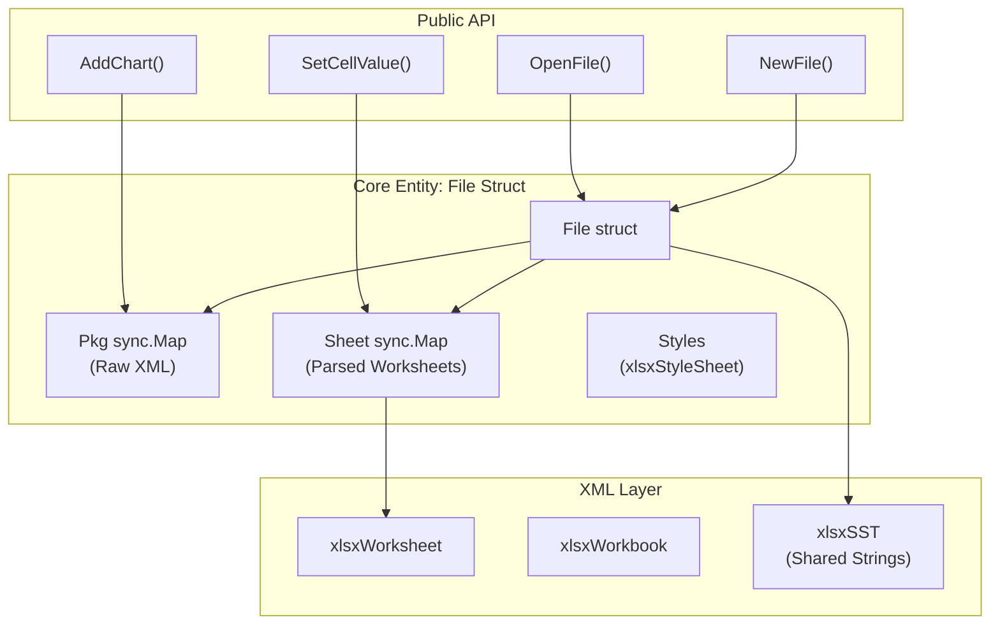
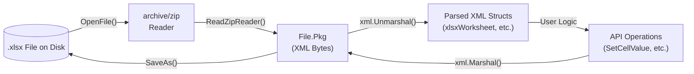

<!-- source: DeepWiki mcp.deepwiki.com · repo qax-os/excelize · page 1 Overview · fetched 2026-10-29 -->

# Overview

Relevant source files

The following files were used as context for generating this wiki page:

- [.github/workflows/go.yml](.github/workflows/go.yml)
- [LICENSE](LICENSE)
- [README.md](README.md)
- [README_zh.md](README_zh.md)
- [excelize_test.go](excelize_test.go)
- [go.mod](go.mod)
- [go.sum](go.sum)

Excelize is a library written in pure Go providing a set of functions that allow you to read from and write to XLAM / XLSM / XLSX / XLTM / XLTX files. It supports spreadsheet documents generated by Microsoft Excel™ 2007 and later, implementing the ECMA-376 and ISO/IEC 29500 international standards. The library is designed for high compatibility with complex components (styles, charts, pivot tables) and provides a streaming API for handling massive datasets.

**Repository**: https://github.com/qax-os/excelize  
**Go Version Requirement**: 1.25.0 or later [README.md:16](), [go.mod:3]()

For detailed information about specific features, refer to the corresponding child pages:
- [Architecture Overview](#1.1) — High-level design, the `File` struct, and concurrency.
- [Getting Started](#1.2) — Quick start examples for basic operations.
- [Dependencies and External Libraries](#1.3) — Details on external utilities like `efp` and `nfp`.

Sources: [README.md:12-17](), [go.mod:1-15]()

## Core Capabilities

Excelize provides a comprehensive suite for spreadsheet manipulation:

*   **File Operations**: Create new spreadsheets via `NewFile()`, open existing ones with `OpenFile()`, and save using `Save()` or `SaveAs()`. [README.md:46-67](), [README.md:84-114]()
*   **Cell Manipulation**: Read and write values with `GetCellValue()` and `SetCellValue()`. The library handles various Go types including `int`, `float64`, `string`, `bool`, and `complex128`. [excelize_test.go:125-142]()
*   **Worksheet Management**: Create, delete, and rename sheets using `NewSheet()`, `DeleteSheet()`, and `SetSheetName()`. [excelize_test.go:76-79]()
*   **Advanced Features**: Support for adding charts ([README.md:150-178]()), pictures ([README.md:213-232]()), and evaluating complex formulas using a built-in calculation engine.
*   **Streaming API**: Efficiently process large worksheets using the `Rows` iterator or `StreamWriter` to maintain a low memory footprint. [README.md:16]()

Sources: [README.md:16-184](), [excelize_test.go:125-142]()

## Architecture Overview

The library is organized around the `File` struct, which manages the state of the spreadsheet package, including XML content, relationships, and styles.

### System Entity Mapping

The following diagram maps high-level library operations to the internal code entities and data structures they interact with.

**Title**: Excelize Logic-to-Code Mapping

The `File` struct acts as the central coordinator. It utilizes `sync.Map` for `Pkg` (storing unzipped XML parts) and `Sheet` (caching parsed worksheet structures) to facilitate concurrent access where possible.

Sources: [README.md:46](), [README.md:84](), [excelize_test.go:29](), [excelize_test.go:125]()

## Data Flow: Spreadsheet Lifecycle

The lifecycle of an Excelize operation typically follows a pipeline from raw ZIP archive to parsed XML structures and back.

### File I/O Pipeline

**Title**: Data Transformation Flow

When `OpenFile` is called, the library uses `archive/zip` to decompress the OOXML package. Individual XML parts are stored in the `Pkg` map. When a specific sheet is accessed (e.g., via `GetRows`), the XML is unmarshaled into Go structs like `xlsxWorksheet`. Modifications are marshaled back to XML before the final ZIP compression during `Save`.

Sources: [excelize_test.go:29-54](), [README.md:84-114]()

## Key Subsystems

Excelize is divided into several specialized subsystems that handle the complexities of the OOXML format:

| Subsystem | Responsibility | Key Entities |
| :--- | :--- | :--- |
| **File Management** | Handling ZIP archives and file I/O | `File`, `OpenFile`, `NewFile` |
| **Worksheet** | Managing sheet properties and data | `xlsxWorksheet`, `NewSheet` |
| **Cell & Data** | Reading/writing values and types | `SetCellValue`, `GetCellValue` |
| **Styles** | Managing fonts, fills, and borders | `xlsxStyleSheet`, `NewStyle` |
| **Calculation** | Formula evaluation engine | `CalcCellValue`, `UpdateLinkedValue` |
| **Drawing** | Charts and picture insertion | `AddChart`, `AddPicture` |

For a deep dive into these components, see [Architecture Overview](#1.1).

Sources: [README.md:16-17](), [excelize_test.go:56](), [excelize_test.go:125-142]()

## External Dependencies

Excelize leverages several specialized libraries to handle domain-specific tasks:
*   **efp**: Excel Formula Parser for tokenizing spreadsheet formulas.
*   **nfp**: Number Format Parser for processing Excel's custom number formats.
*   **mscfb**: Microsoft Compound File Binary reader for handling legacy formats or encrypted packages.

For more details, see [Dependencies and External Libraries](#1.3).

Sources: [go.mod:5-15]()

---

