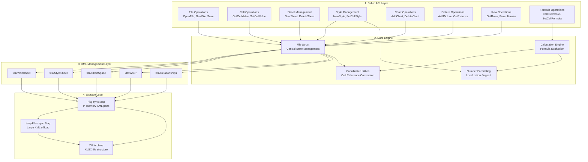
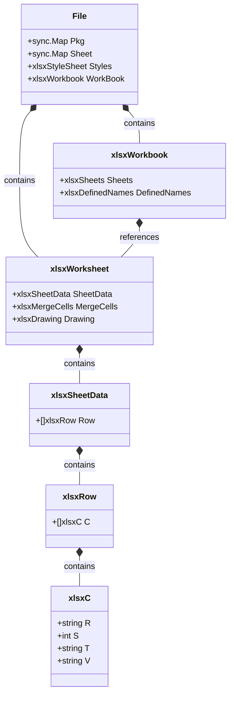
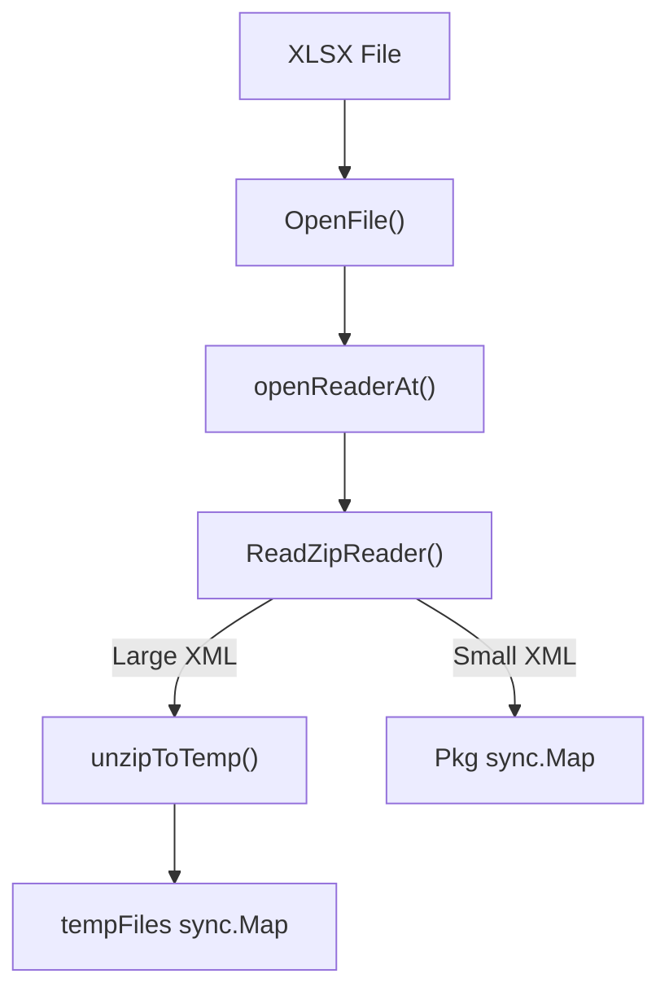
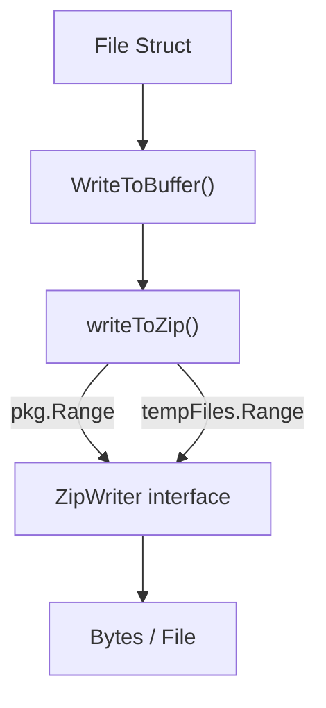

<!-- source: DeepWiki mcp.deepwiki.com · repo qax-os/excelize · page 1.1 Architecture Overview · fetched 2026-10-29 -->

# Architecture Overview

Relevant source files

The following files were used as context for generating this wiki page:

- [excelize.go](excelize.go)
- [file.go](file.go)
- [lib.go](lib.go)
- [lib_test.go](lib_test.go)
- [templates.go](templates.go)
- [xmlWorkbook.go](xmlWorkbook.go)
- [xmlWorksheet.go](xmlWorksheet.go)

This document provides a high-level overview of the architecture of the excelize library, a Go package for reading and writing Excel spreadsheet files (XLAM, XLSM, XLSX, XLTM, and XLTX formats). It explains the main components, their interactions, and the design principles of the library.

## Four-Layer Architecture

The excelize library is organized into four distinct architectural layers, each with specific responsibilities. This layered design enables clean separation of concerns and efficient memory management.

### Layer Architecture Diagram

Sources: [excelize.go:31-66](), [lib.go:32-79](), [file.go:31-56]()

### Central File Struct

The `File` struct [excelize.go:31-66]() is the central hub of all operations, containing:

| Field | Type | Purpose |
|-------|------|---------|
| `Pkg` | `sync.Map` | Stores XML content in memory for small files |
| `Sheet` | `sync.Map` | Caches parsed `xlsxWorksheet` structures |
| `Drawings` | `sync.Map` | Stores chart and drawing structures |
| `Relationships` | `sync.Map` | Manages package relationships |
| `tempFiles` | `sync.Map` | Tracks temporary file paths for large XML |
| `calcCache` | `sync.Map` | Memoizes formula calculation results |
| `Styles` | `*xlsxStyleSheet` | Style definitions |
| `SharedStrings` | `*xlsxSST` | Shared string table |
| `ContentTypes` | `*xlsxTypes` | Content type definitions |
| `sheetMap` | `map[string]string` | Maps sheet names to XML paths |
| `mu` | `sync.Mutex` | Protects critical sections |

The use of `sync.Map` for major data structures enables concurrent read/write operations while maintaining thread safety.

Sources: [excelize.go:31-66]()

## Office Open XML Structure

Excel files (.xlsx) are ZIP archives containing XML files following the Office Open XML specification. Excelize maps these XML structures to Go structs and handles serialization/deserialization.

### XML Structure Map

| XML File Path | Purpose | Primary Go Struct | Stored In |
|--------------|---------|------------------|-----------|
| `xl/workbook.xml` | Workbook structure, sheet list | `xlsxWorkbook` | `Pkg sync.Map` |
| `xl/worksheets/sheet*.xml` | Individual worksheet data | `xlsxWorksheet` | `Pkg` or `tempFiles` |
| `xl/styles.xml` | Cell styles, fonts, fills | `xlsxStyleSheet` | `Pkg sync.Map` |
| `xl/sharedStrings.xml` | Deduplicated string table | `xlsxSST` | `Pkg` or `tempFiles` |
| `xl/theme/theme1.xml` | Color schemes, fonts | `decodeTheme` | `Pkg sync.Map` |
| `_rels/.rels` | Package relationships | `xlsxRelationships` | `Relationships sync.Map` |

Sources: [excelize.go:31-66](), [lib.go:32-79](), [xmlWorksheet.go:21-66](), [xmlWorkbook.go:38-62]()

### Memory Management Strategy

The library implements size-based routing to optimize memory usage:

- **Small XML files** (< `UnzipXMLSizeLimit`, default 16MB): Stored in `Pkg sync.Map` in memory [lib.go:74-77]().
- **Large XML files** (>= `UnzipXMLSizeLimit`): Offloaded to temporary files tracked in `tempFiles sync.Map` [lib.go:53-73]().
- **Size limit validation**: Total unzip size must not exceed `UnzipSizeLimit` (default 16GB) [lib.go:46-48]().

This two-tier strategy prevents memory exhaustion when handling large worksheets or shared string tables.

Sources: [excelize.go:114-125](), [lib.go:32-79](), [lib.go:83-99]()

### Object Model Hierarchy

Sources: [excelize.go:31-66](), [xmlWorksheet.go:21-66](), [xmlWorkbook.go:38-62]()

## File I/O Data Flow

The library implements a sophisticated pipeline for reading and writing Excel files with memory-efficient size-based routing.

### File Input Pipeline

Sources: [excelize.go:134-149](), [excelize.go:198-232](), [lib.go:32-79](), [lib.go:83-99]()

### File Output Pipeline

Sources: [file.go:117-160](), [file.go:163-237]()

### Reading Process

1. **ZIP Extraction**: `OpenReader` [excelize.go:188-194]() reads the file and triggers `openReaderAt`.
2. **Size Validation**: Checks total unzip size against `UnzipSizeLimit` in `ReadZipReader` [lib.go:46-48]().
3. **XML Routing**: `ReadZipReader` [lib.go:32-79]() routes each XML file:
   - Small files → `Pkg sync.Map` (in-memory) [lib.go:74-77]().
   - Large files → temporary files via `unzipToTemp` [lib.go:83-99]().
4. **Lazy Parsing**: XML is not parsed until accessed via internal readers like `workbookReader` or `workSheetReader`.

### Writing Process

1. **Serialization**: Various internal writers (e.g., `workBookWriter`, `workSheetWriter`) serialize structs to XML and store them in `Pkg` [file.go:164-176]().
2. **ZIP Building**: `writeToZip` [file.go:163-237]() iterates through `Pkg` and `tempFiles` to construct the final ZIP archive.
3. **ZIP64 Support**: If entries exceed 4GB, `writeZip64LFH` ensures compatibility [file.go:239-242]().

Sources: [excelize.go:198-232](), [lib.go:32-79](), [file.go:117-160](), [file.go:163-237]()

## Key Subsystems

### File I/O System

The File I/O subsystem manages the opening, creation, and saving of Excel files.

- `OpenFile`: Opens an existing Excel file [excelize.go:134-149]().
- `NewFile`: Creates a new Excel file with default templates [file.go:31-56]().
- `Save`/`SaveAs`: Persists the workbook to disk [file.go:59-87]().
- `Close`: Cleans up temporary files and shared string handles [file.go:89-108]().

### Worksheet Management

Worksheet management handles the structure of individual sheets. The `xlsxWorksheet` struct [xmlWorksheet.go:21-66]() maps the SpreadsheetML schema, containing properties for views, columns, sheet data, and protection.

### Cell Operations

Cell manipulation involves coordinate conversion and value storage.
- `SplitCellName`: Splits "AK74" into "AK" and 74 [lib.go:161-175]().
- `ColumnNameToNumber`: Converts "AK" to 37 [lib.go:204-225]().
- `ColumnNumberToName`: Precomputed lookup for converting 37 to "AK" [lib.go:230-255]().

### Concurrency and Thread Safety

The library uses a hybrid locking model to balance performance and safety:
- **Global Mutex**: `File.mu` [excelize.go:32]() protects high-level structural changes.
- **Concurrent Maps**: `Pkg`, `Sheet`, `Relationships`, and `Drawings` use `sync.Map` [excelize.go:53-58]() for safe concurrent access to different parts of the workbook.
- **Worksheet Mutex**: `xlsxWorksheet.mu` [xmlWorksheet.go:22]() protects internal sheet data during modification.

Sources: [excelize.go:31-66](), [xmlWorksheet.go:21-66](), [xmlWorkbook.go:21-25]()

## Error Handling

The library provides specialized error types for limits and validation, such as `ErrOptionsUnzipSizeLimit` [excelize.go:181]() and `ErrColumnNumber` [lib.go:222](). Most operations return an error as the last return value, which must be checked to ensure data integrity.

---

