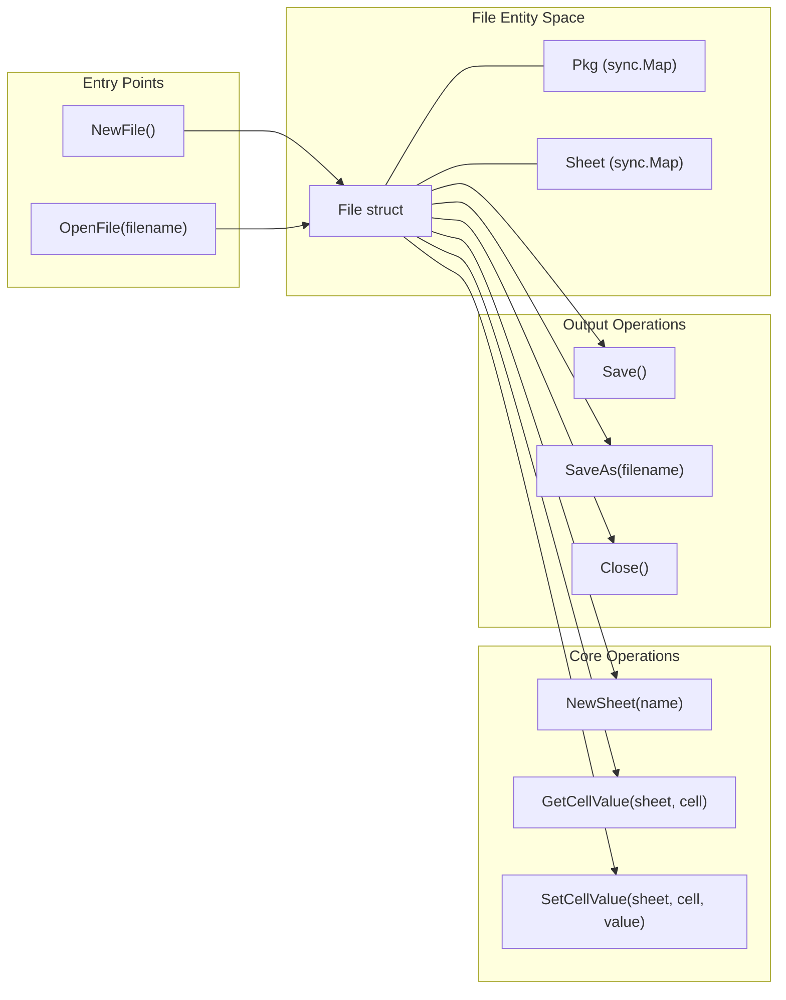
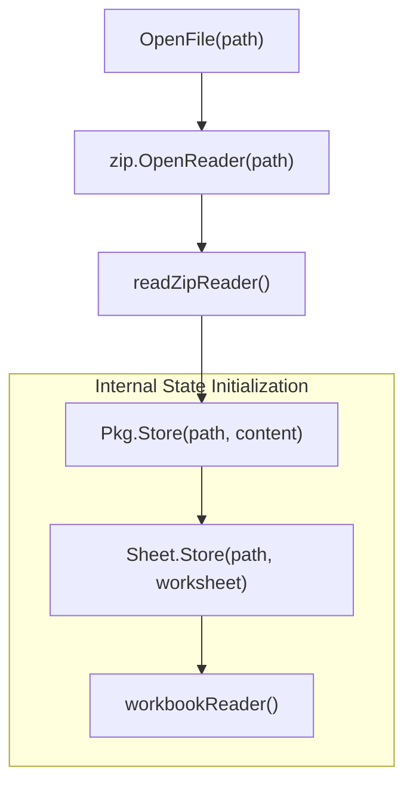
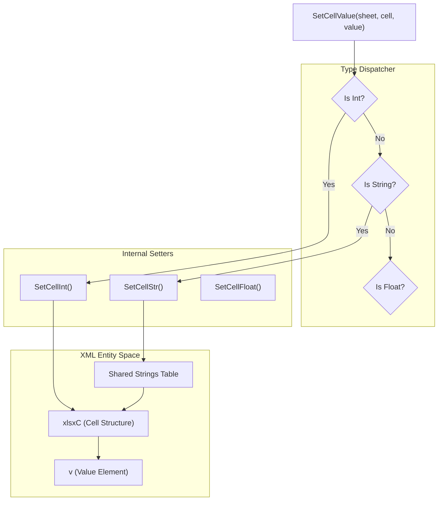

<!-- source: DeepWiki mcp.deepwiki.com · repo qax-os/excelize · page 1.2 Getting Started · fetched 2026-10-29 -->

# Getting Started

<details>
<summary>Relevant source files</summary>

The following files were used as context for generating this wiki page:

- [README.md](README.md)
- [README_zh.md](README_zh.md)
- [excelize_test.go](excelize_test.go)
- [file.go](file.go)
- [templates.go](templates.go)

</details>


This page provides practical examples for performing basic operations with the excelize library. You will learn how to create new workbooks, open existing files, read and write cell values, manage sheets, and save your work.

## Overview of Basic Operations

The excelize library provides a straightforward API for manipulating Excel files. All operations center around the `File` struct, which represents an in-memory Excel workbook. The typical workflow involves initializing a `File` object, manipulating its internal XML parts, and then serializing those parts back into an OOXML (Office Open XML) archive.

**Basic Workflow Diagram**



Sources: [file.go:27-56](), [file.go:59-67](), [file.go:71-87](), [file.go:90-108](), [excelize_test.go:125-143]()

## Creating a New Workbook

To create a new Excel workbook, use the `NewFile()` function. This initializes a `File` struct with a default set of XML templates (relationships, content types, workbook, and a default worksheet named "Sheet1").

**Example: Create New Workbook**

```go
package main

import (
    "fmt"
    "github.com/xuri/excelize/v2"
)

func main() {
    f := excelize.NewFile()
    defer func() {
        if err := f.Close(); err != nil {
            fmt.Println(err)
        }
    }()
    
    // Set a cell value
    f.SetCellValue("Sheet1", "A1", "Hello World")
    
    // Save the workbook
    if err := f.SaveAs("Book1.xlsx"); err != nil {
        fmt.Println(err)
    }
}
```

The `NewFile()` function populates the internal `Pkg` and `Sheet` maps with default XML headers and templates, ensuring the resulting file adheres to the ECMA-376 standard.

Sources: [file.go:27-56](), [README.md:32-68]()

## Opening an Existing Workbook

Use `OpenFile()` to open an existing Excel file from disk. This function parses the ZIP archive and loads the XML components into memory.

**Example: Open Existing File**

```go
f, err := excelize.OpenFile("Book1.xlsx")
if err != nil {
    fmt.Println(err)
    return
}
defer f.Close()
```

**File Opening and Initialization**



Sources: [excelize_test.go:27-30](), [file.go:46-52](), [README.md:84-114]()

## Reading Cell Values

The `GetCellValue()` function retrieves the value of a cell. By default, it returns the formatted value as a string. You can use `Options` to request the raw value.

**Example: Read Cell Values**

```go
// Get formatted value
value, err := f.GetCellValue("Sheet2", "C11")
if err != nil {
    fmt.Println(err)
}

// Get raw value
val, err := f.GetCellValue("Sheet2", "F16", excelize.Options{RawCellValue: true})
```

Sources: [excelize_test.go:110-123](), [excelize_test.go:164-166]()

## Writing Cell Values

The `SetCellValue()` function is a versatile entry point that handles multiple Go types, routing them to specialized internal functions like `SetCellInt`, `SetCellStr`, or `SetCellBool`.

**Example: Write Different Data Types**

```go
f.SetCellValue("Sheet2", "F1", "Hello")   // String
f.SetCellValue("Sheet2", "F2", 42)        // Integer
f.SetCellValue("Sheet2", "F8", -42.65418) // Float
f.SetCellValue("Sheet2", "F16", true)     // Boolean
```

**Data Flow: From Go Type to XML**



Sources: [excelize_test.go:125-143](), [excelize_test.go:66-73](), [file.go:173-174]()

## Working with Sheets

### Creating and Managing Sheets
Use `NewSheet()` to add a worksheet. The library manages the underlying `workbook.xml` and relationship files (`.rels`) automatically.

**Example: Sheet Operations**

```go
// Create new sheet
index, err := f.NewSheet("Sheet2")

// Set active sheet (the one displayed when opening Excel)
f.SetActiveSheet(index)

// Rename a sheet
err = f.SetSheetName("Sheet1", "OldSheet")
```

Sources: [README.md:53-62](), [excelize_test.go:76-79](), [excelize_test.go:88]()

## Saving and Closing

### Saving the Workbook
`SaveAs()` serializes the internal `Pkg` map back into a ZIP archive. If you opened a file via `OpenFile()`, you can use `Save()` to overwrite the original file.

```go
// Save to a new path
err := f.SaveAs("Book1.xlsx")

// Overwrite original path
err = f.Save()
```

### Closing the File
The `Close()` method is critical for cleaning up temporary files used for shared strings or streaming.

```go
err := f.Close()
```

**Implementation Detail: Save Pipeline**
1. `writeToZip`: Iterates through internal writers (styles, workbook, worksheets).
2. `Pkg.Range`: Writes each XML part into the ZIP buffer.
3. `ZipWriter.Close`: Finalizes the archive.

Sources: [file.go:59-67](), [file.go:71-87](), [file.go:90-108](), [file.go:163-176]()

## Summary of Key Functions

| Function | Purpose | Source |
| :--- | :--- | :--- |
| `NewFile` | Initializes a new `File` struct with default templates | [file.go:31]() |
| `OpenFile` | Opens and unzips an existing spreadsheet | [excelize_test.go:29]() |
| `SetCellValue` | Sets a cell value based on Go type inference | [excelize_test.go:125]() |
| `GetCellValue` | Reads a cell value with optional formatting | [excelize_test.go:110]() |
| `NewSheet` | Adds a new worksheet and updates workbook relationships | [README.md:53]() |
| `SaveAs` | Serializes the `File` struct to a disk path | [file.go:71]() |
| `Close` | Cleans up temporary files and stream data | [file.go:90]() |

Sources: [file.go:31-108](), [excelize_test.go:29-125]()

---

