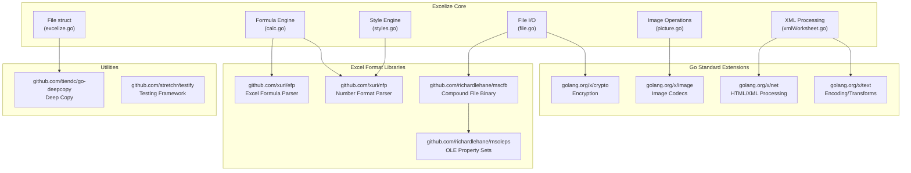
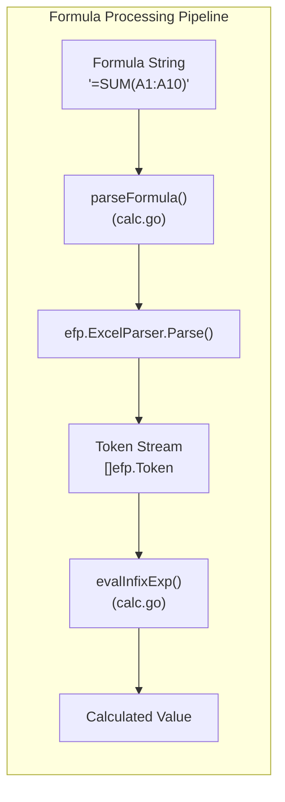
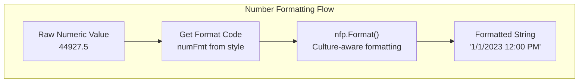
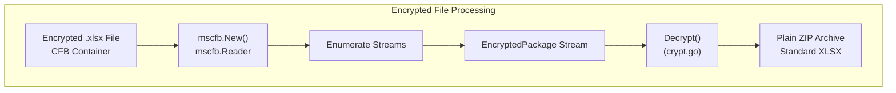
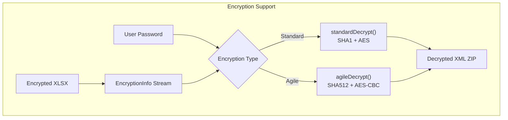
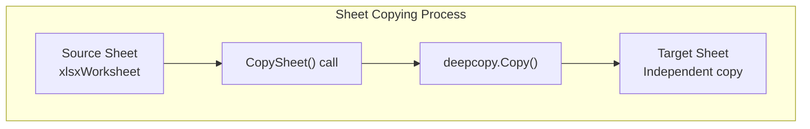

<!-- source: DeepWiki mcp.deepwiki.com · repo qax-os/excelize · page 1.3 Dependencies and External Libraries · fetched 2026-10-29 -->

# Dependencies and External Libraries

Relevant source files

The following files were used as context for generating this wiki page:

- [.github/SECURITY.md](.github/SECURITY.md)
- [.github/dependabot.yml](.github/dependabot.yml)
- [.github/workflows/codeql-analysis.yml](.github/workflows/codeql-analysis.yml)
- [.github/workflows/go.yml](.github/workflows/go.yml)
- [go.mod](go.mod)
- [go.sum](go.sum)

## Purpose and Scope

This document catalogs the external dependencies used by the Excelize library and explains the role each plays in the system. It covers both direct runtime dependencies required for Excel file manipulation and indirect dependencies brought in through the dependency chain. For information about the internal architecture that utilizes these libraries, see [1.1 Architecture Overview](). For specifics on how formulas are processed, see [3.1 Formula Calculation Engine]().

## Dependency Overview

The Excelize library relies on direct dependencies organized into three categories: specialized Excel format libraries, Go standard library extensions, and utility packages.

**Sources:** [go.mod:5-22]()

## Excel Format Libraries

### Excel Formula Parser (efp)

The `github.com/xuri/efp` package provides tokenization and parsing of Excel formula syntax. This is the foundation of Excelize's formula calculation system.

**Package:** `github.com/xuri/efp v0.0.1` [go.mod:9]()

**Primary Integration Points:**

| Code Location | Function | Purpose |
|--------------|----------|---------|
| `calc.go` | `parseFormula()` | Converts formula strings to token streams |
| `calc.go` | `evalInfixExp()` | Evaluates parsed token sequences |
| `calc.go` | `CalcCellValue()` | Entry point for formula evaluation |

The parser handles all Excel formula syntax including cell references (`A1`), range references (`A1:B10`), function calls (`SUM`), and operators.

**Sources:** [go.mod:9](), [go.sum:13-14]()

### Number Format Parser (nfp)

The `github.com/xuri/nfp` package interprets Excel number format codes and applies culture-specific formatting rules. It enables proper display of numbers, dates, currencies, and custom formats.

**Package:** `github.com/xuri/nfp v0.0.2-0.20250530014748-2ddeb826f9a9` [go.mod:10]()

**Primary Integration Points:**

| Code Location | Function | Purpose |
|--------------|----------|---------|
| `numfmt.go` | `formattedValue()` | Applies format codes to numeric values |
| `numfmt.go` | `getValueFrom()` | Extracts and formats cell values |
| `styles.go` | `NewStyle()` | Associates format codes with cell styles |

The library supports built-in Excel format codes (0-49) and custom format strings with conditional sections.

**Sources:** [go.mod:10](), [go.sum:15-16]()

### MS Compound File Binary (mscfb)

The `github.com/richardlehane/mscfb` package reads and writes Microsoft Compound File Binary (CFB) format, used for legacy Excel files and encrypted modern Excel files.

**Package:** `github.com/richardlehane/mscfb v1.0.7` [go.mod:6]()
**Indirect Dependency:** `github.com/richardlehane/msoleps v1.0.6` [go.mod:20]()

**Primary Integration Points:**

| Code Location | Function | Purpose |
|--------------|----------|---------|
| `file.go` | `OpenFile()` | Detects and reads encrypted XLSX files |
| `crypt.go` | `Decrypt()` | Extracts encrypted package from CFB container |
| `file.go` | `Save()` | Writes encrypted files back to CFB format |

**Sources:** [go.mod:6,20](), [go.sum:5-8]()

## Go Standard Library Extensions

### Cryptography (golang.org/x/crypto)

The `golang.org/x/crypto` package provides encryption and decryption capabilities for password-protected Excel files.

**Package:** `golang.org/x/crypto v0.53.0` [go.mod:11]()

**Primary Integration Points:**

| Code Location | Function | Purpose |
|--------------|----------|---------|
| `crypt.go` | `Decrypt()` | Decrypts password-protected XLSX files |
| `crypt.go` | `standardDecrypt()` | ECMA-376 standard encryption |
| `crypt.go` | `agileDecrypt()` | Office 2010+ agile encryption |

**Sources:** [go.mod:11](), [go.sum:17-18]()

### Image Processing (golang.org/x/image)

The `golang.org/x/image` package extends Go's standard image library with additional format codecs (TIFF, BMP, WebP) required for Excel picture embedding.

**Package:** `golang.org/x/image v0.38.0` [go.mod:12]()

**Primary Integration Points:**

| Code Location | Function | Purpose |
|--------------|----------|---------|
| `picture.go` | `AddPicture()` | Validates and embeds images |
| `picture.go` | `AddPictureFromBytes()` | Processes image bytes |

**Sources:** [go.mod:12](), [go.sum:19-20]()

### XML and Text (golang.org/x/net & golang.org/x/text)

The `golang.org/x/net` and `golang.org/x/text` packages provide robust XML parsing and character set detection, supporting non-UTF-8 encodings in legacy or localized Excel files.

**Packages:** 
- `golang.org/x/net v0.55.0` [go.mod:13]()
- `golang.org/x/text v0.38.0` [go.mod:14]()

**Primary Integration Points:**

| Code Location | Function | Purpose |
|--------------|----------|---------|
| `xmlWorksheet.go` | `xmlDecoder()` | Creates charset-aware XML decoders |
| `lib.go` | `CharsetReader` | Configures non-UTF-8 support |

**Sources:** [go.mod:13-14](), [go.sum:21-24]()

## Utility Dependencies

### Deep Copy (go-deepcopy)

The `github.com/tiendc/go-deepcopy` package provides recursive deep copying of complex Go structures, essential for duplicating worksheets or styles.

**Package:** `github.com/tiendc/go-deepcopy v1.7.2` [go.mod:8]()

**Primary Integration Points:**

| Code Location | Function | Purpose |
|--------------|----------|---------|
| `sheet.go` | `CopySheet()` | Creates independent sheet copies |

**Sources:** [go.mod:8](), [go.sum:11-12]()

## Development Dependencies

### Testing Framework (testify)

The `github.com/stretchr/testify` package provides assertion helpers used throughout Excelize's test suite.

**Package:** `github.com/stretchr/testify v1.11.1` [go.mod:7]()

**Integration:**
Used in all `*_test.go` files for `assert` and `require` functionality to validate workbook state, cell values, and file integrity.

**Sources:** [go.mod:7,18-19](), [go.sum:9-10]()

## Dependency Version Management

The project targets Go 1.25.0 [go.mod:3](). CI/CD pipelines validate the library across multiple Go versions (1.25.x, 1.26.x) and operating systems (Ubuntu, macOS, Windows) including ARM architectures [.github/workflows/go.yml:6-10,31-38]().

**Sources:** [go.mod:3](), [.github/workflows/go.yml:6-38]()

---

