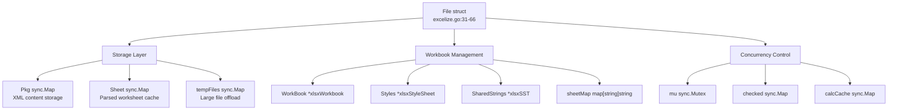
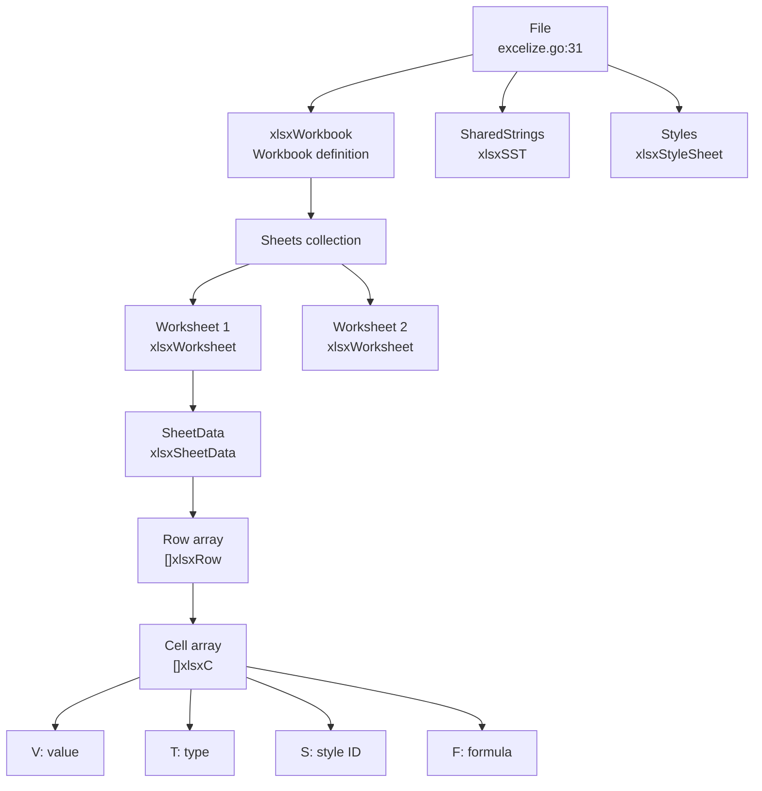
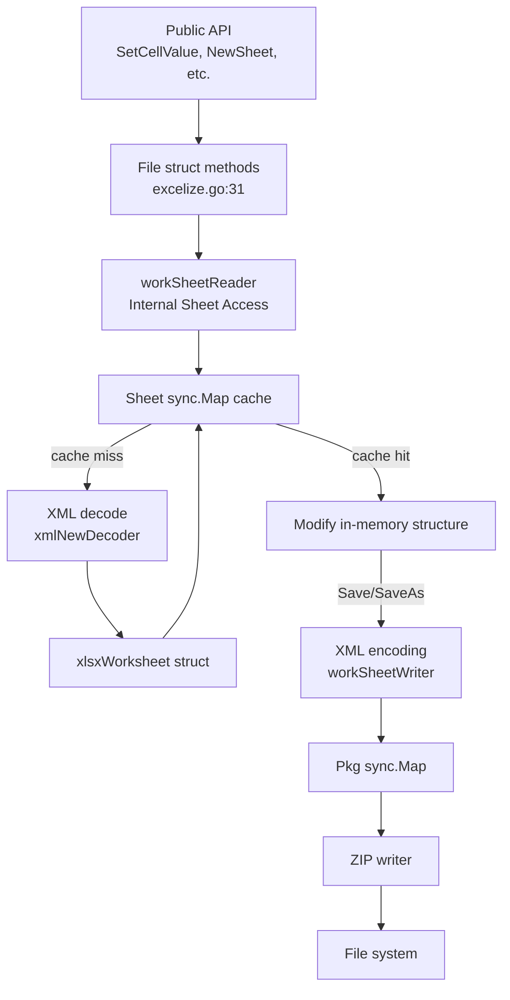
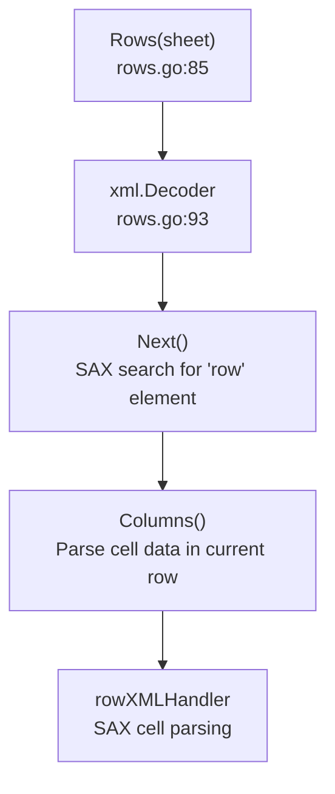

<!-- source: DeepWiki mcp.deepwiki.com · repo qax-os/excelize · page 2 Core Functionality · fetched 2026-10-29 -->

# Core Functionality

Relevant source files

The following files were used as context for generating this wiki page:

- [cell.go](cell.go)
- [excelize.go](excelize.go)
- [file.go](file.go)
- [rows.go](rows.go)
- [sheet.go](sheet.go)
- [sheet_test.go](sheet_test.go)
- [templates.go](templates.go)

The Core Functionality encompasses the essential operations for working with Excel files in excelize. This page provides an overview of the fundamental components and their interactions. The library is built around the `File` struct, which serves as the central access point for all workbook operations.

## Subsystems

This section is divided into four main operational areas:

- **[File Operations](#2.1)**: Opening, creating, saving, and closing Excel files. For details, see [File Operations](#2.1).
- **[Worksheet Management](#2.2)**: Creating, deleting, and managing sheets within a workbook. For details, see [Worksheet Management](#2.2).
- **[Cell Operations](#2.3)**: Reading and writing individual cell values, formulas, and hyperlinks. For details, see [Cell Operations](#2.3).
- **[Row and Column Operations](#2.4)**: Bulk operations on rows and columns, including streaming access. For details, see [Row and Column Operations](#2.4).

## The File Struct

### Central State Management

The `File` struct [excelize.go:31-66]() is the primary interface for all Excel operations. It maintains the workbook state and provides methods for manipulating spreadsheet content.

**File Struct - Core Components**

Sources: [excelize.go:31-66]()

### Key Fields

| Field | Type | Purpose |
|-------|------|---------|
| `Pkg` | `sync.Map` | Stores raw XML content from the ZIP archive [excelize.go:55]() |
| `Sheet` | `sync.Map` | Cache of parsed worksheet structures [excelize.go:58]() |
| `sheetMap` | `map[string]string` | Maps sheet names to XML file paths [excelize.go:40]() |
| `WorkBook` | `*xlsxWorkbook` | Workbook metadata and sheet definitions [excelize.go:64]() |
| `Styles` | `*xlsxStyleSheet` | Cell formatting and styles [excelize.go:60]() |
| `SharedStrings` | `*xlsxSST` | Shared string table for text deduplication [excelize.go:57]() |
| `tempFiles` | `sync.Map` | Paths to temporary files for large XML [excelize.go:42]() |
| `calcCache` | `sync.Map` | Cached formula calculation results [excelize.go:44]() |
| `mu` | `sync.Mutex` | Mutex for thread-safe operations [excelize.go:32]() |

Sources: [excelize.go:31-66]()

## Architecture Overview

### Component Hierarchy

The library organizes Excel data in a hierarchical structure that mirrors the Office Open XML specification.

**Data Model Hierarchy**

Sources: [excelize.go:31-66](), [sheet.go:194-209](), [cell.go:179-181]()

## Functional Areas

### File Operations

File operations provide the lifecycle management for Excel files. The primary entry points are `NewFile()` [file.go:31](), `OpenFile()` [excelize.go:134](), and `OpenReader()` [excelize.go:188]().

**File Operations Overview**

| Operation | Function | Key Implementation |
|-----------|----------|-------------------|
| Create | `NewFile()` | Initializes `File` struct with default template [file.go:31-56]() |
| Open | `OpenFile(name, opts)` | Opens OS file and calls `openReaderAt` [excelize.go:134-149]() |
| Save | `Save()` / `SaveAs(name)` | Serializes structures to XML and writes ZIP [file.go:59-87]() |
| Close | `Close()` | Cleans up temporary files and buffers [file.go:90-108]() |

See [File Operations](#2.1) for details on encryption and memory management.

Sources: [excelize.go:134-149](), [file.go:31-56](), [file.go:59-108]()

### Operation Flow

Operations in excelize follow a consistent pattern from user code to XML serialization.

**Data Flow from API to Storage**

Sources: [sheet.go:153-191](), [file.go:163-237]()

### Worksheet Management

Worksheet operations manage the workbook's sheet structure. The `File.sheetMap` field [excelize.go:40]() maintains the mapping between sheet names and their XML file paths.

**Worksheet Operation Flow**

Sources: [sheet.go:51-80](), [sheet.go:84-95]()

**Core Operations**

| Category | Operations | Implementation Notes |
|----------|-----------|---------------------|
| Creation | `NewSheet(name)` [sheet.go:51]() | Appends sheet to workbook and sets content types |
| Visibility | `SetSheetVisible()` | Sets sheet state (visible, hidden, veryHidden) |
| Metadata | `GetSheetIndex()` [sheet.go:57]() | Retrieves the internal index of a sheet |

See [Worksheet Management](#2.2) for detailed documentation.

Sources: [sheet.go:51-80]()

### Cell Operations

Cell operations provide granular data access. Each cell is represented by the `xlsxC` struct with fields for value (`V`), type (`T`), style (`S`), and formula (`F`).

**Data Type Handling**

| Type | Setter | Storage | Notes |
|------|--------|---------|-------|
| Integer | `SetCellValue(int)` [cell.go:132]() | `setCellIntFunc` | Stored as numeric type |
| String | `SetCellValue(string)` [cell.go:138]() | `SetCellStr` | Uses Shared String Table [cell.go:40]() |
| Boolean | `SetCellValue(bool)` [cell.go:151]() | `SetCellBool` | Type "b" [cell.go:56]() |
| Formula | `SetCellFormula()` | `F` field | Supports STCellFormula types [cell.go:43-52]() |

See [Cell Operations](#2.3) for details on rich text and formulas.

Sources: [cell.go:32-63](), [cell.go:129-159]()

### Row and Column Operations

Row and column operations provide bulk access and manipulation. These can be performed in-memory or via streaming iterators.

**Streaming vs. In-Memory**

| Approach | Function | Use Case |
|----------|----------|----------|
| In-Memory | `GetRows()` [rows.go:61]() | Small to medium datasets; returns `[][]string` |
| Streaming | `Rows()` [rows.go:328]() | Large datasets; uses SAX parser `Rows.Next()` [rows.go:99]() |

**Streaming Architecture**

See [Row and Column Operations](#2.4) for details on the streaming API.

Sources: [rows.go:61-82](), [rows.go:85-127](), [rows.go:153-198]()

## Concurrency Model

The `File` struct uses `sync.Map` and `sync.Mutex` for thread-safe access to worksheets and shared resources.

| Component | Synchronization | Safe Operations |
|-----------|----------------|-----------------|
| `Pkg` | `sync.Map` [excelize.go:55]() | Concurrent raw XML storage |
| `Sheet` | `sync.Map` [excelize.go:58]() | Concurrent parsed worksheet cache |
| `mu` | `sync.Mutex` [excelize.go:32]() | Critical section protection |

Sources: [excelize.go:31-66]()

---

