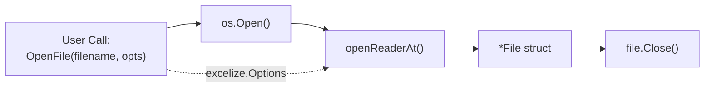
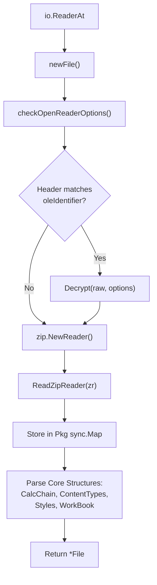
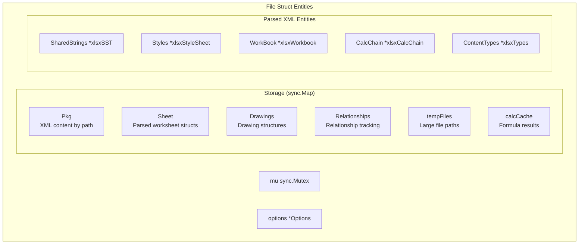
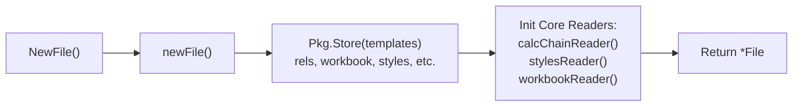

<!-- source: DeepWiki mcp.deepwiki.com · repo qax-os/excelize · page 2.1 File Operations · fetched 2026-10-29 -->

# File Operations

Relevant source files

The following files were used as context for generating this wiki page:

- [crypt.go](crypt.go)
- [crypt_test.go](crypt_test.go)
- [excelize.go](excelize.go)
- [file.go](file.go)
- [file_test.go](file_test.go)
- [lib.go](lib.go)
- [lib_test.go](lib_test.go)
- [templates.go](templates.go)

## Purpose and Scope

This page documents the fundamental file operations in the `excelize` library: opening existing Excel files, creating new workbooks, saving data, and understanding the underlying ZIP processing and memory management strategies. This includes handling encrypted files, configuring size limits, and managing the internal `File` structure that serves as the central state container for all workbook operations.

---

## File Opening Pipeline

The library provides two primary entry points for opening Excel files: `OpenFile` for reading from disk and `OpenReader` for reading from any `io.Reader` stream. Both paths converge on the internal `openReaderAt` function.

### OpenFile Function

The `OpenFile` function is the standard way to open a spreadsheet file from disk. It accepts a filename and optional configuration parameters.

**Diagram: OpenFile Processing Flow**

The function opens the file handle, delegates to `openReaderAt` for parsing, stores the filename in `File.Path`, and closes the original OS file handle after the data has been processed.

Sources: [excelize.go:134-149]()

### OpenReader and openReaderAt

`OpenReader` reads data from any `io.Reader` and converts it into a `bytes.Reader` to utilize `openReaderAt`. The core parsing logic resides in `openReaderAt`, which handles both regular XLSX files and encrypted OLE-format files.

**Diagram: openReaderAt Processing Pipeline**

The function performs these steps:
1. Initializes a new `File` struct via `newFile()` [excelize.go:152-169]().
2. Validates unzip limits via `checkOpenReaderOptions()` [excelize.go:173-184]().
3. Checks for the OLE identifier [crypt.go:41]() (encrypted Excel file marker).
4. If encrypted, invokes `Decrypt` [crypt.go:143-160]() using the password from `Options`.
5. Creates a `zip.Reader` and extracts contents via `ReadZipReader` [lib.go:32-79]().
6. Populates the `Pkg` map and initializes core XML readers (Calculation Chain, Styles, etc.).

Sources: [excelize.go:188-232](), [lib.go:32-79](), [crypt.go:143-160]()

---

## The File Structure

The `File` struct is the central data structure representing a workbook. It uses `sync.Map` extensively to handle concurrent access to different parts of the spreadsheet.

**Diagram: File Struct Core Components**

### Key Fields

- `Pkg sync.Map`: Stores the raw XML content of the ZIP archive parts, keyed by their internal path (e.g., `xl/worksheets/sheet1.xml`) [excelize.go:55]().
- `Sheet sync.Map`: Caches the parsed Go structures of worksheets [excelize.go:58]().
- `tempFiles sync.Map`: Tracks the location of XML parts that were offloaded to disk due to size [excelize.go:42]().
- `ZipWriter func`: A factory function that allows overriding the default `zip.NewWriter` implementation [excelize.go:65]().

Sources: [excelize.go:31-66]()

---

## Creating New Files

The `NewFile` function initializes a new workbook with a default template.

**Diagram: NewFile Initialization**

`NewFile` populates the `Pkg` map with default XML templates for the workbook, styles, themes, and a default "Sheet1" [file.go:31-56](). It also sets the `SheetCount` to 1 and initializes internal readers to sync the Go structs with the template data.

Sources: [file.go:31-56](), [templates.go:21-41]()

---

## ZIP Processing and Memory Management

Excelize implements a size-aware extraction strategy to prevent memory exhaustion when opening large files.

### ReadZipReader Strategy

When `ReadZipReader` processes a ZIP archive, it checks the size of specific XML parts:

| Part Type | Condition | Action |
|-----------|-----------|--------|
| **Total Archive** | `unzipSize > UnzipSizeLimit` | Returns `ErrOptionsUnzipSizeLimit` |
| **Shared Strings** | `fileSize > UnzipXMLSizeLimit` | Offloads to temporary file via `unzipToTemp` |
| **Worksheets** | `fileSize > UnzipXMLSizeLimit` | Offloads to temporary file via `unzipToTemp` |
| **Others** | Always | Loads directly into memory (`Pkg` map) |

Sources: [lib.go:32-79]()

### Temporary File Handling

`unzipToTemp` creates a file in the directory specified by `Options.TmpDir` (or the system default) [lib.go:83-99](). These files are tracked in the `tempFiles` map and are cleaned up when `File.Close()` is called.

**Diagram: File Cleanup and Memory Release**

Sources: [file.go:90-108](), [lib.go:81-99]()

---

## Saving and Serialization

Saving a file involves gathering all XML parts from memory (`Pkg`) and temporary files, then writing them to a ZIP archive.

### Save and SaveAs

- `Save()`: Overwrites the file at the original `File.Path` [file.go:59-67]().
- `SaveAs(name)`: Creates or truncates a file at the specified path and writes the workbook [file.go:71-87]().

### Write Pipeline

The writing process follows this flow:
1. **Sync**: Internal writers (e.g., `workBookWriter`, `styleSheetWriter`) are called to serialize Go structs back into the `Pkg` map [file.go:164-176]().
2. **ZIP Generation**: `writeToZip` iterates through `streams`, `Pkg`, and `tempFiles` to populate the ZIP archive [file.go:163-237]().
3. **ZIP64 Handling**: If any part exceeds 4GB, the library adds ZIP64 Local File Headers via `writeZip64LFH` [file.go:150, 239-254]().
4. **Encryption**: If a password is provided in `Options`, the entire ZIP buffer is encrypted via `Encrypt` [crypt.go:163-189]() before being written to the final destination [file.go:151-158]().

Sources: [file.go:59-160](), [file.go:163-237](), [crypt.go:163-189]()

---

## Configuration Options

The `Options` struct defines limits and behaviors for file operations.

| Option | Type | Description | Default |
|--------|------|-------------|---------|
| `Password` | `string` | Password for encrypted XLSX files | `""` |
| `UnzipSizeLimit` | `int64` | Total unzipped size limit for the workbook | `16GB` |
| `UnzipXMLSizeLimit` | `int64` | Memory limit for individual XML parts (Worksheets/SST) | `16MB` |
| `TmpDir` | `string` | Directory for temporary files | System Default |

The library enforces that `UnzipXMLSizeLimit` must be less than or equal to `UnzipSizeLimit` [excelize.go:173-184]().

Sources: [excelize.go:114-125](), [excelize.go:173-184]()

---

