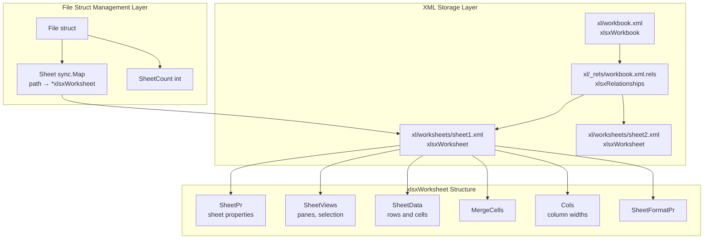
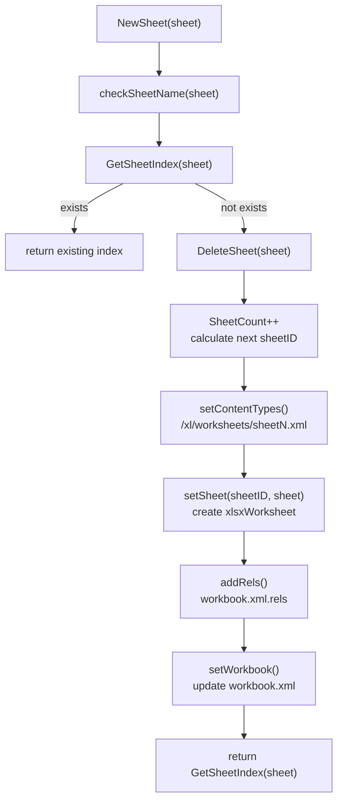
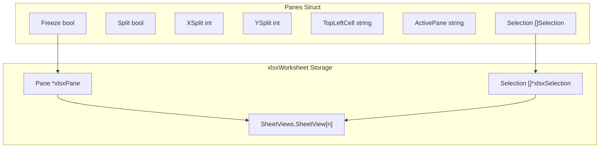
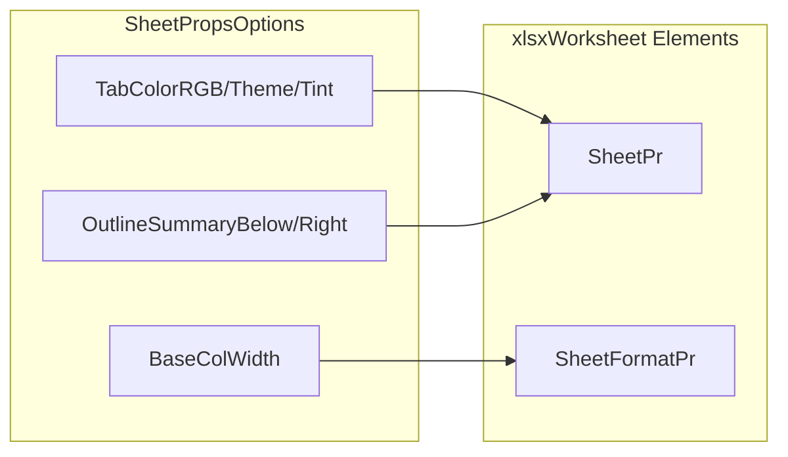

<!-- source: DeepWiki mcp.deepwiki.com · repo qax-os/excelize · page 2.2 Worksheet Management · fetched 2026-10-29 -->

# Worksheet Management

<details>
<summary>Relevant source files</summary>

The following files were used as context for generating this wiki page:

- [docProps.go](docProps.go)
- [docProps_test.go](docProps_test.go)
- [sheet.go](sheet.go)
- [sheet_test.go](sheet_test.go)
- [sheetpr.go](sheetpr.go)
- [sheetpr_test.go](sheetpr_test.go)
- [sheetview.go](sheetview.go)
- [sheetview_test.go](sheetview_test.go)
- [workbook.go](workbook.go)
- [workbook_test.go](workbook_test.go)
- [xmlCore.go](xmlCore.go)

</details>


This page documents worksheet management operations in the Excelize library, covering sheet creation, deletion, copying, moving, property configuration, visibility control, protection, and relationship management.

For cell-level operations, see [Cell Operations](2.3). For row and column operations, see [Row and Column Operations](2.4).

## Architecture Overview

Worksheet management in Excelize operates across multiple layers: the `File` struct maintains in-memory worksheet state, the `xlsxWorksheet` struct represents the Office Open XML structure, and the relationship layer links worksheets to the workbook.

**Worksheet Structure and Storage**



The `File` struct maintains a `Sheet` sync.Map (path-to-parsed-worksheet mapping). Each worksheet is stored as `xl/worksheets/sheet{N}.xml` and referenced in `xl/workbook.xml` via relationships.

Sources: [sheet.go:51-79](), [sheet.go:159-191](), [workbook.go:189-196]()

## Creating and Deleting Worksheets

### NewSheet Function

The `NewSheet` function creates a new worksheet and integrates it into the workbook structure. Note that when creating a new workbook, a default worksheet named `Sheet1` is created.

```go
// Create a new worksheet named "Sheet2"
index, err := f.NewSheet("Sheet2")
if err != nil {
    fmt.Println(err)
    return
}
```

**NewSheet Operation Flow**



The function performs these operations:
1. Validates the sheet name using `checkSheetName` [sheet.go:53]()
2. Checks if a sheet with that name already exists [sheet.go:57-60]()
3. Increments `SheetCount` and finds the next available `sheetID` by iterating existing sheets in `workbook.xml` [sheet.go:62-70]()
4. Updates `[Content_Types].xml` via `setContentTypes` [sheet.go:72]()
5. Updates the workbook relationship file (`workbook.xml.rels`) via `addRels` [sheet.go:76]()
6. Appends the new sheet entry to `workbook.xml` via `setWorkbook` [sheet.go:78]()

Sources: [sheet.go:51-80](), [workbook.go:189-196]()

## Renaming and Moving Worksheets

### SetSheetName Function

The `SetSheetName` function updates a worksheet's name. Sheet names must satisfy these constraints (enforced by `checkSheetName`):
- Not empty.
- Maximum 31 characters.
- Cannot contain characters: `:\/?*[]`.

Sources: [sheet.go:53](), [sheet_test.go:36-39]()

### MoveSheet Function

The `MoveSheet` function reorders worksheets in the workbook. Moving a sheet involves reordering the `<sheet>` elements within the `<sheets>` collection in `workbook.xml`.

Sources: [sheet_test.go:27]()

## Sheet View Options

### Panes: Freeze and Split

Panes allow viewing different parts of a worksheet simultaneously. The `Panes` struct configures freeze or split behavior.

```go
// Freeze column A in Sheet1
err := f.SetPanes("Sheet1", &excelize.Panes{
    Freeze:      true,
    Split:       false,
    XSplit:      1,
    YSplit:      0,
    TopLeftCell: "B1",
    ActivePane:  "topRight",
    Selection: []Selection{
        {SQRef: "K16", ActiveCell: "K16", Pane: "topRight"},
    },
})
```

**Panes Configuration Structure**



Sources: [sheet_test.go:41-140](), [sheetview.go:15-35]()

### View Options

The `ViewOptions` struct controls worksheet display settings such as grid lines, rulers, and zoom scales.

| Field | Type | Description |
|-------|------|-------------|
| `ShowGridLines` | `*bool` | Display grid lines |
| `ShowRowColHeaders` | `*bool` | Display row and column headers |
| `ZoomScale` | `*float64` | Zoom magnification (10-400%) |
| `View` | `*string` | "normal", "pageLayout", or "pageBreakPreview" |

These settings are managed via `SetSheetView` and `GetSheetView`.

Sources: [sheetview.go:38-129](), [sheetview_test.go:9-50]()

## Sheet Protection

Worksheet protection prevents unauthorized modifications. Excelize supports various hash algorithms for password protection.

```go
// Protect a worksheet with password
err := f.ProtectSheet("Sheet1", &excelize.SheetProtectionOptions{
    AlgorithmName: "SHA-512",
    Password:      "password",
})
```

Workbook-level protection is also available via `ProtectWorkbook` and `UnprotectWorkbook`, which can lock the structure (preventing adding/deleting sheets) or windows.

Sources: [workbook.go:128-185]()

## Page Layout and Printing

### Page Layout and Margins

Page layout controls how worksheets are printed. Margins are managed via `SetPageMargins` and `GetPageMargins`.

```go
// Configure page layout
err := f.SetPageLayout("Sheet1", &excelize.PageLayoutOptions{
    Size:        intPtr(1),
    Orientation: stringPtr("landscape"),
})

// Set page margins
err := f.SetPageMargins("Sheet1", &excelize.PageLayoutMarginsOptions{
    Bottom: float64Ptr(1.0),
    Left:   float64Ptr(1.0),
})
```

Sources: [sheetpr.go:17-81](), [sheet_test.go:199-212]()

## Sheet Properties and Configuration

### SetSheetProps and GetSheetProps

The `SheetPropsOptions` struct provides control over worksheet properties like tab colors and outline settings.

```go
// Configure worksheet properties
err := f.SetSheetProps("Sheet1", &excelize.SheetPropsOptions{
    TabColorRGB:         stringPtr("FFFF00"),
    OutlineSummaryBelow: boolPtr(true),
})
```

**Property Mapping to XML**



Sources: [sheetpr.go:109-220](), [sheetpr_test.go:46-109]()

## Search Functionality

The `SearchSheet` function searches for values in a worksheet. It supports exact matches and regular expressions.

```go
// Search for exact value
results, err := f.SearchSheet("Sheet1", "TargetValue")
```

The search process involves decoding the worksheet XML and iterating through cell values. If a shared string is referenced, the library resolves it through the shared strings table.

Sources: [sheet_test.go:142-197]()

## Ignored Errors

Excel can suppress certain error indicators in cells. The `IgnoredErrorsType` enumeration defines common errors like `IgnoredErrorsNumberStoredAsText` or `IgnoredErrorsFormula`.

Sources: [sheet.go:31-45]()

---

