<!-- source: DeepWiki mcp.deepwiki.com · repo qax-os/excelize · page 2.3 Cell Operations · fetched 2026-10-29 -->

# Cell Operations

<details>
<summary>Relevant source files</summary>

The following files were used as context for generating this wiki page:

- [cell.go](cell.go)
- [cell_test.go](cell_test.go)
- [date.go](date.go)
- [date_test.go](date_test.go)
- [merge.go](merge.go)
- [merge_test.go](merge_test.go)
- [xmlContentTypes.go](xmlContentTypes.go)
- [xmlSharedStrings.go](xmlSharedStrings.go)

</details>


## Purpose and Scope

This document covers cell-level operations in the excelize library, including reading and writing cell values, managing different data types, working with formulas, hyperlinks, and rich text. Cell operations form the core interface between users and spreadsheet data, handling the translation between Go data types and Excel's internal XML representation.

For worksheet-level operations such as creating sheets and managing worksheet properties, see [Worksheet Management](#2.2). For formula calculation and evaluation, see [Formula Calculation Engine](#3.1). For cell styling and formatting, see [Styling and Formatting](#3.2).

---

## Cell Reference System

### Coordinate Conversion Architecture

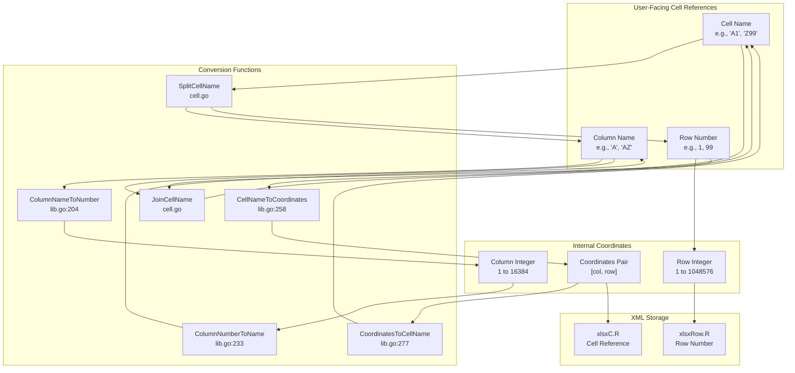

**Sources:** [lib.go:156-292](), [cell.go:1439-1453]()

The library provides bidirectional conversion between Excel-style alphanumeric cell references (like "A1") and zero-indexed integer coordinates. The coordinate system uses 1-based indexing to match Excel's conventions.

| Function | Input | Output | Purpose |
|----------|-------|--------|---------|
| `SplitCellName` | "A1" | "A", 1 | Splits cell reference into column and row |
| `JoinCellName` | "A", 1 | "A1" | Combines column name and row number |
| `CellNameToCoordinates` | "A1" | 1, 1 | Converts to integer coordinates |
| `CoordinatesToCellName` | 1, 1 | "A1" | Converts from integer coordinates |
| `ColumnNameToNumber` | "AK" | 37 | Converts column name to number |
| `ColumnNumberToName` | 37 | "AK" | Converts column number to name |

**Sources:** [lib.go:156-292]()

---

## Cell Data Types

### Type Enumeration and Mapping

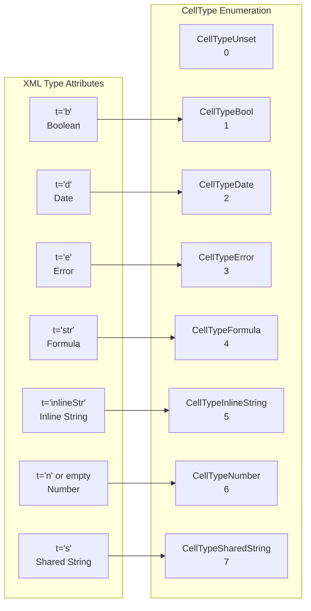

**Sources:** [cell.go:28-63]()

Excel cells can contain different data types, each represented differently in the underlying XML. The `CellType` enumeration provides a Go-native way to work with these types:

| CellType | XML Attribute | Value Storage | Description |
|----------|---------------|---------------|-------------|
| `CellTypeBool` | `t="b"` | "0" or "1" in `V` | Boolean values |
| `CellTypeDate` | `t="d"` | ISO 8601 date string | Date/time in XML format |
| `CellTypeNumber` | `t=""` or `t="n"` | Numeric string in `V` | Integer or floating-point |
| `CellTypeSharedString` | `t="s"` | SST index in `V` | String via shared string table |
| `CellTypeInlineString` | `t="inlineStr"` | Rich text in `IS` | Inline rich string |
| `CellTypeFormula` | `t="str"` | Formula result in `V` | Formula cell |
| `CellTypeError` | `t="e"` | Error code in `V` | Error value (e.g., #DIV/0!) |

**Sources:** [cell.go:28-63](), [cell.go:612-648]()

---

## Reading Cell Values

### Value Retrieval Flow

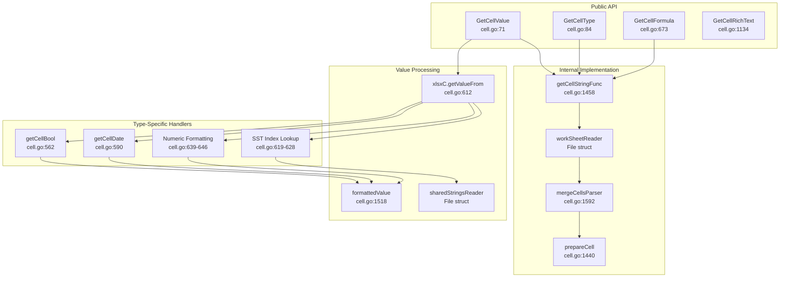

**Sources:** [cell.go:71-97](), [cell.go:612-648](), [cell.go:1458-1513]()

The `GetCellValue` function provides the primary interface for reading cell data. It returns a formatted string representation of the cell value, applying number formatting, date conversion, and boolean formatting as appropriate.

```go
// Basic usage
value, err := f.GetCellValue("Sheet1", "A1")

// Get raw value without formatting
value, err := f.GetCellValue("Sheet1", "A1", Options{RawCellValue: true})

// Get cell type
cellType, err := f.GetCellType("Sheet1", "A1")
```

The value retrieval process:

1. **Cell Reference Resolution**: Convert cell name to coordinates via `CellNameToCoordinates` [lib.go:258]()
2. **Merged Cell Handling**: Check if cell is part of merged range via `mergeCellsParser`, return top-left value [cell.go:1592-1623]()
3. **Row Lookup**: Binary search through worksheet rows using `sort.Find` [cell.go:1486-1494]()
4. **Cell Extraction**: Locate cell in row's cell array [cell.go:1498-1502]()
5. **Type-Based Processing**: Dispatch to type-specific handler based on `xlsxC.T` attribute [cell.go:612-648]()
6. **Value Formatting**: Apply number formats if not requesting raw value [cell.go:1518-1551]()

**Sources:** [cell.go:71-80](), [cell.go:612-648](), [cell.go:1458-1513]()

---

## Writing Cell Values

### Type Dispatch Architecture

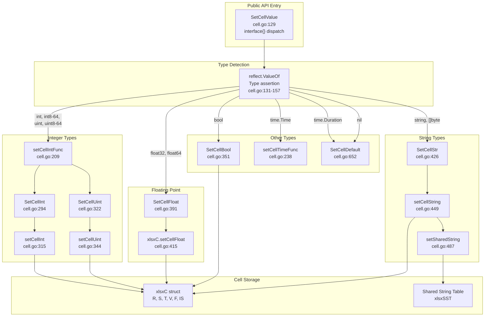

**Sources:** [cell.go:129-159](), [cell.go:209-446]()

The `SetCellValue` function uses Go's type assertion to dispatch to appropriate type-specific setters. This provides a unified interface while maintaining type safety:

| Go Type | Handler Function | Cell Type Set | Value Encoding |
|---------|-----------------|---------------|----------------|
| `int`, `int8`-`int64` | `setCellIntFunc` → `SetCellInt` | `t=""` | `strconv.FormatInt` |
| `uint`, `uint8`-`uint64` | `setCellIntFunc` → `SetCellUint` | `t=""` | `strconv.FormatUint` |
| `float32`, `float64` | `SetCellFloat` | `t=""` | `strconv.FormatFloat` |
| `string`, `[]byte` | `SetCellStr` | `t="s"` | Shared string table index |
| `bool` | `SetCellBool` | `t="b"` | "1" or "0" |
| `time.Time` | `setCellTimeFunc` | `t=""` or `t="d"` | Excel serial date or ISO 8601 |
| `time.Duration` | `SetCellDefault` | `t=""` | Fractional days |
| `nil` | `SetCellDefault` | Empty cell | Empty string |

**Sources:** [cell.go:129-159](), [cell.go:294-446]()

### Cell Write Concurrency

All cell write operations acquire locks in a two-stage process:
1. **File-level lock** (`f.mu.Lock()`): Acquire worksheet reader [cell.go:295-301]()
2. **Worksheet-level lock** (`ws.mu.Lock()`): Modify cell data [cell.go:302-303]()

This pattern ensures thread-safe concurrent writes to different cells while preventing race conditions.

**Sources:** [cell.go:294-312]()

---

## Cell Structure and Storage

### xlsxC Struct Anatomy

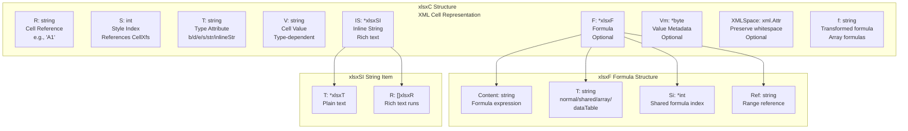

**Sources:** [xmlWorksheet.go](), [cell.go:179-181]()

The `xlsxC` struct is the internal representation of a cell in the worksheet XML. Key attributes:

- **R (Reference)**: Cell address like "A1", used for lookups and ordering [xmlWorksheet.go]()
- **S (Style)**: Index into `styleSheet.CellXfs.Xf` array, determines formatting [xmlWorksheet.go]()
- **T (Type)**: Type discriminator ("b", "d", "e", "s", "str", "inlineStr", or empty for number) [cell.go:55-63]()
- **V (Value)**: String representation of cell value, interpretation depends on type [xmlWorksheet.go]()
- **F (Formula)**: Present if cell contains formula, stores formula metadata [cell.go:183-206]()
- **IS (Inline String)**: Used for rich text cells (`t="inlineStr"`) [xmlWorksheet.go]()

**Sources:** [cell.go:179-181](), [xmlWorksheet.go]()

### Cell Preparation Workflow

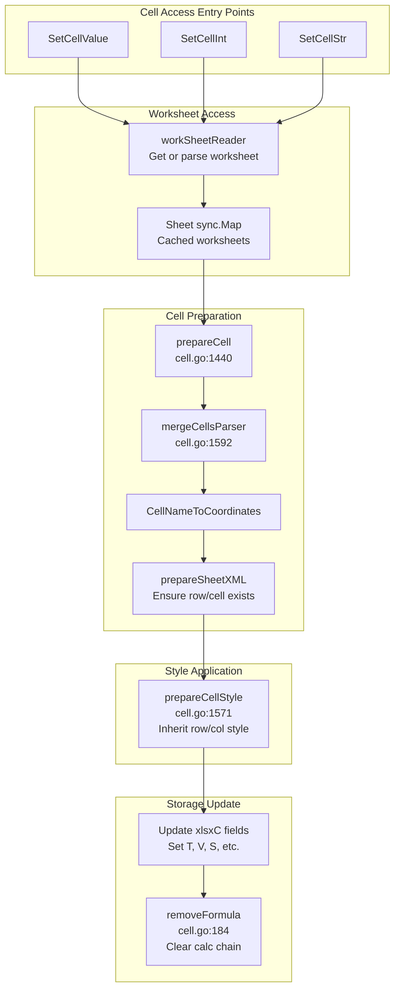

**Sources:** [cell.go:1439-1453](), [cell.go:1571-1588]()

The `prepareCell` function ensures a cell structure exists in memory:

1. **Merged Cell Resolution**: If cell is in merged range, returns reference to top-left cell [cell.go:1442-1445]()
2. **Coordinate Conversion**: Converts cell name to integer coordinates [cell.go:1446-1449]()
3. **Structure Creation**: Calls `prepareSheetXML` to ensure row and cell exist in `SheetData.Row` array [cell.go:1450-1451]()
4. **Style Inheritance**: Applies row or column default style if cell has no explicit style [cell.go:1571-1588]()

This lazy initialization strategy minimizes memory usage for sparse spreadsheets.

**Sources:** [cell.go:1439-1453](), [cell.go:1571-1588]()

---

## Shared String Table

### SST Architecture and Deduplication

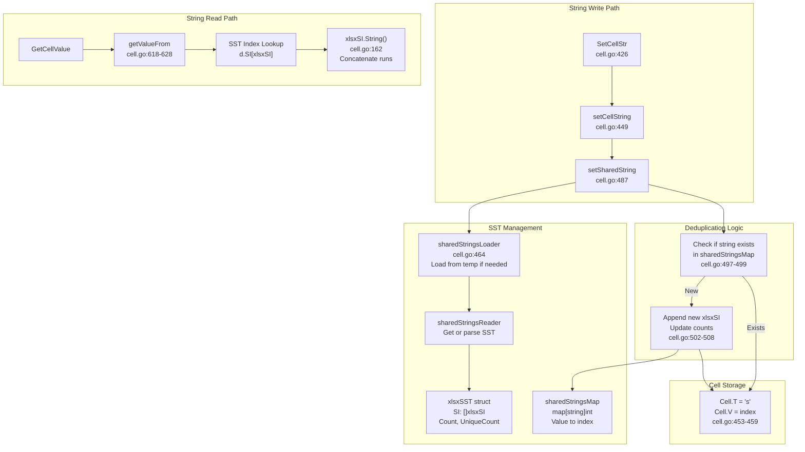

**Sources:** [cell.go:449-509](), [cell.go:162-176](), [xmlSharedStrings.go:26-32]()

The shared string table (SST) is a critical memory optimization. Excel stores each unique string only once in `xl/sharedStrings.xml`, with cells referencing strings by index. This drastically reduces file size for workbooks with repeated strings.

### SST Write Process

When setting a string value via `SetCellStr`:

1. **Character Limit Check**: Truncate to 32,767 characters (TotalCellChars) if needed [cell.go:450-452]()
2. **SST Loader**: If SST was offloaded to temp file, reload it [cell.go:464-484]()
3. **Duplicate Check**: Look up string in `sharedStringsMap` [cell.go:497-499]()
4. **Insert New**: If not found, append to `xlsxSST.SI` array [cell.go:502-508]()
5. **Store Index**: Set cell type to "s" and value to SST index [cell.go:453-459]()

### SST Memory Management

For large workbooks, the SST can exceed memory limits. The library handles this through temp file offloading:

- If `xl/sharedStrings.xml` exceeds `UnzipXMLSizeLimit` during load, it's extracted to temp file.
- Before modifying SST, `sharedStringsLoader` reloads it from temp to memory [cell.go:464-484]()
- The `sharedStringsMap` provides O(1) duplicate detection without scanning the entire array [cell.go:497-499]()

**Sources:** [cell.go:449-509](), [cell.go:464-484](), [xmlSharedStrings.go:26-32]()

---

## Formulas

### Formula Types and Structures

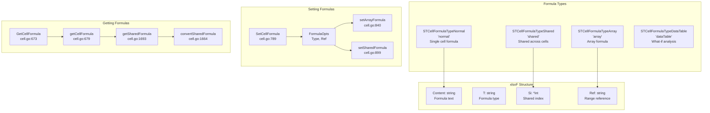

**Sources:** [cell.go:43-52](), [cell.go:702-835]()

Excel supports four formula types, each with different storage and evaluation semantics:

| Type | Attribute | Description | Use Case |
|------|-----------|-------------|----------|
| **Normal** | `t="normal"` or omitted | Standard single-cell formula | Most formulas like `=A1+B1` [cell.go:48-49]() |
| **Shared** | `t="shared"` | Template formula shared by multiple cells | Repeated formula pattern like dragging [cell.go:50-51]() |
| **Array** | `t="array"` | Single formula spanning cell range | Array operations like `{=A1:A10*2}` [cell.go:44-45]() |
| **Data Table** | `t="dataTable"` | What-if analysis table | Scenario analysis, not settable via API [cell.go:46-47]() |

### Setting Formulas

```go
// Normal formula
err := f.SetCellFormula("Sheet1", "A3", "SUM(A1,B1)")

// Array formula with FormulaOpts
formulaType, ref := excelize.STCellFormulaTypeArray, "A3:A5"
err := f.SetCellFormula("Sheet1", "A3", "A1:A2", 
    excelize.FormulaOpts{Ref: &ref, Type: &formulaType})

// Shared formula
formulaType, ref := excelize.STCellFormulaTypeShared, "C1:C5"
err := f.SetCellFormula("Sheet1", "C1", "A1+B1",
    excelize.FormulaOpts{Ref: &ref, Type: &formulaType})
```

**Sources:** [cell.go:707-835]()

### Shared Formula Mechanism

Shared formulas optimize file size by storing a template formula once and generating cell-specific versions through coordinate offsets. The process:

1. **Master Cell**: First cell in range stores formula content and reference range [cell.go:914-921]()
2. **Dependent Cells**: Other cells reference master via shared index (`Si`) [cell.go:920-921]()
3. **Conversion**: When reading, `convertSharedFormula` applies coordinate offsets using `shiftCell` [cell.go:1664-1683]()
4. **Index Cache**: `xlsxWorksheet.formulaSI` sync.Map caches master cell lookups [cell.go:1694-1709]()

The `shiftCell` function handles both absolute (`$A$1`) and relative (`A1`) references correctly during formula transformation [cell.go:1714-1749]().

**Sources:** [cell.go:899-924](), [cell.go:1664-1749]()

### Array Formula Transformation

Array formulas require special handling because they reference ranges rather than single cells. The `setArrayFormula` function:

1. **Parse Range**: Extract cell coordinates from `formula.Ref` [cell.go:841-848]()
2. **Tokenize Formula**: Parse formula into tokens using `efp.ExcelParser` [cell.go:849-852]()
3. **Transform for Each Cell**: For each cell in range, adjust array operands by offset [cell.go:854-868]()
4. **Store Transformed**: Each cell gets unique transformed formula in lowercase `f` field [cell.go:864-865]()

**Sources:** [cell.go:840-870](), [cell.go:875-896]()

---

## Hyperlinks

### Hyperlink Management Architecture

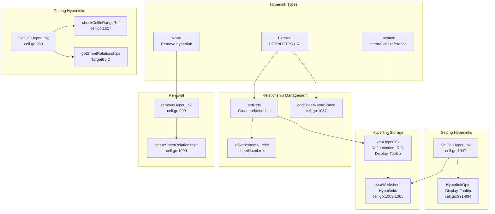

**Sources:** [cell.go:963-1113]()

### Hyperlink Operations

**Setting External Hyperlink:**
```go
display, tooltip := "https://github.com/xuri/excelize", "Excelize on GitHub"
err := f.SetCellHyperLink("Sheet1", "A3", display, "External", 
    excelize.HyperlinkOpts{
        Display: &display,
        Tooltip: &tooltip,
    })
```

**Setting Internal Location:**
```go
err := f.SetCellHyperLink("Sheet1", "A3", "Sheet1!A40", "Location")
```

**Getting Hyperlink:**
```go
link, target, err := f.GetCellHyperLink("Sheet1", "H6")
```

**Sources:** [cell.go:1018-1113]()

### External Link Processing

For external hyperlinks:

1. **Relationship Creation**: Generate relationship in worksheet's `.rels` file [cell.go:1079-1086]()
2. **Namespace Addition**: Add hyperlink namespace to worksheet XML [cell.go:1087]()
3. **RID Assignment**: Store relationship ID in `xlsxHyperlink.RID` [cell.go:1086]()
4. **Max Limit Check**: Enforce 65,530 hyperlink limit per worksheet [cell.go:1074-1076]()

### Range Reference Support

Hyperlinks can apply to cell ranges. The `checkCellInRangeRef` function determines if a cell falls within a hyperlink's range [cell.go:1627-1642](), enabling operations like "apply hyperlink to A1:A10".

**Sources:** [cell.go:1047-1113](), [cell.go:963-987]()

---

## Rich Text

### Rich Text Structure and Operations

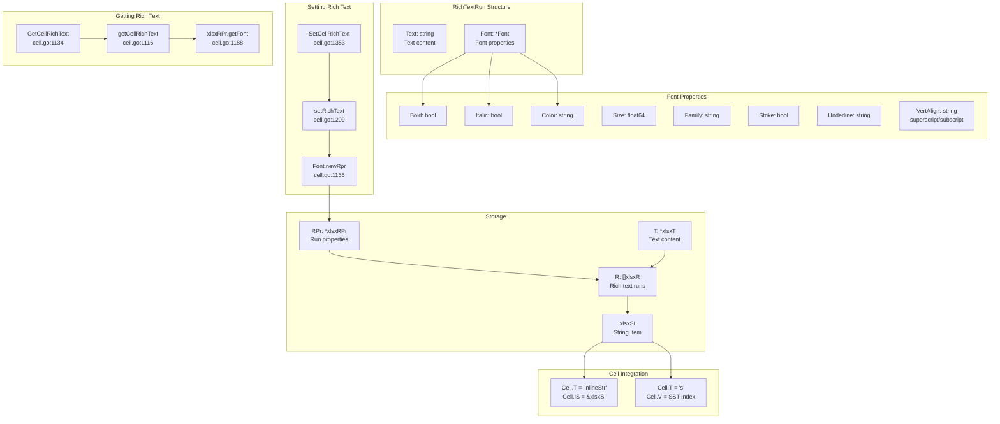

**Sources:** [cell.go:1115-1386](), [xmlSharedStrings.go:88-93]()

Rich text cells allow multiple text segments with different formatting within a single cell. Each segment is represented as a `RichTextRun` with optional font properties.

### Setting Rich Text Example

```go
err := f.SetCellRichText("Sheet1", "A1", []excelize.RichTextRun{
    {
        Text: "bold",
        Font: &excelize.Font{
            Bold:   true,
            Color:  "2354E8",
            Family: "Times New Roman",
        },
    },
    {
        Text: " and ",
        Font: &excelize.Font{
            Family: "Times New Roman",
        },
    },
    {
        Text: "italic",
        Font: &excelize.Font{
            Bold:   true,
            Color:  "E83723",
            Italic: true,
            Family: "Times New Roman",
        },
    },
})
```

**Sources:** [cell.go:1230-1352]()

### Rich Text Processing

The `SetCellRichText` function:

1. **Character Count Validation**: Sum UTF-16 code units across all runs, error if exceeding 32,767 [cell.go:1215-1218]()
2. **Run Conversion**: Convert `RichTextRun` to `xlsxR` with embedded font properties [cell.go:1219-1226]()
3. **Whitespace Preservation**: Apply `xml:space="preserve"` attribute if text has leading/trailing whitespace [cell.go:1220]()
4. **Deduplication**: Check if identical rich text exists in SST via `reflect.DeepEqual` [cell.go:1375-1379]()
5. **Storage Decision**: Store as shared string if deduplicated, otherwise append new entry [cell.go:1381-1385]()

The SST is used for rich text to enable deduplication across cells with identical formatting.

**Sources:** [cell.go:1353-1386](), [cell.go:1209-1228]()

---

## Merged Cells

### Merged Cell Reference Resolution

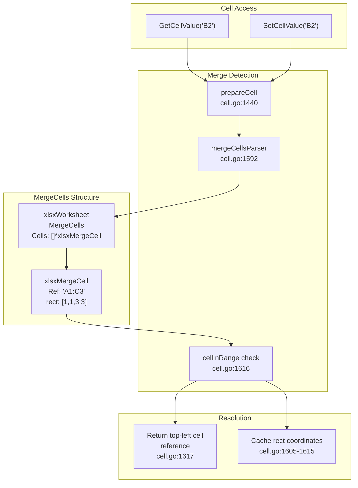

**Sources:** [cell.go:1592-1623](), [merge.go:16-27]()

Excel merged cells share a single value stored in the top-left cell. The `mergeCellsParser` function transparently redirects all cell operations to the master cell:

1. **Parse Request**: Cell reference (e.g., "B2") is uppercased [cell.go:1593]()
2. **Convert to Coordinates**: Transform to integer coordinates [cell.go:1594-1597]()
3. **Scan Merge Ranges**: Iterate through worksheet's `MergeCells.Cells` array [cell.go:1598-1620]()
4. **Range Check**: For each merge cell, check if coordinates fall within range [cell.go:1616]()
5. **Redirect**: If match found, return top-left cell reference [cell.go:1617-1619]()
6. **Rect Caching**: Parse and cache range coordinates in `xlsxMergeCell.rect` for performance [cell.go:1605-1615](), [merge.go:17-27]()

This means `GetCellValue("Sheet1", "B2")` and `GetCellValue("Sheet1", "A1")` return the same value if A1:C3 is merged.

**Sources:** [cell.go:1592-1623](), [merge.go:16-27](), [merge.go:52-88]()

---

## Bulk Operations

### Array-to-Cells Writing

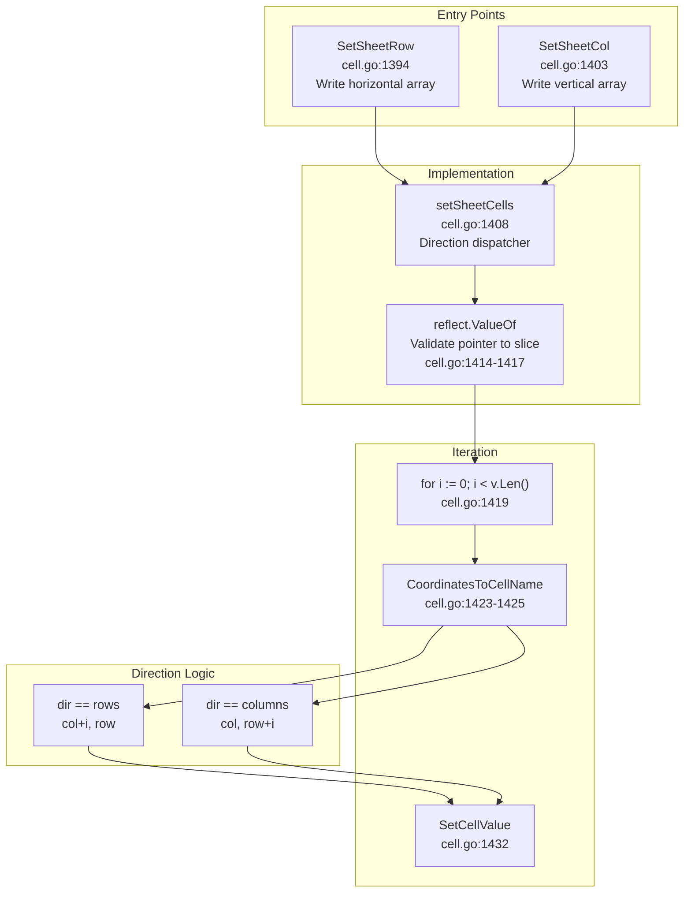

**Sources:** [cell.go:1388-1437]()

The `SetSheetRow` and `SetSheetCol` functions provide efficient bulk writing of arrays to spreadsheet cells.

**Usage Examples:**

```go
// Write horizontal row starting at B6
err := f.SetSheetRow("Sheet1", "B6", &[]interface{}{"1", nil, 2})

// Write vertical column starting at B6
err := f.SetSheetCol("Sheet1", "B6", &[]interface{}{"1", nil, 2})
```

### Implementation Details

1. **Pointer Validation**: Input must be pointer to slice, validated via reflection [cell.go:1414-1417]()
2. **Starting Cell**: Parse starting cell reference to coordinates [cell.go:1409-1412]()
3. **Direction Control**: `adjustDirection` enum determines increment axis [cell.go:1408]()
4. **Cell Iteration**: Loop through slice elements, calculating cell name based on direction [cell.go:1419-1431]()
5. **Type Dispatch**: Each element passes through `SetCellValue`'s type assertion system [cell.go:1432]()

The functions error if input is not a pointer to slice (`ErrParameterInvalid`) [cell.go:1416-1417]().

**Sources:** [cell.go:1388-1437]()

---

## Value Formatting

### Formatting Pipeline

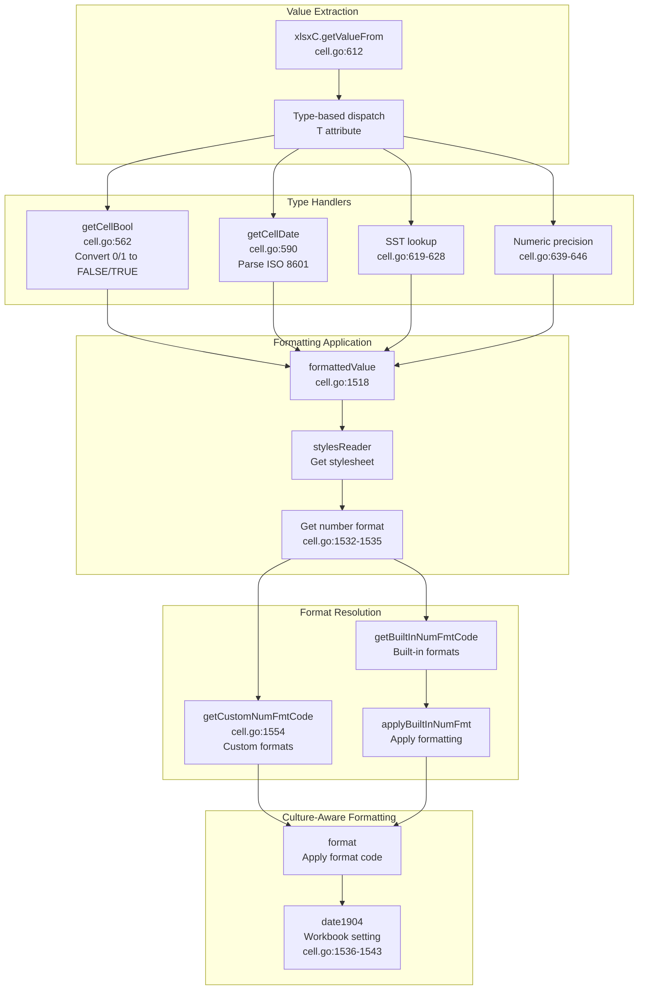

**Sources:** [cell.go:612-648](), [cell.go:1518-1551]()

### Raw vs Formatted Values

Cell values can be retrieved in two modes:

| Mode | Option | Result | Use Case |
|------|--------|--------|----------|
| **Formatted** | Default | "1,234.56", "1/15/2024" | Display to users |
| **Raw** | `Options{RawCellValue: true}` | "1234.56", "45307" | Calculations, parsing |

**Formatting Process:**

1. **Style Lookup**: Get cell style ID from `xlsxC.S` [cell.go:1519-1520]()
2. **Number Format ID**: Extract `NumFmtID` from style's `CellXfs.Xf` entry [cell.go:1532-1535]()
3. **Format Code Resolution**:
   - Check custom formats in stylesheet (ID ≥ 164) [cell.go:1544-1546]()
   - Fall back to built-in formats (ID 0-163) [cell.go:1547-1549]()
4. **Date1904 Handling**: Adjust date calculations if workbook uses 1904 date system [cell.go:1536-1543](), [date.go:35-62]()
5. **Format Application**: Apply format code via `format()` function [cell.go:1545]()

The `formattedValue` function returns the raw value if `raw=true` or if no formatting is available [cell.go:1519-1521]().

**Sources:** [cell.go:1518-1551](), [cell.go:612-648](), [date.go:35-62]()

---

## Thread Safety

Cell operations use multi-level locking to enable concurrent access while preventing data races:

### Locking Strategy

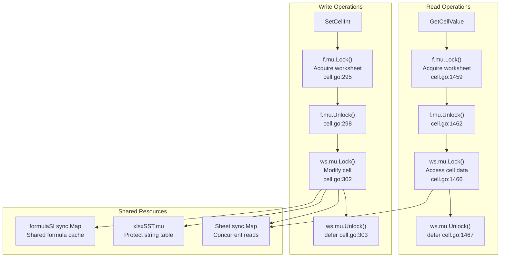

**Sources:** [cell.go:294-312](), [cell.go:1458-1513](), [xmlSharedStrings.go:27]()

### Concurrency Guarantees

1. **File-Level Lock**: Brief lock to access worksheet reader from `Sheet sync.Map` [cell.go:295-301]()
2. **Worksheet-Level Lock**: Per-worksheet mutex (`xlsxWorksheet.mu`) protects row/cell modifications [cell.go:302-303]()
3. **SST Protection**: `xlsxSST.mu` mutex guards shared string table operations [xmlSharedStrings.go:27](), [cell.go:500-501]()
4. **Formula Cache**: `formulaSI sync.Map` allows concurrent shared formula lookups [cell.go:1694]()

This design allows:
- Concurrent reads from different worksheets (no contention)
- Concurrent writes to different worksheets (worksheet-level locks)
- Concurrent reads from same worksheet (read locks)
- Serialized writes to same cell (worksheet mutex)

**Sources:** [cell.go:294-312](), [cell.go:1458-1513](), [cell_test.go:19-117]()

---

