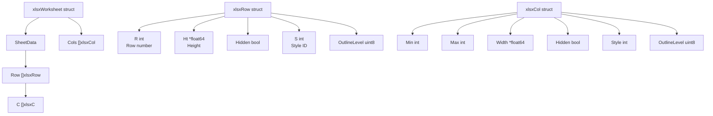
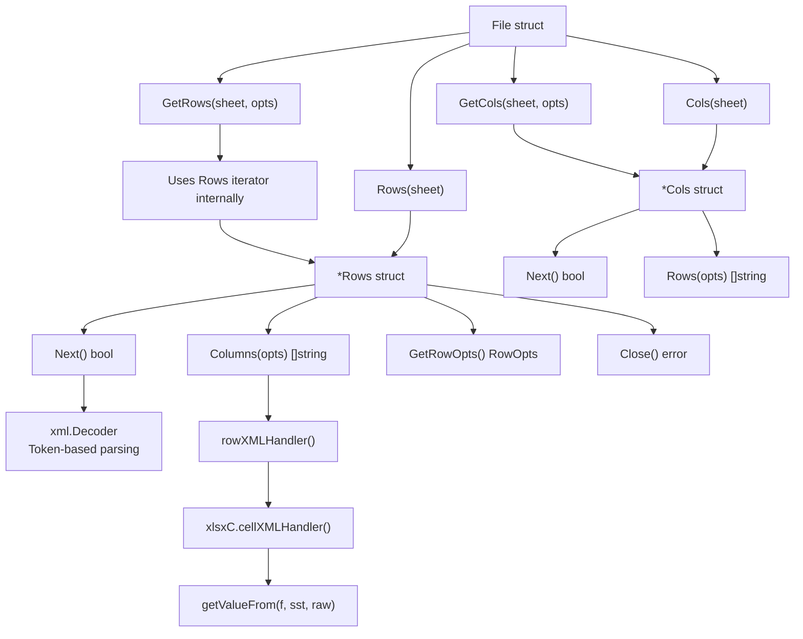
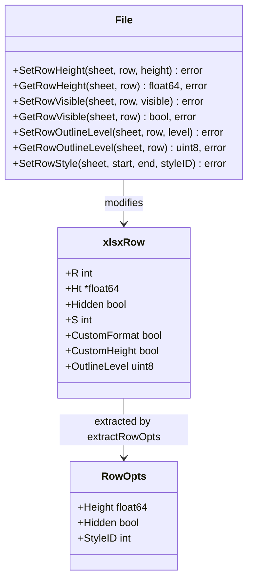
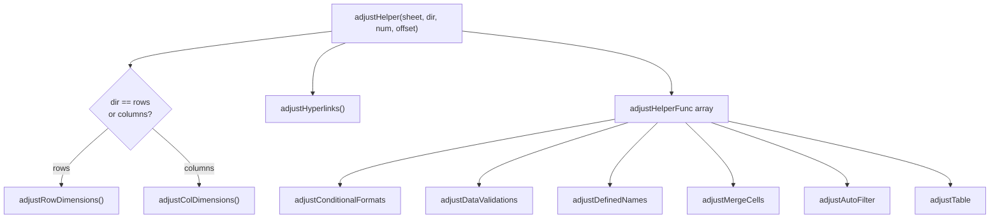

<!-- source: DeepWiki mcp.deepwiki.com · repo qax-os/excelize · page 2.4 Row and Column Operations · fetched 2026-10-29 -->

# Row and Column Operations

Relevant source files

The following files were used as context for generating this wiki page:

- [adjust.go](adjust.go)
- [adjust_test.go](adjust_test.go)
- [col.go](col.go)
- [col_test.go](col_test.go)
- [rows.go](rows.go)
- [rows_test.go](rows_test.go)

This page documents the operations available in the Excelize library for working with rows and columns in Excel spreadsheets. The library provides a comprehensive set of functions to read, modify, and manipulate rows and columns, including adjusting dimensions, setting visibility, and managing styles.

## Overview of Row and Column Structure

Excel worksheets organize data in cells arranged by rows and columns. The `xlsxWorksheet` structure maintains row data in `SheetData.Row` as an array of `xlsxRow` elements, while column properties are stored in `Cols` as an array of `xlsxCol` elements. Excelize provides functions to manipulate these structures through public API functions defined in `rows.go` and `col.go`.

**Diagram: Row and Column Data Model**

Sources: [rows.go:84-96](), [xmlWorksheet.go]()

## Data Access Methods

Excelize provides two distinct approaches for accessing worksheet data: direct access methods that load data into memory, and streaming iterators for processing large files.

**Diagram: Data Access Architecture**

Sources: [rows.go:61-82](), [rows.go:84-127](), [rows.go:153-198](), [col.go:26-34](), [col.go:57-68](), [col.go:202-248]()

### Direct Access Methods

Direct access methods load the entire dataset into memory by internally using the streaming iterators and collecting results into two-dimensional string arrays.

| Function | Description | Return Value | Implementation |
|----------|-------------|--------------|----------------|
| `GetRows(sheet string, opts ...Options)` | Get all rows in a worksheet | `[][]string` | Uses `Rows()` iterator internally |
| `GetCols(sheet string, opts ...Options)` | Get all columns in a worksheet | `[][]string` | Uses `Cols()` iterator internally |

The `GetRows` function implementation [rows.go:61-82]() creates a `Rows` iterator and calls `Next()` repeatedly. Trailing blank cells in each row are skipped, meaning row lengths in the returned slice may be inconsistent [rows.go:43-45]().

Sources: [rows.go:61-82](), [col.go:57-68]()

### Streaming Methods

Streaming methods use SAX-style XML parsing via `xml.Decoder` to process worksheet data incrementally, minimizing memory usage for large datasets.

**Rows Iterator**

The `Rows` struct [rows.go:85-96]() maintains state for iterating through worksheet rows. It includes fields for the XML `decoder`, a `tempFile` for large worksheets offloaded to disk, and `curRowOpts` for the current row's properties.

| Method | Description | Implementation Details |
|--------|-------------|------------------------|
| `Next() bool` | Advance to next row | Parses XML tokens until finding a `<row>` element [rows.go:99-127]() |
| `Columns(opts) []string` | Get cell values | Calls `rowXMLHandler()` to parse `<c>` elements [rows.go:153-198]() |
| `GetRowOpts() RowOpts` | Get row properties | Returns `curRowOpts` extracted from XML attributes [rows.go:129-132]() |
| `Close() error` | Release resources | Closes the system temporary file if one was used [rows.go:141-148]() |

The `Rows()` function initialization [rows.go:328-348]() checks if a worksheet is already loaded in the `Sheet` sync.Map; if so, it marshals the worksheet to XML and saves it to the internal package map before initializing the decoder.

Sources: [rows.go:84-96](), [rows.go:99-127](), [rows.go:129-132](), [rows.go:153-198](), [rows.go:328-348]()

## Row Operations

### Row Properties

Row properties are stored in `xlsxRow` struct fields and accessed through the `RowOpts` struct. The `extractRowOpts()` function [rows.go:201-213]() parses XML attributes like `s` (style), `hidden`, and `ht` (height) into `RowOpts`.

**Diagram: Row Property Management**

Sources: [rows.go:201-213](), [rows.go:424-450](), [rows.go:553-565]()

#### Row Height and Visibility

- **SetRowHeight**: Sets the `Ht` field and marks `CustomHeight = true` [rows.go:424-450](). A height of 0 hides the row, while -1 clears custom settings.
- **SetRowVisible**: Sets the `Hidden` boolean [rows.go:553-565](). It internally calls `prepareSheetXML` to ensure the row element exists in the underlying XML structure.

Sources: [rows.go:424-450](), [rows.go:553-565]()

### Row Manipulation

Row manipulation operations modify the `xlsxWorksheet.SheetData.Row` array and trigger adjustments of dependent worksheet elements.

| Function | Implementation |
|----------|----------------|
| `InsertRows(sheet, row, n)` | Calls `adjustHelper` with positive offset to shift existing data [rows.go:681-692]() |
| `RemoveRow(sheet, row)` | Removes row from slice and calls `adjustHelper` with offset -1 [rows.go:636-669]() |
| `DuplicateRowTo(sheet, r1, r2)` | Uses `deepcopy.Copy` to clone row data and adjusts formulas [rows.go:715-770]() |

The `DuplicateRowTo` function utilizes a `duplicateHelperFunc` array [rows.go:27-37]() to clone conditional formats, data validations, and merged cells for the new row.

Sources: [rows.go:27-37](), [rows.go:636-669](), [rows.go:715-770]()

## Column Operations

Column operations are managed via the `xlsxCol` structure. Unlike rows, which are nested inside `SheetData`, column properties are defined in a separate `<cols>` collection in the worksheet XML.

| Function | Description |
|----------|-------------|
| `SetColWidth` | Sets the `Width` and `CustomWidth` fields for a range of columns [col.go:496-515]() |
| `SetColVisible` | Sets the `Hidden` attribute for columns [col.go:250-280]() |
| `InsertCols` | Adds new columns and shifts existing ones using `adjustHelper` [col.go:745-764]() |
| `RemoveCol` | Deletes a column and shifts subsequent columns left [col.go:766-796]() |

Sources: [col.go:250-280](), [col.go:496-515](), [col.go:745-796]()

## Reference Adjustment System

The adjustment system updates cell references and ranges throughout the workbook when rows or columns are inserted or removed. The `adjustHelper` function [adjust.go:73-100]() orchestrates these updates.

**Diagram: Adjustment Function Pipeline**

Sources: [adjust.go:33-61](), [adjust.go:73-100](), [adjust.go:144-176](), [adjust.go:180-209]()

The system uses `adjustHelperFunc` [adjust.go:33-61](), a collection of functions that update specific XML components like tables, merge cells, and calculation chains to ensure document integrity after structural changes.

Sources: [adjust.go:33-61](), [adjust.go:73-100]()

## Performance Considerations

### Memory and Streaming
For large files, the `Rows` iterator is significantly more memory-efficient than `GetRows`. If the worksheet XML size exceeds `UnzipXMLSizeLimit`, Excelize offloads the data to a temporary file on disk [rows.go:328-348]().

### Column Iterator
The `Cols` iterator [col.go:26-34]() is provided for streaming reading by column. Because Excel is row-oriented (XML stores data by row), the column iterator internally parses the worksheet XML multiple times or buffers data to provide a column-wise view [col.go:202-248]().

Sources: [rows.go:328-348](), [col.go:202-248]()

---

