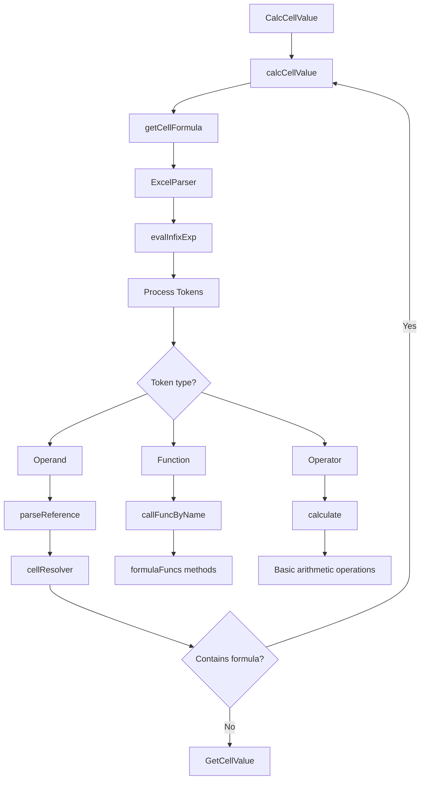
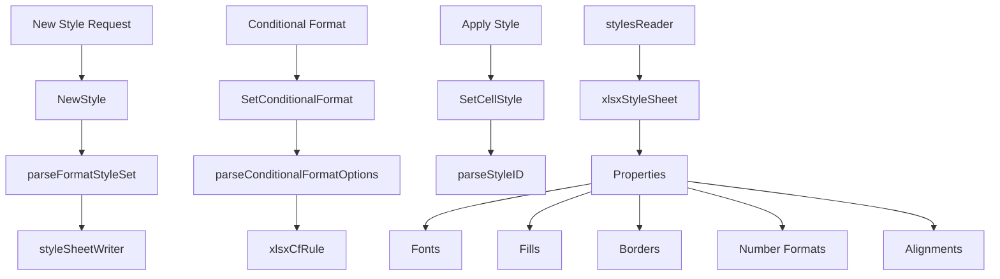
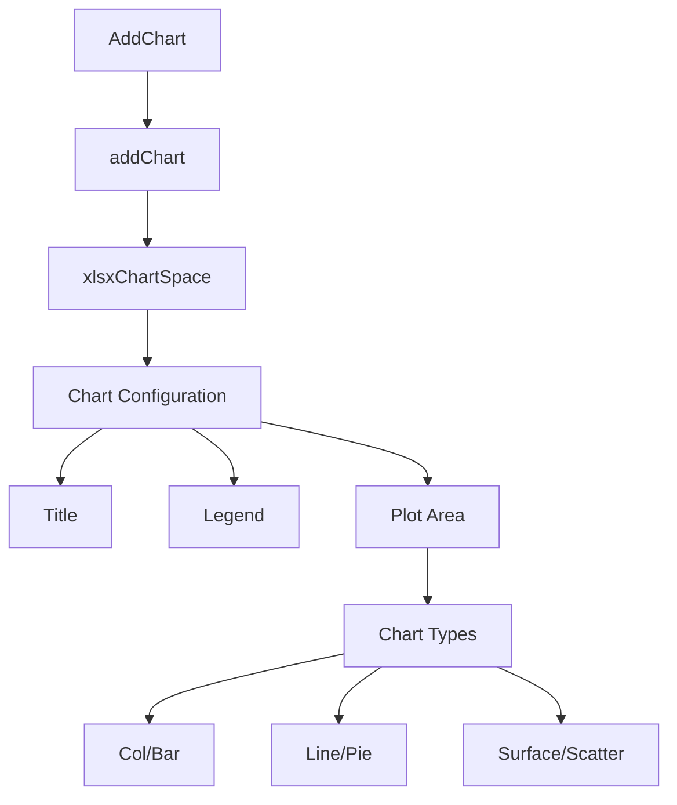
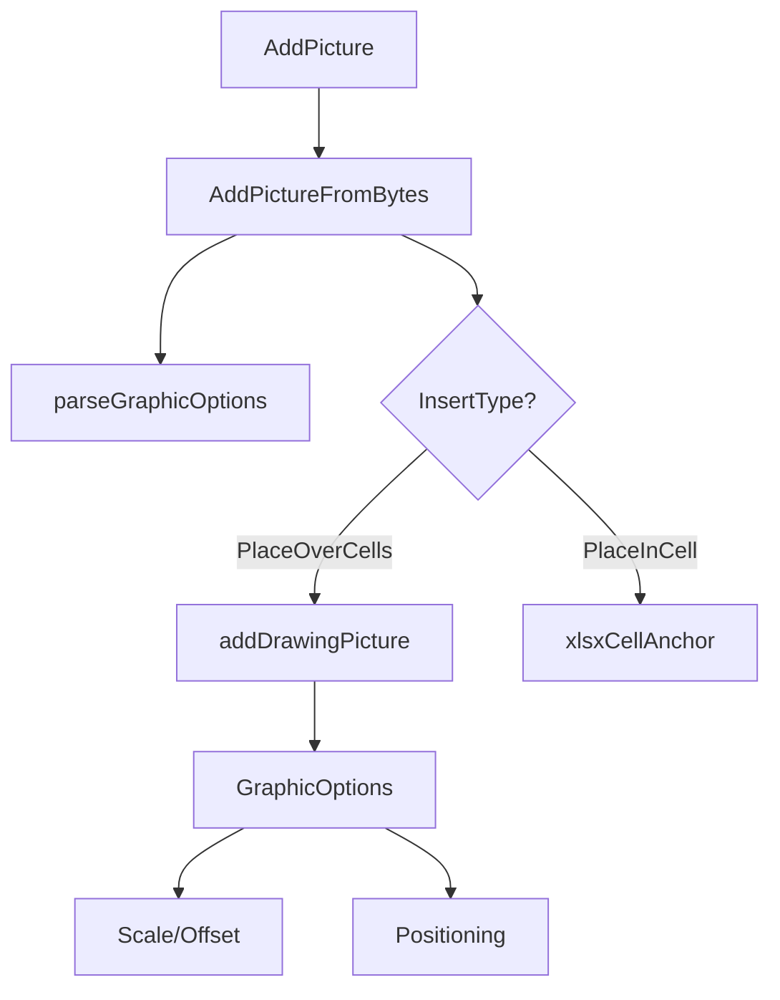
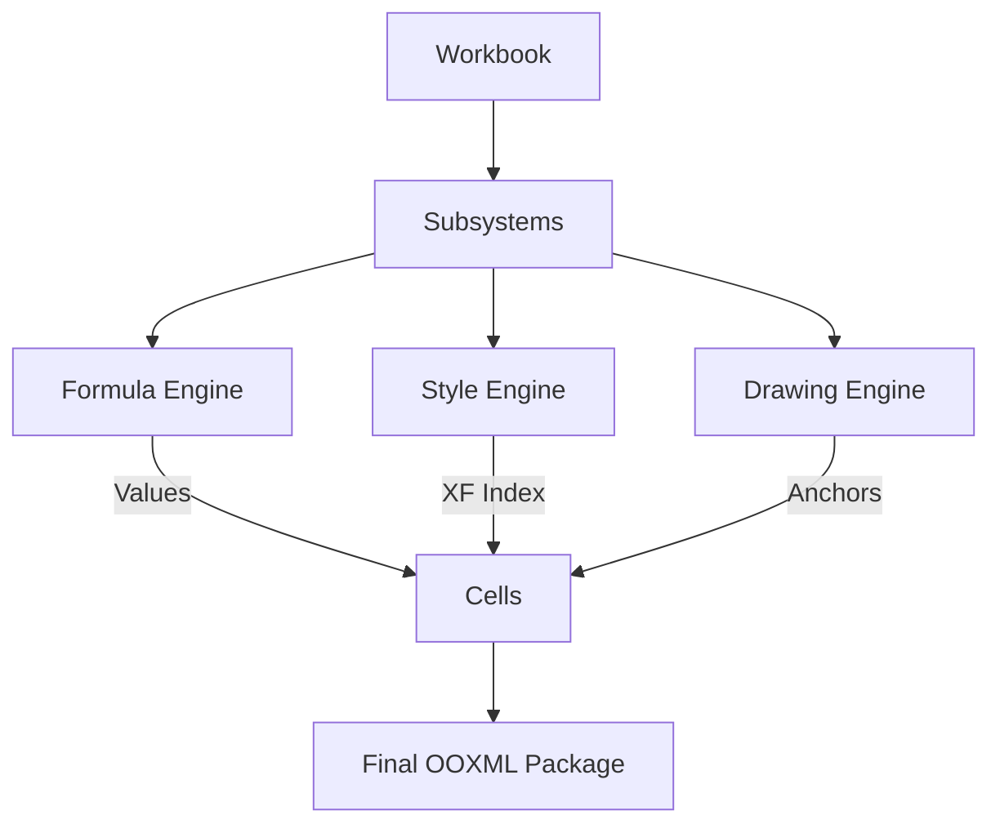

<!-- source: DeepWiki mcp.deepwiki.com · repo qax-os/excelize · page 3 Advanced Features · fetched 2026-10-29 -->

# Advanced Features

<details>
<summary>Relevant source files</summary>

The following files were used as context for generating this wiki page:

- [calc.go](calc.go)
- [calc_test.go](calc_test.go)
- [chart.go](chart.go)
- [picture.go](picture.go)
- [picture_test.go](picture_test.go)
- [styles.go](styles.go)
- [styles_test.go](styles_test.go)
- [xmlStyles.go](xmlStyles.go)

</details>


This document provides an overview of advanced features offered by the excelize library. These capabilities enable developers to work with complex Excel functionality beyond basic data manipulation. For more basic operations like creating workbooks, working with cells, and managing sheets, see [Core Functionality](#2).

## Formula Calculation System

Excelize provides a comprehensive formula calculation engine that supports over 300 Excel functions. The formula calculation system allows you to evaluate formulas in cells, providing the same results you would expect from Excel.



The formula calculation system processes cell formulas recursively, resolving references to other cells and evaluating mathematical expressions. It handles nested formulas, supports both numeric and string operations, and provides comprehensive error handling through constants like `formulaErrorDIV` or `formulaErrorVALUE` [calc.go:42-51]().

To use the formula calculation feature:

```go
// Calculate cell B2 based on formula
value, err := f.CalcCellValue("Sheet1", "B2")
```

The system includes support for:
- Mathematical and Statistical functions
- Engineering functions (e.g., `BESSELI`, `BIN2DEC`, `COMPLEX`) [calc_test.go:85-170]()
- Date and time functions
- Text manipulation and Logical functions

For details, see [Formula Calculation Engine](#3.1).

Sources: [calc.go:42-51](), [calc.go:176-209](), [calc_test.go:25-170]()

## Styling and Formatting

Excelize provides robust styling and formatting capabilities, allowing you to customize the appearance of cells, rows, and columns to create professional spreadsheets.



### Cell Styles

You can create custom styles using the `NewStyle` function [styles.go:162-166](). The `Style` struct allows configuration of `Font`, `Fill`, `Border`, `Alignment`, and `Protection` [xmlStyles.go:19-173]().

### Number Formatting

Excelize supports both built-in and custom number formats via `CustomNumFmt` [styles.go:156-159]().

### Conditional Formatting

Conditional formatting applies styles to cells meeting specific criteria, such as `colorScale`, `dataBar`, or `iconSet` [styles_test.go:51-171]().

For details, see [Styling and Formatting](#3.2).

Sources: [styles.go:127-160](), [styles.go:162-199](), [styles_test.go:51-171](), [xmlStyles.go:19-173]()

## Charts and Graphs

Excelize supports 39 variants of charts, including 3D versions [chart.go:25-83]().



Charts are created using the `AddChart` method, where developers define `ChartSeries` and axis properties. The library handles complex XML generation for the `chartSpace` [chart.go:130-245]().

For details, see [Charts and Graphs](#3.3).

Sources: [chart.go:21-83](), [chart.go:130-245]()

## Images and Pictures

Excelize allows you to insert and manipulate images, providing control over positioning and scaling.



### Supported Image Formats
Supported types include BMP, EMF, GIF, JPEG, PNG, SVG, TIF, and WMF [picture.go:83-86]().

### Positioning Options
The `Positioning` field in `GraphicOptions` defines anchoring modes: `oneCell` (move but don't size), `twoCell` (move and size), and `absolute` [picture.go:190-194]().

For details, see [Images and Pictures](#3.4).

Sources: [picture.go:29-37](), [picture.go:41-67](), [picture.go:83-145](), [picture.go:190-194]()

## Tables, Pivot Tables, and Slicers

Excelize supports advanced data features like Tables and Pivot Tables to summarize and analyze large datasets.

### Pivot Tables
Pivot tables are constructed using `PivotTableOptions`, defining `Rows`, `Columns`, `Data`, and `Filter` fields [styles_test.go:188](). They allow for complex aggregations such as Sum, Count, and Average.

For details, see [Tables, Pivot Tables, and Slicers](#3.5).

Sources: [styles_test.go:188-189]()

## Integration Between Features

Advanced features can be combined to create sophisticated documents. For instance, a spreadsheet might use `CalcCellValue` to compute data, `NewStyle` to format it, and `AddChart` to visualize the calculated results.



Sources: [calc.go:5-10](), [styles.go:5-10](), [picture.go:5-10]()

---

